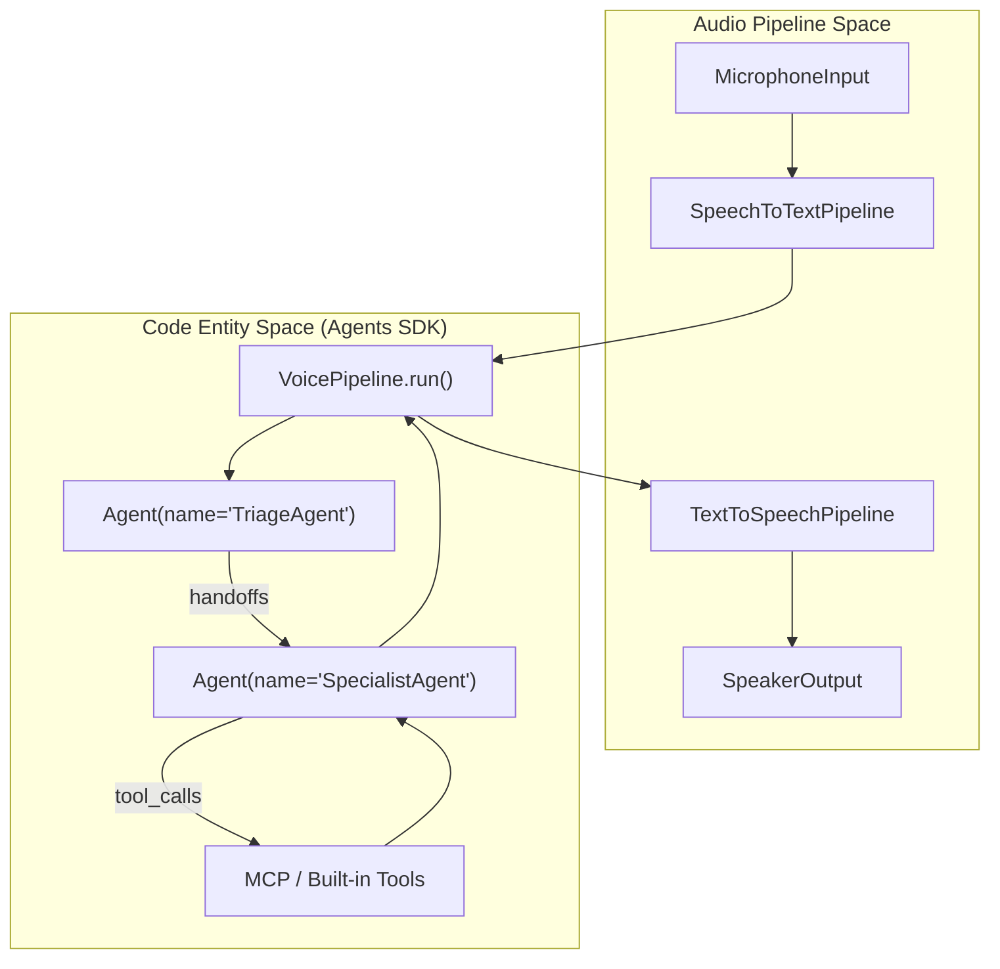
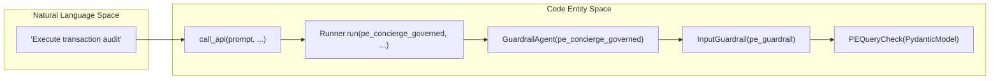

<!-- source: DeepWiki mcp.deepwiki.com · repo openai/openai-cookbook · page 12.2 Voice Agents with Agents SDK · fetched 2026-10-26 -->

# Voice Agents with Agents SDK

Relevant source files

The following files were used as context for generating this wiki page:

- [articles/chatgpt-agents-sales-meeting-prep.md](articles/chatgpt-agents-sales-meeting-prep.md)
- [articles/how_to_work_with_large_language_models.md](articles/how_to_work_with_large_language_models.md)
- [articles/related_resources.md](articles/related_resources.md)
- [articles/techniques_to_improve_reliability.md](articles/techniques_to_improve_reliability.md)
- [articles/text_comparison_examples.md](articles/text_comparison_examples.md)
- [articles/what_makes_documentation_good.md](articles/what_makes_documentation_good.md)
- [examples/How_to_handle_rate_limits.ipynb](examples/How_to_handle_rate_limits.ipynb)
- [examples/Leveraging_model_distillation_to_fine-tune_a_model.ipynb](examples/Leveraging_model_distillation_to_fine-tune_a_model.ipynb)
- [examples/Reinforcement_Fine_Tuning.ipynb](examples/Reinforcement_Fine_Tuning.ipynb)
- [examples/Search_reranking_with_cross-encoders.ipynb](examples/Search_reranking_with_cross-encoders.ipynb)
- [examples/Speech_transcription_methods.ipynb](examples/Speech_transcription_methods.ipynb)
- [examples/Structured_Outputs_Intro.ipynb](examples/Structured_Outputs_Intro.ipynb)
- [examples/Structured_outputs_multi_agent.ipynb](examples/Structured_outputs_multi_agent.ipynb)
- [examples/codex/using_goals_in_codex.ipynb](examples/codex/using_goals_in_codex.ipynb)
- [examples/gpt-5/gpt-5_frontend.ipynb](examples/gpt-5/gpt-5_frontend.ipynb)
- [examples/mcp/mcp_tool_guide.ipynb](examples/mcp/mcp_tool_guide.ipynb)
- [examples/partners/eval_driven_system_design/receipt_inspection.ipynb](examples/partners/eval_driven_system_design/receipt_inspection.ipynb)
- [examples/partners/mcp_powered_voice_agents/mcp_powered_agents_cookbook.ipynb](examples/partners/mcp_powered_voice_agents/mcp_powered_agents_cookbook.ipynb)
- [examples/voice_solutions/arduino_ai_speech_assets/elato-alien.png](examples/voice_solutions/arduino_ai_speech_assets/elato-alien.png)
- [examples/voice_solutions/arduino_ai_speech_assets/pcb-design.png](examples/voice_solutions/arduino_ai_speech_assets/pcb-design.png)
- [images/rft_dashboard_modelgrader2.png](images/rft_dashboard_modelgrader2.png)
- [images/rft_hacking.png](images/rft_hacking.png)
- [images/rft_string_grader.png](images/rft_string_grader.png)

Building voice agents with the OpenAI Agents SDK involves extending text-based agentic workflows into the audio domain. This section covers building voice agents using the Agents SDK, app assistant voice agents, Model Context Protocol (MCP) tool integration, voice agent audio optimization, Arduino AI speech hardware, and realtime translation guides.

Sources: `[examples/Speech_transcription_methods.ipynb:31-34]()`, `[articles/related_resources.md:10-10]()`

## 1. Overview and Architecture

The transition from a text agent to a voice agent allows for natural language interaction while maintaining complex multi-agent orchestration. A typical architecture consists of a Triage Agent that routes voice inputs to specialized agents, utilizing either built-in tools or remote MCP servers.

The SDK provides a `VoicePipeline` and related classes (`SingleAgentVoiceWorkflow`, `StreamedAudioInput`, `VoicePipelineConfig`) to manage real-time streaming [examples/Speech_transcription_methods.ipynb:106-112](). This pipeline handles the lifecycle of audio input, transcription, agent reasoning, and audio output synthesis.

### Voice Agent Execution Pipeline

The following diagram bridges natural audio input space to the underlying code entities executing the voice pipeline.

**Diagram: Voice Agent Execution Pipeline**

Sources: `[examples/Speech_transcription_methods.ipynb:31-34]`, `[examples/Speech_transcription_methods.ipynb:106-112]()`

---

## 2. Building App Assistant Voice Agents

App assistants are built by defining specialized agents that handle specific domains of an application. The `Agent` class in the SDK is used to encapsulate these roles alongside voice workflows like `SingleAgentVoiceWorkflow` [examples/Speech_transcription_methods.ipynb:106-112]().

### Core Components
- **Planner / Triage Agent**: The entry point that determines user intent from transcribed speech.
- **Search Agent**: Powered by custom tools or MCP servers for text retrieval [examples/mcp/mcp_tool_guide.ipynb:14-17]().
- **Voice Pipeline Config**: Configures sample rates, turn detection, and audio encoding for streaming sessions [examples/Speech_transcription_methods.ipynb:106-112]().

### Governed Agent Integration

For testing and governance, voice targets are wrapped to route inputs through validation layers before reaching the core agent logic.

**Diagram: Governed Agent Bridge**

Sources: `[examples/Speech_transcription_methods.ipynb:106-112]()`

---

## 3. MCP-Powered Voice Agents

Voice agents can be extended using the **Model Context Protocol (MCP)**, allowing them to interact with standardized external tools without intermediate backend orchestration hops [examples/mcp/mcp_tool_guide.ipynb:14-17]().

### Implementation Benefits
- **Reduced Latency**: Models communicate directly with remote MCP servers, eliminating redundant round-trips [examples/mcp/mcp_tool_guide.ipynb:14-17]().
- **Centralized Tool Host**: Standard commands (e.g., database queries, API lookups) are exposed directly via `mcp` tool blocks in the Responses API or Agents SDK [examples/mcp/mcp_tool_guide.ipynb:42-50]().
- **Payload Filtering**: Using parameters like `allowed_tools` prevents context bloat and token exhaustion during voice streaming [examples/mcp/mcp_tool_guide.ipynb:62-62]().

Sources: `[examples/mcp/mcp_tool_guide.ipynb:14-62]()`

---

## 4. Voice Agent Audio Optimization

Optimizing voice agents requires balancing latency, bandwidth, and model accuracy by selecting the appropriate transmission mode.

| Mode | Latency to First Token | Best Use Case | Limitations |
| :--- | :--- | :--- | :--- |
| **File upload + `stream=False`** | Seconds | Voicemail, batch meeting logs | No partial results; max 25 MB per request [examples/Speech_transcription_methods.ipynb:29-29]() |
| **File upload + `stream=True`** | Subseconds | Voice memos, mobile uploads | Requires completed file upload beforehand [examples/Speech_transcription_methods.ipynb:30-30]() |
| **Realtime WebSocket** | Subseconds | Live captions, conversational AI | Requires `pcm16`, `g711_ulaw`, or `g711_alaw` audio [examples/Speech_transcription_methods.ipynb:31-31]() |
| **Agents SDK VoicePipeline** | Subseconds | Real-time agentic voice assistants | Python-only beta SDK surface [examples/Speech_transcription_methods.ipynb:32-32]() |

Sources: `[examples/Speech_transcription_methods.ipynb:27-33]()`

---

## 5. Arduino AI Speech Hardware

Voice applications can extend beyond traditional server environments into edge computing hardware, such as running OpenAI Realtime API Speech on ESP32 microcontrollers using Arduino, Deno Edge Runtime, and Supabase [articles/related_resources.md:10-10]().

### Hardware Integration Architecture
- **Microcontroller**: ESP32 hardware captures raw audio via I2S microphones.
- **Edge Runtime**: Deno Edge Runtime handles lightweight WebSocket framing and authentication.
- **Backend Relay**: Supabase manages session tokens and state synchronization with the OpenAI Realtime API.

Sources: `[articles/related_resources.md:10-10]()`

---

## 6. Realtime Translation Guides

Realtime translation applications combine continuous audio streaming over WebSockets with multilingual prompt configurations or translation-specific agent instructions.

### Key Implementation Considerations
- **Audio Framing**: Chunking continuous audio streams into compatible formats (`pcm16` or `g711`) without introducing audible jitter.
- **Context Preservation**: Utilizing session memory and context summarization to maintain speaker intent across translation turns.
- **Asynchronous Transcription**: Running out-of-band transcription alongside active audio streaming to log intermediate translation text.

Sources: `[examples/Speech_transcription_methods.ipynb:31-33]()`

---

