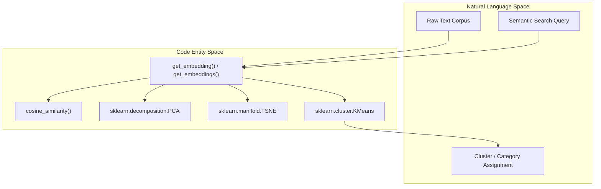
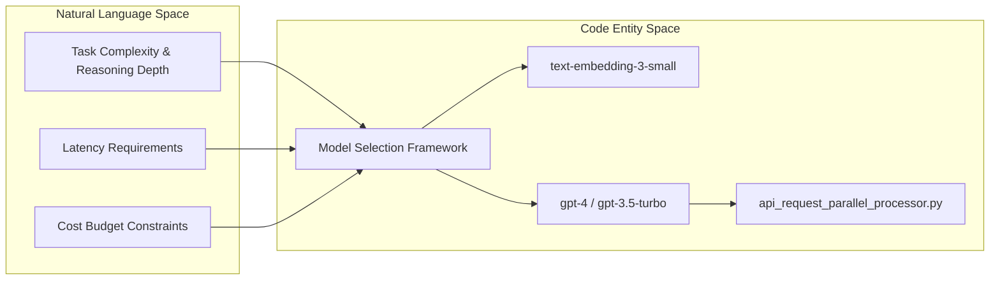

<!-- source: DeepWiki mcp.deepwiki.com · repo openai/openai-cookbook · page 13 Utilities and Helper Patterns · fetched 2026-10-26 -->

# Utilities and Helper Patterns

Relevant source files

The following files were used as context for generating this wiki page:

- [examples/Classification_using_embeddings.ipynb](examples/Classification_using_embeddings.ipynb)
- [examples/Clustering.ipynb](examples/Clustering.ipynb)
- [examples/Clustering_for_transaction_classification.ipynb](examples/Clustering_for_transaction_classification.ipynb)
- [examples/Customizing_embeddings.ipynb](examples/Customizing_embeddings.ipynb)
- [examples/Get_embeddings_from_dataset.ipynb](examples/Get_embeddings_from_dataset.ipynb)
- [examples/Multiclass_classification_for_transactions.ipynb](examples/Multiclass_classification_for_transactions.ipynb)
- [examples/Recommendation_using_embeddings.ipynb](examples/Recommendation_using_embeddings.ipynb)
- [examples/Regression_using_embeddings.ipynb](examples/Regression_using_embeddings.ipynb)
- [examples/Semantic_text_search_using_embeddings.ipynb](examples/Semantic_text_search_using_embeddings.ipynb)
- [examples/User_and_product_embeddings.ipynb](examples/User_and_product_embeddings.ipynb)
- [examples/Visualizing_embeddings_in_2D.ipynb](examples/Visualizing_embeddings_in_2D.ipynb)
- [examples/Visualizing_embeddings_in_3D.ipynb](examples/Visualizing_embeddings_in_3D.ipynb)
- [examples/Zero-shot_classification_with_embeddings.ipynb](examples/Zero-shot_classification_with_embeddings.ipynb)
- [examples/api_request_parallel_processor.py](examples/api_request_parallel_processor.py)
- [examples/data/dbpedia_samples.jsonl](examples/data/dbpedia_samples.jsonl)
- [examples/data/example_requests_to_parallel_process.jsonl](examples/data/example_requests_to_parallel_process.jsonl)
- [examples/data/snli_1.0_train_2k.csv](examples/data/snli_1.0_train_2k.csv)
- [examples/utils/embeddings_utils.py](examples/utils/embeddings_utils.py)

This section documents utility functions, helper patterns, and cross-cutting concerns that support robust integration with OpenAI APIs. This includes managing rate limits, parallelizing requests, counting tokens, embeddings utilities, model selection, prompt migration, and structured outputs.

## API Utilities and Rate Limit Management

When processing large volumes of data, managing API rate limits and maximizing throughput is critical. The cookbook provides comprehensive tools for handling these challenges, primarily centered around a parallel request processor and strategic rate-limiting guidance.

### Parallel Request Processing
The script `api_request_parallel_processor.py` is a robust utility designed to process millions of requests while staying under rate limits. It features:
- **Concurrency**: Uses `aiohttp` to make API calls concurrently [examples/api_request_parallel_processor.py:95]() and `asyncio` for orchestration [examples/api_request_parallel_processor.py:97]().
- **Throttling**: Implements capacity tracking for `available_request_capacity` and `available_token_capacity` [examples/api_request_parallel_processor.py:150-151]().
- **Retries**: Automatically retries failed requests up to a configurable `max_attempts` (default is 5) [examples/api_request_parallel_processor.py:62-64]().
- **Token Counting**: Uses `tiktoken` to infer token usage from requests before they are sent to the API [examples/api_request_parallel_processor.py:89](), [examples/api_request_parallel_processor.py:102]().

For details on rate limit handling, batch processing, prompt migration, model selection frameworks, and the completions usage API for cost tracking, see [API Utilities and Rate Limit Management](#13.1).

Sources: [examples/api_request_parallel_processor.py:1-151]()

## Assistants API and Structured Outputs

The Assistants API represents a stateful evolution of the Chat Completions API, simplifying the management of conversation state and external tool integration.

### Assistants Primitives
The API is built on several key entities:
- **Assistants**: Encapsulate a model, instructions, and tools like Code Interpreter or File Search.
- **Threads**: Store the session state of a conversation, removing the need for manual message history management.
- **Runs**: Execute the Assistant on a Thread, managing the interaction loop.

### Structured Outputs & Utilities
Reliable integration often requires the model to return data in a specific format. The cookbook demonstrates structured outputs using strict JSON schemas to guarantee adherence [examples/Multiclass_classification_for_transactions.ipynb:119-152]().

For details on the Assistants API (threads, runs, code interpreter, file retrieval, function calling), structured outputs with JSON schema, multi-agent structured outputs, and creating slides, see [Assistants API and Structured Outputs](#13.2).

Sources: [examples/Multiclass_classification_for_transactions.ipynb:119-152]()

## Embeddings Utilities and Vector Processing

The cookbook provides specialized utility functions for manipulating, visualizing, and customizing text embeddings.

### Embedding Helpers
- **Similarity Computation**: Functions like `cosine_similarity` in embedding utilities evaluate semantic distance between text vectors [examples/Semantic_text_search_using_embeddings.ipynb:56-64]().
- **Dimensionality Reduction**: Integration with `scikit-learn` for PCA [examples/Visualizing_embeddings_in_3D.ipynb:17-20]() and t-SNE [examples/Visualizing_embeddings_in_2D.ipynb:8-10]() enables 2D and 3D visualization of high-dimensional embedding spaces [examples/Visualizing_embeddings_in_3D.ipynb:159-162]().
- **Customization**: Adapting base embeddings using linear transformation matrices trained on classification pairs [examples/Customizing_embeddings.ipynb:10-16]().

The following diagram bridges embedding operations in natural language processing to the corresponding code entities and libraries.

**Embedding Utility Architecture**

Sources: [examples/Semantic_text_search_using_embeddings.ipynb:56-64](), [examples/Visualizing_embeddings_in_3D.ipynb:17-20](), [examples/Visualizing_embeddings_in_2D.ipynb:8-10](), [examples/Customizing_embeddings.ipynb:10-16]()

## Model Selection and Prompt Migration Frameworks

Selecting the appropriate model and migrating prompts across model generations are critical cross-cutting concerns.

### Model Selection & Cost Tracking
- **Model Comparison**: Frameworks evaluate performance versus cost across different model tiers (e.g., `text-embedding-3-small`, `gpt-4`, `gpt-3.5-turbo`) [examples/Multiclass_classification_for_transactions.ipynb:49](), [examples/Zero-shot_classification_with_embeddings.ipynb:29]().
- **Usage Tracking**: Monitoring token consumption via `tiktoken` and completion usage responses ensures accurate cost attribution and prevents quota exhaustion.

The following diagram maps model selection decisions to code execution pathways.

**Model Selection Routing**

Sources: [examples/api_request_parallel_processor.py:1-58](), [examples/Multiclass_classification_for_transactions.ipynb:49](), [examples/Zero-shot_classification_with_embeddings.ipynb:29]()

---

