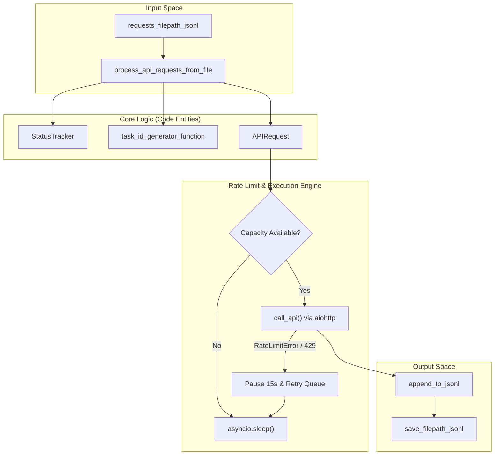
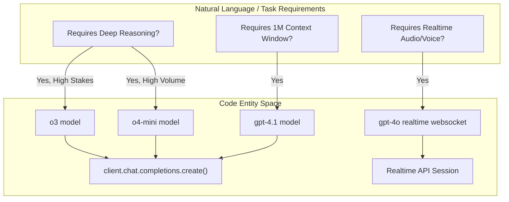

<!-- source: DeepWiki mcp.deepwiki.com · repo openai/openai-cookbook · page 13.1 API Utilities and Rate Limit Management · fetched 2026-10-26 -->

# API Utilities and Rate Limit Management

<details>
<summary>Relevant source files</summary>

The following files were used as context for generating this wiki page:

- [articles/chatgpt-agents-sales-meeting-prep.md](articles/chatgpt-agents-sales-meeting-prep.md)
- [authors.yaml](authors.yaml)
- [examples/Context_summarization_with_realtime_api.ipynb](examples/Context_summarization_with_realtime_api.ipynb)
- [examples/How_to_handle_rate_limits.ipynb](examples/How_to_handle_rate_limits.ipynb)
- [examples/Leveraging_model_distillation_to_fine-tune_a_model.ipynb](examples/Leveraging_model_distillation_to_fine-tune_a_model.ipynb)
- [examples/Prompt_migration_guide.ipynb](examples/Prompt_migration_guide.ipynb)
- [examples/Reinforcement_Fine_Tuning.ipynb](examples/Reinforcement_Fine_Tuning.ipynb)
- [examples/Speech_transcription_methods.ipynb](examples/Speech_transcription_methods.ipynb)
- [examples/Structured_Outputs_Intro.ipynb](examples/Structured_Outputs_Intro.ipynb)
- [examples/Structured_outputs_multi_agent.ipynb](examples/Structured_outputs_multi_agent.ipynb)
- [examples/agents_sdk/building_reliable_agents_memory_compaction.ipynb](examples/agents_sdk/building_reliable_agents_memory_compaction.ipynb)
- [examples/agents_sdk/context_personalization.ipynb](examples/agents_sdk/context_personalization.ipynb)
- [examples/agents_sdk/session_memory.ipynb](examples/agents_sdk/session_memory.ipynb)
- [examples/api_request_parallel_processor.py](examples/api_request_parallel_processor.py)
- [examples/codex/using_goals_in_codex.ipynb](examples/codex/using_goals_in_codex.ipynb)
- [examples/completions_usage_api.ipynb](examples/completions_usage_api.ipynb)
- [examples/data/example_requests_to_parallel_process.jsonl](examples/data/example_requests_to_parallel_process.jsonl)
- [examples/evaluation/moving-from-openai-evals-to-promptfoo.md](examples/evaluation/moving-from-openai-evals-to-promptfoo.md)
- [examples/gpt-5/gpt-5_frontend.ipynb](examples/gpt-5/gpt-5_frontend.ipynb)
- [examples/gpt-5/prompt_personalities.ipynb](examples/gpt-5/prompt_personalities.ipynb)
- [examples/gpt4-1_prompting_guide.ipynb](examples/gpt4-1_prompting_guide.ipynb)
- [examples/mcp/mcp_tool_guide.ipynb](examples/mcp/mcp_tool_guide.ipynb)
- [examples/partners/eval_driven_system_design/receipt_inspection.ipynb](examples/partners/eval_driven_system_design/receipt_inspection.ipynb)
- [examples/partners/mcp_powered_voice_agents/mcp_powered_agents_cookbook.ipynb](examples/partners/mcp_powered_voice_agents/mcp_powered_agents_cookbook.ipynb)
- [examples/partners/model_selection_guide/model_selection_guide.ipynb](examples/partners/model_selection_guide/model_selection_guide.ipynb)
- [examples/skills_in_api.ipynb](examples/skills_in_api.ipynb)
- [images/2.2_model_evolution.png](images/2.2_model_evolution.png)
- [images/3A_rag_hierarchical_router.png](images/3A_rag_hierarchical_router.png)
- [images/3A_rag_task_card.png](images/3A_rag_task_card.png)
- [images/3B_coscientist_architecture.png](images/3B_coscientist_architecture.png)
- [images/3B_reasoning_task_card.png](images/3B_reasoning_task_card.png)
- [images/3C_insurance_architecture.png](images/3C_insurance_architecture.png)
- [images/3C_insurance_form.png](images/3C_insurance_form.png)
- [images/3C_insurance_task_card.png](images/3C_insurance_task_card.png)
- [images/3D_model_selection_flowchart.png](images/3D_model_selection_flowchart.png)
- [images/agents_sdk_transcription.png](images/agents_sdk_transcription.png)
- [images/memory_comparison.jpg](images/memory_comparison.jpg)
- [images/prompt_migrator_fig.png](images/prompt_migrator_fig.png)
- [images/promptfoo-custom-example-view.png](images/promptfoo-custom-example-view.png)
- [images/realtime_api_transcription.png](images/realtime_api_transcription.png)
- [images/rft_dashboard_modelgrader2.png](images/rft_dashboard_modelgrader2.png)
- [images/rft_hacking.png](images/rft_hacking.png)
- [images/rft_string_grader.png](images/rft_string_grader.png)
- [images/speech-to-text-not-streaming.png](images/speech-to-text-not-streaming.png)
- [images/speech-to-text-streaming.png](images/speech-to-text-streaming.png)
- [images/summarizingSession.jpg](images/summarizingSession.jpg)
- [images/text-vs-audio-tokens.png](images/text-vs-audio-tokens.png)
- [images/trimingSession.jpg](images/trimingSession.jpg)
- [registry.yaml](registry.yaml)

</details>


## Purpose and Scope
This page documents the utility functions, scripts, and architectural patterns provided in the OpenAI Cookbook for managing high-volume API requests, handling rate limits, migrating prompts for newer model generations, selecting optimal models, and tracking token costs using the completions usage API.

---

## 1. Rate Limit Handling and Error Management
When interacting with the OpenAI API at scale, applications frequently encounter `429: Too Many Requests` or `RateLimitError` responses [examples/How_to_handle_rate_limits.ipynb:10-10](). These limits are enforced to protect infrastructure from abuse, ensure fair resource access across tenants, and maintain aggregate system stability [examples/How_to_handle_rate_limits.ipynb:18-24]().

### Mitigation Strategies
*   **Exponential Backoff**: Automatically retry failed requests using exponentially increasing sleep durations between attempts.
*   **Proactive Throttling**: Regulate request submission rates to remain well below assigned Requests Per Minute (RPM) and Tokens Per Minute (TPM) thresholds [examples/api_request_parallel_processor.py:7-9]().
*   **Request Batching**: Consolidate multiple inputs or small payloads into single API calls where applicable [examples/api_request_parallel_processor.py:53-53]().

Sources: [examples/How_to_handle_rate_limits.ipynb:1-24](), [examples/api_request_parallel_processor.py:7-16]()

---

## 2. Parallel Request Processing (`api_request_parallel_processor.py`)
To process millions of tokens or requests efficiently without hitting rate limits or exhausting system memory, the cookbook provides `examples/api_request_parallel_processor.py` [examples/api_request_parallel_processor.py:1-17]().

### Core Architecture & Classes
*   `StatusTracker`: A dataclass singleton tracking script metadata counters (successful requests, failed requests, and pending tasks) [examples/api_request_parallel_processor.py:84-84]().
*   `APIRequest`: Encapsulates individual API payloads, metadata, and execution methods with retry logic [examples/api_request_parallel_processor.py:85-85]().
*   `process_api_requests_from_file`: The primary coroutine managing asynchronous file streaming, concurrency via `aiohttp`, and rate-limiting loops [examples/api_request_parallel_processor.py:110-120]().
*   `num_tokens_consumed_from_request`: Utilizes `tiktoken` to estimate token consumption prior to dispatch [examples/api_request_parallel_processor.py:89-89]().

### Parallel Processor Execution Data Flow



Sources: [examples/api_request_parallel_processor.py:73-156]()

---

## 3. Prompt Migration Guide
As model architectures evolve (such as the transition to `gpt-4.1`), instruction following becomes significantly more precise. Older prompts that relied on loose heuristic interpretations may cause models to interpret instructions overly literally [examples/Prompt_migration_guide.ipynb:8-12]().

### Migration Best Practices
*   **Explicit Constraints**: Replace vague instructions (e.g., *"avoid irrelevant info"*) with concrete definitions (*"Only include facts directly related to topic X; exclude personal anecdotes"*).
*   **Automated Critique & Refinement**: The cookbook provides helper utilities like `show_critique_and_diff` to analyze prompt changes using unified diffs [examples/Prompt_migration_guide.ipynb:138-145]().

### Natural Language to Code Entity: Prompt Migration Workflow


Sources: [examples/Prompt_migration_guide.ipynb:1-160]()

---

## 4. Model Selection Frameworks
Choosing the correct model requires balancing reasoning depth, context length, latency, and cost [examples/partners/model_selection_guide/model_selection_guide.ipynb:8-12]().

| Model Family | Core Strength | Ideal Use Case | Watch-outs |
| :--- | :--- | :--- | :--- |
| **GPT-4o** | Real-time multimodal voice/vision | Live multimodal agents [examples/partners/model_selection_guide/model_selection_guide.ipynb:43-43]() | Slightly below 4.1 on text SOTA |
| **GPT-4.1** | Long-context text accuracy (1M tokens) | Document analytics & code review [examples/partners/model_selection_guide/model_selection_guide.ipynb:44-44]() | Higher cost than mini variants |
| **o3** | Deep multi-step reasoning | High-stakes analytical workflows [examples/partners/model_selection_guide/model_selection_guide.ipynb:45-45]() | Higher latency and price |
| **o4-mini** | Fast, economical reasoning | High-volume logical problem solving [examples/partners/model_selection_guide/model_selection_guide.ipynb:46-46]() | Reasoning depth ceiling compared to o3 |

### Model Selection Decision Flow



Sources: [examples/partners/model_selection_guide/model_selection_guide.ipynb:37-60]()

---

## 5. Completions Usage API and Cost Tracking
Monitoring operational expenditure requires precise token accounting. The completions usage API returns granular usage statistics (`prompt_tokens`, `completion_tokens`, and `total_tokens`) within the response object.

### Implementation Pattern
By capturing usage metrics on every response payload, applications can record running token budgets, implement per-run spending caps, and audit cost attribution across multi-tenant systems [articles/per_run_spending_controller_responses_api.md:140-151]().

```python
response = client.chat.completions.create(
    model="gpt-4.1",
    messages=[{"role": "user", "content": "Track my usage."}]
)
usage = response.usage
print(f"Prompt tokens: {usage.prompt_tokens}, Completion tokens: {usage.completion_tokens}")
```

Sources: [examples/completions_usage_api.ipynb:1-50](), [articles/per_run_spending_controller_responses_api.md:140-151]()

---

