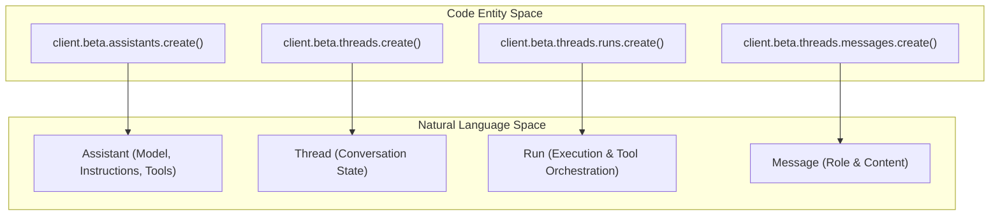
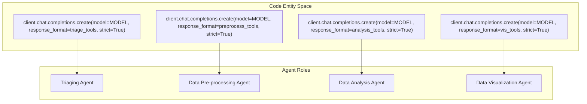
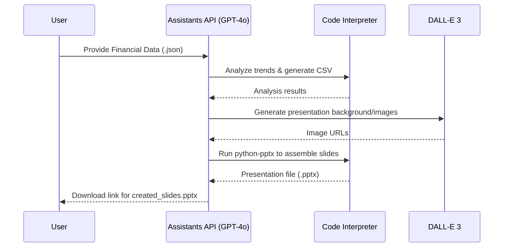
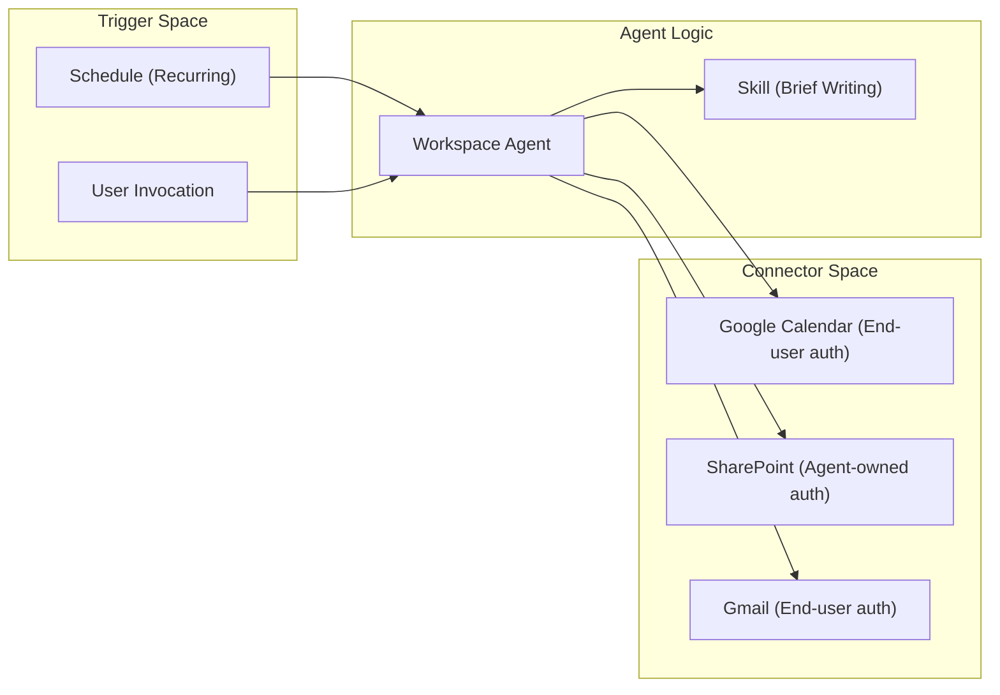

<!-- source: DeepWiki mcp.deepwiki.com · repo openai/openai-cookbook · page 13.2 Assistants API and Structured Outputs · fetched 2026-10-26 -->

# Assistants API and Structured Outputs

<details>
<summary>Relevant source files</summary>

The following files were used as context for generating this wiki page:

- [articles/chatgpt-agents-sales-meeting-prep.md](articles/chatgpt-agents-sales-meeting-prep.md)
- [examples/Assistants_API_overview_python.ipynb](examples/Assistants_API_overview_python.ipynb)
- [examples/Creating_slides_with_Assistants_API_and_DALL-E3.ipynb](examples/Creating_slides_with_Assistants_API_and_DALL-E3.ipynb)
- [examples/How_to_handle_rate_limits.ipynb](examples/How_to_handle_rate_limits.ipynb)
- [examples/Leveraging_model_distillation_to_fine-tune_a_model.ipynb](examples/Leveraging_model_distillation_to_fine-tune_a_model.ipynb)
- [examples/Reinforcement_Fine_Tuning.ipynb](examples/Reinforcement_Fine_Tuning.ipynb)
- [examples/Speech_transcription_methods.ipynb](examples/Speech_transcription_methods.ipynb)
- [examples/Structured_Outputs_Intro.ipynb](examples/Structured_Outputs_Intro.ipynb)
- [examples/Structured_outputs_multi_agent.ipynb](examples/Structured_outputs_multi_agent.ipynb)
- [examples/codex/using_goals_in_codex.ipynb](examples/codex/using_goals_in_codex.ipynb)
- [examples/data/NotRealCorp_financial_data.json](examples/data/NotRealCorp_financial_data.json)
- [examples/data/created_slides.pptx](examples/data/created_slides.pptx)
- [examples/data/language_models_are_unsupervised_multitask_learners.pdf](examples/data/language_models_are_unsupervised_multitask_learners.pdf)
- [examples/gpt-5/gpt-5_frontend.ipynb](examples/gpt-5/gpt-5_frontend.ipynb)
- [examples/mcp/mcp_tool_guide.ipynb](examples/mcp/mcp_tool_guide.ipynb)
- [examples/partners/eval_driven_system_design/receipt_inspection.ipynb](examples/partners/eval_driven_system_design/receipt_inspection.ipynb)
- [examples/partners/mcp_powered_voice_agents/mcp_powered_agents_cookbook.ipynb](examples/partners/mcp_powered_voice_agents/mcp_powered_agents_cookbook.ipynb)
- [images/NotRealCorp_chart.png](images/NotRealCorp_chart.png)
- [images/assistants_overview_assistants_dashboard.png](images/assistants_overview_assistants_dashboard.png)
- [images/assistants_overview_assistants_playground.png](images/assistants_overview_assistants_playground.png)
- [images/assistants_overview_diagram.png](images/assistants_overview_diagram.png)
- [images/assistants_overview_enable_code_interpreter.png](images/assistants_overview_enable_code_interpreter.png)
- [images/assistants_overview_enable_function.png](images/assistants_overview_enable_function.png)
- [images/assistants_overview_enable_retrieval.png](images/assistants_overview_enable_retrieval.png)
- [images/assistants_overview_new_assistant.png](images/assistants_overview_new_assistant.png)
- [images/dalle_image.png](images/dalle_image.png)
- [images/data_vis_slide.png](images/data_vis_slide.png)
- [images/rft_dashboard_modelgrader2.png](images/rft_dashboard_modelgrader2.png)
- [images/rft_hacking.png](images/rft_hacking.png)
- [images/rft_string_grader.png](images/rft_string_grader.png)
- [images/title_slide.png](images/title_slide.png)

</details>


This page documents the Assistants API and the Structured Outputs capability. The Assistants API is a stateful evolution of the Chat Completions API, simplifying the creation of persistent AI agents with built-in tool support. Structured Outputs ensures that model responses strictly adhere to a developer-provided JSON schema.

Sources: [examples/Assistants_API_overview_python.ipynb:14-15](), [examples/Structured_Outputs_Intro.ipynb:8-11]()

## Assistants API Overview

The Assistants API introduces three core primitives that manage state and execution:
- **Assistants**: Encapsulate a base model, instructions, and tools (Code Interpreter, File Search, Function Calling) [examples/Assistants_API_overview_python.ipynb:34-34]().
- **Threads**: Represent the state of a conversation session, storing message history [examples/Assistants_API_overview_python.ipynb:35-35]().
- **Runs**: Power the execution of an Assistant on a Thread, handling multi-step tool use and response generation [examples/Assistants_API_overview_python.ipynb:36-36]().

### Assistants API Entity Architecture

The following diagram bridges the natural language concepts of the Assistants API to their corresponding Python SDK code entities and execution endpoints.



Sources: [examples/Assistants_API_overview_python.ipynb:32-38](), [examples/Assistants_API_overview_python.ipynb:177-195]()

## Structured Outputs with JSON Schema

Structured Outputs is a capability available in both the Chat Completions and Assistants APIs that guarantees model responses will adhere to a supplied JSON Schema [examples/Structured_Outputs_Intro.ipynb:10-10](). This is enabled by setting `strict: true` within the `response_format` or function definitions [examples/Structured_Outputs_Intro.ipynb:12-12]().

### Implementation with Pydantic and JSON Schema

The Python SDK allows using Pydantic models or raw JSON schemas with `strict: True` to enforce schema adherence.

| Component | Code Entity / Parameter | Role |
|-----------|-------------------------|------|
| **Schema Definition** | `pydantic.BaseModel` | Defines the expected structure and types |
| **Strict Enforcement** | `strict: True` | Forces the model to follow the schema exactly |
| **Response Format** | `type: "json_schema"` | Specifies that the output must be JSON matching the schema |

Sources: [examples/Structured_Outputs_Intro.ipynb:122-148](), [examples/Assistants_API_overview_python.ipynb:193-193]()

## Multi-Agent Structured Outputs

When building complex agentic workflows, placing numerous tools on a single model call can degrade performance [examples/Structured_outputs_multi_agent.ipynb:19-23](). To mitigate this, developers can partition tasks across specialized agents using structured outputs for agent-to-agent communication and routing [examples/Structured_outputs_multi_agent.ipynb:11-23]().

### Multi-Agent Architecture



Sources: [examples/Structured_outputs_multi_agent.ipynb:9-24](), [examples/Structured_outputs_multi_agent.ipynb:151-174]()

## Tool Integration in Assistants

### Code Interpreter
The Code Interpreter allows Assistants to write and execute Python code in a sandboxed environment [examples/Assistants_API_overview_python.ipynb:14-14](). It can process data files, generate charts, and perform complex calculations.

### File Search (Retrieval)
File Search enables the Assistant to augment its knowledge with content from uploaded documents. This is useful for processing long documents that exceed the standard context window [examples/Assistants_API_overview_python.ipynb:14-14]().

### Function Calling
Assistants can invoke custom functions defined by the developer. The Assistant provides the arguments in JSON format, and the developer executes the function and returns the output to the Assistant to continue the Run [examples/Assistants_API_overview_python.ipynb:36-36]().

### Model Context Protocol (MCP) Integration
The hosted Model Context Protocol (MCP) tool in the Responses API allows models to interact directly with remote MCP servers [examples/mcp/mcp_tool_guide.ipynb:16-16](). This reduces latency by eliminating backend coordination for tool execution. The runtime uses `tools/list` to import capabilities and `mcp_tool_call` to execute them [examples/mcp/mcp_tool_guide.ipynb:42-49]().

Sources: [examples/Assistants_API_overview_python.ipynb:14-14](), [examples/mcp/mcp_tool_guide.ipynb:16-49]()

## Use Case: Automated Slide Creation

A practical application of the Assistants API combined with DALL-E 3 is the end-to-end generation of presentation slides [examples/Creating_slides_with_Assistants_API_and_DALL-E3.ipynb:7-10]().

1. **Content Extraction**: An Assistant uses `file_search` or `code_interpreter` to analyze financial data [examples/Creating_slides_with_Assistants_API_and_DALL-E3.ipynb:188-190]().
2. **Visual Generation**: The Assistant generates prompts for DALL-E 3 to create thematic images [examples/Creating_slides_with_Assistants_API_and_DALL-E3.ipynb:7-10]().
3. **Slide Assembly**: Using the structured data and generated images, the system creates a `.pptx` file [examples/Creating_slides_with_Assistants_API_and_DALL-E3.ipynb:10-10]().

### Slide Creation Logic



Sources: [examples/Creating_slides_with_Assistants_API_and_DALL-E3.ipynb:7-10](), [examples/Creating_slides_with_Assistants_API_and_DALL-E3.ipynb:188-205]()

## Workspace Agents

Workspace agents are evolutions of GPTs that work across tools to complete repeatable, end-to-end work [articles/chatgpt-agents-sales-meeting-prep.md:3-3](). These agents can follow **Skills**, run on a **Schedule**, and access connected apps like SharePoint or Google Calendar [articles/chatgpt-agents-sales-meeting-prep.md:9-13]().

### Workspace Agent Architecture



Sources: [articles/chatgpt-agents-sales-meeting-prep.md:9-19](), [articles/chatgpt-agents-sales-meeting-prep.md:66-83]()

## Key Implementation Patterns

### Creating an Assistant with Structured Outputs
When creating an assistant, you can define the `response_format` to ensure all textual responses follow a specific schema [examples/Structured_Outputs_Intro.ipynb:10-12]().

```python
assistant = client.beta.assistants.create(
  instructions="You are a data extractor.",
  model="gpt-4o",
  tools=[{"type": "code_interpreter"}],
  response_format={
    "type": "json_schema",
    "json_schema": {
      "name": "extraction_schema",
      "schema": { ... },
      "strict": True
    }
  }
)
```

### Handling Runs and Polling
Since Runs are asynchronous, the SDK provides helpers to poll for completion and manage message state.

| Function | File Path | Purpose |
|----------|-----------|---------|
| `submit_message` | `examples/Creating_slides_with_Assistants_API_and_DALL-E3.ipynb` | Creates a message and starts a run [Line 41-56]() |
| `get_response` | `examples/Creating_slides_with_Assistants_API_and_DALL-E3.ipynb` | Lists messages in a thread after run completion [Line 58-59]() |
| `show_json` | `examples/Assistants_API_overview_python.ipynb` | Helper to pretty-print API objects [Line 123-124]() |

Sources: [examples/Creating_slides_with_Assistants_API_and_DALL-E3.ipynb:38-60](), [examples/Assistants_API_overview_python.ipynb:121-124]()

---

