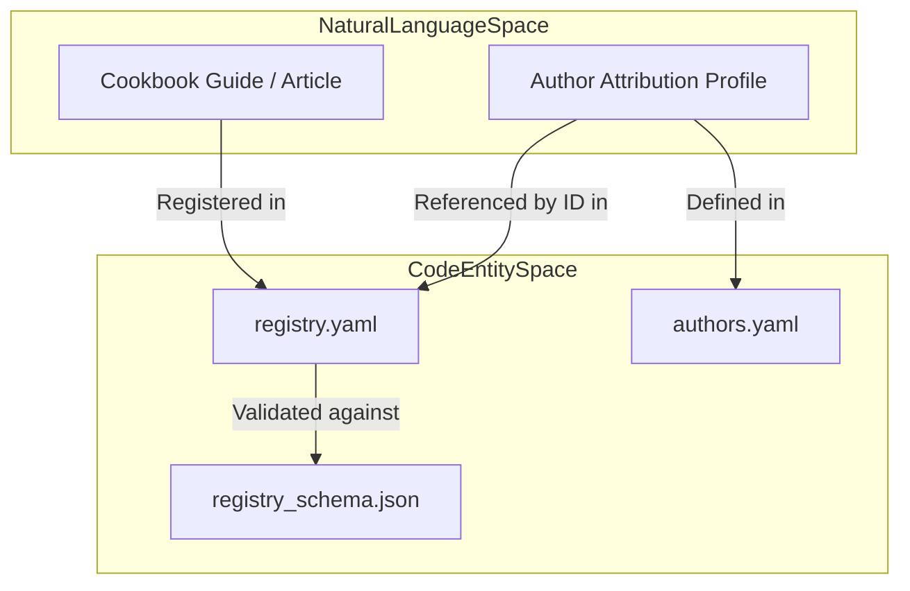
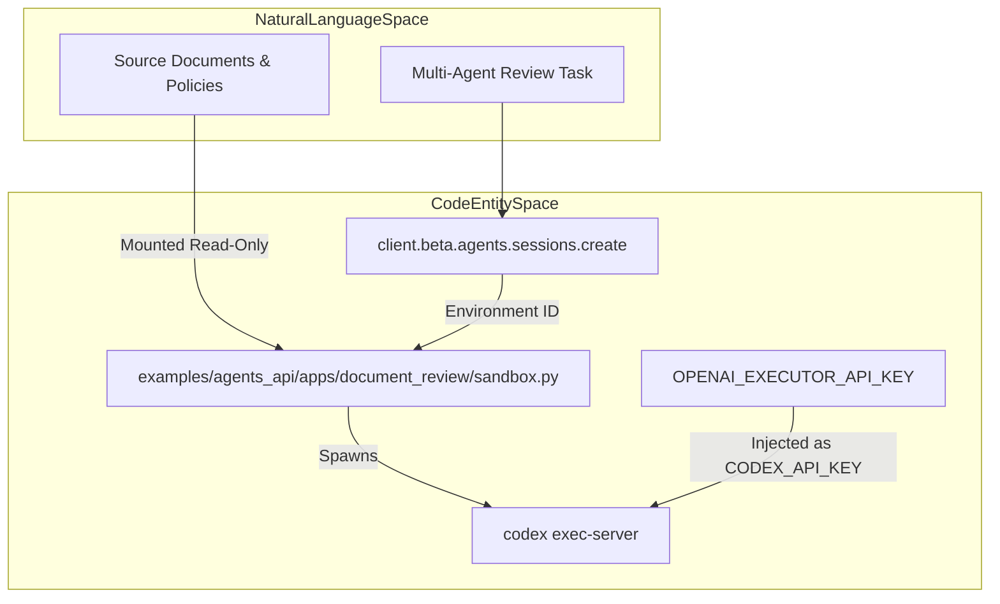

<!-- source: DeepWiki mcp.deepwiki.com · repo openai/openai-cookbook · page 14 Glossary · fetched 2026-10-26 -->

# Glossary

Relevant source files

The following files were used as context for generating this wiki page:

- [articles/gpt-oss/fine-tune-transfomers.ipynb](articles/gpt-oss/fine-tune-transfomers.ipynb)
- [articles/gpt-oss/handle-raw-cot.md](articles/gpt-oss/handle-raw-cot.md)
- [articles/gpt-oss/run-colab.ipynb](articles/gpt-oss/run-colab.ipynb)
- [articles/gpt-oss/run-locally-lmstudio.md](articles/gpt-oss/run-locally-lmstudio.md)
- [articles/gpt-oss/run-locally-ollama.md](articles/gpt-oss/run-locally-ollama.md)
- [articles/gpt-oss/run-transformers.md](articles/gpt-oss/run-transformers.md)
- [articles/gpt-oss/run-vllm.md](articles/gpt-oss/run-vllm.md)
- [articles/openai-harmony.md](articles/openai-harmony.md)
- [authors.yaml](authors.yaml)
- [examples/Code_search_using_embeddings.ipynb](examples/Code_search_using_embeddings.ipynb)
- [examples/Embedding_Wikipedia_articles_for_search.ipynb](examples/Embedding_Wikipedia_articles_for_search.ipynb)
- [examples/Embedding_long_inputs.ipynb](examples/Embedding_long_inputs.ipynb)
- [examples/Fine-tuned_classification.ipynb](examples/Fine-tuned_classification.ipynb)
- [examples/How_to_count_tokens_with_tiktoken.ipynb](examples/How_to_count_tokens_with_tiktoken.ipynb)
- [examples/How_to_format_inputs_to_ChatGPT_models.ipynb](examples/How_to_format_inputs_to_ChatGPT_models.ipynb)
- [examples/Question_answering_using_a_search_API.ipynb](examples/Question_answering_using_a_search_API.ipynb)
- [examples/Question_answering_using_embeddings.ipynb](examples/Question_answering_using_embeddings.ipynb)
- [examples/RAG_with_graph_db.ipynb](examples/RAG_with_graph_db.ipynb)
- [examples/Unit_test_writing_using_a_multi-step_prompt.ipynb](examples/Unit_test_writing_using_a_multi-step_prompt.ipynb)
- [examples/Unit_test_writing_using_a_multi-step_prompt_with_older_completions_API.ipynb](examples/Unit_test_writing_using_a_multi-step_prompt_with_older_completions_API.ipynb)
- [examples/Using_embeddings.ipynb](examples/Using_embeddings.ipynb)
- [examples/Using_logprobs.ipynb](examples/Using_logprobs.ipynb)
- [examples/agents_api/apps/data_analyst/README.md](examples/agents_api/apps/data_analyst/README.md)
- [examples/agents_api/apps/data_analyst/assets/workflow.svg](examples/agents_api/apps/data_analyst/assets/workflow.svg)
- [examples/agents_api/apps/document_review/README.md](examples/agents_api/apps/document_review/README.md)
- [examples/agents_api/apps/document_review/agent.py](examples/agents_api/apps/document_review/agent.py)
- [examples/agents_api/apps/document_review/assets/workflow.svg](examples/agents_api/apps/document_review/assets/workflow.svg)
- [examples/agents_api/apps/document_review/skills/expense-review-policy/SKILL.md](examples/agents_api/apps/document_review/skills/expense-review-policy/SKILL.md)
- [examples/agents_api/apps/github_issues/README.md](examples/agents_api/apps/github_issues/README.md)
- [examples/agents_api/apps/github_issues/assets/workflow.svg](examples/agents_api/apps/github_issues/assets/workflow.svg)
- [examples/agents_api/apps/sev_bot/README.md](examples/agents_api/apps/sev_bot/README.md)
- [examples/agents_api/apps/sev_bot/assets/workflow.svg](examples/agents_api/apps/sev_bot/assets/workflow.svg)
- [examples/agents_api/apps/slack_bot/README.md](examples/agents_api/apps/slack_bot/README.md)
- [examples/agents_api/apps/slack_bot/assets/workflow.svg](examples/agents_api/apps/slack_bot/assets/workflow.svg)
- [examples/agents_sdk/building_reliable_agents_memory_compaction.ipynb](examples/agents_sdk/building_reliable_agents_memory_compaction.ipynb)
- [examples/agents_sdk/context_personalization.ipynb](examples/agents_sdk/context_personalization.ipynb)
- [examples/agents_sdk/session_memory.ipynb](examples/agents_sdk/session_memory.ipynb)
- [examples/completions_usage_api.ipynb](examples/completions_usage_api.ipynb)
- [examples/data/amazon_product_kg.json](examples/data/amazon_product_kg.json)
- [examples/data/winter_olympics_2022.csv](examples/data/winter_olympics_2022.csv)
- [examples/evaluation/How_to_eval_abstractive_summarization.ipynb](examples/evaluation/How_to_eval_abstractive_summarization.ipynb)
- [examples/evaluation/moving-from-openai-evals-to-promptfoo.md](examples/evaluation/moving-from-openai-evals-to-promptfoo.md)
- [examples/gpt-5/prompt_personalities.ipynb](examples/gpt-5/prompt_personalities.ipynb)
- [examples/gpt4-1_prompting_guide.ipynb](examples/gpt4-1_prompting_guide.ipynb)
- [examples/skills_in_api.ipynb](examples/skills_in_api.ipynb)
- [images/memory_comparison.jpg](images/memory_comparison.jpg)
- [images/promptfoo-custom-example-view.png](images/promptfoo-custom-example-view.png)
- [images/search_rerank_answer.png](images/search_rerank_answer.png)
- [images/summarizingSession.jpg](images/summarizingSession.jpg)
- [images/trimingSession.jpg](images/trimingSession.jpg)
- [registry.yaml](registry.yaml)

This page provides definitions and technical context for codebase-specific terms, domain jargon, and abbreviations used throughout the OpenAI Cookbook. It serves as a comprehensive reference for onboarding engineers to understand the mapping between high-level conceptual entities and their concrete implementations in code.

## Core API & SDK Concepts

| Term | Definition | Key Code References |
| :--- | :--- | :--- |
| **Chat Completions** | The fundamental interface for interacting with models via a structured list of messages with roles (`system`, `user`, `assistant`). | [examples/How_to_format_inputs_to_ChatGPT_models.ipynb:55-65]() |
| **Embeddings** | Numerical vector representations of text used for semantic search, clustering, and retrieval. | [examples/Question_answering_using_embeddings.ipynb:63-74]() |
| **Tool Calling** | A mechanism allowing models to generate structured arguments for functions defined via JSON schemas. | [articles/gpt-oss/run-vllm.md:80-110]() |
| **Token** | The basic unit of text processed by LLMs; roughly 4 characters in English. | [examples/How_to_count_tokens_with_tiktoken.ipynb:10-15]() |
| **Encoding** | The specific tokenizer mapping rules used to translate text into token integers (e.g., `o200k_base`, `cl100k_base`). | [examples/How_to_count_tokens_with_tiktoken.ipynb:21-29]() |
| **Responses API** | A stateful alternative to Chat Completions supporting hosted tools, reasoning items, and multi-turn persistence. | [registry.yaml:140-144]() |
| **Agents SDK / API** | High-level frameworks for orchestrating multi-agent workflows, stateful sessions, tool handoffs, and capability directories. | [registry.yaml:20-35](), [examples/agents_api/apps/document_review/README.md:5-12]() |

Sources: [examples/How_to_format_inputs_to_ChatGPT_models.ipynb:55-65](), [examples/Question_answering_using_embeddings.ipynb:63-74](), [articles/gpt-oss/run-vllm.md:80-110](), [examples/How_to_count_tokens_with_tiktoken.ipynb:10-29](), [registry.yaml:20-144](), [examples/agents_api/apps/document_review/README.md:5-12]()

---

## Domain Concepts & Jargon

### RAG (Retrieval-Augmented Generation)
A hybrid architecture where relevant documents are retrieved from an external data store (vector database, search API, or graph) and provided to the model in context. The cookbook frequently refers to this foundational pattern as the **Search-Ask** method.
Sources: [examples/Question_answering_using_embeddings.ipynb:19-22](), [examples/Question_answering_using_a_search_API.ipynb:8-19]()

### Harmony Format
A rigid, structured conversation and response format used by the `gpt-oss` model family to structure chat interactions, internal chain-of-thought, and tool execution. It utilizes specialized roles (`developer`, `tool`) and execution channels (`final`, `analysis`, `commentary`).
Sources: [articles/openai-harmony.md:1-29]()

### Sandboxes (Application-Managed vs. Webhook-Managed)
Isolated execution environments (Docker, AWS Lambda MicroVMs, E2B, Daytona) where agent tools and generated code run safely under restricted permissions and file mounts.
Sources: [registry.yaml:37-41](), [examples/agents_api/apps/document_review/README.md:16-35]()

### Evals Flywheel
An automated testing and evaluation pattern where production failures or benchmark regressions are captured, converted into regression test suites, and used to systematically iterate on prompts, code, or model fine-tuning.
Sources: [examples/gpt4-1_prompting_guide.ipynb:11-13]()

### Reinforcement Fine-Tuning (RFT)
Advanced model training applying reinforcement learning (RL) techniques (such as PPO or DPO) to reasoning models (like o-series) to improve multi-step problem solving, code generation, and domain alignment while mitigating reward hacking.
Sources: [registry.yaml:1-184]()

---

## Codebase Entities & Architecture

The following diagrams bridge natural language concepts to concrete code entities and configuration files within the repository.

### Content Management Mapping
Title: "Registry_and_Metadata_Flow"

Sources: [registry.yaml:3-17](), [authors.yaml:1-6]()

### Sandbox Execution Architecture
Title: "Agents_API_Sandbox_Flow"

Sources: [examples/agents_api/apps/document_review/README.md:70-128](), [examples/agents_api/apps/document_review/agent.py]()

---

## Abbreviations

| Abbreviation | Full Term | Context & Code Reference |
| :--- | :--- | :--- |
| **CoT** | Chain of Thought | Internal reasoning traces output in `analysis` channels [articles/openai-harmony.md:28-28](). |
| **ASR** | Automatic Speech Recognition | Spoken audio processing during Whisper/Realtime transcription [examples/migrating_from_whisper_to_gpt_transcribe.ipynb:33-36](). |
| **CTX** | Context | Model context length variables [examples/Embedding_long_inputs.ipynb:39-39](). |
| **OAI** | OpenAI | Author handle suffix in attribution metadata [authors.yaml:6-6](). |
| **MCP** | Model Context Protocol | Standard protocol for external tool and server connections [registry.yaml:216-216](). |
| **AML** | Anti-Money Laundering | Domain-specific compliance evaluation scenario [registry.yaml:166-170](). |
| **RFT** | Reinforcement Fine-Tuning | Training methodology applied to reasoning models [registry.yaml:1-184](). |
| **RAG** | Retrieval-Augmented Generation | Search-Ask pipeline combining embeddings with generation [examples/Question_answering_using_embeddings.ipynb:19-22](). |

Sources: [articles/openai-harmony.md:28-28](), [examples/Embedding_long_inputs.ipynb:39-39](), [authors.yaml:6-6](), [registry.yaml:166-216](), [examples/Question_answering_using_embeddings.ipynb:19-22]()

---

## Implementation Details: Harmony Roles & Channels

The `gpt-oss` model family uses an explicit multi-role and multi-channel specification to handle system configurations, developer instructions, assistant outputs, and tool responses.

| Role Name | Purpose | Implementation Details |
| :--- | :--- | :--- |
| `system` | Meta-information | Configures reasoning effort, knowledge cutoffs, and built-in flags [articles/openai-harmony.md:13-13](). |
| `developer` | Instructions | Sets core prompt instructions and function tool definitions [articles/openai-harmony.md:14-14](). |
| `user` | Input | Represents user prompts and queries [articles/openai-harmony.md:15-15](). |
| `assistant` | Model Output | Contains generated content or tool calls across `final`, `analysis`, or `commentary` channels [articles/openai-harmony.md:16-29](). |
| `tool` | Tool Response | Represents execution output from specific tools, mapped using the tool name as the role [articles/openai-harmony.md:17-17](). |

Sources: [articles/openai-harmony.md:9-30]()