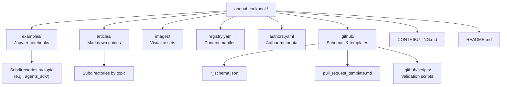
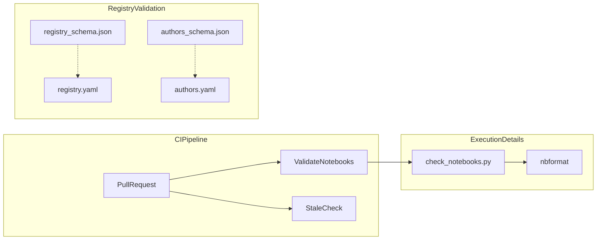

<!-- source: DeepWiki mcp.deepwiki.com · repo openai/openai-cookbook · page 2 Repository Structure and Contribution Guidelines · fetched 2026-10-26 -->

# Repository Structure and Contribution Guidelines

Relevant source files

The following files were used as context for generating this wiki page:

- [.github/authors_schema.json](.github/authors_schema.json)
- [.github/pull_request_template.md](.github/pull_request_template.md)
- [.github/registry_schema.json](.github/registry_schema.json)
- [.github/scripts/check_notebooks.py](.github/scripts/check_notebooks.py)
- [.github/workflows/stale.yaml](.github/workflows/stale.yaml)
- [.github/workflows/validate-notebooks.yaml](.github/workflows/validate-notebooks.yaml)
- [CONTRIBUTING.md](CONTRIBUTING.md)
- [README.md](README.md)
- [examples/data/scifact_claims.jsonl](examples/data/scifact_claims.jsonl)
- [examples/data/scifact_corpus.jsonl](examples/data/scifact_corpus.jsonl)
- [examples/vector_databases/chroma/hyde-with-chroma-and-openai.ipynb](examples/vector_databases/chroma/hyde-with-chroma-and-openai.ipynb)
- [images/openai-cookbook-white.png](images/openai-cookbook-white.png)
- [images/openai-cookbook.png](images/openai-cookbook.png)

## Purpose and Scope

This page documents the **file organization**, **contribution process**, **quality standards**, and **validation mechanisms** for the OpenAI Cookbook repository (`https://github.com/openai/openai-cookbook`). It covers how content is structured, how new contributions are submitted and reviewed, and how content metadata is managed through the registry system for publication to `cookbook.openai.com`.

Sources: [README.md:12-16](), [CONTRIBUTING.md:1-3]()

---

## Repository Structure Overview

The OpenAI Cookbook follows a registry-driven architecture where all publishable content must be declared in `registry.yaml`. The repository is organized into distinct content directories, configuration files, and community infrastructure.

### High-Level Directory Layout

Title: "RepositoryFileHierarchyAndPublishingFlow"

Sources: [README.md:1-20](), [CONTRIBUTING.md:15-20](), [.github/workflows/validate-notebooks.yaml:1-25](), [CONTRIBUTING.md:18]()

---

## Core Files and Their Roles

### Content Registry (`registry.yaml`)

The **central manifest** for all published content. Each entry represents a single page on `cookbook.openai.com`. The file uses a YAML language server schema for validation.

**Structure:**
- Array of content objects [,.github/registry_schema.json:3-4]().
- Each object must include: `title`, `path`, `slug`, `tags`, and `authors` [.github/registry_schema.json:45]().
- Optional fields: `description`, `date`, `redirects`, `archived` [.github/registry_schema.json:6-43]().

**Key Properties:**
- **`title`**: Display name on the website [.github/registry_schema.json:7-9]().
- **`path`**: Relative file path from repository root [.github/registry_schema.json:10-12]().
- **`slug`**: URL-friendly identifier used for the website path [.github/registry_schema.json:13-15]().
- **`tags`**: Searchability and categorization [.github/registry_schema.json:25-30]().
- **`authors`**: GitHub usernames that map to keys in `authors.yaml` [.github/registry_schema.json:31-36]().
- **`date`**: Publication date in YYYY-MM-DD format [.github/registry_schema.json:37-40]().

Sources: [CONTRIBUTING.md:18](), [.github/registry_schema.json:1-48]()

---

### Author Metadata (`authors.yaml`)

Customizes author display information beyond default GitHub profile data.

**Structure:**
- Map of GitHub username to author metadata object [.github/authors_schema.json:4-5]().
- Key fields: `name`, `website`, `avatar` [.github/authors_schema.json:6-18]().

**Validation Constraints:**
- `website` and `avatar` must be valid URIs [.github/authors_schema.json:11-18]().
- No additional properties are allowed per author entry [.github/authors_schema.json:21]().

Sources: [CONTRIBUTING.md:19](), [.github/authors_schema.json:1-25]()

---

### Entry Point (`README.md`)

The **user-facing introduction** to the repository, providing setup instructions and licensing information.

**Contents:**
- Link to the live cookbook at `cookbook.openai.com` [README.md:1-10]().
- Instructions for setting the `OPENAI_API_KEY` environment variable [README.md:12]().
- Guidance on using `.env` files for local development in IDEs like Visual Studio Code [README.md:12]().
- Licensing under the MIT License [README.md:18-20]().

Sources: [README.md:1-20]()

---

## Contribution Guidelines and Quality Rubric

The repository uses a pull request template to enforce quality standards through a **self-review checklist**. Contributions are reviewed on a best-effort basis [CONTRIBUTING.md:5]().

**Quality Rubric Dimensions (Scale 1-4, minimum 3 required):**

| Dimension | Description |
|-----------|-------------|
| **Relevance** | Content is related to building with OpenAI technologies and is useful to others [.github/pull_request_template.md:17](). |
| **Uniqueness** | Verified that content offers new insights compared to existing documentation [.github/pull_request_template.md:18](). |
| **Spelling/Grammar** | Checked for spelling or grammatical mistakes [.github/pull_request_template.md:19](). |
| **Clarity** | Verified that the submission is well-organized and easy to understand [.github/pull_request_template.md:20](). |
| **Correctness** | Information is correct and all code executes successfully [.github/pull_request_template.md:21](). |
| **Completeness** | Explained fully, including all necessary references and citations [.github/pull_request_template.md:22](). |

Sources: [.github/pull_request_template.md:1-24](), [CONTRIBUTING.md:40-52]()

---

## Content Organization and Automated Validation

### Directory Patterns

- **`examples/`**: Contains executable Jupyter notebooks (`.ipynb`) and specific implementation guides organized by topic [CONTRIBUTING.md:17]().
- **`articles/`**: Contains Markdown guides for broader architectural or cost management topics [CONTRIBUTING.md:17]().
- **`images/`**: Visual assets used in the documentation, including logos and diagrams [CONTRIBUTING.md:17]().
- **`examples/data/`**: Datasets used by notebooks for demonstrations, such as `.jsonl` files for RAG or fine-tuning examples [examples/data/scifact_corpus.jsonl:1-4]().

### Automated Validation Workflow

The repository employs GitHub Actions to ensure code quality and schema compliance.

Title: "CIValidationAndSchemaEnforcement"

Sources: [.github/workflows/validate-notebooks.yaml:1-25](), [.github/workflows/stale.yaml:1-19](), [.github/registry_schema.json:1-48]()

---

## Contribution Workflow and Stale Policy

### Step-by-Step Process

1. **Develop Content**: Create a Jupyter notebook or Markdown file following technical standards. Read credentials from environment variables such as `OPENAI_API_KEY` [CONTRIBUTING.md:22-34]().
2. **Add Registry Entry**: Update `registry.yaml` with a new object containing the required properties [CONTRIBUTING.md:18]().
3. **Add Author Info**: If you are a new contributor, add your details to `authors.yaml` [CONTRIBUTING.md:19]().
4. **Submit Pull Request**: Fill out the summary and motivation sections of the PR template [.github/pull_request_template.md:1-8]().
5. **Self-Review**: Complete the mandatory checklist in the PR description, ensuring all rubric areas score 3 or higher [.github/pull_request_template.md:11-24]().

### Stale Policy
Issues and PRs are automatically monitored. If there is no activity for 60 days, they are marked as stale; after another 10 days of inactivity, they are closed [.github/workflows/stale.yaml:12-19]().

Sources: [CONTRIBUTING.md:22-38](), [.github/pull_request_template.md:1-24](), [.github/workflows/stale.yaml:1-19]()

---

## Technical Validation Implementation

### Notebook Validation
The `Validate Changed Notebooks` workflow runs on `ubuntu-latest` using Python 3.12. It executes the `.github/scripts/check_notebooks.py` script to verify the integrity of changed `.ipynb` files [.github/workflows/validate-notebooks.yaml:8-25]().

### Schema Enforcement
The registry validation ensures that no additional properties are added to content entries (`additionalProperties: false`), maintaining a strict data contract for the publishing system [.github/registry_schema.json:46](). The `registry.yaml` file must follow the schema defined in `.github/registry_schema.json` [.github/registry_schema.json:1-48]().

Sources: [.github/workflows/validate-notebooks.yaml:1-25](), [.github/registry_schema.json:1-48]()

---

