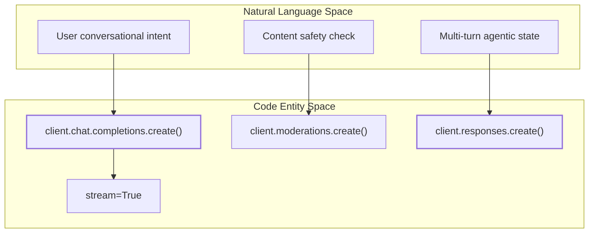
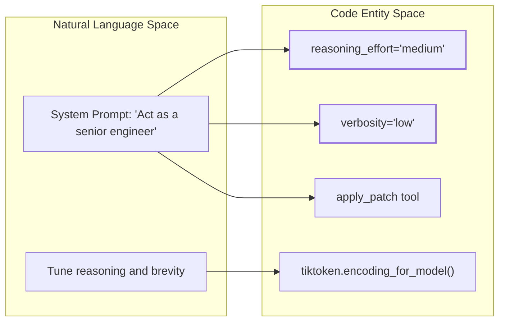

<!-- source: DeepWiki mcp.deepwiki.com · repo openai/openai-cookbook · page 4 Chat Completions and Prompting · fetched 2026-10-26 -->

# Chat Completions and Prompting

Relevant source files

The following files were used as context for generating this wiki page:

- [examples/How_to_combine_GPT4o_with_RAG_Outfit_Assistant.ipynb](examples/How_to_combine_GPT4o_with_RAG_Outfit_Assistant.ipynb)
- [examples/How_to_stream_completions.ipynb](examples/How_to_stream_completions.ipynb)
- [examples/How_to_use_guardrails.ipynb](examples/How_to_use_guardrails.ipynb)
- [examples/How_to_use_moderation.ipynb](examples/How_to_use_moderation.ipynb)
- [examples/SDG1.ipynb](examples/SDG1.ipynb)
- [examples/Tag_caption_images_with_GPT4V.ipynb](examples/Tag_caption_images_with_GPT4V.ipynb)
- [examples/batch_processing.ipynb](examples/batch_processing.ipynb)
- [examples/chatgpt/gpt_actions_library/gpt_action_zapier.ipynb](examples/chatgpt/gpt_actions_library/gpt_action_zapier.ipynb)
- [examples/data/imdb_top_1000.csv](examples/data/imdb_top_1000.csv)
- [examples/gpt-5/codex_prompting_guide.ipynb](examples/gpt-5/codex_prompting_guide.ipynb)
- [examples/gpt-5/gpt-5-1_prompting_guide.ipynb](examples/gpt-5/gpt-5-1_prompting_guide.ipynb)
- [examples/gpt-5/gpt-5_troubleshooting_guide.ipynb](examples/gpt-5/gpt-5_troubleshooting_guide.ipynb)
- [examples/gpt4o/data/keynote_recap.mp3](examples/gpt4o/data/keynote_recap.mp3)
- [examples/gpt4o/introduction_to_gpt4o.ipynb](examples/gpt4o/introduction_to_gpt4o.ipynb)
- [examples/stripe_model_eval/selecting_a_model_based_on_stripe_conversion.ipynb](examples/stripe_model_eval/selecting_a_model_based_on_stripe_conversion.ipynb)
- [images/elbow_chart.png](images/elbow_chart.png)
- [images/stripe_eval_diagram.png](images/stripe_eval_diagram.png)
- [images/zapier_action_config.png](images/zapier_action_config.png)
- [images/zapier_ai_actions.png](images/zapier_ai_actions.png)

This page provides an overview of OpenAI's chat completion APIs, model families, and prompting strategies covered in the cookbook, linking to specialized child pages for deep technical dives. 

For fundamental message formatting, streaming, token management, and moderation, see [Basic Patterns and API Usage](#4.1). For GPT-5 model series specifics and reasoning parameters, see [GPT-5 Model Family and Reasoning Modes](#4.2). For advanced prompt reliability techniques like chain-of-thought and self-consistency, see [Prompting Techniques for Reliability](#4.3). For stateful interactions and hosted tools, see [Responses API](#4.4).

## Chat Completion APIs and Endpoints

OpenAI provides multiple APIs for text generation and interaction, each tailored to different latency, statefulness, and reasoning requirements.

**API Endpoint Selection and Code Entities**

### Chat Completions API
The traditional interface (`client.chat.completions.create`) handles standard conversational and completion tasks using structured messages (`system`, `user`, `assistant`, `tool`) [examples/How_to_format_inputs_to_ChatGPT_models.ipynb:57-63](). It supports real-time streaming via `stream=True` [examples/How_to_stream_completions.ipynb:16-17]() and safety guardrails through input/output moderation tasks (`client.moderations.create`) [examples/How_to_use_moderation.ipynb:91-93]().

### Responses API
As a modern alternative to Chat Completions, the Responses API manages multi-turn stateful interactions, persistent reasoning items, and hosted server-side tools [examples/gpt-5/gpt-5_new_params_and_tools.ipynb:30-30](). 

For implementation details, see [Basic Patterns and API Usage](#4.1) and [Responses API](#4.4).

Sources: [examples/How_to_format_inputs_to_ChatGPT_models.ipynb:57-63](), [examples/How_to_stream_completions.ipynb:16-17](), [examples/How_to_use_moderation.ipynb:91-93](), [examples/gpt-5/gpt-5_new_params_and_tools.ipynb:30-30]().

## Model Families and Capabilities

The cookbook covers several distinct model families optimized for different scales and tasks:

- **GPT-4o and GPT-4o mini**: Natively multimodal models capable of processing text, images, and audio natively [examples/gpt4o/introduction_to_gpt4o.ipynb:7-9](). `gpt-4o-mini` offers high speed and cost efficiency while outperforming earlier iterations [examples/gpt4o/introduction_to_gpt4o.ipynb:14-16]().
- **GPT-5 Model Family**: Includes `gpt-5`, `gpt-5.1`, `gpt-5.2`, and `gpt-5.3-codex`, introducing advanced developer controls such as adjustable `reasoning_effort` and `verbosity` parameters [examples/gpt-5/gpt-5_new_params_and_tools.ipynb:18-78](), along with native coding tools like `apply_patch` [examples/gpt-5/codex_prompting_guide.ipynb:30-30]().

For deep dives into model-specific behaviors, see [GPT-5 Model Family and Reasoning Modes](#4.2).

Sources: [examples/gpt4o/introduction_to_gpt4o.ipynb:7-16](), [examples/gpt-5/gpt-5_new_params_and_tools.ipynb:18-78](), [examples/gpt-5/codex_prompting_guide.ipynb:30-30]().

## Prompting Strategies and Parameter Tuning

Effective prompt design bridges natural language instructions to precise API parameters and system controls.

### Prompting Strategies to Model Parameters

Core prompting patterns covered across the cookbook include:
- **Calibrating Agentic Autonomy**: Preventing over-deference and encouraging persistence through explicit system prompt blocks [examples/gpt-5/gpt-5_troubleshooting_guide.ipynb:78-83]().
- **Token Budgeting**: Using `tiktoken` encoders to inspect context window usage and manage token limits [examples/How_to_combine_GPT4o_with_RAG_Outfit_Assistant.ipynb:138-141]().
- **Guardrails Integration**: Running asynchronous moderation or topical guardrails checks in parallel with completion requests [examples/How_to_use_moderation.ipynb:108-115](), [examples/How_to_use_guardrails.ipynb:59-63]().

For advanced prompting methodologies, see [Prompting Techniques for Reliability](#4.3).

Sources: [examples/gpt-5/gpt-5_troubleshooting_guide.ipynb:78-83](), [examples/How_to_combine_GPT4o_with_RAG_Outfit_Assistant.ipynb:138-141](), [examples/How_to_use_moderation.ipynb:108-115](), [examples/How_to_use_guardrails.ipynb:59-63]().

## Troubleshooting and Optimization

| Issue | Root Cause | Code-level Solution |
| :--- | :--- | :--- |
| **High Latency** | Oversized reasoning effort or synchronous waiting | Set `stream=True` [examples/How_to_stream_completions.ipynb:16-17]() or `reasoning_effort="minimal"` [examples/gpt-5/gpt-5_troubleshooting_guide.ipynb:22-22]() |
| **Model Overthinking** | Lack of clear stop conditions on trivial tasks | Configure fast-paths or reduce `reasoning_effort` [examples/gpt-5/gpt-5_troubleshooting_guide.ipynb:20-22]() |
| **Agent Inaction** | Overly deferential default behavior in prompts | Add explicit `<persistence>` blocks in system instructions [examples/gpt-5/gpt-5_troubleshooting_guide.ipynb:78-83]() |
| **Rate Limit Exceeded** | Burst traffic patterns against API limits | Implement exponential backoff via `tenacity` [examples/How_to_combine_GPT4o_with_RAG_Outfit_Assistant.ipynb:67-67]() |

Sources: [examples/How_to_stream_completions.ipynb:16-17](), [examples/gpt-5/gpt-5_troubleshooting_guide.ipynb:20-83](), [examples/How_to_combine_GPT4o_with_RAG_Outfit_Assistant.ipynb:67-67]().

---

