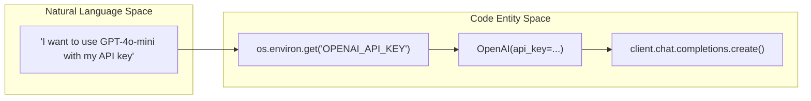
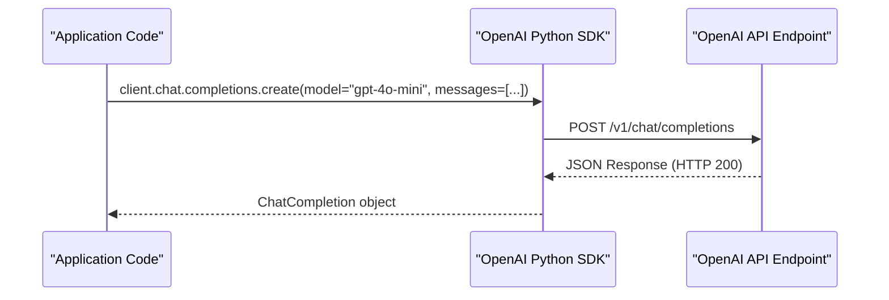
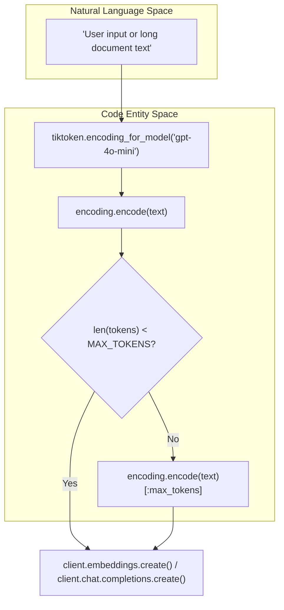
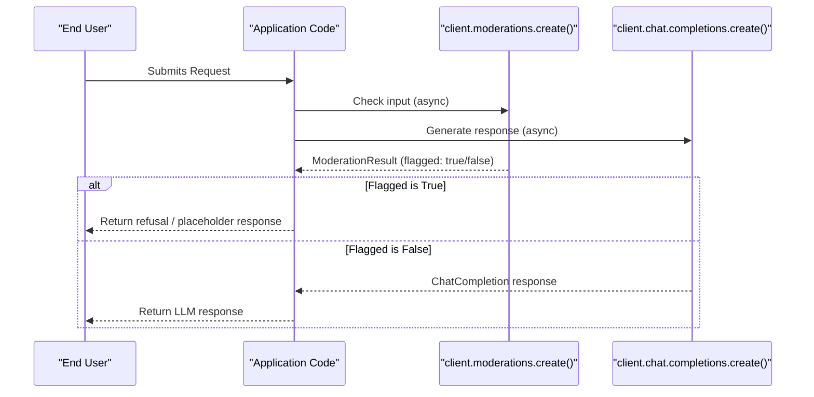

<!-- source: DeepWiki mcp.deepwiki.com · repo openai/openai-cookbook · page 4.1 Basic Patterns and API Usage · fetched 2026-10-26 -->

# Basic Patterns and API Usage

Relevant source files

The following files were used as context for generating this wiki page:

- [examples/Code_search_using_embeddings.ipynb](examples/Code_search_using_embeddings.ipynb)
- [examples/Embedding_Wikipedia_articles_for_search.ipynb](examples/Embedding_Wikipedia_articles_for_search.ipynb)
- [examples/Embedding_long_inputs.ipynb](examples/Embedding_long_inputs.ipynb)
- [examples/Fine-tuned_classification.ipynb](examples/Fine-tuned_classification.ipynb)
- [examples/How_to_combine_GPT4o_with_RAG_Outfit_Assistant.ipynb](examples/How_to_combine_GPT4o_with_RAG_Outfit_Assistant.ipynb)
- [examples/How_to_count_tokens_with_tiktoken.ipynb](examples/How_to_count_tokens_with_tiktoken.ipynb)
- [examples/How_to_format_inputs_to_ChatGPT_models.ipynb](examples/How_to_format_inputs_to_ChatGPT_models.ipynb)
- [examples/How_to_stream_completions.ipynb](examples/How_to_stream_completions.ipynb)
- [examples/How_to_use_guardrails.ipynb](examples/How_to_use_guardrails.ipynb)
- [examples/How_to_use_moderation.ipynb](examples/How_to_use_moderation.ipynb)
- [examples/Prompt_Caching_201.ipynb](examples/Prompt_Caching_201.ipynb)
- [examples/Question_answering_using_a_search_API.ipynb](examples/Question_answering_using_a_search_API.ipynb)
- [examples/Question_answering_using_embeddings.ipynb](examples/Question_answering_using_embeddings.ipynb)
- [examples/RAG_with_graph_db.ipynb](examples/RAG_with_graph_db.ipynb)
- [examples/SDG1.ipynb](examples/SDG1.ipynb)
- [examples/Tag_caption_images_with_GPT4V.ipynb](examples/Tag_caption_images_with_GPT4V.ipynb)
- [examples/Unit_test_writing_using_a_multi-step_prompt.ipynb](examples/Unit_test_writing_using_a_multi-step_prompt.ipynb)
- [examples/Unit_test_writing_using_a_multi-step_prompt_with_older_completions_API.ipynb](examples/Unit_test_writing_using_a_multi-step_prompt_with_older_completions_API.ipynb)
- [examples/Using_embeddings.ipynb](examples/Using_embeddings.ipynb)
- [examples/Using_logprobs.ipynb](examples/Using_logprobs.ipynb)
- [examples/batch_processing.ipynb](examples/batch_processing.ipynb)
- [examples/data/amazon_product_kg.json](examples/data/amazon_product_kg.json)
- [examples/data/imdb_top_1000.csv](examples/data/imdb_top_1000.csv)
- [examples/data/winter_olympics_2022.csv](examples/data/winter_olympics_2022.csv)
- [examples/evaluation/How_to_eval_abstractive_summarization.ipynb](examples/evaluation/How_to_eval_abstractive_summarization.ipynb)
- [examples/gpt4o/data/keynote_recap.mp3](examples/gpt4o/data/keynote_recap.mp3)
- [examples/gpt4o/introduction_to_gpt4o.ipynb](examples/gpt4o/introduction_to_gpt4o.ipynb)
- [images/elbow_chart.png](images/elbow_chart.png)
- [images/prompt-caching-201/figure-2.svg](images/prompt-caching-201/figure-2.svg)
- [images/prompt-caching-201/figure-3.png](images/prompt-caching-201/figure-3.png)
- [images/prompt-caching-201/figure-4.svg](images/prompt-caching-201/figure-4.svg)
- [images/prompt-caching-201/figure-5.svg](images/prompt-caching-201/figure-5.svg)
- [images/search_rerank_answer.png](images/search_rerank_answer.png)

## Purpose and Scope

This page documents fundamental patterns for interacting with OpenAI's Chat Completions API, including client initialization, message formatting, API parameters, response handling, token management with `tiktoken`, streaming responses, content moderation and guardrails, and prompt caching (101 and 201 levels). These core building blocks apply to models like `gpt-3.5-turbo`, `gpt-4`, `gpt-4o`, and `gpt-4o-mini`.

For advanced prompting techniques to improve reliability, see [Prompting Techniques for Reliability](). For GPT-5 series models and reasoning modes, see [GPT-5 Model Family and Reasoning Modes](). For function calling capabilities, see [Basic Function Calling Patterns]().

---

## Client Initialization

The OpenAI Python library provides an `OpenAI` client class for interacting with the API. The client typically retrieves the API key from the `OPENAI_API_KEY` environment variable.

### Basic Client Setup

**Standard initialization pattern:**

The most common pattern retrieves the API key from the environment:
[examples/How_to_format_inputs_to_ChatGPT_models.ipynb:43-47]()

For specific examples involving embeddings or search, the client is initialized similarly:
[examples/Question_answering_using_embeddings.ipynb:129-142]()

Sources: [examples/How_to_format_inputs_to_ChatGPT_models.ipynb:43-47](), [examples/Question_answering_using_embeddings.ipynb:129-142]()

---

## Message Format

Chat models consume a list of message dictionaries. Each message must have a `role` and `content`.

### Message Roles

| Role | Purpose |
|------|---------|
| `system` | Sets the assistant's behavior, personality, or constraints. |
| `user` | Contains instructions or questions from the end user. |
| `assistant` | Contains previous model responses; can be used for few-shot examples. |
| `tool` | Used to provide the output of a function call back to the model. |

[examples/How_to_format_inputs_to_ChatGPT_models.ipynb:58-62]()

**Optional `name` field:**
Messages can include a `name` field (e.g., `example-user`) to help the model distinguish between multiple participants. Names must not contain spaces.
[examples/How_to_format_inputs_to_ChatGPT_models.ipynb:64-64]()

Sources: [examples/How_to_format_inputs_to_ChatGPT_models.ipynb:55-89]()

---

## Basic Chat Completion Request

The fundamental API call uses `client.chat.completions.create()`.

### Request/Response Data Flow

**Minimal Example:**
[examples/How_to_format_inputs_to_ChatGPT_models.ipynb:98-109]()

**Extracting Content:**
The response text is located at `response.choices[0].message.content`.
[examples/How_to_format_inputs_to_ChatGPT_models.ipynb:128-132]()

Sources: [examples/How_to_format_inputs_to_ChatGPT_models.ipynb:98-151]()

---

## API Parameters

Beyond `model` and `messages`, several parameters control the model's output:

*   **`temperature`**: Controls randomness. `0` is deterministic; `2` is highly creative. [examples/How_to_format_inputs_to_ChatGPT_models.ipynb:78-78]()
*   **`max_tokens`**: Sets the maximum number of generated tokens in chat completion. [examples/How_to_format_inputs_to_ChatGPT_models.ipynb:71-71]()
*   **`stream`**: If `True`, the API sends partial message deltas as tokens become available. [examples/How_to_format_inputs_to_ChatGPT_models.ipynb:77-77]()
*   **`logprobs`**: Returns log probabilities of output tokens if set to `true`. [examples/Using_logprobs.ipynb:9-12]()
*   **`top_logprobs`**: Specifies the number of most likely tokens (0-5) to return at each position. [examples/Using_logprobs.ipynb:11-11]()
*   **`response_format`**: Specifies the output format, e.g., JSON mode. [examples/How_to_format_inputs_to_ChatGPT_models.ipynb:74-74]()

Sources: [examples/How_to_format_inputs_to_ChatGPT_models.ipynb:66-82](), [examples/Using_logprobs.ipynb:9-12]()

---

## Token Management with tiktoken

OpenAI models process text in chunks called **tokens**. The `tiktoken` library is used to count tokens and ensure inputs fit within a model's context window.

### Token Counting and Truncation Logic

### Common Encodings
Different models use different encodings:
*   **`o200k_base`**: Used by `gpt-4o` and `gpt-4o-mini`. [examples/How_to_count_tokens_with_tiktoken.ipynb:25-25]()
*   **`cl100k_base`**: Used by `gpt-4-turbo`, `gpt-4`, and `gpt-3.5-turbo`. [examples/How_to_count_tokens_with_tiktoken.ipynb:26-26]()

**Truncation and Chunking:**
If text exceeds context limits (e.g., 8191 for `text-embedding-3-small`), it must be handled:
*   **Truncation**: Truncating tokens using `encoding.encode(text)[:max_tokens]`. [examples/Embedding_long_inputs.ipynb:102-106]()
*   **Chunking**: Splitting text into smaller batches and processing them individually. [examples/Embedding_long_inputs.ipynb:181-186]()

Sources: [examples/How_to_count_tokens_with_tiktoken.ipynb:17-33](), [examples/Embedding_long_inputs.ipynb:102-186]()

---

## Streaming Responses

Streaming allows applications to display responses to users in real-time as they are generated, reducing perceived latency.

**Implementation:**
Set `stream=True` in the `create` call. This returns a generator that yields `ChatCompletionChunk` objects. [examples/How_to_stream_completions.ipynb:16-16]()

**Usage Extraction:**
Token usage data in streaming is typically available in the `usage` field of the final chunk if `stream_options={"include_usage": True}` is provided. [examples/How_to_stream_completions.ipynb:28-28]()

Sources: [examples/How_to_stream_completions.ipynb:8-28](), [examples/How_to_stream_completions.ipynb:148-165]()

---

## Moderation and Guardrails

The Moderation API acts as a preventative safeguard to check whether input text or images are potentially harmful before processing them with an LLM.

### Asynchronous Moderation Workflow

Applications can run input moderation and chat completion requests in parallel using `asyncio` to minimize latency, rejecting flagged inputs before returning generation costs to the user. [examples/How_to_use_moderation.ipynb:40-93]()

Sources: [examples/How_to_use_moderation.ipynb:1-115]()

---

## Prompt Caching (101 and 201 Levels)

Prompt Caching allows the model to reuse previously computed prefixes (e.g., long system instructions or document context), reducing Time-To-First-Token (TTFT) by up to 80% and input token costs by up to 90%.

### Caching Mechanism
Caching is automatic for prompts containing 1024 tokens or more, matching in increments of 128 tokens. [examples/Prompt_Caching_201.ipynb:17-17]() Under the hood, the KV cache stores key and value tensors for the shared prefix across all attention layers and heads, skipping prefill compute during subsequent requests. [examples/Prompt_Caching_201.ipynb:25-32]()

### Optimization Strategies (201 Level)
*   **Prefix Consistency**: Ensure that static content (system prompts, tools) is at the very beginning of the message list to maximize cache hits. [examples/Prompt_Caching_201.ipynb:13-13]()
*   **`prompt_cache_key`**: Use this optional parameter to improve routing for traffic sharing common prefixes. [examples/Prompt_Caching_201.ipynb:20-20]()
*   **Monitoring**: Check the `cached_tokens` field within `usage.prompt_tokens_details` to verify cache hits. [examples/Prompt_Caching_201.ipynb:53-54]()

Sources: [examples/Prompt_Caching_201.ipynb:12-54]()

---

## Basic Prompting Approaches

1.  **Search-Ask (RAG)**: A two-step method where you first search a library (e.g., Wikipedia) using embeddings, then insert the retrieved text into the prompt for the model to answer based on "open notes". [examples/Question_answering_using_embeddings.ipynb:19-22]()
2.  **Few-Shot (Demonstration)**: Providing examples of input-output pairs in the message history to guide the model's style or task performance. [examples/How_to_format_inputs_to_ChatGPT_models.ipynb:58-62]()
3.  **Guardrails**: Implementing detective controls. **Input guardrails** check for jailbreaking or off-topic queries via the Moderation API, while **Output guardrails** validate generated content before it reaches the user. [examples/How_to_use_moderation.ipynb:15-17]()

Sources: [examples/Question_answering_using_embeddings.ipynb:19-22](), [examples/How_to_format_inputs_to_ChatGPT_models.ipynb:58-62](), [examples/How_to_use_moderation.ipynb:15-17]()

---

