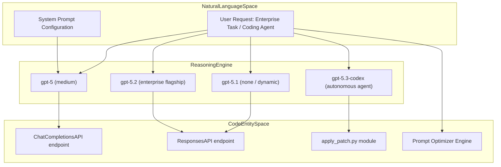
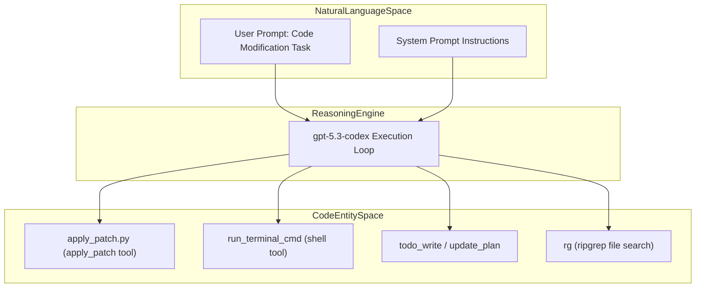
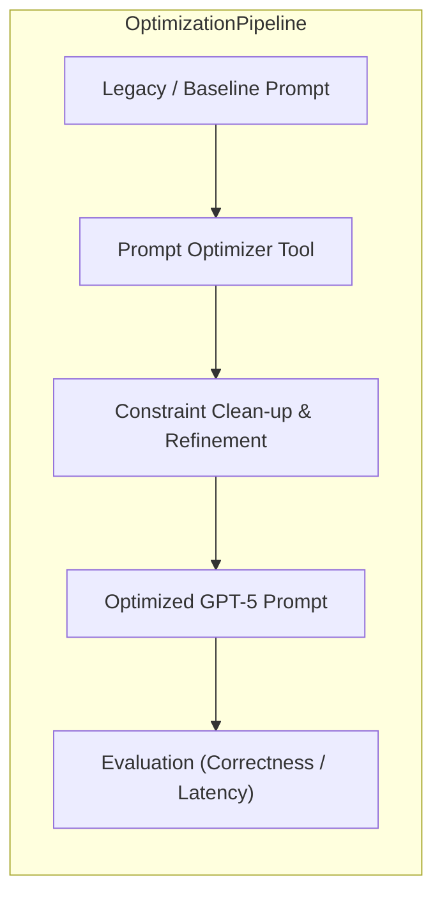

<!-- source: DeepWiki mcp.deepwiki.com · repo openai/openai-cookbook · page 4.2 GPT-5 Model Family and Reasoning Modes · fetched 2026-10-26 -->

# GPT-5 Model Family and Reasoning Modes

Relevant source files

The following files were used as context for generating this wiki page:

- [examples/chatgpt/gpt_actions_library/gpt_action_zapier.ipynb](examples/chatgpt/gpt_actions_library/gpt_action_zapier.ipynb)
- [examples/gpt-5/apply_patch.py](examples/gpt-5/apply_patch.py)
- [examples/gpt-5/codex_prompting_guide.ipynb](examples/gpt-5/codex_prompting_guide.ipynb)
- [examples/gpt-5/gpt-5-1_prompting_guide.ipynb](examples/gpt-5/gpt-5-1_prompting_guide.ipynb)
- [examples/gpt-5/gpt-5-2_prompting_guide.ipynb](examples/gpt-5/gpt-5-2_prompting_guide.ipynb)
- [examples/gpt-5/gpt-5_new_params_and_tools.ipynb](examples/gpt-5/gpt-5_new_params_and_tools.ipynb)
- [examples/gpt-5/gpt-5_prompting_guide.ipynb](examples/gpt-5/gpt-5_prompting_guide.ipynb)
- [examples/gpt-5/gpt-5_troubleshooting_guide.ipynb](examples/gpt-5/gpt-5_troubleshooting_guide.ipynb)
- [examples/gpt-5/outputs/login_page.html](examples/gpt-5/outputs/login_page.html)
- [examples/gpt-5/outputs/retro_dark.html](examples/gpt-5/outputs/retro_dark.html)
- [examples/gpt-5/outputs/retro_light.html](examples/gpt-5/outputs/retro_light.html)
- [examples/gpt-5/outputs/snake_game.html](examples/gpt-5/outputs/snake_game.html)
- [examples/gpt-5/outputs/your_website.html](examples/gpt-5/outputs/your_website.html)
- [examples/gpt-5/prompt-optimization-cookbook.ipynb](examples/gpt-5/prompt-optimization-cookbook.ipynb)
- [examples/stripe_model_eval/selecting_a_model_based_on_stripe_conversion.ipynb](examples/stripe_model_eval/selecting_a_model_based_on_stripe_conversion.ipynb)
- [images/input_image.png](images/input_image.png)
- [images/prompt-optimizer-3-22s.gif](images/prompt-optimizer-3-22s.gif)
- [images/stripe_eval_diagram.png](images/stripe_eval_diagram.png)
- [images/zapier_action_config.png](images/zapier_action_config.png)
- [images/zapier_ai_actions.png](images/zapier_ai_actions.png)

## Purpose and Scope

This document covers the technical architecture, model variants, reasoning effort parameters, tool extensions, and prompting strategies for the GPT-5 model family. It details how to leverage `gpt-5`, `gpt-5.1`, `gpt-5.2`, and `gpt-5.3-codex` through advanced API controls such as verbosity parameters, freeform function calling, Context-Free Grammar (CFG) constraints, and the canonical `apply_patch` tool. Additionally, it details prompt optimization workflows and troubleshooting patterns for agentic applications.

Sources: [examples/gpt-5/prompt-optimization-cookbook.ipynb:16-18](), [examples/gpt-5/gpt-5_new_params_and_tools.ipynb:10-18](), [examples/gpt-5/codex_prompting_guide.ipynb:8-19]()

---

## Model Family Overview

The GPT-5 series introduces multiple specialized variants optimized for distinct latency, intelligence, and agentic autonomy profiles. 

### Model Lineage and Execution Mapping

Title: GPT-5 Model Lineage and API Routing

| Model Identifier | Default Reasoning | Key Architectural Focus | Primary Target Workflows |
|------------------|------------------|-------------------------|--------------------------|
| `gpt-5` | `medium` | General high-intelligence reasoning | Complex multi-step problem solving [examples/gpt-5/gpt-5_prompting_guide.ipynb:9-13]() |
| `gpt-5.1` | `none` | Balanced speed, high steerability, dynamic token scaling | Low-latency agentic workflows [examples/gpt-5/gpt-5-1_prompting_guide.ipynb:8-12]() |
| `gpt-5.2` | `none` | Improved token efficiency, rigorous grounding, structured output | Production enterprise agents [examples/gpt-5/gpt-5-2_prompting_guide.ipynb:10-16]() |
| `gpt-5.3-codex` | Adaptive | PowerShell/Windows optimization, long-horizon persistence | Long-running autonomous coding agents [examples/gpt-5/codex_prompting_guide.ipynb:8-19]() |

Sources: [examples/gpt-5/gpt-5_prompting_guide.ipynb:9-13](), [examples/gpt-5/gpt-5-1_prompting_guide.ipynb:8-12](), [examples/gpt-5/gpt-5-2_prompting_guide.ipynb:10-16](), [examples/gpt-5/codex_prompting_guide.ipynb:8-19]()

---

## Reasoning Control and Parameters

GPT-5 models allow fine-grained control over deliberation depth and response verbosity via API parameters.

### Reasoning Effort Levels
The `reasoning_effort` parameter governs how many internal thinking tokens the model consumes prior to generating final text or tool calls [examples/gpt-5/gpt-5_troubleshooting_guide.ipynb:21-22]().

*   `none`: Bypasses reasoning token generation entirely for minimal latency [examples/gpt-5/gpt-5-1_prompting_guide.ipynb:18-19]().
*   `minimal`: Executes minimal deliberation; ideal for deterministic extraction and short rewrites [examples/gpt-5/gpt-5_new_params_and_tools.ipynb:18-18]().
*   `low`: Terse reasoning for routine tasks [examples/gpt-5/gpt-5_troubleshooting_guide.ipynb:21-22]().
*   `medium`: Balanced default for general problem solving [examples/gpt-5/gpt-5_new_params_and_tools.ipynb:15-15]().
*   `high` / `xhigh`: Deep deliberation for complex software engineering and multi-file codebases [examples/gpt-5/codex_prompting_guide.ipynb:17-17]().

### Verbosity Parameter
The `verbosity` parameter (supporting `low`, `medium`, and `high`) acts as a structural hint to control explanation length without modifying system prompts [examples/gpt-5/gpt-5_new_params_and_tools.ipynb:15-15](). `low` produces terse UI output, while `high` generates detailed explanations suitable for audits and debugging [examples/gpt-5/gpt-5_new_params_and_tools.ipynb:15-15]().

Sources: [examples/gpt-5/gpt-5_new_params_and_tools.ipynb:13-18](), [examples/gpt-5/gpt-5_troubleshooting_guide.ipynb:21-22](), [examples/gpt-5/gpt-5-1_prompting_guide.ipynb:18-19]()

---

## Advanced Tool Integration and Execution

GPT-5 expands tool orchestration capabilities beyond traditional JSON-schema function calling.

### Tool Architecture and Execution Flow

Title: Tool Orchestration from Prompt to Code Entity Space

### Canonical Tool Types
*   `apply_patch`: Implemented in `examples/gpt-5/apply_patch.py`, this is the primary tool for codebase modifications. It accepts structured patch blocks rather than full-file replacements, drastically conserving context windows [examples/gpt-5/gpt-5-1_prompting_guide.ipynb:24-24](), [examples/gpt-5/codex_prompting_guide.ipynb:29-30]().
*   `shell`: Executed via `run_terminal_cmd` for environment inspection and compilation checks [examples/gpt-5/codex_prompting_guide.ipynb:45-45]().
*   **Freeform Function Calling**: Allows the model to output raw text payloads (such as Python scripts, SQL statements, or shell commands) directly to custom runtimes without JSON serialization overhead [examples/gpt-5/gpt-5_new_params_and_tools.ipynb:16-16]().
*   **Context-Free Grammar (CFG)**: Enforces strict syntactic contracts on model output, ensuring compliance with custom domain grammars or programming languages [examples/gpt-5/gpt-5_new_params_and_tools.ipynb:17-17]().

Sources: [examples/gpt-5/gpt-5_new_params_and_tools.ipynb:16-17](), [examples/gpt-5/codex_prompting_guide.ipynb:29-45](), [examples/gpt-5/apply_patch.py:1-1]()

---

## Model-Specific Prompting Strategies

### GPT-5-Codex Autonomy and Persistence
When utilizing `gpt-5.3-codex` for software engineering agents, system prompts must enforce persistence and parallel tool execution [examples/gpt-5/codex_prompting_guide.ipynb:46-54]().
*   **Solver Tool Preference**: Prompt the model to prioritize dedicated tools (`rg`, `read_file`, `apply_patch`) over raw terminal commands [examples/gpt-5/codex_prompting_guide.ipynb:45-45]().
*   **Autonomous End-to-End Execution**: Instruct the model to complete multi-step tasks within a single turn rather than pausing for interim confirmations [examples/gpt-5/codex_prompting_guide.ipynb:53-54]().

### GPT-5.2 Enterprise and Frontend Control
For enterprise deployments of `gpt-5.2`, explicit constraints prevent scope drift and hallucinated design elements [examples/gpt-5/gpt-5-2_prompting_guide.ipynb:12-14]().
*   **Design System Enforcement**: Constrain the model to use existing design tokens, forbidding the invention of unauthorized colors, shadows, or UI components [examples/gpt-5/gpt-5-2_prompting_guide.ipynb:81-90]().
*   **Long-Context Re-grounding**: For context lengths exceeding 10k tokens, prompt the model to build an internal outline and anchor claims to specific section headings [examples/gpt-5/gpt-5-2_prompting_guide.ipynb:105-112]().

Sources: [examples/gpt-5/codex_prompting_guide.ipynb:45-54](), [examples/gpt-5/gpt-5-2_prompting_guide.ipynb:12-90]()

---

## Prompt Optimizer & Migration Workflow

The OpenAI Playground provides the **GPT-5 Prompt Optimizer** (`https://platform.openai.com/chat/edit?optimize=true`) to assist developers in migrating legacy prompts [examples/gpt-5/prompt-optimization-cookbook.ipynb:18-19](). 

### Optimization Cycle

Title: GPT-5 Prompt Optimizer Pipeline

The optimizer detects and eliminates common failure modes:
*   Contradictory instructions within system prompts [examples/gpt-5/prompt-optimization-cookbook.ipynb:34-34]().
*   Ambiguous formatting rules that degrade structured output fidelity [examples/gpt-5/prompt-optimization-cookbook.ipynb:35-35]().
*   Inconsistencies between few-shot examples and task objectives [examples/gpt-5/prompt-optimization-cookbook.ipynb:36-36]().

Sources: [examples/gpt-5/prompt-optimization-cookbook.ipynb:18-38]()

---

## Troubleshooting Guide

When deploying GPT-5 models in production, developers may encounter specific behavioral anomalies:

1.  **Overthinking**: The model spends excessive time deliberating on trivial requests.
    *   *Fix*: Reduce `reasoning_effort` to `minimal` or `low` for routine tasks, and supply an explicit stop condition [examples/gpt-5/gpt-5_troubleshooting_guide.ipynb:21-22]().
2.  **Laziness / Underthinking**: The model produces incomplete solutions or skips verification steps.
    *   *Fix*: Increase `reasoning_effort` or incorporate a self-reflection prompt instructing the model to score its draft against a rubric [examples/gpt-5/gpt-5_troubleshooting_guide.ipynb:63-68]().
3.  **Overly Deferential**: The model pauses frequently to ask for human confirmation.
    *   *Fix*: Include a `<persistence>` instruction block in the system prompt mandating autonomous completion under reasonable assumptions [examples/gpt-5/gpt-5_troubleshooting_guide.ipynb:75-82]().
4.  **Excessive Verbosity**: Final responses contain unwanted conversational padding.
    *   *Fix*: Explicitly lower the `verbosity` parameter or apply output length constraints in the system prompt [examples/gpt-5/gpt-5_troubleshooting_guide.ipynb:88-90]().

Sources: [examples/gpt-5/gpt-5_troubleshooting_guide.ipynb:18-90]()

---

