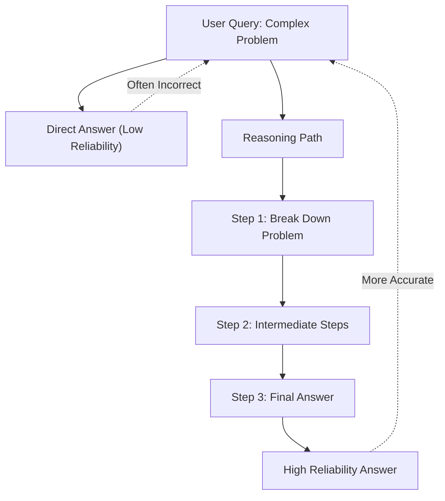
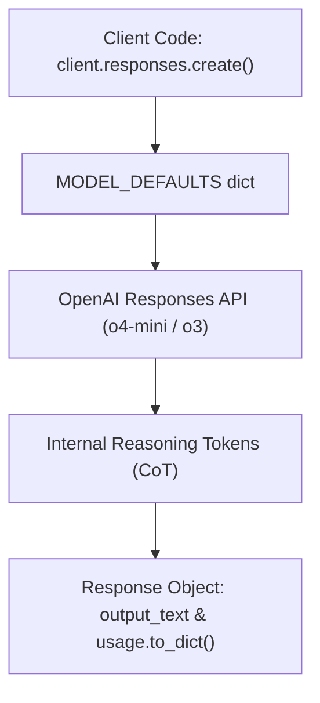
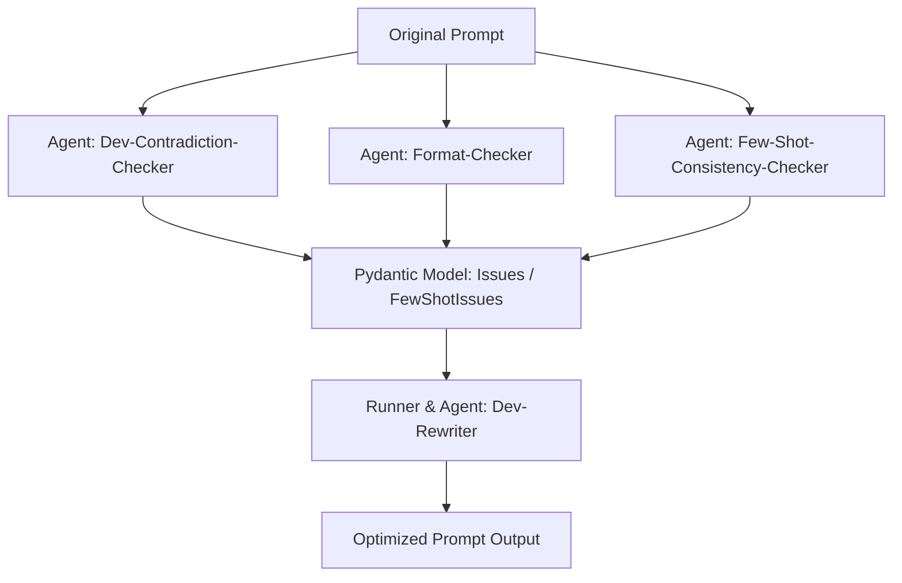
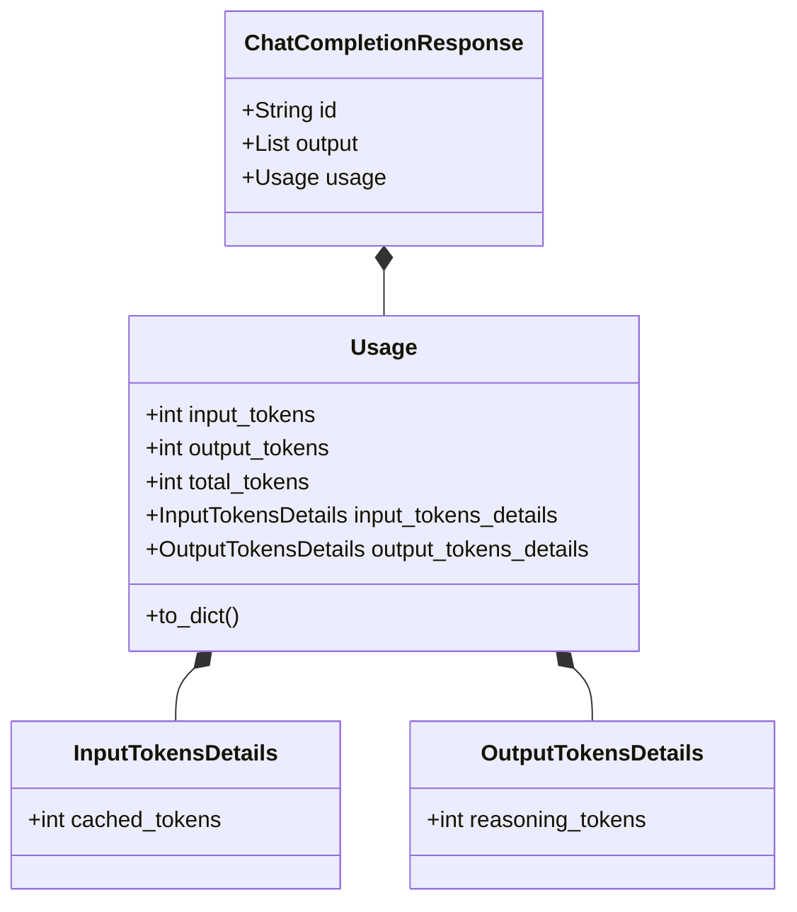

<!-- source: DeepWiki mcp.deepwiki.com · repo openai/openai-cookbook · page 4.3 Prompting Techniques for Reliability · fetched 2026-10-26 -->

# Prompting Techniques for Reliability

Relevant source files

The following files were used as context for generating this wiki page:

- [articles/how_to_work_with_large_language_models.md](articles/how_to_work_with_large_language_models.md)
- [articles/related_resources.md](articles/related_resources.md)
- [articles/techniques_to_improve_reliability.md](articles/techniques_to_improve_reliability.md)
- [articles/text_comparison_examples.md](articles/text_comparison_examples.md)
- [articles/what_makes_documentation_good.md](articles/what_makes_documentation_good.md)
- [examples/Enhance_your_prompts_with_meta_prompting.ipynb](examples/Enhance_your_prompts_with_meta_prompting.ipynb)
- [examples/Optimize_Prompts.ipynb](examples/Optimize_Prompts.ipynb)
- [examples/Search_reranking_with_cross-encoders.ipynb](examples/Search_reranking_with_cross-encoders.ipynb)
- [examples/o-series/o3o4-mini_prompting_guide.ipynb](examples/o-series/o3o4-mini_prompting_guide.ipynb)
- [examples/reasoning_function_calls.ipynb](examples/reasoning_function_calls.ipynb)
- [examples/voice_solutions/arduino_ai_speech_assets/elato-alien.png](examples/voice_solutions/arduino_ai_speech_assets/elato-alien.png)
- [examples/voice_solutions/arduino_ai_speech_assets/pcb-design.png](examples/voice_solutions/arduino_ai_speech_assets/pcb-design.png)

## Purpose and Scope

This document explains advanced prompting techniques designed to improve the reliability and accuracy of responses from OpenAI's language models. These techniques help models reason more effectively, reduce hallucinations, and produce more consistent outputs on complex tasks.

Key concepts covered include **Chain-of-Thought (CoT)**, **Self-Consistency**, **Task Decomposition**, **Meta-Prompting**, **Reasoning Models (o-series)**, **Reasoning Function Calls**, and **Prompt Caching**.

Sources: [articles/techniques_to_improve_reliability.md:1-50](), [articles/how_to_work_with_large_language_models.md:1-18]()

---

## Why Reliability Fails

Language models can fail on complex tasks because they attempt to produce answers too quickly without sufficient reasoning space. Similar to how humans need time to work through a multi-step math problem, models benefit from being prompted to "think through" problems step-by-step [articles/techniques_to_improve_reliability.md:13-15]().

*Figure 1: Comparison between direct prompting paths and multi-step reasoning pathways leading to higher reliability.*

Sources: [articles/techniques_to_improve_reliability.md:1-50]()

---

## Core Reliability Techniques

### Chain-of-Thought (CoT) Prompting
Chain-of-thought prompting asks the model to show its reasoning process before arriving at a final answer.

*   **Zero-Shot CoT**: Adding "Let's think step by step" to the prompt. This simple addition can lift scores on math word problems (GSM8K) from 13% to 41% for models like `text-davinci-002` [articles/related_resources.md:56-56]().
*   **Few-Shot CoT**: Providing examples that include the reasoning steps. This can improve scores on benchmarks like GSM8K from 18% to 57% [articles/related_resources.md:53-53]().

### Self-Consistency
This technique involves generating multiple reasoning paths and taking a vote over the outputs. Voting across 40 outputs has been shown to raise performance on math problems significantly [articles/related_resources.md:54-54]().

### Task Decomposition
Breaking complex tasks into simpler subtasks keeps the model focused. For example, instead of a direct query, a prompt can be structured to:
1. Identify relevant information.
2. Combine clues to reason.
3. Map the result to a final answer [articles/techniques_to_improve_reliability.md:64-136]().

Sources: [articles/related_resources.md:51-57](), [articles/techniques_to_improve_reliability.md:64-136]()

---

## Reasoning Models (o-series) and Reasoning Function Calls

Newer models like `o3` and `o4-mini` are trained with reinforcement learning to perform reasoning natively. They produce a long internal chain of thought before responding to the user [examples/reasoning_function_calls.ipynb:8-9]().

### Managing Reasoning Effort via API
Reasoning models allow developers to control the `effort` parameter via `client.responses.create(...)`, which dictates how much internal reasoning the model performs [examples/reasoning_function_calls.ipynb:39-42]().

*Figure 2: Data flow for reasoning models using `client.responses.create()` and `MODEL_DEFAULTS` configurations.*

Sources: [examples/reasoning_function_calls.ipynb:39-88]()

### Native Tool Reasoning and Function Calling
The `o3`/`o4-mini` models use tools natively within their internal Chain of Thought (CoT), allowing them to reason about *when* and *how* to use a tool before executing it [examples/o-series/o3o4-mini_prompting_guide.ipynb:10-10]().

*   **Developer Messages**: Use `developer` messages (formerly system messages) to set general context and role [examples/o-series/o3o4-mini_prompting_guide.ipynb:52-58]().
*   **Explicit Ordering**: Outline the sequence of functions to call for multi-step tasks to prevent the model from skipping prerequisite steps (e.g., checking if a directory exists before creating a file) [examples/o-series/o3o4-mini_prompting_guide.ipynb:59-70]().
*   **Usage Criteria**: Define clear boundaries in the `description` field of the tool object regarding when to invoke the function and how to construct arguments [examples/o-series/o3o4-mini_prompting_guide.ipynb:89-98]().

Sources: [examples/reasoning_function_calls.ipynb:7-15](), [examples/o-series/o3o4-mini_prompting_guide.ipynb:10-98]()

---

## Meta-Prompting and Optimization

**Meta-prompting** is the technique of using a highly capable model (like `o1-preview`) to generate or improve prompts for a target model (like `gpt-4o`) [examples/Enhance_your_prompts_with_meta_prompting.ipynb:12-12]().

### Multi-Agent Optimization Workflow
The `openai-agents` SDK can be used to build a multi-agent system for prompt optimization using classes such as `Agent`, `Runner`, `Issues`, and `FewShotIssues` [examples/Optimize_Prompts.ipynb:82-144]().

*Figure 3: Multi-agent prompt optimization workflow mapping natural language prompt inputs to `Agent`, `Runner`, and Pydantic validation structures (`Issues`, `FewShotIssues`).*

*   **Dev-Contradiction-Checker**: Scans for logical contradictions in instructions [examples/Optimize_Prompts.ipynb:55-55]().
*   **Format-Checker**: Ensures structured output requirements (JSON/CSV) are explicitly defined [examples/Optimize_Prompts.ipynb:57-57]().
*   **Few-Shot-Consistency-Checker**: Verifies that few-shot examples actually follow the rules in the system prompt [examples/Optimize_Prompts.ipynb:59-59]().

Sources: [examples/Optimize_Prompts.ipynb:51-144](), [examples/Enhance_your_prompts_with_meta_prompting.ipynb:7-16]()

---

## Performance and Cost: Prompt Caching

**Prompt Caching** allows the model to reuse the results of processing a repeated prefix (system instructions, tool definitions, or conversation history).

### Technical Mechanism
Caching targets the Key (K) and Value (V) projections inside the transformer's attention layers. By storing the KV cache for a prefix, the model avoids recomputing attention for those tokens in subsequent requests.

### Caching Monitoring in Code
Caching works automatically for prompts over 1024 tokens. Developers can monitor cache performance via specific fields in the API response usage object (`response.usage.to_dict()`) [examples/reasoning_function_calls.ipynb:133-133]().

*Figure 4: Class diagram showing response usage tracking including `cached_tokens` and `reasoning_tokens`.*

**Implementation Details:**
*   **Cached Tokens**: The `cached_tokens` field indicates how many tokens were served from the cache [examples/reasoning_function_calls.ipynb:119-123]().
*   **Reasoning Tokens**: For o-series models, `reasoning_tokens` are tracked under `output_tokens_details` [examples/reasoning_function_calls.ipynb:122-122]().

Sources: [examples/reasoning_function_calls.ipynb:98-133](), [examples/o-series/o3o4-mini_prompting_guide.ipynb:10-10]()

---

## Advanced Search and Reranking

Reliability in Retrieval-Augmented Generation (RAG) is often improved by moving from simple Bi-Encoders to **Cross-Encoders** for reranking.

*   **Bi-Encoding**: Embeddings are computed once per document/query using tools like `arxiv.Search`. Fast but can lose semantic nuance [examples/Search_reranking_with_cross-encoders.ipynb:22-22]().
*   **Cross-Encoding**: The model processes the query and document together using `OPENAI_MODEL = "gpt-4"`. More accurate but computationally expensive [examples/Search_reranking_with_cross-encoders.ipynb:20-20]().
*   **Hybrid Approach**: Use a Bi-Encoder (e.g., `text-embedding-3-small`) to retrieve top-N candidates, then use a Cross-Encoder (e.g., `gpt-4o` with `logprobs`) to rerank them [examples/Search_reranking_with_cross-encoders.ipynb:24-24]().

Sources: [examples/Search_reranking_with_cross-encoders.ipynb:8-64](), [articles/text_comparison_examples.md:16-34]()

---

