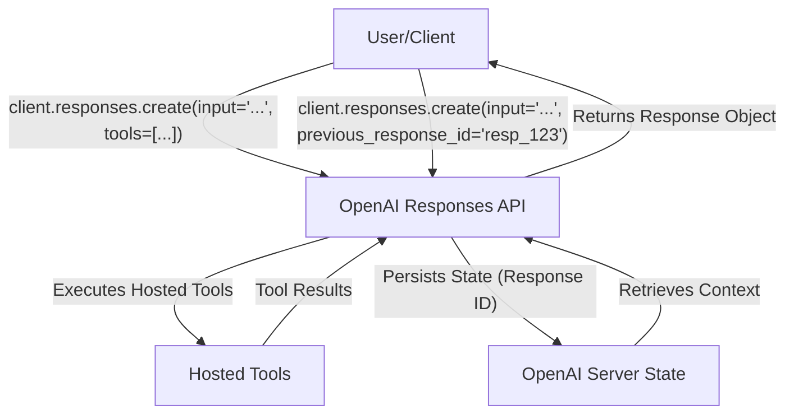
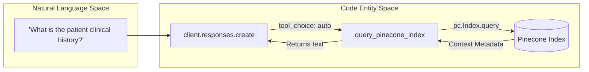
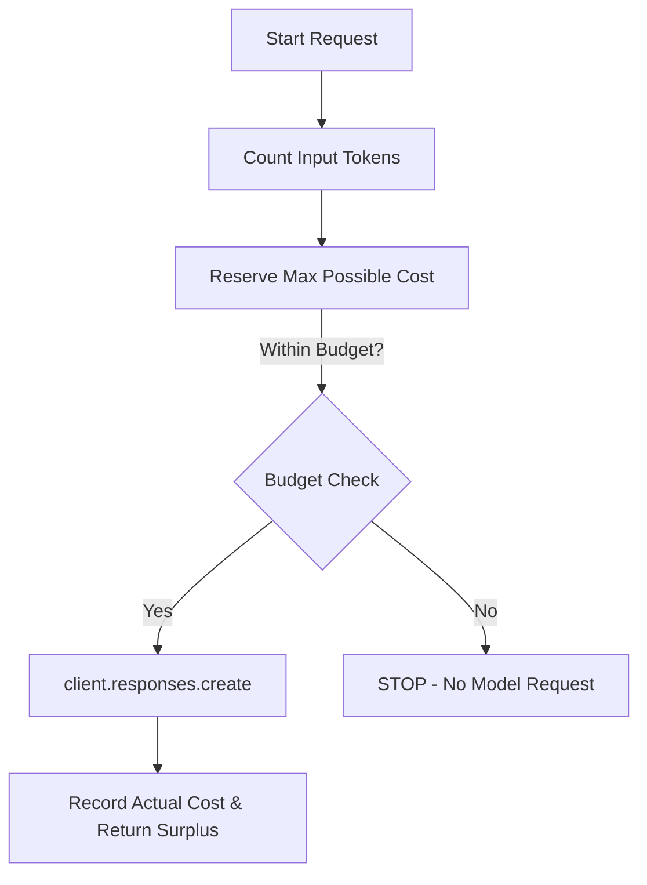
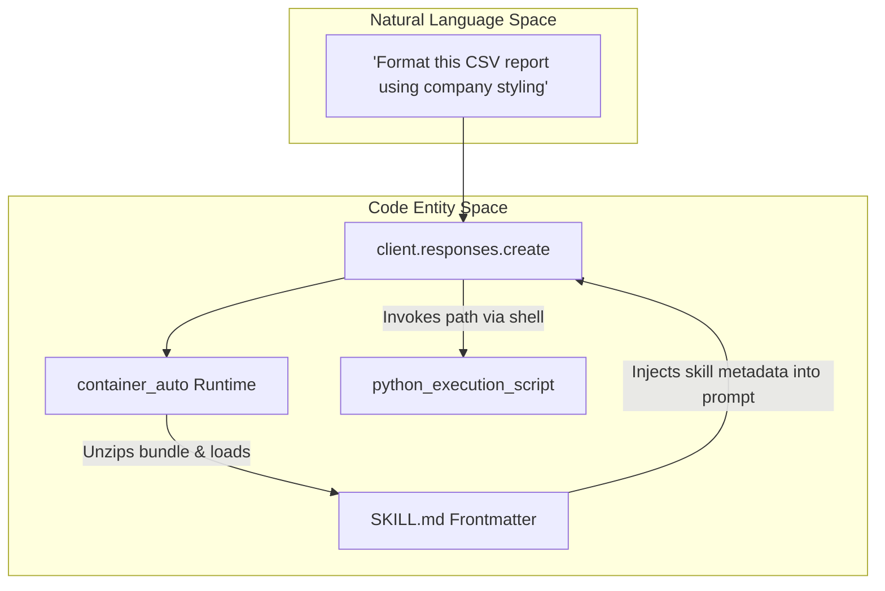

<!-- source: DeepWiki mcp.deepwiki.com · repo openai/openai-cookbook · page 4.4 Responses API · fetched 2026-10-26 -->

# Responses API

Relevant source files

The following files were used as context for generating this wiki page:

- [articles/per_run_spending_controller_responses_api.md](articles/per_run_spending_controller_responses_api.md)
- [authors.yaml](authors.yaml)
- [examples/File_Search_Responses.ipynb](examples/File_Search_Responses.ipynb)
- [examples/agents_sdk/building_reliable_agents_memory_compaction.ipynb](examples/agents_sdk/building_reliable_agents_memory_compaction.ipynb)
- [examples/agents_sdk/context_personalization.ipynb](examples/agents_sdk/context_personalization.ipynb)
- [examples/agents_sdk/session_memory.ipynb](examples/agents_sdk/session_memory.ipynb)
- [examples/completions_usage_api.ipynb](examples/completions_usage_api.ipynb)
- [examples/data/openai_blog_pdfs/1,000 Scientist AI Jam Session _ OpenAI.pdf](examples/data/openai_blog_pdfs/1,000 Scientist AI Jam Session _ OpenAI.pdf)
- [examples/data/openai_blog_pdfs/Announcing The Stargate Project _ OpenAI.pdf](examples/data/openai_blog_pdfs/Announcing The Stargate Project _ OpenAI.pdf)
- [examples/data/openai_blog_pdfs/Bertelsmann powers creativity and productivity with OpenAI _ OpenAI.pdf](examples/data/openai_blog_pdfs/Bertelsmann powers creativity and productivity with OpenAI _ OpenAI.pdf)
- [examples/data/openai_blog_pdfs/Deep research System Card _ OpenAI.pdf](examples/data/openai_blog_pdfs/Deep research System Card _ OpenAI.pdf)
- [examples/data/openai_blog_pdfs/Disrupting malicious uses of AI _ OpenAI.pdf](examples/data/openai_blog_pdfs/Disrupting malicious uses of AI _ OpenAI.pdf)
- [examples/data/openai_blog_pdfs/Introducing GPT-4.5 _ OpenAI.pdf](examples/data/openai_blog_pdfs/Introducing GPT-4.5 _ OpenAI.pdf)
- [examples/data/openai_blog_pdfs/Introducing NextGenAI _ OpenAI.pdf](examples/data/openai_blog_pdfs/Introducing NextGenAI _ OpenAI.pdf)
- [examples/data/openai_blog_pdfs/Introducing Operator _ OpenAI.pdf](examples/data/openai_blog_pdfs/Introducing Operator _ OpenAI.pdf)
- [examples/data/openai_blog_pdfs/Introducing data residency in Europe _ OpenAI.pdf](examples/data/openai_blog_pdfs/Introducing data residency in Europe _ OpenAI.pdf)
- [examples/data/openai_blog_pdfs/Introducing deep research _ OpenAI.pdf](examples/data/openai_blog_pdfs/Introducing deep research _ OpenAI.pdf)
- [examples/evaluation/moving-from-openai-evals-to-promptfoo.md](examples/evaluation/moving-from-openai-evals-to-promptfoo.md)
- [examples/gpt-5/prompt_personalities.ipynb](examples/gpt-5/prompt_personalities.ipynb)
- [examples/gpt4-1_prompting_guide.ipynb](examples/gpt4-1_prompting_guide.ipynb)
- [examples/responses_api/responses_api_tool_orchestration.ipynb](examples/responses_api/responses_api_tool_orchestration.ipynb)
- [examples/responses_api/responses_example.ipynb](examples/responses_api/responses_example.ipynb)
- [examples/skills_in_api.ipynb](examples/skills_in_api.ipynb)
- [images/memory_comparison.jpg](images/memory_comparison.jpg)
- [images/per_run_spending_controller/decision_flow.svg](images/per_run_spending_controller/decision_flow.svg)
- [images/per_run_spending_controller/support_ticket.svg](images/per_run_spending_controller/support_ticket.svg)
- [images/promptfoo-custom-example-view.png](images/promptfoo-custom-example-view.png)
- [images/summarizingSession.jpg](images/summarizingSession.jpg)
- [images/trimingSession.jpg](images/trimingSession.jpg)
- [registry.yaml](registry.yaml)

The Responses API is a modern, stateful alternative to the Chat Completions API, designed for complex, multi-turn interactions, native tool integration, and state persistence [examples/responses_api/responses_example.ipynb:7-17](). This page documents its core architecture, state management mechanics, hosted tools (`file_search`, `web_search`, `code_interpreter`), reasoning items, Pinecone RAG orchestration, per-run spending controls, the Skills API, and migration paths.

---

### Core Concepts and Architecture

The Responses API shifts the responsibility of conversation state management from the client to the OpenAI platform [examples/responses_api/responses_example.ipynb:76-78](). Unlike the stateless Chat Completions API—where the entire conversation history must be transmitted with every call—the Responses API stores thread states server-side and allows clients to reference them using a `previous_response_id` [examples/responses_api/responses_example.ipynb:105-119]().

Sources: [examples/responses_api/responses_example.ipynb:47-52](), [examples/responses_api/responses_example.ipynb:114-119](), [examples/responses_api/responses_example.ipynb:181-185]()

---

### Multi-Turn Stateful Interactions

The API provides native support for stateful continuation and conversation branching [examples/responses_api/responses_example.ipynb:105-145](). 

1. **Stateful Continuation**: By passing `previous_response_id=response.id`, the model automatically inherits all preceding dialogue history and tool outputs [examples/responses_api/responses_example.ipynb:114-119]().
2. **Conversation Forking**: Multiple requests can branch off from the same `response.id`, enabling parallel exploration of distinct user prompts or divergent execution paths without mutating the root history [examples/responses_api/responses_example.ipynb:141-171]().

| Feature | Chat Completions | Responses API |
| :--- | :--- | :--- |
| **State Management** | Client-side (Full history required) | Server-side (Reference by ID) |
| **Tool Execution** | Client-side loop required | Server-side hosted tools |
| **History Access** | Not applicable | `client.responses.retrieve(response_id)` |

Sources: [examples/responses_api/responses_example.ipynb:7-17](), [examples/responses_api/responses_example.ipynb:95-99](), [examples/responses_api/responses_example.ipynb:167-171]()

---

### Hosted Tools and Orchestration

The Responses API integrates hosted tools directly into the runtime, eliminating manual client-side tool execution loops [examples/responses_api/responses_example.ipynb:181-185]().

#### 1. File Search
The `file_search` tool interacts with OpenAI's Vector Stores, managing parsing, chunking, and embedding workflows internally [examples/File_Search_Responses.ipynb:10-14](). Files are uploaded via `client.files.create` and attached to vector stores via `client.vector_stores.files.create` [examples/File_Search_Responses.ipynb:65-72]().

#### 2. Web Search
The `web_search` tool allows models to fetch real-time information by passing `{"type": "web_search"}` in the `tools` configuration array [examples/responses_api/responses_example.ipynb:194-201]().

#### 3. Code Interpreter
The `code_interpreter` tool provides a secure, sandboxed execution environment for performing data analysis and running arbitrary Python code snippets.

Sources: [examples/File_Search_Responses.ipynb:10-14](), [examples/File_Search_Responses.ipynb:65-72](), [examples/responses_api/responses_example.ipynb:181-201]()

---

### Reasoning Items and Effort Control

Reasoning models produce an internal chain of thought before rendering final answers. In the Responses API, these are captured as explicit items within the response structure.

* **Persistence**: Reasoning chains are retained server-side. Referencing `previous_response_id` supplies the model with prior reasoning contexts.
* **Effort Parameters**: Developers can adjust the `reasoning` effort parameter (e.g., `medium`, `high`) to balance model intelligence and response latency.

Sources: [examples/responses_api/responses_example.ipynb:14-17]()

---

### Advanced Tool Orchestration with Pinecone RAG

Developers can combine hosted tools with external vector databases like Pinecone by declaring custom function schemas [examples/responses_api/responses_api_tool_orchestration.ipynb:15-19]().

Sources: [examples/responses_api/responses_api_tool_orchestration.ipynb:15-19](), [examples/responses_api/responses_api_tool_orchestration.ipynb:61-65](), [examples/responses_api/responses_api_tool_orchestration.ipynb:254-270]()

---

### Per-Run Spending Controller

For long-running autonomous workflows, the Responses API can be integrated with budgeting guards to enforce strict cost limits per execution run [articles/per_run_spending_controller_responses_api.md:3-5]().

Sources: [articles/per_run_spending_controller_responses_api.md:3-9](), [articles/per_run_spending_controller_responses_api.md:123-136]()

---

### Skills API Integration

The Skills API packages procedural workflows—including instructions, scripts, and static assets—into a zipped directory anchored by a required `SKILL.md` manifest [examples/skills_in_api.ipynb:38](). When attached to hosted execution environments (`environment.type="container_auto"`), the service extracts the bundle, parses the frontmatter descriptions, and makes capabilities available to the model on demand [examples/skills_in_api.ipynb:40-45]().

Sources: [examples/skills_in_api.ipynb:38-45]()

---

### Migration from Chat Completions

Migrating an application from Chat Completions to the Responses API involves updating endpoint calls and response parsers [examples/responses_api/responses_example.ipynb:47-69]().

1. **Endpoint Replacement**: Switch from `client.chat.completions.create` to `client.responses.create` [examples/responses_api/responses_example.ipynb:47-52]().
2. **Payload Adjustment**: Use the `input` field for strings or message arrays instead of `messages` [examples/responses_api/responses_example.ipynb:49]().
3. **Output Extraction**: Parse text outputs from `response.output[i].content[j].text` [examples/responses_api/responses_example.ipynb:69]().
4. **State Management**: Remove manual array appending of history; rely on `previous_response_id` [examples/responses_api/responses_example.ipynb:114-119]().

Sources: [examples/responses_api/responses_example.ipynb:47-52](), [examples/responses_api/responses_example.ipynb:69](), [examples/responses_api/responses_example.ipynb:114-119]()

---

