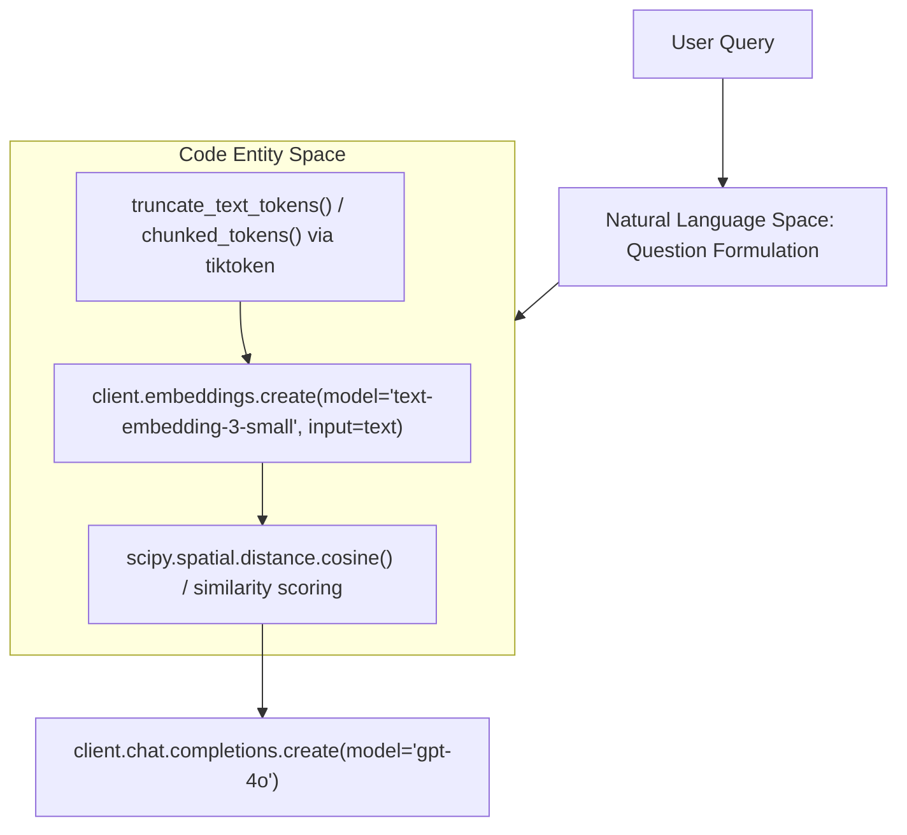
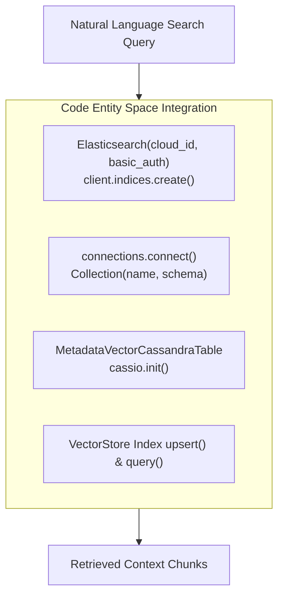

<!-- source: DeepWiki mcp.deepwiki.com · repo openai/openai-cookbook · page 5 Embeddings and Vector Search · fetched 2026-10-26 -->

# Embeddings and Vector Search

Relevant source files

The following files were used as context for generating this wiki page:

- [articles/what_is_new_with_dalle_3.mdx](articles/what_is_new_with_dalle_3.mdx)
- [examples/Code_search_using_embeddings.ipynb](examples/Code_search_using_embeddings.ipynb)
- [examples/Embedding_Wikipedia_articles_for_search.ipynb](examples/Embedding_Wikipedia_articles_for_search.ipynb)
- [examples/Embedding_long_inputs.ipynb](examples/Embedding_long_inputs.ipynb)
- [examples/Fine-tuned_classification.ipynb](examples/Fine-tuned_classification.ipynb)
- [examples/How_to_count_tokens_with_tiktoken.ipynb](examples/How_to_count_tokens_with_tiktoken.ipynb)
- [examples/How_to_format_inputs_to_ChatGPT_models.ipynb](examples/How_to_format_inputs_to_ChatGPT_models.ipynb)
- [examples/Question_answering_using_a_search_API.ipynb](examples/Question_answering_using_a_search_API.ipynb)
- [examples/Question_answering_using_embeddings.ipynb](examples/Question_answering_using_embeddings.ipynb)
- [examples/RAG_with_graph_db.ipynb](examples/RAG_with_graph_db.ipynb)
- [examples/Unit_test_writing_using_a_multi-step_prompt.ipynb](examples/Unit_test_writing_using_a_multi-step_prompt.ipynb)
- [examples/Unit_test_writing_using_a_multi-step_prompt_with_older_completions_API.ipynb](examples/Unit_test_writing_using_a_multi-step_prompt_with_older_completions_API.ipynb)
- [examples/Using_embeddings.ipynb](examples/Using_embeddings.ipynb)
- [examples/Using_logprobs.ipynb](examples/Using_logprobs.ipynb)
- [examples/data/amazon_product_kg.json](examples/data/amazon_product_kg.json)
- [examples/data/winter_olympics_2022.csv](examples/data/winter_olympics_2022.csv)
- [examples/evaluation/How_to_eval_abstractive_summarization.ipynb](examples/evaluation/How_to_eval_abstractive_summarization.ipynb)
- [examples/vector_databases/README.md](examples/vector_databases/README.md)
- [examples/vector_databases/cassandra_astradb/Philosophical_Quotes_AstraPy.ipynb](examples/vector_databases/cassandra_astradb/Philosophical_Quotes_AstraPy.ipynb)
- [examples/vector_databases/cassandra_astradb/Philosophical_Quotes_CQL.ipynb](examples/vector_databases/cassandra_astradb/Philosophical_Quotes_CQL.ipynb)
- [examples/vector_databases/cassandra_astradb/Philosophical_Quotes_cassIO.ipynb](examples/vector_databases/cassandra_astradb/Philosophical_Quotes_cassIO.ipynb)
- [examples/vector_databases/cassandra_astradb/README.md](examples/vector_databases/cassandra_astradb/README.md)
- [examples/vector_databases/cassandra_astradb/sources/philo_quotes.json](examples/vector_databases/cassandra_astradb/sources/philo_quotes.json)
- [examples/vector_databases/elasticsearch/README.md](examples/vector_databases/elasticsearch/README.md)
- [examples/vector_databases/elasticsearch/elasticsearch-retrieval-augmented-generation.ipynb](examples/vector_databases/elasticsearch/elasticsearch-retrieval-augmented-generation.ipynb)
- [examples/vector_databases/elasticsearch/elasticsearch-semantic-search.ipynb](examples/vector_databases/elasticsearch/elasticsearch-semantic-search.ipynb)
- [images/search_rerank_answer.png](images/search_rerank_answer.png)

This page provides an overview of text embeddings, semantic similarity search, and retrieval-augmented generation (RAG) patterns in the OpenAI Cookbook. Embeddings transform text strings into dense vector representations where semantic proximity translates to geometric closeness in a high-dimensional vector space [examples/vector_databases/cassandra_astradb/Philosophical_Quotes_CQL.ipynb:45-66]().

As a parent page, this guide outlines the core architectural patterns and routes you to detailed child pages for specific implementations:
- For the underlying API, RAG workflows, Search-Ask architecture, token management, and advanced reranking, see [Embeddings Fundamentals and RAG](#5.1).
- For scalable storage across 25+ vector database providers, see [Vector Database Integration](#5.2).
- For downstream applications including zero-shot classification, K-means clustering, semantic search, and dimensionality reduction, see [Classification, Clustering, and Semantic Search](#5.3).

---

## Embeddings Fundamentals and RAG

The cookbook establishes a foundational **Search-Ask** methodology to enable GPT models to reason over private or real-time data [examples/Question_answering_using_embeddings.ipynb:19-22](). Rather than relying solely on model weights (long-term memory via fine-tuning), RAG injects precise context into message inputs (short-term memory) [examples/Question_answering_using_embeddings.ipynb:31-43]().

The pipeline involves chunking raw source documents, generating vectors via `client.embeddings.create()`, storing them, and retrieving the most relevant segments for prompt inclusion [examples/Question_answering_using_embeddings.ipynb:82-96]().

Title: "Natural Language RAG Space to Code Entity Space"

Sources: [examples/Question_answering_using_embeddings.ipynb:19-96](), [examples/Embedding_long_inputs.ipynb:38-105]()

For comprehensive documentation on token limits, handling long inputs, PDF parsing, entity extraction, cross-encoder reranking, and graph RAG with Neo4j, see [Embeddings Fundamentals and RAG](#5.1).

---

## Vector Database Integration

While in-memory pandas DataFrames or CSV files are sufficient for small datasets [examples/Question_answering_using_embeddings.ipynb:90-90](), production-grade knowledge retrieval requires dedicated vector databases to perform rapid approximate nearest neighbor (ANN) searches at scale [examples/vector_databases/README.md:1-6]().

The cookbook provides structured integration guides for over 25 vector database providers, demonstrating how to map embedding vectors and metadata into specialized indexing structures [examples/vector_databases/README.md:9-32]().

Title: "Natural Language Vector Store to Code Entity Space"

Sources: [examples/vector_databases/README.md:1-32](), [examples/vector_databases/elasticsearch/elasticsearch-semantic-search.ipynb:92-201](), [examples/vector_databases/cassandra_astradb/Philosophical_Quotes_cassIO.ipynb:112-114]()

For step-by-step notebooks covering Qdrant, Milvus/Zilliz, Pinecone, Redis, Chroma, Weaviate, Elasticsearch, MyScale, Cassandra/AstraDB, Oracle DB, BigQuery, and Azure AI Search, see [Vector Database Integration](#5.2).

---

## Classification, Clustering, and Semantic Search

Beyond powering Retrieval-Augmented Generation, vector embeddings serve as powerful numerical representations for diverse machine learning and analytical workloads without requiring fine-tuned model weights [examples/vector_databases/cassandra_astradb/Philosophical_Quotes_CQL.ipynb:45-66]().

Common application patterns implemented in the cookbook include zero-shot and multiclass text classification, grouping unlabelled records with K-means clustering, computing semantic recommendations, and visualizing high-dimensional manifolds using PCA and t-SNE [examples/Using_logprobs.ipynb:19-25]().

For detailed code examples and implementation recipes on classification, clustering, regression, and visualization techniques, see [Classification, Clustering, and Semantic Search](#5.3).

---

