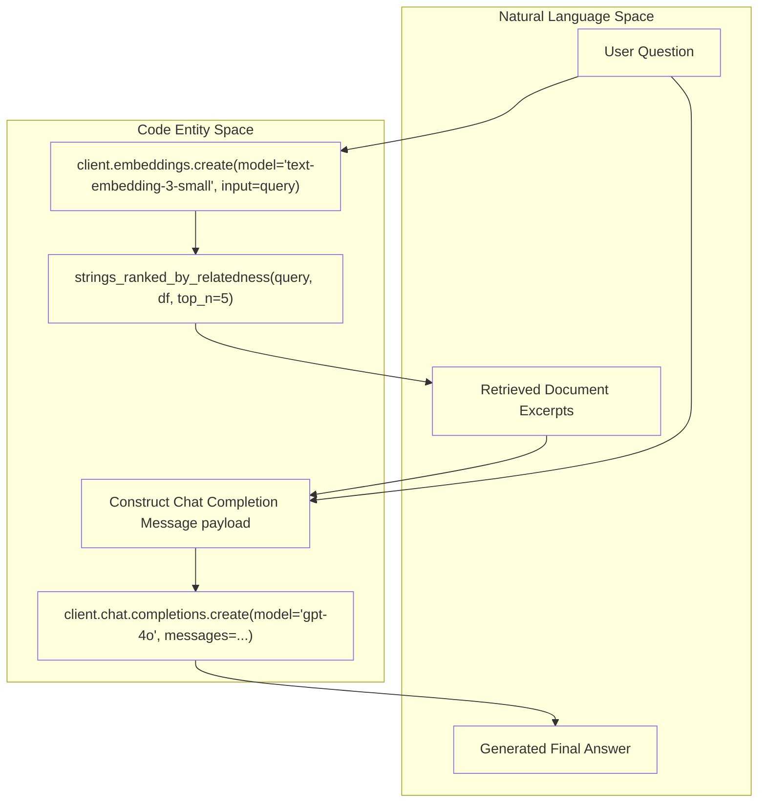
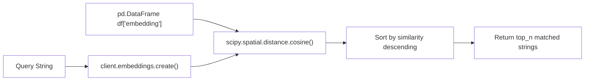

<!-- source: DeepWiki mcp.deepwiki.com · repo openai/openai-cookbook · page 5.1 Embeddings Fundamentals and RAG · fetched 2026-10-26 -->

# Embeddings Fundamentals and RAG

<details>
<summary>Relevant source files</summary>

The following files were used as context for generating this wiki page:

- [articles/how_to_work_with_large_language_models.md](articles/how_to_work_with_large_language_models.md)
- [articles/related_resources.md](articles/related_resources.md)
- [articles/techniques_to_improve_reliability.md](articles/techniques_to_improve_reliability.md)
- [articles/text_comparison_examples.md](articles/text_comparison_examples.md)
- [articles/what_makes_documentation_good.md](articles/what_makes_documentation_good.md)
- [examples/Code_search_using_embeddings.ipynb](examples/Code_search_using_embeddings.ipynb)
- [examples/Embedding_Wikipedia_articles_for_search.ipynb](examples/Embedding_Wikipedia_articles_for_search.ipynb)
- [examples/Embedding_long_inputs.ipynb](examples/Embedding_long_inputs.ipynb)
- [examples/Entity_extraction_for_long_documents.ipynb](examples/Entity_extraction_for_long_documents.ipynb)
- [examples/Fine-tuned_classification.ipynb](examples/Fine-tuned_classification.ipynb)
- [examples/How_to_count_tokens_with_tiktoken.ipynb](examples/How_to_count_tokens_with_tiktoken.ipynb)
- [examples/How_to_format_inputs_to_ChatGPT_models.ipynb](examples/How_to_format_inputs_to_ChatGPT_models.ipynb)
- [examples/Parse_PDF_docs_for_RAG.ipynb](examples/Parse_PDF_docs_for_RAG.ipynb)
- [examples/Question_answering_using_a_search_API.ipynb](examples/Question_answering_using_a_search_API.ipynb)
- [examples/Question_answering_using_embeddings.ipynb](examples/Question_answering_using_embeddings.ipynb)
- [examples/RAG_with_graph_db.ipynb](examples/RAG_with_graph_db.ipynb)
- [examples/Search_reranking_with_cross-encoders.ipynb](examples/Search_reranking_with_cross-encoders.ipynb)
- [examples/Unit_test_writing_using_a_multi-step_prompt.ipynb](examples/Unit_test_writing_using_a_multi-step_prompt.ipynb)
- [examples/Unit_test_writing_using_a_multi-step_prompt_with_older_completions_API.ipynb](examples/Unit_test_writing_using_a_multi-step_prompt_with_older_completions_API.ipynb)
- [examples/Using_embeddings.ipynb](examples/Using_embeddings.ipynb)
- [examples/Using_logprobs.ipynb](examples/Using_logprobs.ipynb)
- [examples/data/amazon_product_kg.json](examples/data/amazon_product_kg.json)
- [examples/data/example_pdfs/evals-decks.pdf](examples/data/example_pdfs/evals-decks.pdf)
- [examples/data/example_pdfs/fine-tuning-deck.pdf](examples/data/example_pdfs/fine-tuning-deck.pdf)
- [examples/data/example_pdfs/models-page.pdf](examples/data/example_pdfs/models-page.pdf)
- [examples/data/example_pdfs/rag-deck.pdf](examples/data/example_pdfs/rag-deck.pdf)
- [examples/data/fia_f1_power_unit_financial_regulations_issue_1_-_2022-08-16.pdf](examples/data/fia_f1_power_unit_financial_regulations_issue_1_-_2022-08-16.pdf)
- [examples/data/parsed_pdf_docs.json](examples/data/parsed_pdf_docs.json)
- [examples/data/parsed_pdf_docs_with_embeddings.csv](examples/data/parsed_pdf_docs_with_embeddings.csv)
- [examples/data/winter_olympics_2022.csv](examples/data/winter_olympics_2022.csv)
- [examples/evaluation/How_to_eval_abstractive_summarization.ipynb](examples/evaluation/How_to_eval_abstractive_summarization.ipynb)
- [examples/voice_solutions/arduino_ai_speech_assets/elato-alien.png](examples/voice_solutions/arduino_ai_speech_assets/elato-alien.png)
- [examples/voice_solutions/arduino_ai_speech_assets/pcb-design.png](examples/voice_solutions/arduino_ai_speech_assets/pcb-design.png)
- [images/search_rerank_answer.png](images/search_rerank_answer.png)

</details>


## Purpose and Scope

This document covers the fundamentals of text embeddings and Retrieval-Augmented Generation (RAG) workflows using OpenAI's embeddings API. It explains the Search-Ask pattern for question answering, token counting with `tiktoken`, query generation strategies, and techniques for handling inputs that exceed model context lengths. It also documents advanced retrieval patterns including PDF parsing, entity extraction from long documents, search reranking with cross-encoders, and graph-based RAG with Neo4j.

For vector database integration with 25+ providers, see [Vector Database Integration](5.2). For embeddings applications including classification, clustering, and semantic search, see [Classification, Clustering, and Semantic Search](5.3).

Sources: `[examples/Question_answering_using_embeddings.ipynb:1-23]()`, `[examples/Embedding_long_inputs.ipynb:1-13]()`, `[examples/Parse_PDF_docs_for_RAG.ipynb:1-20]()`, `[examples/RAG_with_graph_db.ipynb:1-15]()`

---

## Embeddings API Fundamentals

### What Are Embeddings?

Text embeddings are numerical vector representations of text that capture semantic meaning. OpenAI's embeddings API converts text strings into high-dimensional vectors (e.g., 1536 dimensions for `text-embedding-3-small`) that can be compared using distance metrics `[examples/Question_answering_using_embeddings.ipynb:69-71]()`.

```python
# Basic embeddings API usage
client = OpenAI()
response = client.embeddings.create(
    model="text-embedding-3-small",
    input="Your text here"
)
embedding = response.data[0].embedding  # Returns list of floats
```

### Supported Models and Encodings

| Model | Dimensions | Encoding | Use Case |
|-------|-----------|----------|----------|
| `text-embedding-3-small` | 1536 | `cl100k_base` | Most cost-effective for general use |
| `text-embedding-3-large` | 3072 | `cl100k_base` | Higher accuracy for complex tasks |
| `text-embedding-ada-002` | 1536 | `cl100k_base` | Legacy model |

Sources: `[examples/Question_answering_using_embeddings.ipynb:137-142]()`, `[examples/How_to_count_tokens_with_tiktoken.ipynb:25-27]`, `[examples/Embedding_long_inputs.ipynb:38-40]()`

### Similarity Calculation

Embeddings enable semantic similarity comparison using cosine similarity `[examples/Question_answering_using_embeddings.ipynb:71-73]()`. Because OpenAI embeddings are normalized to length 1, calculating cosine similarity is equivalent to taking the dot product between two vectors `[examples/Question_answering_using_a_search_API.ipynb:375-379]()`.

```python
def cosine_similarity(a, b):
    return np.dot(a, b) / (np.linalg.norm(a) * np.linalg.norm(b))
```

Sources: `[examples/Question_answering_using_embeddings.ipynb:129-135]()`, `[examples/Question_answering_using_a_search_API.ipynb:65-65]()`

---

## RAG Architecture: The Search-Ask Pattern

### Overview

RAG (Retrieval-Augmented Generation) addresses the knowledge cutoff limitation of GPT models by inserting relevant context into prompts `[examples/Question_answering_using_embeddings.ipynb:11-17]()`. The Search-Ask pattern is a two-step method:

1. **Search:** Search your library of text for relevant text sections using embedding-based similarity `[examples/Question_answering_using_embeddings.ipynb:21-21]()`.
2. **Ask:** Insert the retrieved text sections into a message to GPT and ask the question `[examples/Question_answering_using_embeddings.ipynb:22-22]()`.

#### Diagram: Natural Language to Code Entity Mapping for Search-Ask RAG


Sources: `[examples/Question_answering_using_embeddings.ipynb:19-22]()`, `[examples/Question_answering_using_embeddings.ipynb:84-97]()`

### Search Implementation

The `strings_ranked_by_relatedness` pattern implements search by comparing a query embedding against a pre-computed dataframe of document embeddings `[examples/Question_answering_using_embeddings.ipynb:607-627]()`.

#### Diagram: Document Search Flow via Code Symbols


Sources: `[examples/Question_answering_using_embeddings.ipynb:129-142]`, `[examples/Question_answering_using_embeddings.ipynb:607-627]()`

---

## Token Management with `tiktoken`

### Why Token Counting Matters

GPT models process text as tokens. Knowing token counts is essential for:
1. **Context Limits:** Determining if a string is too long for the model (e.g., 128k tokens for `gpt-4o`) `[examples/Question_answering_using_embeddings.ipynb:46-50]()`.
2. **Cost Management:** API usage is priced per token `[examples/How_to_count_tokens_with_tiktoken.ipynb:14-14]()`.

### Encoding Models

| Encoding Name | OpenAI Models |
|---------------|---------------|
| `o200k_base` | `gpt-4o`, `gpt-4o-mini` |
| `cl100k_base` | `gpt-4-turbo`, `gpt-4`, `gpt-3.5-turbo`, `text-embedding-3-small` |
| `p50k_base` | Codex models, `text-davinci-003` |

Sources: `[examples/How_to_count_tokens_with_tiktoken.ipynb:23-29]()`

### Basic Token Counting

```python
import tiktoken
encoding = tiktoken.encoding_for_model("gpt-4o-mini")
tokens = encoding.encode("tiktoken is great!") 
num_tokens = len(tokens)
```

Sources: `[examples/How_to_count_tokens_with_tiktoken.ipynb:145-173]()`

---

## Handling Long Inputs

### Context Length Limits

Embedding models have hard token limits (e.g., 8191 for `text-embedding-3-small`) `[examples/Embedding_long_inputs.ipynb:38-40]()`. Exceeding these limits raises a `BadRequestError` `[examples/Embedding_long_inputs.ipynb:69-74]()`.

### Strategy 1: Truncation

Truncating input text to the maximum allowed length after tokenization `[examples/Embedding_long_inputs.ipynb:89-91]()`.

```python
def truncate_text_tokens(text, max_tokens=8191):
    encoding = tiktoken.get_encoding("cl100k_base")
    return encoding.encode(text)[:max_tokens]
```

Sources: `[examples/Embedding_long_inputs.ipynb:102-106]()`

### Strategy 2: Chunking and Averaging

Dividing text into chunks, embedding each individually, and averaging the resulting embeddings (weighted by chunk size) `[examples/Embedding_long_inputs.ipynb:142-144]()`.

```python
def len_safe_get_embedding(text, model="text-embedding-3-small", average=True):
    # chunk tokens using batched()
    # get embeddings for each chunk
    if average:
        return np.average(chunk_embeddings, axis=0, weights=chunk_lens).tolist()
```

Sources: `[examples/Embedding_long_inputs.ipynb:204-215]()`

---

## PDF Parsing and Document Preparation

For RAG systems built over unstructured PDF manuals or reports, `Parse_PDF_docs_for_RAG.ipynb` demonstrates extracting text layers, preserving section hierarchies, and parsing documents into discrete sections suitable for embedding generation and vector search.

Sources: `[examples/Parse_PDF_docs_for_RAG.ipynb:1-40]()`

---

## Entity Extraction for Long Documents

When documents exceed standard context limits, `Entity_extraction_for_long_documents.ipynb` implements a chunked entity extraction pattern. Using `textract` for PDF text ingestion combined with `create_chunks()` and `extract_chunk()` functions, the system queries GPT-4 across sequential sections to extract key figures, dates, and financial metrics before synthesizing results.

```python
# Chunking and extraction pattern in Entity_extraction_for_long_documents.ipynb
chunks = create_chunks(clean_text, 1000, tokenizer)
for chunk in text_chunks:
    results.append(extract_chunk(chunk, template_prompt))
```

Sources: `[examples/Entity_extraction_for_long_documents.ipynb:7-25]()`, `[examples/Entity_extraction_for_long_documents.ipynb:111-149]()`

---

## Search Reranking with Cross-Encoders

While embeddings (bi-encoders) scale efficiently as `D + Q` over large corpora, their semantic matching can miss domain-specific nuances. The `Search_reranking_with_cross-encoders.ipynb` notebook implements a hybrid two-stage retrieval architecture: over-fetching candidate documents via bi-encoder similarity, and then re-ranking them using a cross-encoder pattern powered by GPT models with `logprobs` enabled.

Sources: `[examples/Search_reranking_with_cross-encoders.ipynb:1-32]()`, `[examples/Search_reranking_with_cross-encoders.ipynb:62-65]()`

---

## Graph RAG with Neo4j

Beyond flat vector stores, `RAG_with_graph_db.ipynb` explores graph-based Retrieval-Augmented Generation. By modeling entities and relationships inside a graph database like Neo4j, the system executes graph queries to retrieve structured relational context alongside vector search results, giving GPT models a richer multi-hop understanding of interconnected data.

Sources: `[examples/RAG_with_graph_db.ipynb:1-25]()`

---

