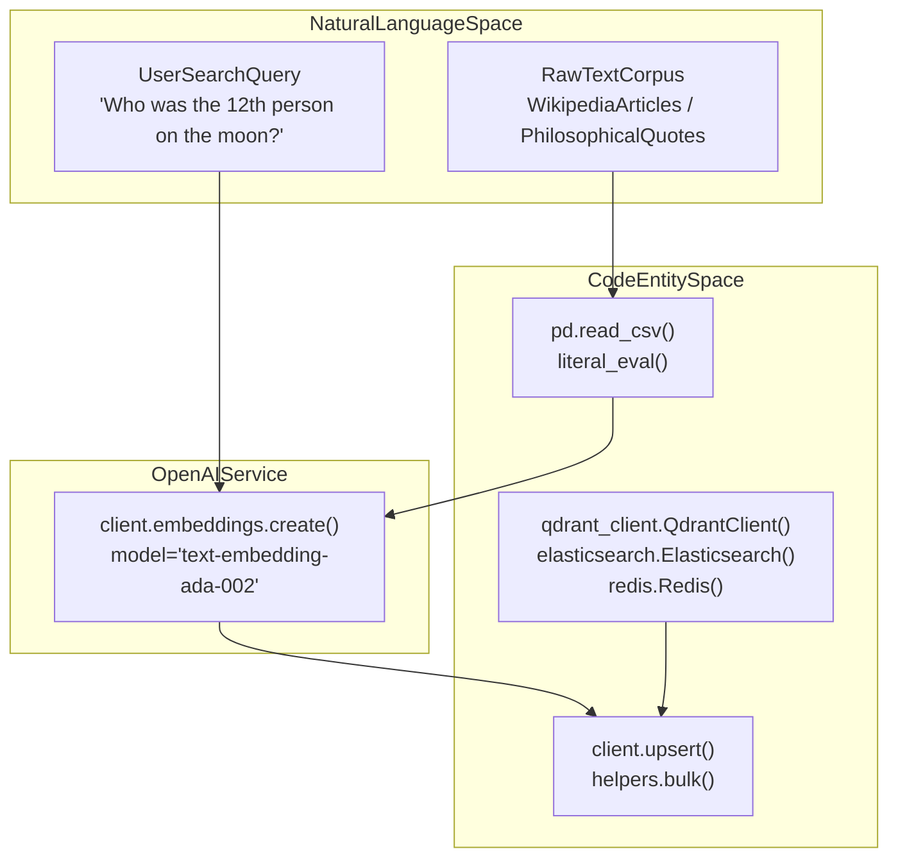
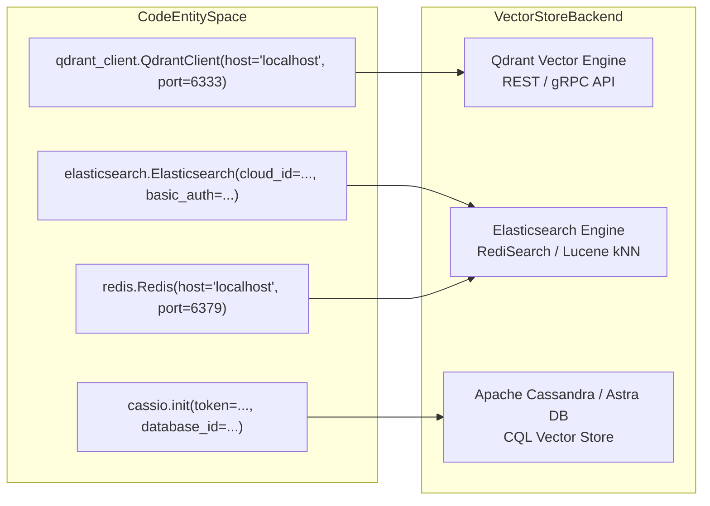

<!-- source: DeepWiki mcp.deepwiki.com · repo openai/openai-cookbook · page 5.2 Vector Database Integration · fetched 2026-10-26 -->

# Vector Database Integration

Relevant source files

The following files were used as context for generating this wiki page:

- [articles/what_is_new_with_dalle_3.mdx](articles/what_is_new_with_dalle_3.mdx)
- [examples/How_to_call_functions_for_knowledge_retrieval.ipynb](examples/How_to_call_functions_for_knowledge_retrieval.ipynb)
- [examples/How_to_call_functions_with_chat_models.ipynb](examples/How_to_call_functions_with_chat_models.ipynb)
- [examples/chatgpt/rag-quickstart/gcp/Getting_started_with_bigquery_vector_search_and_openai.ipynb](examples/chatgpt/rag-quickstart/gcp/Getting_started_with_bigquery_vector_search_and_openai.ipynb)
- [examples/chatgpt/rag-quickstart/gcp/main.py](examples/chatgpt/rag-quickstart/gcp/main.py)
- [examples/chatgpt/rag-quickstart/gcp/requirements.txt](examples/chatgpt/rag-quickstart/gcp/requirements.txt)
- [examples/data/Chinook.db](examples/data/Chinook.db)
- [examples/data/papers/.gitkeep](examples/data/papers/.gitkeep)
- [examples/data/styles_2k.csv](examples/data/styles_2k.csv)
- [examples/data/styles_44k.csv](examples/data/styles_44k.csv)
- [examples/vector_databases/README.md](examples/vector_databases/README.md)
- [examples/vector_databases/cassandra_astradb/Philosophical_Quotes_AstraPy.ipynb](examples/vector_databases/cassandra_astradb/Philosophical_Quotes_AstraPy.ipynb)
- [examples/vector_databases/cassandra_astradb/Philosophical_Quotes_CQL.ipynb](examples/vector_databases/cassandra_astradb/Philosophical_Quotes_CQL.ipynb)
- [examples/vector_databases/cassandra_astradb/Philosophical_Quotes_cassIO.ipynb](examples/vector_databases/cassandra_astradb/Philosophical_Quotes_cassIO.ipynb)
- [examples/vector_databases/cassandra_astradb/README.md](examples/vector_databases/cassandra_astradb/README.md)
- [examples/vector_databases/cassandra_astradb/sources/philo_quotes.json](examples/vector_databases/cassandra_astradb/sources/philo_quotes.json)
- [examples/vector_databases/chroma/Using_Chroma_for_embeddings_search.ipynb](examples/vector_databases/chroma/Using_Chroma_for_embeddings_search.ipynb)
- [examples/vector_databases/elasticsearch/README.md](examples/vector_databases/elasticsearch/README.md)
- [examples/vector_databases/elasticsearch/elasticsearch-retrieval-augmented-generation.ipynb](examples/vector_databases/elasticsearch/elasticsearch-retrieval-augmented-generation.ipynb)
- [examples/vector_databases/elasticsearch/elasticsearch-semantic-search.ipynb](examples/vector_databases/elasticsearch/elasticsearch-semantic-search.ipynb)
- [examples/vector_databases/milvus/Filtered_search_with_Milvus_and_OpenAI.ipynb](examples/vector_databases/milvus/Filtered_search_with_Milvus_and_OpenAI.ipynb)
- [examples/vector_databases/milvus/Getting_started_with_Milvus_and_OpenAI.ipynb](examples/vector_databases/milvus/Getting_started_with_Milvus_and_OpenAI.ipynb)
- [examples/vector_databases/myscale/Using_MyScale_for_embeddings_search.ipynb](examples/vector_databases/myscale/Using_MyScale_for_embeddings_search.ipynb)
- [examples/vector_databases/oracle_db/README.md](examples/vector_databases/oracle_db/README.md)
- [examples/vector_databases/oracle_db/deep_research_openai_agents.ipynb](examples/vector_databases/oracle_db/deep_research_openai_agents.ipynb)
- [examples/vector_databases/oracle_db/oracle_vector_search_langchain.ipynb](examples/vector_databases/oracle_db/oracle_vector_search_langchain.ipynb)
- [examples/vector_databases/pinecone/GPT4_Retrieval_Augmentation.ipynb](examples/vector_databases/pinecone/GPT4_Retrieval_Augmentation.ipynb)
- [examples/vector_databases/pinecone/Gen_QA.ipynb](examples/vector_databases/pinecone/Gen_QA.ipynb)
- [examples/vector_databases/pinecone/README.md](examples/vector_databases/pinecone/README.md)
- [examples/vector_databases/pinecone/Semantic_Search.ipynb](examples/vector_databases/pinecone/Semantic_Search.ipynb)
- [examples/vector_databases/pinecone/Using_Pinecone_for_embeddings_search.ipynb](examples/vector_databases/pinecone/Using_Pinecone_for_embeddings_search.ipynb)
- [examples/vector_databases/qdrant/Getting_started_with_Qdrant_and_OpenAI.ipynb](examples/vector_databases/qdrant/Getting_started_with_Qdrant_and_OpenAI.ipynb)
- [examples/vector_databases/qdrant/QA_with_Langchain_Qdrant_and_OpenAI.ipynb](examples/vector_databases/qdrant/QA_with_Langchain_Qdrant_and_OpenAI.ipynb)
- [examples/vector_databases/qdrant/Using_Qdrant_for_embeddings_search.ipynb](examples/vector_databases/qdrant/Using_Qdrant_for_embeddings_search.ipynb)
- [examples/vector_databases/qdrant/docker-compose.yaml](examples/vector_databases/qdrant/docker-compose.yaml)
- [examples/vector_databases/redis/README.md](examples/vector_databases/redis/README.md)
- [examples/vector_databases/redis/Using_Redis_for_embeddings_search.ipynb](examples/vector_databases/redis/Using_Redis_for_embeddings_search.ipynb)
- [examples/vector_databases/redis/docker-compose.yml](examples/vector_databases/redis/docker-compose.yml)
- [examples/vector_databases/redis/getting-started-with-redis-and-openai.ipynb](examples/vector_databases/redis/getting-started-with-redis-and-openai.ipynb)
- [examples/vector_databases/redis/nbutils.py](examples/vector_databases/redis/nbutils.py)
- [examples/vector_databases/redis/redis-hybrid-query-examples.ipynb](examples/vector_databases/redis/redis-hybrid-query-examples.ipynb)
- [examples/vector_databases/redis/redis.conf](examples/vector_databases/redis/redis.conf)
- [examples/vector_databases/typesense/Using_Typesense_for_embeddings_search.ipynb](examples/vector_databases/typesense/Using_Typesense_for_embeddings_search.ipynb)
- [examples/vector_databases/weaviate/README.md](examples/vector_databases/weaviate/README.md)
- [examples/vector_databases/weaviate/Using_Weaviate_for_embeddings_search.ipynb](examples/vector_databases/weaviate/Using_Weaviate_for_embeddings_search.ipynb)
- [examples/vector_databases/weaviate/docker-compose.yml](examples/vector_databases/weaviate/docker-compose.yml)
- [examples/vector_databases/weaviate/generative-search-with-weaviate-and-openai.ipynb](examples/vector_databases/weaviate/generative-search-with-weaviate-and-openai.ipynb)
- [examples/vector_databases/weaviate/getting-started-with-weaviate-and-openai.ipynb](examples/vector_databases/weaviate/getting-started-with-weaviate-and-openai.ipynb)
- [examples/vector_databases/weaviate/hybrid-search-with-weaviate-and-openai.ipynb](examples/vector_databases/weaviate/hybrid-search-with-weaviate-and-openai.ipynb)
- [examples/vector_databases/weaviate/question-answering-with-weaviate-and-openai.ipynb](examples/vector_databases/weaviate/question-answering-with-weaviate-and-openai.ipynb)
- [examples/vector_databases/zilliz/Filtered_search_with_Zilliz_and_OpenAI.ipynb](examples/vector_databases/zilliz/Filtered_search_with_Zilliz_and_OpenAI.ipynb)
- [examples/vector_databases/zilliz/Getting_started_with_Zilliz_and_OpenAI.ipynb](examples/vector_databases/zilliz/Getting_started_with_Zilliz_and_OpenAI.ipynb)
- [images/bigquery_rag_architecture.png](images/bigquery_rag_architecture.png)
- [images/gcp_rag_quickstart_gpt.png](images/gcp_rag_quickstart_gpt.png)

This page documents integration patterns for storing and searching OpenAI embeddings across 25+ vector database providers. The repository provides end-to-end examples under `examples/vector_databases/` illustrating embedding generation, vector persistence, metadata filtering, and semantic search.

Related pages: [5.1 Embeddings Fundamentals and RAG]() covers core embedding generation workflows, [5.3 Classification, Clustering, and Semantic Search]() explains downstream analytics, and [6.2 Advanced Function Calling and Knowledge Retrieval]() details agentic retrieval with vector databases.

## Vector Database Providers Overview

The cookbook maintains dedicated integration guides and notebooks across a broad range of vector database architectures, ranging from specialized vector engines to relational and key-value stores with vector extensions.

| Provider | Directory | Key Files / Notebooks |
|----------|-----------|-----------------------|
| **AnalyticDB** | `N/A` | External documentation guides [examples/vector_databases/README.md:10-10]() |
| **Cassandra / Astra DB** | `cassandra_astradb/` | `Philosophical_Quotes_CQL.ipynb`, `Philosophical_Quotes_cassIO.ipynb`, `Philosophical_Quotes_AstraPy.ipynb` [examples/vector_databases/README.md:11-11]() |
| **Azure AI Search** | `azuresearch/` | `Getting_started_with_azure_ai_search_and_openai.ipynb` [examples/vector_databases/README.md:12-12]() |
| **Chroma** | `chroma/` | `Using_Chroma_for_embeddings_search.ipynb` [examples/vector_databases/README.md:14-14]() |
| **Elasticsearch** | `elasticsearch/` | `elasticsearch-semantic-search.ipynb`, `elasticsearch-retrieval-augmented-generation.ipynb` [examples/vector_databases/README.md:15-15]() |
| **Milvus / Zilliz** | `milvus/`, `zilliz/` | `Getting_started_with_Milvus_and_OpenAI.ipynb`, `Filtered_search_with_Milvus_and_OpenAI.ipynb` [examples/vector_databases/README.md:18-18](), [examples/vector_databases/README.md:32-32]() |
| **MyScale** | `myscale/` | `Using_MyScale_for_embeddings_search.ipynb` [examples/vector_databases/README.md:19-19]() |
| **Oracle DB** | `oracle_db/` | `oracle_vector_search_langchain.ipynb`, `deep_research_openai_agents.ipynb` [examples/vector_databases/README.md:13-13]() |
| **Pinecone** | `pinecone/` | `Using_Pinecone_for_embeddings_search.ipynb`, `Gen_QA.ipynb`, `GPT4_Retrieval_Augmentation.ipynb` [examples/vector_databases/README.md:22-22]() |
| **Qdrant** | `qdrant/` | `Getting_started_with_Qdrant_and_OpenAI.ipynb`, `Using_Qdrant_for_embeddings_search.ipynb`, `QA_with_Langchain_Qdrant_and_OpenAI.ipynb` [examples/vector_databases/README.md:24-24]() |
| **Redis** | `redis/` | `getting-started-with-redis-and-openai.ipynb`, `Using_Redis_for_embeddings_search.ipynb`, `redis-hybrid-query-examples.ipynb` [examples/vector_databases/README.md:25-25]() |
| **Weaviate** | `weaviate/` | `Using_Weaviate_for_embeddings_search.ipynb`, `getting-started-with-weaviate-and-openai.ipynb` [examples/vector_databases/README.md:31-31]() |

Sources: [examples/vector_databases/README.md:1-32]()

## Standard Integration Workflow & Data Flow

Vector database integrations follow a consistent pipeline architecture: loading precomputed or raw text datasets, converting raw texts into high-dimensional embedding vectors using OpenAI endpoints, initializing database client drivers, configuring vector collections or indices, and executing nearest-neighbor similarity queries.

### Natural Language to Code Entity Space: Embedding & Ingestion Pipeline

Title: "Embedding Generation and Vector Storage Data Flow"

Sources: [examples/vector_databases/qdrant/Getting_started_with_Qdrant_and_OpenAI.ipynb:11-15](), [examples/vector_databases/qdrant/Using_Qdrant_for_embeddings_search.ipynb:21-30](), [examples/vector_databases/elasticsearch/elasticsearch-semantic-search.ipynb:144-144]()

### Dataset Schema
Most example notebooks utilize standardized datasets such as pre-embedded Wikipedia archives or quote libraries. The structure typically includes:

| Field Name | Data Type | Description |
|------------|-----------|-------------|
| `id` / `vector_id` | `int` | Unique identifier for the document record [examples/vector_databases/qdrant/Using_Qdrant_for_embeddings_search.ipynb:171-201]() |
| `url` | `string` | Source link or reference URL [examples/vector_databases/qdrant/Using_Qdrant_for_embeddings_search.ipynb:171-201]() |
| `title` | `string` | Document title [examples/vector_databases/qdrant/Using_Qdrant_for_embeddings_search.ipynb:171-201]() |
| `text` | `string` | Full text or chunk content [examples/vector_databases/qdrant/Using_Qdrant_for_embeddings_search.ipynb:171-201]() |
| `title_vector` | `list[float]` | 1536-dimensional embedding vector of title [examples/vector_databases/qdrant/Using_Qdrant_for_embeddings_search.ipynb:171-201]() |
| `content_vector` | `list[float]` | 1536-dimensional embedding vector of text [examples/vector_databases/qdrant/Using_Qdrant_for_embeddings_search.ipynb:171-201]() |

Sources: [examples/vector_databases/qdrant/Using_Qdrant_for_embeddings_search.ipynb:171-201]()

## Client Initialization & Setup Patterns

Connecting to vector backends requires initializing provider-specific client instances alongside OpenAI API credentials. Local instances are frequently provisioned via containerized environments (`docker-compose.yaml`).

### Client Initialization & Search Architecture

Title: "Vector Database Client Initialization and Search Mapping"

Sources: [examples/vector_databases/qdrant/Getting_started_with_Qdrant_and_OpenAI.ipynb:201-204](), [examples/vector_databases/elasticsearch/elasticsearch-semantic-search.ipynb:92-95](), [examples/vector_databases/redis/getting-started-with-redis-and-openai.ipynb:11-11](), [examples/vector_databases/cassandra_astradb/Philosophical_Quotes_cassIO.ipynb:112-113]()

- **Qdrant**: Initializes via `qdrant_client.QdrantClient` connecting to local Docker instances over port `6333` [examples/vector_databases/qdrant/Getting_started_with_Qdrant_and_OpenAI.ipynb:42-48]().
- **Elasticsearch**: Connects using the `elasticsearch` Python client package with cloud authentication or local endpoints [examples/vector_databases/elasticsearch/elasticsearch-semantic-search.ipynb:92-95]().
- **Redis**: Relies on `redis-py` interacting with Redis Stack container deployments running the `RediSearch` module [examples/vector_databases/redis/getting-started-with-redis-and-openai.ipynb:25-58]().
- **Cassandra / Astra DB**: Uses `cassIO` abstractions (`MetadataVectorCassandraTable`) or direct CQL drivers (`cassandra-driver`) with Astra token authentication [examples/vector_databases/cassandra_astradb/Philosophical_Quotes_cassIO.ipynb:112-113](), [examples/vector_databases/cassandra_astradb/Philosophical_Quotes_CQL.ipynb:99-115]().

Sources: [examples/vector_databases/qdrant/Getting_started_with_Qdrant_and_OpenAI.ipynb:42-48](), [examples/vector_databases/elasticsearch/elasticsearch-semantic-search.ipynb:92-95](), [examples/vector_databases/redis/getting-started-with-redis-and-openai.ipynb:25-58](), [examples/vector_databases/cassandra_astradb/Philosophical_Quotes_cassIO.ipynb:112-113]()

## Collection Schemas, Indexing, and Metadata

Vector databases require explicit schema definitions for vector dimensions, distance metrics (such as `COSINE`, `DOT`, or `L2`), and payload/metadata filtering fields.

- **Qdrant Collections**: Configure multi-vector layouts (e.g., separate `title` and `content` vector spaces) using `rest.VectorParams` [examples/vector_databases/qdrant/Getting_started_with_Qdrant_and_OpenAI.ipynb:493-510]().
- **Elasticsearch Mappings**: Define `dense_vector` field mappings specifying dimensions (`dims: 1536`), indexing status, and similarity metric options [examples/vector_databases/elasticsearch/elasticsearch-semantic-search.ipynb:179-201]().
- **Oracle AI Database**: Integrates via LangChain (`langchain-oracledb`) to store embeddings alongside relational table columns for native SQL vector operations [examples/vector_databases/oracle_db/README.md:16-43]().

Sources: [examples/vector_databases/qdrant/Getting_started_with_Qdrant_and_OpenAI.ipynb:493-510](), [examples/vector_databases/elasticsearch/elasticsearch-semantic-search.ipynb:179-201](), [examples/vector_databases/oracle_db/README.md:16-43]()

## Data Ingestion and Semantic/Hybrid Search

Once collections are established, data ingestion processes format vector payloads and push them in batches.

- **Bulk Ingestion**: Qdrant uses `client.upsert()` with `PointStruct` objects [examples/vector_databases/qdrant/Getting_started_with_Qdrant_and_OpenAI.ipynb:534-548](), whereas Elasticsearch utilizes `helpers.bulk()` for high-throughput dataframe indexing [examples/vector_databases/elasticsearch/elasticsearch-semantic-search.ipynb:211-214]().
- **Hybrid Queries**: Advanced integrations like Redis (`redis-hybrid-query-examples.ipynb`) and Zilliz/Milvus (`Filtered_search_with_Zilliz_and_OpenAI.ipynb`) support combining Vector Similarity Search (VSS) with lexical filters (Tag, Numeric, or Geo constraints) to narrow search spaces within application code [examples/vector_databases/redis/redis-hybrid-query-examples.ipynb:8-12](), [examples/vector_databases/zilliz/Filtered_search_with_Zilliz_and_OpenAI.ipynb:1-50]().

Sources: [examples/vector_databases/qdrant/Getting_started_with_Qdrant_and_OpenAI.ipynb:534-548](), [examples/vector_databases/elasticsearch/elasticsearch-semantic-search.ipynb:211-214](), [examples/vector_databases/redis/redis-hybrid-query-examples.ipynb:8-12]()

## Retrieval-Augmented Generation (RAG) & Agentic Integration

Vector database integrations form the backbone of RAG patterns, acting as long-term external memory for LLMs to ground responses and mitigate hallucinations [examples/vector_databases/pinecone/Gen_QA.ipynb:14-16]().

- **Pinecone Gen-QA**: Demonstrates querying Pinecone indices for relevant document contexts and feeding them into OpenAI chat/completion models [examples/vector_databases/pinecone/Gen_QA.ipynb:10-14]().
- **LangChain Integration**: Framework-backed wrappers (e.g., `QA_with_Langchain_Qdrant_and_OpenAI.ipynb`) streamline embedding generation, vector store creation, and retriever chaining [examples/vector_databases/qdrant/QA_with_Langchain_Qdrant_and_OpenAI.ipynb:7-18]().
- **Function-Calling Agents**: Agents equipped with knowledge retrieval functions (such as `get_articles` searching arXiv libraries) combine vector search results with multi-step tool execution [examples/How_to_call_functions_for_knowledge_retrieval.ipynb:9-17]().

Sources: [examples/vector_databases/pinecone/Gen_QA.ipynb:10-16](), [examples/vector_databases/qdrant/QA_with_Langchain_Qdrant_and_OpenAI.ipynb:7-18](), [examples/How_to_call_functions_for_knowledge_retrieval.ipynb:9-17]()

---

