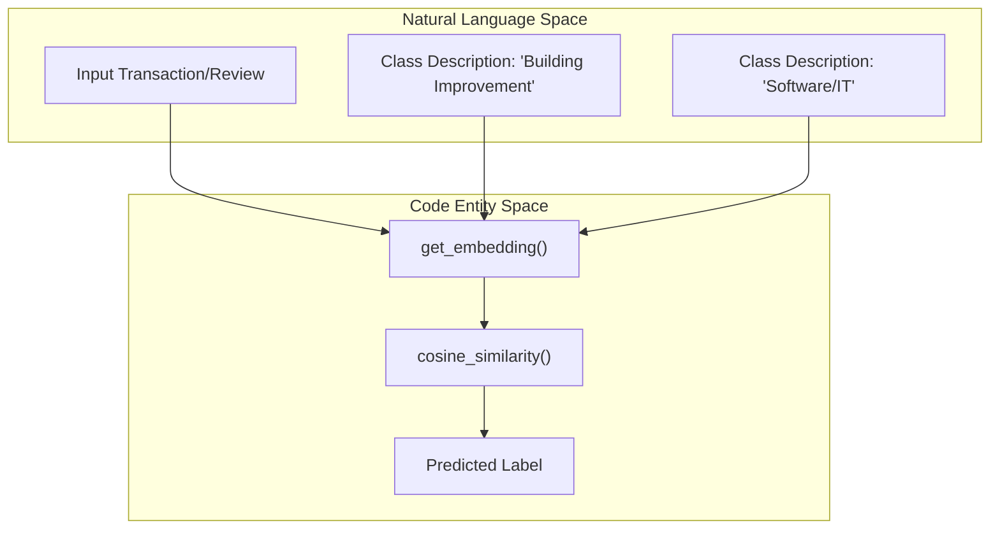
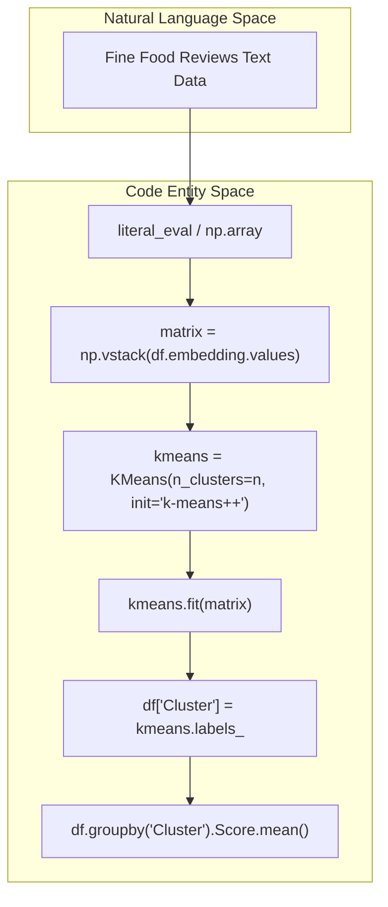
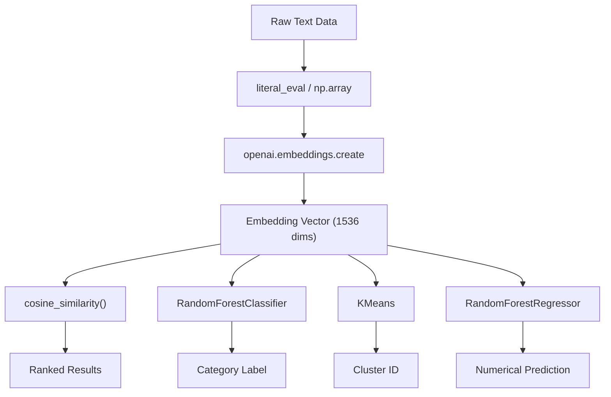

<!-- source: DeepWiki mcp.deepwiki.com · repo openai/openai-cookbook · page 5.3 Classification, Clustering, and Semantic Search · fetched 2026-10-26 -->

# Classification, Clustering, and Semantic Search

Relevant source files

The following files were used as context for generating this wiki page:

- [examples/Classification_using_embeddings.ipynb](examples/Classification_using_embeddings.ipynb)
- [examples/Clustering.ipynb](examples/Clustering.ipynb)
- [examples/Clustering_for_transaction_classification.ipynb](examples/Clustering_for_transaction_classification.ipynb)
- [examples/Customizing_embeddings.ipynb](examples/Customizing_embeddings.ipynb)
- [examples/Get_embeddings_from_dataset.ipynb](examples/Get_embeddings_from_dataset.ipynb)
- [examples/Multiclass_classification_for_transactions.ipynb](examples/Multiclass_classification_for_transactions.ipynb)
- [examples/Recommendation_using_embeddings.ipynb](examples/Recommendation_using_embeddings.ipynb)
- [examples/Regression_using_embeddings.ipynb](examples/Regression_using_embeddings.ipynb)
- [examples/Semantic_text_search_using_embeddings.ipynb](examples/Semantic_text_search_using_embeddings.ipynb)
- [examples/User_and_product_embeddings.ipynb](examples/User_and_product_embeddings.ipynb)
- [examples/Visualizing_embeddings_in_2D.ipynb](examples/Visualizing_embeddings_in_2D.ipynb)
- [examples/Visualizing_embeddings_in_3D.ipynb](examples/Visualizing_embeddings_in_3D.ipynb)
- [examples/Zero-shot_classification_with_embeddings.ipynb](examples/Zero-shot_classification_with_embeddings.ipynb)
- [examples/data/dbpedia_samples.jsonl](examples/data/dbpedia_samples.jsonl)
- [examples/data/snli_1.0_train_2k.csv](examples/data/snli_1.0_train_2k.csv)
- [examples/utils/embeddings_utils.py](examples/utils/embeddings_utils.py)

This page covers technical implementations for applying text embeddings to classification, clustering, regression, and semantic search tasks. These techniques transform unstructured text into numerical vector spaces where semantic relationships can be calculated using linear algebra.

## Overview

Text embeddings convert natural language into dense vectors that capture semantic meaning. The OpenAI Cookbook demonstrates several analytical patterns using these vectors:

- **Classification**: Supervised and zero-shot methods to categorize text.
- **Clustering**: Unsupervised grouping of similar documents.
- **Semantic Search**: Retrieving relevant documents based on conceptual similarity rather than keyword matching.
- **Regression**: Predicting continuous numerical values from text.
- **Recommendations**: Finding similar items based on vector proximity.

Sources: [examples/Clustering.ipynb:8-11](), [examples/Multiclass_classification_for_transactions.ipynb:8-16](), [examples/Semantic_text_search_using_embeddings.ipynb:8-10]()

## Classification Approaches

### Zero-Shot Classification
Zero-shot classification allows for categorizing text into predefined buckets without any labeled training data. This is achieved by embedding both the target text and the descriptions of the classes, then calculating the cosine similarity between them.

*Figure 1: Bridging Natural Language Space to Code Entity Space for Zero-Shot Classification.*

**Implementation Details:**
- Class descriptions are embedded using `EMBEDDING_MODEL` (`text-embedding-3-small`) [examples/Zero-shot_classification_with_embeddings.ipynb:29-34]().
- The highest similarity score determines the label [examples/Zero-shot_classification_with_embeddings.ipynb:47-49]().
- In transaction classification, a prompt-based zero-shot approach can also be used via `classify_transaction()` which calls `openai.chat.completions.create` with a system prompt defining categories [examples/Multiclass_classification_for_transactions.ipynb:135-151]().

Sources: [examples/Zero-shot_classification_with_embeddings.ipynb:29-50](), [examples/Multiclass_classification_for_transactions.ipynb:135-151]()

### Multiclass Classification (Supervised)
For labeled datasets, embeddings serve as high-quality feature vectors for traditional machine learning models.

| Component | Code Entity / Library | Purpose |
| :--- | :--- | :--- |
| **Feature Extraction** | `openai.embeddings` / `get_embedding` | Converts text to dense vector arrays [examples/Multiclass_classification_for_transactions.ipynb:34]() |
| **Classifier** | `sklearn.ensemble.RandomForestClassifier` | Trains on embedding vectors to predict discrete labels [examples/Classification_using_embeddings.ipynb:44-60]() |
| **Data Splitting** | `sklearn.model_selection.train_test_split` | Segregates data into training and testing sets [examples/Classification_using_embeddings.ipynb:54-56]() |
| **Evaluation** | `sklearn.metrics.classification_report` | Generates precision, recall, and F1-score [examples/Classification_using_embeddings.ipynb:64]() |

Sources: [examples/Classification_using_embeddings.ipynb:40-66](), [examples/Multiclass_classification_for_transactions.ipynb:34-52]()

## Clustering and Visualization

### K-Means Clustering
Clustering is used to discover hidden groupings in unlabelled data. The Cookbook demonstrates using the `KMeans` algorithm on embedding matrices.

*Figure 2: Bridging Natural Language Space to Code Entity Space for K-Means Clustering.*

**Workflow:**
1. **Matrix Construction**: Embeddings are converted from strings to NumPy arrays and stacked into a matrix using `np.vstack` [examples/Clustering.ipynb:39-41]().
2. **Clustering**: `KMeans(n_clusters=n_clusters, init="k-means++")` is applied to the matrix [examples/Clustering.ipynb:94-95]().
3. **Labeling**: To make clusters human-readable, the Cookbook uses GPT models (e.g., `gpt-3.5-turbo`) via completions to generate descriptions based on samples from each cluster [examples/Clustering_for_transaction_classification.ipynb:9-12](), [examples/Clustering_for_transaction_classification.ipynb:62-75]().

Sources: [examples/Clustering.ipynb:30-100](), [examples/Clustering_for_transaction_classification.ipynb:49-75]()

### Visualization Techniques
To visualize high-dimensional embeddings, dimensionality reduction is required:
- **t-SNE (2D)**: Ideal for visualizing clusters in a 2D language space. The `TSNE` class from `sklearn.manifold` reduces vectors to 2 components for scatter plots [examples/Clustering_for_transaction_classification.ipynb:54-55](), [examples/Visualizing_embeddings_in_2D.ipynb:40-56]().
- **PCA (3D)**: `sklearn.decomposition.PCA` is used to reduce dimensions to 3 for interactive 3D visualizations, often paired with `plotly.express` [examples/Visualizing_embeddings_in_3D.ipynb:159-162](), [examples/Customizing_embeddings.ipynb:49]().

Sources: [examples/Clustering_for_transaction_classification.ipynb:54-55](), [examples/Visualizing_embeddings_in_3D.ipynb:159-162](), [examples/Visualizing_embeddings_in_2D.ipynb:40-56]()

## Semantic Search and Recommendations

### Semantic Text Search
Semantic search identifies documents conceptually related to a query, even if they share no keywords.

**Key Function:** `search_reviews(df, product_description, n=3)` [examples/Semantic_text_search_using_embeddings.ipynb:59-76]()
1. Embeds the `product_description` query using `get_embedding()` [examples/Semantic_text_search_using_embeddings.ipynb:60-63]().
2. Calculates `cosine_similarity` between the query embedding and all document embeddings in the DataFrame [examples/Semantic_text_search_using_embeddings.ipynb:64]().
3. Sorts the DataFrame by the new `similarity` column and returns the top `n` results [examples/Semantic_text_search_using_embeddings.ipynb:67-68]().

Sources: [examples/Semantic_text_search_using_embeddings.ipynb:56-79](), [examples/utils/embeddings_utils.py]()

### Recommendations
Recommendations are generated using nearest neighbor search in the embedding space:
- `distances_from_embeddings()`: Computes the distance (e.g., cosine) between a target embedding and a list of candidates [examples/Recommendation_using_embeddings.ipynb:30-36]().
- `indices_of_nearest_neighbors_from_distances()`: Identifies the closest matches for recommendation [examples/Recommendation_using_embeddings.ipynb:35]().
- User and product embeddings can also be aggregated by computing the mean embedding of reviews associated with a `UserId` or `ProductId` within the training set, then evaluated against an unseen test set using cosine similarity [examples/User_and_product_embeddings.ipynb:18-21](), [examples/User_and_product_embeddings.ipynb:143-182]().

Sources: [examples/Recommendation_using_embeddings.ipynb:27-38](), [examples/User_and_product_embeddings.ipynb:18-182]()

## Regression and Customization

### Regression using Embeddings
Regression predicts continuous values (like a star rating from 1 to 5) rather than discrete categories.

**Implementation:**
- **Model**: `RandomForestRegressor` is trained using embeddings as the independent variable `X` and scores as the dependent variable `y` [examples/Regression_using_embeddings.ipynb:42-45]().
- **Metrics**: Accuracy is measured using `mean_squared_error` (MSE) and `mean_absolute_error` (MAE) [examples/Regression_using_embeddings.ipynb:48-49]().

Sources: [examples/Regression_using_embeddings.ipynb:29-52]()

### Customizing Embeddings
Embeddings can be customized for specific tasks (like logical entailment) by training a custom matrix to multiply with base embeddings.
- The input is training data in the form of `[text_1, text_2, label]` where label is `+1` for similar pairs and `-1` for dissimilar pairs [examples/Customizing_embeddings.ipynb:14]().
- Optimization is performed using PyTorch (`torch`) to find a transformation matrix that emphasizes aspects relevant to the task, reducing binary classification error rates [examples/Customizing_embeddings.ipynb:16](), [examples/Customizing_embeddings.ipynb:52]().

Sources: [examples/Customizing_embeddings.ipynb:12-22](), [examples/Customizing_embeddings.ipynb:52-54]()

## Data Flow Summary

The following diagram illustrates the flow from raw text to various analytical outputs.

*Figure 3: End-to-end Data Flow for Text Embeddings Analytics.*

Sources: [examples/Clustering.ipynb:39-41](), [examples/Classification_using_embeddings.ipynb:58-62](), [examples/Clustering.ipynb:94-97](), [examples/Regression_using_embeddings.ipynb:44-46]()

---

