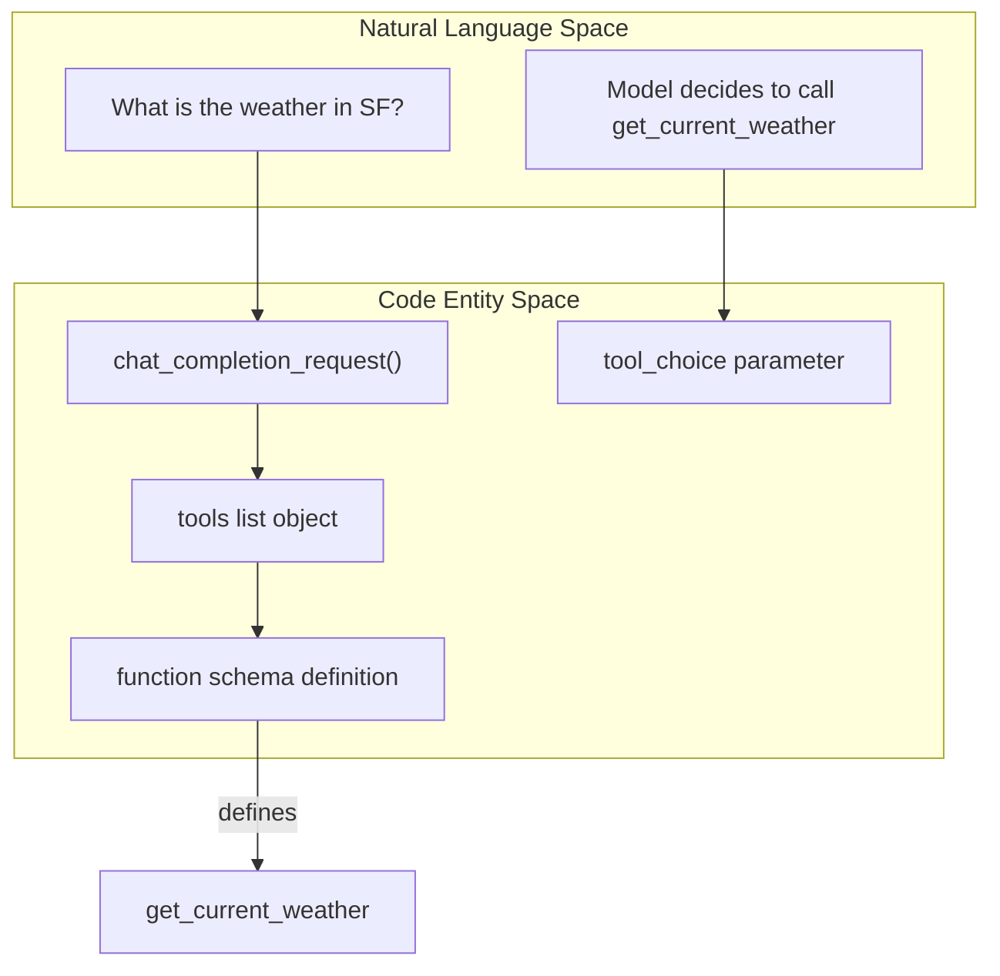
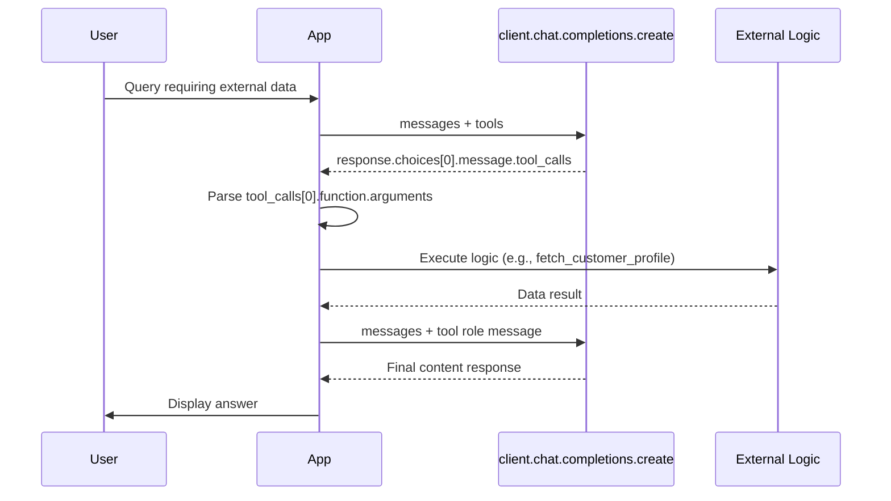
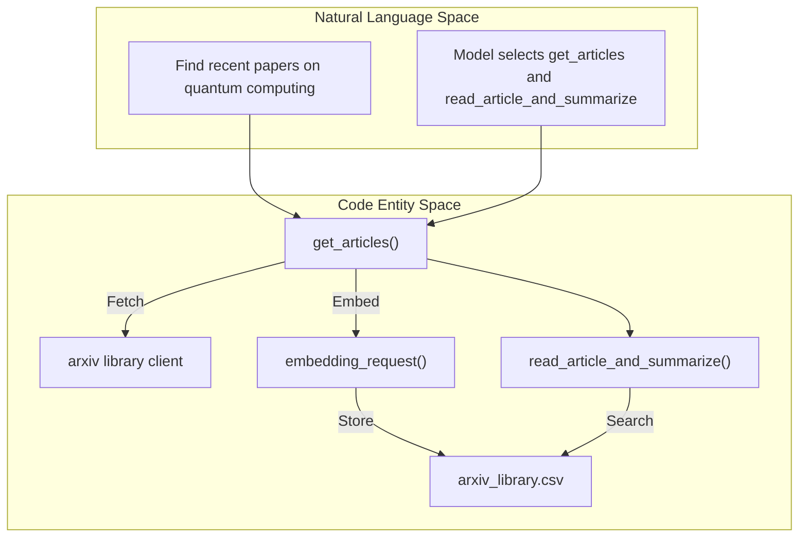

<!-- source: DeepWiki mcp.deepwiki.com · repo openai/openai-cookbook · page 6 Function Calling and Tool Integration · fetched 2026-10-26 -->

# Function Calling and Tool Integration

<details>
<summary>Relevant source files</summary>

The following files were used as context for generating this wiki page:

- [examples/How_to_call_functions_for_knowledge_retrieval.ipynb](examples/How_to_call_functions_for_knowledge_retrieval.ipynb)
- [examples/How_to_call_functions_with_chat_models.ipynb](examples/How_to_call_functions_with_chat_models.ipynb)
- [examples/data/Chinook.db](examples/data/Chinook.db)
- [examples/data/papers/.gitkeep](examples/data/papers/.gitkeep)
- [examples/vector_databases/chroma/Using_Chroma_for_embeddings_search.ipynb](examples/vector_databases/chroma/Using_Chroma_for_embeddings_search.ipynb)
- [examples/vector_databases/myscale/Using_MyScale_for_embeddings_search.ipynb](examples/vector_databases/myscale/Using_MyScale_for_embeddings_search.ipynb)
- [examples/vector_databases/pinecone/Using_Pinecone_for_embeddings_search.ipynb](examples/vector_databases/pinecone/Using_Pinecone_for_embeddings_search.ipynb)
- [examples/vector_databases/qdrant/Getting_started_with_Qdrant_and_OpenAI.ipynb](examples/vector_databases/qdrant/Getting_started_with_Qdrant_and_OpenAI.ipynb)
- [examples/vector_databases/qdrant/QA_with_Langchain_Qdrant_and_OpenAI.ipynb](examples/vector_databases/qdrant/QA_with_Langchain_Qdrant_and_OpenAI.ipynb)
- [examples/vector_databases/qdrant/Using_Qdrant_for_embeddings_search.ipynb](examples/vector_databases/qdrant/Using_Qdrant_for_embeddings_search.ipynb)
- [examples/vector_databases/qdrant/docker-compose.yaml](examples/vector_databases/qdrant/docker-compose.yaml)
- [examples/vector_databases/redis/Using_Redis_for_embeddings_search.ipynb](examples/vector_databases/redis/Using_Redis_for_embeddings_search.ipynb)
- [examples/vector_databases/typesense/Using_Typesense_for_embeddings_search.ipynb](examples/vector_databases/typesense/Using_Typesense_for_embeddings_search.ipynb)
- [examples/vector_databases/weaviate/Using_Weaviate_for_embeddings_search.ipynb](examples/vector_databases/weaviate/Using_Weaviate_for_embeddings_search.ipynb)

</details>


## Purpose and Scope

This document covers OpenAI's function calling capabilities and patterns for integrating external tools with chat models. Function calling enables models to generate structured arguments for external functions, allowing them to interact with APIs, databases, and other systems. The material focuses on the Chat Completions API's `tools` parameter, function schema specifications, and integration architectures.

For detailed patterns, see:
- [Basic Function Calling Patterns](#6.1) — Document function calling fundamentals: function schemas, tool_choice, parallel function calling, handling tool_calls, OpenAPI-spec-driven calls, and practical examples like weather and database queries
- [Advanced Function Calling and Knowledge Retrieval](#6.2) — Cover multi-step function workflows, knowledge retrieval agents (`get_articles`, `read_article_and_summarize`), vector-DB-backed RAG tools, Langchain tool-using agents, and the Node SDK agent example
- [GPT Actions and External Integrations](#6.3) — Explain GPT Actions configuration, Zapier integration, database integrations (Snowflake, BigQuery, Redshift, SQL), SharePoint/Azure Functions middleware, Jira/Outlook, workspace agents, and ChatGPT daily usage limit controls
- [Model Context Protocol (MCP)](#6.4) — Document MCP as a standard for connecting models to external tools: hosted MCP tool in the Responses API, building MCP servers, supply-chain copilot with Databricks MCP, MCP-powered voice agents, Deep Research MCP server, and MCP evaluation

Sources: [examples/How_to_call_functions_with_chat_models.ipynb:9-23]()

## Core Function Calling Mechanism

### Tools Parameter and Function Schemas

The Chat Completions API accepts a `tools` parameter containing function specifications. Each function is described using a JSON schema that defines its name, description, and parameter structure.

**System to Code Mapping**


**Function Schema Structure**

| Field | Type | Description |
|-------|------|-------------|
| `type` | string | Always `"function"` |
| `function.name` | string | Function identifier used by model |
| `function.description` | string | Natural language description guiding model |
| `function.parameters` | object | JSON Schema defining parameter types |
| `function.parameters.required` | array | List of required parameter names |

Sources: [examples/How_to_call_functions_with_chat_models.ipynb:168-217](), [examples/How_to_call_functions_with_chat_models.ipynb:97-104]()

### Tool Choice Parameter

The `tool_choice` parameter controls function calling behavior:

- `"auto"` (default): Model decides whether to call a function.
- `{"type": "function", "function": {"name": "function_name"}}`: Forces a specific function.
- `"none"`: Prevents all function calls.

For details on basic usage, see [Basic Function Calling Patterns](#6.1).

Sources: [examples/How_to_call_functions_with_chat_models.ipynb:15-16]()

## Request-Response Flow

### Basic Function Calling Loop



**Invocation Pattern**
1. **Request**: Send user message with `tools`.
2. **Model Decision**: Model returns `tool_calls` if a function is needed.
3. **Execution**: App executes function and appends result with `role: "tool"`.
4. **Completion**: Send updated messages to API for final text response.

Sources: [examples/How_to_call_functions_with_chat_models.ipynb:13-16]()

## Advanced Patterns and Retrieval

### Knowledge Retrieval Workflows

Advanced workflows involve multi-step logic where the model uses one tool to find information and another to process it. For example, a research agent might use `get_articles` to find academic papers and then `read_article_and_summarize` to extract insights.

**Knowledge Space to Code Mapping**


For detailed multi-step workflows, see [Advanced Function Calling and Knowledge Retrieval](#6.2).

Sources: [examples/How_to_call_functions_for_knowledge_retrieval.ipynb:9-26](), [examples/How_to_call_functions_for_knowledge_retrieval.ipynb:148-181]()

### External Integrations and Protocols

Models can be integrated with existing web services, databases, and standardized protocols like the Model Context Protocol (MCP). This allows models to interact securely with RESTful APIs, enterprise databases (such as Snowflake, BigQuery, or PostgreSQL), and tool servers.

For details, see [GPT Actions and External Integrations](#6.3) and [Model Context Protocol (MCP)](#6.4).

Sources: [examples/How_to_call_functions_for_knowledge_retrieval.ipynb:11-17]()

## Implementation Best Practices

### Error Handling and Retries
The cookbook utilizes utility decorators such as those from the `tenacity` library to handle transient failures, network exceptions, and rate limits during chat completion or embedding requests.

```python
@retry(wait=wait_random_exponential(multiplier=1, max=40), stop=stop_after_attempt(3))
def chat_completion_request(messages, tools=None, tool_choice=None, model=GPT_MODEL):
    try:
        response = client.chat.completions.create(
            model=model,
            messages=messages,
            tools=tools,
            tool_choice=tool_choice,
        )
        return response
    except Exception as e:
        print("Unable to generate ChatCompletion response")
        print(f"Exception: {e}")
        return e
```

Sources: [examples/How_to_call_functions_with_chat_models.ipynb:96-110]()

### Parallel Function Calling
Models can generate multiple `tool_calls` in a single response output, enabling parallel execution of independent tasks (e.g., querying weather data for multiple distinct geographical locations simultaneously).

Sources: [examples/How_to_call_functions_with_chat_models.ipynb:15-16]()

---

