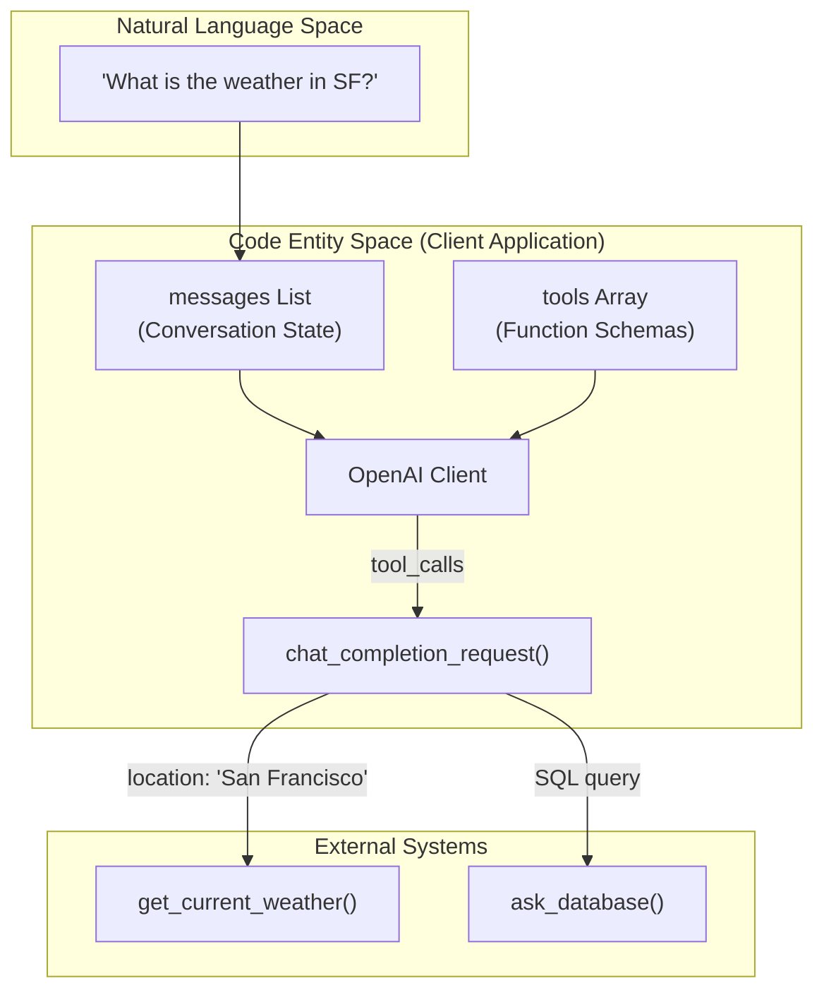
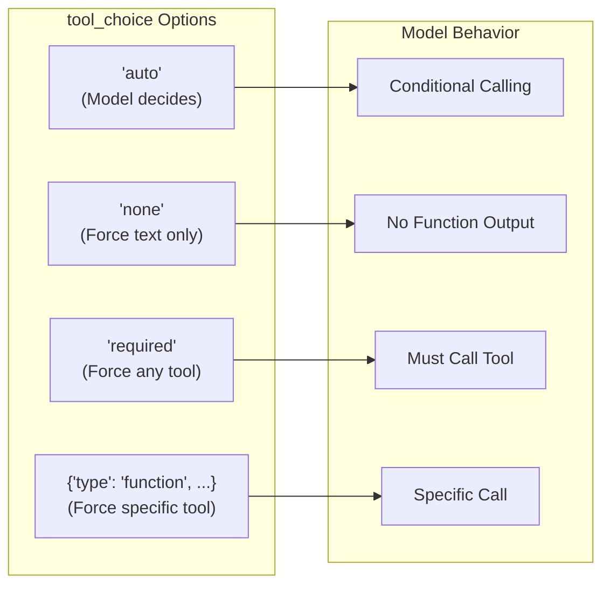
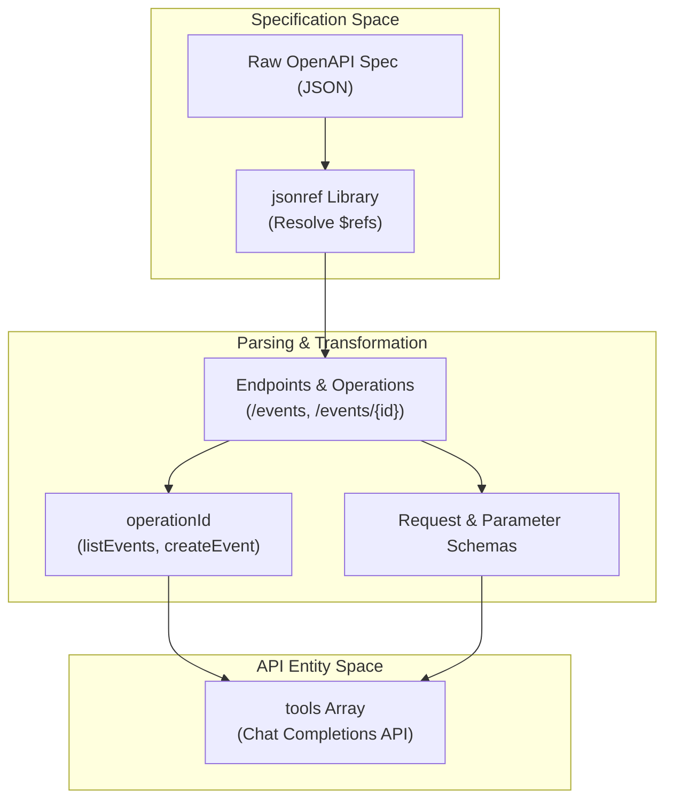
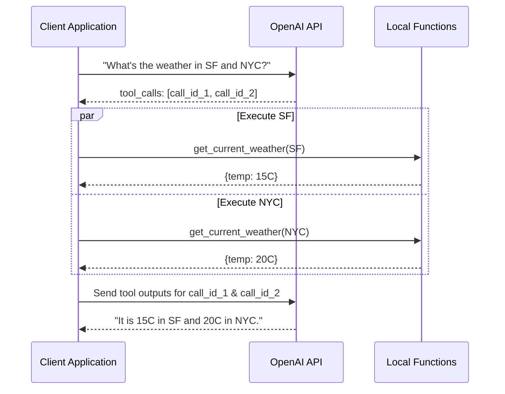
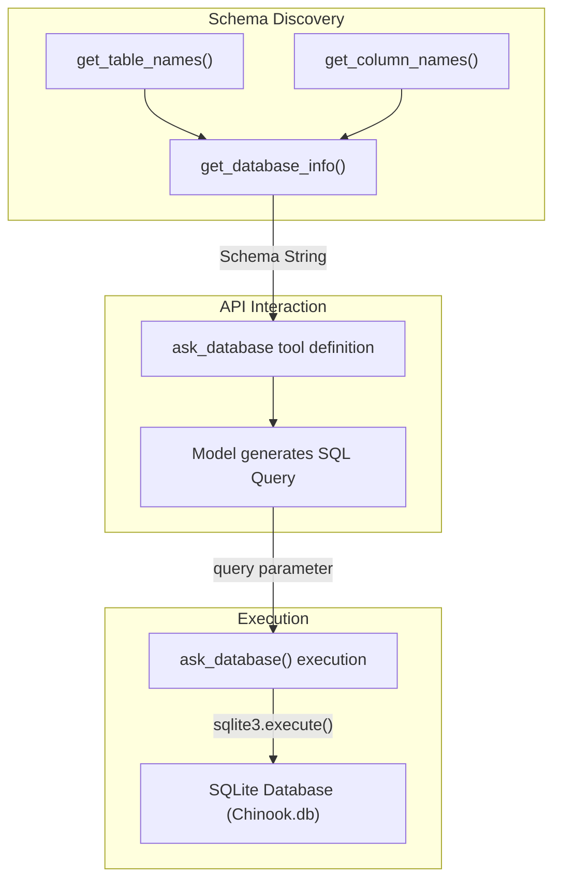

<!-- source: DeepWiki mcp.deepwiki.com · repo openai/openai-cookbook · page 6.1 Basic Function Calling Patterns · fetched 2026-10-26 -->

# Basic Function Calling Patterns

Relevant source files

The following files were used as context for generating this wiki page:

- [examples/Function_calling_finding_nearby_places.ipynb](examples/Function_calling_finding_nearby_places.ipynb)
- [examples/Function_calling_with_an_OpenAPI_spec.ipynb](examples/Function_calling_with_an_OpenAPI_spec.ipynb)
- [examples/GPT_with_vision_for_video_understanding.ipynb](examples/GPT_with_vision_for_video_understanding.ipynb)
- [examples/How_to_call_functions_for_knowledge_retrieval.ipynb](examples/How_to_call_functions_for_knowledge_retrieval.ipynb)
- [examples/How_to_call_functions_with_chat_models.ipynb](examples/How_to_call_functions_with_chat_models.ipynb)
- [examples/data/Chinook.db](examples/data/Chinook.db)
- [examples/data/bison.mp4](examples/data/bison.mp4)
- [examples/data/example_events_openapi.json](examples/data/example_events_openapi.json)
- [examples/data/papers/.gitkeep](examples/data/papers/.gitkeep)
- [examples/gpt4o/data/keynote_recap.mp4](examples/gpt4o/data/keynote_recap.mp4)
- [examples/gpt4o/data/triangle.png](examples/gpt4o/data/triangle.png)
- [examples/vector_databases/chroma/Using_Chroma_for_embeddings_search.ipynb](examples/vector_databases/chroma/Using_Chroma_for_embeddings_search.ipynb)
- [examples/vector_databases/myscale/Using_MyScale_for_embeddings_search.ipynb](examples/vector_databases/myscale/Using_MyScale_for_embeddings_search.ipynb)
- [examples/vector_databases/pinecone/Using_Pinecone_for_embeddings_search.ipynb](examples/vector_databases/pinecone/Using_Pinecone_for_embeddings_search.ipynb)
- [examples/vector_databases/qdrant/Getting_started_with_Qdrant_and_OpenAI.ipynb](examples/vector_databases/qdrant/Getting_started_with_Qdrant_and_OpenAI.ipynb)
- [examples/vector_databases/qdrant/QA_with_Langchain_Qdrant_and_OpenAI.ipynb](examples/vector_databases/qdrant/QA_with_Langchain_Qdrant_and_OpenAI.ipynb)
- [examples/vector_databases/qdrant/Using_Qdrant_for_embeddings_search.ipynb](examples/vector_databases/qdrant/Using_Qdrant_for_embeddings_search.ipynb)
- [examples/vector_databases/qdrant/docker-compose.yaml](examples/vector_databases/qdrant/docker-compose.yaml)
- [examples/vector_databases/redis/Using_Redis_for_embeddings_search.ipynb](examples/vector_databases/redis/Using_Redis_for_embeddings_search.ipynb)
- [examples/vector_databases/typesense/Using_Typesense_for_embeddings_search.ipynb](examples/vector_databases/typesense/Using_Typesense_for_embeddings_search.ipynb)
- [examples/vector_databases/weaviate/Using_Weaviate_for_embeddings_search.ipynb](examples/vector_databases/weaviate/Using_Weaviate_for_embeddings_search.ipynb)

This document covers fundamental techniques for implementing function calling with OpenAI's Chat Completions and Responses APIs. It demonstrates how to define function specifications, handle tool calls, execute functions with model-generated parameters, perform OpenAPI-spec-driven calls, handle parallel execution, and manage conversation state throughout the function calling workflow.

For advanced function calling applications involving knowledge retrieval and research databases, see [6.2 Advanced Function Calling and Knowledge Retrieval](). For structured output guarantees, see [13.2 Assistants API and Structured Outputs]().

## Function Calling Architecture

Function calling allows models to generate structured arguments for external functions. The model does not execute the code directly; instead, it outputs a JSON object containing `tool_calls` that the client application parses and executes.

### Natural Language to Code Mapping
The following diagram bridges user intent in natural language to the specific code entities defined in the implementation.

Sources: [examples/How_to_call_functions_with_chat_models.ipynb:13-22](), [examples/How_to_call_functions_with_chat_models.ipynb:64-71]()

Sources: [examples/How_to_call_functions_with_chat_models.ipynb:13-22](), [examples/How_to_call_functions_with_chat_models.ipynb:64-71]()

## Core API Patterns

### Function Specification and Schemas
Function specifications are defined in the `tools` array passed to `chat.completions.create`. They utilize JSON Schema to define parameters, allowing the model to generate arguments that adhere to the specification.

| Component | Purpose | Implementation Detail |
|-----------|---------|-----------------------|
| `type` | Tool category | Always `"function"` for these patterns [examples/How_to_call_functions_with_chat_models.ipynb:168-170]() |
| `name` | Function ID | The identifier the model returns [examples/How_to_call_functions_with_chat_models.ipynb:172-172]() |
| `description` | Instruction | Helps the model decide when to call the function [examples/How_to_call_functions_with_chat_models.ipynb:173-173]() |
| `parameters` | Schema | Defines expected properties, types, and enums [examples/How_to_call_functions_with_chat_models.ipynb:174-185]() |

Sources: [examples/How_to_call_functions_with_chat_models.ipynb:168-185]()

### Tool Choice Control
The `tool_choice` parameter controls the model's autonomy in selecting tools.

Sources: [examples/How_to_call_functions_with_chat_models.ipynb:15-15]()

Sources: [examples/How_to_call_functions_with_chat_models.ipynb:15-15]()

## OpenAPI-Spec-Driven Function Calls

Much of the internet is powered by RESTful APIs. Giving models the ability to parse OpenAPI Specifications (OAS) and convert them into chat completion tool schemas enables automated, spec-driven API integration.

### OpenAPI Conversion Data Flow
The following diagram illustrates how raw OpenAPI specifications are resolved and converted into tool definitions for the Chat Completions API.

Sources: [examples/Function_calling_with_an_OpenAPI_spec.ipynb:1]()

- **Reference Resolution**: Using the `jsonref` library ensures that external or internal `$ref` schemas within the OpenAPI document are fully expanded before the model parses them [examples/Function_calling_with_an_OpenAPI_spec.ipynb:1]().
- **Operation Mapping**: Each path operation uses its `operationId` as the function name in the generated schema, while parameters and `requestBody` define the schema properties [examples/Function_calling_with_an_OpenAPI_spec.ipynb:1]().

Sources: [examples/Function_calling_with_an_OpenAPI_spec.ipynb:1]()

## Parallel Function Calling

Modern models can generate multiple function calls in a single turn. This is particularly useful for multi-part queries, such as requesting weather data or local places across multiple locations concurrently.

Sources: [examples/How_to_call_functions_with_chat_models.ipynb:544-554]()

Sources: [examples/How_to_call_functions_with_chat_models.ipynb:544-554]()

## Practical Examples: Weather and Database Queries

### Database Integration Pattern
A common pattern involves using function calling to interface with relational databases (e.g., SQLite via `Chinook.db`). The application provides the model with table schemas, and the model generates dynamic SQL queries.

### Database Entity Flow
This diagram maps the internal database utility functions to the data flow when querying a database.

Sources: [examples/How_to_call_functions_with_chat_models.ipynb:618-643](), [examples/How_to_call_functions_with_chat_models.ipynb:696-719]()

Sources: [examples/How_to_call_functions_with_chat_models.ipynb:618-719]()

## Implementation Utilities

### Conversation Management
Maintaining state requires appending model responses containing `tool_calls` and subsequent tool execution results back to the `messages` list. The `pretty_print_conversation` function assists in visualizing message flow during debugging [examples/How_to_call_functions_with_chat_models.ipynb:124-143]().

| Role | Responsibility |
|------|----------------|
| `system` | Global instructions and context [examples/How_to_call_functions_with_chat_models.ipynb:133-134]() |
| `user` | Human input [examples/How_to_call_functions_with_chat_models.ipynb:135-136]() |
| `assistant` | Model output (content or `tool_calls`) [examples/How_to_call_functions_with_chat_models.ipynb:137-140]() |
| `tool` | Output from the executed function [examples/How_to_call_functions_with_chat_models.ipynb:141-142]() |

Sources: [examples/How_to_call_functions_with_chat_models.ipynb:124-143]()

### Reliability Patterns
The cookbook implementations rely on the `tenacity` library to handle rate limits and transient network errors gracefully during chat completion requests [examples/How_to_call_functions_with_chat_models.ipynb:96-97](). Additionally, robust tool error handling passes exception messages back to the model as tool responses, allowing the model to self-correct parameters or SQL queries [examples/How_to_call_functions_with_chat_models.ipynb:747-750]().

Sources: [examples/How_to_call_functions_with_chat_models.ipynb:95-110](), [examples/How_to_call_functions_with_chat_models.ipynb:745-752]()

---

