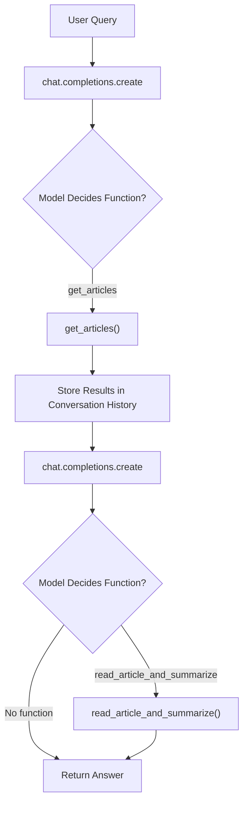
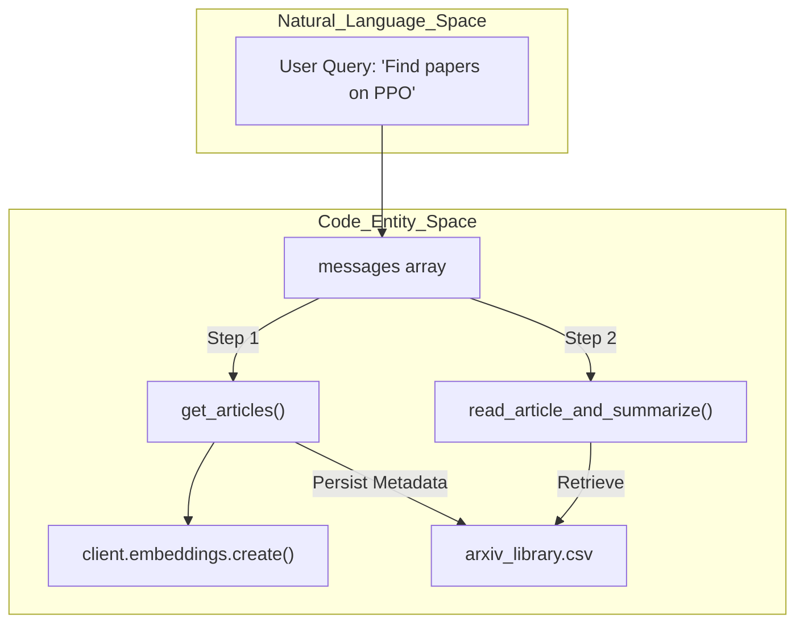
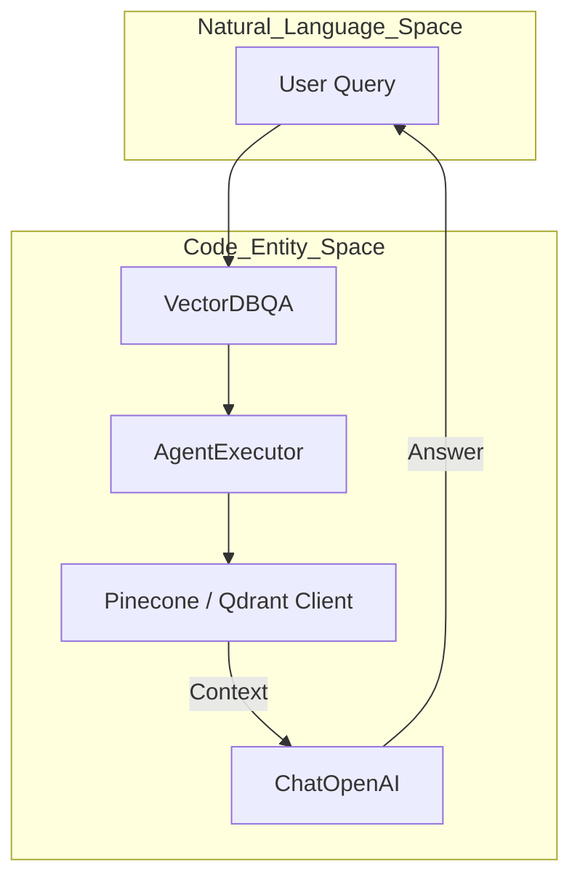

<!-- source: DeepWiki mcp.deepwiki.com · repo openai/openai-cookbook · page 6.2 Advanced Function Calling and Knowledge Retrieval · fetched 2026-10-26 -->

# Advanced Function Calling and Knowledge Retrieval

Relevant source files

The following files were used as context for generating this wiki page:

- [examples/How_to_build_a_tool-using_agent_with_Langchain.ipynb](examples/How_to_build_a_tool-using_agent_with_Langchain.ipynb)
- [examples/How_to_build_an_agent_with_the_node_sdk.mdx](examples/How_to_build_an_agent_with_the_node_sdk.mdx)
- [examples/How_to_call_functions_for_knowledge_retrieval.ipynb](examples/How_to_call_functions_for_knowledge_retrieval.ipynb)
- [examples/How_to_call_functions_with_chat_models.ipynb](examples/How_to_call_functions_with_chat_models.ipynb)
- [examples/data/Chinook.db](examples/data/Chinook.db)
- [examples/data/papers/.gitkeep](examples/data/papers/.gitkeep)
- [examples/vector_databases/chroma/Using_Chroma_for_embeddings_search.ipynb](examples/vector_databases/chroma/Using_Chroma_for_embeddings_search.ipynb)
- [examples/vector_databases/myscale/Using_MyScale_for_embeddings_search.ipynb](examples/vector_databases/myscale/Using_MyScale_for_embeddings_search.ipynb)
- [examples/vector_databases/pinecone/Using_Pinecone_for_embeddings_search.ipynb](examples/vector_databases/pinecone/Using_Pinecone_for_embeddings_search.ipynb)
- [examples/vector_databases/qdrant/Getting_started_with_Qdrant_and_OpenAI.ipynb](examples/vector_databases/qdrant/Getting_started_with_Qdrant_and_OpenAI.ipynb)
- [examples/vector_databases/qdrant/QA_with_Langchain_Qdrant_and_OpenAI.ipynb](examples/vector_databases/qdrant/QA_with_Langchain_Qdrant_and_OpenAI.ipynb)
- [examples/vector_databases/qdrant/Using_Qdrant_for_embeddings_search.ipynb](examples/vector_databases/qdrant/Using_Qdrant_for_embeddings_search.ipynb)
- [examples/vector_databases/qdrant/docker-compose.yaml](examples/vector_databases/qdrant/docker-compose.yaml)
- [examples/vector_databases/redis/Using_Redis_for_embeddings_search.ipynb](examples/vector_databases/redis/Using_Redis_for_embeddings_search.ipynb)
- [examples/vector_databases/typesense/Using_Typesense_for_embeddings_search.ipynb](examples/vector_databases/typesense/Using_Typesense_for_embeddings_search.ipynb)
- [examples/vector_databases/weaviate/Using_Weaviate_for_embeddings_search.ipynb](examples/vector_databases/weaviate/Using_Weaviate_for_embeddings_search.ipynb)

## Purpose and Scope

This page documents advanced function calling patterns that enable complex knowledge retrieval, multi-step agent workflows, vector database RAG integration, LangChain tool-using agents, and client-side agent implementation using the Node.js SDK. It covers:

- **Multi-step function workflows** where function outputs feed into subsequent reasoning steps or function calls.
- **Knowledge retrieval agents** that search external data sources (`get_articles`, `read_article_and_summarize`) and manage internal state [examples/How_to_call_functions_for_knowledge_retrieval.ipynb:13-17]().
- **Vector-DB-backed RAG tools** integrating Qdrant, Pinecone, Chroma, Weaviate, and Redis [examples/vector_databases/qdrant/Getting_started_with_Qdrant_and_OpenAI.ipynb:9](), [examples/vector_databases/pinecone/Using_Pinecone_for_embeddings_search.ipynb:10](), [examples/vector_databases/chroma/Using_Chroma_for_embeddings_search.ipynb:10](), [examples/vector_databases/weaviate/Using_Weaviate_for_embeddings_search.ipynb:10](), [examples/vector_databases/redis/Using_Redis_for_embeddings_search.ipynb:10]().
- **LangChain tool-using agents** and QA chains utilizing `AgentExecutor` and `ChatOpenAI` [examples/How_to_build_a_tool-using_agent_with_Langchain.ipynb:97-102]().
- **Node SDK agent examples** executing tool calls in browser and Node environments [examples/How_to_build_an_agent_with_the_node_sdk.mdx:5-17]().

For basic function calling concepts (schemas, `tool_choice`, parallel execution), see [Basic Function Calling Patterns](6.1).

---

## Multi-Step Function Workflows

Advanced function calling enables workflows where the agent orchestrates multiple function calls in sequence, using the output of one function to inform the next. This pattern is essential for tasks requiring information gathering followed by deep processing.

### Workflow Pattern: Search-Then-Process

Title: Multi-Step Function Workflow

The key difference from basic function calling is that intermediate function results are appended to the conversation history with `role: "function"`, allowing the model to see previous function outputs when deciding whether to call additional functions [examples/How_to_call_functions_for_knowledge_retrieval.ipynb:566-572]().

### Function Call Sequencing

| Step | Action | Code Entity / Location |
|------|--------|------------------------|
| 1 | Send messages + function schemas to Chat API | [examples/How_to_call_functions_for_knowledge_retrieval.ipynb:539-549]() |
| 2 | Check if `finish_reason == "tool_calls"` | [examples/How_to_call_functions_for_knowledge_retrieval.ipynb:543]() |
| 3 | Execute function via mapping (`get_articles` / `read_article_and_summarize`) | [examples/How_to_call_functions_for_knowledge_retrieval.ipynb:545]() |
| 4 | Append function result to conversation state | [examples/How_to_call_functions_for_knowledge_retrieval.ipynb:566-572]() |
| 5 | Iterative follow-up call with updated history | [examples/How_to_call_functions_for_knowledge_retrieval.ipynb:573-576]() |

Sources: [examples/How_to_call_functions_for_knowledge_retrieval.ipynb:539-593]()

---

## Knowledge Retrieval Agent Architecture

Knowledge retrieval agents use complementary functions that work together to answer questions from unstructured sources like academic papers.

### arXiv Agent Example
The arXiv agent demonstrates a complete system with two primary functions: `get_articles` and `read_article_and_summarize` [examples/How_to_call_functions_for_knowledge_retrieval.ipynb:13-17]().

Title: Knowledge Retrieval - Natural Language to Code Entity Mapping

### Agent Components
- **`get_articles`**: Performs search via `arxiv.Search`, generates embeddings for titles via `client.embeddings.create`, and persists results to `arxiv_library.csv` [examples/How_to_call_functions_for_knowledge_retrieval.ipynb:148-182]().
- **`read_article_and_summarize`**: 
    1. Reads the persisted CSV library [examples/How_to_call_functions_for_knowledge_retrieval.ipynb:296-301]().
    2. Uses `spatial.distance.cosine` to rank articles by relevance to the query [examples/How_to_call_functions_for_knowledge_retrieval.ipynb:217-231]().
    3. Chunks PDF content using `tiktoken` to stay within context limits [examples/How_to_call_functions_for_knowledge_retrieval.ipynb:255-273]().
    4. Summarizes chunks concurrently using `concurrent.futures.ThreadPoolExecutor` [examples/How_to_call_functions_for_knowledge_retrieval.ipynb:320-332]().

Sources: [examples/How_to_call_functions_for_knowledge_retrieval.ipynb:148-351](), [examples/How_to_call_functions_for_knowledge_retrieval.ipynb:217-231]()

---

## Vector Database Integration for RAG

Retrieval-Augmented Generation (RAG) utilizes vector databases to store and query high-dimensional embeddings generated by OpenAI APIs.

### Supported Providers in the Cookbook
- **Qdrant**: High-performance vector search database written in Rust with RESTful and gRPC APIs [examples/vector_databases/qdrant/Getting_started_with_Qdrant_and_OpenAI.ipynb:9](). Initialized via `qdrant_client.QdrantClient` [examples/vector_databases/qdrant/Getting_started_with_Qdrant_and_OpenAI.ipynb:203]() and queried using `client.search()` [examples/vector_databases/qdrant/Getting_started_with_Qdrant_and_OpenAI.ipynb:271-280]().
- **Pinecone**: Managed vector database using namespaces for titles and content, initialized with `pinecone.init()` [examples/vector_databases/pinecone/Using_Pinecone_for_embeddings_search.ipynb:27-105]().
- **Chroma**: Local/embedded vector store initialized for similarity search collections [examples/vector_databases/chroma/Using_Chroma_for_embeddings_search.ipynb:27]().
- **Weaviate**: Vector search engine connecting via `weaviate.Client` [examples/vector_databases/weaviate/Using_Weaviate_for_embeddings_search.ipynb:74]().
- **Redis**: Redis-Py client integration supporting vector search and hybrid search indexing [examples/vector_databases/redis/Using_Redis_for_embeddings_search.ipynb:26-27]().

Sources: [examples/vector_databases/qdrant/Getting_started_with_Qdrant_and_OpenAI.ipynb:9-280](), [examples/vector_databases/pinecone/Using_Pinecone_for_embeddings_search.ipynb:27-105](), [examples/vector_databases/chroma/Using_Chroma_for_embeddings_search.ipynb:27](), [examples/vector_databases/weaviate/Using_Weaviate_for_embeddings_search.ipynb:74](), [examples/vector_databases/redis/Using_Redis_for_embeddings_search.ipynb:26-27]()

---

## LangChain Integration Patterns

LangChain provides high-level abstractions for building tool-using agents using the **ReAct** (Reasoning and Acting) framework [examples/How_to_build_a_tool-using_agent_with_Langchain.ipynb:24-25]().

### Core Components
- **`Tool`**: A wrapper around a function including a `name` and `description` [examples/How_to_build_a_tool-using_agent_with_Langchain.ipynb:97-98]().
- **`AgentExecutor`**: The runtime orchestrator managing the loop between the LLM (`ChatOpenAI`) and external tools [examples/How_to_build_a_tool-using_agent_with_Langchain.ipynb:97-102]().
- **`ConversationBufferWindowMemory`**: Manages conversational history across turns [examples/How_to_build_a_tool-using_agent_with_Langchain.ipynb:105]().

Title: LangChain QA Chain Logic

Sources: [examples/How_to_build_a_tool-using_agent_with_Langchain.ipynb:96-112](), [examples/vector_databases/qdrant/QA_with_Langchain_Qdrant_and_OpenAI.ipynb:7-18]()

---

## Node SDK Agent Example

The Cookbook includes JavaScript/Node.js examples demonstrating how to build client-side tool-using agents [examples/How_to_build_an_agent_with_the_node_sdk.mdx:5-17]().

### Implementation Overview
1. **Initialization**: Importing `OpenAI` and instantiating the client with `dangerouslyAllowBrowser: true` for client-side environments [examples/How_to_build_an_agent_with_the_node_sdk.mdx:27-35]().
2. **Tool Definition**: Defining helper functions like `getLocation()` (using `ipapi.co`) and `getCurrentWeather()` (using `open-meteo.com`) [examples/How_to_build_an_agent_with_the_node_sdk.mdx:44-63]().
3. **Tool Schemas**: Passing an array of tool descriptors specifying `type: "function"` along with parameter JSON schemas [examples/How_to_build_an_agent_with_the_node_sdk.mdx:75-107]().
4. **Execution Loop**: Managing conversation state in a `messages` array and calling `openai.chat.completions.create()` to receive `finish_reason: "tool_calls"` [examples/How_to_build_an_agent_with_the_node_sdk.mdx:116-193]().

Sources: [examples/How_to_build_an_agent_with_the_node_sdk.mdx:27-201]()

---

## Multimodal Knowledge Retrieval

Advanced retrieval is not limited to text. GPT-4o allows for visual knowledge retrieval from video content.

### Video Understanding Pipeline
1. **Frame Extraction**: Using `cv2.VideoCapture` to read frames from video inputs [examples/GPT_with_vision_for_video_understanding.ipynb:60-72]().
2. **Encoding**: Converting frames to base64 strings [examples/GPT_with_vision_for_video_understanding.ipynb:67-68]().
3. **Prompting**: Passing frame sequences to `openai.ChatCompletion.create()` to generate descriptions or visual answers [examples/GPT_with_vision_for_video_understanding.ipynb:9-12]().

Sources: [examples/GPT_with_vision_for_video_understanding.ipynb:9-12](), [examples/GPT_with_vision_for_video_understanding.ipynb:60-72]()

---

## Implementation Best Practices

### Token-Aware Chunking
Use `tiktoken` to respect model context limits while preserving sentence boundaries during PDF retrieval [examples/How_to_call_functions_for_knowledge_retrieval.ipynb:255-273]().

### Data Persistence
Functions should persist intermediate search results (e.g., in CSV files or Vector DB collections) so subsequent function iterations can retrieve file paths and embeddings without redundant network requests [examples/How_to_call_functions_for_knowledge_retrieval.ipynb:127-182]().

### Robustness and Error Handling
All external API calls (Embeddings, Chat Completions, Tool execution) must implement exponential backoff retry logic using decorators like `@retry` from the `tenacity` library [examples/How_to_call_functions_for_knowledge_retrieval.ipynb:141-144]().

Sources: [examples/How_to_call_functions_for_knowledge_retrieval.ipynb:141-144](), [examples/How_to_call_functions_for_knowledge_retrieval.ipynb:255-273]()

---

