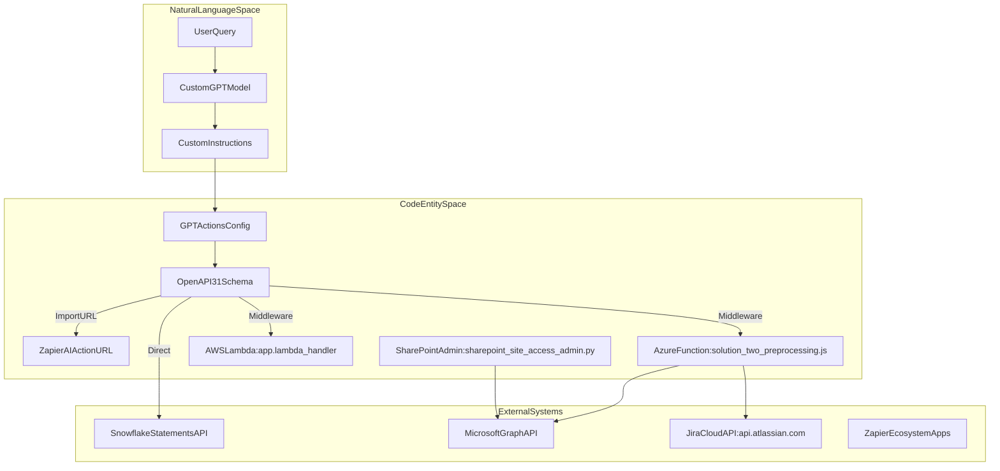
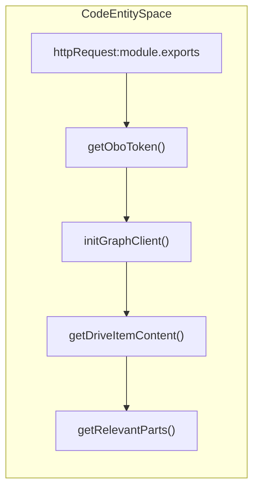

<!-- source: DeepWiki mcp.deepwiki.com · repo openai/openai-cookbook · page 6.3 GPT Actions and External Integrations · fetched 2026-10-26 -->

# GPT Actions and External Integrations

Relevant source files

The following files were used as context for generating this wiki page:

- [.github/workflows/validate-usage-budget.yml](.github/workflows/validate-usage-budget.yml)
- [examples/chatgpt/daily_usage_limits/.gitattributes](examples/chatgpt/daily_usage_limits/.gitattributes)
- [examples/chatgpt/daily_usage_limits/.gitignore](examples/chatgpt/daily_usage_limits/.gitignore)
- [examples/chatgpt/daily_usage_limits/README.md](examples/chatgpt/daily_usage_limits/README.md)
- [examples/chatgpt/daily_usage_limits/assets/chatgpt-usage-budget-starter.zip](examples/chatgpt/daily_usage_limits/assets/chatgpt-usage-budget-starter.zip)
- [examples/chatgpt/daily_usage_limits/assets/control-flow.svg](examples/chatgpt/daily_usage_limits/assets/control-flow.svg)
- [examples/chatgpt/daily_usage_limits/assets/monthly-budget-problem.svg](examples/chatgpt/daily_usage_limits/assets/monthly-budget-problem.svg)
- [examples/chatgpt/daily_usage_limits/assets/release-explorer.html](examples/chatgpt/daily_usage_limits/assets/release-explorer.html)
- [examples/chatgpt/daily_usage_limits/assets/release-timeline.svg](examples/chatgpt/daily_usage_limits/assets/release-timeline.svg)
- [examples/chatgpt/daily_usage_limits/aws/control.mjs](examples/chatgpt/daily_usage_limits/aws/control.mjs)
- [examples/chatgpt/gpt_actions_library/.gpt_action_getting_started.ipynb](examples/chatgpt/gpt_actions_library/.gpt_action_getting_started.ipynb)
- [examples/chatgpt/gpt_actions_library/gpt_action_bigquery.ipynb](examples/chatgpt/gpt_actions_library/gpt_action_bigquery.ipynb)
- [examples/chatgpt/gpt_actions_library/gpt_action_jira.ipynb](examples/chatgpt/gpt_actions_library/gpt_action_jira.ipynb)
- [examples/chatgpt/gpt_actions_library/gpt_action_outlook.ipynb](examples/chatgpt/gpt_actions_library/gpt_action_outlook.ipynb)
- [examples/chatgpt/gpt_actions_library/gpt_action_redshift.ipynb](examples/chatgpt/gpt_actions_library/gpt_action_redshift.ipynb)
- [examples/chatgpt/gpt_actions_library/gpt_action_sharepoint_doc.ipynb](examples/chatgpt/gpt_actions_library/gpt_action_sharepoint_doc.ipynb)
- [examples/chatgpt/gpt_actions_library/gpt_action_sharepoint_text.ipynb](examples/chatgpt/gpt_actions_library/gpt_action_sharepoint_text.ipynb)
- [examples/chatgpt/gpt_actions_library/gpt_action_snowflake_direct.ipynb](examples/chatgpt/gpt_actions_library/gpt_action_snowflake_direct.ipynb)
- [examples/chatgpt/gpt_actions_library/gpt_action_sql_database.ipynb](examples/chatgpt/gpt_actions_library/gpt_action_sql_database.ipynb)
- [examples/chatgpt/gpt_actions_library/gpt_middleware_aws_function.ipynb](examples/chatgpt/gpt_actions_library/gpt_middleware_aws_function.ipynb)
- [examples/chatgpt/gpt_actions_library/gpt_middleware_azure_function.ipynb](examples/chatgpt/gpt_actions_library/gpt_middleware_azure_function.ipynb)
- [examples/chatgpt/sharepoint_azure_function/Using_Azure_Functions_and_Microsoft_Graph_to_Query_SharePoint.md](examples/chatgpt/sharepoint_azure_function/Using_Azure_Functions_and_Microsoft_Graph_to_Query_SharePoint.md)
- [examples/chatgpt/sharepoint_azure_function/solution_one_file_retrieval.js](examples/chatgpt/sharepoint_azure_function/solution_one_file_retrieval.js)
- [examples/chatgpt/sharepoint_azure_function/solution_two_preprocessing.js](examples/chatgpt/sharepoint_azure_function/solution_two_preprocessing.js)
- [examples/chatgpt/sharepoint_site_access/sharepoint_site_access.md](examples/chatgpt/sharepoint_site_access/sharepoint_site_access.md)
- [examples/chatgpt/sharepoint_site_access/sharepoint_site_access_admin.py](examples/chatgpt/sharepoint_site_access/sharepoint_site_access_admin.py)
- [examples/chatgpt/sharepoint_site_access/test_sharepoint_site_access_admin.py](examples/chatgpt/sharepoint_site_access/test_sharepoint_site_access_admin.py)
- [examples/chatgpt/workspace_agents/workspace-agents-api-trigger.ipynb](examples/chatgpt/workspace_agents/workspace-agents-api-trigger.ipynb)
- [images/access_token.png](images/access_token.png)
- [images/agent_instructions.png](images/agent_instructions.png)
- [images/api-trigger-check.svg](images/api-trigger-check.svg)
- [images/api_channel.png](images/api_channel.png)
- [images/business-technical-bridge.svg](images/business-technical-bridge.svg)
- [images/gptactions_jira_callback.png](images/gptactions_jira_callback.png)
- [images/gptactions_jira_clientsecret.png](images/gptactions_jira_clientsecret.png)
- [images/gptactions_jira_devconsole.png](images/gptactions_jira_devconsole.png)
- [images/gptactions_jira_newapplication.png](images/gptactions_jira_newapplication.png)
- [images/gptactions_jira_permissions.png](images/gptactions_jira_permissions.png)
- [images/gptactions_jira_placeholder.png](images/gptactions_jira_placeholder.png)
- [images/gptactions_jira_redirect.png](images/gptactions_jira_redirect.png)
- [images/gptactions_jira_scopes.png](images/gptactions_jira_scopes.png)
- [images/gptactions_sql_database_middleware.png](images/gptactions_sql_database_middleware.png)
- [images/solution_2_architecture.png](images/solution_2_architecture.png)

This document covers GPT Actions, administrative APIs, middleware architectures, and external integrations designed to connect ChatGPT custom GPTs and enterprise workspaces to databases, productivity apps (Outlook, Jira, SharePoint), automation ecosystems (Zapier), and serverless infrastructure. It also documents workspace administrative controls, such as SharePoint site-collection allowlists and daily usage budget enforcement.

For basic function calling concepts with the Chat Completions API, see [Basic Function Calling Patterns](6.1). For knowledge retrieval patterns using function calling, see [Advanced Function Calling and Knowledge Retrieval](6.2).

## GPT Actions Overview and Configuration

GPT Actions allow custom GPTs to interact with external REST APIs by defining OpenAPI schemas that describe available operations. When a user interacts with a custom GPT, the model determines when to invoke configured actions based on the API specifications and custom instructions provided.

**Core Components:**
- **OpenAPI Schema**: Defines endpoints, parameters, data models, and response formats (e.g., OpenAPI 3.1.0 specifications) [examples/chatgpt/gpt_actions_library/gpt_action_snowflake_direct.ipynb:158-164]().
- **Authentication**: OAuth 2.0 (`authorizationCode`, `clientCredentials`), API Key, or `None` for public endpoints [examples/chatgpt/gpt_actions_library/gpt_action_outlook.ipynb:163-172](), [.gpt_action_getting_started.ipynb:33-33]().
- **Custom Instructions**: Natural language system prompts that guide the GPT on workflow sequencing, parameter extraction, and formatting [examples/chatgpt/gpt_actions_library/gpt_action_snowflake_direct.ipynb:125-136]().
- **operationId**: Unique identifiers mapping natural language execution intents directly to OpenAPI paths (e.g., `runQuery` [examples/chatgpt/gpt_actions_library/gpt_action_snowflake_direct.ipynb:172-172]()).

Sources: [examples/chatgpt/gpt_actions_library/gpt_action_snowflake_direct.ipynb:15-31](), [examples/chatgpt/gpt_actions_library/gpt_action_outlook.ipynb:163-172]()

## Integration Architecture Patterns

External integrations with GPT Actions follow different structural models depending on whether the target service supports direct REST invocation or requires a middleware proxy layer (such as Azure Functions or AWS Lambda) to handle authentication tokens, file conversions, or protocol translation.

### Integration Architecture Diagram

Sources: [examples/chatgpt/sharepoint_azure_function/solution_two_preprocessing.js:119-120](), [examples/chatgpt/gpt_actions_library/gpt_action_snowflake_direct.ipynb:163-172](), [examples/chatgpt/sharepoint_site_access/sharepoint_site_access_admin.py:63-74]()

## Cloud Services and Productivity Integrations

### SharePoint and Azure Functions Middleware

Integrating with Microsoft SharePoint or Office 365 requires middleware (Azure Functions) because the Microsoft Graph API returns file references (`driveItem`) rather than raw content suitable for direct model consumption [examples/chatgpt/sharepoint_azure_function/Using_Azure_Functions_and_Microsoft_Graph_to_Query_SharePoint.md:7-14]().

- **Solution 1 (File Retrieval)**: The Azure Function returns a base64 encoded payload structured via `openaiFileResponse`, allowing ChatGPT to treat the retrieved file as if it were uploaded directly by the user [examples/chatgpt/sharepoint_azure_function/Using_Azure_Functions_and_Microsoft_Graph_to_Key_SharePoint.md:14-16]().
- **Solution 2 (Pre-processing)**: The function downloads binary streams, parses documents using `pdf-parse`, extracts text, and queries `gpt-4o-mini` (`getRelevantParts`) to truncate text within model character limits before returning plain text [examples/chatgpt/sharepoint_azure_function/solution_two_preprocessing.js:49-116]().

Sources: [examples/chatgpt/sharepoint_azure_function/Using_Azure_Functions_and_Microsoft_Graph_to_Query_SharePoint.md:7-16](), [examples/chatgpt/sharepoint_azure_function/solution_two_preprocessing.js:11-116]()

### Microsoft Outlook Integration

The Outlook GPT Action integrates with Microsoft Graph API (`https://graph.microsoft.com/v1.0`) to manage emails and calendar events [examples/chatgpt/gpt_actions_library/gpt_action_outlook.ipynb:31-160]().
- **Authentication**: Configured via OAuth2 `clientCredentials` targeting `https://login.microsoftonline.com/{tenant_id}/oauth2/v2.0/token` [examples/chatgpt/gpt_actions_library/gpt_action_outlook.ipynb:163-167]().
- **Scopes**: Requests permissions including `User.Read`, `Mail.Read`, `Mail.Send`, and `Calendars.ReadWrite` [examples/chatgpt/gpt_actions_library/gpt_action_outlook.ipynb:168-172]().
- **Schemas**: Defines component schemas for `UserProfile`, `UserMessage`, and `CalendarEvent` [examples/chatgpt/gpt_actions_library/gpt_action_outlook.ipynb:174-200]().

Sources: [examples/chatgpt/gpt_actions_library/gpt_action_outlook.ipynb:31-200]()

### Jira Cloud Integration

The Jira GPT Action connects ChatGPT to Atlassian Jira Cloud REST API v3 (`https://api.atlassian.com/ex/jira/<CLOUD_ID>/rest/api/3`) [examples/chatgpt/gpt_actions_library/gpt_action_jira.ipynb:31-169]().
- **Authentication**: Uses OAuth2 authorization code flow (`authorizationUrl`: `https://auth.atlassian.com/authorize`, `tokenUrl`: `https://auth.atlassian.com/oauth/token`) [examples/chatgpt/gpt_actions_library/gpt_action_jira.ipynb:173-178]().
- **Scopes**: Requires `read:jira-user`, `read:jira-work`, and `write:jira-work` scopes [examples/chatgpt/gpt_actions_library/gpt_action_jira.ipynb:180-182]().
- **Instructions**: Guides the model to synthesize summaries, manage subtasks using project and parent keys, and resolve assignee profiles via JQL queries [examples/chatgpt/gpt_actions_library/gpt_action_jira.ipynb:121-130]().

Sources: [examples/chatgpt/gpt_actions_library/gpt_action_jira.ipynb:31-182]()

### Zapier Integration

Zapier AI Actions provide instant connectivity to over 6,000 downstream applications without requiring individual OpenAPI schema definitions for each service [examples/chatgpt/gpt_actions_library/gpt_action_zapier.ipynb:31-74]().
- **Configuration**: Uses an imported OpenAPI URL endpoint (`https://actions.zapier.com/gpt/api/v1/dynamic/openapi.json?tools=meta`) [examples/chatgpt/gpt_actions_library/gpt_action_zapier.ipynb:117-117]().
- **Management**: Specific actions must be enabled in the Zapier AI Action Manager before execution [examples/chatgpt/gpt_actions_library/gpt_action_zapier.ipynb:88-90]().

Sources: [examples/chatgpt/gpt_actions_library/gpt_action_zapier.ipynb:21-90]()

## Database Integrations

### Snowflake Direct Integration

The Snowflake Direct Action interfaces with the Snowflake SQL API (`/api/v2/statements`) without intermediate proxy servers [examples/chatgpt/gpt_actions_library/gpt_action_snowflake_direct.ipynb:28-168]().
- **Workflow**: The model starts by executing a query against `{database}.INFORMATION_SCHEMA.COLUMNS` to inspect data types and structure, converts the user prompt into a parameterized SQL statement, and executes it via `runQuery` [examples/chatgpt/gpt_actions_library/gpt_action_snowflake_direct.ipynb:125-132]().

Sources: [examples/chatgpt/gpt_actions_library/gpt_action_snowflake_direct.ipynb:28-172]()

### Google BigQuery Integration

BigQuery integration connects directly to the Google BigQuery REST API (`https://bigquery.googleapis.com/bigquery/v2`) [examples/chatgpt/gpt_actions_library/gpt_action_bigquery.ipynb:31-168]().
- **Query Execution**: Submits POST requests to `/projects/{projectId}/queries` [examples/chatgpt/gpt_actions_library/gpt_action_bigquery.ipynb:171-173]().
- **Instructions**: Instructs the model to inspect `{project}.{dataset}.INFORMATION_SCHEMA.COLUMN_FIELD_PATHS` and enforce `useLegacySql: false` in request payloads [examples/chatgpt/gpt_actions_library/gpt_action_bigquery.ipynb:126-131]().

Sources: [examples/chatgpt/gpt_actions_library/gpt_action_bigquery.ipynb:31-173]()

### SQL Databases and AWS Lambda Middleware

Managed relational databases (PostgreSQL, MySQL, Amazon Redshift) typically lack native REST APIs. Middleware applications built with AWS SAM (Serverless Application Model) or Azure Functions bridge this gap [examples/chatgpt/gpt_actions_library/gpt_middleware_aws_function.ipynb:21-23]().
- **AWS SAM Stack**: Defined in `template.yaml`, containing `MyCognitoUserPool`, `MyCognitoUserPoolClient`, `MiddlewareApi` (with `MyCognitoAuthorizer`), and `MiddlewareFunction` (`app.lambda_handler`, Python 3.11) [examples/chatgpt/gpt_actions_library/gpt_middleware_aws_function.ipynb:122-173]().
- **Result Handling**: Middleware executes SQL queries, converts tabular result sets into CSV format, and returns payloads for data analysis [examples/chatgpt/gpt_actions_library/gpt_action_sql_database.ipynb:48-55]().

Sources: [examples/chatgpt/gpt_actions_library/gpt_action_sql_database.ipynb:48-71](), [examples/chatgpt/gpt_actions_library/gpt_middleware_aws_function.ipynb:21-173]()

## Workspace Agents and Administrative APIs

### SharePoint Site-Collection Allowlist Management

Workspace administrators can restrict the SharePoint app to approved site collections using the ChatGPT Admin API via `sharepoint_site_access_admin.py` [examples/chatgpt/sharepoint_site_access/sharepoint_site_access.md:1-6]().
- **Core Functions**: `request_json()` handles authenticated JSON requests with automatic rate-limit retries (HTTP 429/503) [examples/chatgpt/sharepoint_site_access/sharepoint_site_access_admin.py:23-60](). `resolve_sharepoint_url()` maps ordinary HTTPS SharePoint URLs to canonical site-collection GUIDs via Microsoft Graph (`https://graph.microsoft.com/v1.0/sites/...`) [examples/chatgpt/sharepoint_site_access/sharepoint_site_access_admin.py:63-95]().
- **API Endpoint**: Updates allowlists via `PUT /v1/manage/workspaces/<workspace-id>/sharepoint/site-access/allow-list` [examples/chatgpt/sharepoint_site_access/sharepoint_site_access.md:152-156]().

Sources: [examples/chatgpt/sharepoint_site_access/sharepoint_site_access.md:1-156](), [examples/chatgpt/sharepoint_site_access/sharepoint_site_access_admin.py:23-95]()

## ChatGPT Daily Usage Limit Controls and Budgeting

Enterprise deployments frequently require enforcing daily spending and usage limits for custom GPTs and workspace applications. Usage limit controls can be automated via serverless scripts (e.g., `examples/chatgpt/daily_usage_limits/aws/control.mjs`) that inspect execution logs, aggregate token consumption, and throttle or alert when budgets are exceeded [examples/chatgpt/daily_usage_limits/aws/control.mjs:1-50]().

- **Control Flow**: Scheduled cron jobs or API webhooks evaluate accumulated daily costs against a pre-configured enterprise ceiling.
- **Enforcement**: When usage thresholds are breached, administrative scripts invoke workspace management APIs to temporarily suspend app triggers or notify workspace operators.

Sources: [examples/chatgpt/daily_usage_limits/aws/control.mjs:1-50]()

---

