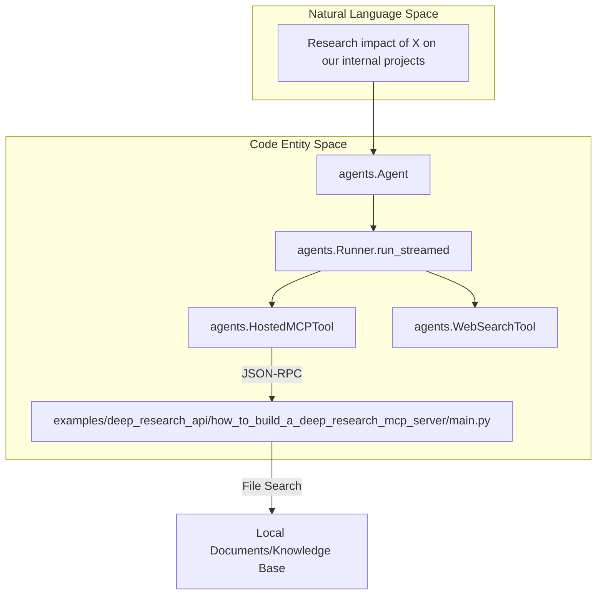
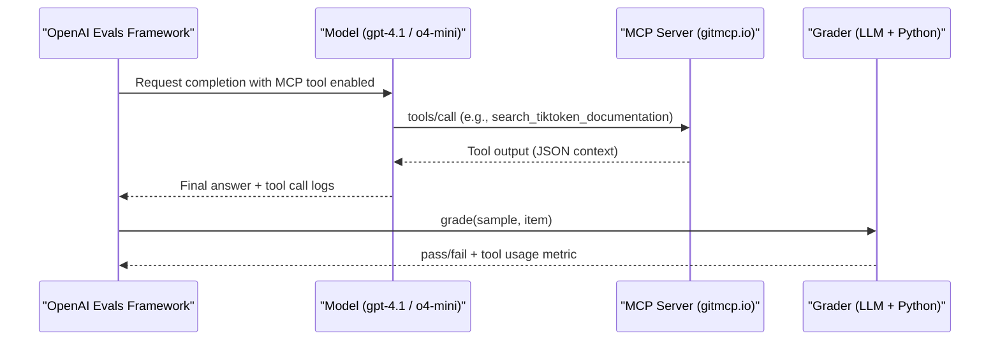

<!-- source: DeepWiki mcp.deepwiki.com · repo openai/openai-cookbook · page 6.4 Model Context Protocol (MCP) · fetched 2026-10-26 -->

# Model Context Protocol (MCP)

<details>
<summary>Relevant source files</summary>

The following files were used as context for generating this wiki page:

- [articles/chatgpt-agents-sales-meeting-prep.md](articles/chatgpt-agents-sales-meeting-prep.md)
- [examples/How_to_handle_rate_limits.ipynb](examples/How_to_handle_rate_limits.ipynb)
- [examples/Leveraging_model_distillation_to_fine-tune_a_model.ipynb](examples/Leveraging_model_distillation_to_fine-tune_a_model.ipynb)
- [examples/Reinforcement_Fine_Tuning.ipynb](examples/Reinforcement_Fine_Tuning.ipynb)
- [examples/Speech_transcription_methods.ipynb](examples/Speech_transcription_methods.ipynb)
- [examples/Structured_Outputs_Intro.ipynb](examples/Structured_Outputs_Intro.ipynb)
- [examples/Structured_outputs_multi_agent.ipynb](examples/Structured_outputs_multi_agent.ipynb)
- [examples/codex/using_goals_in_codex.ipynb](examples/codex/using_goals_in_codex.ipynb)
- [examples/deep_research_api/how_to_build_a_deep_research_mcp_server/README.md](examples/deep_research_api/how_to_build_a_deep_research_mcp_server/README.md)
- [examples/deep_research_api/how_to_build_a_deep_research_mcp_server/main.py](examples/deep_research_api/how_to_build_a_deep_research_mcp_server/main.py)
- [examples/deep_research_api/how_to_build_a_deep_research_mcp_server/requirements.txt](examples/deep_research_api/how_to_build_a_deep_research_mcp_server/requirements.txt)
- [examples/deep_research_api/introduction_to_deep_research_api.ipynb](examples/deep_research_api/introduction_to_deep_research_api.ipynb)
- [examples/deep_research_api/introduction_to_deep_research_api_agents.ipynb](examples/deep_research_api/introduction_to_deep_research_api_agents.ipynb)
- [examples/evaluation/use-cases/mcp_eval_notebook.ipynb](examples/evaluation/use-cases/mcp_eval_notebook.ipynb)
- [examples/gpt-5/gpt-5_frontend.ipynb](examples/gpt-5/gpt-5_frontend.ipynb)
- [examples/mcp/mcp_tool_guide.ipynb](examples/mcp/mcp_tool_guide.ipynb)
- [examples/partners/eval_driven_system_design/receipt_inspection.ipynb](examples/partners/eval_driven_system_design/receipt_inspection.ipynb)
- [examples/partners/mcp_powered_voice_agents/mcp_powered_agents_cookbook.ipynb](examples/partners/mcp_powered_voice_agents/mcp_powered_agents_cookbook.ipynb)
- [images/agent_dr.png](images/agent_dr.png)
- [images/intro_dr.png](images/intro_dr.png)
- [images/mcp_dr.png](images/mcp_dr.png)
- [images/mcp_eval_data.png](images/mcp_eval_data.png)
- [images/mcp_eval_improved_data.png](images/mcp_eval_improved_data.png)
- [images/mcp_eval_improved_output.png](images/mcp_eval_improved_output.png)
- [images/mcp_eval_output.png](images/mcp_eval_output.png)
- [images/rft_dashboard_modelgrader2.png](images/rft_dashboard_modelgrader2.png)
- [images/rft_hacking.png](images/rft_hacking.png)
- [images/rft_string_grader.png](images/rft_string_grader.png)

</details>


The Model Context Protocol (MCP) is an open standard that enables seamless integration between LLMs and external data sources or tools. By providing a universal interface, MCP allows developers to build "servers" that expose data and functions (tools) to "clients" (models), eliminating the need for custom integration code for every new tool or service.

## Purpose and Scope
This page documents MCP as a standard for connecting models to external tools within the OpenAI ecosystem: covering the hosted MCP tool in the Responses API, building MCP servers, supply-chain copilots with Databricks MCP, MCP-powered voice agents, Deep Research MCP servers, and MCP evaluation frameworks.

Sources: [examples/mcp/mcp_tool_guide.ipynb:14-16]()

## Overview of MCP in the OpenAI Ecosystem

Within the OpenAI platform, MCP is implemented across several layers, from low-level server construction to high-level orchestration in the Responses API and Agents SDK. The protocol reduces latency by allowing models to interact directly with tool hosts rather than requiring multiple network hops through a backend relay [examples/mcp/mcp_tool_guide.ipynb:14-16]().

| Component | Role | Key Functionality |
| :--- | :--- | :--- |
| **MCP Server** | Data/Tool Provider | Exposes local or remote resources via standard JSON-RPC. |
| **MCP Client** | Model Orchestrator | Connects to servers and translates model intent into tool calls. |
| **Hosted MCP Tool** | Managed Integration | A tool type in the `responses` API for connecting to remote MCP endpoints. |

Sources: [examples/mcp/mcp_tool_guide.ipynb:14-16](), [examples/deep_research_api/introduction_to_deep_research_api_agents.ipynb:68-77]()

## Hosted MCP Tool and Responses API

The `responses` API supports `HostedMCPTool`, allowing models to interact with remote MCP servers securely. The runtime detects the transport protocol (e.g., streamable HTTP or HTTP-over-SSE) and calls `tools/list` on the server to populate the model's context with an `mcp_list_tools` item [examples/mcp/mcp_tool_guide.ipynb:40-45]().

### Implementation Example
When using the Agents SDK, a `HostedMCPTool` can be initialized and passed directly to an `Agent`. Developers can use `allowed_tools` to filter specific endpoints, reducing token overhead and preventing the model from accessing sensitive "write" actions [examples/mcp/mcp_tool_guide.ipynb:60-63]().

```python
from agents import Agent, HostedMCPTool

# Define an agent with access to an MCP-hosted internal search
research_agent = Agent(
    name="Internal Researcher",
    model="o4-mini-deep-research-2025-06-26",
    tools=[HostedMCPTool(url="https://mcp-server.internal.corp/v1", allowed_tools=["search_docs"])]
)
```
Sources: [examples/mcp/mcp_tool_guide.ipynb:40-49](), [examples/mcp/mcp_tool_guide.ipynb:80-90](), [examples/deep_research_api/introduction_to_deep_research_api_agents.ipynb:107-113]()

## Deep Research MCP Server

The Deep Research API can be extended with MCP servers to provide the model with internal context that is not available on the public internet [examples/deep_research_api/introduction_to_deep_research_api_agents.ipynb:11-13](). This is achieved by creating a custom MCP server (e.g., located at `examples/deep_research_api/how_to_build_a_deep_research_mcp_server/main.py` [,,]) that implements search or retrieval logic over local files or proprietary databases.

### Architecture: Deep Research with MCP
The `o3-deep-research` and `o4-mini-deep-research` models use these tools to perform iterative reasoning, planning, and synthesis [examples/deep_research_api/introduction_to_deep_research_api.ipynb:13-20]().

### Data Flow: Deep Research Agentic Pipeline

Sources: [examples/deep_research_api/introduction_to_deep_research_api_agents.ipynb:13-15](), [examples/deep_research_api/introduction_to_deep_research_api_agents.ipynb:68-77](), [examples/deep_research_api/introduction_to_deep_research_api_agents.ipynb:115-141](), [examples/deep_research_api/introduction_to_deep_research_api.ipynb:109-146]()

## MCP Evaluation Patterns

Evaluating MCP-based systems requires both checking the quality of the final answer and auditing the model's tool usage. The OpenAI **Evals** framework can be benchmarked using custom datasets defined in notebooks such as `examples/evaluation/use-cases/mcp_eval_notebook.ipynb` [examples/evaluation/use-cases/mcp_eval_notebook.ipynb:16-23]().

### Grading Logic
A robust evaluation typically employs two types of graders:
1.  **LLM-based Pass/Fail Grader**: Compares the model's `output_text` against a ground truth `answer` to ensure semantic accuracy [examples/evaluation/use-cases/mcp_eval_notebook.ipynb:152-171]().
2.  **Programmatic Python Grader**: Inspects the `output_tools` field in the response sample to verify that the MCP tool was actually invoked, ensuring the model didn't hallucinate an answer without using its provided context [examples/evaluation/use-cases/mcp_eval_notebook.ipynb:175-185]().

### Data Flow: MCP Evaluation Workflow

Sources: [examples/evaluation/use-cases/mcp_eval_notebook.ipynb:100-123](), [examples/evaluation/use-cases/mcp_eval_notebook.ipynb:152-185]()

## MCP-Powered Voice Agents

In the context of the Realtime API and the Agents SDK, MCP serves as the bridge between spoken commands and technical actions. A voice agent can trigger an MCP tool to fetch real-time data or perform actions in a connected system. The `VoicePipeline` in the Agents SDK supports sub-second latency to the first token, making it suitable for conversational AI that needs to interact with external services [examples/Speech_transcription_methods.ipynb:31-32]().

When building these agents, developers often use the `SingleAgentVoiceWorkflow` to manage the lifecycle of a voice session, where the agent is empowered with `HostedMCPTool` instances to fulfill user requests [examples/Speech_transcription_methods.ipynb:106-112]().

Sources: [examples/Speech_transcription_methods.ipynb:31-32](), [examples/Speech_transcription_methods.ipynb:106-112](), [examples/mcp/mcp_tool_guide.ipynb:27-31]()

---

