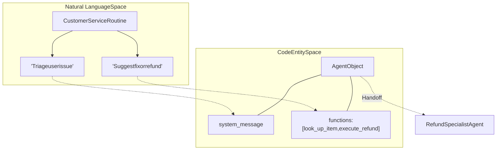
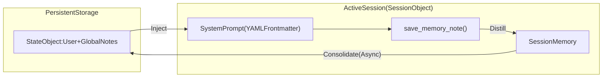

<!-- source: DeepWiki mcp.deepwiki.com · repo openai/openai-cookbook · page 7 Agents SDK and Agentic Workflows · fetched 2026-10-26 -->

# Agents SDK and Agentic Workflows

Relevant source files

The following files were used as context for generating this wiki page:

- [authors.yaml](authors.yaml)
- [examples/agents_api/README.md](examples/agents_api/README.md)
- [examples/agents_api/apps/data_analyst/agent.py](examples/agents_api/apps/data_analyst/agent.py)
- [examples/agents_api/apps/data_analyst/main.py](examples/agents_api/apps/data_analyst/main.py)
- [examples/agents_api/apps/document_review/main.py](examples/agents_api/apps/document_review/main.py)
- [examples/agents_api/apps/github_issues/main.py](examples/agents_api/apps/github_issues/main.py)
- [examples/agents_api/apps/sev_bot/main.py](examples/agents_api/apps/sev_bot/main.py)
- [examples/agents_api/apps/slack_bot/main.py](examples/agents_api/apps/slack_bot/main.py)
- [examples/agents_sdk/building_reliable_agents_memory_compaction.ipynb](examples/agents_sdk/building_reliable_agents_memory_compaction.ipynb)
- [examples/agents_sdk/context_personalization.ipynb](examples/agents_sdk/context_personalization.ipynb)
- [examples/agents_sdk/session_memory.ipynb](examples/agents_sdk/session_memory.ipynb)
- [examples/completions_usage_api.ipynb](examples/completions_usage_api.ipynb)
- [examples/evaluation/moving-from-openai-evals-to-promptfoo.md](examples/evaluation/moving-from-openai-evals-to-promptfoo.md)
- [examples/gpt-5/prompt_personalities.ipynb](examples/gpt-5/prompt_personalities.ipynb)
- [examples/gpt4-1_prompting_guide.ipynb](examples/gpt4-1_prompting_guide.ipynb)
- [examples/skills_in_api.ipynb](examples/skills_in_api.ipynb)
- [images/memory_comparison.jpg](images/memory_comparison.jpg)
- [images/promptfoo-custom-example-view.png](images/promptfoo-custom-example-view.png)
- [images/summarizingSession.jpg](images/summarizingSession.jpg)
- [images/trimingSession.jpg](images/trimingSession.jpg)
- [registry.yaml](registry.yaml)

The OpenAI Agents SDK provides a framework for building complex, multi-turn AI applications by moving beyond single-prompt interactions toward **agentic workflows**. This system allows developers to decompose monolithic prompts into specialized **routines** and **handoffs**, enabling more reliable and maintainable AI systems.

## Purpose and Scope

This page serves as a high-level technical overview of the Agents SDK and its associated patterns. It bridges the gap between natural language instructions and code-level entities like agents, tools, and session state. The following sections provide summaries of core concepts and link to specialized child pages for implementation details.

---

## Core Concepts: Routines and Handoffs

The SDK is built on two fundamental abstractions that allow for sophisticated orchestration:

*   **Routines**: A set of natural language instructions (represented as a system prompt) paired with the specific tools required to execute them [examples/Orchestrating_agents.ipynb:47-53](). Routines act like state machines where the LLM handles transitions and logic "softly" [examples/Orchestrating_agents.ipynb:94-96]().
*   **Handoffs**: The process of one agent transferring the conversation to another. This is implemented by an agent returning another agent instance as a tool result, effectively switching the context and system instructions for the next turn.

### From Natural Language to Code Entities

The diagram below illustrates how a high-level customer service "Routine" maps to specific code objects within the SDK environment.

**Agent-Code Entity Mapping**

Sources: [examples/Orchestrating_agents.ipynb:57-88]()

For deep technical details on agent definition, tools, handoffs, routines, session memory, context personalization, memory compaction, the Skills API, security scanner agents, and migration from the Claude Agent SDK, see **[Agents SDK Fundamentals](#7.1)**.

---

## SDK Fundamentals and State Management

The Agents SDK simplifies complex interactions by managing state and memory automatically. Unlike the raw Responses API, which requires manual tracking of `previous_response_id`, the SDK uses a `Session` object to maintain history and continuity [examples/agents_sdk/session_memory.ipynb:45-50]().

*   **Context Engineering**: Managing the token window through **Trimming** (dropping old turns) or **Summarization** (compressing history into a structured synthetic message) [examples/agents_sdk/session_memory.ipynb:67-91]().
*   **Context Personalization**: Using `RunContextWrapper` to maintain a structured state (e.g., user profiles, global notes) that persists across multiple runs [examples/agents_sdk/context_personalization.ipynb:16-19]().
*   **Personality Steering**: Defining an agent's tone and detail level (e.g., "Professional", "Efficient") via system instructions to align behavior with business constraints [examples/gpt-5/prompt_personalities.ipynb:20-27]().

Sources: [examples/agents_sdk/session_memory.ipynb:45-50](), [examples/agents_sdk/context_personalization.ipynb:16-19](), [examples/gpt-5/prompt_personalities.ipynb:20-27]()

---

## Multi-Agent Orchestration

Complex applications often require multiple specialized agents working in tandem. The SDK supports patterns such as:
*   **Agents-as-Tools**: An orchestrator agent calls specialist agents as if they were functions.
*   **Parallel Execution**: Running multiple agents simultaneously for portfolio analysis or deployment management.
*   **Partner Integrations**: Orchestrating agents across platforms, such as running synthetic AML analysis using the Agents SDK on Amazon Bedrock [registry.yaml:47-50]().

For multi-agent patterns, agents-as-tools, parallel execution, portfolio collaboration with specialist agents, deployment manager agents, object-oriented agentic approaches, agent cost/quality optimization, and AWS AgentCore integration, see **[Multi-Agent Orchestration](#7.2)**.

Sources: [registry.yaml:47-50]()

---

## Specialized Agentic Workflows

### Agentic Coding
The SDK and models like `gpt-5.1` enable automated code generation and refinement. By using tools like `apply_patch` (to edit files), `shell` (to run commands), and `web_search`, agents can scaffold apps and iterate based on feedback [examples/Build_a_coding_agent_with_GPT-5.1.ipynb:8-19](). For production, these agents must operate in sandboxed environments [examples/Build_a_coding_agent_with_GPT-5.1.ipynb:71-71](). For details on Codex CLI and SDK for automated code review in CI/CD, ExecPlans, goals, Jira-GitHub integration, autofix workflows, sandboxed code migration, and Codex + Agents SDK workflows, see **[Agentic Coding with Codex](#7.3)**.

### Evaluation and Governance
Production agents require rigorous guardrails and evaluation. This includes clustering trace-level signals into recurring behavior patterns to evaluate multi-agent systems at scale [registry.yaml:157-160](). Governance also involves enforcing application-owned review gates for high-stakes actions like payments [registry.yaml:63-66](). For information on evaluating agents with the Agents SDK, guardrail tuning, self-evolving agents, temporal agents with knowledge graphs, schemaflow design, and macro-level system evaluation, see **[Agent Evaluation and Governance](#7.4)**.

Sources: [examples/Build_a_coding_agent_with_GPT-5.1.ipynb:8-19](), [registry.yaml:157-160](), [registry.yaml:63-66]()

---

## Agents API Applications and Sandboxes

Beyond the client-side SDK, the OpenAI ecosystem supports robust server-side agent architectures via the Agents API (`client.beta.agents.sessions`) [examples/agents_api/README.md:34-36]().

### Reference Applications
Complete reference implementations showcase production patterns such as SRE/sev monitoring bots, Slack integration bots, data analytics warehouse query agents, GitHub issue investigators, and document reviewers with policy skills [examples/agents_api/README.md:8-15](). These apps leverage session creation, streaming turns, subagents, capability directories, vaults, webhook entrypoints, and human-in-the-loop approval gates. For details, see **[Agents API Reference Applications](#7.5)**.

### Sandbox Environments
Agent execution often requires isolated runtimes. Sandboxes can be application-managed or webhook-managed, running components like `codex exec-server` authenticated via `OPENAI_EXECUTOR_API_KEY` [examples/agents_api/README.md:16-24,50-58](). Provider integrations span AWS Lambda MicroVMs [registry.yaml:37-41](), Docker, E2B, Daytona, Modal, Cloudflare, Vercel, Runloop, Blaxel, DigitalOcean, and OCI. For provisioning guides and runtime configurations, see **[Agents API Sandbox Environments](#7.6)**.

Sources: [registry.yaml:37-41](), [examples/agents_api/README.md:8-58]()

---

## Memory Lifecycle Diagram

The diagram below shows how state transitions from a global "Code Entity" into a specific session and back again through distillation and consolidation.

**Context and Memory Lifecycle**

Sources: [examples/agents_sdk/context_personalization.ipynb:70-106](), [examples/agents_sdk/session_memory.ipynb:49-50]()

## Summary Table of Techniques

| Technique | Purpose | Best For |
| :--- | :--- | :--- |
| **Trimming** | Drop older turns deterministically | Low-latency, independent tasks [examples/agents_sdk/session_memory.ipynb:84-88]() |
| **Summarization** | Compress history into a synthetic anchor | Long-range context, coaching, analysis [examples/agents_sdk/session_memory.ipynb:106-109]() |
| **Compaction** | Carry forward state while reducing size | Compliance reviews, evolving evidence [examples/agents_sdk/building_reliable_agents_memory_compaction.ipynb:18-20]() |
| **Memory** | Reuse lessons from prior runs | Reusable workflow guidance [examples/agents_sdk/building_reliable_agents_memory_compaction.ipynb:21-22]() |

Sources: [examples/agents_sdk/session_memory.ipynb:67-109](), [examples/agents_sdk/building_reliable_agents_memory_compaction.ipynb:18-22]()

---

