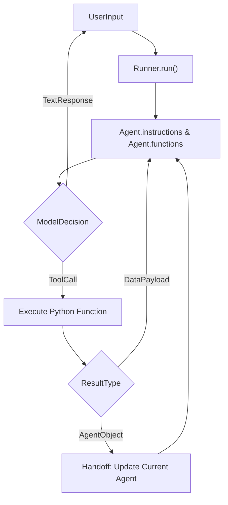
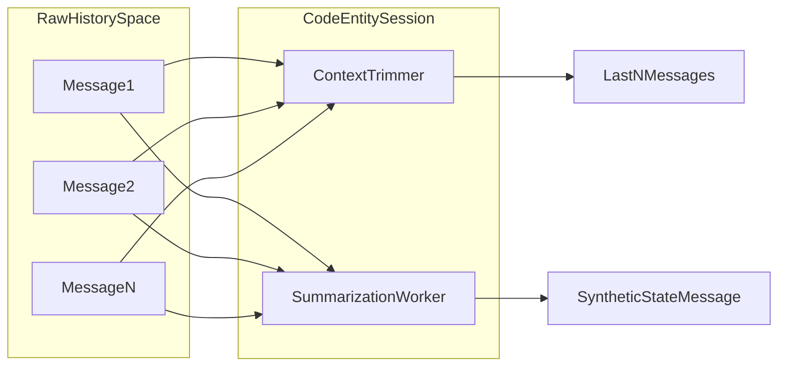
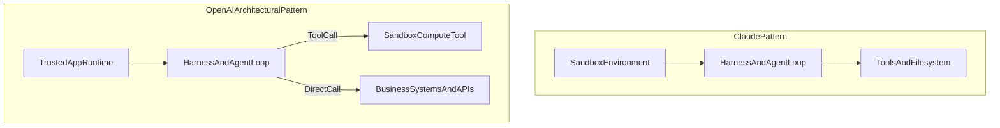

<!-- source: DeepWiki mcp.deepwiki.com · repo openai/openai-cookbook · page 7.1 Agents SDK Fundamentals · fetched 2026-10-26 -->

# Agents SDK Fundamentals

Relevant source files

The following files were used as context for generating this wiki page:

- [authors.yaml](authors.yaml)
- [examples/Orchestrating_agents.ipynb](examples/Orchestrating_agents.ipynb)
- [examples/agents_sdk/building_reliable_agents_memory_compaction.ipynb](examples/agents_sdk/building_reliable_agents_memory_compaction.ipynb)
- [examples/agents_sdk/context_personalization.ipynb](examples/agents_sdk/context_personalization.ipynb)
- [examples/agents_sdk/migrate-from-claude-agent-sdk/README.md](examples/agents_sdk/migrate-from-claude-agent-sdk/README.md)
- [examples/agents_sdk/migrate-from-claude-agent-sdk/assets/claude-agent-sdk-pattern.png](examples/agents_sdk/migrate-from-claude-agent-sdk/assets/claude-agent-sdk-pattern.png)
- [examples/agents_sdk/migrate-from-claude-agent-sdk/assets/openai-agents-sdk-pattern.png](examples/agents_sdk/migrate-from-claude-agent-sdk/assets/openai-agents-sdk-pattern.png)
- [examples/agents_sdk/security_review_helpers.py](examples/agents_sdk/security_review_helpers.py)
- [examples/agents_sdk/security_scanners_with_agents_sdk.ipynb](examples/agents_sdk/security_scanners_with_agents_sdk.ipynb)
- [examples/agents_sdk/session_memory.ipynb](examples/agents_sdk/session_memory.ipynb)
- [examples/agents_sdk/tests/test_security_review_repository_labels.py](examples/agents_sdk/tests/test_security_review_repository_labels.py)
- [examples/completions_usage_api.ipynb](examples/completions_usage_api.ipynb)
- [examples/evaluation/moving-from-openai-evals-to-promptfoo.md](examples/evaluation/moving-from-openai-evals-to-promptfoo.md)
- [examples/gpt-5/prompt_personalities.ipynb](examples/gpt-5/prompt_personalities.ipynb)
- [examples/gpt4-1_prompting_guide.ipynb](examples/gpt4-1_prompting_guide.ipynb)
- [examples/skills_in_api.ipynb](examples/skills_in_api.ipynb)
- [images/memory_comparison.jpg](images/memory_comparison.jpg)
- [images/promptfoo-custom-example-view.png](images/promptfoo-custom-example-view.png)
- [images/summarizingSession.jpg](images/summarizingSession.jpg)
- [images/trimingSession.jpg](images/trimingSession.jpg)
- [registry.yaml](registry.yaml)

The purpose of this page is to document the core concepts and architecture of the OpenAI Agents SDK, including agent definitions, routines, handoffs, session memory, context personalization, memory compaction, the Skills API, security scanner agent swarms, and migration strategies from the Claude Agent SDK.

---

## 1. Core Abstractions: Routines, Handoffs, and Agent Definition

The SDK organizes agent behavior around structured abstractions that govern how instructions and tool allocations are processed [examples/Orchestrating_agents.ipynb:47-54]().
*   **Routines**: Sets of natural language instructions (represented as system prompts) combined with the tools necessary to execute those steps [examples/Orchestrating_agents.ipynb:47-49]().
*   **Handoffs**: Mechanisms where one agent transfers execution control to another agent or a human, typically by returning an `Agent` object from a tool function [examples/Orchestrating_agents.ipynb:218-245]().
*   **Agent Definition**: Entities containing an explicit `name`, `model`, `instructions`, and list of `functions` [examples/Orchestrating_agents.ipynb:62-74](). Python functions are dynamically converted to JSON schemas using helper utilities [examples/Orchestrating_agents.ipynb:155-195]().

**Natural Language Space to Code Entity Space: Routine Execution**
This diagram maps conceptual agent instructions and execution states directly to SDK classes and loop functions.

| Natural Language Concept | Code Entity / Symbol | File Reference |
| :--- | :--- | :--- |
| **Routine Definition** | `Agent` class / `system_message` | [examples/Orchestrating_agents.ipynb:62-74]() |
| **Tool Allocation** | Python functions / `tools` list | [examples/Orchestrating_agents.ipynb:76-88]() |
| **Execution Loop** | `run_full_turn` function | [examples/Orchestrating_agents.ipynb:117-127]() |
| **Handoff Mechanism** | `transfer_to_agent` pattern | [examples/Orchestrating_agents.ipynb:235-245]() |

Title: "Agent Execution and Handoff Control Flow"

Sources: [examples/Orchestrating_agents.ipynb:62-136](), [examples/Orchestrating_agents.ipynb:218-245]()

---

## 2. Session Memory and Context Management

The `Session` object provides managed short-term memory over the underlying API, removing the need to manually append message histories or manage IDs across turns [examples/agents_sdk/session_memory.ipynb:45-50]().

### Context Trimming vs. Summarization
To prevent context window degradation, the SDK implements two core compaction strategies:

| Strategy | Implementation Mechanics | Advantages | Disadvantages |
| :--- | :--- | :--- | :--- |
| **Trimming** | Drops historical turns, keeping the last $N$ messages [examples/agents_sdk/session_memory.ipynb:69-70]() | Low latency, highly deterministic [examples/agents_sdk/session_memory.ipynb:72-73]() | Abruptly forgets long-range constraints [examples/agents_sdk/session_memory.ipynb:79-80]() |
| **Summarization** | Compresses prior message histories into synthetic summary messages [examples/agents_sdk/session_memory.ipynb:91-92]() | Retains long-range context compactly [examples/agents_sdk/session_memory.ipynb:94-95]() | Adds latency and risk of drift [examples/agents_sdk/session_memory.ipynb:101-102]() |

**Natural Language Space to Code Entity Space: Session Compaction**
This diagram maps raw conversation text states into managed SDK session entities.

| Conceptual State | Code Symbol | File Reference |
| :--- | :--- | :--- |
| **Raw History** | `messages` list / `input` array | [examples/agents_sdk/session_memory.ipynb:45-47]() |
| **Compaction Handler** | `Session` object / Trimmer | [examples/agents_sdk/session_memory.ipynb:48-50]() |
| **Synthetic Anchor** | Summary message injection | [examples/agents_sdk/session_memory.ipynb:97-98]() |

Title: "Session Memory Compaction Flow"

Sources: [examples/agents_sdk/session_memory.ipynb:45-103](), [examples/agents_sdk/building_reliable_agents_memory_compaction.ipynb:16-29]()

---

## 3. Context Personalization and State Management

Context personalization is handled via the `RunContextWrapper` in the OpenAI Agents SDK, enabling structured state persistence across runs [examples/agents_sdk/context_personalization.ipynb:16-18]().

### State Lifecycle Mechanics
1.  **State Object**: A local store containing a structured user profile (YAML frontmatter) and unstructured Markdown memory notes [examples/agents_sdk/context_personalization.ipynb:20-25]().
2.  **Distillation**: Capturing durable preferences during execution via tool calls like `save_memory_note(...)` [examples/agents_sdk/context_personalization.ipynb:87-89]().
3.  **Consolidation**: Asynchronously merging session notes into global long-term storage while performing deduplication and conflict resolution [examples/agents_sdk/context_personalization.ipynb:99-102]().
4.  **Injection**: Injecting resolved state into the system prompt at run startup [examples/agents_sdk/context_personalization.ipynb:25-26]().

Sources: [examples/agents_sdk/context_personalization.ipynb:16-27](), [examples/agents_sdk/context_personalization.ipynb:74-106]()

---

## 4. Skills API for Reusable Agent Bundles

A **Skill** represents a packaged bundle of instructions, scripts, and assets anchored by a required `SKILL.md` manifest [examples/skills_in_api.ipynb:38-39]().

### Architectural Boundaries: Prompts vs. Tools vs. Skills
*   **System Prompts**: Define global behavior, tone, and safety guardrails [examples/skills_in_api.ipynb:150-155]().
*   **Tools**: Expose narrowly typed functions that execute external API calls or create external side effects [examples/skills_in_api.ipynb:172-186]().
*   **Skills**: Encapsulate repeatable workflows, code templates, and assets executed within sandbox runtimes (`environment.type="container_auto"`) [examples/skills_in_api.ipynb:40-45](), [examples/skills_in_api.ipynb:186-193]().

Sources: [examples/skills_in_api.ipynb:38-54](), [examples/skills_in_api.ipynb:150-193]()

---

## 5. Security Scanner Agents and Multi-Agent Swarms

Security workflows combine static analysis tools (Semgrep, Bandit) with the Agents SDK to route scanner findings to specialist agents, validate source evidence, and prepare remediation artifacts [examples/agents_sdk/security_scanners_with_agents_sdk.ipynb:8-10]().

### Core Implementation Components
*   **Manager Agent**: Inspects scan findings and dynamically selects specialist agents for investigation [examples/agents_sdk/security_scanners_with_agents_sdk.ipynb:8-10]().
*   **ModelSettings & RunConfig**: Configure parameters such as `max_tokens`, `reasoning` effort (e.g., `Reasoning(effort="xhigh")`), and tool concurrency bounds [examples/agents_sdk/security_scanners_with_agents_sdk.ipynb:142-150]().
*   **Contracts & Manifests**: Use Pydantic-based contracts (`TargetManifest`, `ApprovedFile`, `SourceSnapshot`) to enforce strict path safety and sha256 evidence integrity before tool execution [examples/agents_sdk/security_review_helpers.py:37-126]().

Sources: [examples/agents_sdk/security_scanners_with_agents_sdk.ipynb:8-150](), [examples/agents_sdk/security_review_helpers.py:37-126]()

---

## 6. Migration from the Claude Agent SDK

Migrating from the Claude Agent SDK to the OpenAI Agents SDK involves decoupling the agent harness from the underlying compute sandbox [examples/agents_sdk/migrate-from-claude-agent-sdk/README.md:7-13]().

### Key Architectural Shifts
*   **Claude Pattern**: The harness, agent loop, and execution environment reside directly inside the sandbox [examples/agents_sdk/migrate-from-claude-agent-sdk/README.md:9-11]().
*   **OpenAI Pattern**: The trusted host application runs the harness, agent loop, and tool coordination, while the sandbox is treated as a discrete execution tool for scoped compute and file operations [examples/agents_sdk/migrate-from-claude-agent-sdk/README.md:12-13](), [examples/agents_sdk/migrate-from-claude-agent-sdk/README.md:30-31]().

### Concept Mapping Table

| Claude Concept | OpenAI Agents SDK Equivalent | Migration Rule |
| :--- | :--- | :--- |
| `CLAUDE.md` (Behavior) | `Agent.instructions` | Place core role and task policies here [examples/agents_sdk/migrate-from-claude-agent-sdk/README.md:50]() |
| `CLAUDE.md` (Workspace) | `AGENTS.md` | Store repo-wide conventions and test paths here [examples/agents_sdk/migrate-from-claude-agent-sdk/README.md:51]() |
| Subagents | `handoffs=[...]` or `agent.as_tool()` | Use `handoffs` for control transfer, `as_tool` for specialist assistance [examples/agents_sdk/migrate-from-claude-agent-sdk/README.md:73-78]() |
| Lifecycle Callbacks | `RunHooks` or `AgentHooks` | Migrate logging to hooks and permissions to guardrails [examples/agents_sdk/migrate-from-claude-agent-sdk/README.md:65-70]() |

Title: "Migration Architecture Comparison"

Sources: [examples/agents_sdk/migrate-from-claude-agent-sdk/README.md:7-56](), [examples/agents_sdk/migrate-from-claude-agent-sdk/README.md:65-78]()

---

