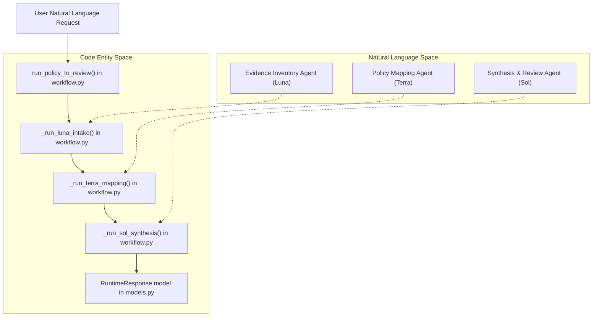
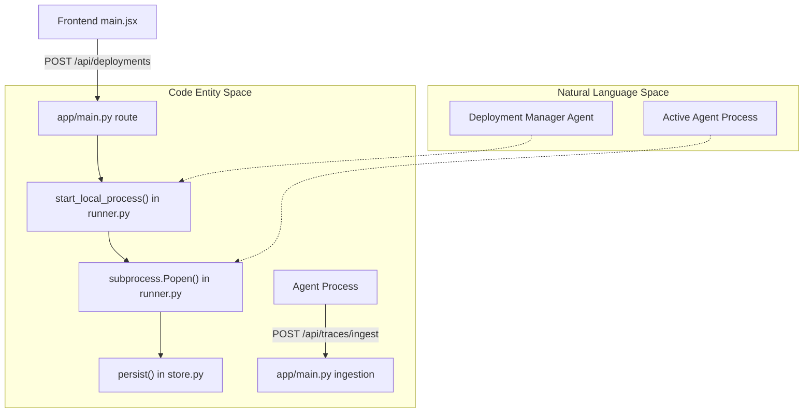

<!-- source: DeepWiki mcp.deepwiki.com · repo openai/openai-cookbook · page 7.2 Multi-Agent Orchestration · fetched 2026-10-26 -->

# Multi-Agent Orchestration

<details>
<summary>Relevant source files</summary>

The following files were used as context for generating this wiki page:

- [examples/agent_optimization/evaluation.py](examples/agent_optimization/evaluation.py)
- [examples/agent_optimization/live_api.py](examples/agent_optimization/live_api.py)
- [examples/agent_optimization/optimizing_agents_for_cost_and_quality.ipynb](examples/agent_optimization/optimizing_agents_for_cost_and_quality.ipynb)
- [examples/agent_optimization/outputs/nightly_support_qa_batch.jsonl](examples/agent_optimization/outputs/nightly_support_qa_batch.jsonl)
- [examples/agent_optimization/requirements.txt](examples/agent_optimization/requirements.txt)
- [examples/agent_optimization/scenarios.py](examples/agent_optimization/scenarios.py)
- [examples/agent_optimization/simulation.py](examples/agent_optimization/simulation.py)
- [examples/agent_optimization/support.py](examples/agent_optimization/support.py)
- [examples/agents_sdk/deployment_manager/.gitignore](examples/agents_sdk/deployment_manager/.gitignore)
- [examples/agents_sdk/deployment_manager/Makefile](examples/agents_sdk/deployment_manager/Makefile)
- [examples/agents_sdk/deployment_manager/README.md](examples/agents_sdk/deployment_manager/README.md)
- [examples/agents_sdk/deployment_manager/app/__init__.py](examples/agents_sdk/deployment_manager/app/__init__.py)
- [examples/agents_sdk/deployment_manager/app/dockerfile_writer.py](examples/agents_sdk/deployment_manager/app/dockerfile_writer.py)
- [examples/agents_sdk/deployment_manager/app/main.py](examples/agents_sdk/deployment_manager/app/main.py)
- [examples/agents_sdk/deployment_manager/app/models.py](examples/agents_sdk/deployment_manager/app/models.py)
- [examples/agents_sdk/deployment_manager/app/project_inspector.py](examples/agents_sdk/deployment_manager/app/project_inspector.py)
- [examples/agents_sdk/deployment_manager/app/runner.py](examples/agents_sdk/deployment_manager/app/runner.py)
- [examples/agents_sdk/deployment_manager/app/store.py](examples/agents_sdk/deployment_manager/app/store.py)
- [examples/agents_sdk/deployment_manager/app/timeline.py](examples/agents_sdk/deployment_manager/app/timeline.py)
- [examples/agents_sdk/deployment_manager/frontend/src/main.jsx](examples/agents_sdk/deployment_manager/frontend/src/main.jsx)
- [examples/agents_sdk/deployment_manager/frontend/src/styles.css](examples/agents_sdk/deployment_manager/frontend/src/styles.css)
- [examples/object_oriented_agentic_approach/Secure_code_interpreter_tool_for_LLM_agents.ipynb](examples/object_oriented_agentic_approach/Secure_code_interpreter_tool_for_LLM_agents.ipynb)
- [examples/object_oriented_agentic_approach/resources/object_oriented_agents/core_classes/agent_signature.py](examples/object_oriented_agentic_approach/resources/object_oriented_agents/core_classes/agent_signature.py)
- [examples/object_oriented_agentic_approach/resources/object_oriented_agents/core_classes/base_agent.py](examples/object_oriented_agentic_approach/resources/object_oriented_agents/core_classes/base_agent.py)
- [examples/object_oriented_agentic_approach/resources/object_oriented_agents/core_classes/tool_manager.py](examples/object_oriented_agentic_approach/resources/object_oriented_agents/core_classes/tool_manager.py)
- [examples/object_oriented_agentic_approach/resources/object_oriented_agents/services/language_model_interface.py](examples/object_oriented_agentic_approach/resources/object_oriented_agents/services/language_model_interface.py)
- [examples/object_oriented_agentic_approach/resources/object_oriented_agents/services/openai_language_model.py](examples/object_oriented_agentic_approach/resources/object_oriented_agents/services/openai_language_model.py)
- [examples/object_oriented_agentic_approach/resources/registry/agents/python_code_exec_agent.py](examples/object_oriented_agentic_approach/resources/registry/agents/python_code_exec_agent.py)
- [examples/partners/AWS/controlled_agentic_commerce_with_agentcore_payments/.env.example](examples/partners/AWS/controlled_agentic_commerce_with_agentcore_payments/.env.example)
- [examples/partners/AWS/controlled_agentic_commerce_with_agentcore_payments/.gitignore](examples/partners/AWS/controlled_agentic_commerce_with_agentcore_payments/.gitignore)
- [examples/partners/AWS/controlled_agentic_commerce_with_agentcore_payments/README.md](examples/partners/AWS/controlled_agentic_commerce_with_agentcore_payments/README.md)
- [examples/partners/AWS/controlled_agentic_commerce_with_agentcore_payments/controlled_agentic_commerce.ipynb](examples/partners/AWS/controlled_agentic_commerce_with_agentcore_payments/controlled_agentic_commerce.ipynb)
- [examples/partners/AWS/controlled_agentic_commerce_with_agentcore_payments/pyproject.toml](examples/partners/AWS/controlled_agentic_commerce_with_agentcore_payments/pyproject.toml)
- [examples/partners/AWS/controlled_agentic_commerce_with_agentcore_payments/src/agentic_commerce/__init__.py](examples/partners/AWS/controlled_agentic_commerce_with_agentcore_payments/src/agentic_commerce/__init__.py)
- [examples/partners/AWS/controlled_agentic_commerce_with_agentcore_payments/src/agentic_commerce/agent.py](examples/partners/AWS/controlled_agentic_commerce_with_agentcore_payments/src/agentic_commerce/agent.py)
- [examples/partners/AWS/controlled_agentic_commerce_with_agentcore_payments/src/agentic_commerce/agentcore_agent.py](examples/partners/AWS/controlled_agentic_commerce_with_agentcore_payments/src/agentic_commerce/agentcore_agent.py)
- [examples/partners/AWS/controlled_agentic_commerce_with_agentcore_payments/src/agentic_commerce/agentcore_application.py](examples/partners/AWS/controlled_agentic_commerce_with_agentcore_payments/src/agentic_commerce/agentcore_application.py)
- [examples/partners/AWS/controlled_agentic_commerce_with_agentcore_payments/src/agentic_commerce/agentcore_e2e.py](examples/partners/AWS/controlled_agentic_commerce_with_agentcore_payments/src/agentic_commerce/agentcore_e2e.py)
- [examples/partners/AWS/controlled_agentic_commerce_with_agentcore_payments/tests/test_publication_contract.py](examples/partners/AWS/controlled_agentic_commerce_with_agentcore_payments/tests/test_publication_contract.py)
- [examples/partners/AWS/data/policy_to_review/.gitattributes](examples/partners/AWS/data/policy_to_review/.gitattributes)
- [examples/partners/AWS/data/policy_to_review/PA-OXY-2088-room-air-oximetry-abg.pdf](examples/partners/AWS/data/policy_to_review/PA-OXY-2088-room-air-oximetry-abg.pdf)
- [examples/partners/AWS/policy_to_review_prior_authorization_agents_sdk_agentcore.ipynb](examples/partners/AWS/policy_to_review_prior_authorization_agents_sdk_agentcore.ipynb)
- [examples/partners/AWS/prior_authorization_agentcore/README.md](examples/partners/AWS/prior_authorization_agentcore/README.md)
- [examples/partners/AWS/prior_authorization_agentcore/__init__.py](examples/partners/AWS/prior_authorization_agentcore/__init__.py)
- [examples/partners/AWS/prior_authorization_agentcore/knowledge_base.py](examples/partners/AWS/prior_authorization_agentcore/knowledge_base.py)
- [examples/partners/AWS/prior_authorization_agentcore/runtime_project.py](examples/partners/AWS/prior_authorization_agentcore/runtime_project.py)
- [examples/partners/AWS/prior_authorization_agentcore/runtime_source/main.py](examples/partners/AWS/prior_authorization_agentcore/runtime_source/main.py)
- [examples/partners/AWS/prior_authorization_agentcore/runtime_source/models.py](examples/partners/AWS/prior_authorization_agentcore/runtime_source/models.py)
- [examples/partners/AWS/prior_authorization_agentcore/runtime_source/policy_registry.py.tmpl](examples/partners/AWS/prior_authorization_agentcore/runtime_source/policy_registry.py.tmpl)
- [images/oo_aa_image_1_code_interpreter_agents.png](images/oo_aa_image_1_code_interpreter_agents.png)
- [images/oo_aa_image_2_uml_diagram.png](images/oo_aa_image_2_uml_diagram.png)

</details>


Multi-agent orchestration coordinates independent AI agents and specialized routines to solve complex tasks exceeding single-model capabilities. This page covers multi-agent design patterns, including agents-as-tools, parallel execution, specialist portfolio collaboration, deployment manager agents, object-oriented architectures, agent cost/quality optimization, and secure integration with AWS AgentCore and payment infrastructure.

## Core Concepts: Routines, Handoffs, and Agents-as-Tools

Orchestration relies on core abstractions including **Routines**, **Handoffs**, and **Agents-as-Tools** [examples/Orchestrating_agents.ipynb:11-13]().

*   **Routine**: A set of natural language instructions (developer prompts) paired with toolsets for specific subtasks [examples/Orchestrating_agents.ipynb:49-53]().
*   **Handoff**: Transferring control and conversational state from one agent to another [examples/Orchestrating_agents.ipynb:11-13]().
*   **Agent-as-Tool**: Encapsulating an entire agent loop inside a standard tool function so a parent agent can invoke it and receive structured outputs.

### Routine Execution Flow
Routine execution involves loop management over message states and tool calls:

| Step | Action | Cookbook Reference |
| :--- | :--- | :--- |
| 1 | Capture user input and append to `messages` | [examples/Orchestrating_agents.ipynb:132-133]() |
| 2 | Call completion endpoints with routine prompts | [examples/Orchestrating_agents.ipynb:118-121]() |
| 3 | Process `tool_calls` for function or sub-agent execution | [examples/Orchestrating_agents.ipynb:142-144]() |
| 4 | Return results or execute handoff routines | [examples/Orchestrating_agents.ipynb:127]() |

**Sources:** [examples/Orchestrating_agents.ipynb:47-136]()

## Specialist Portfolio Collaboration and Parallel Execution

Complex multi-step domains utilize a portfolio pattern where a lead orchestrator delegates to specialist routines, executed either sequentially or in parallel. For instance, prior authorization reviews deploy specialized sequential agents (Luna for inventory, Terra for policy mapping, and Sol for synthesis) [examples/partners/AWS/policy_to_review_prior_authorization_agents_sdk_agentcore.ipynb:28-39]().

### Diagram: Natural Language Space to Code Entity Space (Prior Authorization Pipeline)
The following diagram bridges natural language roles to concrete code modules and functions in the prior authorization workflow.

"Specialist Portfolio Collaboration and Code Mapping"

**Sources:** [examples/partners/AWS/prior_authorization_agentcore/runtime_source/models.py:188-199](), [examples/partners/AWS/policy_to_review_prior_authorization_agents_sdk_agentcore.ipynb:28-39]()

## Object-Oriented Agentic Approaches

Production agent systems implement object-oriented design patterns to encapsulate state, configuration, and tool registries.

### Key Classes and Modules
*   `BaseAgent`: Abstract foundation defining `developer_prompt` and `model_name` [examples/object_oriented_agentic_approach/resources/object_oriented_agents/core_classes/base_agent.py:6]().
*   `ToolManager`: Manages tool registration and dispatch via a `language_model_interface` [examples/object_oriented_agentic_approach/resources/object_oriented_agents/core_classes/tool_manager.py:7]().
*   `PythonExecAgent`: Concrete implementation utilizing `o3-mini` for dynamic code generation and execution [examples/object_oriented_agentic_approach/resources/registry/agents/python_code_exec_agent.py:20-38]().

### Implementation: PythonExecAgent
The agent registers a `PythonExecTool` running within an isolated Docker environment [examples/object_oriented_agentic_approach/resources/registry/agents/python_code_exec_agent.py:52-62]().

```python
class PythonExecAgent(BaseAgent):
    def __init__(self, developer_prompt, model_name="o3-mini", ...):
        super().__init__(...)
        self.setup_tools()

    def setup_tools(self) -> None:
        self.tool_manager = ToolManager(logger=self.logger, ...)
        python_exec_tool = PythonExecTool()
        self.tool_manager.register_tool(python_exec_tool)
```
[examples/object_oriented_agentic_approach/resources/registry/agents/python_code_exec_agent.py:52-62]()

**Sources:** [examples/object_oriented_agentic_approach/resources/registry/agents/python_code_exec_agent.py:1-62](), [examples/object_oriented_agentic_approach/Secure_code_interpreter_tool_for_LLM_agents.ipynb:96-100]()

## Deployment Manager Agents and Lifecycle Execution

Deployment Manager agents orchestrate the lifecycle, tracing, and hosting of agentic applications.

### Project Inspection and Deployment Functions
| Function / Module | Responsibility | Code Reference |
| :--- | :--- | :--- |
| `inspect_project()` | Scans project directories for configuration and entry points | [examples/agents_sdk/deployment_manager/app/project_inspector.py:66-133]() |
| `start_local_process()` | Spawns agent orchestrator subprocesses with isolated `PYTHONPATH` | [examples/agents_sdk/deployment_manager/app/runner.py:167-211]() |
| `_manager_trace_endpoint()` | Constructs runtime trace ingestion URLs | [examples/agents_sdk/deployment_manager/app/runner.py:79-82]() |

### Diagram: Natural Language Space to Code Entity Space (Deployment Manager)
The following diagram bridges the deployment manager interface to internal code classes and server processes.

"Deployment Manager Infrastructure and Code Mapping"

**Sources:** [examples/agents_sdk/deployment_manager/app/main.py:134-150](), [examples/agents_sdk/deployment_manager/app/runner.py:167-211](), [examples/agents_sdk/deployment_manager/app/store.py:12-36]()

## Agent Cost and Quality Optimization

Optimizing multi-agent systems involves balancing model selection, prompt token efficiency, and evaluation feedback loops. The cookbook provides optimization suites (`examples/agent_optimization/`) to evaluate trade-offs between smaller reasoning models (like `o4-mini`) and frontier models across test scenarios.

*   **Simulation Scenarios**: Define benchmark tasks and test fixtures in `examples/agent_optimization/scenarios.py`.
*   **Evaluation Runner**: Measures accuracy, token consumption, and latency across optimization iterations (`examples/agent_optimization/evaluation.py`).

**Sources:** [examples/agent_optimization/optimizing_agents_for_cost_and_quality.ipynb:1-50](), [examples/agent_optimization/evaluation.py:1-40]()

## AWS AgentCore Integration and Bounded Payments

In advanced commercial setups, agents interact with external paid APIs using the `x402_fetch` tool [examples/partners/AWS/controlled_agentic_commerce_with_agentcore_payments/README.md:10-18]().

### Authority Boundaries and Architecture
| Layer | Owns / Controls | Excluded / Protected |
| :--- | :--- | :--- |
| **Model & Agents SDK** | Tool selection and typed proposal generation | Payment approval, budget, and signing credentials |
| **Application** | Merchant policy, approval grants, challenge validation, idempotency | Direct cryptographic private key signing |
| **AgentCore Payments** | Bounded payment session generation | Business logic authorization |

**Sources:** [examples/partners/AWS/controlled_agentic_commerce_with_agentcore_payments/README.md:73-81](), [examples/partners/AWS/controlled_agentic_commerce_with_agentcore_payments/controlled_agentic_commerce.ipynb:38-52]()

---

