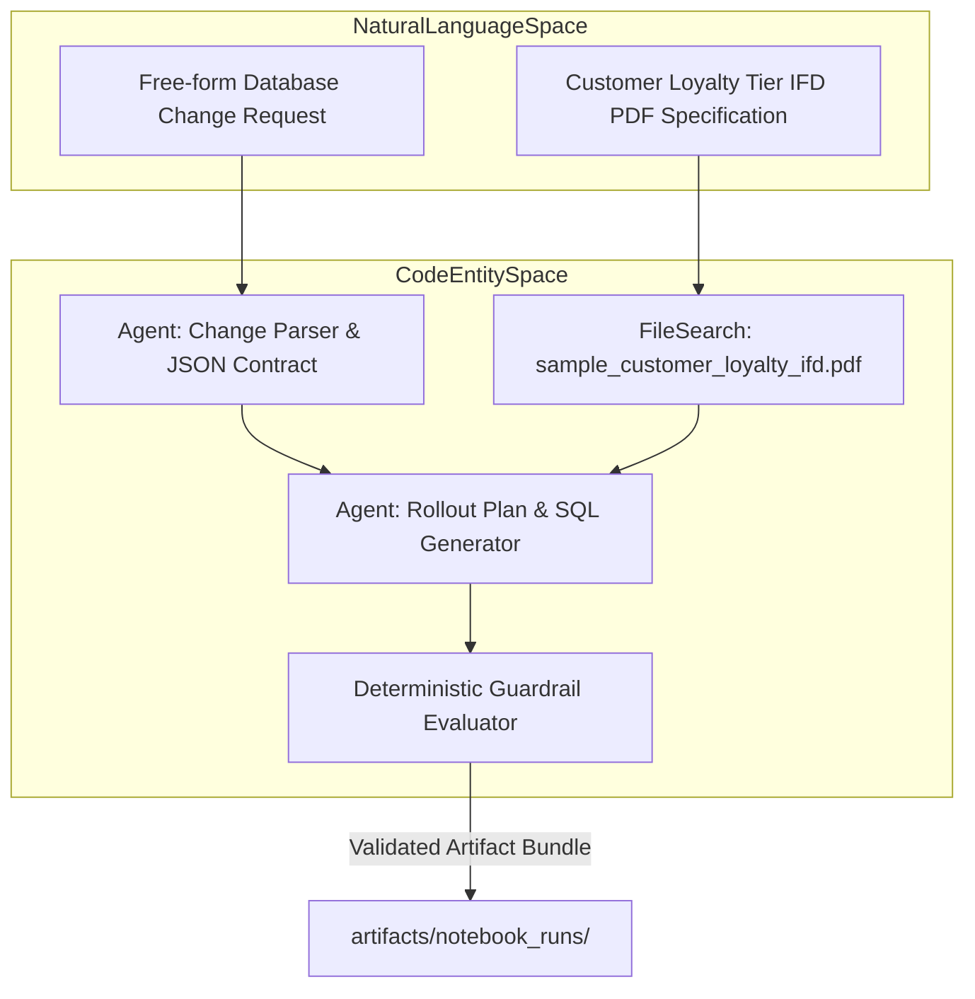
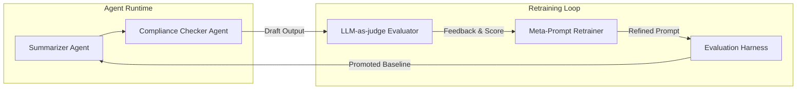

<!-- source: DeepWiki mcp.deepwiki.com · repo openai/openai-cookbook · page 7.4 Agent Evaluation and Governance · fetched 2026-10-26 -->

# Agent Evaluation and Governance

<details>
<summary>Relevant source files</summary>

The following files were used as context for generating this wiki page:

- [examples/agents_sdk/evaluate_agents.ipynb](examples/agents_sdk/evaluate_agents.ipynb)
- [examples/partners/agentic_governance_guide/agentic_governance_cookbook.ipynb](examples/partners/agentic_governance_guide/agentic_governance_cookbook.ipynb)
- [examples/partners/agentic_governance_guide/eval_data/guardrail_test_data.jsonl](examples/partners/agentic_governance_guide/eval_data/guardrail_test_data.jsonl)
- [examples/partners/agentic_governance_guide/eval_data/input_guardrail_test_data.jsonl](examples/partners/agentic_governance_guide/eval_data/input_guardrail_test_data.jsonl)
- [examples/partners/agentic_governance_guide/guardrail_tuner/__init__.py](examples/partners/agentic_governance_guide/guardrail_tuner/__init__.py)
- [examples/partners/agentic_governance_guide/guardrail_tuner/feedback_loop.py](examples/partners/agentic_governance_guide/guardrail_tuner/feedback_loop.py)
- [examples/partners/agentic_governance_guide/guardrail_tuner/threshold_adjuster.py](examples/partners/agentic_governance_guide/guardrail_tuner/threshold_adjuster.py)
- [examples/partners/agentic_governance_guide/guardrail_tuner/types.py](examples/partners/agentic_governance_guide/guardrail_tuner/types.py)
- [examples/partners/agentic_governance_guide/promptfoo/promptfoo_target.py](examples/partners/agentic_governance_guide/promptfoo/promptfoo_target.py)
- [examples/partners/agentic_governance_guide/promptfoo/promptfooconfig.yaml](examples/partners/agentic_governance_guide/promptfoo/promptfooconfig.yaml)
- [examples/partners/agentic_governance_guide/promptfoo/redteam.yaml](examples/partners/agentic_governance_guide/promptfoo/redteam.yaml)
- [examples/partners/agentic_governance_guide/requirements.txt](examples/partners/agentic_governance_guide/requirements.txt)
- [examples/partners/macro_evals_for_agentic_systems/README.md](examples/partners/macro_evals_for_agentic_systems/README.md)
- [examples/partners/macro_evals_for_agentic_systems/data/eval_labels.jsonl](examples/partners/macro_evals_for_agentic_systems/data/eval_labels.jsonl)
- [examples/partners/macro_evals_for_agentic_systems/data/run_summary.json](examples/partners/macro_evals_for_agentic_systems/data/run_summary.json)
- [examples/partners/macro_evals_for_agentic_systems/data/trace_bundles.zip](examples/partners/macro_evals_for_agentic_systems/data/trace_bundles.zip)
- [examples/partners/macro_evals_for_agentic_systems/data/trace_results.jsonl](examples/partners/macro_evals_for_agentic_systems/data/trace_results.jsonl)
- [examples/partners/macro_evals_for_agentic_systems/helpers/data_prep.py](examples/partners/macro_evals_for_agentic_systems/helpers/data_prep.py)
- [examples/partners/macro_evals_for_agentic_systems/helpers/macro_eval_pipeline.py](examples/partners/macro_evals_for_agentic_systems/helpers/macro_eval_pipeline.py)
- [examples/partners/macro_evals_for_agentic_systems/macro_evals_for_agentic_systems.ipynb](examples/partners/macro_evals_for_agentic_systems/macro_evals_for_agentic_systems.ipynb)
- [examples/partners/macro_evals_for_agentic_systems/requirements.txt](examples/partners/macro_evals_for_agentic_systems/requirements.txt)
- [examples/partners/macro_evals_for_agentic_systems/run_notebook.sh](examples/partners/macro_evals_for_agentic_systems/run_notebook.sh)
- [examples/partners/schemaflow_design_guide/data/sample_customer_loyalty_ifd.pdf](examples/partners/schemaflow_design_guide/data/sample_customer_loyalty_ifd.pdf)
- [examples/partners/schemaflow_design_guide/schemaflow_cookbook.ipynb](examples/partners/schemaflow_design_guide/schemaflow_cookbook.ipynb)
- [examples/partners/self_evolving_agents/autonomous_agent_retraining.ipynb](examples/partners/self_evolving_agents/autonomous_agent_retraining.ipynb)
- [examples/partners/self_evolving_agents/data/c13_pyruvate_sample_CMC_from_UCSF.pdf](examples/partners/self_evolving_agents/data/c13_pyruvate_sample_CMC_from_UCSF.pdf)
- [examples/partners/self_evolving_agents/data/chemical_names.json](examples/partners/self_evolving_agents/data/chemical_names.json)
- [examples/partners/self_evolving_agents/data/dataset.csv](examples/partners/self_evolving_agents/data/dataset.csv)
- [images/agent_log_traces.png](images/agent_log_traces.png)
- [images/agent_trace_details.png](images/agent_trace_details.png)
- [images/agentic-system-architecture.svg](images/agentic-system-architecture.svg)
- [images/baseline_agent.png](images/baseline_agent.png)
- [images/eval_dashboard.png](images/eval_dashboard.png)
- [images/eval_run_results.png](images/eval_run_results.png)
- [images/eval_set_config.png](images/eval_set_config.png)
- [images/feedback.png](images/feedback.png)
- [images/schemaflow_kbgraph-small.gif](images/schemaflow_kbgraph-small.gif)
- [images/schemaflow_promptfoo.gif](images/schemaflow_promptfoo.gif)
- [images/schemaflow_seq_diagram.png](images/schemaflow_seq_diagram.png)
- [images/schemaflow_system_design.png](images/schemaflow_system_design.png)

</details>


## Purpose and Scope
This page covers the methodologies, architectural frameworks, and implementation tooling for ensuring the reliability, safety, governance, and continuous evolution of production agentic systems. It details online and offline tracing with the OpenAI Agents SDK, macro-level evaluations across large multi-agent populations, structured enterprise workflow design via SchemaFlow, automated threshold tuning for safety guardrails, autonomous self-evolving retraining loops, and adversarial red-teaming with Promptfoo.

---

## 1. Evaluating Agents with the Agents SDK

Evaluation in agentic systems requires capturing internal execution steps (traces) to debug reasoning failures, monitor operational latency, track token economics, and enforce safety boundaries. The OpenAI Agents SDK integrates natively with OpenTelemetry ecosystems to export detailed execution spans.

### Instrumentation and Tracing
Tracing is achieved by instrumenting the SDK execution runtime with OpenTelemetry collectors like `logfire` [examples/agents_sdk/evaluate_agents.ipynb:163-172](). This patches the underlying agentic loop to emit telemetry for handoffs, tool executions, and LLM completions.

*   **Key Initialization**: `logfire.configure()` sets up the tracing service, and `logfire.instrument_openai_agents()` patches the Agents SDK [examples/agents_sdk/evaluate_agents.ipynb:163-172]().
*   **Data Flow**: Execution traces generated by agent runners are routed via OTLP endpoints (`OTEL_EXPORTER_OTLP_ENDPOINT`) using Basic authentication headers to observability backends like Langfuse [examples/agents_sdk/evaluate_agents.ipynb:102-104]().

### Evaluation Metrics and Validation
Agent evaluations combine real-time tracing with batch quality assessments:
1.  **Online Trace Monitoring**: Inspecting individual spans and parent-child execution graphs for tool failure rates, excessive round-trips, and handoff inefficiencies [examples/agents_sdk/evaluate_agents.ipynb:11-18]().
2.  **LLM-as-a-Judge**: Utilizing secondary evaluator models to score agent outputs against structured rubrics and policy constraints [examples/partners/self_evolving_agents/autonomous_agent_retraining.ipynb:57-62]().

Sources: [examples/agents_sdk/evaluate_agents.ipynb:1-172](), [examples/partners/self_evolving_agents/autonomous_agent_retraining.ipynb:45-64]()

---

## 2. Macro-Level Agentic System Evaluation

When systems scale to large populations of specialist agents handling thousands of parallel transactions, single-trace debugging becomes insufficient. Macro-evaluation aggregates historical run logs to uncover systemic behavioral bottlenecks, such as recurring specialist activation failures or downstream routing loops.

### Macro-Eval Pipeline Architecture
The evaluation pipeline ingests raw trace exports and transforms them into discoverable analytical documents and vector embeddings.

| Component | Code Entity | Purpose |
| :--- | :--- | :--- |
| **Data Ingestion** | `load_trace_tables` | Loads run logs from `trace_results.jsonl` and compressed trace bundles into pandas DataFrames [examples/partners/macro_evals_for_agentic_systems/helpers/data_prep.py:111-149]() |
| **Document Builder** | `build_trace_documents` | Converts execution steps into text summaries (`doc_failure_window`, `doc_tool_error_summary`) [examples/partners/macro_evals_for_agentic_systems/helpers/data_prep.py:17-23]() |
| **Discovery Engine** | `MacroDiscoveryArtifacts` | Clusters traces using dimensionality reduction and vector similarity to isolate behavioral patterns [examples/partners/macro_evals_for_agentic_systems/helpers/macro_eval_pipeline.py:152-158]() |
| **Root-Cause Drilldown** | `TopicDrilldownArtifacts` | Analyzes specific behavioral clusters to isolate suspect nodes and generate root-cause cards [examples/partners/macro_evals_for_agentic_systems/helpers/macro_eval_pipeline.py:185-199]() |

### System Architecture: Natural Language to Code Entity Space
The macro-evaluation pipeline bridges natural language scenario parameters with concrete execution traces and analytical code entities.

```mermaid
graph TD
    subgraph "NaturalLanguageSpace"
        NL_SCENARIO[""MarketRegime & Tariff Drift Requests""]
        NL_ORDERS[""Natural Language Order Simulations""]
    end

    subgraph "CodeEntitySpace"
        PREP[""data_prep.py: load_trace_tables()""]
        DOCS[""data_prep.py: build_trace_documents()""]
        CLUSTER[""MacroDiscoveryArtifacts: TopicBundle""]
        DIAG[""TopicDrilldownArtifacts: TopicDrilldown""]
    end

    NL_SCENARIO --> PREP
    NL_ORDERS --> PREP
    PREP -- "Trace Bundles" --> DOCS
    DOCS -- "Text Documents" --> CLUSTER
    CLUSTER -- "Behavior Clusters" --> DIAG
    DIAG -- "Root Cause Analysis" --> USER[""Engineering Reviewer""]
```
*Figure 1: Macro-level evaluation architecture bridging scenario specifications to analytical diagnostic artifacts.*

Sources: [examples/partners/macro_evals_for_agentic_systems/macro_evals_for_agentic_systems.ipynb:8-62](), [examples/partners/macro_evals_for_agentic_systems/helpers/data_prep.py:111-194](), [examples/partners/macro_evals_for_agentic_systems/helpers/macro_eval_pipeline.py:152-248]()

---

## 3. SchemaFlow Design and Enterprise Workflows

SchemaFlow demonstrates an end-to-end, multi-stage agentic design pattern for complex data-intensive operations (such as automated database change impact analysis) using the OpenAI Agents SDK. Instead of executing unverified monolithic prompts, SchemaFlow decomposes enterprise workflows into isolated, typed stages.

### Workflow Stages and Artifact Generation
1.  **Natural Language Parsing**: Interprets free-form requests into a normalized `change_json` schema contract [examples/partners/schemaflow_design_guide/schemaflow_cookbook.ipynb:88-90]().
2.  **Impact Analysis with RAG**: Grounds downstream analysis by executing File Search over reference specifications or Integration Functional Design (IFD) PDFs [examples/partners/schemaflow_design_guide/schemaflow_cookbook.ipynb:91-93]().
3.  **Rollout Planning & SQL Generation**: Generates prechecks, implementation steps, postchecks, rollback guides, and multi-layer SQL scripts [examples/partners/schemaflow_design_guide/schemaflow_cookbook.ipynb:128-173]().
4.  **Deterministic Validation**: Applies programmatic guardrails to catch syntax, nullability, or constraint violations before deployment [examples/partners/schemaflow_design_guide/schemaflow_cookbook.ipynb:93-95]().

### Natural Language to Code Entity Space Bridge in SchemaFlow


*Figure 2: Mapping natural language change requests and specifications to typed agent stages and deterministic code guardrails.*

Sources: [examples/partners/schemaflow_design_guide/schemaflow_cookbook.ipynb:8-130](), [examples/partners/schemaflow_design_guide/data/sample_customer_loyalty_ifd.pdf:1-182]()

---

## 4. Agentic Governance and Guardrail Tuning

Governance ensures agentic workflows adhere strictly to security policies, compliance standards, and functional bounds. The `GuardrailAgent` pattern interlocks checks across execution lifecycles.

### Guardrail Stages
| Stage | Purpose | Example Implementation |
| :--- | :--- | :--- |
| **Pre-flight** | Static pre-checks before model invocation | PII detection and regex pattern scanning [examples/partners/agentic_governance_guide/promptfoo/promptfoo_target.py:102-126]() |
| **Input** | Dynamic semantic evaluation of user intent | Jailbreak detection and off-topic prompt filtering [examples/partners/agentic_governance_guide/promptfoo/promptfoo_target.py:127-151]() |
| **Output** | Verification of model response integrity | Hallucination checks and data leakage prevention [examples/partners/agentic_governance_guide/promptfoo/promptfoo_target.py:152-167]() |

### Automated Threshold Adjustment
To balance precision and recall dynamically, the `GuardrailFeedbackLoop` and `ThresholdAdjuster` examine evaluation metrics and modify confidence thresholds programmatically.

```mermaid
graph TD
    subgraph "CodeEntitySpace"
        POLICY[""PE_FIRM_POLICY (dict)""]
        LOOP[""GuardrailFeedbackLoop""]
        ADJUSTER[""ThresholdAdjuster.calculate_adjustment()""]
        EVAL[""GuardrailEval Run""]
    end

    subgraph "NaturalLanguageSpace"
        TESTDATA[""input_guardrail_test_data.jsonl""]
        GOAL[""Precision / Recall Target""]
    end

    TESTDATA --> EVAL
    POLICY --> EVAL
    GOAL --> EVAL
    EVAL -- "Eval Metrics JSON" --> LOOP
    LOOP --> ADJUSTER
    ADJUSTER -- "Step Delta" --> LOOP
    LOOP -- "Updated Threshold" --> POLICY
    POLICY -- "Next Iteration" --> EVAL
```
*Figure 3: Automated threshold tuning feedback loop.*

*   **Oscillation Dampening**: The `ThresholdAdjuster` reduces step sizes automatically when threshold values begin oscillating between increasing false positives and false negatives [examples/partners/agentic_governance_guide/guardrail_tuner/threshold_adjuster.py:118-146]().
*   **Optimization Targets**: Tuning configurations prioritize `precision`, `recall`, or balanced `f1` scores [examples/partners/agentic_governance_guide/guardrail_tuner/types.py:16-22]().

Sources: [examples/partners/agentic_governance_guide/guardrail_tuner/feedback_loop.py:25-53](), [examples/partners/agentic_governance_guide/guardrail_tuner/threshold_adjuster.py:73-110](), [examples/partners/agentic_governance_guide/promptfoo/promptfoo_target.py:98-168]()

---

## 5. Self-Evolving Agents: Autonomous Retraining

Self-evolving architectures implement continuous-improvement loops where failures encountered in operational execution or evaluation trigger automated prompt refinement and baseline retraining.

### The Autonomous Retraining Loop
1.  **Baseline Execution**: The primary agent processes tasks (e.g., extracting and summarizing regulatory CMC sections) [examples/partners/self_evolving_agents/autonomous_agent_retraining.ipynb:54-56]().
2.  **Feedback & Judging**: An automated `LLM-as-judge` grades outputs against compliance and structural rules, emitting quantitative scores and qualitative critiques [examples/partners/self_evolving_agents/autonomous_agent_retraining.ipynb:57-59]().
3.  **Meta-Prompting**: A meta-retraining agent evaluates aggregate feedback and adjusts system prompts to patch identified weaknesses [examples/partners/self_evolving_agents/autonomous_agent_retraining.ipynb:60-62]().
4.  **Promotion**: When an optimized prompt exceeds performance thresholds (e.g., aggregate score > 0.8), it is promoted to replace the baseline agent [examples/partners/self_evolving_agents/autonomous_agent_retraining.ipynb:63-64]().


*Figure 4: Self-evolving autonomous retraining loop architecture.*

Sources: [examples/partners/self_evolving_agents/autonomous_agent_retraining.ipynb:35-82]()

---

## 6. Partner Governance Frameworks: Promptfoo Red-Teaming

Adversarial testing and red-teaming are integrated via Promptfoo configurations to evaluate agent resilience against prompt injection, data extraction, and jailbreak attacks.

### Configuration & Target Bridge
*   **Attack Plugins**: Configured with threat vectors including `hijacking`, `pii:direct`, `prompt-extraction`, and `off-topic` filters [examples/partners/agentic_governance_guide/promptfoo/promptfooconfig.yaml:25-30]().
*   **Target Interface (`promptfoo_target.py`)**: The `call_api()` function invokes `Runner.run()` on governed agent pipelines and intercepts guardrail tripwire exceptions (`InputGuardrailTripwireTriggered` or `OutputGuardrailTripwireTriggered`) to report blocked attacks back to the evaluation framework [examples/partners/agentic_governance_guide/promptfoo/promptfoo_target.py:189-203]().

Sources: [examples/partners/agentic_governance_guide/promptfoo/promptfooconfig.yaml:1-34](), [examples/partners/agentic_governance_guide/promptfoo/promptfoo_target.py:171-203]()

---

