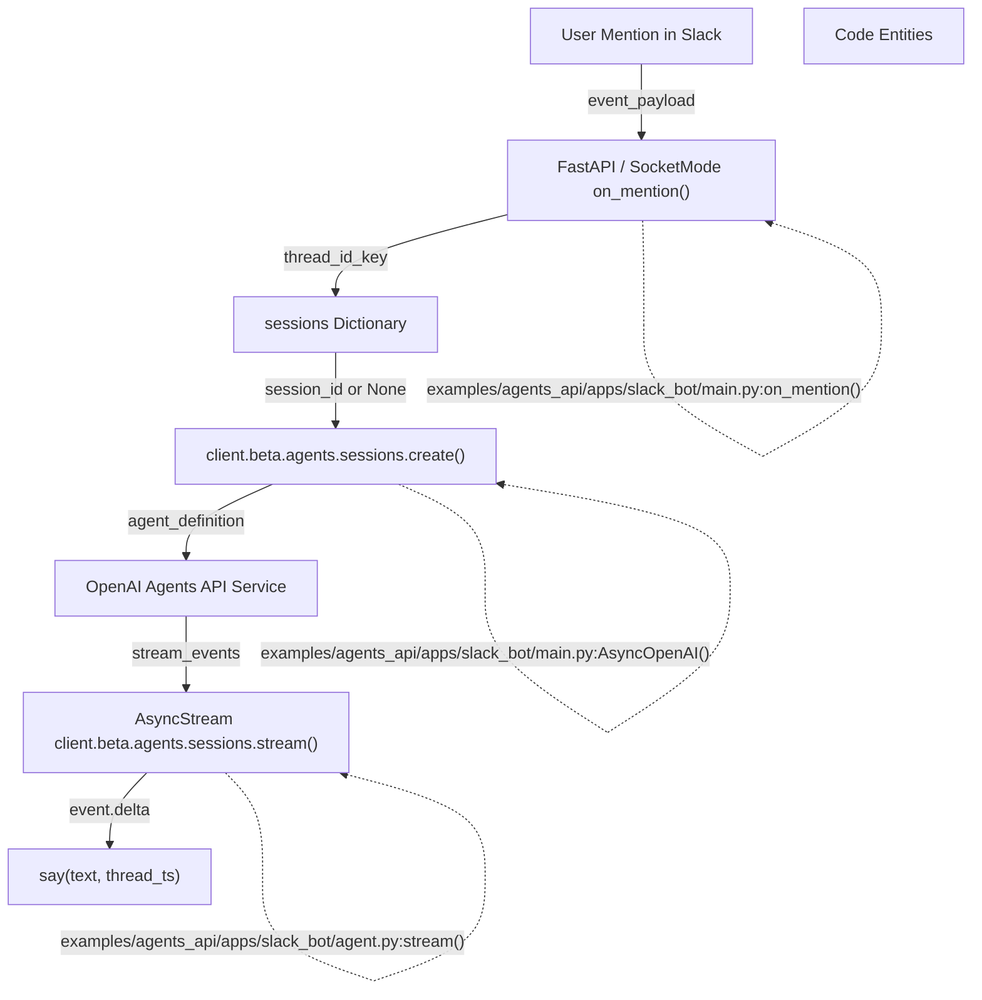
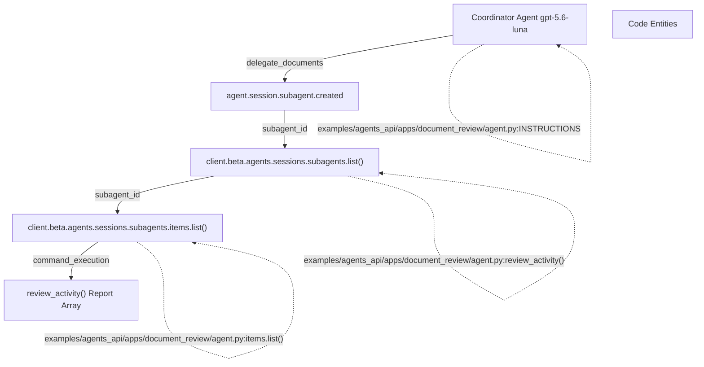

<!-- source: DeepWiki mcp.deepwiki.com · repo openai/openai-cookbook · page 7.5 Agents API Reference Applications · fetched 2026-10-26 -->

# Agents API Reference Applications

<details>
<summary>Relevant source files</summary>

The following files were used as context for generating this wiki page:

- [examples/agents_api/README.md](examples/agents_api/README.md)
- [examples/agents_api/apps/data_analyst/README.md](examples/agents_api/apps/data_analyst/README.md)
- [examples/agents_api/apps/data_analyst/agent.py](examples/agents_api/apps/data_analyst/agent.py)
- [examples/agents_api/apps/data_analyst/assets/workflow.svg](examples/agents_api/apps/data_analyst/assets/workflow.svg)
- [examples/agents_api/apps/data_analyst/main.py](examples/agents_api/apps/data_analyst/main.py)
- [examples/agents_api/apps/document_review/.env.example](examples/agents_api/apps/document_review/.env.example)
- [examples/agents_api/apps/document_review/README.md](examples/agents_api/apps/document_review/README.md)
- [examples/agents_api/apps/document_review/agent.py](examples/agents_api/apps/document_review/agent.py)
- [examples/agents_api/apps/document_review/assets/workflow.svg](examples/agents_api/apps/document_review/assets/workflow.svg)
- [examples/agents_api/apps/document_review/main.py](examples/agents_api/apps/document_review/main.py)
- [examples/agents_api/apps/document_review/sandbox.py](examples/agents_api/apps/document_review/sandbox.py)
- [examples/agents_api/apps/document_review/skills/expense-review-policy/SKILL.md](examples/agents_api/apps/document_review/skills/expense-review-policy/SKILL.md)
- [examples/agents_api/apps/github_issues/.env.example](examples/agents_api/apps/github_issues/.env.example)
- [examples/agents_api/apps/github_issues/README.md](examples/agents_api/apps/github_issues/README.md)
- [examples/agents_api/apps/github_issues/agent.py](examples/agents_api/apps/github_issues/agent.py)
- [examples/agents_api/apps/github_issues/assets/workflow.svg](examples/agents_api/apps/github_issues/assets/workflow.svg)
- [examples/agents_api/apps/github_issues/main.py](examples/agents_api/apps/github_issues/main.py)
- [examples/agents_api/apps/sev_bot/.env.example](examples/agents_api/apps/sev_bot/.env.example)
- [examples/agents_api/apps/sev_bot/README.md](examples/agents_api/apps/sev_bot/README.md)
- [examples/agents_api/apps/sev_bot/agent.py](examples/agents_api/apps/sev_bot/agent.py)
- [examples/agents_api/apps/sev_bot/assets/workflow.svg](examples/agents_api/apps/sev_bot/assets/workflow.svg)
- [examples/agents_api/apps/sev_bot/main.py](examples/agents_api/apps/sev_bot/main.py)
- [examples/agents_api/apps/slack_bot/.env.example](examples/agents_api/apps/slack_bot/.env.example)
- [examples/agents_api/apps/slack_bot/README.md](examples/agents_api/apps/slack_bot/README.md)
- [examples/agents_api/apps/slack_bot/assets/workflow.svg](examples/agents_api/apps/slack_bot/assets/workflow.svg)
- [examples/agents_api/apps/slack_bot/main.py](examples/agents_api/apps/slack_bot/main.py)

</details>


This section documents the reference applications located under `examples/agents_api/` in the OpenAI Cookbook repository [examples/agents_api/README.md:1-65](). These applications—spanning an SRE incident response bot, a Slack workspace integration, a data warehouse analyst, a GitHub issue investigator, and a bulk document reviewer—demonstrate production-grade usage of the OpenAI Agents API (`client.beta.agents.sessions`) [examples/agents_api/README.md:34-36]().

---

## 1. Overview of Reference Applications

The reference applications showcase how external systems (Slack channels, GitHub webhooks, alert webhooks, and local file mounts) bridge into stateful, multi-turn AI sessions using the Agents SDK and Agents API. 

| Reference Application | Directory | Primary Trigger / Interface | Core Agents API Features Used |
| :--- | :--- | :--- | :--- |
| **SRE / Sev Bot** | `examples/agents_api/apps/sev_bot` | PagerDuty / Webhook alerts + Slack `#oncall` threads | `self_hosted` environment, webhook action gates (`agent.session.action_required`), runbook mounts |
| **Slack Bot** | `examples/agents_api/apps/slack_bot` | Slack App mentions (`app_mention`) via Socket Mode | Thread-to-session mapping, scoped tool handlers, workspace vaults (`vault_ids`) |
| **Data Analyst** | `examples/agents_api/apps/data_analyst` | Web UI / CLI prompts | Conversation-only sessions, tool search, programmatic tool calling, memory persistence |
| **GitHub Issue Investigator** | `examples/agents_api/apps/github_issues` | GitHub `issues.opened` webhooks | Ephemeral git clones, isolated workspace mounts, read-only analysis instructions |
| **Document Reviewer** | `examples/agents_api/apps/document_review` | CLI batch command | Multi-agent concurrency (`multi_agent`), capability directories (`capability_directories`), custom validation |

Sources: [examples/agents_api/README.md:1-15](), [examples/agents_api/apps/document_review/README.md:1-12](), [examples/agents_api/apps/slack_bot/README.md:1-14](), [examples/agents_api/apps/github_issues/README.md:1-10](), [examples/agents_api/apps/sev_bot/README.md:1-11](), [examples/agents_api/apps/data_analyst/README.md:1-10]()

### Natural Language to Code Entity Mapping: Slack Bot Event Routing


*Figure 1: Mapping natural language interactions in Slack to specific execution functions and API calls.*

Sources: [examples/agents_api/apps/slack_bot/README.md:89-106](), [examples/agents_api/apps/slack_bot/README.md:143-169]()

---

## 2. Session Creation, Streaming Turns, and Subagents

All reference applications rely on asynchronous session initialization via `client.beta.agents.sessions.create()` [examples/agents_api/README.md:44-48](). Sessions maintain the execution context, tool definitions, environment mounts, and multi-agent hierarchies across turns.

### Session Initialization and Streaming

Applications interact with the Agents API using the standard asynchronous OpenAI client (`AsyncOpenAI`) [examples/agents_api/apps/document_review/README.md:75-99]() and consume responses via streaming iterators (`client.beta.agents.sessions.stream()`) [examples/agents_api/apps/document_review/README.md:141-152]() to capture text deltas, subagent spawns, and execution failures in real time.

### Subagent Delegation

Applications like the document reviewer configure multi-agent execution by specifying the `multi_agent` parameter in the agent creation payload [examples/agents_api/apps/document_review/README.md:86-98](). 

```python
session = await client.beta.agents.sessions.create(
    agent={
        "model": "gpt-5.6-luna",
        "instructions": instructions,
        "reasoning": {"effort": "high"},
        "multi_agent": {"enabled": True, "max_concurrent_subagents": 4},
    },
    environment={
        "type": "self_hosted",
        "workspace_directory": "/workspace",
        "capability_directories": ["/workspace/skills"],
    },
)
```
Sources: [examples/agents_api/apps/document_review/README.md:86-98](), [examples/agents_api/apps/document_review/agent.py:138-153]()

### Natural Language to Code Entity Mapping: Document Review Subagent Delegation


*Figure 2: Subagent delegation and activity item harvesting across sessions.*

Sources: [examples/agents_api/apps/document_review/agent.py:21-67](), [examples/agents_api/apps/document_review/README.md:132-152]()

---

## 3. Capability Directories, Skills, and Vaults

To ensure specialized agents adhere to precise organizational policies and possess required contextual tools without hardcoding them into system prompts, the reference apps use capability directories and security vaults.

### Capability Directories and `SKILL.md`

In the document reviewer application, a skill directory (`/workspace/skills`) containing subfolders like `expense-review-policy/SKILL.md` is mounted via `environment.capability_directories` [examples/agents_api/apps/document_review/README.md:93-98]().
- **Discovery**: Agents discover capabilities dynamically by evaluating skill definitions.
- **Enforcement**: The policy skill enforces specific calculation rules using Python's `decimal.Decimal`, decision categories (`ready_for_approval`, `escalated`, `needs_info`), and strict JSON report schemas [examples/agents_api/apps/document_review/skills/expense-review-policy/SKILL.md:12-61]().

### Vaults for Credentials

The Slack bot reference app attaches secure credentials and shared environment tools via `vault_ids` [examples/agents_api/apps/slack_bot/README.md:143-167](). Vaults allow the application to provide restricted external service tokens (such as Notion, Google Drive, or GitHub connectors) to the agent runtime securely without exposing master application keys.

Sources: [examples/agents_api/apps/document_review/README.md:93-98](), [examples/agents_api/apps/document_review/skills/expense-review-policy/SKILL.md:1-64](), [examples/agents_api/apps/slack_bot/README.md:143-167]()

---

## 4. Webhook Entrypoints and Asynchronous Routing

Reference applications designed for event-driven architectures (such as the GitHub issue investigator and the SRE sev bot) expose FastAPI webhook endpoints to ingest external triggers asynchronously.

### Webhook Verification and Background Processing

- **Signature Validation**: Endpoints verify inbound cryptographic signatures (e.g., GitHub webhook secrets or OpenAI webhook signing secrets) before processing payloads.
- **Deduplication**: Incoming deliveries (`X-GitHub-Delivery` or alert fingerprints) are deduplicated to prevent duplicate agent session spawning [examples/agents_api/apps/github_issues/README.md:67-72](), [examples/agents_api/apps/sev_bot/README.md:104-119]().
- **Background Tasks**: FastAPI's `BackgroundTasks` queue the execution of long-running investigation loops so webhook receivers return HTTP 200 responses immediately while the sandbox clone and agent turn execute asynchronously [examples/agents_api/apps/github_issues/README.md:70-71](), [examples/agents_api/apps/sev_bot/README.md:114-119]().

Sources: [examples/agents_api/apps/github_issues/README.md:67-72](), [examples/agents_api/apps/sev_bot/README.md:104-119]()

---

## 5. Approval Gates and Human-in-the-Loop Workflows

Production governance requires human oversight for high-impact actions. The SRE sev bot demonstrates how to implement approval gates using OpenAI webhook entrypoints and tool result injections.

### Action-Required Webhooks

When an agent executing a recovery runbook reaches a sensitive action (such as `propose_rollback`), it pauses execution and triggers an `agent.session.action_required` webhook event [examples/agents_api/apps/sev_bot/README.md:51-54](). 

### Handling Approvals in Slack

1. **Webhook Reception**: The FastAPI app receives the action-required event, parses the `turn_id` and `call_id`, and posts interactive approval buttons into the corresponding Slack incident thread [examples/agents_api/apps/sev_bot/README.md:60-61]().
2. **Resuming Execution**: Once a responder clicks "Approve" or "Reject" in Slack, the application submits a tool result event back to the session using `client.beta.agents.sessions.events.create()` [examples/agents_api/apps/sev_bot/README.md:67-80]()

```python
await client.beta.agents.sessions.events.create(
    session.id,
    events=[
        {
            "type": "agent.session.input.tool_result",
            "turn_id": action["turn_id"],
            "call_id": action["call_id"],
            "success": True,
            "output": json.dumps({"decision": "approved", "executed": False}),
        }
    ],
)
```
Sources: [examples/agents_api/apps/sev_bot/README.md:51-80](), [examples/agents_api/apps/sev_bot/agent.py:1-120]()

---

