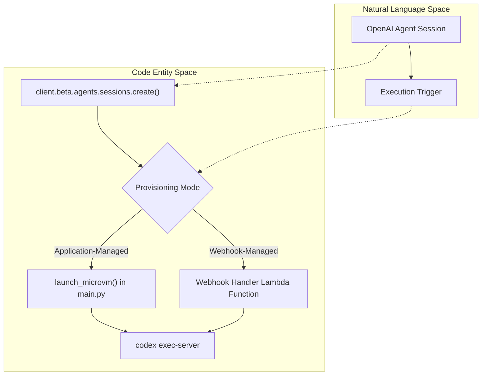
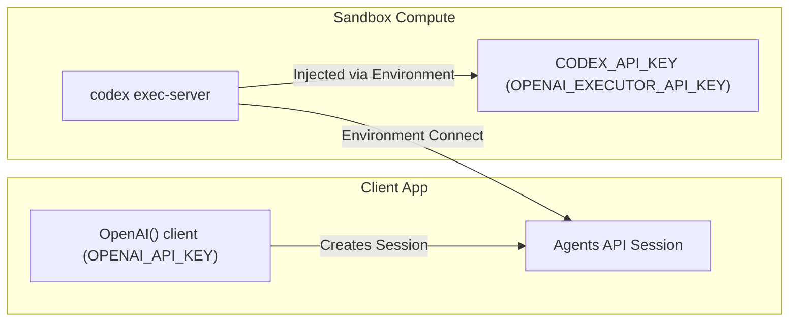
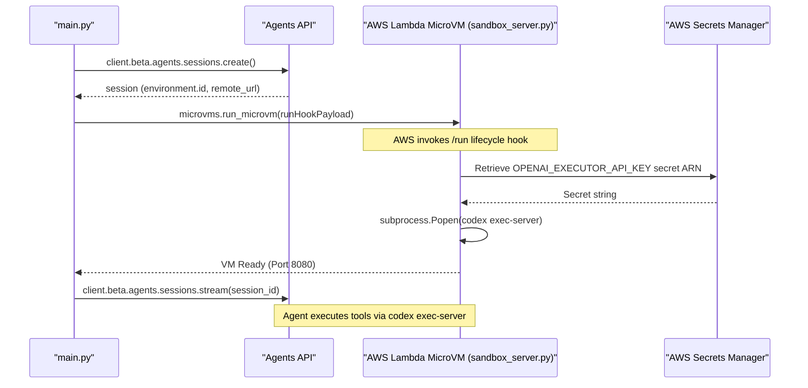

<!-- source: DeepWiki mcp.deepwiki.com · repo openai/openai-cookbook · page 7.6 Agents API Sandbox Environments · fetched 2026-10-26 -->

# Agents API Sandbox Environments

Relevant source files

The following files were used as context for generating this wiki page:

- [.gitignore](.gitignore)
- [examples/agents_api/README.md](examples/agents_api/README.md)
- [examples/agents_api/apps/data_analyst/agent.py](examples/agents_api/apps/data_analyst/agent.py)
- [examples/agents_api/apps/data_analyst/main.py](examples/agents_api/apps/data_analyst/main.py)
- [examples/agents_api/apps/document_review/main.py](examples/agents_api/apps/document_review/main.py)
- [examples/agents_api/apps/github_issues/main.py](examples/agents_api/apps/github_issues/main.py)
- [examples/agents_api/apps/sev_bot/main.py](examples/agents_api/apps/sev_bot/main.py)
- [examples/agents_api/apps/slack_bot/main.py](examples/agents_api/apps/slack_bot/main.py)
- [examples/agents_api/sandboxes/README.md](examples/agents_api/sandboxes/README.md)
- [examples/agents_api/sandboxes/aws/README.md](examples/agents_api/sandboxes/aws/README.md)
- [examples/agents_api/sandboxes/aws/application_managed/Dockerfile](examples/agents_api/sandboxes/aws/application_managed/Dockerfile)
- [examples/agents_api/sandboxes/aws/application_managed/README.md](examples/agents_api/sandboxes/aws/application_managed/README.md)
- [examples/agents_api/sandboxes/aws/application_managed/build_image.py](examples/agents_api/sandboxes/aws/application_managed/build_image.py)
- [examples/agents_api/sandboxes/aws/application_managed/configure_execution_role.py](examples/agents_api/sandboxes/aws/application_managed/configure_execution_role.py)
- [examples/agents_api/sandboxes/aws/application_managed/main.py](examples/agents_api/sandboxes/aws/application_managed/main.py)
- [examples/agents_api/sandboxes/aws/application_managed/sandbox_server.py](examples/agents_api/sandboxes/aws/application_managed/sandbox_server.py)
- [examples/agents_api/sandboxes/aws/common.py](examples/agents_api/sandboxes/aws/common.py)
- [examples/agents_api/sandboxes/aws/images/aws-microvm-sandboxes.webp](examples/agents_api/sandboxes/aws/images/aws-microvm-sandboxes.webp)

This section explains the self-hosted sandbox environment integrations provided under `examples/agents_api/sandboxes/` [examples/agents_api/sandboxes/README.md:1-32](). These integrations connect agent sessions executing within OpenAI's cloud infrastructure to isolated compute environments running user-managed code via the `codex exec-server` CLI [examples/agents_api/sandboxes/README.md:1-5]().

---

## 1. Provisioning Modes: Application-Managed vs. Webhook-Managed

The Agents API sandbox architecture supports two distinct provisioning lifecycles for managing compute resources. Both modes rely on OpenAI maintaining the agent session state while the developer hosts the execution environment.

| Provisioning Mode | Application Behavior | Webhook/Trigger Mechanism |
| :--- | :--- | :--- |
| **Application-Managed** | The client application explicitly provisions, starts, suspends, and terminates compute directly via provider SDKs/APIs [examples/agents_api/sandboxes/README.md:6-8](). | None; orchestration logic lives entirely inside the client lifecycle script (`main.py`) [examples/agents_api/sandboxes/README.md:6-8](). |
| **Webhook-Managed** | The client creates a self-hosted session and submits input [examples/agents_api/README.md:20-21](). When compute is required, OpenAI dispatches an `agent.session.action_required` webhook [examples/agents_api/sandboxes/README.md:9]() (specifically an `environment_connection` action) to a deployed webhook handler [examples/agents_api/sandboxes/aws/README.md:9-11](). | A serverless function or webhook endpoint verifies the signature, resolves the session state, and spins up the sandbox dynamically [examples/agents_api/sandboxes/aws/README.md:9-11](). |

*Sources: [examples/agents_api/README.md:37-48](), [examples/agents_api/sandboxes/README.md:1-13](), [examples/agents_api/sandboxes/aws/README.md:9-16]()*.

---

## 2. Executor Authentication and `OPENAI_EXECUTOR_API_KEY`

Sandbox executors require an explicit API key with specific granular permissions to authenticate back to the OpenAI Agents API control plane.

### Key Requirements
* **Separation of Keys:** The client application uses `OPENAI_API_KEY` to create sessions and submit input, whereas the sandbox executor runs using a restricted `OPENAI_EXECUTOR_API_KEY` [examples/agents_api/README.md:55-59](), [examples/agents_api/sandboxes/aws/README.md:20-22]().
* **Scope and Ownership:** Both keys must share identical organization, project, and user or service-account ownership [examples/agents_api/sandboxes/aws/README.md:20-21]().
* **Permissions:** The executor key must include the permission `api.agents.environments.connect` [examples/agents_api/README.md:58-59]().
* **Network Restrictions:** IP allowlists on the executor key must accommodate the outbound public IPs of the chosen sandbox provider [examples/agents_api/README.md:58-59]().

*Sources: [examples/agents_api/README.md:37-60](), [examples/agents_api/sandboxes/aws/README.md:20-25]()*.

---

## 3. AWS Lambda MicroVMs Reference Implementation

The AWS integration (`examples/agents_api/sandboxes/aws/`) demonstrates how to run agent execution environments using AWS Lambda MicroVMs [examples/agents_api/sandboxes/aws/README.md:1-5]().

### Component Architecture & Lifecycle Hooks
The sandbox server (`sandbox_server.py`) acts as a Flask service listening on port `8080` inside the microVM [examples/agents_api/sandboxes/aws/application_managed/sandbox_server.py:15-125](). It implements the mandatory AWS MicroVM runtime hooks:

| Hook Route | Function (`sandbox_server.py`) | Behavior |
| :--- | :--- | :--- |
| `/aws/lambda-microvms/runtime/v1/ready` | `ready()` [examples/agents_api/sandboxes/aws/application_managed/sandbox_server.py:22-25]() | Returns HTTP 200 when the image is initialized, allowing AWS to snapshot the idle server [examples/agents_api/sandboxes/aws/README.md:30-32](). |
| `/aws/lambda-microvms/runtime/v1/run` | `start()` [examples/agents_api/sandboxes/aws/application_managed/sandbox_server.py:36-70]() | Parses `runHookPayload`, fetches the executor secret from AWS Secrets Manager, and spawns `codex exec-server` [examples/agents_api/sandboxes/aws/application_managed/sandbox_server.py:43-64](). |
| `/aws/lambda-microvms/runtime/v1/validate` | `validate()` [examples/agents_api/sandboxes/aws/application_managed/sandbox_server.py:28-33]() | Validates that the `codex` binary is executable and `/workspace` is writable [examples/agents_api/sandboxes/aws/application_managed/sandbox_server.py:30-33](). |
| `/aws/lambda-microvms/runtime/v1/suspend` | `stop()` [examples/agents_api/sandboxes/aws/application_managed/sandbox_server.py:72-87]() | Terminates the `codex` child process group and syncs disk writes before snapshotting [examples/agents_api/sandboxes/aws/application_managed/sandbox_server.py:75-87](). |
| `/aws/lambda-microvms/runtime/v1/resume` | `start()` [examples/agents_api/sandboxes/aws/application_managed/sandbox_server.py:36-70]() | Re-establishes the environment connection and restarts the executor process [examples/agents_api/sandboxes/aws/application_managed/sandbox_server.py:36-65](). |
| `/aws/lambda-microvms/runtime/v1/terminate` | `stop()` [examples/agents_api/sandboxes/aws/application_managed/sandbox_server.py:72-87]() | Cleans up running execution processes prior to MicroVM termination [examples/agents_api/sandboxes/aws/application_managed/sandbox_server.py:75-87](). |

*Sources: [examples/agents_api/sandboxes/aws/application_managed/main.py:34-68](), [examples/agents_api/sandboxes/aws/application_managed/sandbox_server.py:22-87](), [examples/agents_api/sandboxes/aws/common.py:17-65]()*.

### File Transfer Protocol
The Flask server exposes authenticated file management endpoints relative to `/workspace` [examples/agents_api/sandboxes/aws/application_managed/sandbox_server.py:17]():
* `PUT /upload/<path>`: Streams raw bytes (up to 64 MiB) into the container workspace safely via a temporary file swap [examples/agents_api/sandboxes/aws/application_managed/sandbox_server.py:105-121]().
* `GET /download/<path>`: Attaches and streams files out of the workspace [examples/agents_api/sandboxes/aws/application_managed/sandbox_server.py:97-102]().
* Proxied requests are signed using short-lived tokens generated via `microvms.create_microvm_auth_token()` and passed in the `X-aws-proxy-auth` header [examples/agents_api/sandboxes/aws/common.py:68-80]().

*Sources: [examples/agents_api/sandboxes/aws/application_managed/README.md:78-96](), [examples/agents_api/sandboxes/aws/application_managed/sandbox_server.py:90-122](), [examples/agents_api/sandboxes/aws/common.py:68-105]()*.

---

## 4. Supported Sandbox Providers Overview

In addition to AWS Lambda MicroVMs, the Cookbook provides standardized integration blueprints for 10 additional sandbox infrastructure providers [examples/agents_api/sandboxes/README.md:14-29]():

| Provider | Application-Managed Example | Webhook-Managed Example | Key Compute Primitive |
| :--- | :--- | :--- | :--- |
| **Blaxel** | `blaxel/application_managed/` [examples/agents_api/sandboxes/README.md:18]() | `blaxel/webhook_managed/` [examples/agents_api/sandboxes/README.md:18]() | Managed MicroVMs / Containers |
| **Cloudflare** | `cloudflare/application_managed/` [examples/agents_api/sandboxes/README.md:19]() | `cloudflare/webhook_managed/` [examples/agents_api/sandboxes/README.md:19]() | Workers & Containers |
| **Daytona** | `daytona/application_managed/` [examples/agents_api/sandboxes/README.md:20]() | `daytona/webhook_managed/` [examples/agents_api/sandboxes/README.md:20]() | Developer Workspace Environments |
| **DigitalOcean** | `digitalocean/application_managed/` [examples/agents_api/sandboxes/README.md:21]() | `digitalocean/webhook_managed/` [examples/agents_api/sandboxes/README.md:21]() | Droplets / App Platform |
| **Docker** | `docker/application_managed/` [examples/agents_api/sandboxes/README.md:22]() | Not included [examples/agents_api/sandboxes/README.md:22]() | Local/Remote Docker Containers |
| **E2B** | `e2b/application_managed/` [examples/agents_api/sandboxes/README.md:23]() | `e2b/webhook_managed/` [examples/agents_api/sandboxes/README.md:23]() | Secure Cloud Sandboxes |
| **Modal** | `modal/application_managed/` [examples/agents_api/sandboxes/README.md:24]() | `modal/webhook_managed/` [examples/agents_api/sandboxes/README.md:24]() | Serverless Python Functions & Sandboxes |
| **OCI** | `oci/application_managed/` [examples/agents_api/sandboxes/README.md:26]() | Not included [examples/agents_api/sandboxes/README.md:26]() | Oracle Cloud Instances |
| **Runloop** | `runloop/application_managed/` [examples/agents_api/sandboxes/README.md:27]() | `runloop/webhook_managed/` [examples/agents_api/sandboxes/README.md:27]() | AI Code Execution Sandboxes |
| **Vercel** | `vercel/application_managed/` [examples/agents_api/sandboxes/README.md:28]() | `vercel/webhook_managed/` [examples/agents_api/sandboxes/README.md:28]() | Edge/Serverless Functions |

*Sources: [examples/agents_api/sandboxes/README.md:14-29]()*

---

