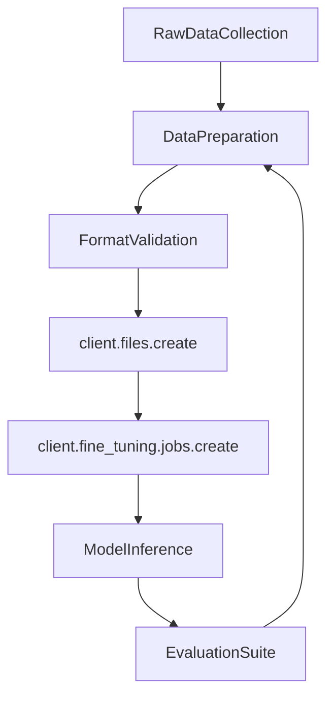
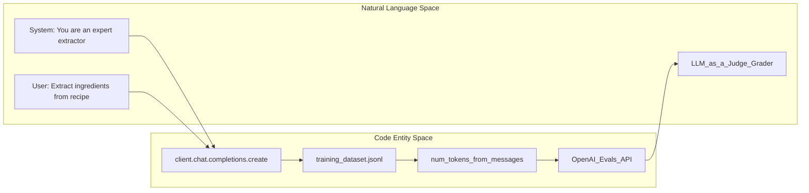

<!-- source: DeepWiki mcp.deepwiki.com · repo openai/openai-cookbook · page 8 Fine-tuning · fetched 2026-10-26 -->

# Fine-tuning

Relevant source files

The following files were used as context for generating this wiki page:

- [examples/How_to_finetune_chat_models.ipynb](examples/How_to_finetune_chat_models.ipynb)
- [examples/book_translation/translate_latex_book.ipynb](examples/book_translation/translate_latex_book.ipynb)
- [examples/fine-tuned_qa/answers_with_ft.py](examples/fine-tuned_qa/answers_with_ft.py)
- [examples/fine-tuned_qa/olympics-1-collect-data.ipynb](examples/fine-tuned_qa/olympics-1-collect-data.ipynb)
- [examples/fine-tuned_qa/olympics-2-create-qa.ipynb](examples/fine-tuned_qa/olympics-2-create-qa.ipynb)
- [examples/fine-tuned_qa/olympics-3-train-qa.ipynb](examples/fine-tuned_qa/olympics-3-train-qa.ipynb)

## Purpose and Scope

Fine-tuning allows you to customize OpenAI models for specific tasks by training on domain-specific datasets. This process improves performance beyond what is possible with prompting alone by providing the model with many more examples than can fit in a context window.

The OpenAI Cookbook covers several fine-tuning workflows:
- **Standard Fine-tuning**: Improving performance on tasks like entity extraction, classification, and question answering [examples/How_to_finetune_chat_models.ipynb:10-21]().
- **Function Calling Optimization**: Increasing accuracy and reliability of tool use by training on specific function schemas.
- **Reinforcement Fine-tuning (RFT)**: Optimizing models for reasoning and complex problem-solving.
- **Data Preparation and Validation**: Tools for analyzing datasets, estimating costs, and ensuring format compliance [examples/How_to_finetune_chat_models.ipynb:16-17]().

For detailed implementation of standard pipelines, data preparation, distillation, DPO, and vision fine-tuning, see [Fine-tuning Workflow and Evaluation](#8.1). For reasoning-specific optimization, model graders, and reward hacking pitfalls, see [Reinforcement Fine-Tuning](#8.2).

Sources: [examples/How_to_finetune_chat_models.ipynb:10-23]()

## Fine-tuning Workflow Overview

The fine-tuning process typically involves data collection, formatting into JSONL, validation, and training using client libraries.

Title: "Fine-tuning Pipeline Architecture"

Sources: [examples/How_to_finetune_chat_models.ipynb:16-21](), [examples/fine-tuned_qa/olympics-1-collect-data.ipynb:14-24]()

### Data Preparation and Analysis
Proper data preparation is critical for fine-tuning success. The cookbook provides examples on how to format training and validation examples, upload them to the `Files` endpoint, and invoke fine-tuning jobs [examples/How_to_finetune_chat_models.ipynb:16-19]().

### Model Selection

| Model | Use Case | Tier Access |
|-------|----------|-------------|
| `gpt-4o-mini` | High performance, cost-effective reasoning & NER | Tier 4 and 5 [examples/How_to_finetune_chat_models.ipynb:10-12]() |
| `gpt-3.5-turbo` | Standard chat and function calling | General [examples/How_to_finetune_chat_models.ipynb:10-13]() |
| `babbage-002` | Simple classification / legacy tasks | Legacy [examples/How_to_finetune_chat_models.ipynb:10-13]() |

Sources: [examples/How_to_finetune_chat_models.ipynb:10-22]()

## Core Fine-tuning Use Cases

### Function Calling Accuracy
Fine-tuning is recommended when prompt engineering and clear function definitions fail to reach desired accuracy levels. This is especially useful for complex structured tasks where specific tool invocations must be precise. The workflow involves generating synthetic datasets to train smaller, efficient target models.

### Entity Extraction and NER
Training models to extract structured data reliably. By training on domain-specific datasets (such as recipe ingredients or medical records), models learn to output specific JSON structures or tool arguments without the overhead of long system instructions [examples/How_to_finetune_chat_models.ipynb:10-21]().

### Retrieval Augmented Generation (RAG) and Q&A
Fine-tuning can be combined with search and retrieval patterns to improve the correctness of Q&A systems, utilizing specialized synthetic datasets and adversarial discriminator models to filter out unanswerable queries [examples/fine-tuned_qa/olympics-1-collect-data.ipynb:14-24]().

Sources: [examples/How_to_finetune_chat_models.ipynb:10-21](), [examples/fine-tuned_qa/olympics-1-collect-data.ipynb:14-24]()

## Evaluation and Monitoring

Evaluation is an iterative process used to check for regressions and improve performance against baseline models.

Title: "Bridge between Logged Data and Evaluation Graders"

Sources: [examples/How_to_finetune_chat_models.ipynb:52-64](), [examples/fine-tuned_qa/answers_with_ft.py:70-96]()

### Key Evaluation Patterns
- **Baseline Assessment**: Evaluating an out-of-the-box model before starting the fine-tuning job to justify the investment [examples/How_to_finetune_chat_models.ipynb:10-21]().
- **Synthetic Data Generation**: Using a stronger teacher model to create training and adversarial validation sets for student models [examples/fine-tuned_qa/olympics-2-create-qa.ipynb:14-20]().
- **Custom Utility Graders**: Automating the comparison of model outputs against expected labels or tool schemas [examples/fine-tuned_qa/answers_with_ft.py:46-96]().

For detailed workflows on building evaluation suites, see [Fine-tuning Workflow and Evaluation](#8.1).

Sources: [examples/How_to_finetune_chat_models.ipynb:10-21](), [examples/fine-tuned_qa/olympics-2-create-qa.ipynb:14-20](), [examples/fine-tuned_qa/answers_with_ft.py:46-96]()

## Reinforcement Fine-Tuning (RFT)
Reinforcement Fine-Tuning is a specialized workflow for reasoning models. It involves:
- Applying reinforcement learning techniques on reasoning models like `o4-mini`.
- Defining model-based graders to provide accurate reward signals.
- Avoiding reward hacking pitfalls during training workflows.
- Evaluating performance on complex reasoning benchmarks such as HealthBench.

For details, see [Reinforcement Fine-Tuning](#8.2).

Sources: [examples/How_to_finetune_chat_models.ipynb:10-23]()

---
**Sources:**
- [examples/How_to_finetune_chat_models.ipynb]()
- [examples/fine-tuned_qa/olympics-1-collect-data.ipynb]()
- [examples/fine-tuned_qa/olympics-2-create-qa.ipynb]()
- [examples/fine-tuned_qa/answers_with_ft.py]()

---

