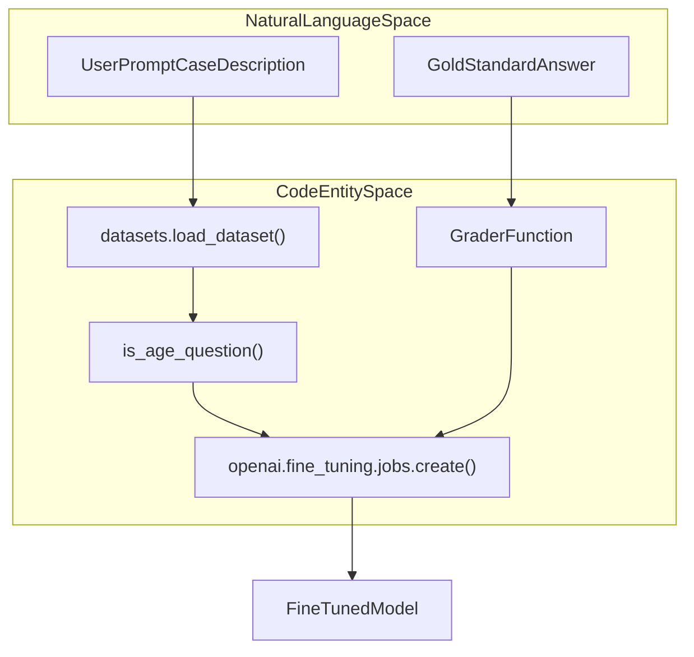
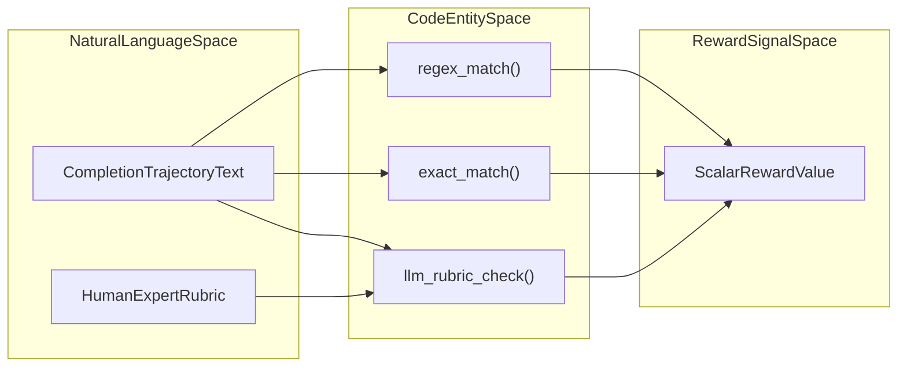

<!-- source: DeepWiki mcp.deepwiki.com · repo openai/openai-cookbook · page 8.2 Reinforcement Fine-Tuning · fetched 2026-10-26 -->

# Reinforcement Fine-Tuning

Relevant source files

The following files were used as context for generating this wiki page:

- [articles/chatgpt-agents-sales-meeting-prep.md](articles/chatgpt-agents-sales-meeting-prep.md)
- [examples/How_to_handle_rate_limits.ipynb](examples/How_to_handle_rate_limits.ipynb)
- [examples/Leveraging_model_distillation_to_fine-tune_a_model.ipynb](examples/Leveraging_model_distillation_to_fine-tune_a_model.ipynb)
- [examples/Reinforcement_Fine_Tuning.ipynb](examples/Reinforcement_Fine_Tuning.ipynb)
- [examples/Speech_transcription_methods.ipynb](examples/Speech_transcription_methods.ipynb)
- [examples/Structured_Outputs_Intro.ipynb](examples/Structured_Outputs_Intro.ipynb)
- [examples/Structured_outputs_multi_agent.ipynb](examples/Structured_outputs_multi_agent.ipynb)
- [examples/codex/using_goals_in_codex.ipynb](examples/codex/using_goals_in_codex.ipynb)
- [examples/fine-tuned_qa/reinforcement_finetuning_healthbench.ipynb](examples/fine-tuned_qa/reinforcement_finetuning_healthbench.ipynb)
- [examples/gpt-5/gpt-5_frontend.ipynb](examples/gpt-5/gpt-5_frontend.ipynb)
- [examples/mcp/mcp_tool_guide.ipynb](examples/mcp/mcp_tool_guide.ipynb)
- [examples/partners/eval_driven_system_design/receipt_inspection.ipynb](examples/partners/eval_driven_system_design/receipt_inspection.ipynb)
- [examples/partners/mcp_powered_voice_agents/mcp_powered_agents_cookbook.ipynb](examples/partners/mcp_powered_voice_agents/mcp_powered_agents_cookbook.ipynb)
- [images/rft_dashboard_modelgrader2.png](images/rft_dashboard_modelgrader2.png)
- [images/rft_hacking.png](images/rft_hacking.png)
- [images/rft_string_grader.png](images/rft_string_grader.png)

This page documents reinforcement fine-tuning (RFT) for reasoning models such as `o4-mini`, covering model graders, reward hacking pitfalls, training workflows, and HealthBench evaluation.

Sources: [examples/Reinforcement_Fine_Tuning.ipynb:11-12](), [examples/fine-tuned_qa/reinforcement_finetuning_healthbench.ipynb:12-18]()

## Overview of RFT for Reasoning Models

Reinforcement Fine-Tuning (RFT) is a specialized technique for improving the reasoning performance of models by running reinforcement learning on top of a base reasoning model [examples/Reinforcement_Fine_Tuning.ipynb:11-12](). This process allows the model to explore the solution space and reinforces strategies that result in higher rewards, helping the model make sharper decisions and interpret context more effectively [examples/Reinforcement_Fine_Tuning.ipynb:11-12]().

RFT is particularly effective for enhancing conversational reasoning and domain-specific expertise (e.g., medical, financial, or legal domains) where precise, repeatable reasoning is required [examples/Reinforcement_Fine_Tuning.ipynb:35-39](). Unlike standard supervised fine-tuning, RFT uses trajectory sampling and feedback loops to teach the model not just correct behaviors, but also patterns to avoid [examples/Reinforcement_Fine_Tuning.ipynb:101-102]().

### Key Components of RFT
*   **Reasoning Model:** The base model used for exploration, such as `o4-mini` [examples/Reinforcement_Fine_Tuning.ipynb:14-14]().
*   **Model Grader:** A programmatic or model-based component that evaluates completions and assigns a reward signal [examples/Reinforcement_Fine_Tuning.ipynb:21-21]().
*   **Training Workflow:** The iterative process of sampling responses, grading them, and updating model weights [examples/Reinforcement_Fine_Tuning.ipynb:11-12]().

Sources: [examples/Reinforcement_Fine_Tuning.ipynb:11-102]()

## Implementation Workflow

The RFT process follows a structured pipeline from dataset preparation to model evaluation.

### Data Flow and Code Entity Space
The following diagram illustrates the transition from natural language prompts to the fine-tuning execution environment, linking conceptual inputs to concrete code functions.

**RFT System Architecture**

Sources: [examples/Reinforcement_Fine_Tuning.ipynb:84-94](), [examples/Reinforcement_Fine_Tuning.ipynb:21-23]()

### 1. Dataset Preparation
For reasoning tasks, datasets often consist of a patient case description, a question, and a verifiable correct answer [examples/Reinforcement_Fine_Tuning.ipynb:57-59](). RFT can show significant gains even with small datasets (e.g., 100 training samples) due to the nature of trajectory sampling [examples/Reinforcement_Fine_Tuning.ipynb:101-103](). Standardizing ground-truth answers (e.g., to lowercase) is a common preprocessing step [examples/Reinforcement_Fine_Tuning.ipynb:145-151]().

### 2. Defining Model Graders
Graders provide the reward signal. They can be implemented in several ways:
*   **String Graders:** Perform exact or normalized string matching between the model output and the ground truth [examples/Reinforcement_Fine_Tuning.ipynb:145-151]().
*   **Model-based Graders:** Use a separate LLM to evaluate the reasoning steps or the final answer against a rubric [examples/fine-tuned_qa/reinforcement_finetuning_healthbench.ipynb:52-52]().

### 3. Training Workflow
The training job is initiated via the OpenAI API. While standard fine-tuning uses supervised signals, RFT utilizes reinforcement learning techniques to reward or penalize responses based on specific criteria [examples/fine-tuned_qa/reinforcement_finetuning_healthbench.ipynb:12-12]().

| Parameter | Description |
| :--- | :--- |
| `model` | The base reasoning model (e.g., `o4-mini`) |
| `training_file` | The dataset in JSONL format |
| `method` | Configuration for reinforcement fine-tuning |

Sources: [examples/Reinforcement_Fine_Tuning.ipynb:14-23](), [examples/fine-tuned_qa/reinforcement_finetuning_healthbench.ipynb:12-69]()

## HealthBench Evaluation

HealthBench is a benchmark suite used to assess LLM performance on healthcare-related QA, emphasizing accuracy, safety, and factual grounding [examples/fine-tuned_qa/reinforcement_finetuning_healthbench.ipynb:18-20](). Evaluations can be executed using lightweight evaluation harnesses such as `openai/simple-evals` via `python -m simple-evals.simple_evals --eval=healthbench_hard --model=gpt-4.1` [examples/fine-tuned_qa/reinforcement_finetuning_healthbench.ipynb:24-48]().

### Conversational Reasoning Improvement
RFT is used to improve a model's ability to ask clarifying questions to reduce uncertainty before providing a medical assessment [examples/fine-tuned_qa/reinforcement_finetuning_healthbench.ipynb:12-12](). This is particularly useful for dialogue systems where quality of reasoning is crucial.

**Evaluation Data Structure:**
*   `prompt`: The conversation history between the user and the model [examples/fine-tuned_qa/reinforcement_finetuning_healthbench.ipynb:55-55]().
*   `rubric`: The criteria used by the grader to score responses [examples/fine-tuned_qa/reinforcement_finetuning_healthbench.ipynb:56-56]().
*   `completion`: The model's response to the prompt [examples/fine-tuned_qa/reinforcement_finetuning_healthbench.ipynb:57-57]().
*   `score`: The reward signal derived from the grader [examples/fine-tuned_qa/reinforcement_finetuning_healthbench.ipynb:58-58]().

Sources: [examples/fine-tuned_qa/reinforcement_finetuning_healthbench.ipynb:12-59]()

## Avoiding Reward Hacking

A critical aspect of RFT is designing graders that avoid "reward hacking," where a model finds a shortcut to a high score without actually improving its reasoning [examples/Reinforcement_Fine_Tuning.ipynb:41-41]().

The following diagram bridges natural language grading rubrics and completion trajectories to the programmatic grading functions that compute scalar reward signals.

**Grader Logic Mapping**

Sources: [examples/Reinforcement_Fine_Tuning.ipynb:41-94](), [examples/fine-tuned_qa/reinforcement_finetuning_healthbench.ipynb:52-59]()

## Using Fine-Tuned Models

Once the RFT job is complete, the resulting model can be used via the standard Chat Completions API. These models typically exhibit improved performance on complex reasoning tasks compared to their base versions, particularly in following specific rubrics or extracting structured data from unstructured transcripts [examples/Reinforcement_Fine_Tuning.ipynb:35-39]().

Sources: [examples/Reinforcement_Fine_Tuning.ipynb:23-23]()

---

