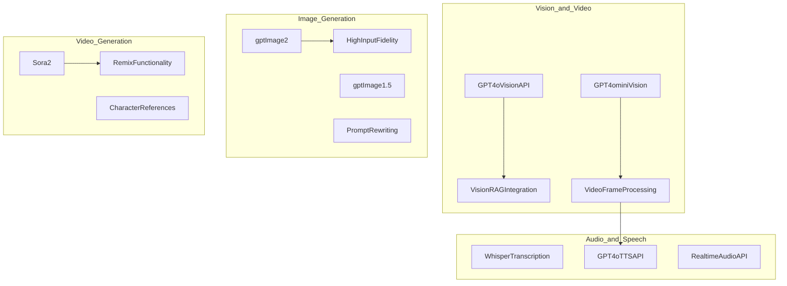
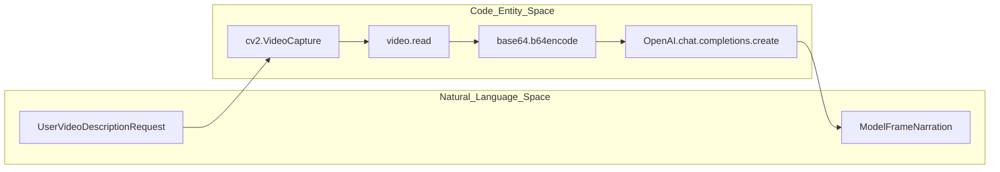
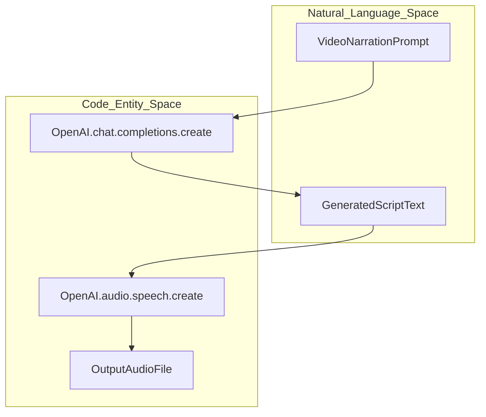

<!-- source: DeepWiki mcp.deepwiki.com · repo openai/openai-cookbook · page 9 Multimodal Capabilities · fetched 2026-10-26 -->

# Multimodal Capabilities

Relevant source files

The following files were used as context for generating this wiki page:

- [examples/Function_calling_finding_nearby_places.ipynb](examples/Function_calling_finding_nearby_places.ipynb)
- [examples/Function_calling_with_an_OpenAPI_spec.ipynb](examples/Function_calling_with_an_OpenAPI_spec.ipynb)
- [examples/GPT_with_vision_for_video_understanding.ipynb](examples/GPT_with_vision_for_video_understanding.ipynb)
- [examples/data/bison.mp4](examples/data/bison.mp4)
- [examples/data/example_events_openapi.json](examples/data/example_events_openapi.json)
- [examples/gpt4o/data/keynote_recap.mp4](examples/gpt4o/data/keynote_recap.mp4)
- [examples/gpt4o/data/triangle.png](examples/gpt4o/data/triangle.png)
- [examples/multimodal/image-gen-models-prompting-guide.ipynb](examples/multimodal/image-gen-models-prompting-guide.ipynb)
- [images/billboard_gpt-image-2.png](images/billboard_gpt-image-2.png)
- [images/billboard_winter_gpt-image-2.png](images/billboard_winter_gpt-image-2.png)
- [images/childrens_book_illustration_1_gpt-image-2.png](images/childrens_book_illustration_1_gpt-image-2.png)
- [images/childrens_book_illustration_2_gpt-image-2.png](images/childrens_book_illustration_2_gpt-image-2.png)
- [images/christmas_collectible_toy_airplane_gpt-image-2.png](images/christmas_collectible_toy_airplane_gpt-image-2.png)
- [images/christmas_holiday_card_teddy_gpt-image-2.png](images/christmas_holiday_card_teddy_gpt-image-2.png)
- [images/comic_reel-gpt-image-2.png](images/comic_reel-gpt-image-2.png)
- [images/extract_product_gpt-image-2.png](images/extract_product_gpt-image-2.png)
- [images/infographic_coffee_machine_gpt-image-2.png](images/infographic_coffee_machine_gpt-image-2.png)
- [images/infographic_coffee_machine_sp_gpt-image-2.png](images/infographic_coffee_machine_sp_gpt-image-2.png)

This page provides an overview of OpenAI's multimodal features spanning vision, image generation, video generation, and audio processing. Detailed implementation guides, parameter references, and prompting strategies are documented in the respective child pages.

Sources: [examples/GPT_with_vision_for_video_understanding.ipynb:7-12](), [examples/multimodal/image-gen-models-prompting-guide.ipynb:24-38]()

## Overview

OpenAI's multimodal APIs enable applications to process and generate content across multiple formats: analyzing images and documents with vision models, creating production-quality images through text-to-image generation, producing video content from text and image prompts, and transcribing or generating audio.

Diagram: Architecture Overview

Sources: [examples/multimodal/image-gen-models-prompting-guide.ipynb:26-36](), [examples/GPT_with_vision_for_video_understanding.ipynb:7-12]()

## Vision and Image Understanding

GPT-4o and GPT-4o-mini provide vision capabilities for understanding images, documents, and video frames. The cookbook demonstrates integration with retrieval-augmented generation (RAG) and video narration workflows [examples/GPT_with_vision_for_video_understanding.ipynb:7-12]().

While models do not take raw video files directly, applications can process a sequence of static frames extracted using OpenCV (`cv2.VideoCapture`), leveraging large context windows to analyze entire clips [examples/GPT_with_vision_for_video_understanding.ipynb:9-12](), [examples/GPT_with_vision_for_video_understanding.ipynb:60-70]().

Diagram: Video Processing Pipeline Bridge

Sources: [examples/GPT_with_vision_for_video_understanding.ipynb:7-12](), [examples/GPT_with_vision_for_video_understanding.ipynb:60-71]()

For details, see [Vision and Image Understanding](#9.1).

## Image Generation

OpenAI provides advanced image generation models including `gpt-image-2`, `gpt-image-1.5`, and `gpt-image-1-mini` for production-quality visuals and highly controllable creative workflows [examples/multimodal/image-gen-models-prompting-guide.ipynb:24-25](). These models support robust facial and identity preservation, transparent-background PNG and WebP assets, and flexible quality-latency tradeoffs [examples/multimodal/image-gen-models-prompting-guide.ipynb:28-31]().

| Model | Supported Quality / Input Fidelity | Recommended Use Case |
|---|---|---|
| `gpt-image-2` | `low`, `medium`, `high` (Input fidelity disabled by default) | Recommended default for highest-quality generation, editing, photorealism, and text-heavy images [examples/multimodal/image-gen-models-prompting-guide.ipynb:61-61]() |
| `gpt-image-1-mini` | `low`, `medium`, `high` / `low`, `high` | Cost and throughput constraints: batch variants, rapid ideation, and draft assets [examples/multimodal/image-gen-models-prompting-guide.ipynb:64-64]() |

Sources: [examples/multimodal/image-gen-models-prompting-guide.ipynb:59-64]()

For details, see [Image Generation](#9.2).

## Video Generation with Sora

Sora generates high-quality video content from text and image prompts, supporting prose descriptions, cinematography settings, action sequences, and dialogue structures [examples/sora/sora2_prompting_guide.ipynb](). It features reusable character references and remix capabilities [examples/sora/sora2_prompting_guide.ipynb:60-60]().

Sources: [examples/sora/sora2_prompting_guide.ipynb:22-62]()

For details, see [Video Generation with Sora](#9.3).

## Audio, Speech, and Whisper

OpenAI's audio capabilities include speech-to-text transcription via Whisper and text-to-speech generation via the TTS API [examples/GPT_with_vision_for_video_understanding.ipynb:7-12](). 

Diagram: Multimodal Audio Integration Bridge

Sources: [examples/GPT_with_vision_for_video_understanding.ipynb:7-12]()

For details, see [Audio, Speech, and Whisper](#9.4).

## Implementation Patterns

Multimodal inputs and outputs can be combined with structured outputs, function calling, and external tools, such as integrating profile data or OpenAPI-backed APIs to handle dynamic location-based or document-driven queries [examples/Function_calling_finding_nearby_places.ipynb:7-25](), [examples/Function_calling_with_an_OpenAPI_spec.ipynb:1]().

Sources: [examples/Function_calling_finding_nearby_places.ipynb:7-25](), [examples/Function_calling_with_an_OpenAPI_spec.ipynb:1]()

---

