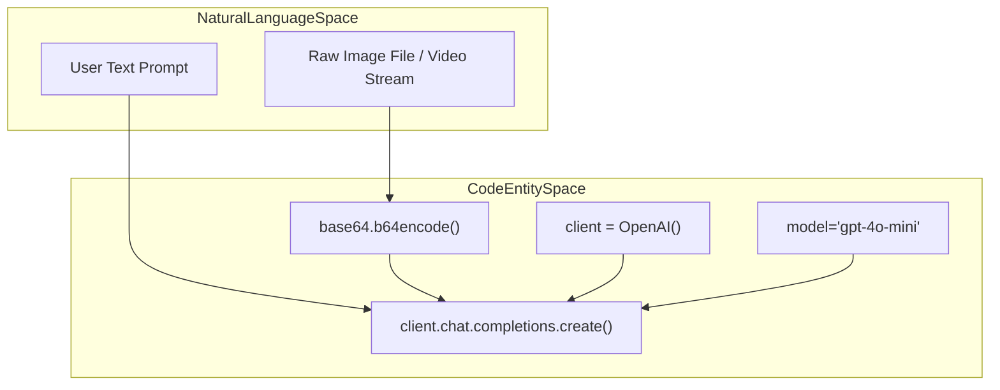
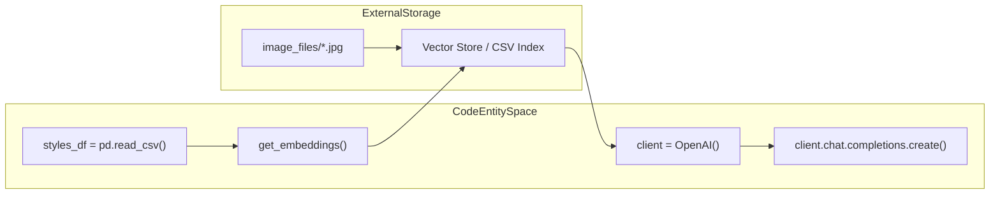

<!-- source: DeepWiki mcp.deepwiki.com · repo openai/openai-cookbook · page 9.1 Vision and Image Understanding · fetched 2026-10-26 -->

# Vision and Image Understanding

<details>
<summary>Relevant source files</summary>

The following files were used as context for generating this wiki page:

- [examples/Function_calling_finding_nearby_places.ipynb](examples/Function_calling_finding_nearby_places.ipynb)
- [examples/Function_calling_with_an_OpenAPI_spec.ipynb](examples/Function_calling_with_an_OpenAPI_spec.ipynb)
- [examples/GPT_with_vision_for_video_understanding.ipynb](examples/GPT_with_vision_for_video_understanding.ipynb)
- [examples/How_to_combine_GPT4o_with_RAG_Outfit_Assistant.ipynb](examples/How_to_combine_GPT4o_with_RAG_Outfit_Assistant.ipynb)
- [examples/How_to_stream_completions.ipynb](examples/How_to_stream_completions.ipynb)
- [examples/How_to_use_guardrails.ipynb](examples/How_to_use_guardrails.ipynb)
- [examples/How_to_use_moderation.ipynb](examples/How_to_use_moderation.ipynb)
- [examples/SDG1.ipynb](examples/SDG1.ipynb)
- [examples/Tag_caption_images_with_GPT4V.ipynb](examples/Tag_caption_images_with_GPT4V.ipynb)
- [examples/batch_processing.ipynb](examples/batch_processing.ipynb)
- [examples/data/bison.mp4](examples/data/bison.mp4)
- [examples/data/example_events_openapi.json](examples/data/example_events_openapi.json)
- [examples/data/imdb_top_1000.csv](examples/data/imdb_top_1000.csv)
- [examples/gpt4o/data/keynote_recap.mp3](examples/gpt4o/data/keynote_recap.mp3)
- [examples/gpt4o/data/keynote_recap.mp4](examples/gpt4o/data/keynote_recap.mp4)
- [examples/gpt4o/data/triangle.png](examples/gpt4o/data/triangle.png)
- [examples/gpt4o/introduction_to_gpt4o.ipynb](examples/gpt4o/introduction_to_gpt4o.ipynb)
- [examples/multimodal/document_and_multimodal_understanding_tips.ipynb](examples/multimodal/document_and_multimodal_understanding_tips.ipynb)
- [examples/multimodal/grounded_spatial_reasoning_layouts.ipynb](examples/multimodal/grounded_spatial_reasoning_layouts.ipynb)
- [examples/multimodal/images/apartment_floorplan.png](examples/multimodal/images/apartment_floorplan.png)
- [examples/multimodal/images/bracket.png](examples/multimodal/images/bracket.png)
- [examples/multimodal/images/chart.png](examples/multimodal/images/chart.png)
- [examples/multimodal/images/grounded_spatial_failed_run_viewer.png](examples/multimodal/images/grounded_spatial_failed_run_viewer.png)
- [examples/multimodal/images/grounded_spatial_figure_1_empty_vs_reference.png](examples/multimodal/images/grounded_spatial_figure_1_empty_vs_reference.png)
- [examples/multimodal/images/grounded_spatial_run_15_trace_viewer.png](examples/multimodal/images/grounded_spatial_run_15_trace_viewer.png)
- [examples/multimodal/images/grounded_spatial_run_1_valid_layout.png](examples/multimodal/images/grounded_spatial_run_1_valid_layout.png)
- [examples/multimodal/images/grounded_spatial_run_2_wrong_decomposition.png](examples/multimodal/images/grounded_spatial_run_2_wrong_decomposition.png)
- [examples/multimodal/images/grounded_spatial_run_8_overfilled_layout.png](examples/multimodal/images/grounded_spatial_run_8_overfilled_layout.png)
- [examples/multimodal/images/newspaper.png](examples/multimodal/images/newspaper.png)
- [examples/multimodal/images/police_form.png](examples/multimodal/images/police_form.png)
- [examples/multimodal/images/sample_hotel_invoice.png](examples/multimodal/images/sample_hotel_invoice.png)
- [images/elbow_chart.png](images/elbow_chart.png)
- [images/omnidocbench_selected_runs.png](images/omnidocbench_selected_runs.png)

</details>


## Purpose and Scope

This page documents OpenAI's vision capabilities for understanding images and video streams through the GPT-4o model family and newer reasoning endpoints. It covers how to pass images and extracted video frames to the API, combine visual understanding with retrieval-augmented generation (RAG), implement vision-enabled function calling, apply grounded spatial reasoning, and optimize document understanding.

For image generation capabilities, see [9.2](). For video generation with Sora, see [9.3](). For general chat completion patterns without images, see [4.1]().

**Sources:** [examples/multimodal/image_understanding_with_rag.ipynb:7-20](), [examples/multimodal/Using_GPT4_Vision_With_Function_Calling.ipynb:10-17]()

## Vision Capabilities Overview

GPT-4o, GPT-4o-mini, and related multimodal architectures provide native visual processing capabilities. The model can process mixed inputs of text, images, and video frames to:

- Identify and describe physical objects, people, and complex scenes.
- Perform optical character recognition (OCR) and extract structured data from documents, invoices, and charts [examples/multimodal/Using_GPT4_Vision_With_Function_Calling.ipynb:16-17]().
- Analyze spatial layouts, dimensions, and structural compositions for architectural or office planning tasks [examples/multimodal/grounded_spatial_reasoning_layouts.ipynb:16-24]().
- Process continuous video by breaking streams down into static frame sequences [examples/GPT_with_vision_for_video_understanding.ipynb:7-12]().
- Interface with vector search indices for multimodal retrieval-augmented generation (RAG) [examples/multimodal/image_understanding_with_rag.ipynb:7-13]().

**Sources:** [examples/multimodal/image_understanding_with_rag.ipynb:7-15](), [examples/GPT_with_vision_for_video_understanding.ipynb:7-12](), [examples/multimodal/Using_GPT4_Vision_With_Function_Calling.ipynb:10-17]()

## Multimodal Input Architecture

The following diagram bridges the Natural Language and Code Entity spaces, mapping user queries and raw image files to concrete API client functions and model identifiers.

**Multimodal Input Processing Flow**


**Sources:** [examples/multimodal/image_understanding_with_rag.ipynb:143-148](), [examples/GPT_with_vision_for_video_understanding.ipynb:26-29](), [examples/GPT_with_vision_for_video_understanding.ipynb:67-68]()

## Image Encoding and API Usage

### Base64 Encoding
Images passed directly to the Chat Completions API must be serialized into base64-encoded data strings [examples/GPT_with_vision_for_video_understanding.ipynb:68-68]().

```python
import base64

def encode_image(image_path):
    with open(image_path, "rb") as image_file:
        return base64.b64encode(image_file.read()).decode("utf-8")
```

### Vision API Payload Structure
The message payload accepts a list of objects containing text and image blocks [examples/multimodal/image_understanding_with_rag.ipynb:100-104](). The image URL field supports data URIs (`data:image/jpeg;base64,...`) as well as remote HTTP/HTTPS URLs.

```python
response = client.chat.completions.create(
    model="gpt-4o",
    messages=[
        {
            "role": "user",
            "content": [
                {"type": "text", "text": "Extract table values from this invoice."},
                {"type": "image_url", "image_url": {"url": f"data:image/png;base64,{base64_image}"}}
            ]
        }
    ]
)
```

**Sources:** [examples/multimodal/image_understanding_with_rag.ipynb:99-104](), [examples/multimodal/image_understanding_with_rag.ipynb:143-148](), [examples/GPT_with_vision_for_video_understanding.ipynb:67-68]()

## Retrieval-Augmented Generation (RAG) with Images

Combining vision models with vector databases allows applications to query visual assets alongside textual records [examples/multimodal/image_understanding_with_rag.ipynb:7-13]().

### Multimodal RAG Workflow
1. **Corpus Preparation:** Pair unstructured text metadata or reviews with physical image file paths in a structured dataset [examples/multimodal/image_understanding_with_rag.ipynb:25-27]().
2. **Embedding Generation:** Create vector embeddings of text descriptions using models like `text-embedding-3-large` [examples/multimodal/image_understanding_with_rag.ipynb:74-74]().
3. **Retrieval & Analysis:** Query the vector index to retrieve relevant image records, then feed those images into `client.chat.completions.create()` alongside the user query [examples/multimodal/image_understanding_with_rag.ipynb:115-120]().

**Multimodal RAG Code Entity Mapping**


**Sources:** [examples/multimodal/image_understanding_with_rag.ipynb:7-33](), [examples/multimodal/image_understanding_with_rag.ipynb:74-120]()

## Using Vision with Function Calling

GPT-4o supports simultaneous vision analysis and tool/function calling [examples/multimodal/Using_GPT4_Vision_With_Function_Calling.ipynb:10-17](). This allows models to inspect visual inputs (such as organizational charts, damaged goods, or UI wireframes) and deterministically trigger programmatic workflows.

- **Automated Routing:** Inspecting an image of a returned item to decide whether to trigger `issue_refund()` or `escalate_to_human()` [examples/multimodal/Using_GPT4_Vision_With_Function_Calling.ipynb:93-97]().
- **Structured Data Extraction:** Reading complex diagrams and passing structured JSON arguments to database insertion tools [examples/multimodal/Using_GPT4_Vision_With_Function_Calling.ipynb:16-17]().

**Sources:** [examples/multimodal/Using_GPT4_Vision_With_Function_Calling.ipynb:10-17](), [examples/multimodal/Using_GPT4_Vision_With_Function_Calling.ipynb:93-97]()

## Grounded Spatial Reasoning

Frontier reasoning models can be applied to complex spatial layout problems—such as generating office layouts from empty floorplans [examples/multimodal/grounded_spatial_reasoning_layouts.ipynb:16-24]().

### Spatial Layout Pipeline
1. **Visual Evidence:** The model ingests an empty floorplan image (`empty.png`) to deduce walls, doors, and functional boundaries [examples/multimodal/grounded_spatial_reasoning_layouts.ipynb:34-40]().
2. **Constraint Application:** An operating procedure (`constraints.json`) and furniture catalog define dimension rules and required object counts [examples/multimodal/grounded_spatial_reasoning_layouts.ipynb:43-45]().
3. **Structured Output:** The model outputs a layout specification (`raw_layout.json`) containing object coordinates and semantic room assignments, which are then evaluated for mechanical validity [examples/multimodal/grounded_spatial_reasoning_layouts.ipynb:23-24]().

**Sources:** [examples/multimodal/grounded_spatial_reasoning_layouts.ipynb:16-24](), [examples/multimodal/grounded_spatial_reasoning_layouts.ipynb:34-45]()

## Video Understanding with Frames

Although video files cannot always be streamed directly into standard text endpoints as raw byte streams, videos can be processed by extracting static frame sequences using libraries like OpenCV [examples/GPT_with_vision_for_video_understanding.ipynb:7-12]().

### Video Processing Pipeline
- **Frame Extraction:** Iterate through video streams using `cv2.VideoCapture` to pull frames at defined intervals [examples/GPT_with_vision_for_video_understanding.ipynb:60-64]().
- **Base64 Batching:** Encode extracted frame buffers into base64 arrays [examples/GPT_with_vision_for_video_understanding.ipynb:67-68]().
- **Context Window Utilization:** Feed the ordered frame sequence into models with large context windows to generate comprehensive video narratives or voiceovers [examples/GPT_with_vision_for_video_understanding.ipynb:7-12]().

**Sources:** [examples/GPT_with_vision_for_video_understanding.ipynb:7-12](), [examples/GPT_with_vision_for_video_understanding.ipynb:60-71]()

## Document and Multimodal Understanding Tips

When designing systems for document parsing, charts, and image tagging:

1. **Resolution Management:** Ensure uploaded images maintain sufficient resolution for fine-grained OCR tasks [examples/multimodal/image_understanding_with_rag.ipynb:103-103]().
2. **Task Decomposition:** Split complex reasoning workflows (such as identifying room semantics before calculating furniture coordinates) into distinct prompt stages [examples/multimodal/grounded_spatial_reasoning_layouts.ipynb:108-108]().
3. **Structured Outputs:** Combine vision prompts with JSON mode or function schemas to ensure downstream parsers receive clean data structures.

**Sources:** [examples/multimodal/image_understanding_with_rag.ipynb:103-103](), [examples/multimodal/grounded_spatial_reasoning_layouts.ipynb:108-108]()

## Vision Fine-Tuning and Evaluation

Multimodal models can be fine-tuned or evaluated against domain-specific test sets:

- **Fine-Tuning:** Fine-tune GPT-4o models on custom image-text pairs to improve performance on specialized document types or visual question-answering tasks [examples/multimodal/image_understanding_with_rag.ipynb:13-13]().
- **Automated Validation:** Evaluate spatial and structural outputs by running programmatic checks on generated JSON specifications (e.g., verifying bounding box collisions or missing required objects) [examples/multimodal/grounded_spatial_reasoning_layouts.ipynb:23-24]().

**Sources:** [examples/multimodal/image_understanding_with_rag.ipynb:13-13](), [examples/multimodal/grounded_spatial_reasoning_layouts.ipynb:23-24]()

---

