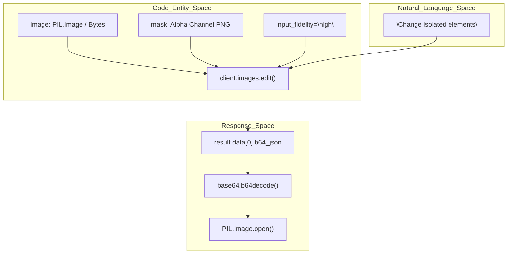

<!-- source: DeepWiki mcp.deepwiki.com · repo openai/openai-cookbook · page 9.2 Image Generation · fetched 2026-10-26 -->

# Image Generation

<details>
<summary>Relevant source files</summary>

The following files were used as context for generating this wiki page:

- [examples/Generate_Images_With_GPT_Image.ipynb](examples/Generate_Images_With_GPT_Image.ipynb)
- [examples/Generate_Images_With_High_Input_Fidelity.ipynb](examples/Generate_Images_With_High_Input_Fidelity.ipynb)
- [examples/dalle/How_to_create_dynamic_masks_with_DALL-E_and_Segment_Anything.ipynb](examples/dalle/How_to_create_dynamic_masks_with_DALL-E_and_Segment_Anything.ipynb)
- [examples/dalle/Image_generations_edits_and_variations_with_DALL-E.ipynb](examples/dalle/Image_generations_edits_and_variations_with_DALL-E.ipynb)
- [examples/dalle/images/01_generations/generation_1.png](examples/dalle/images/01_generations/generation_1.png)
- [examples/dalle/images/01_generations/generation_2.png](examples/dalle/images/01_generations/generation_2.png)
- [examples/dalle/images/01_generations/generation_3.png](examples/dalle/images/01_generations/generation_3.png)
- [examples/dalle/images/02_masks/new_mask.png](examples/dalle/images/02_masks/new_mask.png)
- [examples/dalle/images/03_edits/edits_0.png](examples/dalle/images/03_edits/edits_0.png)
- [examples/dalle/images/03_edits/edits_1.png](examples/dalle/images/03_edits/edits_1.png)
- [examples/dalle/images/03_edits/edits_2.png](examples/dalle/images/03_edits/edits_2.png)
- [examples/dalle/images/03_edits/edits_3.png](examples/dalle/images/03_edits/edits_3.png)
- [examples/imgs/bag.png](examples/imgs/bag.png)
- [examples/imgs/cat_portrait_pixel.jpg](examples/imgs/cat_portrait_pixel.jpg)
- [examples/imgs/cat_with_hat.jpg](examples/imgs/cat_with_hat.jpg)
- [examples/imgs/desk.png](examples/imgs/desk.png)
- [examples/imgs/glorptak.jpg](examples/imgs/glorptak.jpg)
- [examples/imgs/hat.png](examples/imgs/hat.png)
- [examples/imgs/logo.png](examples/imgs/logo.png)
- [examples/imgs/mask.png](examples/imgs/mask.png)
- [examples/imgs/mask_alpha.png](examples/imgs/mask_alpha.png)
- [examples/imgs/mask_edit.png](examples/imgs/mask_edit.png)
- [examples/imgs/model.png](examples/imgs/model.png)
- [examples/imgs/woman_portrait.png](examples/imgs/woman_portrait.png)
- [examples/imgs/woman_smiling.jpg](examples/imgs/woman_smiling.jpg)
- [examples/multimodal/image-gen-1.5-prompting_guide.ipynb](examples/multimodal/image-gen-1.5-prompting_guide.ipynb)
- [examples/multimodal/image-gen-models-prompting-guide.ipynb](examples/multimodal/image-gen-models-prompting-guide.ipynb)
- [examples/multimodal/transparent-image-assets-for-campaigns-and-presentations.ipynb](examples/multimodal/transparent-image-assets-for-campaigns-and-presentations.ipynb)
- [images/base_woman.png](images/base_woman.png)
- [images/billboard.png](images/billboard.png)
- [images/billboard_gpt-image-2.png](images/billboard_gpt-image-2.png)
- [images/billboard_winter.png](images/billboard_winter.png)
- [images/billboard_winter_gpt-image-2.png](images/billboard_winter_gpt-image-2.png)
- [images/boots copy.png](images/boots copy.png)
- [images/boots.png](images/boots.png)
- [images/carbon_cycle_technical_diagram.png](images/carbon_cycle_technical_diagram.png)
- [images/childrens_book_illustration_1.png](images/childrens_book_illustration_1.png)
- [images/childrens_book_illustration_1_gpt-image-2.png](images/childrens_book_illustration_1_gpt-image-2.png)
- [images/childrens_book_illustration_2.png](images/childrens_book_illustration_2.png)
- [images/childrens_book_illustration_2_gpt-image-2.png](images/childrens_book_illustration_2_gpt-image-2.png)
- [images/christmas_collectible_toy_airplane.png](images/christmas_collectible_toy_airplane.png)
- [images/christmas_collectible_toy_airplane_gpt-image-2.png](images/christmas_collectible_toy_airplane_gpt-image-2.png)
- [images/christmas_holiday_card_teddy.png](images/christmas_holiday_card_teddy.png)
- [images/christmas_holiday_card_teddy_gpt-image-2.png](images/christmas_holiday_card_teddy_gpt-image-2.png)
- [images/comic_reel-gpt-image-2.png](images/comic_reel-gpt-image-2.png)
- [images/extract_product.png](images/extract_product.png)
- [images/extract_product_gpt-image-2.png](images/extract_product_gpt-image-2.png)
- [images/infographic_coffee_machine.png](images/infographic_coffee_machine.png)
- [images/infographic_coffee_machine_gpt-image-2.png](images/infographic_coffee_machine_gpt-image-2.png)
- [images/infographic_coffee_machine_sp_gpt-image-2.png](images/infographic_coffee_machine_sp_gpt-image-2.png)
- [images/kitchen.jpeg](images/kitchen.jpeg)
- [images/motorcycle.png](images/motorcycle.png)
- [images/photorealism.png](images/photorealism.png)
- [images/pixels.png](images/pixels.png)
- [images/scene.png](images/scene.png)
- [images/shampoo.png](images/shampoo.png)

</details>


## Purpose and Scope

This page documents the image generation capabilities available through OpenAI's API, covering the DALL-E series (`dall-e-2`, `dall-e-3`) and modern multimodal image models (`gpt-image-1`, `gpt-image-1.5`, `gpt-image-2`, and `gpt-image-1-mini`) [examples/multimodal/image-gen-models-prompting-guide.ipynb:59-65](). It details programmatic implementation patterns for text-to-image generation, inpainting with static and dynamic masks, preserving details using high input fidelity, generating transparent production assets, and executing image evaluation harnesses [examples/Generate_Images_With_High_Input_Fidelity.ipynb:8-14](), [examples/multimodal/image-gen-models-prompting-guide.ipynb:31-35]().

Sources: [examples/multimodal/image-gen-models-prompting-guide.ipynb:24-38](), [examples/Generate_Images_With_High_Input_Fidelity.ipynb:8-14]()

---

## Model Families and Capabilities

OpenAI provides specialized DALL-E models and GPT-based image models optimized for professional workflows, offering superior instruction-following, photorealism, and layout control [examples/Generate_Images_With_GPT_Image.ipynb:16-20]().

### Model Comparison Table

| Model | Supported `outputQuality` | `input_fidelity` Support | Resolutions | Recommended Use Cases |
| :--- | :--- | :--- | :--- | :--- |
| `gpt-image-2` | `low`, `medium`, `high` | Disabled (Always High) | Custom (up to 4K experimental) | Default production model; highest quality, transparent assets, text-heavy images [examples/multimodal/image-gen-models-prompting-guide.ipynb:61-61](). |
| `gpt-image-1.5` | `low`, `medium`, `high` | `low`, `high` | `1024x1024`, `1024x1536`, `1536x1024`, `auto` | Production visuals with flexible quality–latency tradeoffs [examples/multimodal/image-gen-models-prompting-guide.ipynb:62-62](). |
| `gpt-image-1` | `low`, `medium`, `high` | `low`, `high` | `1024x1024`, `1024x1536`, `1536x1024`, `auto` | Legacy compatibility and migration validation [examples/multimodal/image-gen-models-prompting-guide.ipynb:63-63](). |
| `gpt-image-1-mini` | `low`, `medium`, `high` | `low`, `high` | `1024x1024`, `1024x1536`, `1536x1024`, `auto` | Cost-sensitive batch variant generation and rapid ideation [examples/multimodal/image-gen-models-prompting-guide.ipynb:64-64](). |
| `dall-e-3` | `standard`, `hd` | N/A | `1024x1024`, `1792x1024`, `1024x1792` | Automated prompt rewriting and artistic styles [examples/dalle/Image_generations_edits_and_variations_with_DALL-E.ipynb:85-88](). |
| `dall-e-2` | N/A | N/A | `256x256`, `512x512`, `1024x1024` | Legacy variations and standard edits [examples/dalle/Image_generations_edits_and_variations_with_DALL-E.ipynb:87-87](). |

Sources: [examples/multimodal/image-gen-models-prompting-guide.ipynb:59-64](), [examples/dalle/Image_generations_edits_and_variations_with_DALL-E.ipynb:75-89]()

---

## Technical Implementation and Data Flow

### Text-to-Image Generation Flow

The `OpenAI` client handles generation requests via `client.images.generate()` [examples/dalle/Image_generations_edits_and_variations_with_DALL-E.ipynb:112-118]().

Title: "Image Generation Data Flow"
```mermaid
graph TD
    subgraph "Natural_Language_Space"
        UserPrompt["\"A cyberpunk monkey hacker\""]
        QualitySetting["\"high\""]
    end

    subgraph "Code_Entity_Space"
        Client["OpenAI() Client"]
        GenCall["client.images.generate()"]
        ParamDict["Model: \"gpt-image-2\", Quality: \"high\""]
        
        Client --> GenCall
        UserPrompt --> GenCall
        QualitySetting --> GenCall
        ParamDict --> GenCall
    end

    subgraph "Response_Space"
        ImgResp["ImagesResponse"]
        DataList["data: list[Image]"]
        B64["b64_json: Base64 String"]
        URL["url: Storage URL"]
        
        GenCall --> ImgResp
        ImgResp --> DataList
        DataList --> B64
        DataList --> URL
    end
```
Sources: [examples/dalle/Image_generations_edits_and_variations_with_DALL-E.ipynb:112-121](), [examples/multimodal/image-gen-1.5-prompting_guide.ipynb:128-133]()

### Inpainting, Masking, and High Input Fidelity

Image editing is executed using `client.images.edit()` with a source image and an alpha mask [examples/Generate_Images_With_High_Input_Fidelity.ipynb:77-85](). Setting `input_fidelity="high"` preserves core identity features like faces and logos [examples/Generate_Images_With_High_Input_Fidelity.ipynb:10-13]().

Title: "Image Editing and Inpainting Data Flow"

Sources: [examples/Generate_Images_With_High_Input_Fidelity.ipynb:77-90](), [examples/dalle/Image_generations_edits_and_variations_with_DALL-E.ipynb:198-216]()

---

## Advanced Features

### Transparent Background Assets (`gpt-image-2`)
With `gpt-image-2`, transparent assets can be generated directly without external background removal [examples/multimodal/image-gen-models-prompting-guide.ipynb:31-32](). 
- Set `background="transparent"` [examples/multimodal/image-gen-models-prompting-guide.ipynb:70-70]().
- Set `output_format="png"` (default) or `output_format="webp"` [examples/multimodal/image-gen-models-prompting-guide.ipynb:71-71]().
- Explicitly prompt for an isolated subject on an alpha background with no cast shadows or solid backdrops [examples/multimodal/image-gen-models-prompting-guide.ipynb:73-73]().

### Dynamic Masks with Segment Anything
For complex image editing workflows where manual masks are impractical, the cookbook integrates Segment Anything models (SAM) alongside DALL-E/GPT Image models [examples/dalle/How_to_create_dynamic_masks_with_DALL-E_and_Segment_Anything.ipynb]() to programmatically segment objects and construct precise alpha masks (`mask.png` / `mask_alpha.png`) before invoking `client.images.edit()` [examples/imgs/mask.png:1-3](), [examples/imgs/mask_alpha.png:1-4]().

Sources: [examples/multimodal/image-gen-models-prompting-guide.ipynb:66-76](), [examples/dalle/How_to_create_dynamic_masks_with_DALL-E_and_Segment_Anything.ipynb]()

---

## Prompting Fundamentals

To maximize performance across modern image generation models:
1. **Structure + Goal**: Organize prompts consistently (background/scene → subject → key details → constraints) [examples/multimodal/image-gen-1.5-prompting_guide.ipynb:46-46]().
2. **Specificity**: Use concrete materials, shapes, and photographic terminology (aperture, lighting, focal length) instead of generic terms like "ultra-detailed" [examples/multimodal/image-gen-1.5-prompting_guide.ipynb:48-48]().
3. **Text Rendering**: Place literal text in **quotes** or **ALL CAPS** and specify typography constraints [examples/multimodal/image-gen-1.5-prompting_guide.ipynb:56-56]().
4. **Iterative Invariant Preservation**: State exclusions explicitly (`"no watermark"`, `"preserve identity"`) and repeat invariant lists on every edit iteration [examples/multimodal/image-gen-1.5-prompting_guide.ipynb:54-60]().

Sources: [examples/multimodal/image-gen-1.5-prompting_guide.ipynb:44-61]()

---

## Evaluation Harnesses

Image generation quality and authenticity are evaluated using automated compliance suites and visual grading harnesses:
- **C2PA Metadata & Truepic Verification**: Generated assets embed cryptographic provenance data (C2PA manifests), verified using Truepic SDKs to ensure algorithmic media transparency [images/infographic_coffee_machine.png:3-14]().
- **Vision Model Graders**: Harnesses use multimodal models like `gpt-4o` to inspect output images against specific prompt requirements, text spelling accuracy, and style alignment.

Sources: [images/infographic_coffee_machine.png:3-14](), [examples/multimodal/image-gen-1.5-prompting_guide.ipynb:24-35]()

---

