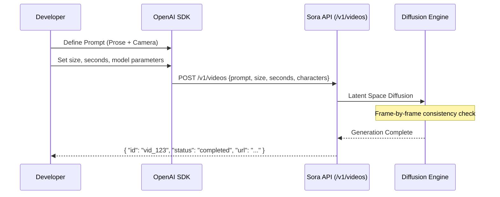

<!-- source: DeepWiki mcp.deepwiki.com · repo openai/openai-cookbook · page 9.3 Video Generation with Sora · fetched 2026-10-26 -->

# Video Generation with Sora

<details>
<summary>Relevant source files</summary>

The following files were used as context for generating this wiki page:

- [examples/sora/gifs/alfie_f1.gif](examples/sora/gifs/alfie_f1.gif)
- [examples/sora/gifs/alfie_input.gif](examples/sora/gifs/alfie_input.gif)
- [examples/sora/gifs/alfie_museum.gif](examples/sora/gifs/alfie_museum.gif)
- [examples/sora/gifs/alfie_tokyo.gif](examples/sora/gifs/alfie_tokyo.gif)
- [examples/sora/sora2_prompting_guide.ipynb](examples/sora/sora2_prompting_guide.ipynb)

</details>


## Purpose and Scope

This page documents the Sora 2 video generation API and its usage patterns within the OpenAI ecosystem. Sora is a diffusion model that converts text and image inputs into video outputs, supporting multiple resolutions, durations, and advanced features like character consistency [examples/sora/sora2_prompting_guide.ipynb:22-29](). This guide covers API parameters, the modular prompt structure (prose, cinematography, actions), and integration patterns for production video generation workflows [examples/sora/sora2_prompting_guide.ipynb:31-62]().

For image generation, see [Image Generation](#9.2). For vision understanding of existing images, see [Vision and Image Understanding](#9.1).

Sources: [examples/sora/sora2_prompting_guide.ipynb:22-62]()

---

## API Overview

### Models and Endpoints

Sora 2 introduces enhanced visual fidelity and longer durations compared to previous iterations [examples/sora/sora2_prompting_guide.ipynb:22-29](). Access is provided through several specialized endpoints:

| Endpoint | Path | Purpose |
|----------|------|---------|
| **Create Video** | `POST /v1/videos` | Generate a new video from a prompt. [examples/sora/sora2_prompting_guide.ipynb:91-92]() |
| **Create Character** | `POST /v1/videos/characters` | Upload a short reference clip to create a reusable character ID for generation. [examples/sora/sora2_prompting_guide.ipynb:94-95]() |
| **Extend Video** | `POST /v1/videos/extensions` | Continue an existing video using the full initial clip as context. [examples/sora/sora2_prompting_guide.ipynb:97-98]() |
| **Edit Video** | `POST /v1/videos/{video_id}/edits` | Modify an existing video with a new prompt. [examples/sora/sora2_prompting_guide.ipynb:100-101]() |

**Model Variants:**
- `sora-2`: Standard model optimized for 720p resolutions. [examples/sora/sora2_prompting_guide.ipynb:51-54]()
- `sora-2-pro`: High-performance model supporting up to 1080p resolution and better motion consistency. [examples/sora/sora2_prompting_guide.ipynb:51-58]()

Sources: [examples/sora/sora2_prompting_guide.ipynb:22-29](), [examples/sora/sora2_prompting_guide.ipynb:51-58](), [examples/sora/sora2_prompting_guide.ipynb:88-102]()

### Core API Parameters

The following diagram maps natural language requirements to specific API parameters used in the generation request.

| Parameter | Type | Description |
|-----------|------|-------------|
| `model` | string | Either `sora-2` or `sora-2-pro`. [examples/sora/sora2_prompting_guide.ipynb:51-51]() |
| `size` | string | Resolution in `{width}x{height}` format. [examples/sora/sora2_prompting_guide.ipynb:52-52]() |
| `seconds` | string | Clip length: `"4"`, `"8"`, `"12"`, `"16"`, or `"20"`. [examples/sora/sora2_prompting_guide.ipynb:59-59]() |
| `characters` | list | Optional list of character IDs (up to two). [examples/sora/sora2_prompting_guide.ipynb:60-60]() |
| `prompt` | string | The descriptive text for the video content. [examples/sora/sora2_prompting_guide.ipynb:50-50]() |

```mermaid
graph TB
    subgraph "NaturalLanguageSpace"
        Intent[""A 20 second 1080p video of my character""]
    end

    subgraph "CodeEntitySpace"
        Request[""POST /v1/videos""]
        ModelParam[""model: sora-2-pro""]
        SizeParam[""size: 1920x1080""]
        SecParam[""seconds: 20""]
        CharParam[""characters: [char_abc123]""]
    end
    
    Intent -.-> ModelParam
    Intent -.-> SizeParam
    Intent -.-> SecParam
    Intent -.-> CharParam
    
    ModelParam --> Request
    SizeParam --> Request
    SecParam --> Request
    CharParam --> Request
```

Sources: [examples/sora/sora2_prompting_guide.ipynb:49-62]()

---

## Resolution and Duration Configuration

### Resolution Impact
Video resolution directly influences visual fidelity and motion consistency in Sora [examples/sora/sora2_prompting_guide.ipynb:70-71](). Higher resolutions generate detail, texture, and lighting transitions more accurately, while lower resolutions compress visual information, often introducing softness or artifacts [examples/sora/sora2_prompting_guide.ipynb:70-71]().

**Supported Resolutions by Model:**

| Model | Supported `size` Strings |
|-------|--------------------------|
| `sora-2` | `1280x720`, `720x1280` [examples/sora/sora2_prompting_guide.ipynb:53-54]() |
| `sora-2-pro` | `1280x720`, `720x1280`, `1792x1024`, `1024x1792`, `1920x1080`, `1080x1920` [examples/sora/sora2_prompting_guide.ipynb:55-58]() |

### Duration and Extension
The `seconds` parameter supports clip lengths of `"4"`, `"8"`, `"12"`, `"16"`, or `"20"`, with a default value of `"4"` [examples/sora/sora2_prompting_guide.ipynb:59-59]().

**Extension Logic:**
The `POST /v1/videos/extensions` endpoint allows extending an existing video [examples/sora/sora2_prompting_guide.ipynb:97-98](). Unlike previous methods that relied solely on the final frame, Sora 2 uses the **full original clip** as context for the extension [examples/sora/sora2_prompting_guide.ipynb:27-27]().

Sources: [examples/sora/sora2_prompting_guide.ipynb:27-27](), [examples/sora/sora2_prompting_guide.ipynb:51-59](), [examples/sora/sora2_prompting_guide.ipynb:70-71](), [examples/sora/sora2_prompting_guide.ipynb:97-98]()

---

## Character References and Consistency

Sora 2 supports **Character References**, allowing consistent appearance of objects or animals across multiple generations [examples/sora/sora2_prompting_guide.ipynb:24-24]().

1. **Creation**: Upload a short reference clip via `POST /v1/videos/characters` to obtain a character ID [examples/sora/sora2_prompting_guide.ipynb:94-95]().
2. **Usage**: Reference up to two uploaded character IDs in the `characters` parameter during generation [examples/sora/sora2_prompting_guide.ipynb:60-60]().

The following diagram maps natural language instructions for character reuse to the corresponding API entity space:

```mermaid
graph TB
    subgraph "NaturalLanguageSpace"
        CharIntent[""Upload Alfie the dog clip and reuse him in a new scene""]
    end

    subgraph "CodeEntitySpace"
        CharEndpoint[""POST /v1/videos/characters""]
        VideoEndpoint[""POST /v1/videos""]
        CharID[""characters: [char_alfie_01]""]
    end

    CharIntent -.-> CharEndpoint
    CharEndpoint -->|Returns ID| CharID
    CharID -.-> VideoEndpoint
```

Sources: [examples/sora/sora2_prompting_guide.ipynb:24-24](), [examples/sora/sora2_prompting_guide.ipynb:60-60](), [examples/sora/sora2_prompting_guide.ipynb:94-95]()

---

## Prompt Structure and Anatomy

### The Cinematographic Brief
Effective prompts describe a shot as if briefing a cinematographer who has never seen your storyboard [examples/sora/sora2_prompting_guide.ipynb:31-32](). State camera framing, depth of field, action beats, lighting, and palette [examples/sora/sora2_prompting_guide.ipynb:109-110]().

```mermaid
graph TD
    subgraph "PromptAnatomy"
        Camera[""Cinematography (Framing, Lens, Movement)""]
        Subject[""Subject Details (Appearance, Dialogue)""]
        Action[""Action Beats (Motion, Physics)""]
        Style[""Environment (Lighting, Palette, Style)""]
    end
    
    Camera --> PromptString[""Final Prose Prompt""]
    Subject --> PromptString
    Action --> PromptString
    Style --> PromptString
    
    subgraph "CodeImplementation"
        API_Call[""openai.videos.create(prompt=PromptString, ...)""]
    end
    
    PromptString --> API_Call
```

**Key Components:**
- **Style Markers**: e.g., "90s documentary-style" sets camera lens, medium, and color grade [examples/sora/sora2_prompting_guide.ipynb:119-122]().
- **Dialogue**: Prose can include specific spoken lines for characters (e.g., `says, "I still remember when I was young."`) [examples/sora/sora2_prompting_guide.ipynb:119-120]().
- **Motion Beats**: Describing actions in sequential beats helps the model follow complex sequences [examples/sora/sora2_prompting_guide.ipynb:110-112]().

Sources: [examples/sora/sora2_prompting_guide.ipynb:31-34](), [examples/sora/sora2_prompting_guide.ipynb:109-123]()

---

## Video Generation Pipeline

The generation process transitions from natural language intent to a structured API payload processed by the Sora diffusion engine.



**Implementation Note:** 
Resolution and duration **cannot** be requested via prose (e.g., "make it 10 seconds long"). They must be set explicitly as API parameters [examples/sora/sora2_prompting_guide.ipynb:49-50]().

Sources: [examples/sora/sora2_prompting_guide.ipynb:49-62](), [examples/sora/sora2_prompting_guide.ipynb:90-93]()

---

## Best Practices

### Iteration and Non-Determinism
Sora is non-deterministic; using the same prompt multiple times leads to different results [examples/sora/sora2_prompting_guide.ipynb:35-35](). Each generation is a fresh take, which is a feature designed for creative exploration [examples/sora/sora2_prompting_guide.ipynb:35-35]().

### Shot Length Strategy
The model follows instructions more reliably in shorter clips [examples/sora/sora2_prompting_guide.ipynb:79-80](). For best results, consider generating concise 4-second shots and stitching them together in editing rather than requesting overly long single clips [examples/sora/sora2_prompting_guide.ipynb:79-81]().

### Prompt Specificity
- **Short Prompts**: Give the model creative freedom, resulting in surprising and varied outcomes [examples/sora/sora2_prompting_guide.ipynb:34-34](), [examples/sora/sora2_prompting_guide.ipynb:114-114]().
- **Long Prompts**: Enforce stricter adherence to a specific vision, though overly complex instructions may occasionally conflict [examples/sora/sora2_prompting_guide.ipynb:115-115]().

Sources: [examples/sora/sora2_prompting_guide.ipynb:34-35](), [examples/sora/sora2_prompting_guide.ipynb:79-81](), [examples/sora/sora2_prompting_guide.ipynb:114-116]()

---

## Integration with Multimodal Workflows

Sora 2 integrates into broader production pipelines:

- **Batch API**: Run asynchronous video generation jobs for large-scale production workflows [examples/sora/sora2_prompting_guide.ipynb:28-28]().
- **Remixing and Editing**: Use `POST /v1/videos/{video_id}/edits` to modify existing videos with new prompts [examples/sora/sora2_prompting_guide.ipynb:100-101]().
- **Video Extensions**: Use `POST /v1/videos/extensions` to continue sequences using full clip context [examples/sora/sora2_prompting_guide.ipynb:27-27](), [examples/sora/sora2_prompting_guide.ipynb:97-98]().

Sources: [examples/sora/sora2_prompting_guide.ipynb:27-28](), [examples/sora/sora2_prompting_guide.ipynb:97-101]()

---

