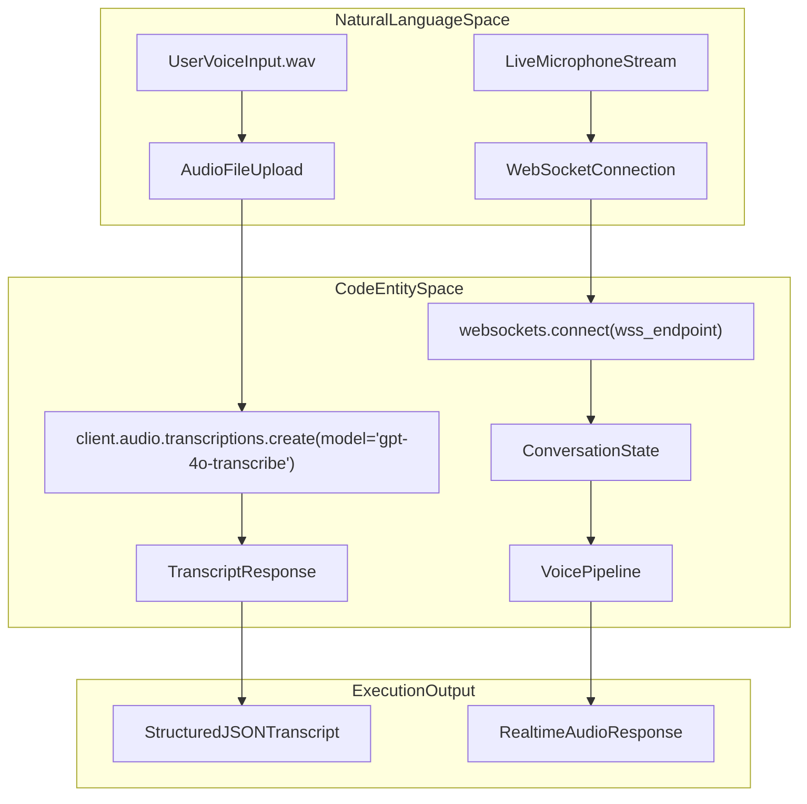
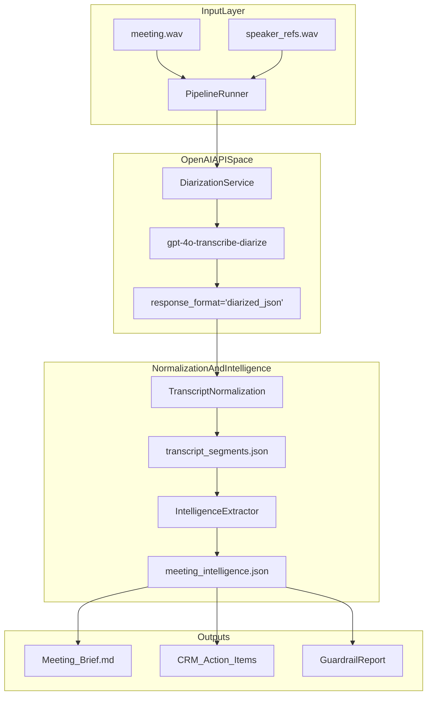
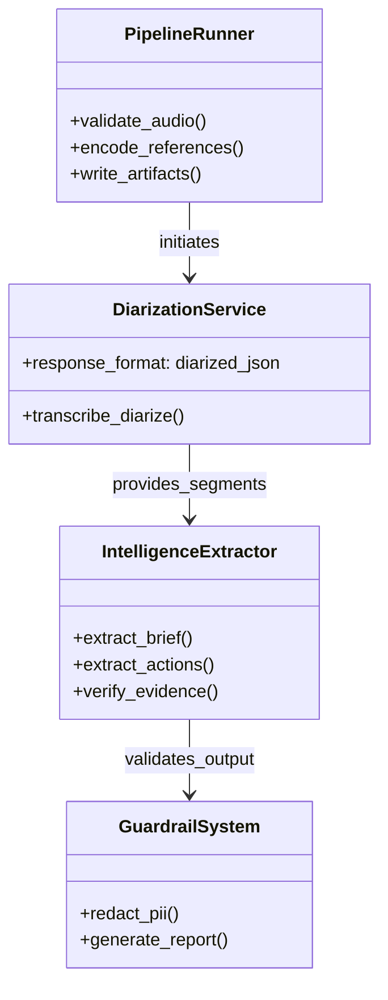

<!-- source: DeepWiki mcp.deepwiki.com · repo openai/openai-cookbook · page 9.4 Audio, Speech, and Whisper · fetched 2026-10-26 -->

# Audio, Speech, and Whisper

Relevant source files

The following files were used as context for generating this wiki page:

- [articles/chatgpt-agents-sales-meeting-prep.md](articles/chatgpt-agents-sales-meeting-prep.md)
- [examples/Context_summarization_with_realtime_api.ipynb](examples/Context_summarization_with_realtime_api.ipynb)
- [examples/How_to_handle_rate_limits.ipynb](examples/How_to_handle_rate_limits.ipynb)
- [examples/Leveraging_model_distillation_to_fine-tune_a_model.ipynb](examples/Leveraging_model_distillation_to_fine-tune_a_model.ipynb)
- [examples/Prompt_migration_guide.ipynb](examples/Prompt_migration_guide.ipynb)
- [examples/Reinforcement_Fine_Tuning.ipynb](examples/Reinforcement_Fine_Tuning.ipynb)
- [examples/Speech_transcription_methods.ipynb](examples/Speech_transcription_methods.ipynb)
- [examples/Structured_Outputs_Intro.ipynb](examples/Structured_Outputs_Intro.ipynb)
- [examples/Structured_outputs_multi_agent.ipynb](examples/Structured_outputs_multi_agent.ipynb)
- [examples/Whisper_correct_misspelling.ipynb](examples/Whisper_correct_misspelling.ipynb)
- [examples/Whisper_processing_guide.ipynb](examples/Whisper_processing_guide.ipynb)
- [examples/Whisper_prompting_guide.ipynb](examples/Whisper_prompting_guide.ipynb)
- [examples/codex/using_goals_in_codex.ipynb](examples/codex/using_goals_in_codex.ipynb)
- [examples/gpt-5/gpt-5_frontend.ipynb](examples/gpt-5/gpt-5_frontend.ipynb)
- [examples/mcp/mcp_tool_guide.ipynb](examples/mcp/mcp_tool_guide.ipynb)
- [examples/partners/eval_driven_system_design/receipt_inspection.ipynb](examples/partners/eval_driven_system_design/receipt_inspection.ipynb)
- [examples/partners/mcp_powered_voice_agents/mcp_powered_agents_cookbook.ipynb](examples/partners/mcp_powered_voice_agents/mcp_powered_agents_cookbook.ipynb)
- [images/agents_sdk_transcription.png](images/agents_sdk_transcription.png)
- [images/prompt_migrator_fig.png](images/prompt_migrator_fig.png)
- [images/realtime_api_transcription.png](images/realtime_api_transcription.png)
- [images/rft_dashboard_modelgrader2.png](images/rft_dashboard_modelgrader2.png)
- [images/rft_hacking.png](images/rft_hacking.png)
- [images/rft_string_grader.png](images/rft_string_grader.png)
- [images/speech-to-text-not-streaming.png](images/speech-to-text-not-streaming.png)
- [images/speech-to-text-streaming.png](images/speech-to-text-streaming.png)
- [images/text-vs-audio-tokens.png](images/text-vs-audio-tokens.png)

This page documents the capabilities and implementation patterns for audio processing using OpenAI's models, focusing on the **Whisper** model for transcription, audio pre/post-processing, advanced speaker-aware intelligence pipelines, and real-time streaming alternatives. It covers transcription optimization, prompt engineering for audio, error correction, migration to newer transcription engines (`gpt-4o-transcribe` and Realtime APIs), and architectural patterns for meeting intelligence.

---

## 1. Whisper Speech Transcription and Processing Guide

Whisper is a general-purpose speech recognition model capable of transcribing audio into text. The OpenAI API provides the `whisper-1` model via the `audio.transcriptions` endpoint [examples/Whisper_prompting_guide.ipynb:112-117]().

### Basic Transcription Pattern
A standard transcription request requires passing an open audio file handle and the model identifier.
*   **Key Function**: `client.audio.transcriptions.create()` [examples/Whisper_prompting_guide.ipynb:112-117]()
*   **Supported Formats**: mp3, mp4, mpeg, mpga, m4a, wav, and webm [examples/Speech_transcription_methods.ipynb:134-134]()
*   **File Size Limit**: 25 MB per request [examples/Speech_transcription_methods.ipynb:29-29]()

### Transcription Processing Pipeline
To maximize accuracy, raw audio often undergoes pre-processing (such as silence trimming) and post-processing (formatting and symbol correction).

| Phase | Action / Function | Purpose |
| :--- | :--- | :--- |
| **Pre-processing** | `milliseconds_until_sound` | Detects leading silence to prevent Whisper from misinterpreting initial noise [examples/Whisper_processing_guide.ipynb:100-108]() |
| **Pre-processing** | `trim_start` | Slices audio using `pydub` to remove detected silence [examples/Whisper_processing_guide.ipynb:116-126]() |
| **Post-processing** | `remove_non_ascii` | Mitigates Unicode character injection in raw transcripts [examples/Whisper_processing_guide.ipynb:159-160]() |
| **Post-processing** | `punctuation_assistant` | Uses a Chat Completion model (e.g., `gpt-3.5-turbo`) to inject punctuation, capitalization, and formatting [examples/Whisper_processing_guide.ipynb:178-216]() |

Sources: [examples/Whisper_prompting_guide.ipynb:112-117](), [examples/Whisper_processing_guide.ipynb:100-216]()

---

## 2. Whisper Prompting and Misspelling Correction

Unlike LLMs, Whisper's `prompt` parameter is designed to provide contextual cues or steer output style/spelling rather than act as a conversational instruction. It is strictly limited to **224 tokens** using the multilingual Whisper tokenizer [examples/Whisper_prompting_guide.ipynb:27-27](). Tokens exceeding this limit are silently ignored.

### Steering Techniques
1.  **Context Stitching**: Providing the transcript of a preceding audio segment maintains continuity across chunked files [examples/Whisper_prompting_guide.ipynb:12-12]().
2.  **Spelling Guides**: Passing a comma-separated list of proper nouns, company names, or technical terms ensures correct spelling [examples/Whisper_prompting_guide.ipynb:19-19]().
3.  **Fictitious Prompts**: Submitting styled text forces Whisper to emulate capitalization and punctuation styles [examples/Whisper_prompting_guide.ipynb:156-157]().

### Addressing Transcription Misspellings
Specialized product or company names (e.g., "ZyntriQix") are frequently misspelled by default [examples/Whisper_correct_misspelling.ipynb:149-154](). A dual-strategy resolves this:
*   **Prompt Steering**: Including the correct vocabulary directly in the `prompt` argument of `client.audio.transcriptions.create()` [examples/Whisper_correct_misspelling.ipynb:149-154]().
*   **GPT Post-Processing**: Passing the raw transcript to a Chat Completion model with a system prompt containing the target dictionary to perform find-and-replace corrections [examples/Whisper_correct_misspelling.ipynb:185-215]().

Sources: [examples/Whisper_prompting_guide.ipynb:27-157](), [examples/Whisper_correct_misspelling.ipynb:149-215]()

---

## 3. Transcription Method Comparison: Streaming vs. Non-Streaming

Applications require different trade-offs between latency, cost, and interactivity. The OpenAI ecosystem supports multiple transcription modalities.

### Method Matrix

| Mode | Latency to First Token | Best Use Case | Advantages | Key Limitations |
| :--- | :--- | :--- | :--- | :--- |
| **File Upload (`stream=False`)** | Seconds | Voicemails, batch meeting recordings | Simple HTTP integration, full context accuracy | No partial results; 25 MB file size limit [examples/Speech_transcription_methods.ipynb:29-29]() |
| **File Upload (`stream=True`)** | Sub-seconds | Mobile voice memos | Token streaming for live UI feel | Requires completed file upload; manual chunking needed [examples/Speech_transcription_methods.ipynb:30-30]() |
| **Realtime WebSocket** | Sub-seconds | Live webinar captions, voice bots | True real-time bidirectional audio stream | Requires PCM16/G.711 encoding; session limits [examples/Speech_transcription_methods.ipynb:31-31]() |
| **Agents SDK `VoicePipeline`** | Sub-seconds | Internal help-desk voice agents | Native agentic integration and streaming | Python-only beta dependency [examples/Speech_transcription_methods.ipynb:32-32]() |

### Migration to Modern Engines (`gpt-4o-transcribe` and Realtime)
Older workflows relying solely on `whisper-1` batch file uploads can be migrated to `gpt-4o-transcribe` for enhanced instruction-following or moved to WebSocket-based Realtime sessions (`gpt-realtime`) for sub-second bidirectional voice interactions [examples/Speech_transcription_methods.ipynb:131-131]().

**Transcription Pipeline Architecture (Natural Language to Code Entity Space)**

Sources: [examples/Speech_transcription_methods.ipynb:27-34](), [examples/Speech_transcription_methods.ipynb:130-161](), [examples/Context_summarization_with_realtime_api.ipynb:138-154]()

---

## 4. Speaker-Aware Meeting Intelligence with Diarization

For complex workflows like sales discovery calls or compliance audits, plain transcripts lack speaker attribution and actionable structure. The **Speaker-Aware Meeting Intelligence** pipeline combines diarization with structured extraction [examples/audio/speaker_aware_meeting_intelligence/speaker_aware_meeting_intelligence.ipynb:7-7]().

### Pipeline Data Flow

**Meeting Intelligence Pipeline Data Flow**

Sources: [examples/audio/speaker_aware_meeting_intelligence/speaker_aware_meeting_intelligence.ipynb:13-13](), [examples/audio/speaker_aware_meeting_intelligence/images/architecture.svg:1-120]()

### Implementation Components
1.  **`PipelineRunner`**: Validates input audio files, encodes speaker reference snippets, and manages output artifact persistence [examples/audio/speaker_aware_meeting_intelligence/speaker_aware_meeting_intelligence.ipynb:13-13]().
2.  **`DiarizationService`**: Invokes `gpt-4o-transcribe-diarize` with `chunking_strategy="auto"` to produce structured, speaker-attributed JSON blocks [examples/audio/speaker_aware_meeting_intelligence/speaker_aware_meeting_intelligence.ipynb:13-13]().
3.  **`IntelligenceExtractor`**: Uses the Responses API to parse decisions, risks, and action items with traceable segment references [examples/audio/speaker_aware_meeting_intelligence/speaker_aware_meeting_intelligence.ipynb:13-13]().
4.  **`GuardrailSystem`**: Applies regex PII redaction (emails, phone numbers) and verifies evidence anchors prior to downstream writes [examples/audio/speaker_aware_meeting_intelligence/speaker_aware_meeting_intelligence.ipynb:25-25]().

### Code Entity Association

**Meeting Intelligence Entity Mapping**

Sources: [examples/audio/speaker_aware_meeting_intelligence/speaker_aware_meeting_intelligence.ipynb:13-25]()

### Security and Data Retention
Meeting intelligence pipelines handle sensitive enterprise payloads. Developers should explicitly set `store=False` on API requests when operating under Zero Data Retention (ZDR) policies, and ensure structured outputs retain segment IDs and timestamps for human auditability [examples/audio/speaker_aware_meeting_intelligence/speaker_aware_meeting_intelligence.ipynb:19-25]().

Sources: [examples/audio/speaker_aware_meeting_intelligence/speaker_aware_meeting_intelligence.ipynb:19-25]()

---

