# Page: Overview

# Overview

<details>
<summary>Relevant source files</summary>

The following files were used as context for generating this wiki page:

- [.github/authors_schema.json](.github/authors_schema.json)
- [.github/pull_request_template.md](.github/pull_request_template.md)
- [.github/registry_schema.json](.github/registry_schema.json)
- [CONTRIBUTING.md](CONTRIBUTING.md)
- [README.md](README.md)
- [articles/how_to_work_with_large_language_models.md](articles/how_to_work_with_large_language_models.md)
- [articles/related_resources.md](articles/related_resources.md)
- [articles/techniques_to_improve_reliability.md](articles/techniques_to_improve_reliability.md)
- [articles/text_comparison_examples.md](articles/text_comparison_examples.md)
- [articles/what_makes_documentation_good.md](articles/what_makes_documentation_good.md)
- [authors.yaml](authors.yaml)
- [examples/Search_reranking_with_cross-encoders.ipynb](examples/Search_reranking_with_cross-encoders.ipynb)
- [examples/agents_sdk/building_reliable_agents_memory_compaction.ipynb](examples/agents_sdk/building_reliable_agents_memory_compaction.ipynb)
- [examples/agents_sdk/context_personalization.ipynb](examples/agents_sdk/context_personalization.ipynb)
- [examples/agents_sdk/session_memory.ipynb](examples/agents_sdk/session_memory.ipynb)
- [examples/completions_usage_api.ipynb](examples/completions_usage_api.ipynb)
- [examples/evaluation/moving-from-openai-evals-to-promptfoo.md](examples/evaluation/moving-from-openai-evals-to-promptfoo.md)
- [examples/gpt-5/prompt_personalities.ipynb](examples/gpt-5/prompt_personalities.ipynb)
- [examples/gpt4-1_prompting_guide.ipynb](examples/gpt4-1_prompting_guide.ipynb)
- [examples/skills_in_api.ipynb](examples/skills_in_api.ipynb)
- [examples/voice_solutions/arduino_ai_speech_assets/elato-alien.png](examples/voice_solutions/arduino_ai_speech_assets/elato-alien.png)
- [examples/voice_solutions/arduino_ai_speech_assets/pcb-design.png](examples/voice_solutions/arduino_ai_speech_assets/pcb-design.png)
- [images/memory_comparison.jpg](images/memory_comparison.jpg)
- [images/openai-cookbook-white.png](images/openai-cookbook-white.png)
- [images/openai-cookbook.png](images/openai-cookbook.png)
- [images/promptfoo-custom-example-view.png](images/promptfoo-custom-example-view.png)
- [images/summarizingSession.jpg](images/summarizingSession.jpg)
- [images/trimingSession.jpg](images/trimingSession.jpg)
- [registry.yaml](registry.yaml)

</details>


The OpenAI Cookbook is a community-driven collection of executable code examples, articles, and guides demonstrating common patterns and use cases for the OpenAI API platform [README.md:12-15](). The repository serves as a reference implementation library, showing developers how to build applications using chat completions, embeddings, function calling, fine-tuning, multimodal inputs, and agentic workflows [README.md:12-15]().

All content is published to [cookbook.openai.com](https://cookbook.openai.com) through a registry-based content management system defined in `registry.yaml` [registry.yaml:3-5](). The repository provides both conceptual articles in markdown and runnable examples in Jupyter notebooks covering the full OpenAI API surface [README.md:12-15]().

Sources: [README.md:12-15](), [registry.yaml:3-5]()

## Repository Architecture

The repository uses a declarative content manifest to control what appears on the cookbook website. All discoverable content must be registered in `registry.yaml` with metadata including title, path, tags, authors, and publication date [registry.yaml:7-17]().

### Manifest and Publication Flow
Title: "RepositoryDataFlow"

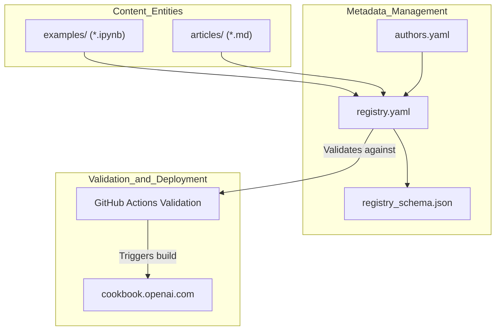
Sources: [registry.yaml:1-5](), [authors.yaml:1-5](), [.github/registry_schema.json:1-48]()

### Key Files and Directories

| Path | Purpose | Key References |
|------|---------|------------|
| `registry.yaml` | Manifest of all published content with metadata | [registry.yaml:1-5]() |
| `authors.yaml` | Author profile customizations (name, website, avatar) | [authors.yaml:1-194]() |
| `examples/` | Executable Jupyter notebooks demonstrating API usage | [registry.yaml:8]() |
| `articles/` | Educational markdown guides | [registry.yaml:22]() |
| `.github/registry_schema.json` | JSON Schema for validating registry entries | [registry.yaml:1]() |
| `.github/pull_request_template.md` | Quality rubric checklist for contributions | [.github/pull_request_template.md:11-24]() |

Sources: [registry.yaml:1-153](), [authors.yaml:1-194](), [.github/pull_request_template.md:1-24]()

## Content Organization and Metadata

Content entries in `registry.yaml` follow a strict JSON schema defined in [.github/registry_schema.json:1-48]() to ensure proper rendering on the web portal [registry.yaml:1-5]().

Required fields per entry include `title`, `path`, `slug`, `tags`, and `authors` [.github/registry_schema.json:45](). Tags serve as the primary content categorization mechanism.

Sources: [registry.yaml:1-5](), [.github/registry_schema.json:1-48]()

## API and Model Coverage

The cookbook covers primary OpenAI API endpoints and model families through targeted examples and guides.

### Chat, Reasoning, and Skills
- **GPT-4.1 Prompting:** Focuses on instruction following, multi-message turns, and agentic workflows using `System Prompt Reminders` for persistence and tool-calling [examples/gpt4-1_prompting_guide.ipynb:7-47]().
- **Skills API:** Demonstrates packaging workflows into a folder structure anchored by a required `SKILL.md` manifest, uploaded and run with hosted shell environments (`environment.type="container_auto"`) [examples/skills_in_api.ipynb:12-45]().

### Agentic Frameworks
The cookbook extensively documents the **OpenAI Agents SDK** for building adaptive collaborators using `RunContextWrapper` for state management [examples/agents_sdk/context_personalization.ipynb:18-25]() and `Session` memory objects with `Runner.run()` [examples/agents_sdk/session_memory.ipynb:40-50]().

Title: "AgentMemoryEntityMapping"
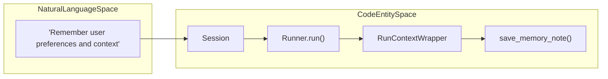
Sources: [examples/agents_sdk/context_personalization.ipynb:18-106](), [examples/agents_sdk/session_memory.ipynb:40-50]()

## Major Workflow Patterns

### Retrieval Augmented Generation and Cross-Encoders
The cookbook outlines bi-encoder retrieval combined with cross-encoder re-ranking using GPT models and libraries like `arxiv` and `tenacity` [examples/Search_reranking_with_cross-encoders.ipynb:10-30]().

Title: "SearchRerankingEntityMapping"
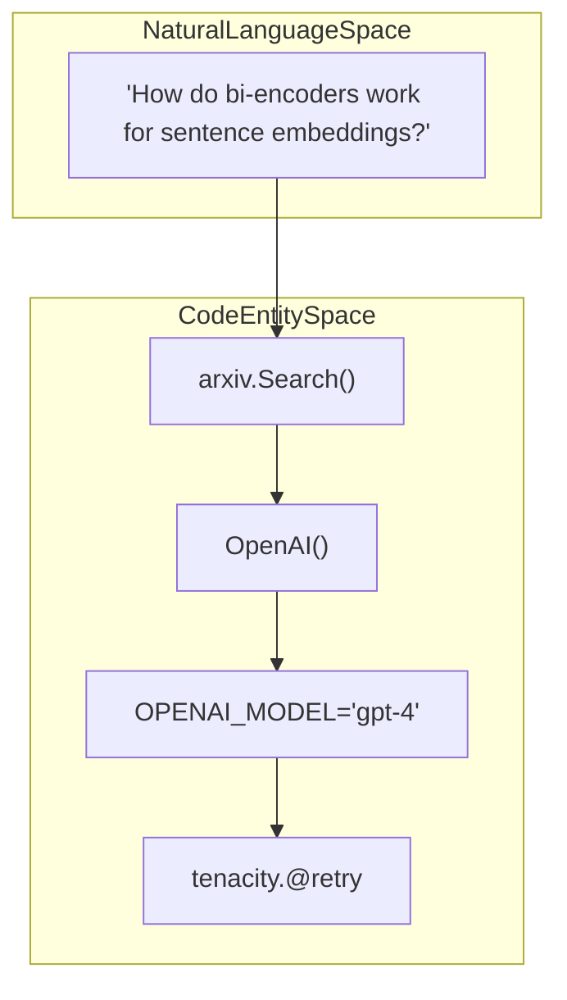
Sources: [examples/Search_reranking_with_cross-encoders.ipynb:28-65]()

### Agentic Context Engineering
Modern agentic patterns utilize **Context Trimming** (dropping older turns) and **Context Summarization** (compressing history) via the `Session` object to maintain coherence across long-running sessions [examples/agents_sdk/session_memory.ipynb:40-69]().

Sources: [examples/agents_sdk/session_memory.ipynb:40-108]()

## Contribution and Quality Standards

The repository maintains strict standards for community contributions. Contributors must perform a self-review against a standardized rubric covering relevance, uniqueness, spelling, grammar, clarity, correctness, and completeness [.github/pull_request_template.md:11-24](). New entries must be added to `registry.yaml` and validated against schema constraints [CONTRIBUTING.md:15-18]().

Sources: [.github/pull_request_template.md:11-24](), [CONTRIBUTING.md:15-35]()

---

# Page: Repository Structure and Contribution Guidelines

# Repository Structure and Contribution Guidelines

<details>
<summary>Relevant source files</summary>

The following files were used as context for generating this wiki page:

- [.github/authors_schema.json](.github/authors_schema.json)
- [.github/pull_request_template.md](.github/pull_request_template.md)
- [.github/registry_schema.json](.github/registry_schema.json)
- [.github/scripts/check_notebooks.py](.github/scripts/check_notebooks.py)
- [.github/workflows/stale.yaml](.github/workflows/stale.yaml)
- [.github/workflows/validate-notebooks.yaml](.github/workflows/validate-notebooks.yaml)
- [CONTRIBUTING.md](CONTRIBUTING.md)
- [README.md](README.md)
- [examples/data/scifact_claims.jsonl](examples/data/scifact_claims.jsonl)
- [examples/data/scifact_corpus.jsonl](examples/data/scifact_corpus.jsonl)
- [examples/vector_databases/chroma/hyde-with-chroma-and-openai.ipynb](examples/vector_databases/chroma/hyde-with-chroma-and-openai.ipynb)
- [images/openai-cookbook-white.png](images/openai-cookbook-white.png)
- [images/openai-cookbook.png](images/openai-cookbook.png)

</details>


## Purpose and Scope

This page documents the **file organization**, **contribution process**, **quality standards**, and **validation mechanisms** for the OpenAI Cookbook repository (`https://github.com/openai/openai-cookbook`). It covers how content is structured, how new contributions are submitted and reviewed, and how content metadata is managed through the registry system for publication to `cookbook.openai.com`.

Sources: [README.md:12-16](), [CONTRIBUTING.md:1-3]()

---

## Repository Structure Overview

The OpenAI Cookbook follows a registry-driven architecture where all publishable content must be declared in `registry.yaml`. The repository is organized into distinct content directories, configuration files, and community infrastructure.

### High-Level Directory Layout

Title: "RepositoryFileHierarchyAndPublishingFlow"
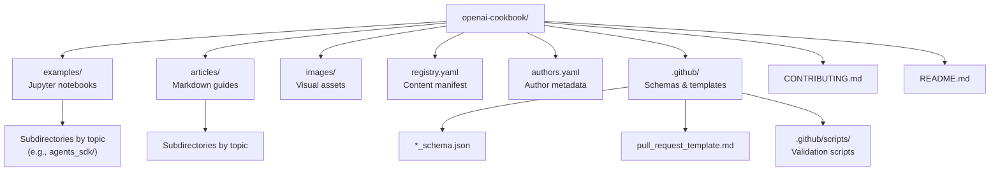

Sources: [README.md:1-20](), [CONTRIBUTING.md:15-20](), [.github/workflows/validate-notebooks.yaml:1-25](), [CONTRIBUTING.md:18]()

---

## Core Files and Their Roles

### Content Registry (`registry.yaml`)

The **central manifest** for all published content. Each entry represents a single page on `cookbook.openai.com`. The file uses a YAML language server schema for validation.

**Structure:**
- Array of content objects [,.github/registry_schema.json:3-4]().
- Each object must include: `title`, `path`, `slug`, `tags`, and `authors` [.github/registry_schema.json:45]().
- Optional fields: `description`, `date`, `redirects`, `archived` [.github/registry_schema.json:6-43]().

**Key Properties:**
- **`title`**: Display name on the website [.github/registry_schema.json:7-9]().
- **`path`**: Relative file path from repository root [.github/registry_schema.json:10-12]().
- **`slug`**: URL-friendly identifier used for the website path [.github/registry_schema.json:13-15]().
- **`tags`**: Searchability and categorization [.github/registry_schema.json:25-30]().
- **`authors`**: GitHub usernames that map to keys in `authors.yaml` [.github/registry_schema.json:31-36]().
- **`date`**: Publication date in YYYY-MM-DD format [.github/registry_schema.json:37-40]().

Sources: [CONTRIBUTING.md:18](), [.github/registry_schema.json:1-48]()

---

### Author Metadata (`authors.yaml`)

Customizes author display information beyond default GitHub profile data.

**Structure:**
- Map of GitHub username to author metadata object [.github/authors_schema.json:4-5]().
- Key fields: `name`, `website`, `avatar` [.github/authors_schema.json:6-18]().

**Validation Constraints:**
- `website` and `avatar` must be valid URIs [.github/authors_schema.json:11-18]().
- No additional properties are allowed per author entry [.github/authors_schema.json:21]().

Sources: [CONTRIBUTING.md:19](), [.github/authors_schema.json:1-25]()

---

### Entry Point (`README.md`)

The **user-facing introduction** to the repository, providing setup instructions and licensing information.

**Contents:**
- Link to the live cookbook at `cookbook.openai.com` [README.md:1-10]().
- Instructions for setting the `OPENAI_API_KEY` environment variable [README.md:12]().
- Guidance on using `.env` files for local development in IDEs like Visual Studio Code [README.md:12]().
- Licensing under the MIT License [README.md:18-20]().

Sources: [README.md:1-20]()

---

## Contribution Guidelines and Quality Rubric

The repository uses a pull request template to enforce quality standards through a **self-review checklist**. Contributions are reviewed on a best-effort basis [CONTRIBUTING.md:5]().

**Quality Rubric Dimensions (Scale 1-4, minimum 3 required):**

| Dimension | Description |
|-----------|-------------|
| **Relevance** | Content is related to building with OpenAI technologies and is useful to others [.github/pull_request_template.md:17](). |
| **Uniqueness** | Verified that content offers new insights compared to existing documentation [.github/pull_request_template.md:18](). |
| **Spelling/Grammar** | Checked for spelling or grammatical mistakes [.github/pull_request_template.md:19](). |
| **Clarity** | Verified that the submission is well-organized and easy to understand [.github/pull_request_template.md:20](). |
| **Correctness** | Information is correct and all code executes successfully [.github/pull_request_template.md:21](). |
| **Completeness** | Explained fully, including all necessary references and citations [.github/pull_request_template.md:22](). |

Sources: [.github/pull_request_template.md:1-24](), [CONTRIBUTING.md:40-52]()

---

## Content Organization and Automated Validation

### Directory Patterns

- **`examples/`**: Contains executable Jupyter notebooks (`.ipynb`) and specific implementation guides organized by topic [CONTRIBUTING.md:17]().
- **`articles/`**: Contains Markdown guides for broader architectural or cost management topics [CONTRIBUTING.md:17]().
- **`images/`**: Visual assets used in the documentation, including logos and diagrams [CONTRIBUTING.md:17]().
- **`examples/data/`**: Datasets used by notebooks for demonstrations, such as `.jsonl` files for RAG or fine-tuning examples [examples/data/scifact_corpus.jsonl:1-4]().

### Automated Validation Workflow

The repository employs GitHub Actions to ensure code quality and schema compliance.

Title: "CIValidationAndSchemaEnforcement"
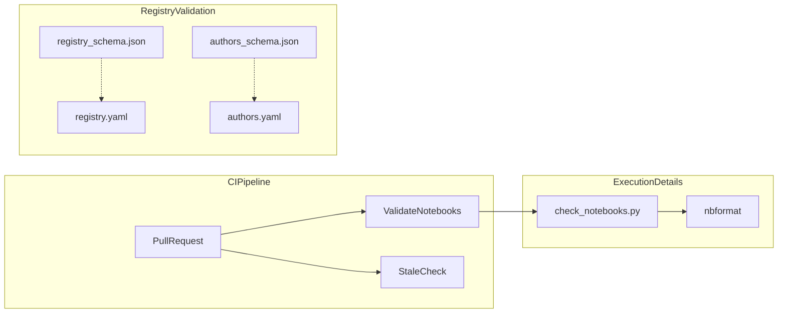

Sources: [.github/workflows/validate-notebooks.yaml:1-25](), [.github/workflows/stale.yaml:1-19](), [.github/registry_schema.json:1-48]()

---

## Contribution Workflow and Stale Policy

### Step-by-Step Process

1. **Develop Content**: Create a Jupyter notebook or Markdown file following technical standards. Read credentials from environment variables such as `OPENAI_API_KEY` [CONTRIBUTING.md:22-34]().
2. **Add Registry Entry**: Update `registry.yaml` with a new object containing the required properties [CONTRIBUTING.md:18]().
3. **Add Author Info**: If you are a new contributor, add your details to `authors.yaml` [CONTRIBUTING.md:19]().
4. **Submit Pull Request**: Fill out the summary and motivation sections of the PR template [.github/pull_request_template.md:1-8]().
5. **Self-Review**: Complete the mandatory checklist in the PR description, ensuring all rubric areas score 3 or higher [.github/pull_request_template.md:11-24]().

### Stale Policy
Issues and PRs are automatically monitored. If there is no activity for 60 days, they are marked as stale; after another 10 days of inactivity, they are closed [.github/workflows/stale.yaml:12-19]().

Sources: [CONTRIBUTING.md:22-38](), [.github/pull_request_template.md:1-24](), [.github/workflows/stale.yaml:1-19]()

---

## Technical Validation Implementation

### Notebook Validation
The `Validate Changed Notebooks` workflow runs on `ubuntu-latest` using Python 3.12. It executes the `.github/scripts/check_notebooks.py` script to verify the integrity of changed `.ipynb` files [.github/workflows/validate-notebooks.yaml:8-25]().

### Schema Enforcement
The registry validation ensures that no additional properties are added to content entries (`additionalProperties: false`), maintaining a strict data contract for the publishing system [.github/registry_schema.json:46](). The `registry.yaml` file must follow the schema defined in `.github/registry_schema.json` [.github/registry_schema.json:1-48]().

Sources: [.github/workflows/validate-notebooks.yaml:1-25](), [.github/registry_schema.json:1-48]()

---

# Page: Content Management and Publishing System

# Content Management and Publishing System

<details>
<summary>Relevant source files</summary>

The following files were used as context for generating this wiki page:

- [.github/authors_schema.json](.github/authors_schema.json)
- [.github/pull_request_template.md](.github/pull_request_template.md)
- [.github/registry_schema.json](.github/registry_schema.json)
- [CONTRIBUTING.md](CONTRIBUTING.md)
- [README.md](README.md)
- [authors.yaml](authors.yaml)
- [examples/agents_sdk/building_reliable_agents_memory_compaction.ipynb](examples/agents_sdk/building_reliable_agents_memory_compaction.ipynb)
- [examples/agents_sdk/context_personalization.ipynb](examples/agents_sdk/context_personalization.ipynb)
- [examples/agents_sdk/session_memory.ipynb](examples/agents_sdk/session_memory.ipynb)
- [examples/completions_usage_api.ipynb](examples/completions_usage_api.ipynb)
- [examples/evaluation/moving-from-openai-evals-to-promptfoo.md](examples/evaluation/moving-from-openai-evals-to-promptfoo.md)
- [examples/gpt-5/prompt_personalities.ipynb](examples/gpt-5/prompt_personalities.ipynb)
- [examples/gpt4-1_prompting_guide.ipynb](examples/gpt4-1_prompting_guide.ipynb)
- [examples/skills_in_api.ipynb](examples/skills_in_api.ipynb)
- [images/memory_comparison.jpg](images/memory_comparison.jpg)
- [images/openai-cookbook-white.png](images/openai-cookbook-white.png)
- [images/openai-cookbook.png](images/openai-cookbook.png)
- [images/promptfoo-custom-example-view.png](images/promptfoo-custom-example-view.png)
- [images/summarizingSession.jpg](images/summarizingSession.jpg)
- [images/trimingSession.jpg](images/trimingSession.jpg)
- [registry.yaml](registry.yaml)

</details>


## Purpose and Scope
This section details the content management and publishing system that powers the OpenAI Cookbook repository (`openai/openai-cookbook`) and its published website interface at `cookbook.openai.com` [README.md:1-10](). The system orchestrates content ingestion, metadata organization via `registry.yaml` [registry.yaml:1-5](), contributor attribution via `authors.yaml` [authors.yaml:1-5](), schema validation through `.github/registry_schema.json` and `.github/authors_schema.json` [.github/registry_schema.json:1-48](), and contribution guidelines enforced by pull request templates [.github/pull_request_template.md:1-24]() and validation scripts [CONTRIBUTING.md:26-30]().

Sources: [README.md:1-10](), [registry.yaml:1-5](), [authors.yaml:1-5](), [.github/registry_schema.json:1-48](), [.github/pull_request_template.md:1-24](), [CONTRIBUTING.md:26-30]()

## System Overview
The content management system acts as the core bridge between raw repository assets (`examples/`, `articles/`) and the generated static site output (`cookbook.openai.com`) [README.md:1-10](), [CONTRIBUTING.md:15-20](). It relies on a centralized manifest file (`registry.yaml`) [registry.yaml:3-5]() and an author lookup file (`authors.yaml`) [authors.yaml:3-5](), both validated against strict JSON schemas [.github/registry_schema.json:1-48]().

Title: Content Management Architecture and Data Flow
```mermaid
graph TB
    subgraph NaturalLanguageSpace["Natural Language & Documentation Space"]
        ContentAuthors[""Contributors & Authors"""]
        MarkdownArticles[""Long-form Articles (articles/*.md)"""]
        JupyterNotebooks[""Example Notebooks (examples/*.ipynb)"""]
    end

    subgraph CodeEntitySpace["Code Entity Space & Manifests"]
        RegistryYaml[""registry.yaml Manifest [registry.yaml:3-5]"""]
        AuthorsYaml[""authors.yaml Lookup [authors.yaml:3-5]"""]
        RegistrySchema[""JsonSchemaValidator: .github/registry_schema.json [.github/registry_schema.json:1-48]"""]
        AuthorsSchema[""JsonSchemaValidator: .github/authors_schema.json"""]
    end

    subgraph PublishingPipeline["Publishing Pipeline & Output"]
        SiteGenerator[""WebsiteGenerator: cookbook.openai.com [README.md:1-10]"""]
        NavigationBuilder[""NavigationBuilder: Tag & Category Indices"""]
        SearchIndex[""SearchIndexBuilder: Content Search"""]
    end

    MarkdownArticles --> RegistryYaml
    JupyterNotebooks --> RegistryYaml
    ContentAuthors --> AuthorsYaml

    RegistryYaml --> RegistrySchema
    AuthorsYaml --> AuthorsSchema

    RegistrySchema --> SiteGenerator
    AuthorsSchema --> SiteGenerator
    SiteGenerator --> NavigationBuilder
    SiteGenerator --> SearchIndex
```
Sources: [README.md:1-10](), [registry.yaml:3-5](), [authors.yaml:3-5](), [.github/registry_schema.json:1-48](), [CONTRIBUTING.md:15-20]()

## Content Registry Architecture
The `registry.yaml` file functions as the authoritative content manifest. Each item in the YAML array defines specific metadata fields required to render content items on the website [registry.yaml:1-184]().

Title: Registry Entry Resolution and Schema Mapping
```mermaid
graph LR
    subgraph NaturalLanguageSpace["Content Definition (Natural Language)"]
        EntryTitle[""title: 'Build a prior review assistant' [registry.yaml:20]"""]
        EntryDesc[""description: 'Build and deploy...' [registry.yaml:23]"""]
    end

    subgraph CodeEntitySpace["Registry & Mapping Logic"]
        RegistryEntry[""registry.yaml Entry [registry.yaml:20-35]"""]
        PathField[""path: examples/partners/AWS/... [registry.yaml:21]"""]
        SlugField[""slug: prior-authorization-review-agentcore [registry.yaml:22]"""]
        AuthorsList[""authors: [sks-oai] [registry.yaml:25-26]"""]
        TagsList[""tags: [partners, agents-sdk] [registry.yaml:27-35]"""]
        AuthorsLookup[""authors.yaml Record [authors.yaml:11-14]"""]
    end

    subgraph OutputSpace["Website Target"]
        RenderedPage[""cookbook.openai.com/prior-authorization-review-agentcore [README.md:1-10], [registry.yaml:22]"""]
    end

    EntryTitle --> RegistryEntry
    EntryDesc --> RegistryEntry
    RegistryEntry --> PathField
    RegistryEntry --> SlugField
    RegistryEntry --> AuthorsList
    RegistryEntry --> TagsList
    AuthorsList --> AuthorsLookup
    PathField --> RenderedPage
    AuthorsLookup --> RenderedPage
```
Sources: [README.md:1-10](), [registry.yaml:20-35](), [authors.yaml:11-14]()

## Content Types and Organization
The repository organizes educational content into structured directories under `examples/` and `articles/` [CONTRIBUTING.md:15-20](). Every published piece requires a corresponding entry in `registry.yaml` [CONTRIBUTING.md:18]().

| Content Type | Path Pattern | Example Tags | Purpose |
|--------------|--------------|--------------|---------|
| API Examples | `examples/*.ipynb` | `audio`, `transcription`, `gpt-5` | Practical API usage demonstrations |
| Technical Articles | `articles/*.md` | `responses`, `cost-management` | Conceptual guidance and best practices |
| Partner Content | `examples/partners/` | `partners`, `bedrock`, `promptfoo` | Third-party ecosystem integrations |
| Agents SDK | `examples/agents_sdk/` | `agents-sdk`, `memory`, `personalization` | Framework-specific agentic patterns |
| Codex & Tools | `examples/codex/` | `codex`, `automation`, `planning` | Developer tool and IDE integrations |

Sources: [registry.yaml:7-19](), [registry.yaml:20-35](), [registry.yaml:37-48](), [CONTRIBUTING.md:15-20]()

## Author Management System
The `authors.yaml` file defines custom contributor details (name, website, avatar) [authors.yaml:1-5](). If an author slug specified in `registry.yaml` is absent from `authors.yaml`, the build system falls back to querying the contributor's GitHub profile [authors.yaml:3-4]().

Title: Author Attribution Resolution Pipeline
```mermaid
graph TB
    subgraph NaturalLanguageSpace["Author Profile Metadata"]
        GitHubProfile[""GitHub User Profile (github.com/username)"""]
        CustomAuthor[""Custom Author Entry [authors.yaml:6-10]"""]
    end

    subgraph CodeEntitySpace["Author System Code & Manifests"]
        AuthorsYaml[""authors.yaml [authors.yaml:1-5]"""]
        RegistryAuthorKey[""registry.yaml authors[] [registry.yaml:12-13]"""]
        AuthorSchemaValidation[""authors_schema.json [.github/authors_schema.json]"""]
    end

    subgraph OutputSpace["Website Rendering"]
        AuthorBadge[""Author Profile Card & Link [README.md:1-10]"""]
    end

    GitHubProfile --> AuthorsYaml
    CustomAuthor --> AuthorsYaml
    AuthorsYaml --> AuthorSchemaValidation
    RegistryAuthorKey --> AuthorsYaml
    AuthorsYaml --> AuthorBadge
```
Sources: [registry.yaml:12-13](), [authors.yaml:1-10](), [README.md:1-10]()

## Validation and Schema Enforcement
To maintain repository data hygiene, validation schemas are defined in `.github/registry_schema.json` and `.github/authors_schema.json` [.github/registry_schema.json:1-48](). These schemas enforce required properties (`title`, `path`, `slug`, `tags`, `authors`) [.github/registry_schema.json:45](), date formats [.github/registry_schema.json:37-40](), and prevent additional properties [.github/registry_schema.json:46](). Notebook validation scripts check structure integrity [CONTRIBUTING.md:26-30]().

Sources: [.github/registry_schema.json:1-48](), [CONTRIBUTING.md:22-35]()

## Content Lifecycle Management
Content moves through distinct lifecycle phases from local development to production publication:
- **Draft:** Developed locally in `examples/` or `articles/` without a `registry.yaml` entry.
- **Review:** Submitted via pull request using the pull request template [.github/pull_request_template.md:1-24](), verified against the contribution rubric (Relevance, Uniqueness, Spelling/Grammar, Clarity, Correctness, Completeness) [CONTRIBUTING.md:40-50](), and validated with structure scripts [CONTRIBUTING.md:26-30]().
- **Published:** Registered in `registry.yaml` with required metadata and rendered on `cookbook.openai.com` [registry.yaml:3-5](), [README.md:1-10]().

Sources: [.github/pull_request_template.md:1-24](), [CONTRIBUTING.md:26-50](), [registry.yaml:3-5]()

## Publishing and Website Generation
The publishing pipeline transforms raw Markdown, notebooks, and YAML registry definitions into the static site hosted at `cookbook.openai.com` [README.md:1-10](), [registry.yaml:3-5]().

Sources: [README.md:1-10](), [registry.yaml:3-5]()

---

# Page: Chat Completions and Prompting

# Chat Completions and Prompting

<details>
<summary>Relevant source files</summary>

The following files were used as context for generating this wiki page:

- [examples/How_to_combine_GPT4o_with_RAG_Outfit_Assistant.ipynb](examples/How_to_combine_GPT4o_with_RAG_Outfit_Assistant.ipynb)
- [examples/How_to_stream_completions.ipynb](examples/How_to_stream_completions.ipynb)
- [examples/How_to_use_guardrails.ipynb](examples/How_to_use_guardrails.ipynb)
- [examples/How_to_use_moderation.ipynb](examples/How_to_use_moderation.ipynb)
- [examples/SDG1.ipynb](examples/SDG1.ipynb)
- [examples/Tag_caption_images_with_GPT4V.ipynb](examples/Tag_caption_images_with_GPT4V.ipynb)
- [examples/batch_processing.ipynb](examples/batch_processing.ipynb)
- [examples/chatgpt/gpt_actions_library/gpt_action_zapier.ipynb](examples/chatgpt/gpt_actions_library/gpt_action_zapier.ipynb)
- [examples/data/imdb_top_1000.csv](examples/data/imdb_top_1000.csv)
- [examples/gpt-5/codex_prompting_guide.ipynb](examples/gpt-5/codex_prompting_guide.ipynb)
- [examples/gpt-5/gpt-5-1_prompting_guide.ipynb](examples/gpt-5/gpt-5-1_prompting_guide.ipynb)
- [examples/gpt-5/gpt-5_troubleshooting_guide.ipynb](examples/gpt-5/gpt-5_troubleshooting_guide.ipynb)
- [examples/gpt4o/data/keynote_recap.mp3](examples/gpt4o/data/keynote_recap.mp3)
- [examples/gpt4o/introduction_to_gpt4o.ipynb](examples/gpt4o/introduction_to_gpt4o.ipynb)
- [examples/stripe_model_eval/selecting_a_model_based_on_stripe_conversion.ipynb](examples/stripe_model_eval/selecting_a_model_based_on_stripe_conversion.ipynb)
- [images/elbow_chart.png](images/elbow_chart.png)
- [images/stripe_eval_diagram.png](images/stripe_eval_diagram.png)
- [images/zapier_action_config.png](images/zapier_action_config.png)
- [images/zapier_ai_actions.png](images/zapier_ai_actions.png)

</details>


This page provides an overview of OpenAI's chat completion APIs, model families, and prompting strategies covered in the cookbook, linking to specialized child pages for deep technical dives. 

For fundamental message formatting, streaming, token management, and moderation, see [Basic Patterns and API Usage](#4.1). For GPT-5 model series specifics and reasoning parameters, see [GPT-5 Model Family and Reasoning Modes](#4.2). For advanced prompt reliability techniques like chain-of-thought and self-consistency, see [Prompting Techniques for Reliability](#4.3). For stateful interactions and hosted tools, see [Responses API](#4.4).

## Chat Completion APIs and Endpoints

OpenAI provides multiple APIs for text generation and interaction, each tailored to different latency, statefulness, and reasoning requirements.

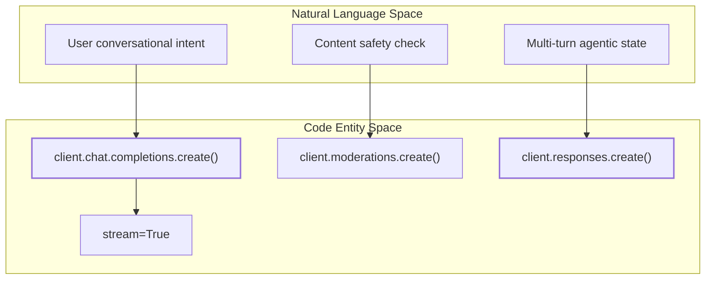
**API Endpoint Selection and Code Entities**

### Chat Completions API
The traditional interface (`client.chat.completions.create`) handles standard conversational and completion tasks using structured messages (`system`, `user`, `assistant`, `tool`) [examples/How_to_format_inputs_to_ChatGPT_models.ipynb:57-63](). It supports real-time streaming via `stream=True` [examples/How_to_stream_completions.ipynb:16-17]() and safety guardrails through input/output moderation tasks (`client.moderations.create`) [examples/How_to_use_moderation.ipynb:91-93]().

### Responses API
As a modern alternative to Chat Completions, the Responses API manages multi-turn stateful interactions, persistent reasoning items, and hosted server-side tools [examples/gpt-5/gpt-5_new_params_and_tools.ipynb:30-30](). 

For implementation details, see [Basic Patterns and API Usage](#4.1) and [Responses API](#4.4).

Sources: [examples/How_to_format_inputs_to_ChatGPT_models.ipynb:57-63](), [examples/How_to_stream_completions.ipynb:16-17](), [examples/How_to_use_moderation.ipynb:91-93](), [examples/gpt-5/gpt-5_new_params_and_tools.ipynb:30-30]().

## Model Families and Capabilities

The cookbook covers several distinct model families optimized for different scales and tasks:

- **GPT-4o and GPT-4o mini**: Natively multimodal models capable of processing text, images, and audio natively [examples/gpt4o/introduction_to_gpt4o.ipynb:7-9](). `gpt-4o-mini` offers high speed and cost efficiency while outperforming earlier iterations [examples/gpt4o/introduction_to_gpt4o.ipynb:14-16]().
- **GPT-5 Model Family**: Includes `gpt-5`, `gpt-5.1`, `gpt-5.2`, and `gpt-5.3-codex`, introducing advanced developer controls such as adjustable `reasoning_effort` and `verbosity` parameters [examples/gpt-5/gpt-5_new_params_and_tools.ipynb:18-78](), along with native coding tools like `apply_patch` [examples/gpt-5/codex_prompting_guide.ipynb:30-30]().

For deep dives into model-specific behaviors, see [GPT-5 Model Family and Reasoning Modes](#4.2).

Sources: [examples/gpt4o/introduction_to_gpt4o.ipynb:7-16](), [examples/gpt-5/gpt-5_new_params_and_tools.ipynb:18-78](), [examples/gpt-5/codex_prompting_guide.ipynb:30-30]().

## Prompting Strategies and Parameter Tuning

Effective prompt design bridges natural language instructions to precise API parameters and system controls.

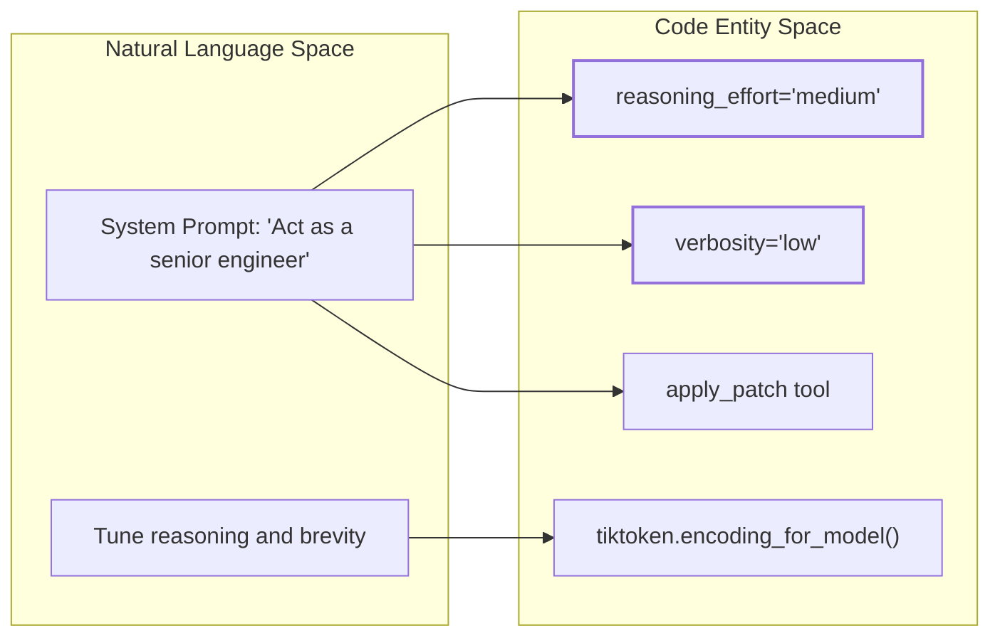
### Prompting Strategies to Model Parameters

Core prompting patterns covered across the cookbook include:
- **Calibrating Agentic Autonomy**: Preventing over-deference and encouraging persistence through explicit system prompt blocks [examples/gpt-5/gpt-5_troubleshooting_guide.ipynb:78-83]().
- **Token Budgeting**: Using `tiktoken` encoders to inspect context window usage and manage token limits [examples/How_to_combine_GPT4o_with_RAG_Outfit_Assistant.ipynb:138-141]().
- **Guardrails Integration**: Running asynchronous moderation or topical guardrails checks in parallel with completion requests [examples/How_to_use_moderation.ipynb:108-115](), [examples/How_to_use_guardrails.ipynb:59-63]().

For advanced prompting methodologies, see [Prompting Techniques for Reliability](#4.3).

Sources: [examples/gpt-5/gpt-5_troubleshooting_guide.ipynb:78-83](), [examples/How_to_combine_GPT4o_with_RAG_Outfit_Assistant.ipynb:138-141](), [examples/How_to_use_moderation.ipynb:108-115](), [examples/How_to_use_guardrails.ipynb:59-63]().

## Troubleshooting and Optimization

| Issue | Root Cause | Code-level Solution |
| :--- | :--- | :--- |
| **High Latency** | Oversized reasoning effort or synchronous waiting | Set `stream=True` [examples/How_to_stream_completions.ipynb:16-17]() or `reasoning_effort="minimal"` [examples/gpt-5/gpt-5_troubleshooting_guide.ipynb:22-22]() |
| **Model Overthinking** | Lack of clear stop conditions on trivial tasks | Configure fast-paths or reduce `reasoning_effort` [examples/gpt-5/gpt-5_troubleshooting_guide.ipynb:20-22]() |
| **Agent Inaction** | Overly deferential default behavior in prompts | Add explicit `<persistence>` blocks in system instructions [examples/gpt-5/gpt-5_troubleshooting_guide.ipynb:78-83]() |
| **Rate Limit Exceeded** | Burst traffic patterns against API limits | Implement exponential backoff via `tenacity` [examples/How_to_combine_GPT4o_with_RAG_Outfit_Assistant.ipynb:67-67]() |

Sources: [examples/How_to_stream_completions.ipynb:16-17](), [examples/gpt-5/gpt-5_troubleshooting_guide.ipynb:20-83](), [examples/How_to_combine_GPT4o_with_RAG_Outfit_Assistant.ipynb:67-67]().

---

# Page: Basic Patterns and API Usage

# Basic Patterns and API Usage

<details>
<summary>Relevant source files</summary>

The following files were used as context for generating this wiki page:

- [examples/Code_search_using_embeddings.ipynb](examples/Code_search_using_embeddings.ipynb)
- [examples/Embedding_Wikipedia_articles_for_search.ipynb](examples/Embedding_Wikipedia_articles_for_search.ipynb)
- [examples/Embedding_long_inputs.ipynb](examples/Embedding_long_inputs.ipynb)
- [examples/Fine-tuned_classification.ipynb](examples/Fine-tuned_classification.ipynb)
- [examples/How_to_combine_GPT4o_with_RAG_Outfit_Assistant.ipynb](examples/How_to_combine_GPT4o_with_RAG_Outfit_Assistant.ipynb)
- [examples/How_to_count_tokens_with_tiktoken.ipynb](examples/How_to_count_tokens_with_tiktoken.ipynb)
- [examples/How_to_format_inputs_to_ChatGPT_models.ipynb](examples/How_to_format_inputs_to_ChatGPT_models.ipynb)
- [examples/How_to_stream_completions.ipynb](examples/How_to_stream_completions.ipynb)
- [examples/How_to_use_guardrails.ipynb](examples/How_to_use_guardrails.ipynb)
- [examples/How_to_use_moderation.ipynb](examples/How_to_use_moderation.ipynb)
- [examples/Prompt_Caching_201.ipynb](examples/Prompt_Caching_201.ipynb)
- [examples/Question_answering_using_a_search_API.ipynb](examples/Question_answering_using_a_search_API.ipynb)
- [examples/Question_answering_using_embeddings.ipynb](examples/Question_answering_using_embeddings.ipynb)
- [examples/RAG_with_graph_db.ipynb](examples/RAG_with_graph_db.ipynb)
- [examples/SDG1.ipynb](examples/SDG1.ipynb)
- [examples/Tag_caption_images_with_GPT4V.ipynb](examples/Tag_caption_images_with_GPT4V.ipynb)
- [examples/Unit_test_writing_using_a_multi-step_prompt.ipynb](examples/Unit_test_writing_using_a_multi-step_prompt.ipynb)
- [examples/Unit_test_writing_using_a_multi-step_prompt_with_older_completions_API.ipynb](examples/Unit_test_writing_using_a_multi-step_prompt_with_older_completions_API.ipynb)
- [examples/Using_embeddings.ipynb](examples/Using_embeddings.ipynb)
- [examples/Using_logprobs.ipynb](examples/Using_logprobs.ipynb)
- [examples/batch_processing.ipynb](examples/batch_processing.ipynb)
- [examples/data/amazon_product_kg.json](examples/data/amazon_product_kg.json)
- [examples/data/imdb_top_1000.csv](examples/data/imdb_top_1000.csv)
- [examples/data/winter_olympics_2022.csv](examples/data/winter_olympics_2022.csv)
- [examples/evaluation/How_to_eval_abstractive_summarization.ipynb](examples/evaluation/How_to_eval_abstractive_summarization.ipynb)
- [examples/gpt4o/data/keynote_recap.mp3](examples/gpt4o/data/keynote_recap.mp3)
- [examples/gpt4o/introduction_to_gpt4o.ipynb](examples/gpt4o/introduction_to_gpt4o.ipynb)
- [images/elbow_chart.png](images/elbow_chart.png)
- [images/prompt-caching-201/figure-2.svg](images/prompt-caching-201/figure-2.svg)
- [images/prompt-caching-201/figure-3.png](images/prompt-caching-201/figure-3.png)
- [images/prompt-caching-201/figure-4.svg](images/prompt-caching-201/figure-4.svg)
- [images/prompt-caching-201/figure-5.svg](images/prompt-caching-201/figure-5.svg)
- [images/search_rerank_answer.png](images/search_rerank_answer.png)

</details>


## Purpose and Scope

This page documents fundamental patterns for interacting with OpenAI's Chat Completions API, including client initialization, message formatting, API parameters, response handling, token management with `tiktoken`, streaming responses, content moderation and guardrails, and prompt caching (101 and 201 levels). These core building blocks apply to models like `gpt-3.5-turbo`, `gpt-4`, `gpt-4o`, and `gpt-4o-mini`.

For advanced prompting techniques to improve reliability, see [Prompting Techniques for Reliability](). For GPT-5 series models and reasoning modes, see [GPT-5 Model Family and Reasoning Modes](). For function calling capabilities, see [Basic Function Calling Patterns]().

---

## Client Initialization

The OpenAI Python library provides an `OpenAI` client class for interacting with the API. The client typically retrieves the API key from the `OPENAI_API_KEY` environment variable.

### Basic Client Setup

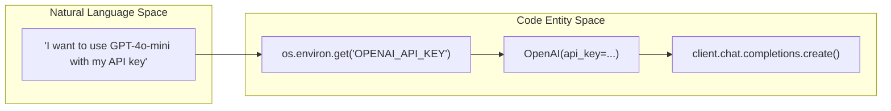

**Standard initialization pattern:**

The most common pattern retrieves the API key from the environment:
[examples/How_to_format_inputs_to_ChatGPT_models.ipynb:43-47]()

For specific examples involving embeddings or search, the client is initialized similarly:
[examples/Question_answering_using_embeddings.ipynb:129-142]()

Sources: [examples/How_to_format_inputs_to_ChatGPT_models.ipynb:43-47](), [examples/Question_answering_using_embeddings.ipynb:129-142]()

---

## Message Format

Chat models consume a list of message dictionaries. Each message must have a `role` and `content`.

### Message Roles

| Role | Purpose |
|------|---------|
| `system` | Sets the assistant's behavior, personality, or constraints. |
| `user` | Contains instructions or questions from the end user. |
| `assistant` | Contains previous model responses; can be used for few-shot examples. |
| `tool` | Used to provide the output of a function call back to the model. |

[examples/How_to_format_inputs_to_ChatGPT_models.ipynb:58-62]()

**Optional `name` field:**
Messages can include a `name` field (e.g., `example-user`) to help the model distinguish between multiple participants. Names must not contain spaces.
[examples/How_to_format_inputs_to_ChatGPT_models.ipynb:64-64]()

Sources: [examples/How_to_format_inputs_to_ChatGPT_models.ipynb:55-89]()

---

## Basic Chat Completion Request

The fundamental API call uses `client.chat.completions.create()`.

### Request/Response Data Flow

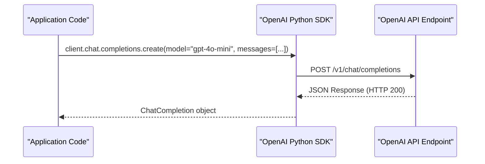

**Minimal Example:**
[examples/How_to_format_inputs_to_ChatGPT_models.ipynb:98-109]()

**Extracting Content:**
The response text is located at `response.choices[0].message.content`.
[examples/How_to_format_inputs_to_ChatGPT_models.ipynb:128-132]()

Sources: [examples/How_to_format_inputs_to_ChatGPT_models.ipynb:98-151]()

---

## API Parameters

Beyond `model` and `messages`, several parameters control the model's output:

*   **`temperature`**: Controls randomness. `0` is deterministic; `2` is highly creative. [examples/How_to_format_inputs_to_ChatGPT_models.ipynb:78-78]()
*   **`max_tokens`**: Sets the maximum number of generated tokens in chat completion. [examples/How_to_format_inputs_to_ChatGPT_models.ipynb:71-71]()
*   **`stream`**: If `True`, the API sends partial message deltas as tokens become available. [examples/How_to_format_inputs_to_ChatGPT_models.ipynb:77-77]()
*   **`logprobs`**: Returns log probabilities of output tokens if set to `true`. [examples/Using_logprobs.ipynb:9-12]()
*   **`top_logprobs`**: Specifies the number of most likely tokens (0-5) to return at each position. [examples/Using_logprobs.ipynb:11-11]()
*   **`response_format`**: Specifies the output format, e.g., JSON mode. [examples/How_to_format_inputs_to_ChatGPT_models.ipynb:74-74]()

Sources: [examples/How_to_format_inputs_to_ChatGPT_models.ipynb:66-82](), [examples/Using_logprobs.ipynb:9-12]()

---

## Token Management with tiktoken

OpenAI models process text in chunks called **tokens**. The `tiktoken` library is used to count tokens and ensure inputs fit within a model's context window.

### Token Counting and Truncation Logic

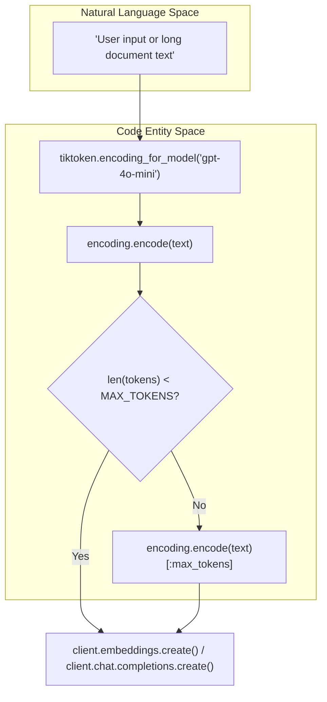

### Common Encodings
Different models use different encodings:
*   **`o200k_base`**: Used by `gpt-4o` and `gpt-4o-mini`. [examples/How_to_count_tokens_with_tiktoken.ipynb:25-25]()
*   **`cl100k_base`**: Used by `gpt-4-turbo`, `gpt-4`, and `gpt-3.5-turbo`. [examples/How_to_count_tokens_with_tiktoken.ipynb:26-26]()

**Truncation and Chunking:**
If text exceeds context limits (e.g., 8191 for `text-embedding-3-small`), it must be handled:
*   **Truncation**: Truncating tokens using `encoding.encode(text)[:max_tokens]`. [examples/Embedding_long_inputs.ipynb:102-106]()
*   **Chunking**: Splitting text into smaller batches and processing them individually. [examples/Embedding_long_inputs.ipynb:181-186]()

Sources: [examples/How_to_count_tokens_with_tiktoken.ipynb:17-33](), [examples/Embedding_long_inputs.ipynb:102-186]()

---

## Streaming Responses

Streaming allows applications to display responses to users in real-time as they are generated, reducing perceived latency.

**Implementation:**
Set `stream=True` in the `create` call. This returns a generator that yields `ChatCompletionChunk` objects. [examples/How_to_stream_completions.ipynb:16-16]()

**Usage Extraction:**
Token usage data in streaming is typically available in the `usage` field of the final chunk if `stream_options={"include_usage": True}` is provided. [examples/How_to_stream_completions.ipynb:28-28]()

Sources: [examples/How_to_stream_completions.ipynb:8-28](), [examples/How_to_stream_completions.ipynb:148-165]()

---

## Moderation and Guardrails

The Moderation API acts as a preventative safeguard to check whether input text or images are potentially harmful before processing them with an LLM.

### Asynchronous Moderation Workflow

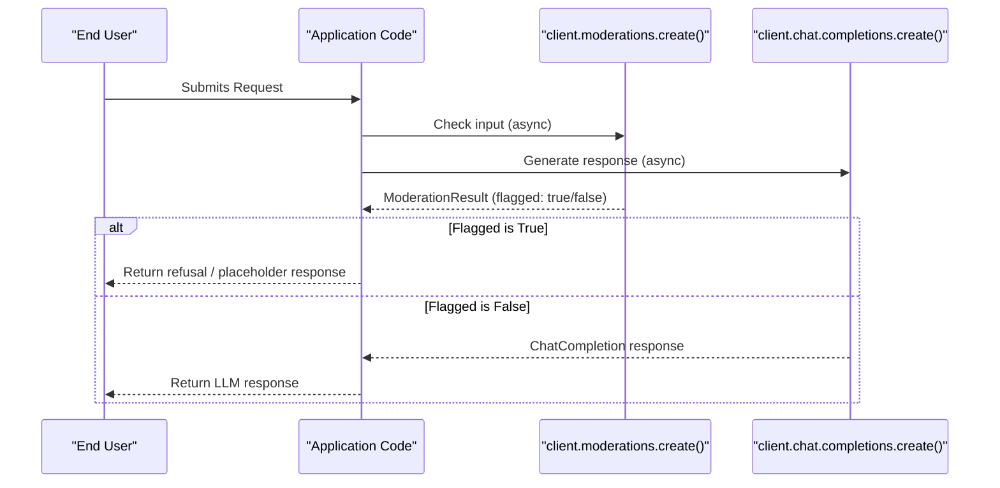

Applications can run input moderation and chat completion requests in parallel using `asyncio` to minimize latency, rejecting flagged inputs before returning generation costs to the user. [examples/How_to_use_moderation.ipynb:40-93]()

Sources: [examples/How_to_use_moderation.ipynb:1-115]()

---

## Prompt Caching (101 and 201 Levels)

Prompt Caching allows the model to reuse previously computed prefixes (e.g., long system instructions or document context), reducing Time-To-First-Token (TTFT) by up to 80% and input token costs by up to 90%.

### Caching Mechanism
Caching is automatic for prompts containing 1024 tokens or more, matching in increments of 128 tokens. [examples/Prompt_Caching_201.ipynb:17-17]() Under the hood, the KV cache stores key and value tensors for the shared prefix across all attention layers and heads, skipping prefill compute during subsequent requests. [examples/Prompt_Caching_201.ipynb:25-32]()

### Optimization Strategies (201 Level)
*   **Prefix Consistency**: Ensure that static content (system prompts, tools) is at the very beginning of the message list to maximize cache hits. [examples/Prompt_Caching_201.ipynb:13-13]()
*   **`prompt_cache_key`**: Use this optional parameter to improve routing for traffic sharing common prefixes. [examples/Prompt_Caching_201.ipynb:20-20]()
*   **Monitoring**: Check the `cached_tokens` field within `usage.prompt_tokens_details` to verify cache hits. [examples/Prompt_Caching_201.ipynb:53-54]()

Sources: [examples/Prompt_Caching_201.ipynb:12-54]()

---

## Basic Prompting Approaches

1.  **Search-Ask (RAG)**: A two-step method where you first search a library (e.g., Wikipedia) using embeddings, then insert the retrieved text into the prompt for the model to answer based on "open notes". [examples/Question_answering_using_embeddings.ipynb:19-22]()
2.  **Few-Shot (Demonstration)**: Providing examples of input-output pairs in the message history to guide the model's style or task performance. [examples/How_to_format_inputs_to_ChatGPT_models.ipynb:58-62]()
3.  **Guardrails**: Implementing detective controls. **Input guardrails** check for jailbreaking or off-topic queries via the Moderation API, while **Output guardrails** validate generated content before it reaches the user. [examples/How_to_use_moderation.ipynb:15-17]()

Sources: [examples/Question_answering_using_embeddings.ipynb:19-22](), [examples/How_to_format_inputs_to_ChatGPT_models.ipynb:58-62](), [examples/How_to_use_moderation.ipynb:15-17]()

---

# Page: GPT-5 Model Family and Reasoning Modes

# GPT-5 Model Family and Reasoning Modes

<details>
<summary>Relevant source files</summary>

The following files were used as context for generating this wiki page:

- [examples/chatgpt/gpt_actions_library/gpt_action_zapier.ipynb](examples/chatgpt/gpt_actions_library/gpt_action_zapier.ipynb)
- [examples/gpt-5/apply_patch.py](examples/gpt-5/apply_patch.py)
- [examples/gpt-5/codex_prompting_guide.ipynb](examples/gpt-5/codex_prompting_guide.ipynb)
- [examples/gpt-5/gpt-5-1_prompting_guide.ipynb](examples/gpt-5/gpt-5-1_prompting_guide.ipynb)
- [examples/gpt-5/gpt-5-2_prompting_guide.ipynb](examples/gpt-5/gpt-5-2_prompting_guide.ipynb)
- [examples/gpt-5/gpt-5_new_params_and_tools.ipynb](examples/gpt-5/gpt-5_new_params_and_tools.ipynb)
- [examples/gpt-5/gpt-5_prompting_guide.ipynb](examples/gpt-5/gpt-5_prompting_guide.ipynb)
- [examples/gpt-5/gpt-5_troubleshooting_guide.ipynb](examples/gpt-5/gpt-5_troubleshooting_guide.ipynb)
- [examples/gpt-5/outputs/login_page.html](examples/gpt-5/outputs/login_page.html)
- [examples/gpt-5/outputs/retro_dark.html](examples/gpt-5/outputs/retro_dark.html)
- [examples/gpt-5/outputs/retro_light.html](examples/gpt-5/outputs/retro_light.html)
- [examples/gpt-5/outputs/snake_game.html](examples/gpt-5/outputs/snake_game.html)
- [examples/gpt-5/outputs/your_website.html](examples/gpt-5/outputs/your_website.html)
- [examples/gpt-5/prompt-optimization-cookbook.ipynb](examples/gpt-5/prompt-optimization-cookbook.ipynb)
- [examples/stripe_model_eval/selecting_a_model_based_on_stripe_conversion.ipynb](examples/stripe_model_eval/selecting_a_model_based_on_stripe_conversion.ipynb)
- [images/input_image.png](images/input_image.png)
- [images/prompt-optimizer-3-22s.gif](images/prompt-optimizer-3-22s.gif)
- [images/stripe_eval_diagram.png](images/stripe_eval_diagram.png)
- [images/zapier_action_config.png](images/zapier_action_config.png)
- [images/zapier_ai_actions.png](images/zapier_ai_actions.png)

</details>


## Purpose and Scope

This document covers the technical architecture, model variants, reasoning effort parameters, tool extensions, and prompting strategies for the GPT-5 model family. It details how to leverage `gpt-5`, `gpt-5.1`, `gpt-5.2`, and `gpt-5.3-codex` through advanced API controls such as verbosity parameters, freeform function calling, Context-Free Grammar (CFG) constraints, and the canonical `apply_patch` tool. Additionally, it details prompt optimization workflows and troubleshooting patterns for agentic applications.

Sources: [examples/gpt-5/prompt-optimization-cookbook.ipynb:16-18](), [examples/gpt-5/gpt-5_new_params_and_tools.ipynb:10-18](), [examples/gpt-5/codex_prompting_guide.ipynb:8-19]()

---

## Model Family Overview

The GPT-5 series introduces multiple specialized variants optimized for distinct latency, intelligence, and agentic autonomy profiles. 

### Model Lineage and Execution Mapping

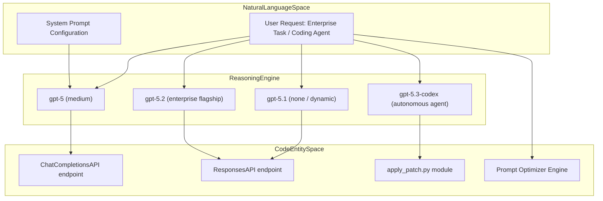

Title: GPT-5 Model Lineage and API Routing

| Model Identifier | Default Reasoning | Key Architectural Focus | Primary Target Workflows |
|------------------|------------------|-------------------------|--------------------------|
| `gpt-5` | `medium` | General high-intelligence reasoning | Complex multi-step problem solving [examples/gpt-5/gpt-5_prompting_guide.ipynb:9-13]() |
| `gpt-5.1` | `none` | Balanced speed, high steerability, dynamic token scaling | Low-latency agentic workflows [examples/gpt-5/gpt-5-1_prompting_guide.ipynb:8-12]() |
| `gpt-5.2` | `none` | Improved token efficiency, rigorous grounding, structured output | Production enterprise agents [examples/gpt-5/gpt-5-2_prompting_guide.ipynb:10-16]() |
| `gpt-5.3-codex` | Adaptive | PowerShell/Windows optimization, long-horizon persistence | Long-running autonomous coding agents [examples/gpt-5/codex_prompting_guide.ipynb:8-19]() |

Sources: [examples/gpt-5/gpt-5_prompting_guide.ipynb:9-13](), [examples/gpt-5/gpt-5-1_prompting_guide.ipynb:8-12](), [examples/gpt-5/gpt-5-2_prompting_guide.ipynb:10-16](), [examples/gpt-5/codex_prompting_guide.ipynb:8-19]()

---

## Reasoning Control and Parameters

GPT-5 models allow fine-grained control over deliberation depth and response verbosity via API parameters.

### Reasoning Effort Levels
The `reasoning_effort` parameter governs how many internal thinking tokens the model consumes prior to generating final text or tool calls [examples/gpt-5/gpt-5_troubleshooting_guide.ipynb:21-22]().

*   `none`: Bypasses reasoning token generation entirely for minimal latency [examples/gpt-5/gpt-5-1_prompting_guide.ipynb:18-19]().
*   `minimal`: Executes minimal deliberation; ideal for deterministic extraction and short rewrites [examples/gpt-5/gpt-5_new_params_and_tools.ipynb:18-18]().
*   `low`: Terse reasoning for routine tasks [examples/gpt-5/gpt-5_troubleshooting_guide.ipynb:21-22]().
*   `medium`: Balanced default for general problem solving [examples/gpt-5/gpt-5_new_params_and_tools.ipynb:15-15]().
*   `high` / `xhigh`: Deep deliberation for complex software engineering and multi-file codebases [examples/gpt-5/codex_prompting_guide.ipynb:17-17]().

### Verbosity Parameter
The `verbosity` parameter (supporting `low`, `medium`, and `high`) acts as a structural hint to control explanation length without modifying system prompts [examples/gpt-5/gpt-5_new_params_and_tools.ipynb:15-15](). `low` produces terse UI output, while `high` generates detailed explanations suitable for audits and debugging [examples/gpt-5/gpt-5_new_params_and_tools.ipynb:15-15]().

Sources: [examples/gpt-5/gpt-5_new_params_and_tools.ipynb:13-18](), [examples/gpt-5/gpt-5_troubleshooting_guide.ipynb:21-22](), [examples/gpt-5/gpt-5-1_prompting_guide.ipynb:18-19]()

---

## Advanced Tool Integration and Execution

GPT-5 expands tool orchestration capabilities beyond traditional JSON-schema function calling.

### Tool Architecture and Execution Flow

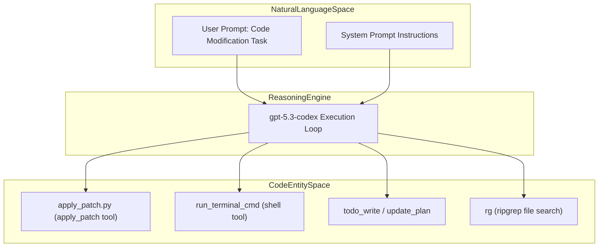

Title: Tool Orchestration from Prompt to Code Entity Space

### Canonical Tool Types
*   `apply_patch`: Implemented in `examples/gpt-5/apply_patch.py`, this is the primary tool for codebase modifications. It accepts structured patch blocks rather than full-file replacements, drastically conserving context windows [examples/gpt-5/gpt-5-1_prompting_guide.ipynb:24-24](), [examples/gpt-5/codex_prompting_guide.ipynb:29-30]().
*   `shell`: Executed via `run_terminal_cmd` for environment inspection and compilation checks [examples/gpt-5/codex_prompting_guide.ipynb:45-45]().
*   **Freeform Function Calling**: Allows the model to output raw text payloads (such as Python scripts, SQL statements, or shell commands) directly to custom runtimes without JSON serialization overhead [examples/gpt-5/gpt-5_new_params_and_tools.ipynb:16-16]().
*   **Context-Free Grammar (CFG)**: Enforces strict syntactic contracts on model output, ensuring compliance with custom domain grammars or programming languages [examples/gpt-5/gpt-5_new_params_and_tools.ipynb:17-17]().

Sources: [examples/gpt-5/gpt-5_new_params_and_tools.ipynb:16-17](), [examples/gpt-5/codex_prompting_guide.ipynb:29-45](), [examples/gpt-5/apply_patch.py:1-1]()

---

## Model-Specific Prompting Strategies

### GPT-5-Codex Autonomy and Persistence
When utilizing `gpt-5.3-codex` for software engineering agents, system prompts must enforce persistence and parallel tool execution [examples/gpt-5/codex_prompting_guide.ipynb:46-54]().
*   **Solver Tool Preference**: Prompt the model to prioritize dedicated tools (`rg`, `read_file`, `apply_patch`) over raw terminal commands [examples/gpt-5/codex_prompting_guide.ipynb:45-45]().
*   **Autonomous End-to-End Execution**: Instruct the model to complete multi-step tasks within a single turn rather than pausing for interim confirmations [examples/gpt-5/codex_prompting_guide.ipynb:53-54]().

### GPT-5.2 Enterprise and Frontend Control
For enterprise deployments of `gpt-5.2`, explicit constraints prevent scope drift and hallucinated design elements [examples/gpt-5/gpt-5-2_prompting_guide.ipynb:12-14]().
*   **Design System Enforcement**: Constrain the model to use existing design tokens, forbidding the invention of unauthorized colors, shadows, or UI components [examples/gpt-5/gpt-5-2_prompting_guide.ipynb:81-90]().
*   **Long-Context Re-grounding**: For context lengths exceeding 10k tokens, prompt the model to build an internal outline and anchor claims to specific section headings [examples/gpt-5/gpt-5-2_prompting_guide.ipynb:105-112]().

Sources: [examples/gpt-5/codex_prompting_guide.ipynb:45-54](), [examples/gpt-5/gpt-5-2_prompting_guide.ipynb:12-90]()

---

## Prompt Optimizer & Migration Workflow

The OpenAI Playground provides the **GPT-5 Prompt Optimizer** (`https://platform.openai.com/chat/edit?optimize=true`) to assist developers in migrating legacy prompts [examples/gpt-5/prompt-optimization-cookbook.ipynb:18-19](). 

### Optimization Cycle

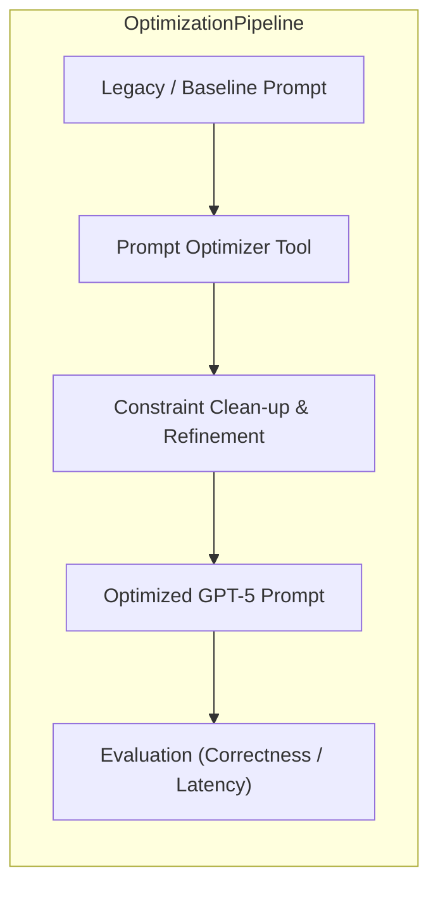

Title: GPT-5 Prompt Optimizer Pipeline

The optimizer detects and eliminates common failure modes:
*   Contradictory instructions within system prompts [examples/gpt-5/prompt-optimization-cookbook.ipynb:34-34]().
*   Ambiguous formatting rules that degrade structured output fidelity [examples/gpt-5/prompt-optimization-cookbook.ipynb:35-35]().
*   Inconsistencies between few-shot examples and task objectives [examples/gpt-5/prompt-optimization-cookbook.ipynb:36-36]().

Sources: [examples/gpt-5/prompt-optimization-cookbook.ipynb:18-38]()

---

## Troubleshooting Guide

When deploying GPT-5 models in production, developers may encounter specific behavioral anomalies:

1.  **Overthinking**: The model spends excessive time deliberating on trivial requests.
    *   *Fix*: Reduce `reasoning_effort` to `minimal` or `low` for routine tasks, and supply an explicit stop condition [examples/gpt-5/gpt-5_troubleshooting_guide.ipynb:21-22]().
2.  **Laziness / Underthinking**: The model produces incomplete solutions or skips verification steps.
    *   *Fix*: Increase `reasoning_effort` or incorporate a self-reflection prompt instructing the model to score its draft against a rubric [examples/gpt-5/gpt-5_troubleshooting_guide.ipynb:63-68]().
3.  **Overly Deferential**: The model pauses frequently to ask for human confirmation.
    *   *Fix*: Include a `<persistence>` instruction block in the system prompt mandating autonomous completion under reasonable assumptions [examples/gpt-5/gpt-5_troubleshooting_guide.ipynb:75-82]().
4.  **Excessive Verbosity**: Final responses contain unwanted conversational padding.
    *   *Fix*: Explicitly lower the `verbosity` parameter or apply output length constraints in the system prompt [examples/gpt-5/gpt-5_troubleshooting_guide.ipynb:88-90]().

Sources: [examples/gpt-5/gpt-5_troubleshooting_guide.ipynb:18-90]()

---

# Page: Prompting Techniques for Reliability

# Prompting Techniques for Reliability

<details>
<summary>Relevant source files</summary>

The following files were used as context for generating this wiki page:

- [articles/how_to_work_with_large_language_models.md](articles/how_to_work_with_large_language_models.md)
- [articles/related_resources.md](articles/related_resources.md)
- [articles/techniques_to_improve_reliability.md](articles/techniques_to_improve_reliability.md)
- [articles/text_comparison_examples.md](articles/text_comparison_examples.md)
- [articles/what_makes_documentation_good.md](articles/what_makes_documentation_good.md)
- [examples/Enhance_your_prompts_with_meta_prompting.ipynb](examples/Enhance_your_prompts_with_meta_prompting.ipynb)
- [examples/Optimize_Prompts.ipynb](examples/Optimize_Prompts.ipynb)
- [examples/Search_reranking_with_cross-encoders.ipynb](examples/Search_reranking_with_cross-encoders.ipynb)
- [examples/o-series/o3o4-mini_prompting_guide.ipynb](examples/o-series/o3o4-mini_prompting_guide.ipynb)
- [examples/reasoning_function_calls.ipynb](examples/reasoning_function_calls.ipynb)
- [examples/voice_solutions/arduino_ai_speech_assets/elato-alien.png](examples/voice_solutions/arduino_ai_speech_assets/elato-alien.png)
- [examples/voice_solutions/arduino_ai_speech_assets/pcb-design.png](examples/voice_solutions/arduino_ai_speech_assets/pcb-design.png)

</details>


## Purpose and Scope

This document explains advanced prompting techniques designed to improve the reliability and accuracy of responses from OpenAI's language models. These techniques help models reason more effectively, reduce hallucinations, and produce more consistent outputs on complex tasks.

Key concepts covered include **Chain-of-Thought (CoT)**, **Self-Consistency**, **Task Decomposition**, **Meta-Prompting**, **Reasoning Models (o-series)**, **Reasoning Function Calls**, and **Prompt Caching**.

Sources: [articles/techniques_to_improve_reliability.md:1-50](), [articles/how_to_work_with_large_language_models.md:1-18]()

---

## Why Reliability Fails

Language models can fail on complex tasks because they attempt to produce answers too quickly without sufficient reasoning space. Similar to how humans need time to work through a multi-step math problem, models benefit from being prompted to "think through" problems step-by-step [articles/techniques_to_improve_reliability.md:13-15]().

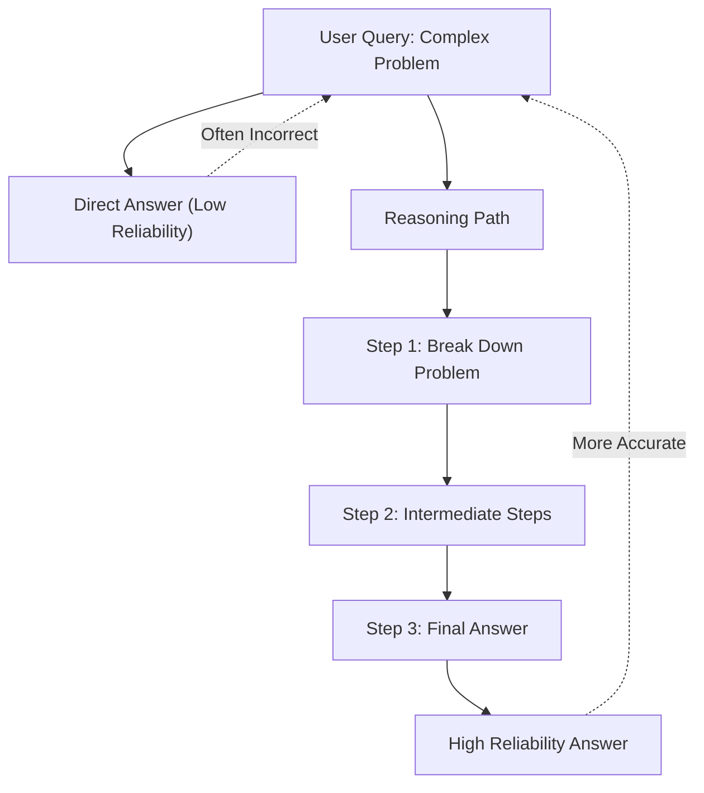
*Figure 1: Comparison between direct prompting paths and multi-step reasoning pathways leading to higher reliability.*

Sources: [articles/techniques_to_improve_reliability.md:1-50]()

---

## Core Reliability Techniques

### Chain-of-Thought (CoT) Prompting
Chain-of-thought prompting asks the model to show its reasoning process before arriving at a final answer.

*   **Zero-Shot CoT**: Adding "Let's think step by step" to the prompt. This simple addition can lift scores on math word problems (GSM8K) from 13% to 41% for models like `text-davinci-002` [articles/related_resources.md:56-56]().
*   **Few-Shot CoT**: Providing examples that include the reasoning steps. This can improve scores on benchmarks like GSM8K from 18% to 57% [articles/related_resources.md:53-53]().

### Self-Consistency
This technique involves generating multiple reasoning paths and taking a vote over the outputs. Voting across 40 outputs has been shown to raise performance on math problems significantly [articles/related_resources.md:54-54]().

### Task Decomposition
Breaking complex tasks into simpler subtasks keeps the model focused. For example, instead of a direct query, a prompt can be structured to:
1. Identify relevant information.
2. Combine clues to reason.
3. Map the result to a final answer [articles/techniques_to_improve_reliability.md:64-136]().

Sources: [articles/related_resources.md:51-57](), [articles/techniques_to_improve_reliability.md:64-136]()

---

## Reasoning Models (o-series) and Reasoning Function Calls

Newer models like `o3` and `o4-mini` are trained with reinforcement learning to perform reasoning natively. They produce a long internal chain of thought before responding to the user [examples/reasoning_function_calls.ipynb:8-9]().

### Managing Reasoning Effort via API
Reasoning models allow developers to control the `effort` parameter via `client.responses.create(...)`, which dictates how much internal reasoning the model performs [examples/reasoning_function_calls.ipynb:39-42]().

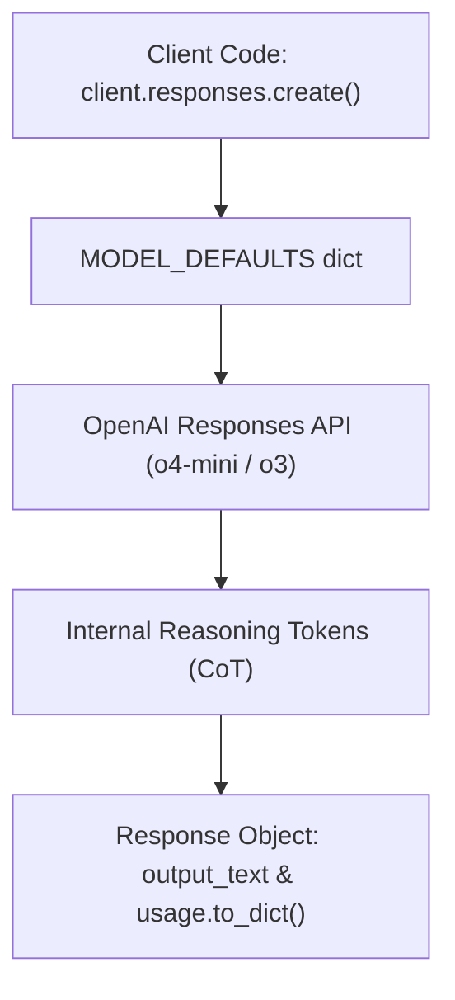
*Figure 2: Data flow for reasoning models using `client.responses.create()` and `MODEL_DEFAULTS` configurations.*

Sources: [examples/reasoning_function_calls.ipynb:39-88]()

### Native Tool Reasoning and Function Calling
The `o3`/`o4-mini` models use tools natively within their internal Chain of Thought (CoT), allowing them to reason about *when* and *how* to use a tool before executing it [examples/o-series/o3o4-mini_prompting_guide.ipynb:10-10]().

*   **Developer Messages**: Use `developer` messages (formerly system messages) to set general context and role [examples/o-series/o3o4-mini_prompting_guide.ipynb:52-58]().
*   **Explicit Ordering**: Outline the sequence of functions to call for multi-step tasks to prevent the model from skipping prerequisite steps (e.g., checking if a directory exists before creating a file) [examples/o-series/o3o4-mini_prompting_guide.ipynb:59-70]().
*   **Usage Criteria**: Define clear boundaries in the `description` field of the tool object regarding when to invoke the function and how to construct arguments [examples/o-series/o3o4-mini_prompting_guide.ipynb:89-98]().

Sources: [examples/reasoning_function_calls.ipynb:7-15](), [examples/o-series/o3o4-mini_prompting_guide.ipynb:10-98]()

---

## Meta-Prompting and Optimization

**Meta-prompting** is the technique of using a highly capable model (like `o1-preview`) to generate or improve prompts for a target model (like `gpt-4o`) [examples/Enhance_your_prompts_with_meta_prompting.ipynb:12-12]().

### Multi-Agent Optimization Workflow
The `openai-agents` SDK can be used to build a multi-agent system for prompt optimization using classes such as `Agent`, `Runner`, `Issues`, and `FewShotIssues` [examples/Optimize_Prompts.ipynb:82-144]().

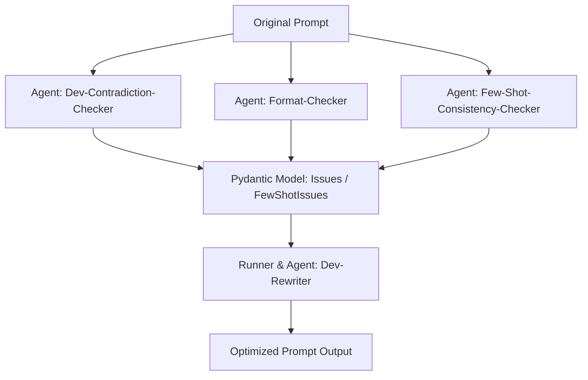
*Figure 3: Multi-agent prompt optimization workflow mapping natural language prompt inputs to `Agent`, `Runner`, and Pydantic validation structures (`Issues`, `FewShotIssues`).*

*   **Dev-Contradiction-Checker**: Scans for logical contradictions in instructions [examples/Optimize_Prompts.ipynb:55-55]().
*   **Format-Checker**: Ensures structured output requirements (JSON/CSV) are explicitly defined [examples/Optimize_Prompts.ipynb:57-57]().
*   **Few-Shot-Consistency-Checker**: Verifies that few-shot examples actually follow the rules in the system prompt [examples/Optimize_Prompts.ipynb:59-59]().

Sources: [examples/Optimize_Prompts.ipynb:51-144](), [examples/Enhance_your_prompts_with_meta_prompting.ipynb:7-16]()

---

## Performance and Cost: Prompt Caching

**Prompt Caching** allows the model to reuse the results of processing a repeated prefix (system instructions, tool definitions, or conversation history).

### Technical Mechanism
Caching targets the Key (K) and Value (V) projections inside the transformer's attention layers. By storing the KV cache for a prefix, the model avoids recomputing attention for those tokens in subsequent requests.

### Caching Monitoring in Code
Caching works automatically for prompts over 1024 tokens. Developers can monitor cache performance via specific fields in the API response usage object (`response.usage.to_dict()`) [examples/reasoning_function_calls.ipynb:133-133]().

```mermaid
classDiagram
    class ChatCompletionResponse {
        +String id
        +List output
        +Usage usage
    }
    class Usage {
        +int input_tokens
        +int output_tokens
        +int total_tokens
        +InputTokensDetails input_tokens_details
        +OutputTokensDetails output_tokens_details
        +to_dict()
    }
    class InputTokensDetails {
        +int cached_tokens
    }
    class OutputTokensDetails {
        +int reasoning_tokens
    }
    ChatCompletionResponse *-- Usage
    Usage *-- InputTokensDetails
    Usage *-- OutputTokensDetails
```
*Figure 4: Class diagram showing response usage tracking including `cached_tokens` and `reasoning_tokens`.*

**Implementation Details:**
*   **Cached Tokens**: The `cached_tokens` field indicates how many tokens were served from the cache [examples/reasoning_function_calls.ipynb:119-123]().
*   **Reasoning Tokens**: For o-series models, `reasoning_tokens` are tracked under `output_tokens_details` [examples/reasoning_function_calls.ipynb:122-122]().

Sources: [examples/reasoning_function_calls.ipynb:98-133](), [examples/o-series/o3o4-mini_prompting_guide.ipynb:10-10]()

---

## Advanced Search and Reranking

Reliability in Retrieval-Augmented Generation (RAG) is often improved by moving from simple Bi-Encoders to **Cross-Encoders** for reranking.

*   **Bi-Encoding**: Embeddings are computed once per document/query using tools like `arxiv.Search`. Fast but can lose semantic nuance [examples/Search_reranking_with_cross-encoders.ipynb:22-22]().
*   **Cross-Encoding**: The model processes the query and document together using `OPENAI_MODEL = "gpt-4"`. More accurate but computationally expensive [examples/Search_reranking_with_cross-encoders.ipynb:20-20]().
*   **Hybrid Approach**: Use a Bi-Encoder (e.g., `text-embedding-3-small`) to retrieve top-N candidates, then use a Cross-Encoder (e.g., `gpt-4o` with `logprobs`) to rerank them [examples/Search_reranking_with_cross-encoders.ipynb:24-24]().

Sources: [examples/Search_reranking_with_cross-encoders.ipynb:8-64](), [articles/text_comparison_examples.md:16-34]()

---

# Page: Responses API

# Responses API

<details>
<summary>Relevant source files</summary>

The following files were used as context for generating this wiki page:

- [articles/per_run_spending_controller_responses_api.md](articles/per_run_spending_controller_responses_api.md)
- [authors.yaml](authors.yaml)
- [examples/File_Search_Responses.ipynb](examples/File_Search_Responses.ipynb)
- [examples/agents_sdk/building_reliable_agents_memory_compaction.ipynb](examples/agents_sdk/building_reliable_agents_memory_compaction.ipynb)
- [examples/agents_sdk/context_personalization.ipynb](examples/agents_sdk/context_personalization.ipynb)
- [examples/agents_sdk/session_memory.ipynb](examples/agents_sdk/session_memory.ipynb)
- [examples/completions_usage_api.ipynb](examples/completions_usage_api.ipynb)
- [examples/data/openai_blog_pdfs/1,000 Scientist AI Jam Session _ OpenAI.pdf](examples/data/openai_blog_pdfs/1,000 Scientist AI Jam Session _ OpenAI.pdf)
- [examples/data/openai_blog_pdfs/Announcing The Stargate Project _ OpenAI.pdf](examples/data/openai_blog_pdfs/Announcing The Stargate Project _ OpenAI.pdf)
- [examples/data/openai_blog_pdfs/Bertelsmann powers creativity and productivity with OpenAI _ OpenAI.pdf](examples/data/openai_blog_pdfs/Bertelsmann powers creativity and productivity with OpenAI _ OpenAI.pdf)
- [examples/data/openai_blog_pdfs/Deep research System Card _ OpenAI.pdf](examples/data/openai_blog_pdfs/Deep research System Card _ OpenAI.pdf)
- [examples/data/openai_blog_pdfs/Disrupting malicious uses of AI _ OpenAI.pdf](examples/data/openai_blog_pdfs/Disrupting malicious uses of AI _ OpenAI.pdf)
- [examples/data/openai_blog_pdfs/Introducing GPT-4.5 _ OpenAI.pdf](examples/data/openai_blog_pdfs/Introducing GPT-4.5 _ OpenAI.pdf)
- [examples/data/openai_blog_pdfs/Introducing NextGenAI _ OpenAI.pdf](examples/data/openai_blog_pdfs/Introducing NextGenAI _ OpenAI.pdf)
- [examples/data/openai_blog_pdfs/Introducing Operator _ OpenAI.pdf](examples/data/openai_blog_pdfs/Introducing Operator _ OpenAI.pdf)
- [examples/data/openai_blog_pdfs/Introducing data residency in Europe _ OpenAI.pdf](examples/data/openai_blog_pdfs/Introducing data residency in Europe _ OpenAI.pdf)
- [examples/data/openai_blog_pdfs/Introducing deep research _ OpenAI.pdf](examples/data/openai_blog_pdfs/Introducing deep research _ OpenAI.pdf)
- [examples/evaluation/moving-from-openai-evals-to-promptfoo.md](examples/evaluation/moving-from-openai-evals-to-promptfoo.md)
- [examples/gpt-5/prompt_personalities.ipynb](examples/gpt-5/prompt_personalities.ipynb)
- [examples/gpt4-1_prompting_guide.ipynb](examples/gpt4-1_prompting_guide.ipynb)
- [examples/responses_api/responses_api_tool_orchestration.ipynb](examples/responses_api/responses_api_tool_orchestration.ipynb)
- [examples/responses_api/responses_example.ipynb](examples/responses_api/responses_example.ipynb)
- [examples/skills_in_api.ipynb](examples/skills_in_api.ipynb)
- [images/memory_comparison.jpg](images/memory_comparison.jpg)
- [images/per_run_spending_controller/decision_flow.svg](images/per_run_spending_controller/decision_flow.svg)
- [images/per_run_spending_controller/support_ticket.svg](images/per_run_spending_controller/support_ticket.svg)
- [images/promptfoo-custom-example-view.png](images/promptfoo-custom-example-view.png)
- [images/summarizingSession.jpg](images/summarizingSession.jpg)
- [images/trimingSession.jpg](images/trimingSession.jpg)
- [registry.yaml](registry.yaml)

</details>


The Responses API is a modern, stateful alternative to the Chat Completions API, designed for complex, multi-turn interactions, native tool integration, and state persistence [examples/responses_api/responses_example.ipynb:7-17](). This page documents its core architecture, state management mechanics, hosted tools (`file_search`, `web_search`, `code_interpreter`), reasoning items, Pinecone RAG orchestration, per-run spending controls, the Skills API, and migration paths.

---

### Core Concepts and Architecture

The Responses API shifts the responsibility of conversation state management from the client to the OpenAI platform [examples/responses_api/responses_example.ipynb:76-78](). Unlike the stateless Chat Completions API—where the entire conversation history must be transmitted with every call—the Responses API stores thread states server-side and allows clients to reference them using a `previous_response_id` [examples/responses_api/responses_example.ipynb:105-119]().

```mermaid
graph TD
    User["User/Client"] -- "client.responses.create(input='...', tools=[...])" --> API["OpenAI Responses API"]
    API -- "Executes Hosted Tools" --> Tools["Hosted Tools"]
    Tools -- "Tool Results" --> API
    API -- "Persists State (Response ID)" --> Storage["OpenAI Server State"]
    API -- "Returns Response Object" --> User
    User -- "client.responses.create(input='...', previous_response_id='resp_123')" --> API
    Storage -- "Retrieves Context" --> API
```
Sources: [examples/responses_api/responses_example.ipynb:47-52](), [examples/responses_api/responses_example.ipynb:114-119](), [examples/responses_api/responses_example.ipynb:181-185]()

---

### Multi-Turn Stateful Interactions

The API provides native support for stateful continuation and conversation branching [examples/responses_api/responses_example.ipynb:105-145](). 

1. **Stateful Continuation**: By passing `previous_response_id=response.id`, the model automatically inherits all preceding dialogue history and tool outputs [examples/responses_api/responses_example.ipynb:114-119]().
2. **Conversation Forking**: Multiple requests can branch off from the same `response.id`, enabling parallel exploration of distinct user prompts or divergent execution paths without mutating the root history [examples/responses_api/responses_example.ipynb:141-171]().

| Feature | Chat Completions | Responses API |
| :--- | :--- | :--- |
| **State Management** | Client-side (Full history required) | Server-side (Reference by ID) |
| **Tool Execution** | Client-side loop required | Server-side hosted tools |
| **History Access** | Not applicable | `client.responses.retrieve(response_id)` |

Sources: [examples/responses_api/responses_example.ipynb:7-17](), [examples/responses_api/responses_example.ipynb:95-99](), [examples/responses_api/responses_example.ipynb:167-171]()

---

### Hosted Tools and Orchestration

The Responses API integrates hosted tools directly into the runtime, eliminating manual client-side tool execution loops [examples/responses_api/responses_example.ipynb:181-185]().

#### 1. File Search
The `file_search` tool interacts with OpenAI's Vector Stores, managing parsing, chunking, and embedding workflows internally [examples/File_Search_Responses.ipynb:10-14](). Files are uploaded via `client.files.create` and attached to vector stores via `client.vector_stores.files.create` [examples/File_Search_Responses.ipynb:65-72]().

#### 2. Web Search
The `web_search` tool allows models to fetch real-time information by passing `{"type": "web_search"}` in the `tools` configuration array [examples/responses_api/responses_example.ipynb:194-201]().

#### 3. Code Interpreter
The `code_interpreter` tool provides a secure, sandboxed execution environment for performing data analysis and running arbitrary Python code snippets.

Sources: [examples/File_Search_Responses.ipynb:10-14](), [examples/File_Search_Responses.ipynb:65-72](), [examples/responses_api/responses_example.ipynb:181-201]()

---

### Reasoning Items and Effort Control

Reasoning models produce an internal chain of thought before rendering final answers. In the Responses API, these are captured as explicit items within the response structure.

* **Persistence**: Reasoning chains are retained server-side. Referencing `previous_response_id` supplies the model with prior reasoning contexts.
* **Effort Parameters**: Developers can adjust the `reasoning` effort parameter (e.g., `medium`, `high`) to balance model intelligence and response latency.

Sources: [examples/responses_api/responses_example.ipynb:14-17]()

---

### Advanced Tool Orchestration with Pinecone RAG

Developers can combine hosted tools with external vector databases like Pinecone by declaring custom function schemas [examples/responses_api/responses_api_tool_orchestration.ipynb:15-19]().

```mermaid
graph LR
    subgraph "Natural Language Space"
        Query["'What is the patient clinical history?'"]
    end
    
    subgraph "Code Entity Space"
        API["client.responses.create"]
        Tool["query_pinecone_index"]
        DB[("Pinecone Index")]
    end
    
    Query --> API
    API -- "tool_choice: auto" --> Tool
    Tool -- "pc.Index.query" --> DB
    DB -- "Context Metadata" --> Tool
    Tool -- "Returns text" --> API
```
Sources: [examples/responses_api/responses_api_tool_orchestration.ipynb:15-19](), [examples/responses_api/responses_api_tool_orchestration.ipynb:61-65](), [examples/responses_api/responses_api_tool_orchestration.ipynb:254-270]()

---

### Per-Run Spending Controller

For long-running autonomous workflows, the Responses API can be integrated with budgeting guards to enforce strict cost limits per execution run [articles/per_run_spending_controller_responses_api.md:3-5]().

```mermaid
graph TD
    Start["Start Request"] --> Count["Count Input Tokens"]
    Count --> Reserve["Reserve Max Possible Cost"]
    Reserve -- "Within Budget?" --> Decision{Budget Check}
    Decision -- "Yes" --> Call["client.responses.create"]
    Decision -- "No" --> Stop["STOP - No Model Request"]
    Call --> Record["Record Actual Cost & Return Surplus"]
```
Sources: [articles/per_run_spending_controller_responses_api.md:3-9](), [articles/per_run_spending_controller_responses_api.md:123-136]()

---

### Skills API Integration

The Skills API packages procedural workflows—including instructions, scripts, and static assets—into a zipped directory anchored by a required `SKILL.md` manifest [examples/skills_in_api.ipynb:38](). When attached to hosted execution environments (`environment.type="container_auto"`), the service extracts the bundle, parses the frontmatter descriptions, and makes capabilities available to the model on demand [examples/skills_in_api.ipynb:40-45]().

```mermaid
graph TD
    subgraph "Natural Language Space"
        UserQuery["'Format this CSV report using company styling'"]
    end
    
    subgraph "Code Entity Space"
        API["client.responses.create"]
        Env["container_auto Runtime"]
        Manifest["SKILL.md Frontmatter"]
        Script["python_execution_script"]
    end
    
    UserQuery --> API
    API --> Env
    Env -- "Unzips bundle & loads" --> Manifest
    Manifest -- "Injects skill metadata into prompt" --> API
    API -- "Invokes path via shell" --> Script
```
Sources: [examples/skills_in_api.ipynb:38-45]()

---

### Migration from Chat Completions

Migrating an application from Chat Completions to the Responses API involves updating endpoint calls and response parsers [examples/responses_api/responses_example.ipynb:47-69]().

1. **Endpoint Replacement**: Switch from `client.chat.completions.create` to `client.responses.create` [examples/responses_api/responses_example.ipynb:47-52]().
2. **Payload Adjustment**: Use the `input` field for strings or message arrays instead of `messages` [examples/responses_api/responses_example.ipynb:49]().
3. **Output Extraction**: Parse text outputs from `response.output[i].content[j].text` [examples/responses_api/responses_example.ipynb:69]().
4. **State Management**: Remove manual array appending of history; rely on `previous_response_id` [examples/responses_api/responses_example.ipynb:114-119]().

Sources: [examples/responses_api/responses_example.ipynb:47-52](), [examples/responses_api/responses_example.ipynb:69](), [examples/responses_api/responses_example.ipynb:114-119]()

---

# Page: Embeddings and Vector Search

# Embeddings and Vector Search

<details>
<summary>Relevant source files</summary>

The following files were used as context for generating this wiki page:

- [articles/what_is_new_with_dalle_3.mdx](articles/what_is_new_with_dalle_3.mdx)
- [examples/Code_search_using_embeddings.ipynb](examples/Code_search_using_embeddings.ipynb)
- [examples/Embedding_Wikipedia_articles_for_search.ipynb](examples/Embedding_Wikipedia_articles_for_search.ipynb)
- [examples/Embedding_long_inputs.ipynb](examples/Embedding_long_inputs.ipynb)
- [examples/Fine-tuned_classification.ipynb](examples/Fine-tuned_classification.ipynb)
- [examples/How_to_count_tokens_with_tiktoken.ipynb](examples/How_to_count_tokens_with_tiktoken.ipynb)
- [examples/How_to_format_inputs_to_ChatGPT_models.ipynb](examples/How_to_format_inputs_to_ChatGPT_models.ipynb)
- [examples/Question_answering_using_a_search_API.ipynb](examples/Question_answering_using_a_search_API.ipynb)
- [examples/Question_answering_using_embeddings.ipynb](examples/Question_answering_using_embeddings.ipynb)
- [examples/RAG_with_graph_db.ipynb](examples/RAG_with_graph_db.ipynb)
- [examples/Unit_test_writing_using_a_multi-step_prompt.ipynb](examples/Unit_test_writing_using_a_multi-step_prompt.ipynb)
- [examples/Unit_test_writing_using_a_multi-step_prompt_with_older_completions_API.ipynb](examples/Unit_test_writing_using_a_multi-step_prompt_with_older_completions_API.ipynb)
- [examples/Using_embeddings.ipynb](examples/Using_embeddings.ipynb)
- [examples/Using_logprobs.ipynb](examples/Using_logprobs.ipynb)
- [examples/data/amazon_product_kg.json](examples/data/amazon_product_kg.json)
- [examples/data/winter_olympics_2022.csv](examples/data/winter_olympics_2022.csv)
- [examples/evaluation/How_to_eval_abstractive_summarization.ipynb](examples/evaluation/How_to_eval_abstractive_summarization.ipynb)
- [examples/vector_databases/README.md](examples/vector_databases/README.md)
- [examples/vector_databases/cassandra_astradb/Philosophical_Quotes_AstraPy.ipynb](examples/vector_databases/cassandra_astradb/Philosophical_Quotes_AstraPy.ipynb)
- [examples/vector_databases/cassandra_astradb/Philosophical_Quotes_CQL.ipynb](examples/vector_databases/cassandra_astradb/Philosophical_Quotes_CQL.ipynb)
- [examples/vector_databases/cassandra_astradb/Philosophical_Quotes_cassIO.ipynb](examples/vector_databases/cassandra_astradb/Philosophical_Quotes_cassIO.ipynb)
- [examples/vector_databases/cassandra_astradb/README.md](examples/vector_databases/cassandra_astradb/README.md)
- [examples/vector_databases/cassandra_astradb/sources/philo_quotes.json](examples/vector_databases/cassandra_astradb/sources/philo_quotes.json)
- [examples/vector_databases/elasticsearch/README.md](examples/vector_databases/elasticsearch/README.md)
- [examples/vector_databases/elasticsearch/elasticsearch-retrieval-augmented-generation.ipynb](examples/vector_databases/elasticsearch/elasticsearch-retrieval-augmented-generation.ipynb)
- [examples/vector_databases/elasticsearch/elasticsearch-semantic-search.ipynb](examples/vector_databases/elasticsearch/elasticsearch-semantic-search.ipynb)
- [images/search_rerank_answer.png](images/search_rerank_answer.png)

</details>


This page provides an overview of text embeddings, semantic similarity search, and retrieval-augmented generation (RAG) patterns in the OpenAI Cookbook. Embeddings transform text strings into dense vector representations where semantic proximity translates to geometric closeness in a high-dimensional vector space [examples/vector_databases/cassandra_astradb/Philosophical_Quotes_CQL.ipynb:45-66]().

As a parent page, this guide outlines the core architectural patterns and routes you to detailed child pages for specific implementations:
- For the underlying API, RAG workflows, Search-Ask architecture, token management, and advanced reranking, see [Embeddings Fundamentals and RAG](#5.1).
- For scalable storage across 25+ vector database providers, see [Vector Database Integration](#5.2).
- For downstream applications including zero-shot classification, K-means clustering, semantic search, and dimensionality reduction, see [Classification, Clustering, and Semantic Search](#5.3).

---

## Embeddings Fundamentals and RAG

The cookbook establishes a foundational **Search-Ask** methodology to enable GPT models to reason over private or real-time data [examples/Question_answering_using_embeddings.ipynb:19-22](). Rather than relying solely on model weights (long-term memory via fine-tuning), RAG injects precise context into message inputs (short-term memory) [examples/Question_answering_using_embeddings.ipynb:31-43]().

The pipeline involves chunking raw source documents, generating vectors via `client.embeddings.create()`, storing them, and retrieving the most relevant segments for prompt inclusion [examples/Question_answering_using_embeddings.ipynb:82-96]().

Title: "Natural Language RAG Space to Code Entity Space"
```mermaid
graph TD
    UserQuery["User Query"] --> NLSpace["Natural Language Space: Question Formulation"]
    NLSpace --> CodeSpace["Code Entity Space: client.embeddings.create()"]
    
    subgraph CodeSpace["Code Entity Space"]
        EmbeddingCall["client.embeddings.create(model='text-embedding-3-small', input=text)"]
        TokenHandling["truncate_text_tokens() / chunked_tokens() via tiktoken"]
        VectorRanking["scipy.spatial.distance.cosine() / similarity scoring"]
    end
    
    EmbeddingCall --> VectorRanking
    TokenHandling --> EmbeddingCall
    VectorRanking --> GPTGeneration["client.chat.completions.create(model='gpt-4o')"]
```
Sources: [examples/Question_answering_using_embeddings.ipynb:19-96](), [examples/Embedding_long_inputs.ipynb:38-105]()

For comprehensive documentation on token limits, handling long inputs, PDF parsing, entity extraction, cross-encoder reranking, and graph RAG with Neo4j, see [Embeddings Fundamentals and RAG](#5.1).

---

## Vector Database Integration

While in-memory pandas DataFrames or CSV files are sufficient for small datasets [examples/Question_answering_using_embeddings.ipynb:90-90](), production-grade knowledge retrieval requires dedicated vector databases to perform rapid approximate nearest neighbor (ANN) searches at scale [examples/vector_databases/README.md:1-6]().

The cookbook provides structured integration guides for over 25 vector database providers, demonstrating how to map embedding vectors and metadata into specialized indexing structures [examples/vector_databases/README.md:9-32]().

Title: "Natural Language Vector Store to Code Entity Space"
```mermaid
graph TD
    NLQuery["Natural Language Search Query"] --> CodeIntegration["Code Entity Space: Vector Store Client"]
    
    subgraph CodeIntegration["Code Entity Space Integration"]
        ElasticSearch["Elasticsearch(cloud_id, basic_auth)<br/>client.indices.create()"]
        MilvusZilliz["connections.connect()<br/>Collection(name, schema)"]
        CassandraAstra["MetadataVectorCassandraTable<br/>cassio.init()"]
        PineconeRedis["VectorStore Index upsert() & query()"]
    end
    
    CodeIntegration --> TopMatches["Retrieved Context Chunks"]
```
Sources: [examples/vector_databases/README.md:1-32](), [examples/vector_databases/elasticsearch/elasticsearch-semantic-search.ipynb:92-201](), [examples/vector_databases/cassandra_astradb/Philosophical_Quotes_cassIO.ipynb:112-114]()

For step-by-step notebooks covering Qdrant, Milvus/Zilliz, Pinecone, Redis, Chroma, Weaviate, Elasticsearch, MyScale, Cassandra/AstraDB, Oracle DB, BigQuery, and Azure AI Search, see [Vector Database Integration](#5.2).

---

## Classification, Clustering, and Semantic Search

Beyond powering Retrieval-Augmented Generation, vector embeddings serve as powerful numerical representations for diverse machine learning and analytical workloads without requiring fine-tuned model weights [examples/vector_databases/cassandra_astradb/Philosophical_Quotes_CQL.ipynb:45-66]().

Common application patterns implemented in the cookbook include zero-shot and multiclass text classification, grouping unlabelled records with K-means clustering, computing semantic recommendations, and visualizing high-dimensional manifolds using PCA and t-SNE [examples/Using_logprobs.ipynb:19-25]().

For detailed code examples and implementation recipes on classification, clustering, regression, and visualization techniques, see [Classification, Clustering, and Semantic Search](#5.3).

---

# Page: Embeddings Fundamentals and RAG

# Embeddings Fundamentals and RAG

<details>
<summary>Relevant source files</summary>

The following files were used as context for generating this wiki page:

- [articles/how_to_work_with_large_language_models.md](articles/how_to_work_with_large_language_models.md)
- [articles/related_resources.md](articles/related_resources.md)
- [articles/techniques_to_improve_reliability.md](articles/techniques_to_improve_reliability.md)
- [articles/text_comparison_examples.md](articles/text_comparison_examples.md)
- [articles/what_makes_documentation_good.md](articles/what_makes_documentation_good.md)
- [examples/Code_search_using_embeddings.ipynb](examples/Code_search_using_embeddings.ipynb)
- [examples/Embedding_Wikipedia_articles_for_search.ipynb](examples/Embedding_Wikipedia_articles_for_search.ipynb)
- [examples/Embedding_long_inputs.ipynb](examples/Embedding_long_inputs.ipynb)
- [examples/Entity_extraction_for_long_documents.ipynb](examples/Entity_extraction_for_long_documents.ipynb)
- [examples/Fine-tuned_classification.ipynb](examples/Fine-tuned_classification.ipynb)
- [examples/How_to_count_tokens_with_tiktoken.ipynb](examples/How_to_count_tokens_with_tiktoken.ipynb)
- [examples/How_to_format_inputs_to_ChatGPT_models.ipynb](examples/How_to_format_inputs_to_ChatGPT_models.ipynb)
- [examples/Parse_PDF_docs_for_RAG.ipynb](examples/Parse_PDF_docs_for_RAG.ipynb)
- [examples/Question_answering_using_a_search_API.ipynb](examples/Question_answering_using_a_search_API.ipynb)
- [examples/Question_answering_using_embeddings.ipynb](examples/Question_answering_using_embeddings.ipynb)
- [examples/RAG_with_graph_db.ipynb](examples/RAG_with_graph_db.ipynb)
- [examples/Search_reranking_with_cross-encoders.ipynb](examples/Search_reranking_with_cross-encoders.ipynb)
- [examples/Unit_test_writing_using_a_multi-step_prompt.ipynb](examples/Unit_test_writing_using_a_multi-step_prompt.ipynb)
- [examples/Unit_test_writing_using_a_multi-step_prompt_with_older_completions_API.ipynb](examples/Unit_test_writing_using_a_multi-step_prompt_with_older_completions_API.ipynb)
- [examples/Using_embeddings.ipynb](examples/Using_embeddings.ipynb)
- [examples/Using_logprobs.ipynb](examples/Using_logprobs.ipynb)
- [examples/data/amazon_product_kg.json](examples/data/amazon_product_kg.json)
- [examples/data/example_pdfs/evals-decks.pdf](examples/data/example_pdfs/evals-decks.pdf)
- [examples/data/example_pdfs/fine-tuning-deck.pdf](examples/data/example_pdfs/fine-tuning-deck.pdf)
- [examples/data/example_pdfs/models-page.pdf](examples/data/example_pdfs/models-page.pdf)
- [examples/data/example_pdfs/rag-deck.pdf](examples/data/example_pdfs/rag-deck.pdf)
- [examples/data/fia_f1_power_unit_financial_regulations_issue_1_-_2022-08-16.pdf](examples/data/fia_f1_power_unit_financial_regulations_issue_1_-_2022-08-16.pdf)
- [examples/data/parsed_pdf_docs.json](examples/data/parsed_pdf_docs.json)
- [examples/data/parsed_pdf_docs_with_embeddings.csv](examples/data/parsed_pdf_docs_with_embeddings.csv)
- [examples/data/winter_olympics_2022.csv](examples/data/winter_olympics_2022.csv)
- [examples/evaluation/How_to_eval_abstractive_summarization.ipynb](examples/evaluation/How_to_eval_abstractive_summarization.ipynb)
- [examples/voice_solutions/arduino_ai_speech_assets/elato-alien.png](examples/voice_solutions/arduino_ai_speech_assets/elato-alien.png)
- [examples/voice_solutions/arduino_ai_speech_assets/pcb-design.png](examples/voice_solutions/arduino_ai_speech_assets/pcb-design.png)
- [images/search_rerank_answer.png](images/search_rerank_answer.png)

</details>


## Purpose and Scope

This document covers the fundamentals of text embeddings and Retrieval-Augmented Generation (RAG) workflows using OpenAI's embeddings API. It explains the Search-Ask pattern for question answering, token counting with `tiktoken`, query generation strategies, and techniques for handling inputs that exceed model context lengths. It also documents advanced retrieval patterns including PDF parsing, entity extraction from long documents, search reranking with cross-encoders, and graph-based RAG with Neo4j.

For vector database integration with 25+ providers, see [Vector Database Integration](5.2). For embeddings applications including classification, clustering, and semantic search, see [Classification, Clustering, and Semantic Search](5.3).

Sources: `[examples/Question_answering_using_embeddings.ipynb:1-23]()`, `[examples/Embedding_long_inputs.ipynb:1-13]()`, `[examples/Parse_PDF_docs_for_RAG.ipynb:1-20]()`, `[examples/RAG_with_graph_db.ipynb:1-15]()`

---

## Embeddings API Fundamentals

### What Are Embeddings?

Text embeddings are numerical vector representations of text that capture semantic meaning. OpenAI's embeddings API converts text strings into high-dimensional vectors (e.g., 1536 dimensions for `text-embedding-3-small`) that can be compared using distance metrics `[examples/Question_answering_using_embeddings.ipynb:69-71]()`.

```python
# Basic embeddings API usage
client = OpenAI()
response = client.embeddings.create(
    model="text-embedding-3-small",
    input="Your text here"
)
embedding = response.data[0].embedding  # Returns list of floats
```

### Supported Models and Encodings

| Model | Dimensions | Encoding | Use Case |
|-------|-----------|----------|----------|
| `text-embedding-3-small` | 1536 | `cl100k_base` | Most cost-effective for general use |
| `text-embedding-3-large` | 3072 | `cl100k_base` | Higher accuracy for complex tasks |
| `text-embedding-ada-002` | 1536 | `cl100k_base` | Legacy model |

Sources: `[examples/Question_answering_using_embeddings.ipynb:137-142]()`, `[examples/How_to_count_tokens_with_tiktoken.ipynb:25-27]`, `[examples/Embedding_long_inputs.ipynb:38-40]()`

### Similarity Calculation

Embeddings enable semantic similarity comparison using cosine similarity `[examples/Question_answering_using_embeddings.ipynb:71-73]()`. Because OpenAI embeddings are normalized to length 1, calculating cosine similarity is equivalent to taking the dot product between two vectors `[examples/Question_answering_using_a_search_API.ipynb:375-379]()`.

```python
def cosine_similarity(a, b):
    return np.dot(a, b) / (np.linalg.norm(a) * np.linalg.norm(b))
```

Sources: `[examples/Question_answering_using_embeddings.ipynb:129-135]()`, `[examples/Question_answering_using_a_search_API.ipynb:65-65]()`

---

## RAG Architecture: The Search-Ask Pattern

### Overview

RAG (Retrieval-Augmented Generation) addresses the knowledge cutoff limitation of GPT models by inserting relevant context into prompts `[examples/Question_answering_using_embeddings.ipynb:11-17]()`. The Search-Ask pattern is a two-step method:

1. **Search:** Search your library of text for relevant text sections using embedding-based similarity `[examples/Question_answering_using_embeddings.ipynb:21-21]()`.
2. **Ask:** Insert the retrieved text sections into a message to GPT and ask the question `[examples/Question_answering_using_embeddings.ipynb:22-22]()`.

#### Diagram: Natural Language to Code Entity Mapping for Search-Ask RAG
```mermaid
graph TB
    subgraph "Natural Language Space"
        UserQuery["User Question"]
        Context["Retrieved Document Excerpts"]
        Answer["Generated Final Answer"]
    end

    subgraph "Code Entity Space"
        QueryEmbed["client.embeddings.create(model='text-embedding-3-small', input=query)"]
        VecSearch["strings_ranked_by_relatedness(query, df, top_n=5)"]
        PromptConstruct["Construct Chat Completion Message payload"]
        GPTCall["client.chat.completions.create(model='gpt-4o', messages=...)"]
    end

    UserQuery --> QueryEmbed
    QueryEmbed --> VecSearch
    VecSearch --> Context
    Context --> PromptConstruct
    UserQuery --> PromptConstruct
    PromptConstruct --> GPTCall
    GPTCall --> Answer

    style UserQuery fill:none
    style Context fill:none
    style Answer fill:none
    style QueryEmbed fill:none
    style VecSearch fill:none
    style PromptConstruct fill:none
    style GPTCall fill:none
```

Sources: `[examples/Question_answering_using_embeddings.ipynb:19-22]()`, `[examples/Question_answering_using_embeddings.ipynb:84-97]()`

### Search Implementation

The `strings_ranked_by_relatedness` pattern implements search by comparing a query embedding against a pre-computed dataframe of document embeddings `[examples/Question_answering_using_embeddings.ipynb:607-627]()`.

#### Diagram: Document Search Flow via Code Symbols
```mermaid
graph LR
    Input["Query String"] --> EmbedAPI["client.embeddings.create()"]
    DataFrame["pd.DataFrame df['embedding']"] --> Compute["scipy.spatial.distance.cosine()"]
    EmbedAPI --> Compute
    Compute --> Sort["Sort by similarity descending"]
    Sort --> Return["Return top_n matched strings"]

    style Input fill:none
    style EmbedAPI fill:none
    style DataFrame fill:none
    style Compute fill:none
    style Sort fill:none
    style Return fill:none
```

Sources: `[examples/Question_answering_using_embeddings.ipynb:129-142]`, `[examples/Question_answering_using_embeddings.ipynb:607-627]()`

---

## Token Management with `tiktoken`

### Why Token Counting Matters

GPT models process text as tokens. Knowing token counts is essential for:
1. **Context Limits:** Determining if a string is too long for the model (e.g., 128k tokens for `gpt-4o`) `[examples/Question_answering_using_embeddings.ipynb:46-50]()`.
2. **Cost Management:** API usage is priced per token `[examples/How_to_count_tokens_with_tiktoken.ipynb:14-14]()`.

### Encoding Models

| Encoding Name | OpenAI Models |
|---------------|---------------|
| `o200k_base` | `gpt-4o`, `gpt-4o-mini` |
| `cl100k_base` | `gpt-4-turbo`, `gpt-4`, `gpt-3.5-turbo`, `text-embedding-3-small` |
| `p50k_base` | Codex models, `text-davinci-003` |

Sources: `[examples/How_to_count_tokens_with_tiktoken.ipynb:23-29]()`

### Basic Token Counting

```python
import tiktoken
encoding = tiktoken.encoding_for_model("gpt-4o-mini")
tokens = encoding.encode("tiktoken is great!") 
num_tokens = len(tokens)
```

Sources: `[examples/How_to_count_tokens_with_tiktoken.ipynb:145-173]()`

---

## Handling Long Inputs

### Context Length Limits

Embedding models have hard token limits (e.g., 8191 for `text-embedding-3-small`) `[examples/Embedding_long_inputs.ipynb:38-40]()`. Exceeding these limits raises a `BadRequestError` `[examples/Embedding_long_inputs.ipynb:69-74]()`.

### Strategy 1: Truncation

Truncating input text to the maximum allowed length after tokenization `[examples/Embedding_long_inputs.ipynb:89-91]()`.

```python
def truncate_text_tokens(text, max_tokens=8191):
    encoding = tiktoken.get_encoding("cl100k_base")
    return encoding.encode(text)[:max_tokens]
```

Sources: `[examples/Embedding_long_inputs.ipynb:102-106]()`

### Strategy 2: Chunking and Averaging

Dividing text into chunks, embedding each individually, and averaging the resulting embeddings (weighted by chunk size) `[examples/Embedding_long_inputs.ipynb:142-144]()`.

```python
def len_safe_get_embedding(text, model="text-embedding-3-small", average=True):
    # chunk tokens using batched()
    # get embeddings for each chunk
    if average:
        return np.average(chunk_embeddings, axis=0, weights=chunk_lens).tolist()
```

Sources: `[examples/Embedding_long_inputs.ipynb:204-215]()`

---

## PDF Parsing and Document Preparation

For RAG systems built over unstructured PDF manuals or reports, `Parse_PDF_docs_for_RAG.ipynb` demonstrates extracting text layers, preserving section hierarchies, and parsing documents into discrete sections suitable for embedding generation and vector search.

Sources: `[examples/Parse_PDF_docs_for_RAG.ipynb:1-40]()`

---

## Entity Extraction for Long Documents

When documents exceed standard context limits, `Entity_extraction_for_long_documents.ipynb` implements a chunked entity extraction pattern. Using `textract` for PDF text ingestion combined with `create_chunks()` and `extract_chunk()` functions, the system queries GPT-4 across sequential sections to extract key figures, dates, and financial metrics before synthesizing results.

```python
# Chunking and extraction pattern in Entity_extraction_for_long_documents.ipynb
chunks = create_chunks(clean_text, 1000, tokenizer)
for chunk in text_chunks:
    results.append(extract_chunk(chunk, template_prompt))
```

Sources: `[examples/Entity_extraction_for_long_documents.ipynb:7-25]()`, `[examples/Entity_extraction_for_long_documents.ipynb:111-149]()`

---

## Search Reranking with Cross-Encoders

While embeddings (bi-encoders) scale efficiently as `D + Q` over large corpora, their semantic matching can miss domain-specific nuances. The `Search_reranking_with_cross-encoders.ipynb` notebook implements a hybrid two-stage retrieval architecture: over-fetching candidate documents via bi-encoder similarity, and then re-ranking them using a cross-encoder pattern powered by GPT models with `logprobs` enabled.

Sources: `[examples/Search_reranking_with_cross-encoders.ipynb:1-32]()`, `[examples/Search_reranking_with_cross-encoders.ipynb:62-65]()`

---

## Graph RAG with Neo4j

Beyond flat vector stores, `RAG_with_graph_db.ipynb` explores graph-based Retrieval-Augmented Generation. By modeling entities and relationships inside a graph database like Neo4j, the system executes graph queries to retrieve structured relational context alongside vector search results, giving GPT models a richer multi-hop understanding of interconnected data.

Sources: `[examples/RAG_with_graph_db.ipynb:1-25]()`

---

# Page: Vector Database Integration

# Vector Database Integration

<details>
<summary>Relevant source files</summary>

The following files were used as context for generating this wiki page:

- [articles/what_is_new_with_dalle_3.mdx](articles/what_is_new_with_dalle_3.mdx)
- [examples/How_to_call_functions_for_knowledge_retrieval.ipynb](examples/How_to_call_functions_for_knowledge_retrieval.ipynb)
- [examples/How_to_call_functions_with_chat_models.ipynb](examples/How_to_call_functions_with_chat_models.ipynb)
- [examples/chatgpt/rag-quickstart/gcp/Getting_started_with_bigquery_vector_search_and_openai.ipynb](examples/chatgpt/rag-quickstart/gcp/Getting_started_with_bigquery_vector_search_and_openai.ipynb)
- [examples/chatgpt/rag-quickstart/gcp/main.py](examples/chatgpt/rag-quickstart/gcp/main.py)
- [examples/chatgpt/rag-quickstart/gcp/requirements.txt](examples/chatgpt/rag-quickstart/gcp/requirements.txt)
- [examples/data/Chinook.db](examples/data/Chinook.db)
- [examples/data/papers/.gitkeep](examples/data/papers/.gitkeep)
- [examples/data/styles_2k.csv](examples/data/styles_2k.csv)
- [examples/data/styles_44k.csv](examples/data/styles_44k.csv)
- [examples/vector_databases/README.md](examples/vector_databases/README.md)
- [examples/vector_databases/cassandra_astradb/Philosophical_Quotes_AstraPy.ipynb](examples/vector_databases/cassandra_astradb/Philosophical_Quotes_AstraPy.ipynb)
- [examples/vector_databases/cassandra_astradb/Philosophical_Quotes_CQL.ipynb](examples/vector_databases/cassandra_astradb/Philosophical_Quotes_CQL.ipynb)
- [examples/vector_databases/cassandra_astradb/Philosophical_Quotes_cassIO.ipynb](examples/vector_databases/cassandra_astradb/Philosophical_Quotes_cassIO.ipynb)
- [examples/vector_databases/cassandra_astradb/README.md](examples/vector_databases/cassandra_astradb/README.md)
- [examples/vector_databases/cassandra_astradb/sources/philo_quotes.json](examples/vector_databases/cassandra_astradb/sources/philo_quotes.json)
- [examples/vector_databases/chroma/Using_Chroma_for_embeddings_search.ipynb](examples/vector_databases/chroma/Using_Chroma_for_embeddings_search.ipynb)
- [examples/vector_databases/elasticsearch/README.md](examples/vector_databases/elasticsearch/README.md)
- [examples/vector_databases/elasticsearch/elasticsearch-retrieval-augmented-generation.ipynb](examples/vector_databases/elasticsearch/elasticsearch-retrieval-augmented-generation.ipynb)
- [examples/vector_databases/elasticsearch/elasticsearch-semantic-search.ipynb](examples/vector_databases/elasticsearch/elasticsearch-semantic-search.ipynb)
- [examples/vector_databases/milvus/Filtered_search_with_Milvus_and_OpenAI.ipynb](examples/vector_databases/milvus/Filtered_search_with_Milvus_and_OpenAI.ipynb)
- [examples/vector_databases/milvus/Getting_started_with_Milvus_and_OpenAI.ipynb](examples/vector_databases/milvus/Getting_started_with_Milvus_and_OpenAI.ipynb)
- [examples/vector_databases/myscale/Using_MyScale_for_embeddings_search.ipynb](examples/vector_databases/myscale/Using_MyScale_for_embeddings_search.ipynb)
- [examples/vector_databases/oracle_db/README.md](examples/vector_databases/oracle_db/README.md)
- [examples/vector_databases/oracle_db/deep_research_openai_agents.ipynb](examples/vector_databases/oracle_db/deep_research_openai_agents.ipynb)
- [examples/vector_databases/oracle_db/oracle_vector_search_langchain.ipynb](examples/vector_databases/oracle_db/oracle_vector_search_langchain.ipynb)
- [examples/vector_databases/pinecone/GPT4_Retrieval_Augmentation.ipynb](examples/vector_databases/pinecone/GPT4_Retrieval_Augmentation.ipynb)
- [examples/vector_databases/pinecone/Gen_QA.ipynb](examples/vector_databases/pinecone/Gen_QA.ipynb)
- [examples/vector_databases/pinecone/README.md](examples/vector_databases/pinecone/README.md)
- [examples/vector_databases/pinecone/Semantic_Search.ipynb](examples/vector_databases/pinecone/Semantic_Search.ipynb)
- [examples/vector_databases/pinecone/Using_Pinecone_for_embeddings_search.ipynb](examples/vector_databases/pinecone/Using_Pinecone_for_embeddings_search.ipynb)
- [examples/vector_databases/qdrant/Getting_started_with_Qdrant_and_OpenAI.ipynb](examples/vector_databases/qdrant/Getting_started_with_Qdrant_and_OpenAI.ipynb)
- [examples/vector_databases/qdrant/QA_with_Langchain_Qdrant_and_OpenAI.ipynb](examples/vector_databases/qdrant/QA_with_Langchain_Qdrant_and_OpenAI.ipynb)
- [examples/vector_databases/qdrant/Using_Qdrant_for_embeddings_search.ipynb](examples/vector_databases/qdrant/Using_Qdrant_for_embeddings_search.ipynb)
- [examples/vector_databases/qdrant/docker-compose.yaml](examples/vector_databases/qdrant/docker-compose.yaml)
- [examples/vector_databases/redis/README.md](examples/vector_databases/redis/README.md)
- [examples/vector_databases/redis/Using_Redis_for_embeddings_search.ipynb](examples/vector_databases/redis/Using_Redis_for_embeddings_search.ipynb)
- [examples/vector_databases/redis/docker-compose.yml](examples/vector_databases/redis/docker-compose.yml)
- [examples/vector_databases/redis/getting-started-with-redis-and-openai.ipynb](examples/vector_databases/redis/getting-started-with-redis-and-openai.ipynb)
- [examples/vector_databases/redis/nbutils.py](examples/vector_databases/redis/nbutils.py)
- [examples/vector_databases/redis/redis-hybrid-query-examples.ipynb](examples/vector_databases/redis/redis-hybrid-query-examples.ipynb)
- [examples/vector_databases/redis/redis.conf](examples/vector_databases/redis/redis.conf)
- [examples/vector_databases/typesense/Using_Typesense_for_embeddings_search.ipynb](examples/vector_databases/typesense/Using_Typesense_for_embeddings_search.ipynb)
- [examples/vector_databases/weaviate/README.md](examples/vector_databases/weaviate/README.md)
- [examples/vector_databases/weaviate/Using_Weaviate_for_embeddings_search.ipynb](examples/vector_databases/weaviate/Using_Weaviate_for_embeddings_search.ipynb)
- [examples/vector_databases/weaviate/docker-compose.yml](examples/vector_databases/weaviate/docker-compose.yml)
- [examples/vector_databases/weaviate/generative-search-with-weaviate-and-openai.ipynb](examples/vector_databases/weaviate/generative-search-with-weaviate-and-openai.ipynb)
- [examples/vector_databases/weaviate/getting-started-with-weaviate-and-openai.ipynb](examples/vector_databases/weaviate/getting-started-with-weaviate-and-openai.ipynb)
- [examples/vector_databases/weaviate/hybrid-search-with-weaviate-and-openai.ipynb](examples/vector_databases/weaviate/hybrid-search-with-weaviate-and-openai.ipynb)
- [examples/vector_databases/weaviate/question-answering-with-weaviate-and-openai.ipynb](examples/vector_databases/weaviate/question-answering-with-weaviate-and-openai.ipynb)
- [examples/vector_databases/zilliz/Filtered_search_with_Zilliz_and_OpenAI.ipynb](examples/vector_databases/zilliz/Filtered_search_with_Zilliz_and_OpenAI.ipynb)
- [examples/vector_databases/zilliz/Getting_started_with_Zilliz_and_OpenAI.ipynb](examples/vector_databases/zilliz/Getting_started_with_Zilliz_and_OpenAI.ipynb)
- [images/bigquery_rag_architecture.png](images/bigquery_rag_architecture.png)
- [images/gcp_rag_quickstart_gpt.png](images/gcp_rag_quickstart_gpt.png)

</details>


This page documents integration patterns for storing and searching OpenAI embeddings across 25+ vector database providers. The repository provides end-to-end examples under `examples/vector_databases/` illustrating embedding generation, vector persistence, metadata filtering, and semantic search.

Related pages: [5.1 Embeddings Fundamentals and RAG]() covers core embedding generation workflows, [5.3 Classification, Clustering, and Semantic Search]() explains downstream analytics, and [6.2 Advanced Function Calling and Knowledge Retrieval]() details agentic retrieval with vector databases.

## Vector Database Providers Overview

The cookbook maintains dedicated integration guides and notebooks across a broad range of vector database architectures, ranging from specialized vector engines to relational and key-value stores with vector extensions.

| Provider | Directory | Key Files / Notebooks |
|----------|-----------|-----------------------|
| **AnalyticDB** | `N/A` | External documentation guides [examples/vector_databases/README.md:10-10]() |
| **Cassandra / Astra DB** | `cassandra_astradb/` | `Philosophical_Quotes_CQL.ipynb`, `Philosophical_Quotes_cassIO.ipynb`, `Philosophical_Quotes_AstraPy.ipynb` [examples/vector_databases/README.md:11-11]() |
| **Azure AI Search** | `azuresearch/` | `Getting_started_with_azure_ai_search_and_openai.ipynb` [examples/vector_databases/README.md:12-12]() |
| **Chroma** | `chroma/` | `Using_Chroma_for_embeddings_search.ipynb` [examples/vector_databases/README.md:14-14]() |
| **Elasticsearch** | `elasticsearch/` | `elasticsearch-semantic-search.ipynb`, `elasticsearch-retrieval-augmented-generation.ipynb` [examples/vector_databases/README.md:15-15]() |
| **Milvus / Zilliz** | `milvus/`, `zilliz/` | `Getting_started_with_Milvus_and_OpenAI.ipynb`, `Filtered_search_with_Milvus_and_OpenAI.ipynb` [examples/vector_databases/README.md:18-18](), [examples/vector_databases/README.md:32-32]() |
| **MyScale** | `myscale/` | `Using_MyScale_for_embeddings_search.ipynb` [examples/vector_databases/README.md:19-19]() |
| **Oracle DB** | `oracle_db/` | `oracle_vector_search_langchain.ipynb`, `deep_research_openai_agents.ipynb` [examples/vector_databases/README.md:13-13]() |
| **Pinecone** | `pinecone/` | `Using_Pinecone_for_embeddings_search.ipynb`, `Gen_QA.ipynb`, `GPT4_Retrieval_Augmentation.ipynb` [examples/vector_databases/README.md:22-22]() |
| **Qdrant** | `qdrant/` | `Getting_started_with_Qdrant_and_OpenAI.ipynb`, `Using_Qdrant_for_embeddings_search.ipynb`, `QA_with_Langchain_Qdrant_and_OpenAI.ipynb` [examples/vector_databases/README.md:24-24]() |
| **Redis** | `redis/` | `getting-started-with-redis-and-openai.ipynb`, `Using_Redis_for_embeddings_search.ipynb`, `redis-hybrid-query-examples.ipynb` [examples/vector_databases/README.md:25-25]() |
| **Weaviate** | `weaviate/` | `Using_Weaviate_for_embeddings_search.ipynb`, `getting-started-with-weaviate-and-openai.ipynb` [examples/vector_databases/README.md:31-31]() |

Sources: [examples/vector_databases/README.md:1-32]()

## Standard Integration Workflow & Data Flow

Vector database integrations follow a consistent pipeline architecture: loading precomputed or raw text datasets, converting raw texts into high-dimensional embedding vectors using OpenAI endpoints, initializing database client drivers, configuring vector collections or indices, and executing nearest-neighbor similarity queries.

### Natural Language to Code Entity Space: Embedding & Ingestion Pipeline

Title: "Embedding Generation and Vector Storage Data Flow"
```mermaid
graph TD
    subgraph "NaturalLanguageSpace"
        RawText["RawTextCorpus<br/>WikipediaArticles / PhilosophicalQuotes"]
        UserQuery["UserSearchQuery<br/>'Who was the 12th person on the moon?'"]
    end

    subgraph "OpenAIService"
        EmbedAPI["client.embeddings.create()<br/>model='text-embedding-ada-002'"]
    end

    subgraph "CodeEntitySpace"
        PandasLoader["pd.read_csv()<br/>literal_eval()"]
        DBClient["qdrant_client.QdrantClient()<br/>elasticsearch.Elasticsearch()<br/>redis.Redis()"]
        UpsertOp["client.upsert()<br/>helpers.bulk()"]
    end

    RawText --> PandasLoader
    PandasLoader --> EmbedAPI
    EmbedAPI --> UpsertOp
    UserQuery --> EmbedAPI
    DBClient --> UpsertOp
```

Sources: [examples/vector_databases/qdrant/Getting_started_with_Qdrant_and_OpenAI.ipynb:11-15](), [examples/vector_databases/qdrant/Using_Qdrant_for_embeddings_search.ipynb:21-30](), [examples/vector_databases/elasticsearch/elasticsearch-semantic-search.ipynb:144-144]()

### Dataset Schema
Most example notebooks utilize standardized datasets such as pre-embedded Wikipedia archives or quote libraries. The structure typically includes:

| Field Name | Data Type | Description |
|------------|-----------|-------------|
| `id` / `vector_id` | `int` | Unique identifier for the document record [examples/vector_databases/qdrant/Using_Qdrant_for_embeddings_search.ipynb:171-201]() |
| `url` | `string` | Source link or reference URL [examples/vector_databases/qdrant/Using_Qdrant_for_embeddings_search.ipynb:171-201]() |
| `title` | `string` | Document title [examples/vector_databases/qdrant/Using_Qdrant_for_embeddings_search.ipynb:171-201]() |
| `text` | `string` | Full text or chunk content [examples/vector_databases/qdrant/Using_Qdrant_for_embeddings_search.ipynb:171-201]() |
| `title_vector` | `list[float]` | 1536-dimensional embedding vector of title [examples/vector_databases/qdrant/Using_Qdrant_for_embeddings_search.ipynb:171-201]() |
| `content_vector` | `list[float]` | 1536-dimensional embedding vector of text [examples/vector_databases/qdrant/Using_Qdrant_for_embeddings_search.ipynb:171-201]() |

Sources: [examples/vector_databases/qdrant/Using_Qdrant_for_embeddings_search.ipynb:171-201]()

## Client Initialization & Setup Patterns

Connecting to vector backends requires initializing provider-specific client instances alongside OpenAI API credentials. Local instances are frequently provisioned via containerized environments (`docker-compose.yaml`).

### Client Initialization & Search Architecture

Title: "Vector Database Client Initialization and Search Mapping"
```mermaid
graph LR
    subgraph "CodeEntitySpace"
        QdrantInit["qdrant_client.QdrantClient(host='localhost', port=6333)"]
        ESInit["elasticsearch.Elasticsearch(cloud_id=..., basic_auth=...)"]
        RedisInit["redis.Redis(host='localhost', port=6379)"]
        AstraInit["cassio.init(token=..., database_id=...)"]
    end

    subgraph "VectorStoreBackend"
        QdrantEngine["Qdrant Vector Engine<br/>REST / gRPC API"]
        ESEngine["Elasticsearch Engine<br/>RediSearch / Lucene kNN"]
        AstraEngine["Apache Cassandra / Astra DB<br/>CQL Vector Store"]
    end

    QdrantInit --> QdrantEngine
    ESInit --> ESEngine
    RedisInit --> ESEngine
    AstraInit --> AstraEngine
```

Sources: [examples/vector_databases/qdrant/Getting_started_with_Qdrant_and_OpenAI.ipynb:201-204](), [examples/vector_databases/elasticsearch/elasticsearch-semantic-search.ipynb:92-95](), [examples/vector_databases/redis/getting-started-with-redis-and-openai.ipynb:11-11](), [examples/vector_databases/cassandra_astradb/Philosophical_Quotes_cassIO.ipynb:112-113]()

- **Qdrant**: Initializes via `qdrant_client.QdrantClient` connecting to local Docker instances over port `6333` [examples/vector_databases/qdrant/Getting_started_with_Qdrant_and_OpenAI.ipynb:42-48]().
- **Elasticsearch**: Connects using the `elasticsearch` Python client package with cloud authentication or local endpoints [examples/vector_databases/elasticsearch/elasticsearch-semantic-search.ipynb:92-95]().
- **Redis**: Relies on `redis-py` interacting with Redis Stack container deployments running the `RediSearch` module [examples/vector_databases/redis/getting-started-with-redis-and-openai.ipynb:25-58]().
- **Cassandra / Astra DB**: Uses `cassIO` abstractions (`MetadataVectorCassandraTable`) or direct CQL drivers (`cassandra-driver`) with Astra token authentication [examples/vector_databases/cassandra_astradb/Philosophical_Quotes_cassIO.ipynb:112-113](), [examples/vector_databases/cassandra_astradb/Philosophical_Quotes_CQL.ipynb:99-115]().

Sources: [examples/vector_databases/qdrant/Getting_started_with_Qdrant_and_OpenAI.ipynb:42-48](), [examples/vector_databases/elasticsearch/elasticsearch-semantic-search.ipynb:92-95](), [examples/vector_databases/redis/getting-started-with-redis-and-openai.ipynb:25-58](), [examples/vector_databases/cassandra_astradb/Philosophical_Quotes_cassIO.ipynb:112-113]()

## Collection Schemas, Indexing, and Metadata

Vector databases require explicit schema definitions for vector dimensions, distance metrics (such as `COSINE`, `DOT`, or `L2`), and payload/metadata filtering fields.

- **Qdrant Collections**: Configure multi-vector layouts (e.g., separate `title` and `content` vector spaces) using `rest.VectorParams` [examples/vector_databases/qdrant/Getting_started_with_Qdrant_and_OpenAI.ipynb:493-510]().
- **Elasticsearch Mappings**: Define `dense_vector` field mappings specifying dimensions (`dims: 1536`), indexing status, and similarity metric options [examples/vector_databases/elasticsearch/elasticsearch-semantic-search.ipynb:179-201]().
- **Oracle AI Database**: Integrates via LangChain (`langchain-oracledb`) to store embeddings alongside relational table columns for native SQL vector operations [examples/vector_databases/oracle_db/README.md:16-43]().

Sources: [examples/vector_databases/qdrant/Getting_started_with_Qdrant_and_OpenAI.ipynb:493-510](), [examples/vector_databases/elasticsearch/elasticsearch-semantic-search.ipynb:179-201](), [examples/vector_databases/oracle_db/README.md:16-43]()

## Data Ingestion and Semantic/Hybrid Search

Once collections are established, data ingestion processes format vector payloads and push them in batches.

- **Bulk Ingestion**: Qdrant uses `client.upsert()` with `PointStruct` objects [examples/vector_databases/qdrant/Getting_started_with_Qdrant_and_OpenAI.ipynb:534-548](), whereas Elasticsearch utilizes `helpers.bulk()` for high-throughput dataframe indexing [examples/vector_databases/elasticsearch/elasticsearch-semantic-search.ipynb:211-214]().
- **Hybrid Queries**: Advanced integrations like Redis (`redis-hybrid-query-examples.ipynb`) and Zilliz/Milvus (`Filtered_search_with_Zilliz_and_OpenAI.ipynb`) support combining Vector Similarity Search (VSS) with lexical filters (Tag, Numeric, or Geo constraints) to narrow search spaces within application code [examples/vector_databases/redis/redis-hybrid-query-examples.ipynb:8-12](), [examples/vector_databases/zilliz/Filtered_search_with_Zilliz_and_OpenAI.ipynb:1-50]().

Sources: [examples/vector_databases/qdrant/Getting_started_with_Qdrant_and_OpenAI.ipynb:534-548](), [examples/vector_databases/elasticsearch/elasticsearch-semantic-search.ipynb:211-214](), [examples/vector_databases/redis/redis-hybrid-query-examples.ipynb:8-12]()

## Retrieval-Augmented Generation (RAG) & Agentic Integration

Vector database integrations form the backbone of RAG patterns, acting as long-term external memory for LLMs to ground responses and mitigate hallucinations [examples/vector_databases/pinecone/Gen_QA.ipynb:14-16]().

- **Pinecone Gen-QA**: Demonstrates querying Pinecone indices for relevant document contexts and feeding them into OpenAI chat/completion models [examples/vector_databases/pinecone/Gen_QA.ipynb:10-14]().
- **LangChain Integration**: Framework-backed wrappers (e.g., `QA_with_Langchain_Qdrant_and_OpenAI.ipynb`) streamline embedding generation, vector store creation, and retriever chaining [examples/vector_databases/qdrant/QA_with_Langchain_Qdrant_and_OpenAI.ipynb:7-18]().
- **Function-Calling Agents**: Agents equipped with knowledge retrieval functions (such as `get_articles` searching arXiv libraries) combine vector search results with multi-step tool execution [examples/How_to_call_functions_for_knowledge_retrieval.ipynb:9-17]().

Sources: [examples/vector_databases/pinecone/Gen_QA.ipynb:10-16](), [examples/vector_databases/qdrant/QA_with_Langchain_Qdrant_and_OpenAI.ipynb:7-18](), [examples/How_to_call_functions_for_knowledge_retrieval.ipynb:9-17]()

---

# Page: Classification, Clustering, and Semantic Search

# Classification, Clustering, and Semantic Search

<details>
<summary>Relevant source files</summary>

The following files were used as context for generating this wiki page:

- [examples/Classification_using_embeddings.ipynb](examples/Classification_using_embeddings.ipynb)
- [examples/Clustering.ipynb](examples/Clustering.ipynb)
- [examples/Clustering_for_transaction_classification.ipynb](examples/Clustering_for_transaction_classification.ipynb)
- [examples/Customizing_embeddings.ipynb](examples/Customizing_embeddings.ipynb)
- [examples/Get_embeddings_from_dataset.ipynb](examples/Get_embeddings_from_dataset.ipynb)
- [examples/Multiclass_classification_for_transactions.ipynb](examples/Multiclass_classification_for_transactions.ipynb)
- [examples/Recommendation_using_embeddings.ipynb](examples/Recommendation_using_embeddings.ipynb)
- [examples/Regression_using_embeddings.ipynb](examples/Regression_using_embeddings.ipynb)
- [examples/Semantic_text_search_using_embeddings.ipynb](examples/Semantic_text_search_using_embeddings.ipynb)
- [examples/User_and_product_embeddings.ipynb](examples/User_and_product_embeddings.ipynb)
- [examples/Visualizing_embeddings_in_2D.ipynb](examples/Visualizing_embeddings_in_2D.ipynb)
- [examples/Visualizing_embeddings_in_3D.ipynb](examples/Visualizing_embeddings_in_3D.ipynb)
- [examples/Zero-shot_classification_with_embeddings.ipynb](examples/Zero-shot_classification_with_embeddings.ipynb)
- [examples/data/dbpedia_samples.jsonl](examples/data/dbpedia_samples.jsonl)
- [examples/data/snli_1.0_train_2k.csv](examples/data/snli_1.0_train_2k.csv)
- [examples/utils/embeddings_utils.py](examples/utils/embeddings_utils.py)

</details>


This page covers technical implementations for applying text embeddings to classification, clustering, regression, and semantic search tasks. These techniques transform unstructured text into numerical vector spaces where semantic relationships can be calculated using linear algebra.

## Overview

Text embeddings convert natural language into dense vectors that capture semantic meaning. The OpenAI Cookbook demonstrates several analytical patterns using these vectors:

- **Classification**: Supervised and zero-shot methods to categorize text.
- **Clustering**: Unsupervised grouping of similar documents.
- **Semantic Search**: Retrieving relevant documents based on conceptual similarity rather than keyword matching.
- **Regression**: Predicting continuous numerical values from text.
- **Recommendations**: Finding similar items based on vector proximity.

Sources: [examples/Clustering.ipynb:8-11](), [examples/Multiclass_classification_for_transactions.ipynb:8-16](), [examples/Semantic_text_search_using_embeddings.ipynb:8-10]()

## Classification Approaches

### Zero-Shot Classification
Zero-shot classification allows for categorizing text into predefined buckets without any labeled training data. This is achieved by embedding both the target text and the descriptions of the classes, then calculating the cosine similarity between them.

```mermaid
graph TD
    subgraph "Natural Language Space"
        Input["Input Transaction/Review"]
        ClassA["Class Description: 'Building Improvement'"]
        ClassB["Class Description: 'Software/IT'"]
    end

    subgraph "Code Entity Space"
        Input --> GetEmb["get_embedding()"]
        ClassA --> GetEmb
        ClassB --> GetEmb
        
        GetEmb --> Sim["cosine_similarity()"]
        
        Sim --> Result["Predicted Label"]
    end
```
*Figure 1: Bridging Natural Language Space to Code Entity Space for Zero-Shot Classification.*

**Implementation Details:**
- Class descriptions are embedded using `EMBEDDING_MODEL` (`text-embedding-3-small`) [examples/Zero-shot_classification_with_embeddings.ipynb:29-34]().
- The highest similarity score determines the label [examples/Zero-shot_classification_with_embeddings.ipynb:47-49]().
- In transaction classification, a prompt-based zero-shot approach can also be used via `classify_transaction()` which calls `openai.chat.completions.create` with a system prompt defining categories [examples/Multiclass_classification_for_transactions.ipynb:135-151]().

Sources: [examples/Zero-shot_classification_with_embeddings.ipynb:29-50](), [examples/Multiclass_classification_for_transactions.ipynb:135-151]()

### Multiclass Classification (Supervised)
For labeled datasets, embeddings serve as high-quality feature vectors for traditional machine learning models.

| Component | Code Entity / Library | Purpose |
| :--- | :--- | :--- |
| **Feature Extraction** | `openai.embeddings` / `get_embedding` | Converts text to dense vector arrays [examples/Multiclass_classification_for_transactions.ipynb:34]() |
| **Classifier** | `sklearn.ensemble.RandomForestClassifier` | Trains on embedding vectors to predict discrete labels [examples/Classification_using_embeddings.ipynb:44-60]() |
| **Data Splitting** | `sklearn.model_selection.train_test_split` | Segregates data into training and testing sets [examples/Classification_using_embeddings.ipynb:54-56]() |
| **Evaluation** | `sklearn.metrics.classification_report` | Generates precision, recall, and F1-score [examples/Classification_using_embeddings.ipynb:64]() |

Sources: [examples/Classification_using_embeddings.ipynb:40-66](), [examples/Multiclass_classification_for_transactions.ipynb:34-52]()

## Clustering and Visualization

### K-Means Clustering
Clustering is used to discover hidden groupings in unlabelled data. The Cookbook demonstrates using the `KMeans` algorithm on embedding matrices.

```mermaid
graph TD
    subgraph "Natural Language Space"
        RawReviews["Fine Food Reviews Text Data"]
    end

    subgraph "Code Entity Space"
        RawReviews --> LitEval["literal_eval / np.array"]
        LitEval --> Matrix["matrix = np.vstack(df.embedding.values)"]
        Matrix --> KM["kmeans = KMeans(n_clusters=n, init='k-means++')"]
        KM --> Fit["kmeans.fit(matrix)"]
        Fit --> Labels["df['Cluster'] = kmeans.labels_"]
        Labels --> Group["df.groupby('Cluster').Score.mean()"]
    end
```
*Figure 2: Bridging Natural Language Space to Code Entity Space for K-Means Clustering.*

**Workflow:**
1. **Matrix Construction**: Embeddings are converted from strings to NumPy arrays and stacked into a matrix using `np.vstack` [examples/Clustering.ipynb:39-41]().
2. **Clustering**: `KMeans(n_clusters=n_clusters, init="k-means++")` is applied to the matrix [examples/Clustering.ipynb:94-95]().
3. **Labeling**: To make clusters human-readable, the Cookbook uses GPT models (e.g., `gpt-3.5-turbo`) via completions to generate descriptions based on samples from each cluster [examples/Clustering_for_transaction_classification.ipynb:9-12](), [examples/Clustering_for_transaction_classification.ipynb:62-75]().

Sources: [examples/Clustering.ipynb:30-100](), [examples/Clustering_for_transaction_classification.ipynb:49-75]()

### Visualization Techniques
To visualize high-dimensional embeddings, dimensionality reduction is required:
- **t-SNE (2D)**: Ideal for visualizing clusters in a 2D language space. The `TSNE` class from `sklearn.manifold` reduces vectors to 2 components for scatter plots [examples/Clustering_for_transaction_classification.ipynb:54-55](), [examples/Visualizing_embeddings_in_2D.ipynb:40-56]().
- **PCA (3D)**: `sklearn.decomposition.PCA` is used to reduce dimensions to 3 for interactive 3D visualizations, often paired with `plotly.express` [examples/Visualizing_embeddings_in_3D.ipynb:159-162](), [examples/Customizing_embeddings.ipynb:49]().

Sources: [examples/Clustering_for_transaction_classification.ipynb:54-55](), [examples/Visualizing_embeddings_in_3D.ipynb:159-162](), [examples/Visualizing_embeddings_in_2D.ipynb:40-56]()

## Semantic Search and Recommendations

### Semantic Text Search
Semantic search identifies documents conceptually related to a query, even if they share no keywords.

**Key Function:** `search_reviews(df, product_description, n=3)` [examples/Semantic_text_search_using_embeddings.ipynb:59-76]()
1. Embeds the `product_description` query using `get_embedding()` [examples/Semantic_text_search_using_embeddings.ipynb:60-63]().
2. Calculates `cosine_similarity` between the query embedding and all document embeddings in the DataFrame [examples/Semantic_text_search_using_embeddings.ipynb:64]().
3. Sorts the DataFrame by the new `similarity` column and returns the top `n` results [examples/Semantic_text_search_using_embeddings.ipynb:67-68]().

Sources: [examples/Semantic_text_search_using_embeddings.ipynb:56-79](), [examples/utils/embeddings_utils.py]()

### Recommendations
Recommendations are generated using nearest neighbor search in the embedding space:
- `distances_from_embeddings()`: Computes the distance (e.g., cosine) between a target embedding and a list of candidates [examples/Recommendation_using_embeddings.ipynb:30-36]().
- `indices_of_nearest_neighbors_from_distances()`: Identifies the closest matches for recommendation [examples/Recommendation_using_embeddings.ipynb:35]().
- User and product embeddings can also be aggregated by computing the mean embedding of reviews associated with a `UserId` or `ProductId` within the training set, then evaluated against an unseen test set using cosine similarity [examples/User_and_product_embeddings.ipynb:18-21](), [examples/User_and_product_embeddings.ipynb:143-182]().

Sources: [examples/Recommendation_using_embeddings.ipynb:27-38](), [examples/User_and_product_embeddings.ipynb:18-182]()

## Regression and Customization

### Regression using Embeddings
Regression predicts continuous values (like a star rating from 1 to 5) rather than discrete categories.

**Implementation:**
- **Model**: `RandomForestRegressor` is trained using embeddings as the independent variable `X` and scores as the dependent variable `y` [examples/Regression_using_embeddings.ipynb:42-45]().
- **Metrics**: Accuracy is measured using `mean_squared_error` (MSE) and `mean_absolute_error` (MAE) [examples/Regression_using_embeddings.ipynb:48-49]().

Sources: [examples/Regression_using_embeddings.ipynb:29-52]()

### Customizing Embeddings
Embeddings can be customized for specific tasks (like logical entailment) by training a custom matrix to multiply with base embeddings.
- The input is training data in the form of `[text_1, text_2, label]` where label is `+1` for similar pairs and `-1` for dissimilar pairs [examples/Customizing_embeddings.ipynb:14]().
- Optimization is performed using PyTorch (`torch`) to find a transformation matrix that emphasizes aspects relevant to the task, reducing binary classification error rates [examples/Customizing_embeddings.ipynb:16](), [examples/Customizing_embeddings.ipynb:52]().

Sources: [examples/Customizing_embeddings.ipynb:12-22](), [examples/Customizing_embeddings.ipynb:52-54]()

## Data Flow Summary

The following diagram illustrates the flow from raw text to various analytical outputs.

```mermaid
flowchart TD
    RawText["Raw Text Data"] --> PreProc["literal_eval / np.array"]
    PreProc --> API["openai.embeddings.create"]
    API --> Vector["Embedding Vector (1536 dims)"]
    
    Vector --> Search["cosine_similarity()"]
    Vector --> Class["RandomForestClassifier"]
    Vector --> Clust["KMeans"]
    Vector --> Reg["RandomForestRegressor"]
    
    Search --> SearchRes["Ranked Results"]
    Class --> ClassRes["Category Label"]
    Clust --> ClustRes["Cluster ID"]
    Reg --> RegRes["Numerical Prediction"]
```
*Figure 3: End-to-end Data Flow for Text Embeddings Analytics.*

Sources: [examples/Clustering.ipynb:39-41](), [examples/Classification_using_embeddings.ipynb:58-62](), [examples/Clustering.ipynb:94-97](), [examples/Regression_using_embeddings.ipynb:44-46]()

---

# Page: Function Calling and Tool Integration

# Function Calling and Tool Integration

<details>
<summary>Relevant source files</summary>

The following files were used as context for generating this wiki page:

- [examples/How_to_call_functions_for_knowledge_retrieval.ipynb](examples/How_to_call_functions_for_knowledge_retrieval.ipynb)
- [examples/How_to_call_functions_with_chat_models.ipynb](examples/How_to_call_functions_with_chat_models.ipynb)
- [examples/data/Chinook.db](examples/data/Chinook.db)
- [examples/data/papers/.gitkeep](examples/data/papers/.gitkeep)
- [examples/vector_databases/chroma/Using_Chroma_for_embeddings_search.ipynb](examples/vector_databases/chroma/Using_Chroma_for_embeddings_search.ipynb)
- [examples/vector_databases/myscale/Using_MyScale_for_embeddings_search.ipynb](examples/vector_databases/myscale/Using_MyScale_for_embeddings_search.ipynb)
- [examples/vector_databases/pinecone/Using_Pinecone_for_embeddings_search.ipynb](examples/vector_databases/pinecone/Using_Pinecone_for_embeddings_search.ipynb)
- [examples/vector_databases/qdrant/Getting_started_with_Qdrant_and_OpenAI.ipynb](examples/vector_databases/qdrant/Getting_started_with_Qdrant_and_OpenAI.ipynb)
- [examples/vector_databases/qdrant/QA_with_Langchain_Qdrant_and_OpenAI.ipynb](examples/vector_databases/qdrant/QA_with_Langchain_Qdrant_and_OpenAI.ipynb)
- [examples/vector_databases/qdrant/Using_Qdrant_for_embeddings_search.ipynb](examples/vector_databases/qdrant/Using_Qdrant_for_embeddings_search.ipynb)
- [examples/vector_databases/qdrant/docker-compose.yaml](examples/vector_databases/qdrant/docker-compose.yaml)
- [examples/vector_databases/redis/Using_Redis_for_embeddings_search.ipynb](examples/vector_databases/redis/Using_Redis_for_embeddings_search.ipynb)
- [examples/vector_databases/typesense/Using_Typesense_for_embeddings_search.ipynb](examples/vector_databases/typesense/Using_Typesense_for_embeddings_search.ipynb)
- [examples/vector_databases/weaviate/Using_Weaviate_for_embeddings_search.ipynb](examples/vector_databases/weaviate/Using_Weaviate_for_embeddings_search.ipynb)

</details>


## Purpose and Scope

This document covers OpenAI's function calling capabilities and patterns for integrating external tools with chat models. Function calling enables models to generate structured arguments for external functions, allowing them to interact with APIs, databases, and other systems. The material focuses on the Chat Completions API's `tools` parameter, function schema specifications, and integration architectures.

For detailed patterns, see:
- [Basic Function Calling Patterns](#6.1) — Document function calling fundamentals: function schemas, tool_choice, parallel function calling, handling tool_calls, OpenAPI-spec-driven calls, and practical examples like weather and database queries
- [Advanced Function Calling and Knowledge Retrieval](#6.2) — Cover multi-step function workflows, knowledge retrieval agents (`get_articles`, `read_article_and_summarize`), vector-DB-backed RAG tools, Langchain tool-using agents, and the Node SDK agent example
- [GPT Actions and External Integrations](#6.3) — Explain GPT Actions configuration, Zapier integration, database integrations (Snowflake, BigQuery, Redshift, SQL), SharePoint/Azure Functions middleware, Jira/Outlook, workspace agents, and ChatGPT daily usage limit controls
- [Model Context Protocol (MCP)](#6.4) — Document MCP as a standard for connecting models to external tools: hosted MCP tool in the Responses API, building MCP servers, supply-chain copilot with Databricks MCP, MCP-powered voice agents, Deep Research MCP server, and MCP evaluation

Sources: [examples/How_to_call_functions_with_chat_models.ipynb:9-23]()

## Core Function Calling Mechanism

### Tools Parameter and Function Schemas

The Chat Completions API accepts a `tools` parameter containing function specifications. Each function is described using a JSON schema that defines its name, description, and parameter structure.

**System to Code Mapping**
```mermaid
graph TB
    subgraph "Natural Language Space"
        UserQuery["What is the weather in SF?"]
        ModelDecision["Model decides to call get_current_weather"]
    end

    subgraph "Code Entity Space"
        ToolsList["tools list object"]
        Schema["function schema definition"]
        ChatReq["chat_completion_request()"]
        ToolChoice["tool_choice parameter"]
    end

    UserQuery --> ChatReq
    ToolsList --> Schema
    Schema -->|defines| ToolName["get_current_weather"]
    ChatReq --> ToolsList
    ModelDecision --> ToolChoice
```

**Function Schema Structure**

| Field | Type | Description |
|-------|------|-------------|
| `type` | string | Always `"function"` |
| `function.name` | string | Function identifier used by model |
| `function.description` | string | Natural language description guiding model |
| `function.parameters` | object | JSON Schema defining parameter types |
| `function.parameters.required` | array | List of required parameter names |

Sources: [examples/How_to_call_functions_with_chat_models.ipynb:168-217](), [examples/How_to_call_functions_with_chat_models.ipynb:97-104]()

### Tool Choice Parameter

The `tool_choice` parameter controls function calling behavior:

- `"auto"` (default): Model decides whether to call a function.
- `{"type": "function", "function": {"name": "function_name"}}`: Forces a specific function.
- `"none"`: Prevents all function calls.

For details on basic usage, see [Basic Function Calling Patterns](#6.1).

Sources: [examples/How_to_call_functions_with_chat_models.ipynb:15-16]()

## Request-Response Flow

### Basic Function Calling Loop

```mermaid
sequenceDiagram
    participant User
    participant App
    participant ChatAPI as client.chat.completions.create
    participant Function as External Logic
    
    User->>App: Query requiring external data
    App->>ChatAPI: messages + tools
    ChatAPI-->>App: response.choices[0].message.tool_calls
    
    App->>App: Parse tool_calls[0].function.arguments
    App->>Function: Execute logic (e.g., fetch_customer_profile)
    Function-->>App: Data result
    
    App->>ChatAPI: messages + tool role message
    ChatAPI-->>App: Final content response
    App->>User: Display answer
```

**Invocation Pattern**
1. **Request**: Send user message with `tools`.
2. **Model Decision**: Model returns `tool_calls` if a function is needed.
3. **Execution**: App executes function and appends result with `role: "tool"`.
4. **Completion**: Send updated messages to API for final text response.

Sources: [examples/How_to_call_functions_with_chat_models.ipynb:13-16]()

## Advanced Patterns and Retrieval

### Knowledge Retrieval Workflows

Advanced workflows involve multi-step logic where the model uses one tool to find information and another to process it. For example, a research agent might use `get_articles` to find academic papers and then `read_article_and_summarize` to extract insights.

**Knowledge Space to Code Mapping**
```mermaid
graph TB
    subgraph "Natural Language Space"
        UserReq["Find recent papers on quantum computing"]
        AgentReasoning["Model selects get_articles and read_article_and_summarize"]
    end

    subgraph "Code Entity Space"
        ArXivLib["arxiv library client"]
        GA["get_articles()"]
        RAS["read_article_and_summarize()"]
        ER["embedding_request()"]
        CSVStore["arxiv_library.csv"]
    end

    UserReq --> GA
    AgentReasoning --> GA
    GA -->|Fetch| ArXivLib
    GA -->|Embed| ER
    ER -->|Store| CSVStore
    GA --> RAS
    RAS -->|Search| CSVStore
```

For detailed multi-step workflows, see [Advanced Function Calling and Knowledge Retrieval](#6.2).

Sources: [examples/How_to_call_functions_for_knowledge_retrieval.ipynb:9-26](), [examples/How_to_call_functions_for_knowledge_retrieval.ipynb:148-181]()

### External Integrations and Protocols

Models can be integrated with existing web services, databases, and standardized protocols like the Model Context Protocol (MCP). This allows models to interact securely with RESTful APIs, enterprise databases (such as Snowflake, BigQuery, or PostgreSQL), and tool servers.

For details, see [GPT Actions and External Integrations](#6.3) and [Model Context Protocol (MCP)](#6.4).

Sources: [examples/How_to_call_functions_for_knowledge_retrieval.ipynb:11-17]()

## Implementation Best Practices

### Error Handling and Retries
The cookbook utilizes utility decorators such as those from the `tenacity` library to handle transient failures, network exceptions, and rate limits during chat completion or embedding requests.

```python
@retry(wait=wait_random_exponential(multiplier=1, max=40), stop=stop_after_attempt(3))
def chat_completion_request(messages, tools=None, tool_choice=None, model=GPT_MODEL):
    try:
        response = client.chat.completions.create(
            model=model,
            messages=messages,
            tools=tools,
            tool_choice=tool_choice,
        )
        return response
    except Exception as e:
        print("Unable to generate ChatCompletion response")
        print(f"Exception: {e}")
        return e
```

Sources: [examples/How_to_call_functions_with_chat_models.ipynb:96-110]()

### Parallel Function Calling
Models can generate multiple `tool_calls` in a single response output, enabling parallel execution of independent tasks (e.g., querying weather data for multiple distinct geographical locations simultaneously).

Sources: [examples/How_to_call_functions_with_chat_models.ipynb:15-16]()

---

# Page: Basic Function Calling Patterns

# Basic Function Calling Patterns

<details>
<summary>Relevant source files</summary>

The following files were used as context for generating this wiki page:

- [examples/Function_calling_finding_nearby_places.ipynb](examples/Function_calling_finding_nearby_places.ipynb)
- [examples/Function_calling_with_an_OpenAPI_spec.ipynb](examples/Function_calling_with_an_OpenAPI_spec.ipynb)
- [examples/GPT_with_vision_for_video_understanding.ipynb](examples/GPT_with_vision_for_video_understanding.ipynb)
- [examples/How_to_call_functions_for_knowledge_retrieval.ipynb](examples/How_to_call_functions_for_knowledge_retrieval.ipynb)
- [examples/How_to_call_functions_with_chat_models.ipynb](examples/How_to_call_functions_with_chat_models.ipynb)
- [examples/data/Chinook.db](examples/data/Chinook.db)
- [examples/data/bison.mp4](examples/data/bison.mp4)
- [examples/data/example_events_openapi.json](examples/data/example_events_openapi.json)
- [examples/data/papers/.gitkeep](examples/data/papers/.gitkeep)
- [examples/gpt4o/data/keynote_recap.mp4](examples/gpt4o/data/keynote_recap.mp4)
- [examples/gpt4o/data/triangle.png](examples/gpt4o/data/triangle.png)
- [examples/vector_databases/chroma/Using_Chroma_for_embeddings_search.ipynb](examples/vector_databases/chroma/Using_Chroma_for_embeddings_search.ipynb)
- [examples/vector_databases/myscale/Using_MyScale_for_embeddings_search.ipynb](examples/vector_databases/myscale/Using_MyScale_for_embeddings_search.ipynb)
- [examples/vector_databases/pinecone/Using_Pinecone_for_embeddings_search.ipynb](examples/vector_databases/pinecone/Using_Pinecone_for_embeddings_search.ipynb)
- [examples/vector_databases/qdrant/Getting_started_with_Qdrant_and_OpenAI.ipynb](examples/vector_databases/qdrant/Getting_started_with_Qdrant_and_OpenAI.ipynb)
- [examples/vector_databases/qdrant/QA_with_Langchain_Qdrant_and_OpenAI.ipynb](examples/vector_databases/qdrant/QA_with_Langchain_Qdrant_and_OpenAI.ipynb)
- [examples/vector_databases/qdrant/Using_Qdrant_for_embeddings_search.ipynb](examples/vector_databases/qdrant/Using_Qdrant_for_embeddings_search.ipynb)
- [examples/vector_databases/qdrant/docker-compose.yaml](examples/vector_databases/qdrant/docker-compose.yaml)
- [examples/vector_databases/redis/Using_Redis_for_embeddings_search.ipynb](examples/vector_databases/redis/Using_Redis_for_embeddings_search.ipynb)
- [examples/vector_databases/typesense/Using_Typesense_for_embeddings_search.ipynb](examples/vector_databases/typesense/Using_Typesense_for_embeddings_search.ipynb)
- [examples/vector_databases/weaviate/Using_Weaviate_for_embeddings_search.ipynb](examples/vector_databases/weaviate/Using_Weaviate_for_embeddings_search.ipynb)

</details>


This document covers fundamental techniques for implementing function calling with OpenAI's Chat Completions and Responses APIs. It demonstrates how to define function specifications, handle tool calls, execute functions with model-generated parameters, perform OpenAPI-spec-driven calls, handle parallel execution, and manage conversation state throughout the function calling workflow.

For advanced function calling applications involving knowledge retrieval and research databases, see [6.2 Advanced Function Calling and Knowledge Retrieval](). For structured output guarantees, see [13.2 Assistants API and Structured Outputs]().

## Function Calling Architecture

Function calling allows models to generate structured arguments for external functions. The model does not execute the code directly; instead, it outputs a JSON object containing `tool_calls` that the client application parses and executes.

### Natural Language to Code Mapping
The following diagram bridges user intent in natural language to the specific code entities defined in the implementation.

```mermaid
graph TD
    subgraph "Natural Language Space"
        USER_INTENT["'What is the weather in SF?'"]
    end

    subgraph "Code Entity Space (Client Application)"
        MESSAGES["messages List<br/>(Conversation State)"]
        TOOLS["tools Array<br/>(Function Schemas)"]
        CLIENT["OpenAI Client"]
        EXEC["chat_completion_request()"]
    end

    subgraph "External Systems"
        WEATHER_API["get_current_weather()"]
        DB["ask_database()"]
    end

    USER_INTENT --> MESSAGES
    MESSAGES --> CLIENT
    TOOLS --> CLIENT
    CLIENT -- "tool_calls" --> EXEC
    EXEC -- "location: 'San Francisco'" --> WEATHER_API
    EXEC -- "SQL query" --> DB
```
Sources: [examples/How_to_call_functions_with_chat_models.ipynb:13-22](), [examples/How_to_call_functions_with_chat_models.ipynb:64-71]()

Sources: [examples/How_to_call_functions_with_chat_models.ipynb:13-22](), [examples/How_to_call_functions_with_chat_models.ipynb:64-71]()

## Core API Patterns

### Function Specification and Schemas
Function specifications are defined in the `tools` array passed to `chat.completions.create`. They utilize JSON Schema to define parameters, allowing the model to generate arguments that adhere to the specification.

| Component | Purpose | Implementation Detail |
|-----------|---------|-----------------------|
| `type` | Tool category | Always `"function"` for these patterns [examples/How_to_call_functions_with_chat_models.ipynb:168-170]() |
| `name` | Function ID | The identifier the model returns [examples/How_to_call_functions_with_chat_models.ipynb:172-172]() |
| `description` | Instruction | Helps the model decide when to call the function [examples/How_to_call_functions_with_chat_models.ipynb:173-173]() |
| `parameters` | Schema | Defines expected properties, types, and enums [examples/How_to_call_functions_with_chat_models.ipynb:174-185]() |

Sources: [examples/How_to_call_functions_with_chat_models.ipynb:168-185]()

### Tool Choice Control
The `tool_choice` parameter controls the model's autonomy in selecting tools.

```mermaid
graph LR
    subgraph "tool_choice Options"
        AUTO["'auto'<br/>(Model decides)"]
        NONE["'none'<br/>(Force text only)"]
        REQUIRED["'required'<br/>(Force any tool)"]
        SPECIFIC["{'type': 'function', ...}<br/>(Force specific tool)"]
    end

    subgraph "Model Behavior"
        DECIDE["Conditional Calling"]
        TEXT["No Function Output"]
        ANY["Must Call Tool"]
        FORCED["Specific Call"]
    end

    AUTO --> DECIDE
    NONE --> TEXT
    REQUIRED --> ANY
    SPECIFIC --> FORCED
```
Sources: [examples/How_to_call_functions_with_chat_models.ipynb:15-15]()

Sources: [examples/How_to_call_functions_with_chat_models.ipynb:15-15]()

## OpenAPI-Spec-Driven Function Calls

Much of the internet is powered by RESTful APIs. Giving models the ability to parse OpenAPI Specifications (OAS) and convert them into chat completion tool schemas enables automated, spec-driven API integration.

### OpenAPI Conversion Data Flow
The following diagram illustrates how raw OpenAPI specifications are resolved and converted into tool definitions for the Chat Completions API.

```mermaid
graph TD
    subgraph "Specification Space"
        OAS_RAW["Raw OpenAPI Spec (JSON)"]
        JSONREF["jsonref Library<br/>(Resolve $refs)"]
    end

    subgraph "Parsing & Transformation"
        PATHS["Endpoints & Operations<br/>(/events, /events/{id})"]
        OP_ID["operationId<br/>(listEvents, createEvent)"]
        PARAM_SCHEMA["Request & Parameter Schemas"]
    end

    subgraph "API Entity Space"
        TOOLS_ARRAY["tools Array<br/>(Chat Completions API)"]
    end

    OAS_RAW --> JSONREF
    JSONREF --> PATHS
    PATHS --> OP_ID
    PATHS --> PARAM_SCHEMA
    OP_ID --> TOOLS_ARRAY
    PARAM_SCHEMA --> TOOLS_ARRAY
```
Sources: [examples/Function_calling_with_an_OpenAPI_spec.ipynb:1]()

- **Reference Resolution**: Using the `jsonref` library ensures that external or internal `$ref` schemas within the OpenAPI document are fully expanded before the model parses them [examples/Function_calling_with_an_OpenAPI_spec.ipynb:1]().
- **Operation Mapping**: Each path operation uses its `operationId` as the function name in the generated schema, while parameters and `requestBody` define the schema properties [examples/Function_calling_with_an_OpenAPI_spec.ipynb:1]().

Sources: [examples/Function_calling_with_an_OpenAPI_spec.ipynb:1]()

## Parallel Function Calling

Modern models can generate multiple function calls in a single turn. This is particularly useful for multi-part queries, such as requesting weather data or local places across multiple locations concurrently.

```mermaid
sequenceDiagram
    participant App as Client Application
    participant API as OpenAI API
    participant Tools as Local Functions

    App->>API: "What's the weather in SF and NYC?"
    API-->>App: tool_calls: [call_id_1, call_id_2]
    
    par Execute SF
        App->>Tools: get_current_weather(SF)
        Tools-->>App: {temp: 15C}
    and Execute NYC
        App->>Tools: get_current_weather(NYC)
        Tools-->>App: {temp: 20C}
    end

    App->>API: Send tool outputs for call_id_1 & call_id_2
    API-->>App: "It is 15C in SF and 20C in NYC."
```
Sources: [examples/How_to_call_functions_with_chat_models.ipynb:544-554]()

Sources: [examples/How_to_call_functions_with_chat_models.ipynb:544-554]()

## Practical Examples: Weather and Database Queries

### Database Integration Pattern
A common pattern involves using function calling to interface with relational databases (e.g., SQLite via `Chinook.db`). The application provides the model with table schemas, and the model generates dynamic SQL queries.

### Database Entity Flow
This diagram maps the internal database utility functions to the data flow when querying a database.

```mermaid
graph TD
    subgraph "Schema Discovery"
        GET_TABLES["get_table_names()"]
        GET_COLS["get_column_names()"]
        GET_INFO["get_database_info()"]
    end

    subgraph "API Interaction"
        SPEC["ask_database tool definition"]
        GEN_SQL["Model generates SQL Query"]
    end

    subgraph "Execution"
        SQL_EXEC["ask_database() execution"]
        SQLITE["SQLite Database (Chinook.db)"]
    end

    GET_TABLES --> GET_INFO
    GET_COLS --> GET_INFO
    GET_INFO -- "Schema String" --> SPEC
    SPEC --> GEN_SQL
    GEN_SQL -- "query parameter" --> SQL_EXEC
    SQL_EXEC -- "sqlite3.execute()" --> SQLITE
```
Sources: [examples/How_to_call_functions_with_chat_models.ipynb:618-643](), [examples/How_to_call_functions_with_chat_models.ipynb:696-719]()

Sources: [examples/How_to_call_functions_with_chat_models.ipynb:618-719]()

## Implementation Utilities

### Conversation Management
Maintaining state requires appending model responses containing `tool_calls` and subsequent tool execution results back to the `messages` list. The `pretty_print_conversation` function assists in visualizing message flow during debugging [examples/How_to_call_functions_with_chat_models.ipynb:124-143]().

| Role | Responsibility |
|------|----------------|
| `system` | Global instructions and context [examples/How_to_call_functions_with_chat_models.ipynb:133-134]() |
| `user` | Human input [examples/How_to_call_functions_with_chat_models.ipynb:135-136]() |
| `assistant` | Model output (content or `tool_calls`) [examples/How_to_call_functions_with_chat_models.ipynb:137-140]() |
| `tool` | Output from the executed function [examples/How_to_call_functions_with_chat_models.ipynb:141-142]() |

Sources: [examples/How_to_call_functions_with_chat_models.ipynb:124-143]()

### Reliability Patterns
The cookbook implementations rely on the `tenacity` library to handle rate limits and transient network errors gracefully during chat completion requests [examples/How_to_call_functions_with_chat_models.ipynb:96-97](). Additionally, robust tool error handling passes exception messages back to the model as tool responses, allowing the model to self-correct parameters or SQL queries [examples/How_to_call_functions_with_chat_models.ipynb:747-750]().

Sources: [examples/How_to_call_functions_with_chat_models.ipynb:95-110](), [examples/How_to_call_functions_with_chat_models.ipynb:745-752]()

---

# Page: Advanced Function Calling and Knowledge Retrieval

# Advanced Function Calling and Knowledge Retrieval

<details>
<summary>Relevant source files</summary>

The following files were used as context for generating this wiki page:

- [examples/How_to_build_a_tool-using_agent_with_Langchain.ipynb](examples/How_to_build_a_tool-using_agent_with_Langchain.ipynb)
- [examples/How_to_build_an_agent_with_the_node_sdk.mdx](examples/How_to_build_an_agent_with_the_node_sdk.mdx)
- [examples/How_to_call_functions_for_knowledge_retrieval.ipynb](examples/How_to_call_functions_for_knowledge_retrieval.ipynb)
- [examples/How_to_call_functions_with_chat_models.ipynb](examples/How_to_call_functions_with_chat_models.ipynb)
- [examples/data/Chinook.db](examples/data/Chinook.db)
- [examples/data/papers/.gitkeep](examples/data/papers/.gitkeep)
- [examples/vector_databases/chroma/Using_Chroma_for_embeddings_search.ipynb](examples/vector_databases/chroma/Using_Chroma_for_embeddings_search.ipynb)
- [examples/vector_databases/myscale/Using_MyScale_for_embeddings_search.ipynb](examples/vector_databases/myscale/Using_MyScale_for_embeddings_search.ipynb)
- [examples/vector_databases/pinecone/Using_Pinecone_for_embeddings_search.ipynb](examples/vector_databases/pinecone/Using_Pinecone_for_embeddings_search.ipynb)
- [examples/vector_databases/qdrant/Getting_started_with_Qdrant_and_OpenAI.ipynb](examples/vector_databases/qdrant/Getting_started_with_Qdrant_and_OpenAI.ipynb)
- [examples/vector_databases/qdrant/QA_with_Langchain_Qdrant_and_OpenAI.ipynb](examples/vector_databases/qdrant/QA_with_Langchain_Qdrant_and_OpenAI.ipynb)
- [examples/vector_databases/qdrant/Using_Qdrant_for_embeddings_search.ipynb](examples/vector_databases/qdrant/Using_Qdrant_for_embeddings_search.ipynb)
- [examples/vector_databases/qdrant/docker-compose.yaml](examples/vector_databases/qdrant/docker-compose.yaml)
- [examples/vector_databases/redis/Using_Redis_for_embeddings_search.ipynb](examples/vector_databases/redis/Using_Redis_for_embeddings_search.ipynb)
- [examples/vector_databases/typesense/Using_Typesense_for_embeddings_search.ipynb](examples/vector_databases/typesense/Using_Typesense_for_embeddings_search.ipynb)
- [examples/vector_databases/weaviate/Using_Weaviate_for_embeddings_search.ipynb](examples/vector_databases/weaviate/Using_Weaviate_for_embeddings_search.ipynb)

</details>


## Purpose and Scope

This page documents advanced function calling patterns that enable complex knowledge retrieval, multi-step agent workflows, vector database RAG integration, LangChain tool-using agents, and client-side agent implementation using the Node.js SDK. It covers:

- **Multi-step function workflows** where function outputs feed into subsequent reasoning steps or function calls.
- **Knowledge retrieval agents** that search external data sources (`get_articles`, `read_article_and_summarize`) and manage internal state [examples/How_to_call_functions_for_knowledge_retrieval.ipynb:13-17]().
- **Vector-DB-backed RAG tools** integrating Qdrant, Pinecone, Chroma, Weaviate, and Redis [examples/vector_databases/qdrant/Getting_started_with_Qdrant_and_OpenAI.ipynb:9](), [examples/vector_databases/pinecone/Using_Pinecone_for_embeddings_search.ipynb:10](), [examples/vector_databases/chroma/Using_Chroma_for_embeddings_search.ipynb:10](), [examples/vector_databases/weaviate/Using_Weaviate_for_embeddings_search.ipynb:10](), [examples/vector_databases/redis/Using_Redis_for_embeddings_search.ipynb:10]().
- **LangChain tool-using agents** and QA chains utilizing `AgentExecutor` and `ChatOpenAI` [examples/How_to_build_a_tool-using_agent_with_Langchain.ipynb:97-102]().
- **Node SDK agent examples** executing tool calls in browser and Node environments [examples/How_to_build_an_agent_with_the_node_sdk.mdx:5-17]().

For basic function calling concepts (schemas, `tool_choice`, parallel execution), see [Basic Function Calling Patterns](6.1).

---

## Multi-Step Function Workflows

Advanced function calling enables workflows where the agent orchestrates multiple function calls in sequence, using the output of one function to inform the next. This pattern is essential for tasks requiring information gathering followed by deep processing.

### Workflow Pattern: Search-Then-Process

Title: Multi-Step Function Workflow

```mermaid
graph TB
    UserQuery["User Query"] --> ChatAPI["chat.completions.create"]
    ChatAPI --> Decision{"Model Decides Function?"}
    
    Decision -->|get_articles| SearchFunc["get_articles()"]
    SearchFunc --> StoreResults["Store Results in Conversation History"]
    StoreResults --> ChatAPI2["chat.completions.create"]
    
    ChatAPI2 --> Decision2{"Model Decides Function?"}
    Decision2 -->|read_article_and_summarize| ProcessFunc["read_article_and_summarize()"]
    Decision2 -->|No function| FinalResponse["Return Answer"]
    
    ProcessFunc --> FinalResponse
```

The key difference from basic function calling is that intermediate function results are appended to the conversation history with `role: "function"`, allowing the model to see previous function outputs when deciding whether to call additional functions [examples/How_to_call_functions_for_knowledge_retrieval.ipynb:566-572]().

### Function Call Sequencing

| Step | Action | Code Entity / Location |
|------|--------|------------------------|
| 1 | Send messages + function schemas to Chat API | [examples/How_to_call_functions_for_knowledge_retrieval.ipynb:539-549]() |
| 2 | Check if `finish_reason == "tool_calls"` | [examples/How_to_call_functions_for_knowledge_retrieval.ipynb:543]() |
| 3 | Execute function via mapping (`get_articles` / `read_article_and_summarize`) | [examples/How_to_call_functions_for_knowledge_retrieval.ipynb:545]() |
| 4 | Append function result to conversation state | [examples/How_to_call_functions_for_knowledge_retrieval.ipynb:566-572]() |
| 5 | Iterative follow-up call with updated history | [examples/How_to_call_functions_for_knowledge_retrieval.ipynb:573-576]() |

Sources: [examples/How_to_call_functions_for_knowledge_retrieval.ipynb:539-593]()

---

## Knowledge Retrieval Agent Architecture

Knowledge retrieval agents use complementary functions that work together to answer questions from unstructured sources like academic papers.

### arXiv Agent Example
The arXiv agent demonstrates a complete system with two primary functions: `get_articles` and `read_article_and_summarize` [examples/How_to_call_functions_for_knowledge_retrieval.ipynb:13-17]().

Title: Knowledge Retrieval - Natural Language to Code Entity Mapping

```mermaid
graph TB
    subgraph "Natural_Language_Space"
        User["User Query: 'Find papers on PPO'"]
    end

    subgraph "Code_Entity_Space"
        Conv["messages array"]
        GetArt["get_articles()"]
        Summ["read_article_and_summarize()"]
        Embed["client.embeddings.create()"]
        Lib["arxiv_library.csv"]
    end

    User --> Conv
    Conv -- "Step 1" --> GetArt
    GetArt --> Embed
    GetArt -- "Persist Metadata" --> Lib
    Conv -- "Step 2" --> Summ
    Summ -- "Retrieve" --> Lib
```

### Agent Components
- **`get_articles`**: Performs search via `arxiv.Search`, generates embeddings for titles via `client.embeddings.create`, and persists results to `arxiv_library.csv` [examples/How_to_call_functions_for_knowledge_retrieval.ipynb:148-182]().
- **`read_article_and_summarize`**: 
    1. Reads the persisted CSV library [examples/How_to_call_functions_for_knowledge_retrieval.ipynb:296-301]().
    2. Uses `spatial.distance.cosine` to rank articles by relevance to the query [examples/How_to_call_functions_for_knowledge_retrieval.ipynb:217-231]().
    3. Chunks PDF content using `tiktoken` to stay within context limits [examples/How_to_call_functions_for_knowledge_retrieval.ipynb:255-273]().
    4. Summarizes chunks concurrently using `concurrent.futures.ThreadPoolExecutor` [examples/How_to_call_functions_for_knowledge_retrieval.ipynb:320-332]().

Sources: [examples/How_to_call_functions_for_knowledge_retrieval.ipynb:148-351](), [examples/How_to_call_functions_for_knowledge_retrieval.ipynb:217-231]()

---

## Vector Database Integration for RAG

Retrieval-Augmented Generation (RAG) utilizes vector databases to store and query high-dimensional embeddings generated by OpenAI APIs.

### Supported Providers in the Cookbook
- **Qdrant**: High-performance vector search database written in Rust with RESTful and gRPC APIs [examples/vector_databases/qdrant/Getting_started_with_Qdrant_and_OpenAI.ipynb:9](). Initialized via `qdrant_client.QdrantClient` [examples/vector_databases/qdrant/Getting_started_with_Qdrant_and_OpenAI.ipynb:203]() and queried using `client.search()` [examples/vector_databases/qdrant/Getting_started_with_Qdrant_and_OpenAI.ipynb:271-280]().
- **Pinecone**: Managed vector database using namespaces for titles and content, initialized with `pinecone.init()` [examples/vector_databases/pinecone/Using_Pinecone_for_embeddings_search.ipynb:27-105]().
- **Chroma**: Local/embedded vector store initialized for similarity search collections [examples/vector_databases/chroma/Using_Chroma_for_embeddings_search.ipynb:27]().
- **Weaviate**: Vector search engine connecting via `weaviate.Client` [examples/vector_databases/weaviate/Using_Weaviate_for_embeddings_search.ipynb:74]().
- **Redis**: Redis-Py client integration supporting vector search and hybrid search indexing [examples/vector_databases/redis/Using_Redis_for_embeddings_search.ipynb:26-27]().

Sources: [examples/vector_databases/qdrant/Getting_started_with_Qdrant_and_OpenAI.ipynb:9-280](), [examples/vector_databases/pinecone/Using_Pinecone_for_embeddings_search.ipynb:27-105](), [examples/vector_databases/chroma/Using_Chroma_for_embeddings_search.ipynb:27](), [examples/vector_databases/weaviate/Using_Weaviate_for_embeddings_search.ipynb:74](), [examples/vector_databases/redis/Using_Redis_for_embeddings_search.ipynb:26-27]()

---

## LangChain Integration Patterns

LangChain provides high-level abstractions for building tool-using agents using the **ReAct** (Reasoning and Acting) framework [examples/How_to_build_a_tool-using_agent_with_Langchain.ipynb:24-25]().

### Core Components
- **`Tool`**: A wrapper around a function including a `name` and `description` [examples/How_to_build_a_tool-using_agent_with_Langchain.ipynb:97-98]().
- **`AgentExecutor`**: The runtime orchestrator managing the loop between the LLM (`ChatOpenAI`) and external tools [examples/How_to_build_a_tool-using_agent_with_Langchain.ipynb:97-102]().
- **`ConversationBufferWindowMemory`**: Manages conversational history across turns [examples/How_to_build_a_tool-using_agent_with_Langchain.ipynb:105]().

Title: LangChain QA Chain Logic

```mermaid
graph TB
    subgraph "Natural_Language_Space"
        Query["User Query"]
    end

    subgraph "Code_Entity_Space"
        QA["VectorDBQA"]
        LLM["ChatOpenAI"]
        VS["Pinecone / Qdrant Client"]
        Chain["AgentExecutor"]
    end

    Query --> QA
    QA --> Chain
    Chain --> VS
    VS -- "Context" --> LLM
    LLM -- "Answer" --> Query
```

Sources: [examples/How_to_build_a_tool-using_agent_with_Langchain.ipynb:96-112](), [examples/vector_databases/qdrant/QA_with_Langchain_Qdrant_and_OpenAI.ipynb:7-18]()

---

## Node SDK Agent Example

The Cookbook includes JavaScript/Node.js examples demonstrating how to build client-side tool-using agents [examples/How_to_build_an_agent_with_the_node_sdk.mdx:5-17]().

### Implementation Overview
1. **Initialization**: Importing `OpenAI` and instantiating the client with `dangerouslyAllowBrowser: true` for client-side environments [examples/How_to_build_an_agent_with_the_node_sdk.mdx:27-35]().
2. **Tool Definition**: Defining helper functions like `getLocation()` (using `ipapi.co`) and `getCurrentWeather()` (using `open-meteo.com`) [examples/How_to_build_an_agent_with_the_node_sdk.mdx:44-63]().
3. **Tool Schemas**: Passing an array of tool descriptors specifying `type: "function"` along with parameter JSON schemas [examples/How_to_build_an_agent_with_the_node_sdk.mdx:75-107]().
4. **Execution Loop**: Managing conversation state in a `messages` array and calling `openai.chat.completions.create()` to receive `finish_reason: "tool_calls"` [examples/How_to_build_an_agent_with_the_node_sdk.mdx:116-193]().

Sources: [examples/How_to_build_an_agent_with_the_node_sdk.mdx:27-201]()

---

## Multimodal Knowledge Retrieval

Advanced retrieval is not limited to text. GPT-4o allows for visual knowledge retrieval from video content.

### Video Understanding Pipeline
1. **Frame Extraction**: Using `cv2.VideoCapture` to read frames from video inputs [examples/GPT_with_vision_for_video_understanding.ipynb:60-72]().
2. **Encoding**: Converting frames to base64 strings [examples/GPT_with_vision_for_video_understanding.ipynb:67-68]().
3. **Prompting**: Passing frame sequences to `openai.ChatCompletion.create()` to generate descriptions or visual answers [examples/GPT_with_vision_for_video_understanding.ipynb:9-12]().

Sources: [examples/GPT_with_vision_for_video_understanding.ipynb:9-12](), [examples/GPT_with_vision_for_video_understanding.ipynb:60-72]()

---

## Implementation Best Practices

### Token-Aware Chunking
Use `tiktoken` to respect model context limits while preserving sentence boundaries during PDF retrieval [examples/How_to_call_functions_for_knowledge_retrieval.ipynb:255-273]().

### Data Persistence
Functions should persist intermediate search results (e.g., in CSV files or Vector DB collections) so subsequent function iterations can retrieve file paths and embeddings without redundant network requests [examples/How_to_call_functions_for_knowledge_retrieval.ipynb:127-182]().

### Robustness and Error Handling
All external API calls (Embeddings, Chat Completions, Tool execution) must implement exponential backoff retry logic using decorators like `@retry` from the `tenacity` library [examples/How_to_call_functions_for_knowledge_retrieval.ipynb:141-144]().

Sources: [examples/How_to_call_functions_for_knowledge_retrieval.ipynb:141-144](), [examples/How_to_call_functions_for_knowledge_retrieval.ipynb:255-273]()

---

# Page: GPT Actions and External Integrations

# GPT Actions and External Integrations

<details>
<summary>Relevant source files</summary>

The following files were used as context for generating this wiki page:

- [.github/workflows/validate-usage-budget.yml](.github/workflows/validate-usage-budget.yml)
- [examples/chatgpt/daily_usage_limits/.gitattributes](examples/chatgpt/daily_usage_limits/.gitattributes)
- [examples/chatgpt/daily_usage_limits/.gitignore](examples/chatgpt/daily_usage_limits/.gitignore)
- [examples/chatgpt/daily_usage_limits/README.md](examples/chatgpt/daily_usage_limits/README.md)
- [examples/chatgpt/daily_usage_limits/assets/chatgpt-usage-budget-starter.zip](examples/chatgpt/daily_usage_limits/assets/chatgpt-usage-budget-starter.zip)
- [examples/chatgpt/daily_usage_limits/assets/control-flow.svg](examples/chatgpt/daily_usage_limits/assets/control-flow.svg)
- [examples/chatgpt/daily_usage_limits/assets/monthly-budget-problem.svg](examples/chatgpt/daily_usage_limits/assets/monthly-budget-problem.svg)
- [examples/chatgpt/daily_usage_limits/assets/release-explorer.html](examples/chatgpt/daily_usage_limits/assets/release-explorer.html)
- [examples/chatgpt/daily_usage_limits/assets/release-timeline.svg](examples/chatgpt/daily_usage_limits/assets/release-timeline.svg)
- [examples/chatgpt/daily_usage_limits/aws/control.mjs](examples/chatgpt/daily_usage_limits/aws/control.mjs)
- [examples/chatgpt/gpt_actions_library/.gpt_action_getting_started.ipynb](examples/chatgpt/gpt_actions_library/.gpt_action_getting_started.ipynb)
- [examples/chatgpt/gpt_actions_library/gpt_action_bigquery.ipynb](examples/chatgpt/gpt_actions_library/gpt_action_bigquery.ipynb)
- [examples/chatgpt/gpt_actions_library/gpt_action_jira.ipynb](examples/chatgpt/gpt_actions_library/gpt_action_jira.ipynb)
- [examples/chatgpt/gpt_actions_library/gpt_action_outlook.ipynb](examples/chatgpt/gpt_actions_library/gpt_action_outlook.ipynb)
- [examples/chatgpt/gpt_actions_library/gpt_action_redshift.ipynb](examples/chatgpt/gpt_actions_library/gpt_action_redshift.ipynb)
- [examples/chatgpt/gpt_actions_library/gpt_action_sharepoint_doc.ipynb](examples/chatgpt/gpt_actions_library/gpt_action_sharepoint_doc.ipynb)
- [examples/chatgpt/gpt_actions_library/gpt_action_sharepoint_text.ipynb](examples/chatgpt/gpt_actions_library/gpt_action_sharepoint_text.ipynb)
- [examples/chatgpt/gpt_actions_library/gpt_action_snowflake_direct.ipynb](examples/chatgpt/gpt_actions_library/gpt_action_snowflake_direct.ipynb)
- [examples/chatgpt/gpt_actions_library/gpt_action_sql_database.ipynb](examples/chatgpt/gpt_actions_library/gpt_action_sql_database.ipynb)
- [examples/chatgpt/gpt_actions_library/gpt_middleware_aws_function.ipynb](examples/chatgpt/gpt_actions_library/gpt_middleware_aws_function.ipynb)
- [examples/chatgpt/gpt_actions_library/gpt_middleware_azure_function.ipynb](examples/chatgpt/gpt_actions_library/gpt_middleware_azure_function.ipynb)
- [examples/chatgpt/sharepoint_azure_function/Using_Azure_Functions_and_Microsoft_Graph_to_Query_SharePoint.md](examples/chatgpt/sharepoint_azure_function/Using_Azure_Functions_and_Microsoft_Graph_to_Query_SharePoint.md)
- [examples/chatgpt/sharepoint_azure_function/solution_one_file_retrieval.js](examples/chatgpt/sharepoint_azure_function/solution_one_file_retrieval.js)
- [examples/chatgpt/sharepoint_azure_function/solution_two_preprocessing.js](examples/chatgpt/sharepoint_azure_function/solution_two_preprocessing.js)
- [examples/chatgpt/sharepoint_site_access/sharepoint_site_access.md](examples/chatgpt/sharepoint_site_access/sharepoint_site_access.md)
- [examples/chatgpt/sharepoint_site_access/sharepoint_site_access_admin.py](examples/chatgpt/sharepoint_site_access/sharepoint_site_access_admin.py)
- [examples/chatgpt/sharepoint_site_access/test_sharepoint_site_access_admin.py](examples/chatgpt/sharepoint_site_access/test_sharepoint_site_access_admin.py)
- [examples/chatgpt/workspace_agents/workspace-agents-api-trigger.ipynb](examples/chatgpt/workspace_agents/workspace-agents-api-trigger.ipynb)
- [images/access_token.png](images/access_token.png)
- [images/agent_instructions.png](images/agent_instructions.png)
- [images/api-trigger-check.svg](images/api-trigger-check.svg)
- [images/api_channel.png](images/api_channel.png)
- [images/business-technical-bridge.svg](images/business-technical-bridge.svg)
- [images/gptactions_jira_callback.png](images/gptactions_jira_callback.png)
- [images/gptactions_jira_clientsecret.png](images/gptactions_jira_clientsecret.png)
- [images/gptactions_jira_devconsole.png](images/gptactions_jira_devconsole.png)
- [images/gptactions_jira_newapplication.png](images/gptactions_jira_newapplication.png)
- [images/gptactions_jira_permissions.png](images/gptactions_jira_permissions.png)
- [images/gptactions_jira_placeholder.png](images/gptactions_jira_placeholder.png)
- [images/gptactions_jira_redirect.png](images/gptactions_jira_redirect.png)
- [images/gptactions_jira_scopes.png](images/gptactions_jira_scopes.png)
- [images/gptactions_sql_database_middleware.png](images/gptactions_sql_database_middleware.png)
- [images/solution_2_architecture.png](images/solution_2_architecture.png)

</details>


This document covers GPT Actions, administrative APIs, middleware architectures, and external integrations designed to connect ChatGPT custom GPTs and enterprise workspaces to databases, productivity apps (Outlook, Jira, SharePoint), automation ecosystems (Zapier), and serverless infrastructure. It also documents workspace administrative controls, such as SharePoint site-collection allowlists and daily usage budget enforcement.

For basic function calling concepts with the Chat Completions API, see [Basic Function Calling Patterns](6.1). For knowledge retrieval patterns using function calling, see [Advanced Function Calling and Knowledge Retrieval](6.2).

## GPT Actions Overview and Configuration

GPT Actions allow custom GPTs to interact with external REST APIs by defining OpenAPI schemas that describe available operations. When a user interacts with a custom GPT, the model determines when to invoke configured actions based on the API specifications and custom instructions provided.

**Core Components:**
- **OpenAPI Schema**: Defines endpoints, parameters, data models, and response formats (e.g., OpenAPI 3.1.0 specifications) [examples/chatgpt/gpt_actions_library/gpt_action_snowflake_direct.ipynb:158-164]().
- **Authentication**: OAuth 2.0 (`authorizationCode`, `clientCredentials`), API Key, or `None` for public endpoints [examples/chatgpt/gpt_actions_library/gpt_action_outlook.ipynb:163-172](), [.gpt_action_getting_started.ipynb:33-33]().
- **Custom Instructions**: Natural language system prompts that guide the GPT on workflow sequencing, parameter extraction, and formatting [examples/chatgpt/gpt_actions_library/gpt_action_snowflake_direct.ipynb:125-136]().
- **operationId**: Unique identifiers mapping natural language execution intents directly to OpenAPI paths (e.g., `runQuery` [examples/chatgpt/gpt_actions_library/gpt_action_snowflake_direct.ipynb:172-172]()).

Sources: [examples/chatgpt/gpt_actions_library/gpt_action_snowflake_direct.ipynb:15-31](), [examples/chatgpt/gpt_actions_library/gpt_action_outlook.ipynb:163-172]()

## Integration Architecture Patterns

External integrations with GPT Actions follow different structural models depending on whether the target service supports direct REST invocation or requires a middleware proxy layer (such as Azure Functions or AWS Lambda) to handle authentication tokens, file conversions, or protocol translation.

### Integration Architecture Diagram

```mermaid
graph TB
    subgraph "NaturalLanguageSpace"
        USER["UserQuery"]
        GPT["CustomGPTModel"]
        INST["CustomInstructions"]
    end
    
    subgraph "CodeEntitySpace"
        ACTIONS["GPTActionsConfig"]
        SCHEMA["OpenAPI31Schema"]
        ZAP_API["ZapierAIActionURL"]
        AZURE_FUNC["AzureFunction:solution_two_preprocessing.js"]
        AWS_LAMBDA["AWSLambda:app.lambda_handler"]
        ADMIN_CLI["SharePointAdmin:sharepoint_site_access_admin.py"]
    end
    
    subgraph "ExternalSystems"
        SNOW_API["SnowflakeStatementsAPI"]
        MS_GRAPH["MicrosoftGraphAPI"]
        JIRA_API["JiraCloudAPI:api.atlassian.com"]
        ZAP_APPS["ZapierEcosystemApps"]
    end
    
    USER --> GPT
    GPT --> INST
    INST --> ACTIONS
    ACTIONS --> SCHEMA
    
    SCHEMA -- "Direct" --> SNOW_API
    SCHEMA -- "Middleware" --> AZURE_FUNC
    SCHEMA -- "Middleware" --> AWS_LAMBDA
    SCHEMA -- "ImportURL" --> ZAP_API
    
    AZURE_FUNC --> MS_GRAPH
    AZURE_FUNC --> JIRA_API
    ADMIN_CLI --> MS_GRAPH
```

Sources: [examples/chatgpt/sharepoint_azure_function/solution_two_preprocessing.js:119-120](), [examples/chatgpt/gpt_actions_library/gpt_action_snowflake_direct.ipynb:163-172](), [examples/chatgpt/sharepoint_site_access/sharepoint_site_access_admin.py:63-74]()

## Cloud Services and Productivity Integrations

### SharePoint and Azure Functions Middleware

Integrating with Microsoft SharePoint or Office 365 requires middleware (Azure Functions) because the Microsoft Graph API returns file references (`driveItem`) rather than raw content suitable for direct model consumption [examples/chatgpt/sharepoint_azure_function/Using_Azure_Functions_and_Microsoft_Graph_to_Query_SharePoint.md:7-14]().

- **Solution 1 (File Retrieval)**: The Azure Function returns a base64 encoded payload structured via `openaiFileResponse`, allowing ChatGPT to treat the retrieved file as if it were uploaded directly by the user [examples/chatgpt/sharepoint_azure_function/Using_Azure_Functions_and_Microsoft_Graph_to_Key_SharePoint.md:14-16]().
- **Solution 2 (Pre-processing)**: The function downloads binary streams, parses documents using `pdf-parse`, extracts text, and queries `gpt-4o-mini` (`getRelevantParts`) to truncate text within model character limits before returning plain text [examples/chatgpt/sharepoint_azure_function/solution_two_preprocessing.js:49-116]().

```mermaid
graph LR
    subgraph "CodeEntitySpace"
        REQ["httpRequest:module.exports"]
        OBO["getOboToken()"]
        GRAPH["initGraphClient()"]
        PARSE["getDriveItemContent()"]
        EXTRACT["getRelevantParts()"]
    end
    
    REQ --> OBO
    OBO --> GRAPH
    GRAPH --> PARSE
    PARSE --> EXTRACT
```

Sources: [examples/chatgpt/sharepoint_azure_function/Using_Azure_Functions_and_Microsoft_Graph_to_Query_SharePoint.md:7-16](), [examples/chatgpt/sharepoint_azure_function/solution_two_preprocessing.js:11-116]()

### Microsoft Outlook Integration

The Outlook GPT Action integrates with Microsoft Graph API (`https://graph.microsoft.com/v1.0`) to manage emails and calendar events [examples/chatgpt/gpt_actions_library/gpt_action_outlook.ipynb:31-160]().
- **Authentication**: Configured via OAuth2 `clientCredentials` targeting `https://login.microsoftonline.com/{tenant_id}/oauth2/v2.0/token` [examples/chatgpt/gpt_actions_library/gpt_action_outlook.ipynb:163-167]().
- **Scopes**: Requests permissions including `User.Read`, `Mail.Read`, `Mail.Send`, and `Calendars.ReadWrite` [examples/chatgpt/gpt_actions_library/gpt_action_outlook.ipynb:168-172]().
- **Schemas**: Defines component schemas for `UserProfile`, `UserMessage`, and `CalendarEvent` [examples/chatgpt/gpt_actions_library/gpt_action_outlook.ipynb:174-200]().

Sources: [examples/chatgpt/gpt_actions_library/gpt_action_outlook.ipynb:31-200]()

### Jira Cloud Integration

The Jira GPT Action connects ChatGPT to Atlassian Jira Cloud REST API v3 (`https://api.atlassian.com/ex/jira/<CLOUD_ID>/rest/api/3`) [examples/chatgpt/gpt_actions_library/gpt_action_jira.ipynb:31-169]().
- **Authentication**: Uses OAuth2 authorization code flow (`authorizationUrl`: `https://auth.atlassian.com/authorize`, `tokenUrl`: `https://auth.atlassian.com/oauth/token`) [examples/chatgpt/gpt_actions_library/gpt_action_jira.ipynb:173-178]().
- **Scopes**: Requires `read:jira-user`, `read:jira-work`, and `write:jira-work` scopes [examples/chatgpt/gpt_actions_library/gpt_action_jira.ipynb:180-182]().
- **Instructions**: Guides the model to synthesize summaries, manage subtasks using project and parent keys, and resolve assignee profiles via JQL queries [examples/chatgpt/gpt_actions_library/gpt_action_jira.ipynb:121-130]().

Sources: [examples/chatgpt/gpt_actions_library/gpt_action_jira.ipynb:31-182]()

### Zapier Integration

Zapier AI Actions provide instant connectivity to over 6,000 downstream applications without requiring individual OpenAPI schema definitions for each service [examples/chatgpt/gpt_actions_library/gpt_action_zapier.ipynb:31-74]().
- **Configuration**: Uses an imported OpenAPI URL endpoint (`https://actions.zapier.com/gpt/api/v1/dynamic/openapi.json?tools=meta`) [examples/chatgpt/gpt_actions_library/gpt_action_zapier.ipynb:117-117]().
- **Management**: Specific actions must be enabled in the Zapier AI Action Manager before execution [examples/chatgpt/gpt_actions_library/gpt_action_zapier.ipynb:88-90]().

Sources: [examples/chatgpt/gpt_actions_library/gpt_action_zapier.ipynb:21-90]()

## Database Integrations

### Snowflake Direct Integration

The Snowflake Direct Action interfaces with the Snowflake SQL API (`/api/v2/statements`) without intermediate proxy servers [examples/chatgpt/gpt_actions_library/gpt_action_snowflake_direct.ipynb:28-168]().
- **Workflow**: The model starts by executing a query against `{database}.INFORMATION_SCHEMA.COLUMNS` to inspect data types and structure, converts the user prompt into a parameterized SQL statement, and executes it via `runQuery` [examples/chatgpt/gpt_actions_library/gpt_action_snowflake_direct.ipynb:125-132]().

Sources: [examples/chatgpt/gpt_actions_library/gpt_action_snowflake_direct.ipynb:28-172]()

### Google BigQuery Integration

BigQuery integration connects directly to the Google BigQuery REST API (`https://bigquery.googleapis.com/bigquery/v2`) [examples/chatgpt/gpt_actions_library/gpt_action_bigquery.ipynb:31-168]().
- **Query Execution**: Submits POST requests to `/projects/{projectId}/queries` [examples/chatgpt/gpt_actions_library/gpt_action_bigquery.ipynb:171-173]().
- **Instructions**: Instructs the model to inspect `{project}.{dataset}.INFORMATION_SCHEMA.COLUMN_FIELD_PATHS` and enforce `useLegacySql: false` in request payloads [examples/chatgpt/gpt_actions_library/gpt_action_bigquery.ipynb:126-131]().

Sources: [examples/chatgpt/gpt_actions_library/gpt_action_bigquery.ipynb:31-173]()

### SQL Databases and AWS Lambda Middleware

Managed relational databases (PostgreSQL, MySQL, Amazon Redshift) typically lack native REST APIs. Middleware applications built with AWS SAM (Serverless Application Model) or Azure Functions bridge this gap [examples/chatgpt/gpt_actions_library/gpt_middleware_aws_function.ipynb:21-23]().
- **AWS SAM Stack**: Defined in `template.yaml`, containing `MyCognitoUserPool`, `MyCognitoUserPoolClient`, `MiddlewareApi` (with `MyCognitoAuthorizer`), and `MiddlewareFunction` (`app.lambda_handler`, Python 3.11) [examples/chatgpt/gpt_actions_library/gpt_middleware_aws_function.ipynb:122-173]().
- **Result Handling**: Middleware executes SQL queries, converts tabular result sets into CSV format, and returns payloads for data analysis [examples/chatgpt/gpt_actions_library/gpt_action_sql_database.ipynb:48-55]().

Sources: [examples/chatgpt/gpt_actions_library/gpt_action_sql_database.ipynb:48-71](), [examples/chatgpt/gpt_actions_library/gpt_middleware_aws_function.ipynb:21-173]()

## Workspace Agents and Administrative APIs

### SharePoint Site-Collection Allowlist Management

Workspace administrators can restrict the SharePoint app to approved site collections using the ChatGPT Admin API via `sharepoint_site_access_admin.py` [examples/chatgpt/sharepoint_site_access/sharepoint_site_access.md:1-6]().
- **Core Functions**: `request_json()` handles authenticated JSON requests with automatic rate-limit retries (HTTP 429/503) [examples/chatgpt/sharepoint_site_access/sharepoint_site_access_admin.py:23-60](). `resolve_sharepoint_url()` maps ordinary HTTPS SharePoint URLs to canonical site-collection GUIDs via Microsoft Graph (`https://graph.microsoft.com/v1.0/sites/...`) [examples/chatgpt/sharepoint_site_access/sharepoint_site_access_admin.py:63-95]().
- **API Endpoint**: Updates allowlists via `PUT /v1/manage/workspaces/<workspace-id>/sharepoint/site-access/allow-list` [examples/chatgpt/sharepoint_site_access/sharepoint_site_access.md:152-156]().

Sources: [examples/chatgpt/sharepoint_site_access/sharepoint_site_access.md:1-156](), [examples/chatgpt/sharepoint_site_access/sharepoint_site_access_admin.py:23-95]()

## ChatGPT Daily Usage Limit Controls and Budgeting

Enterprise deployments frequently require enforcing daily spending and usage limits for custom GPTs and workspace applications. Usage limit controls can be automated via serverless scripts (e.g., `examples/chatgpt/daily_usage_limits/aws/control.mjs`) that inspect execution logs, aggregate token consumption, and throttle or alert when budgets are exceeded [examples/chatgpt/daily_usage_limits/aws/control.mjs:1-50]().

- **Control Flow**: Scheduled cron jobs or API webhooks evaluate accumulated daily costs against a pre-configured enterprise ceiling.
- **Enforcement**: When usage thresholds are breached, administrative scripts invoke workspace management APIs to temporarily suspend app triggers or notify workspace operators.

Sources: [examples/chatgpt/daily_usage_limits/aws/control.mjs:1-50]()

---

# Page: Model Context Protocol (MCP)

# Model Context Protocol (MCP)

<details>
<summary>Relevant source files</summary>

The following files were used as context for generating this wiki page:

- [articles/chatgpt-agents-sales-meeting-prep.md](articles/chatgpt-agents-sales-meeting-prep.md)
- [examples/How_to_handle_rate_limits.ipynb](examples/How_to_handle_rate_limits.ipynb)
- [examples/Leveraging_model_distillation_to_fine-tune_a_model.ipynb](examples/Leveraging_model_distillation_to_fine-tune_a_model.ipynb)
- [examples/Reinforcement_Fine_Tuning.ipynb](examples/Reinforcement_Fine_Tuning.ipynb)
- [examples/Speech_transcription_methods.ipynb](examples/Speech_transcription_methods.ipynb)
- [examples/Structured_Outputs_Intro.ipynb](examples/Structured_Outputs_Intro.ipynb)
- [examples/Structured_outputs_multi_agent.ipynb](examples/Structured_outputs_multi_agent.ipynb)
- [examples/codex/using_goals_in_codex.ipynb](examples/codex/using_goals_in_codex.ipynb)
- [examples/deep_research_api/how_to_build_a_deep_research_mcp_server/README.md](examples/deep_research_api/how_to_build_a_deep_research_mcp_server/README.md)
- [examples/deep_research_api/how_to_build_a_deep_research_mcp_server/main.py](examples/deep_research_api/how_to_build_a_deep_research_mcp_server/main.py)
- [examples/deep_research_api/how_to_build_a_deep_research_mcp_server/requirements.txt](examples/deep_research_api/how_to_build_a_deep_research_mcp_server/requirements.txt)
- [examples/deep_research_api/introduction_to_deep_research_api.ipynb](examples/deep_research_api/introduction_to_deep_research_api.ipynb)
- [examples/deep_research_api/introduction_to_deep_research_api_agents.ipynb](examples/deep_research_api/introduction_to_deep_research_api_agents.ipynb)
- [examples/evaluation/use-cases/mcp_eval_notebook.ipynb](examples/evaluation/use-cases/mcp_eval_notebook.ipynb)
- [examples/gpt-5/gpt-5_frontend.ipynb](examples/gpt-5/gpt-5_frontend.ipynb)
- [examples/mcp/mcp_tool_guide.ipynb](examples/mcp/mcp_tool_guide.ipynb)
- [examples/partners/eval_driven_system_design/receipt_inspection.ipynb](examples/partners/eval_driven_system_design/receipt_inspection.ipynb)
- [examples/partners/mcp_powered_voice_agents/mcp_powered_agents_cookbook.ipynb](examples/partners/mcp_powered_voice_agents/mcp_powered_agents_cookbook.ipynb)
- [images/agent_dr.png](images/agent_dr.png)
- [images/intro_dr.png](images/intro_dr.png)
- [images/mcp_dr.png](images/mcp_dr.png)
- [images/mcp_eval_data.png](images/mcp_eval_data.png)
- [images/mcp_eval_improved_data.png](images/mcp_eval_improved_data.png)
- [images/mcp_eval_improved_output.png](images/mcp_eval_improved_output.png)
- [images/mcp_eval_output.png](images/mcp_eval_output.png)
- [images/rft_dashboard_modelgrader2.png](images/rft_dashboard_modelgrader2.png)
- [images/rft_hacking.png](images/rft_hacking.png)
- [images/rft_string_grader.png](images/rft_string_grader.png)

</details>


The Model Context Protocol (MCP) is an open standard that enables seamless integration between LLMs and external data sources or tools. By providing a universal interface, MCP allows developers to build "servers" that expose data and functions (tools) to "clients" (models), eliminating the need for custom integration code for every new tool or service.

## Purpose and Scope
This page documents MCP as a standard for connecting models to external tools within the OpenAI ecosystem: covering the hosted MCP tool in the Responses API, building MCP servers, supply-chain copilots with Databricks MCP, MCP-powered voice agents, Deep Research MCP servers, and MCP evaluation frameworks.

Sources: [examples/mcp/mcp_tool_guide.ipynb:14-16]()

## Overview of MCP in the OpenAI Ecosystem

Within the OpenAI platform, MCP is implemented across several layers, from low-level server construction to high-level orchestration in the Responses API and Agents SDK. The protocol reduces latency by allowing models to interact directly with tool hosts rather than requiring multiple network hops through a backend relay [examples/mcp/mcp_tool_guide.ipynb:14-16]().

| Component | Role | Key Functionality |
| :--- | :--- | :--- |
| **MCP Server** | Data/Tool Provider | Exposes local or remote resources via standard JSON-RPC. |
| **MCP Client** | Model Orchestrator | Connects to servers and translates model intent into tool calls. |
| **Hosted MCP Tool** | Managed Integration | A tool type in the `responses` API for connecting to remote MCP endpoints. |

Sources: [examples/mcp/mcp_tool_guide.ipynb:14-16](), [examples/deep_research_api/introduction_to_deep_research_api_agents.ipynb:68-77]()

## Hosted MCP Tool and Responses API

The `responses` API supports `HostedMCPTool`, allowing models to interact with remote MCP servers securely. The runtime detects the transport protocol (e.g., streamable HTTP or HTTP-over-SSE) and calls `tools/list` on the server to populate the model's context with an `mcp_list_tools` item [examples/mcp/mcp_tool_guide.ipynb:40-45]().

### Implementation Example
When using the Agents SDK, a `HostedMCPTool` can be initialized and passed directly to an `Agent`. Developers can use `allowed_tools` to filter specific endpoints, reducing token overhead and preventing the model from accessing sensitive "write" actions [examples/mcp/mcp_tool_guide.ipynb:60-63]().

```python
from agents import Agent, HostedMCPTool

# Define an agent with access to an MCP-hosted internal search
research_agent = Agent(
    name="Internal Researcher",
    model="o4-mini-deep-research-2025-06-26",
    tools=[HostedMCPTool(url="https://mcp-server.internal.corp/v1", allowed_tools=["search_docs"])]
)
```
Sources: [examples/mcp/mcp_tool_guide.ipynb:40-49](), [examples/mcp/mcp_tool_guide.ipynb:80-90](), [examples/deep_research_api/introduction_to_deep_research_api_agents.ipynb:107-113]()

## Deep Research MCP Server

The Deep Research API can be extended with MCP servers to provide the model with internal context that is not available on the public internet [examples/deep_research_api/introduction_to_deep_research_api_agents.ipynb:11-13](). This is achieved by creating a custom MCP server (e.g., located at `examples/deep_research_api/how_to_build_a_deep_research_mcp_server/main.py` [,,]) that implements search or retrieval logic over local files or proprietary databases.

### Architecture: Deep Research with MCP
The `o3-deep-research` and `o4-mini-deep-research` models use these tools to perform iterative reasoning, planning, and synthesis [examples/deep_research_api/introduction_to_deep_research_api.ipynb:13-20]().

### Data Flow: Deep Research Agentic Pipeline
```mermaid
graph TD
    subgraph "Natural Language Space"
        UserQuery[""Research impact of X on our internal projects""]
    end

    subgraph "Code Entity Space"
        AgentObj["agents.Agent"]
        RunnerObj["agents.Runner.run_streamed"]
        MCPTool["agents.HostedMCPTool"]
        WebTool["agents.WebSearchTool"]
        InternalServer["examples/deep_research_api/how_to_build_a_deep_research_mcp_server/main.py"]
    end

    UserQuery --> AgentObj
    AgentObj --> RunnerObj
    RunnerObj --> MCPTool
    RunnerObj --> WebTool
    
    MCPTool -- "JSON-RPC" --> InternalServer
    InternalServer -- "File Search" --> LocalDocs["Local Documents/Knowledge Base"]
```
Sources: [examples/deep_research_api/introduction_to_deep_research_api_agents.ipynb:13-15](), [examples/deep_research_api/introduction_to_deep_research_api_agents.ipynb:68-77](), [examples/deep_research_api/introduction_to_deep_research_api_agents.ipynb:115-141](), [examples/deep_research_api/introduction_to_deep_research_api.ipynb:109-146]()

## MCP Evaluation Patterns

Evaluating MCP-based systems requires both checking the quality of the final answer and auditing the model's tool usage. The OpenAI **Evals** framework can be benchmarked using custom datasets defined in notebooks such as `examples/evaluation/use-cases/mcp_eval_notebook.ipynb` [examples/evaluation/use-cases/mcp_eval_notebook.ipynb:16-23]().

### Grading Logic
A robust evaluation typically employs two types of graders:
1.  **LLM-based Pass/Fail Grader**: Compares the model's `output_text` against a ground truth `answer` to ensure semantic accuracy [examples/evaluation/use-cases/mcp_eval_notebook.ipynb:152-171]().
2.  **Programmatic Python Grader**: Inspects the `output_tools` field in the response sample to verify that the MCP tool was actually invoked, ensuring the model didn't hallucinate an answer without using its provided context [examples/evaluation/use-cases/mcp_eval_notebook.ipynb:175-185]().

### Data Flow: MCP Evaluation Workflow
```mermaid
sequenceDiagram
    participant EvalFrame as "OpenAI Evals Framework"
    participant Model as "Model (gpt-4.1 / o4-mini)"
    participant MCP as "MCP Server (gitmcp.io)"
    participant Grader as "Grader (LLM + Python)"

    EvalFrame->>Model: Request completion with MCP tool enabled
    Model->>MCP: tools/call (e.g., search_tiktoken_documentation)
    MCP-->>Model: Tool output (JSON context)
    Model-->>EvalFrame: Final answer + tool call logs
    EvalFrame->>Grader: grade(sample, item)
    Grader-->>EvalFrame: pass/fail + tool usage metric
```
Sources: [examples/evaluation/use-cases/mcp_eval_notebook.ipynb:100-123](), [examples/evaluation/use-cases/mcp_eval_notebook.ipynb:152-185]()

## MCP-Powered Voice Agents

In the context of the Realtime API and the Agents SDK, MCP serves as the bridge between spoken commands and technical actions. A voice agent can trigger an MCP tool to fetch real-time data or perform actions in a connected system. The `VoicePipeline` in the Agents SDK supports sub-second latency to the first token, making it suitable for conversational AI that needs to interact with external services [examples/Speech_transcription_methods.ipynb:31-32]().

When building these agents, developers often use the `SingleAgentVoiceWorkflow` to manage the lifecycle of a voice session, where the agent is empowered with `HostedMCPTool` instances to fulfill user requests [examples/Speech_transcription_methods.ipynb:106-112]().

Sources: [examples/Speech_transcription_methods.ipynb:31-32](), [examples/Speech_transcription_methods.ipynb:106-112](), [examples/mcp/mcp_tool_guide.ipynb:27-31]()

---

# Page: Agents SDK and Agentic Workflows

# Agents SDK and Agentic Workflows

<details>
<summary>Relevant source files</summary>

The following files were used as context for generating this wiki page:

- [authors.yaml](authors.yaml)
- [examples/agents_api/README.md](examples/agents_api/README.md)
- [examples/agents_api/apps/data_analyst/agent.py](examples/agents_api/apps/data_analyst/agent.py)
- [examples/agents_api/apps/data_analyst/main.py](examples/agents_api/apps/data_analyst/main.py)
- [examples/agents_api/apps/document_review/main.py](examples/agents_api/apps/document_review/main.py)
- [examples/agents_api/apps/github_issues/main.py](examples/agents_api/apps/github_issues/main.py)
- [examples/agents_api/apps/sev_bot/main.py](examples/agents_api/apps/sev_bot/main.py)
- [examples/agents_api/apps/slack_bot/main.py](examples/agents_api/apps/slack_bot/main.py)
- [examples/agents_sdk/building_reliable_agents_memory_compaction.ipynb](examples/agents_sdk/building_reliable_agents_memory_compaction.ipynb)
- [examples/agents_sdk/context_personalization.ipynb](examples/agents_sdk/context_personalization.ipynb)
- [examples/agents_sdk/session_memory.ipynb](examples/agents_sdk/session_memory.ipynb)
- [examples/completions_usage_api.ipynb](examples/completions_usage_api.ipynb)
- [examples/evaluation/moving-from-openai-evals-to-promptfoo.md](examples/evaluation/moving-from-openai-evals-to-promptfoo.md)
- [examples/gpt-5/prompt_personalities.ipynb](examples/gpt-5/prompt_personalities.ipynb)
- [examples/gpt4-1_prompting_guide.ipynb](examples/gpt4-1_prompting_guide.ipynb)
- [examples/skills_in_api.ipynb](examples/skills_in_api.ipynb)
- [images/memory_comparison.jpg](images/memory_comparison.jpg)
- [images/promptfoo-custom-example-view.png](images/promptfoo-custom-example-view.png)
- [images/summarizingSession.jpg](images/summarizingSession.jpg)
- [images/trimingSession.jpg](images/trimingSession.jpg)
- [registry.yaml](registry.yaml)

</details>


The OpenAI Agents SDK provides a framework for building complex, multi-turn AI applications by moving beyond single-prompt interactions toward **agentic workflows**. This system allows developers to decompose monolithic prompts into specialized **routines** and **handoffs**, enabling more reliable and maintainable AI systems.

## Purpose and Scope

This page serves as a high-level technical overview of the Agents SDK and its associated patterns. It bridges the gap between natural language instructions and code-level entities like agents, tools, and session state. The following sections provide summaries of core concepts and link to specialized child pages for implementation details.

---

## Core Concepts: Routines and Handoffs

The SDK is built on two fundamental abstractions that allow for sophisticated orchestration:

*   **Routines**: A set of natural language instructions (represented as a system prompt) paired with the specific tools required to execute them [examples/Orchestrating_agents.ipynb:47-53](). Routines act like state machines where the LLM handles transitions and logic "softly" [examples/Orchestrating_agents.ipynb:94-96]().
*   **Handoffs**: The process of one agent transferring the conversation to another. This is implemented by an agent returning another agent instance as a tool result, effectively switching the context and system instructions for the next turn.

### From Natural Language to Code Entities

The diagram below illustrates how a high-level customer service "Routine" maps to specific code objects within the SDK environment.

**Agent-Code Entity Mapping**
```mermaid
graph TD
    subgraph "Natural LanguageSpace"
        A["CustomerServiceRoutine"] --> B["'Triageuserissue'"]
        A --> C["'Suggestfixorrefund'"]
    end

    subgraph "CodeEntitySpace"
        D["AgentObject"]
        E["system_message"]
        F["functions:[look_up_item,execute_refund]"]
        
        D --- E
        D --- F
    end

    B -.-> E
    C -.-> F
    D -.->|"Handoff"| G["RefundSpecialistAgent"]
```
Sources: [examples/Orchestrating_agents.ipynb:57-88]()

For deep technical details on agent definition, tools, handoffs, routines, session memory, context personalization, memory compaction, the Skills API, security scanner agents, and migration from the Claude Agent SDK, see **[Agents SDK Fundamentals](#7.1)**.

---

## SDK Fundamentals and State Management

The Agents SDK simplifies complex interactions by managing state and memory automatically. Unlike the raw Responses API, which requires manual tracking of `previous_response_id`, the SDK uses a `Session` object to maintain history and continuity [examples/agents_sdk/session_memory.ipynb:45-50]().

*   **Context Engineering**: Managing the token window through **Trimming** (dropping old turns) or **Summarization** (compressing history into a structured synthetic message) [examples/agents_sdk/session_memory.ipynb:67-91]().
*   **Context Personalization**: Using `RunContextWrapper` to maintain a structured state (e.g., user profiles, global notes) that persists across multiple runs [examples/agents_sdk/context_personalization.ipynb:16-19]().
*   **Personality Steering**: Defining an agent's tone and detail level (e.g., "Professional", "Efficient") via system instructions to align behavior with business constraints [examples/gpt-5/prompt_personalities.ipynb:20-27]().

Sources: [examples/agents_sdk/session_memory.ipynb:45-50](), [examples/agents_sdk/context_personalization.ipynb:16-19](), [examples/gpt-5/prompt_personalities.ipynb:20-27]()

---

## Multi-Agent Orchestration

Complex applications often require multiple specialized agents working in tandem. The SDK supports patterns such as:
*   **Agents-as-Tools**: An orchestrator agent calls specialist agents as if they were functions.
*   **Parallel Execution**: Running multiple agents simultaneously for portfolio analysis or deployment management.
*   **Partner Integrations**: Orchestrating agents across platforms, such as running synthetic AML analysis using the Agents SDK on Amazon Bedrock [registry.yaml:47-50]().

For multi-agent patterns, agents-as-tools, parallel execution, portfolio collaboration with specialist agents, deployment manager agents, object-oriented agentic approaches, agent cost/quality optimization, and AWS AgentCore integration, see **[Multi-Agent Orchestration](#7.2)**.

Sources: [registry.yaml:47-50]()

---

## Specialized Agentic Workflows

### Agentic Coding
The SDK and models like `gpt-5.1` enable automated code generation and refinement. By using tools like `apply_patch` (to edit files), `shell` (to run commands), and `web_search`, agents can scaffold apps and iterate based on feedback [examples/Build_a_coding_agent_with_GPT-5.1.ipynb:8-19](). For production, these agents must operate in sandboxed environments [examples/Build_a_coding_agent_with_GPT-5.1.ipynb:71-71](). For details on Codex CLI and SDK for automated code review in CI/CD, ExecPlans, goals, Jira-GitHub integration, autofix workflows, sandboxed code migration, and Codex + Agents SDK workflows, see **[Agentic Coding with Codex](#7.3)**.

### Evaluation and Governance
Production agents require rigorous guardrails and evaluation. This includes clustering trace-level signals into recurring behavior patterns to evaluate multi-agent systems at scale [registry.yaml:157-160](). Governance also involves enforcing application-owned review gates for high-stakes actions like payments [registry.yaml:63-66](). For information on evaluating agents with the Agents SDK, guardrail tuning, self-evolving agents, temporal agents with knowledge graphs, schemaflow design, and macro-level system evaluation, see **[Agent Evaluation and Governance](#7.4)**.

Sources: [examples/Build_a_coding_agent_with_GPT-5.1.ipynb:8-19](), [registry.yaml:157-160](), [registry.yaml:63-66]()

---

## Agents API Applications and Sandboxes

Beyond the client-side SDK, the OpenAI ecosystem supports robust server-side agent architectures via the Agents API (`client.beta.agents.sessions`) [examples/agents_api/README.md:34-36]().

### Reference Applications
Complete reference implementations showcase production patterns such as SRE/sev monitoring bots, Slack integration bots, data analytics warehouse query agents, GitHub issue investigators, and document reviewers with policy skills [examples/agents_api/README.md:8-15](). These apps leverage session creation, streaming turns, subagents, capability directories, vaults, webhook entrypoints, and human-in-the-loop approval gates. For details, see **[Agents API Reference Applications](#7.5)**.

### Sandbox Environments
Agent execution often requires isolated runtimes. Sandboxes can be application-managed or webhook-managed, running components like `codex exec-server` authenticated via `OPENAI_EXECUTOR_API_KEY` [examples/agents_api/README.md:16-24,50-58](). Provider integrations span AWS Lambda MicroVMs [registry.yaml:37-41](), Docker, E2B, Daytona, Modal, Cloudflare, Vercel, Runloop, Blaxel, DigitalOcean, and OCI. For provisioning guides and runtime configurations, see **[Agents API Sandbox Environments](#7.6)**.

Sources: [registry.yaml:37-41](), [examples/agents_api/README.md:8-58]()

---

## Memory Lifecycle Diagram

The diagram below shows how state transitions from a global "Code Entity" into a specific session and back again through distillation and consolidation.

**Context and Memory Lifecycle**
```mermaid
graph LR
    subgraph "PersistentStorage"
        State["StateObject:User+GlobalNotes"]
    end

    subgraph "ActiveSession(SessionObject)"
        SystemPrompt["SystemPrompt(YAMLFrontmatter)"]
        ToolCall["save_memory_note()"]
        SMemory["SessionMemory"]
    end

    State -->|"Inject"| SystemPrompt
    SystemPrompt --> ToolCall
    ToolCall -->|"Distill"| SMemory
    SMemory -->|"Consolidate(Async)"| State
```
Sources: [examples/agents_sdk/context_personalization.ipynb:70-106](), [examples/agents_sdk/session_memory.ipynb:49-50]()

## Summary Table of Techniques

| Technique | Purpose | Best For |
| :--- | :--- | :--- |
| **Trimming** | Drop older turns deterministically | Low-latency, independent tasks [examples/agents_sdk/session_memory.ipynb:84-88]() |
| **Summarization** | Compress history into a synthetic anchor | Long-range context, coaching, analysis [examples/agents_sdk/session_memory.ipynb:106-109]() |
| **Compaction** | Carry forward state while reducing size | Compliance reviews, evolving evidence [examples/agents_sdk/building_reliable_agents_memory_compaction.ipynb:18-20]() |
| **Memory** | Reuse lessons from prior runs | Reusable workflow guidance [examples/agents_sdk/building_reliable_agents_memory_compaction.ipynb:21-22]() |

Sources: [examples/agents_sdk/session_memory.ipynb:67-109](), [examples/agents_sdk/building_reliable_agents_memory_compaction.ipynb:18-22]()

---

# Page: Agents SDK Fundamentals

# Agents SDK Fundamentals

<details>
<summary>Relevant source files</summary>

The following files were used as context for generating this wiki page:

- [authors.yaml](authors.yaml)
- [examples/Orchestrating_agents.ipynb](examples/Orchestrating_agents.ipynb)
- [examples/agents_sdk/building_reliable_agents_memory_compaction.ipynb](examples/agents_sdk/building_reliable_agents_memory_compaction.ipynb)
- [examples/agents_sdk/context_personalization.ipynb](examples/agents_sdk/context_personalization.ipynb)
- [examples/agents_sdk/migrate-from-claude-agent-sdk/README.md](examples/agents_sdk/migrate-from-claude-agent-sdk/README.md)
- [examples/agents_sdk/migrate-from-claude-agent-sdk/assets/claude-agent-sdk-pattern.png](examples/agents_sdk/migrate-from-claude-agent-sdk/assets/claude-agent-sdk-pattern.png)
- [examples/agents_sdk/migrate-from-claude-agent-sdk/assets/openai-agents-sdk-pattern.png](examples/agents_sdk/migrate-from-claude-agent-sdk/assets/openai-agents-sdk-pattern.png)
- [examples/agents_sdk/security_review_helpers.py](examples/agents_sdk/security_review_helpers.py)
- [examples/agents_sdk/security_scanners_with_agents_sdk.ipynb](examples/agents_sdk/security_scanners_with_agents_sdk.ipynb)
- [examples/agents_sdk/session_memory.ipynb](examples/agents_sdk/session_memory.ipynb)
- [examples/agents_sdk/tests/test_security_review_repository_labels.py](examples/agents_sdk/tests/test_security_review_repository_labels.py)
- [examples/completions_usage_api.ipynb](examples/completions_usage_api.ipynb)
- [examples/evaluation/moving-from-openai-evals-to-promptfoo.md](examples/evaluation/moving-from-openai-evals-to-promptfoo.md)
- [examples/gpt-5/prompt_personalities.ipynb](examples/gpt-5/prompt_personalities.ipynb)
- [examples/gpt4-1_prompting_guide.ipynb](examples/gpt4-1_prompting_guide.ipynb)
- [examples/skills_in_api.ipynb](examples/skills_in_api.ipynb)
- [images/memory_comparison.jpg](images/memory_comparison.jpg)
- [images/promptfoo-custom-example-view.png](images/promptfoo-custom-example-view.png)
- [images/summarizingSession.jpg](images/summarizingSession.jpg)
- [images/trimingSession.jpg](images/trimingSession.jpg)
- [registry.yaml](registry.yaml)

</details>


The purpose of this page is to document the core concepts and architecture of the OpenAI Agents SDK, including agent definitions, routines, handoffs, session memory, context personalization, memory compaction, the Skills API, security scanner agent swarms, and migration strategies from the Claude Agent SDK.

---

## 1. Core Abstractions: Routines, Handoffs, and Agent Definition

The SDK organizes agent behavior around structured abstractions that govern how instructions and tool allocations are processed [examples/Orchestrating_agents.ipynb:47-54]().
*   **Routines**: Sets of natural language instructions (represented as system prompts) combined with the tools necessary to execute those steps [examples/Orchestrating_agents.ipynb:47-49]().
*   **Handoffs**: Mechanisms where one agent transfers execution control to another agent or a human, typically by returning an `Agent` object from a tool function [examples/Orchestrating_agents.ipynb:218-245]().
*   **Agent Definition**: Entities containing an explicit `name`, `model`, `instructions`, and list of `functions` [examples/Orchestrating_agents.ipynb:62-74](). Python functions are dynamically converted to JSON schemas using helper utilities [examples/Orchestrating_agents.ipynb:155-195]().

**Natural Language Space to Code Entity Space: Routine Execution**
This diagram maps conceptual agent instructions and execution states directly to SDK classes and loop functions.

| Natural Language Concept | Code Entity / Symbol | File Reference |
| :--- | :--- | :--- |
| **Routine Definition** | `Agent` class / `system_message` | [examples/Orchestrating_agents.ipynb:62-74]() |
| **Tool Allocation** | Python functions / `tools` list | [examples/Orchestrating_agents.ipynb:76-88]() |
| **Execution Loop** | `run_full_turn` function | [examples/Orchestrating_agents.ipynb:117-127]() |
| **Handoff Mechanism** | `transfer_to_agent` pattern | [examples/Orchestrating_agents.ipynb:235-245]() |

Title: "Agent Execution and Handoff Control Flow"
```mermaid
graph TD
    User["UserInput"] --> SessionRun["Runner.run()"]
    SessionRun --> AgentProcess["Agent.instructions & Agent.functions"]
    AgentProcess --> ModelChoice{ModelDecision}
    
    ModelChoice -- "TextResponse" --> User
    ModelChoice -- "ToolCall" --> ToolExec["Execute Python Function"]
    
    ToolExec --> ToolResult{ResultType}
    ToolResult -- "DataPayload" --> AgentProcess
    ToolResult -- "AgentObject" --> Handoff["Handoff: Update Current Agent"]
    Handoff --> AgentProcess
```
Sources: [examples/Orchestrating_agents.ipynb:62-136](), [examples/Orchestrating_agents.ipynb:218-245]()

---

## 2. Session Memory and Context Management

The `Session` object provides managed short-term memory over the underlying API, removing the need to manually append message histories or manage IDs across turns [examples/agents_sdk/session_memory.ipynb:45-50]().

### Context Trimming vs. Summarization
To prevent context window degradation, the SDK implements two core compaction strategies:

| Strategy | Implementation Mechanics | Advantages | Disadvantages |
| :--- | :--- | :--- | :--- |
| **Trimming** | Drops historical turns, keeping the last $N$ messages [examples/agents_sdk/session_memory.ipynb:69-70]() | Low latency, highly deterministic [examples/agents_sdk/session_memory.ipynb:72-73]() | Abruptly forgets long-range constraints [examples/agents_sdk/session_memory.ipynb:79-80]() |
| **Summarization** | Compresses prior message histories into synthetic summary messages [examples/agents_sdk/session_memory.ipynb:91-92]() | Retains long-range context compactly [examples/agents_sdk/session_memory.ipynb:94-95]() | Adds latency and risk of drift [examples/agents_sdk/session_memory.ipynb:101-102]() |

**Natural Language Space to Code Entity Space: Session Compaction**
This diagram maps raw conversation text states into managed SDK session entities.

| Conceptual State | Code Symbol | File Reference |
| :--- | :--- | :--- |
| **Raw History** | `messages` list / `input` array | [examples/agents_sdk/session_memory.ipynb:45-47]() |
| **Compaction Handler** | `Session` object / Trimmer | [examples/agents_sdk/session_memory.ipynb:48-50]() |
| **Synthetic Anchor** | Summary message injection | [examples/agents_sdk/session_memory.ipynb:97-98]() |

Title: "Session Memory Compaction Flow"
```mermaid
graph LR
    subgraph "RawHistorySpace"
        M1["Message1"]
        M2["Message2"]
        MN["MessageN"]
    end

    subgraph "CodeEntitySession"
        Trimmer["ContextTrimmer"]
        Summarizer["SummarizationWorker"]
    end

    M1 & M2 & MN --> Trimmer
    Trimmer --> TrimmedOutput["LastNMessages"]
    
    M1 & M2 & MN --> Summarizer
    Summarizer --> SummaryMsg["SyntheticStateMessage"]
```
Sources: [examples/agents_sdk/session_memory.ipynb:45-103](), [examples/agents_sdk/building_reliable_agents_memory_compaction.ipynb:16-29]()

---

## 3. Context Personalization and State Management

Context personalization is handled via the `RunContextWrapper` in the OpenAI Agents SDK, enabling structured state persistence across runs [examples/agents_sdk/context_personalization.ipynb:16-18]().

### State Lifecycle Mechanics
1.  **State Object**: A local store containing a structured user profile (YAML frontmatter) and unstructured Markdown memory notes [examples/agents_sdk/context_personalization.ipynb:20-25]().
2.  **Distillation**: Capturing durable preferences during execution via tool calls like `save_memory_note(...)` [examples/agents_sdk/context_personalization.ipynb:87-89]().
3.  **Consolidation**: Asynchronously merging session notes into global long-term storage while performing deduplication and conflict resolution [examples/agents_sdk/context_personalization.ipynb:99-102]().
4.  **Injection**: Injecting resolved state into the system prompt at run startup [examples/agents_sdk/context_personalization.ipynb:25-26]().

Sources: [examples/agents_sdk/context_personalization.ipynb:16-27](), [examples/agents_sdk/context_personalization.ipynb:74-106]()

---

## 4. Skills API for Reusable Agent Bundles

A **Skill** represents a packaged bundle of instructions, scripts, and assets anchored by a required `SKILL.md` manifest [examples/skills_in_api.ipynb:38-39]().

### Architectural Boundaries: Prompts vs. Tools vs. Skills
*   **System Prompts**: Define global behavior, tone, and safety guardrails [examples/skills_in_api.ipynb:150-155]().
*   **Tools**: Expose narrowly typed functions that execute external API calls or create external side effects [examples/skills_in_api.ipynb:172-186]().
*   **Skills**: Encapsulate repeatable workflows, code templates, and assets executed within sandbox runtimes (`environment.type="container_auto"`) [examples/skills_in_api.ipynb:40-45](), [examples/skills_in_api.ipynb:186-193]().

Sources: [examples/skills_in_api.ipynb:38-54](), [examples/skills_in_api.ipynb:150-193]()

---

## 5. Security Scanner Agents and Multi-Agent Swarms

Security workflows combine static analysis tools (Semgrep, Bandit) with the Agents SDK to route scanner findings to specialist agents, validate source evidence, and prepare remediation artifacts [examples/agents_sdk/security_scanners_with_agents_sdk.ipynb:8-10]().

### Core Implementation Components
*   **Manager Agent**: Inspects scan findings and dynamically selects specialist agents for investigation [examples/agents_sdk/security_scanners_with_agents_sdk.ipynb:8-10]().
*   **ModelSettings & RunConfig**: Configure parameters such as `max_tokens`, `reasoning` effort (e.g., `Reasoning(effort="xhigh")`), and tool concurrency bounds [examples/agents_sdk/security_scanners_with_agents_sdk.ipynb:142-150]().
*   **Contracts & Manifests**: Use Pydantic-based contracts (`TargetManifest`, `ApprovedFile`, `SourceSnapshot`) to enforce strict path safety and sha256 evidence integrity before tool execution [examples/agents_sdk/security_review_helpers.py:37-126]().

Sources: [examples/agents_sdk/security_scanners_with_agents_sdk.ipynb:8-150](), [examples/agents_sdk/security_review_helpers.py:37-126]()

---

## 6. Migration from the Claude Agent SDK

Migrating from the Claude Agent SDK to the OpenAI Agents SDK involves decoupling the agent harness from the underlying compute sandbox [examples/agents_sdk/migrate-from-claude-agent-sdk/README.md:7-13]().

### Key Architectural Shifts
*   **Claude Pattern**: The harness, agent loop, and execution environment reside directly inside the sandbox [examples/agents_sdk/migrate-from-claude-agent-sdk/README.md:9-11]().
*   **OpenAI Pattern**: The trusted host application runs the harness, agent loop, and tool coordination, while the sandbox is treated as a discrete execution tool for scoped compute and file operations [examples/agents_sdk/migrate-from-claude-agent-sdk/README.md:12-13](), [examples/agents_sdk/migrate-from-claude-agent-sdk/README.md:30-31]().

### Concept Mapping Table

| Claude Concept | OpenAI Agents SDK Equivalent | Migration Rule |
| :--- | :--- | :--- |
| `CLAUDE.md` (Behavior) | `Agent.instructions` | Place core role and task policies here [examples/agents_sdk/migrate-from-claude-agent-sdk/README.md:50]() |
| `CLAUDE.md` (Workspace) | `AGENTS.md` | Store repo-wide conventions and test paths here [examples/agents_sdk/migrate-from-claude-agent-sdk/README.md:51]() |
| Subagents | `handoffs=[...]` or `agent.as_tool()` | Use `handoffs` for control transfer, `as_tool` for specialist assistance [examples/agents_sdk/migrate-from-claude-agent-sdk/README.md:73-78]() |
| Lifecycle Callbacks | `RunHooks` or `AgentHooks` | Migrate logging to hooks and permissions to guardrails [examples/agents_sdk/migrate-from-claude-agent-sdk/README.md:65-70]() |

Title: "Migration Architecture Comparison"
```mermaid
graph TD
    subgraph "ClaudePattern"
        CS["SandboxEnvironment"] --> CH["HarnessAndAgentLoop"]
        CH --> CT["ToolsAndFilesystem"]
    end

    subgraph "OpenAIArchitecturalPattern"
        OR["TrustedAppRuntime"] --> OH["HarnessAndAgentLoop"]
        OH -- "ToolCall" --> OS["SandboxComputeTool"]
        OH -- "DirectCall" --> DB["BusinessSystemsAndAPIs"]
    end
```
Sources: [examples/agents_sdk/migrate-from-claude-agent-sdk/README.md:7-56](), [examples/agents_sdk/migrate-from-claude-agent-sdk/README.md:65-78]()

---

# Page: Multi-Agent Orchestration

# Multi-Agent Orchestration

<details>
<summary>Relevant source files</summary>

The following files were used as context for generating this wiki page:

- [examples/agent_optimization/evaluation.py](examples/agent_optimization/evaluation.py)
- [examples/agent_optimization/live_api.py](examples/agent_optimization/live_api.py)
- [examples/agent_optimization/optimizing_agents_for_cost_and_quality.ipynb](examples/agent_optimization/optimizing_agents_for_cost_and_quality.ipynb)
- [examples/agent_optimization/outputs/nightly_support_qa_batch.jsonl](examples/agent_optimization/outputs/nightly_support_qa_batch.jsonl)
- [examples/agent_optimization/requirements.txt](examples/agent_optimization/requirements.txt)
- [examples/agent_optimization/scenarios.py](examples/agent_optimization/scenarios.py)
- [examples/agent_optimization/simulation.py](examples/agent_optimization/simulation.py)
- [examples/agent_optimization/support.py](examples/agent_optimization/support.py)
- [examples/agents_sdk/deployment_manager/.gitignore](examples/agents_sdk/deployment_manager/.gitignore)
- [examples/agents_sdk/deployment_manager/Makefile](examples/agents_sdk/deployment_manager/Makefile)
- [examples/agents_sdk/deployment_manager/README.md](examples/agents_sdk/deployment_manager/README.md)
- [examples/agents_sdk/deployment_manager/app/__init__.py](examples/agents_sdk/deployment_manager/app/__init__.py)
- [examples/agents_sdk/deployment_manager/app/dockerfile_writer.py](examples/agents_sdk/deployment_manager/app/dockerfile_writer.py)
- [examples/agents_sdk/deployment_manager/app/main.py](examples/agents_sdk/deployment_manager/app/main.py)
- [examples/agents_sdk/deployment_manager/app/models.py](examples/agents_sdk/deployment_manager/app/models.py)
- [examples/agents_sdk/deployment_manager/app/project_inspector.py](examples/agents_sdk/deployment_manager/app/project_inspector.py)
- [examples/agents_sdk/deployment_manager/app/runner.py](examples/agents_sdk/deployment_manager/app/runner.py)
- [examples/agents_sdk/deployment_manager/app/store.py](examples/agents_sdk/deployment_manager/app/store.py)
- [examples/agents_sdk/deployment_manager/app/timeline.py](examples/agents_sdk/deployment_manager/app/timeline.py)
- [examples/agents_sdk/deployment_manager/frontend/src/main.jsx](examples/agents_sdk/deployment_manager/frontend/src/main.jsx)
- [examples/agents_sdk/deployment_manager/frontend/src/styles.css](examples/agents_sdk/deployment_manager/frontend/src/styles.css)
- [examples/object_oriented_agentic_approach/Secure_code_interpreter_tool_for_LLM_agents.ipynb](examples/object_oriented_agentic_approach/Secure_code_interpreter_tool_for_LLM_agents.ipynb)
- [examples/object_oriented_agentic_approach/resources/object_oriented_agents/core_classes/agent_signature.py](examples/object_oriented_agentic_approach/resources/object_oriented_agents/core_classes/agent_signature.py)
- [examples/object_oriented_agentic_approach/resources/object_oriented_agents/core_classes/base_agent.py](examples/object_oriented_agentic_approach/resources/object_oriented_agents/core_classes/base_agent.py)
- [examples/object_oriented_agentic_approach/resources/object_oriented_agents/core_classes/tool_manager.py](examples/object_oriented_agentic_approach/resources/object_oriented_agents/core_classes/tool_manager.py)
- [examples/object_oriented_agentic_approach/resources/object_oriented_agents/services/language_model_interface.py](examples/object_oriented_agentic_approach/resources/object_oriented_agents/services/language_model_interface.py)
- [examples/object_oriented_agentic_approach/resources/object_oriented_agents/services/openai_language_model.py](examples/object_oriented_agentic_approach/resources/object_oriented_agents/services/openai_language_model.py)
- [examples/object_oriented_agentic_approach/resources/registry/agents/python_code_exec_agent.py](examples/object_oriented_agentic_approach/resources/registry/agents/python_code_exec_agent.py)
- [examples/partners/AWS/controlled_agentic_commerce_with_agentcore_payments/.env.example](examples/partners/AWS/controlled_agentic_commerce_with_agentcore_payments/.env.example)
- [examples/partners/AWS/controlled_agentic_commerce_with_agentcore_payments/.gitignore](examples/partners/AWS/controlled_agentic_commerce_with_agentcore_payments/.gitignore)
- [examples/partners/AWS/controlled_agentic_commerce_with_agentcore_payments/README.md](examples/partners/AWS/controlled_agentic_commerce_with_agentcore_payments/README.md)
- [examples/partners/AWS/controlled_agentic_commerce_with_agentcore_payments/controlled_agentic_commerce.ipynb](examples/partners/AWS/controlled_agentic_commerce_with_agentcore_payments/controlled_agentic_commerce.ipynb)
- [examples/partners/AWS/controlled_agentic_commerce_with_agentcore_payments/pyproject.toml](examples/partners/AWS/controlled_agentic_commerce_with_agentcore_payments/pyproject.toml)
- [examples/partners/AWS/controlled_agentic_commerce_with_agentcore_payments/src/agentic_commerce/__init__.py](examples/partners/AWS/controlled_agentic_commerce_with_agentcore_payments/src/agentic_commerce/__init__.py)
- [examples/partners/AWS/controlled_agentic_commerce_with_agentcore_payments/src/agentic_commerce/agent.py](examples/partners/AWS/controlled_agentic_commerce_with_agentcore_payments/src/agentic_commerce/agent.py)
- [examples/partners/AWS/controlled_agentic_commerce_with_agentcore_payments/src/agentic_commerce/agentcore_agent.py](examples/partners/AWS/controlled_agentic_commerce_with_agentcore_payments/src/agentic_commerce/agentcore_agent.py)
- [examples/partners/AWS/controlled_agentic_commerce_with_agentcore_payments/src/agentic_commerce/agentcore_application.py](examples/partners/AWS/controlled_agentic_commerce_with_agentcore_payments/src/agentic_commerce/agentcore_application.py)
- [examples/partners/AWS/controlled_agentic_commerce_with_agentcore_payments/src/agentic_commerce/agentcore_e2e.py](examples/partners/AWS/controlled_agentic_commerce_with_agentcore_payments/src/agentic_commerce/agentcore_e2e.py)
- [examples/partners/AWS/controlled_agentic_commerce_with_agentcore_payments/tests/test_publication_contract.py](examples/partners/AWS/controlled_agentic_commerce_with_agentcore_payments/tests/test_publication_contract.py)
- [examples/partners/AWS/data/policy_to_review/.gitattributes](examples/partners/AWS/data/policy_to_review/.gitattributes)
- [examples/partners/AWS/data/policy_to_review/PA-OXY-2088-room-air-oximetry-abg.pdf](examples/partners/AWS/data/policy_to_review/PA-OXY-2088-room-air-oximetry-abg.pdf)
- [examples/partners/AWS/policy_to_review_prior_authorization_agents_sdk_agentcore.ipynb](examples/partners/AWS/policy_to_review_prior_authorization_agents_sdk_agentcore.ipynb)
- [examples/partners/AWS/prior_authorization_agentcore/README.md](examples/partners/AWS/prior_authorization_agentcore/README.md)
- [examples/partners/AWS/prior_authorization_agentcore/__init__.py](examples/partners/AWS/prior_authorization_agentcore/__init__.py)
- [examples/partners/AWS/prior_authorization_agentcore/knowledge_base.py](examples/partners/AWS/prior_authorization_agentcore/knowledge_base.py)
- [examples/partners/AWS/prior_authorization_agentcore/runtime_project.py](examples/partners/AWS/prior_authorization_agentcore/runtime_project.py)
- [examples/partners/AWS/prior_authorization_agentcore/runtime_source/main.py](examples/partners/AWS/prior_authorization_agentcore/runtime_source/main.py)
- [examples/partners/AWS/prior_authorization_agentcore/runtime_source/models.py](examples/partners/AWS/prior_authorization_agentcore/runtime_source/models.py)
- [examples/partners/AWS/prior_authorization_agentcore/runtime_source/policy_registry.py.tmpl](examples/partners/AWS/prior_authorization_agentcore/runtime_source/policy_registry.py.tmpl)
- [images/oo_aa_image_1_code_interpreter_agents.png](images/oo_aa_image_1_code_interpreter_agents.png)
- [images/oo_aa_image_2_uml_diagram.png](images/oo_aa_image_2_uml_diagram.png)

</details>


Multi-agent orchestration coordinates independent AI agents and specialized routines to solve complex tasks exceeding single-model capabilities. This page covers multi-agent design patterns, including agents-as-tools, parallel execution, specialist portfolio collaboration, deployment manager agents, object-oriented architectures, agent cost/quality optimization, and secure integration with AWS AgentCore and payment infrastructure.

## Core Concepts: Routines, Handoffs, and Agents-as-Tools

Orchestration relies on core abstractions including **Routines**, **Handoffs**, and **Agents-as-Tools** [examples/Orchestrating_agents.ipynb:11-13]().

*   **Routine**: A set of natural language instructions (developer prompts) paired with toolsets for specific subtasks [examples/Orchestrating_agents.ipynb:49-53]().
*   **Handoff**: Transferring control and conversational state from one agent to another [examples/Orchestrating_agents.ipynb:11-13]().
*   **Agent-as-Tool**: Encapsulating an entire agent loop inside a standard tool function so a parent agent can invoke it and receive structured outputs.

### Routine Execution Flow
Routine execution involves loop management over message states and tool calls:

| Step | Action | Cookbook Reference |
| :--- | :--- | :--- |
| 1 | Capture user input and append to `messages` | [examples/Orchestrating_agents.ipynb:132-133]() |
| 2 | Call completion endpoints with routine prompts | [examples/Orchestrating_agents.ipynb:118-121]() |
| 3 | Process `tool_calls` for function or sub-agent execution | [examples/Orchestrating_agents.ipynb:142-144]() |
| 4 | Return results or execute handoff routines | [examples/Orchestrating_agents.ipynb:127]() |

**Sources:** [examples/Orchestrating_agents.ipynb:47-136]()

## Specialist Portfolio Collaboration and Parallel Execution

Complex multi-step domains utilize a portfolio pattern where a lead orchestrator delegates to specialist routines, executed either sequentially or in parallel. For instance, prior authorization reviews deploy specialized sequential agents (Luna for inventory, Terra for policy mapping, and Sol for synthesis) [examples/partners/AWS/policy_to_review_prior_authorization_agents_sdk_agentcore.ipynb:28-39]().

### Diagram: Natural Language Space to Code Entity Space (Prior Authorization Pipeline)
The following diagram bridges natural language roles to concrete code modules and functions in the prior authorization workflow.

"Specialist Portfolio Collaboration and Code Mapping"
```mermaid
graph TD
    User["User Natural Language Request"] --> MainEntry["run_policy_to_review() in workflow.py"]
    
    subgraph NaturalLanguageSpace ["Natural Language Space"]
        Luna["Evidence Inventory Agent (Luna)"]
        Terra["Policy Mapping Agent (Terra)"]
        Sol["Synthesis & Review Agent (Sol)"]
    end

    subgraph CodeEntitySpace ["Code Entity Space"]
        MainEntry --> LunaExec["_run_luna_intake() in workflow.py"]
        LunaExec --> TerraExec["_run_terra_mapping() in workflow.py"]
        TerraExec --> SolExec["_run_sol_synthesis() in workflow.py"]
        SolExec --> ValModels["RuntimeResponse model in models.py"]
    end

    Luna -.-> LunaExec
    Terra -.-> TerraExec
    Sol -.-> SolExec
```
**Sources:** [examples/partners/AWS/prior_authorization_agentcore/runtime_source/models.py:188-199](), [examples/partners/AWS/policy_to_review_prior_authorization_agents_sdk_agentcore.ipynb:28-39]()

## Object-Oriented Agentic Approaches

Production agent systems implement object-oriented design patterns to encapsulate state, configuration, and tool registries.

### Key Classes and Modules
*   `BaseAgent`: Abstract foundation defining `developer_prompt` and `model_name` [examples/object_oriented_agentic_approach/resources/object_oriented_agents/core_classes/base_agent.py:6]().
*   `ToolManager`: Manages tool registration and dispatch via a `language_model_interface` [examples/object_oriented_agentic_approach/resources/object_oriented_agents/core_classes/tool_manager.py:7]().
*   `PythonExecAgent`: Concrete implementation utilizing `o3-mini` for dynamic code generation and execution [examples/object_oriented_agentic_approach/resources/registry/agents/python_code_exec_agent.py:20-38]().

### Implementation: PythonExecAgent
The agent registers a `PythonExecTool` running within an isolated Docker environment [examples/object_oriented_agentic_approach/resources/registry/agents/python_code_exec_agent.py:52-62]().

```python
class PythonExecAgent(BaseAgent):
    def __init__(self, developer_prompt, model_name="o3-mini", ...):
        super().__init__(...)
        self.setup_tools()

    def setup_tools(self) -> None:
        self.tool_manager = ToolManager(logger=self.logger, ...)
        python_exec_tool = PythonExecTool()
        self.tool_manager.register_tool(python_exec_tool)
```
[examples/object_oriented_agentic_approach/resources/registry/agents/python_code_exec_agent.py:52-62]()

**Sources:** [examples/object_oriented_agentic_approach/resources/registry/agents/python_code_exec_agent.py:1-62](), [examples/object_oriented_agentic_approach/Secure_code_interpreter_tool_for_LLM_agents.ipynb:96-100]()

## Deployment Manager Agents and Lifecycle Execution

Deployment Manager agents orchestrate the lifecycle, tracing, and hosting of agentic applications.

### Project Inspection and Deployment Functions
| Function / Module | Responsibility | Code Reference |
| :--- | :--- | :--- |
| `inspect_project()` | Scans project directories for configuration and entry points | [examples/agents_sdk/deployment_manager/app/project_inspector.py:66-133]() |
| `start_local_process()` | Spawns agent orchestrator subprocesses with isolated `PYTHONPATH` | [examples/agents_sdk/deployment_manager/app/runner.py:167-211]() |
| `_manager_trace_endpoint()` | Constructs runtime trace ingestion URLs | [examples/agents_sdk/deployment_manager/app/runner.py:79-82]() |

### Diagram: Natural Language Space to Code Entity Space (Deployment Manager)
The following diagram bridges the deployment manager interface to internal code classes and server processes.

"Deployment Manager Infrastructure and Code Mapping"
```mermaid
graph TD
    UI["Frontend main.jsx"] -- "POST /api/deployments" --> API["app/main.py route"]
    
    subgraph NaturalLanguageSpace ["Natural Language Space"]
        Manager["Deployment Manager Agent"]
        RunnerProc["Active Agent Process"]
    end

    subgraph CodeEntitySpace ["Code Entity Space"]
        API --> StartProc["start_local_process() in runner.py"]
        StartProc --> Popen["subprocess.Popen() in runner.py"]
        Popen --> StateStore["persist() in store.py"]
        AgentProc["Agent Process"] -- "POST /api/traces/ingest" --> TraceRoute["app/main.py ingestion"]
    end

    Manager -.-> StartProc
    RunnerProc -.-> Popen
```
**Sources:** [examples/agents_sdk/deployment_manager/app/main.py:134-150](), [examples/agents_sdk/deployment_manager/app/runner.py:167-211](), [examples/agents_sdk/deployment_manager/app/store.py:12-36]()

## Agent Cost and Quality Optimization

Optimizing multi-agent systems involves balancing model selection, prompt token efficiency, and evaluation feedback loops. The cookbook provides optimization suites (`examples/agent_optimization/`) to evaluate trade-offs between smaller reasoning models (like `o4-mini`) and frontier models across test scenarios.

*   **Simulation Scenarios**: Define benchmark tasks and test fixtures in `examples/agent_optimization/scenarios.py`.
*   **Evaluation Runner**: Measures accuracy, token consumption, and latency across optimization iterations (`examples/agent_optimization/evaluation.py`).

**Sources:** [examples/agent_optimization/optimizing_agents_for_cost_and_quality.ipynb:1-50](), [examples/agent_optimization/evaluation.py:1-40]()

## AWS AgentCore Integration and Bounded Payments

In advanced commercial setups, agents interact with external paid APIs using the `x402_fetch` tool [examples/partners/AWS/controlled_agentic_commerce_with_agentcore_payments/README.md:10-18]().

### Authority Boundaries and Architecture
| Layer | Owns / Controls | Excluded / Protected |
| :--- | :--- | :--- |
| **Model & Agents SDK** | Tool selection and typed proposal generation | Payment approval, budget, and signing credentials |
| **Application** | Merchant policy, approval grants, challenge validation, idempotency | Direct cryptographic private key signing |
| **AgentCore Payments** | Bounded payment session generation | Business logic authorization |

**Sources:** [examples/partners/AWS/controlled_agentic_commerce_with_agentcore_payments/README.md:73-81](), [examples/partners/AWS/controlled_agentic_commerce_with_agentcore_payments/controlled_agentic_commerce.ipynb:38-52]()

---

# Page: Agentic Coding with Codex

# Agentic Coding with Codex

<details>
<summary>Relevant source files</summary>

The following files were used as context for generating this wiki page:

- [.codex/skills/docs-editor/SKILL.md](.codex/skills/docs-editor/SKILL.md)
- [.codex/skills/docs-editor/resources/style-guide.md](.codex/skills/docs-editor/resources/style-guide.md)
- [AGENTS.md](AGENTS.md)
- [articles/codex_exec_plans.md](articles/codex_exec_plans.md)
- [examples/codex/Autofix-github-actions.ipynb](examples/codex/Autofix-github-actions.ipynb)
- [examples/codex/build_code_review_with_codex_sdk.md](examples/codex/build_code_review_with_codex_sdk.md)
- [examples/codex/codex_mcp_agents_sdk/building_consistent_workflows_codex_cli_agents_sdk.ipynb](examples/codex/codex_mcp_agents_sdk/building_consistent_workflows_codex_cli_agents_sdk.ipynb)
- [examples/codex/images/game_example_1.png](examples/codex/images/game_example_1.png)
- [examples/codex/images/game_example_2.png](examples/codex/images/game_example_2.png)
- [examples/codex/images/multi_agent_codex_workflow.png](examples/codex/images/multi_agent_codex_workflow.png)
- [examples/codex/images/multi_agent_trace.png](examples/codex/images/multi_agent_trace.png)
- [examples/codex/images/multi_agent_trace_details.png](examples/codex/images/multi_agent_trace_details.png)
- [examples/codex/jira-github.ipynb](examples/codex/jira-github.ipynb)
- [examples/codex/secure_quality_gitlab.md](examples/codex/secure_quality_gitlab.md)
- [examples/evals/realtime_evals/shared/plotting_utils.py](examples/evals/realtime_evals/shared/plotting_utils.py)
- [examples/evals/realtime_evals/shared/result_types.py](examples/evals/realtime_evals/shared/result_types.py)
- [examples/evals/realtime_evals/skills/bootstrap-realtime-eval/SKILL.md](examples/evals/realtime_evals/skills/bootstrap-realtime-eval/SKILL.md)
- [examples/evals/realtime_evals/skills/bootstrap-realtime-eval/agents/openai.yaml](examples/evals/realtime_evals/skills/bootstrap-realtime-eval/agents/openai.yaml)
- [examples/evals/realtime_evals/skills/bootstrap-realtime-eval/references/harness-selection.md](examples/evals/realtime_evals/skills/bootstrap-realtime-eval/references/harness-selection.md)
- [examples/evals/realtime_evals/skills/bootstrap-realtime-eval/scripts/bootstrap_realtime_eval.py](examples/evals/realtime_evals/skills/bootstrap-realtime-eval/scripts/bootstrap_realtime_eval.py)
- [images/add_label.png](images/add_label.png)
- [images/ci-codex-workflow.png](images/ci-codex-workflow.png)
- [images/codex-pr.png](images/codex-pr.png)
- [images/codex-workflow.png](images/codex-workflow.png)
- [images/codex_action copy.png](images/codex_action copy.png)
- [images/codex_action.png](images/codex_action.png)
- [images/codex_code_review.png](images/codex_code_review.png)
- [images/failing-workflow.png](images/failing-workflow.png)
- [images/github-pr-settings copy.png](images/github-pr-settings copy.png)
- [images/github-pr-settings.png](images/github-pr-settings.png)
- [images/gitlab-mr-widget.png](images/gitlab-mr-widget.png)
- [images/gitlab-pipelines-success.png](images/gitlab-pipelines-success.png)
- [images/jira_comment.png](images/jira_comment.png)
- [images/jira_rule.png](images/jira_rule.png)
- [images/jira_status_change.png](images/jira_status_change.png)

</details>


## Purpose and Scope

This section documents the integration of OpenAI Codex (CLI and SDK) into automated development workflows. It covers automated code review in CI/CD pipelines (GitHub Actions, GitLab CI/CD, Azure DevOps), multi-hour problem solving using Execution Plans (`ExecPlans`), automated test failure remediation (Autofix), Jira-GitHub webhook integrations, and Model Context Protocol (MCP) server composition with the Agents SDK.

Sources: [examples/codex/build_code_review_with_codex_sdk.md:1-17](), [articles/codex_exec_plans.md:1-6](), [examples/codex/codex_mcp_agents_sdk/building_consistent_workflows_codex_cli_agents_sdk.ipynb:15-26]()

---

## Automated Code Review in CI/CD

Codex replicates cloud-hosted code review workflows inside self-hosted or managed CI/CD runners using headless execution (`codex exec`) [examples/codex/build_code_review_with_codex_sdk.md:5-7](). The recommended model for complex review accuracy is `gpt-5.5` [examples/codex/build_code_review_with_codex_sdk.md:9-9]().

### Review Prompts and Structured Outputs

Codex is steered via structured system prompts that restrict outputs to actionable correctness, performance, security, and maintainability findings [examples/codex/build_code_review_with_codex_sdk.md:26-33](). To interface programmatically with source control management (SCM) APIs, requests use OpenAI structured outputs defined via a JSON schema file (`codex-output-schema.json`) [examples/codex/build_code_review_with_codex_sdk.md:35-38]() passed to the CLI or GitHub Action:

```yaml
- name: Run Codex structured review
  id: run-codex
  uses: openai/codex-action@main
  with:
    openai-api-key: ${{ secrets.OPENAI_API_KEY }}
    prompt-file: codex-prompt.md
    sandbox: read-only
    model: ${{ env.CODEX_MODEL }}
    output-schema-file: codex-output-schema.json
    output-file: codex-output.json
```
[examples/codex/build_code_review_with_codex_sdk.md:41-52]()

Alternatively, invocations can run directly via the shell:
```bash
codex exec "Review my pull request!" --output-schema codex-output-schema.json
```
[examples/codex/build_code_review_with_codex_sdk.md:56-58]()

### Diagram: Natural Language Space to Code Entity Space (Code Review)

```mermaid
graph TD
    "NaturalLanguagePrompt[Prompt: codex-prompt.md]" -->|Steers| "GPT55[gpt-5.5 Model]"
    "SCMEvent[GitHub pull_request Event]" -->|Triggers| "CodexAction[openai/codex-action@main]"
    "CodexAction" -->|Executes| "CodexCLI[codex exec]"
    "CodexCLI" -->|Enforces Schema| "JSONSchema[codex-output-schema.json]"
    "GPT55" -->|Returns Structured JSON| "CodexCLI"
    "CodexCLI" -->|Writes Output| "OutputFile[codex-output.json]"
    "OutputFile" -->|Posts Comments| "GitHubRESTAPI[GitHub REST API]"
```
Sources: [examples/codex/build_code_review_with_codex_sdk.md:26-52](), [examples/codex/build_code_review_with_codex_sdk.md:65-110]()

Sources: [examples/codex/build_code_review_with_codex_sdk.md:1-110]()

---

## Autofix CI Failures and Quality Workflows

Codex can intercept CI/CD pipeline failures and automatically generate surgical patches to resolve test errors.

### GitHub Actions Autofix Workflow
The workflow listens for `workflow_run` events concluding with a failure state, checks out the offending SHA, and runs `codex exec` within a `workspace-write` sandbox to fix the minimal set of files [examples/codex/Autofix-github-actions.ipynb:60-111]().

```yaml
- name: Run Codex
  uses: openai/codex-action@main
  id: codex
  with:
    openai_api_key: ${{ secrets.OPENAI_API_KEY }}
    prompt: "You are working in a Node.js monorepo with Jest tests and GitHub Actions. Read the repository, run the test suite, identify the minimal change needed to make all tests pass, implement only that change, and stop."
    codex_args: '[\"--config\",\"sandbox_mode=\\\"workspace-write\\\"\"]'
```
[examples/codex/Autofix-github-actions.ipynb:105-111]()

### GitLab CI/CD Code Quality Integration
In GitLab pipelines, Codex executes in full auto mode to produce CodeClimate-compliant JSON quality reports (`gl-code-quality-report.json`) that render natively in merge request widgets [examples/codex/secure_quality_gitlab.md:21-45]().

Sources: [examples/codex/Autofix-github-actions.ipynb:60-129](), [examples/codex/secure_quality_gitlab.md:21-115]()

---

## Multi-Hour Problem Solving with ExecPlans

For long-running refactors or features spanning hours of execution, Codex leverages Execution Plans (`ExecPlans`) using the `gpt-5.2-codex` model [articles/codex_exec_plans.md:1-6]().

### Repository Configuration (`AGENTS.md` and `PLANS.md`)
*   **`AGENTS.md`**: Guides coding agents on shorthand definitions and references when to consult an ExecPlan [articles/codex_exec_plans.md:9-19]().
*   **`PLANS.md`**: A self-contained, living design specification containing intent, milestones, and a progress checklist that permits the agent to resume execution from arbitrary stopping points without external context [articles/codex_exec_plans.md:25-60]().

### Diagram: Natural Language Space to Code Entity Space (ExecPlans)

```mermaid
graph LR
    subgraph "Natural Language Space"
        "AGENTS[AGENTS.md ExecPlan Rule]"
        "PLANS[PLANS.md Living Specification]"
    end

    subgraph "Code Entity Space"
        "CodexExec[codex exec --full-auto]"
        "Sandbox[sandbox_mode='workspace-write']"
        "GitCommit[git commit -m]"
    end

    "AGENTS" -->|Invokes| "CodexExec"
    "PLANS" -->|Guides Milestones| "CodexExec"
    "CodexExec" -->|Runs in| "Sandbox"
    "CodexExec" -->|Updates Progress| "PLANS"
    "CodexExec" -->|Commits Code| "GitCommit"
```
Sources: [articles/codex_exec_plans.md:9-60](), [examples/codex/Autofix-github-actions.ipynb:109-109]()

Sources: [articles/codex_exec_plans.md:1-67]()

---

## Codex CLI as an MCP Server and Agents SDK Workflows

The OpenAI Agents SDK can spawn Codex CLI as a Model Context Protocol (MCP) server via `MCPServerStdio`, exposing specialized tools for multi-agent architectures [examples/codex/codex_mcp_agents_sdk/building_consistent_workflows_codex_cli_agents_sdk.ipynb:52-68]().

### MCP Initialization and Tools
The MCP process exposes two core tools (`codex()` for creating conversations and `codex-reply()` for continuing them) over extended timeouts (360,000 seconds) [examples/codex/codex_mcp_agents_sdk/building_consistent_workflows_codex_cli_agents_sdk.ipynb:56-72]().

```python
async with MCPServerStdio(
    name="Codex CLI",
    params={
        "command": "npx",
        "args": ["-y", "codex", "mcp-server"],
    },
    client_session_timeout_seconds=360000,
) as codex_mcp_server:
    print("Codex MCP server started.")
```
[examples/codex/codex_mcp_agents_sdk/building_consistent_workflows_codex_cli_agents_sdk.ipynb:66-73]()

### Multi-Agent Orchestration Example
Agents can be specialized into roles such as a `Game Designer` agent that hands off implementation tasks to a `Game Developer` agent equipped with the Codex MCP server [examples/codex/codex_mcp_agents_sdk/building_consistent_workflows_codex_cli_agents_sdk.ipynb:83-107]().

Sources: [examples/codex/codex_mcp_agents_sdk/building_consistent_workflows_codex_cli_agents_sdk.ipynb:52-110]()

---

## Jira-GitHub Integration and Enterprise Workflows

Codex bridges issue trackers and source code management via webhooks and API triggers [examples/codex/jira-github.ipynb:11-15]().

### Workflow Lifecycle
1.  **Jira Automation**: Labeling an issue with a specific tag (e.g., `aswe`) triggers an automation rule that sends a `POST` request to GitHub's `workflow_dispatch` endpoint with issue keys and cleaned descriptions [examples/codex/jira-github.ipynb:30-65]().
2.  **Status Transition**: The GitHub Action transitions the Jira issue state to "In Progress" using Jira REST APIs [examples/codex/jira-github.ipynb:132-140]().
3.  **Branch Implementation**: `codex-cli` executes on a feature branch named `codex/${ISSUE_KEY}` to implement the requested change [examples/codex/jira-github.ipynb:130-130]().

Sources: [examples/codex/jira-github.ipynb:11-140]()

---

## Safety, Sandboxing, and Governance

Execution security is enforced via configurable sandbox policies [examples/codex/build_code_review_with_codex_sdk.md:48-48]().

| Sandbox Policy | Target Use Case | Permissions | File Reference |
| :--- | :--- | :--- | :--- |
| `read-only` | Code review, static analysis | Restricts file writes and shell execution | [examples/codex/build_code_review_with_codex_sdk.md:46-48]() |
| `workspace-write` | CI autofix, code migration, feature implementation | Permits controlled modifications within project workspace directory | [examples/codex/Autofix-github-actions.ipynb:109-111]() |

Sources: [examples/codex/build_code_review_with_codex_sdk.md:46-48](), [examples/codex/Autofix-github-actions.ipynb:109-111]()

---

# Page: Agent Evaluation and Governance

# Agent Evaluation and Governance

<details>
<summary>Relevant source files</summary>

The following files were used as context for generating this wiki page:

- [examples/agents_sdk/evaluate_agents.ipynb](examples/agents_sdk/evaluate_agents.ipynb)
- [examples/partners/agentic_governance_guide/agentic_governance_cookbook.ipynb](examples/partners/agentic_governance_guide/agentic_governance_cookbook.ipynb)
- [examples/partners/agentic_governance_guide/eval_data/guardrail_test_data.jsonl](examples/partners/agentic_governance_guide/eval_data/guardrail_test_data.jsonl)
- [examples/partners/agentic_governance_guide/eval_data/input_guardrail_test_data.jsonl](examples/partners/agentic_governance_guide/eval_data/input_guardrail_test_data.jsonl)
- [examples/partners/agentic_governance_guide/guardrail_tuner/__init__.py](examples/partners/agentic_governance_guide/guardrail_tuner/__init__.py)
- [examples/partners/agentic_governance_guide/guardrail_tuner/feedback_loop.py](examples/partners/agentic_governance_guide/guardrail_tuner/feedback_loop.py)
- [examples/partners/agentic_governance_guide/guardrail_tuner/threshold_adjuster.py](examples/partners/agentic_governance_guide/guardrail_tuner/threshold_adjuster.py)
- [examples/partners/agentic_governance_guide/guardrail_tuner/types.py](examples/partners/agentic_governance_guide/guardrail_tuner/types.py)
- [examples/partners/agentic_governance_guide/promptfoo/promptfoo_target.py](examples/partners/agentic_governance_guide/promptfoo/promptfoo_target.py)
- [examples/partners/agentic_governance_guide/promptfoo/promptfooconfig.yaml](examples/partners/agentic_governance_guide/promptfoo/promptfooconfig.yaml)
- [examples/partners/agentic_governance_guide/promptfoo/redteam.yaml](examples/partners/agentic_governance_guide/promptfoo/redteam.yaml)
- [examples/partners/agentic_governance_guide/requirements.txt](examples/partners/agentic_governance_guide/requirements.txt)
- [examples/partners/macro_evals_for_agentic_systems/README.md](examples/partners/macro_evals_for_agentic_systems/README.md)
- [examples/partners/macro_evals_for_agentic_systems/data/eval_labels.jsonl](examples/partners/macro_evals_for_agentic_systems/data/eval_labels.jsonl)
- [examples/partners/macro_evals_for_agentic_systems/data/run_summary.json](examples/partners/macro_evals_for_agentic_systems/data/run_summary.json)
- [examples/partners/macro_evals_for_agentic_systems/data/trace_bundles.zip](examples/partners/macro_evals_for_agentic_systems/data/trace_bundles.zip)
- [examples/partners/macro_evals_for_agentic_systems/data/trace_results.jsonl](examples/partners/macro_evals_for_agentic_systems/data/trace_results.jsonl)
- [examples/partners/macro_evals_for_agentic_systems/helpers/data_prep.py](examples/partners/macro_evals_for_agentic_systems/helpers/data_prep.py)
- [examples/partners/macro_evals_for_agentic_systems/helpers/macro_eval_pipeline.py](examples/partners/macro_evals_for_agentic_systems/helpers/macro_eval_pipeline.py)
- [examples/partners/macro_evals_for_agentic_systems/macro_evals_for_agentic_systems.ipynb](examples/partners/macro_evals_for_agentic_systems/macro_evals_for_agentic_systems.ipynb)
- [examples/partners/macro_evals_for_agentic_systems/requirements.txt](examples/partners/macro_evals_for_agentic_systems/requirements.txt)
- [examples/partners/macro_evals_for_agentic_systems/run_notebook.sh](examples/partners/macro_evals_for_agentic_systems/run_notebook.sh)
- [examples/partners/schemaflow_design_guide/data/sample_customer_loyalty_ifd.pdf](examples/partners/schemaflow_design_guide/data/sample_customer_loyalty_ifd.pdf)
- [examples/partners/schemaflow_design_guide/schemaflow_cookbook.ipynb](examples/partners/schemaflow_design_guide/schemaflow_cookbook.ipynb)
- [examples/partners/self_evolving_agents/autonomous_agent_retraining.ipynb](examples/partners/self_evolving_agents/autonomous_agent_retraining.ipynb)
- [examples/partners/self_evolving_agents/data/c13_pyruvate_sample_CMC_from_UCSF.pdf](examples/partners/self_evolving_agents/data/c13_pyruvate_sample_CMC_from_UCSF.pdf)
- [examples/partners/self_evolving_agents/data/chemical_names.json](examples/partners/self_evolving_agents/data/chemical_names.json)
- [examples/partners/self_evolving_agents/data/dataset.csv](examples/partners/self_evolving_agents/data/dataset.csv)
- [images/agent_log_traces.png](images/agent_log_traces.png)
- [images/agent_trace_details.png](images/agent_trace_details.png)
- [images/agentic-system-architecture.svg](images/agentic-system-architecture.svg)
- [images/baseline_agent.png](images/baseline_agent.png)
- [images/eval_dashboard.png](images/eval_dashboard.png)
- [images/eval_run_results.png](images/eval_run_results.png)
- [images/eval_set_config.png](images/eval_set_config.png)
- [images/feedback.png](images/feedback.png)
- [images/schemaflow_kbgraph-small.gif](images/schemaflow_kbgraph-small.gif)
- [images/schemaflow_promptfoo.gif](images/schemaflow_promptfoo.gif)
- [images/schemaflow_seq_diagram.png](images/schemaflow_seq_diagram.png)
- [images/schemaflow_system_design.png](images/schemaflow_system_design.png)

</details>


## Purpose and Scope
This page covers the methodologies, architectural frameworks, and implementation tooling for ensuring the reliability, safety, governance, and continuous evolution of production agentic systems. It details online and offline tracing with the OpenAI Agents SDK, macro-level evaluations across large multi-agent populations, structured enterprise workflow design via SchemaFlow, automated threshold tuning for safety guardrails, autonomous self-evolving retraining loops, and adversarial red-teaming with Promptfoo.

---

## 1. Evaluating Agents with the Agents SDK

Evaluation in agentic systems requires capturing internal execution steps (traces) to debug reasoning failures, monitor operational latency, track token economics, and enforce safety boundaries. The OpenAI Agents SDK integrates natively with OpenTelemetry ecosystems to export detailed execution spans.

### Instrumentation and Tracing
Tracing is achieved by instrumenting the SDK execution runtime with OpenTelemetry collectors like `logfire` [examples/agents_sdk/evaluate_agents.ipynb:163-172](). This patches the underlying agentic loop to emit telemetry for handoffs, tool executions, and LLM completions.

*   **Key Initialization**: `logfire.configure()` sets up the tracing service, and `logfire.instrument_openai_agents()` patches the Agents SDK [examples/agents_sdk/evaluate_agents.ipynb:163-172]().
*   **Data Flow**: Execution traces generated by agent runners are routed via OTLP endpoints (`OTEL_EXPORTER_OTLP_ENDPOINT`) using Basic authentication headers to observability backends like Langfuse [examples/agents_sdk/evaluate_agents.ipynb:102-104]().

### Evaluation Metrics and Validation
Agent evaluations combine real-time tracing with batch quality assessments:
1.  **Online Trace Monitoring**: Inspecting individual spans and parent-child execution graphs for tool failure rates, excessive round-trips, and handoff inefficiencies [examples/agents_sdk/evaluate_agents.ipynb:11-18]().
2.  **LLM-as-a-Judge**: Utilizing secondary evaluator models to score agent outputs against structured rubrics and policy constraints [examples/partners/self_evolving_agents/autonomous_agent_retraining.ipynb:57-62]().

Sources: [examples/agents_sdk/evaluate_agents.ipynb:1-172](), [examples/partners/self_evolving_agents/autonomous_agent_retraining.ipynb:45-64]()

---

## 2. Macro-Level Agentic System Evaluation

When systems scale to large populations of specialist agents handling thousands of parallel transactions, single-trace debugging becomes insufficient. Macro-evaluation aggregates historical run logs to uncover systemic behavioral bottlenecks, such as recurring specialist activation failures or downstream routing loops.

### Macro-Eval Pipeline Architecture
The evaluation pipeline ingests raw trace exports and transforms them into discoverable analytical documents and vector embeddings.

| Component | Code Entity | Purpose |
| :--- | :--- | :--- |
| **Data Ingestion** | `load_trace_tables` | Loads run logs from `trace_results.jsonl` and compressed trace bundles into pandas DataFrames [examples/partners/macro_evals_for_agentic_systems/helpers/data_prep.py:111-149]() |
| **Document Builder** | `build_trace_documents` | Converts execution steps into text summaries (`doc_failure_window`, `doc_tool_error_summary`) [examples/partners/macro_evals_for_agentic_systems/helpers/data_prep.py:17-23]() |
| **Discovery Engine** | `MacroDiscoveryArtifacts` | Clusters traces using dimensionality reduction and vector similarity to isolate behavioral patterns [examples/partners/macro_evals_for_agentic_systems/helpers/macro_eval_pipeline.py:152-158]() |
| **Root-Cause Drilldown** | `TopicDrilldownArtifacts` | Analyzes specific behavioral clusters to isolate suspect nodes and generate root-cause cards [examples/partners/macro_evals_for_agentic_systems/helpers/macro_eval_pipeline.py:185-199]() |

### System Architecture: Natural Language to Code Entity Space
The macro-evaluation pipeline bridges natural language scenario parameters with concrete execution traces and analytical code entities.

```mermaid
graph TD
    subgraph "NaturalLanguageSpace"
        NL_SCENARIO[""MarketRegime & Tariff Drift Requests""]
        NL_ORDERS[""Natural Language Order Simulations""]
    end

    subgraph "CodeEntitySpace"
        PREP[""data_prep.py: load_trace_tables()""]
        DOCS[""data_prep.py: build_trace_documents()""]
        CLUSTER[""MacroDiscoveryArtifacts: TopicBundle""]
        DIAG[""TopicDrilldownArtifacts: TopicDrilldown""]
    end

    NL_SCENARIO --> PREP
    NL_ORDERS --> PREP
    PREP -- "Trace Bundles" --> DOCS
    DOCS -- "Text Documents" --> CLUSTER
    CLUSTER -- "Behavior Clusters" --> DIAG
    DIAG -- "Root Cause Analysis" --> USER[""Engineering Reviewer""]
```
*Figure 1: Macro-level evaluation architecture bridging scenario specifications to analytical diagnostic artifacts.*

Sources: [examples/partners/macro_evals_for_agentic_systems/macro_evals_for_agentic_systems.ipynb:8-62](), [examples/partners/macro_evals_for_agentic_systems/helpers/data_prep.py:111-194](), [examples/partners/macro_evals_for_agentic_systems/helpers/macro_eval_pipeline.py:152-248]()

---

## 3. SchemaFlow Design and Enterprise Workflows

SchemaFlow demonstrates an end-to-end, multi-stage agentic design pattern for complex data-intensive operations (such as automated database change impact analysis) using the OpenAI Agents SDK. Instead of executing unverified monolithic prompts, SchemaFlow decomposes enterprise workflows into isolated, typed stages.

### Workflow Stages and Artifact Generation
1.  **Natural Language Parsing**: Interprets free-form requests into a normalized `change_json` schema contract [examples/partners/schemaflow_design_guide/schemaflow_cookbook.ipynb:88-90]().
2.  **Impact Analysis with RAG**: Grounds downstream analysis by executing File Search over reference specifications or Integration Functional Design (IFD) PDFs [examples/partners/schemaflow_design_guide/schemaflow_cookbook.ipynb:91-93]().
3.  **Rollout Planning & SQL Generation**: Generates prechecks, implementation steps, postchecks, rollback guides, and multi-layer SQL scripts [examples/partners/schemaflow_design_guide/schemaflow_cookbook.ipynb:128-173]().
4.  **Deterministic Validation**: Applies programmatic guardrails to catch syntax, nullability, or constraint violations before deployment [examples/partners/schemaflow_design_guide/schemaflow_cookbook.ipynb:93-95]().

### Natural Language to Code Entity Space Bridge in SchemaFlow

```mermaid
graph TD
    subgraph "NaturalLanguageSpace"
        NL_REQ[""Free-form Database Change Request""]
        NL_IFD[""Customer Loyalty Tier IFD PDF Specification""]
    end

    subgraph "CodeEntitySpace"
        PARSER[""Agent: Change Parser & JSON Contract""]
        RAG[""FileSearch: sample_customer_loyalty_ifd.pdf""]
        PLANNER[""Agent: Rollout Plan & SQL Generator""]
        GUARD[""Deterministic Guardrail Evaluator""]
    end

    NL_REQ --> PARSER
    NL_IFD --> RAG
    PARSER --> PLANNER
    RAG --> PLANNER
    PLANNER --> GUARD
    GUARD -- "Validated Artifact Bundle" --> OUT[""artifacts/notebook_runs/""]
```
*Figure 2: Mapping natural language change requests and specifications to typed agent stages and deterministic code guardrails.*

Sources: [examples/partners/schemaflow_design_guide/schemaflow_cookbook.ipynb:8-130](), [examples/partners/schemaflow_design_guide/data/sample_customer_loyalty_ifd.pdf:1-182]()

---

## 4. Agentic Governance and Guardrail Tuning

Governance ensures agentic workflows adhere strictly to security policies, compliance standards, and functional bounds. The `GuardrailAgent` pattern interlocks checks across execution lifecycles.

### Guardrail Stages
| Stage | Purpose | Example Implementation |
| :--- | :--- | :--- |
| **Pre-flight** | Static pre-checks before model invocation | PII detection and regex pattern scanning [examples/partners/agentic_governance_guide/promptfoo/promptfoo_target.py:102-126]() |
| **Input** | Dynamic semantic evaluation of user intent | Jailbreak detection and off-topic prompt filtering [examples/partners/agentic_governance_guide/promptfoo/promptfoo_target.py:127-151]() |
| **Output** | Verification of model response integrity | Hallucination checks and data leakage prevention [examples/partners/agentic_governance_guide/promptfoo/promptfoo_target.py:152-167]() |

### Automated Threshold Adjustment
To balance precision and recall dynamically, the `GuardrailFeedbackLoop` and `ThresholdAdjuster` examine evaluation metrics and modify confidence thresholds programmatically.

```mermaid
graph TD
    subgraph "CodeEntitySpace"
        POLICY[""PE_FIRM_POLICY (dict)""]
        LOOP[""GuardrailFeedbackLoop""]
        ADJUSTER[""ThresholdAdjuster.calculate_adjustment()""]
        EVAL[""GuardrailEval Run""]
    end

    subgraph "NaturalLanguageSpace"
        TESTDATA[""input_guardrail_test_data.jsonl""]
        GOAL[""Precision / Recall Target""]
    end

    TESTDATA --> EVAL
    POLICY --> EVAL
    GOAL --> EVAL
    EVAL -- "Eval Metrics JSON" --> LOOP
    LOOP --> ADJUSTER
    ADJUSTER -- "Step Delta" --> LOOP
    LOOP -- "Updated Threshold" --> POLICY
    POLICY -- "Next Iteration" --> EVAL
```
*Figure 3: Automated threshold tuning feedback loop.*

*   **Oscillation Dampening**: The `ThresholdAdjuster` reduces step sizes automatically when threshold values begin oscillating between increasing false positives and false negatives [examples/partners/agentic_governance_guide/guardrail_tuner/threshold_adjuster.py:118-146]().
*   **Optimization Targets**: Tuning configurations prioritize `precision`, `recall`, or balanced `f1` scores [examples/partners/agentic_governance_guide/guardrail_tuner/types.py:16-22]().

Sources: [examples/partners/agentic_governance_guide/guardrail_tuner/feedback_loop.py:25-53](), [examples/partners/agentic_governance_guide/guardrail_tuner/threshold_adjuster.py:73-110](), [examples/partners/agentic_governance_guide/promptfoo/promptfoo_target.py:98-168]()

---

## 5. Self-Evolving Agents: Autonomous Retraining

Self-evolving architectures implement continuous-improvement loops where failures encountered in operational execution or evaluation trigger automated prompt refinement and baseline retraining.

### The Autonomous Retraining Loop
1.  **Baseline Execution**: The primary agent processes tasks (e.g., extracting and summarizing regulatory CMC sections) [examples/partners/self_evolving_agents/autonomous_agent_retraining.ipynb:54-56]().
2.  **Feedback & Judging**: An automated `LLM-as-judge` grades outputs against compliance and structural rules, emitting quantitative scores and qualitative critiques [examples/partners/self_evolving_agents/autonomous_agent_retraining.ipynb:57-59]().
3.  **Meta-Prompting**: A meta-retraining agent evaluates aggregate feedback and adjusts system prompts to patch identified weaknesses [examples/partners/self_evolving_agents/autonomous_agent_retraining.ipynb:60-62]().
4.  **Promotion**: When an optimized prompt exceeds performance thresholds (e.g., aggregate score > 0.8), it is promoted to replace the baseline agent [examples/partners/self_evolving_agents/autonomous_agent_retraining.ipynb:63-64]().

```mermaid
graph LR
    subgraph "Agent Runtime"
        AGENT[""Summarizer Agent""]
        CHECKER[""Compliance Checker Agent""]
    end

    subgraph "Retraining Loop"
        JUDGE[""LLM-as-judge Evaluator""]
        META[""Meta-Prompt Retrainer""]
        EVALS[""Evaluation Harness""]
    end

    AGENT --> CHECKER
    CHECKER -- "Draft Output" --> JUDGE
    JUDGE -- "Feedback & Score" --> META
    META -- "Refined Prompt" --> EVALS
    EVALS -- "Promoted Baseline" --> AGENT
```
*Figure 4: Self-evolving autonomous retraining loop architecture.*

Sources: [examples/partners/self_evolving_agents/autonomous_agent_retraining.ipynb:35-82]()

---

## 6. Partner Governance Frameworks: Promptfoo Red-Teaming

Adversarial testing and red-teaming are integrated via Promptfoo configurations to evaluate agent resilience against prompt injection, data extraction, and jailbreak attacks.

### Configuration & Target Bridge
*   **Attack Plugins**: Configured with threat vectors including `hijacking`, `pii:direct`, `prompt-extraction`, and `off-topic` filters [examples/partners/agentic_governance_guide/promptfoo/promptfooconfig.yaml:25-30]().
*   **Target Interface (`promptfoo_target.py`)**: The `call_api()` function invokes `Runner.run()` on governed agent pipelines and intercepts guardrail tripwire exceptions (`InputGuardrailTripwireTriggered` or `OutputGuardrailTripwireTriggered`) to report blocked attacks back to the evaluation framework [examples/partners/agentic_governance_guide/promptfoo/promptfoo_target.py:189-203]().

Sources: [examples/partners/agentic_governance_guide/promptfoo/promptfooconfig.yaml:1-34](), [examples/partners/agentic_governance_guide/promptfoo/promptfoo_target.py:171-203]()

---

# Page: Agents API Reference Applications

# Agents API Reference Applications

<details>
<summary>Relevant source files</summary>

The following files were used as context for generating this wiki page:

- [examples/agents_api/README.md](examples/agents_api/README.md)
- [examples/agents_api/apps/data_analyst/README.md](examples/agents_api/apps/data_analyst/README.md)
- [examples/agents_api/apps/data_analyst/agent.py](examples/agents_api/apps/data_analyst/agent.py)
- [examples/agents_api/apps/data_analyst/assets/workflow.svg](examples/agents_api/apps/data_analyst/assets/workflow.svg)
- [examples/agents_api/apps/data_analyst/main.py](examples/agents_api/apps/data_analyst/main.py)
- [examples/agents_api/apps/document_review/.env.example](examples/agents_api/apps/document_review/.env.example)
- [examples/agents_api/apps/document_review/README.md](examples/agents_api/apps/document_review/README.md)
- [examples/agents_api/apps/document_review/agent.py](examples/agents_api/apps/document_review/agent.py)
- [examples/agents_api/apps/document_review/assets/workflow.svg](examples/agents_api/apps/document_review/assets/workflow.svg)
- [examples/agents_api/apps/document_review/main.py](examples/agents_api/apps/document_review/main.py)
- [examples/agents_api/apps/document_review/sandbox.py](examples/agents_api/apps/document_review/sandbox.py)
- [examples/agents_api/apps/document_review/skills/expense-review-policy/SKILL.md](examples/agents_api/apps/document_review/skills/expense-review-policy/SKILL.md)
- [examples/agents_api/apps/github_issues/.env.example](examples/agents_api/apps/github_issues/.env.example)
- [examples/agents_api/apps/github_issues/README.md](examples/agents_api/apps/github_issues/README.md)
- [examples/agents_api/apps/github_issues/agent.py](examples/agents_api/apps/github_issues/agent.py)
- [examples/agents_api/apps/github_issues/assets/workflow.svg](examples/agents_api/apps/github_issues/assets/workflow.svg)
- [examples/agents_api/apps/github_issues/main.py](examples/agents_api/apps/github_issues/main.py)
- [examples/agents_api/apps/sev_bot/.env.example](examples/agents_api/apps/sev_bot/.env.example)
- [examples/agents_api/apps/sev_bot/README.md](examples/agents_api/apps/sev_bot/README.md)
- [examples/agents_api/apps/sev_bot/agent.py](examples/agents_api/apps/sev_bot/agent.py)
- [examples/agents_api/apps/sev_bot/assets/workflow.svg](examples/agents_api/apps/sev_bot/assets/workflow.svg)
- [examples/agents_api/apps/sev_bot/main.py](examples/agents_api/apps/sev_bot/main.py)
- [examples/agents_api/apps/slack_bot/.env.example](examples/agents_api/apps/slack_bot/.env.example)
- [examples/agents_api/apps/slack_bot/README.md](examples/agents_api/apps/slack_bot/README.md)
- [examples/agents_api/apps/slack_bot/assets/workflow.svg](examples/agents_api/apps/slack_bot/assets/workflow.svg)
- [examples/agents_api/apps/slack_bot/main.py](examples/agents_api/apps/slack_bot/main.py)

</details>


This section documents the reference applications located under `examples/agents_api/` in the OpenAI Cookbook repository [examples/agents_api/README.md:1-65](). These applications—spanning an SRE incident response bot, a Slack workspace integration, a data warehouse analyst, a GitHub issue investigator, and a bulk document reviewer—demonstrate production-grade usage of the OpenAI Agents API (`client.beta.agents.sessions`) [examples/agents_api/README.md:34-36]().

---

## 1. Overview of Reference Applications

The reference applications showcase how external systems (Slack channels, GitHub webhooks, alert webhooks, and local file mounts) bridge into stateful, multi-turn AI sessions using the Agents SDK and Agents API. 

| Reference Application | Directory | Primary Trigger / Interface | Core Agents API Features Used |
| :--- | :--- | :--- | :--- |
| **SRE / Sev Bot** | `examples/agents_api/apps/sev_bot` | PagerDuty / Webhook alerts + Slack `#oncall` threads | `self_hosted` environment, webhook action gates (`agent.session.action_required`), runbook mounts |
| **Slack Bot** | `examples/agents_api/apps/slack_bot` | Slack App mentions (`app_mention`) via Socket Mode | Thread-to-session mapping, scoped tool handlers, workspace vaults (`vault_ids`) |
| **Data Analyst** | `examples/agents_api/apps/data_analyst` | Web UI / CLI prompts | Conversation-only sessions, tool search, programmatic tool calling, memory persistence |
| **GitHub Issue Investigator** | `examples/agents_api/apps/github_issues` | GitHub `issues.opened` webhooks | Ephemeral git clones, isolated workspace mounts, read-only analysis instructions |
| **Document Reviewer** | `examples/agents_api/apps/document_review` | CLI batch command | Multi-agent concurrency (`multi_agent`), capability directories (`capability_directories`), custom validation |

Sources: [examples/agents_api/README.md:1-15](), [examples/agents_api/apps/document_review/README.md:1-12](), [examples/agents_api/apps/slack_bot/README.md:1-14](), [examples/agents_api/apps/github_issues/README.md:1-10](), [examples/agents_api/apps/sev_bot/README.md:1-11](), [examples/agents_api/apps/data_analyst/README.md:1-10]()

### Natural Language to Code Entity Mapping: Slack Bot Event Routing

```mermaid
graph TD
    User["User Mention in Slack"] -->|event_payload| SlackRouter["FastAPI / SocketMode on_mention()"]
    SlackRouter -->|thread_id_key| SessionMap["sessions Dictionary"]
    SessionMap -->|session_id or None| CreateSession["client.beta.agents.sessions.create()"]
    CreateSession -->|agent_definition| AgentsAPI["OpenAI Agents API Service"]
    AgentsAPI -->|stream_events| EventStream["AsyncStream client.beta.agents.sessions.stream()"]
    EventStream -->|event.delta| SlackSay["say(text, thread_ts)"]

    subclass["Code Entities"]
    SlackRouter -.->|"examples/agents_api/apps/slack_bot/main.py:on_mention()"| SlackRouter
    CreateSession -.->|"examples/agents_api/apps/slack_bot/main.py:AsyncOpenAI()"| CreateSession
    EventStream -.->|"examples/agents_api/apps/slack_bot/agent.py:stream()"| EventStream
```
*Figure 1: Mapping natural language interactions in Slack to specific execution functions and API calls.*

Sources: [examples/agents_api/apps/slack_bot/README.md:89-106](), [examples/agents_api/apps/slack_bot/README.md:143-169]()

---

## 2. Session Creation, Streaming Turns, and Subagents

All reference applications rely on asynchronous session initialization via `client.beta.agents.sessions.create()` [examples/agents_api/README.md:44-48](). Sessions maintain the execution context, tool definitions, environment mounts, and multi-agent hierarchies across turns.

### Session Initialization and Streaming

Applications interact with the Agents API using the standard asynchronous OpenAI client (`AsyncOpenAI`) [examples/agents_api/apps/document_review/README.md:75-99]() and consume responses via streaming iterators (`client.beta.agents.sessions.stream()`) [examples/agents_api/apps/document_review/README.md:141-152]() to capture text deltas, subagent spawns, and execution failures in real time.

### Subagent Delegation

Applications like the document reviewer configure multi-agent execution by specifying the `multi_agent` parameter in the agent creation payload [examples/agents_api/apps/document_review/README.md:86-98](). 

```python
session = await client.beta.agents.sessions.create(
    agent={
        "model": "gpt-5.6-luna",
        "instructions": instructions,
        "reasoning": {"effort": "high"},
        "multi_agent": {"enabled": True, "max_concurrent_subagents": 4},
    },
    environment={
        "type": "self_hosted",
        "workspace_directory": "/workspace",
        "capability_directories": ["/workspace/skills"],
    },
)
```
Sources: [examples/agents_api/apps/document_review/README.md:86-98](), [examples/agents_api/apps/document_review/agent.py:138-153]()

### Natural Language to Code Entity Mapping: Document Review Subagent Delegation

```mermaid
graph TD
    Coordinator["Coordinator Agent gpt-5.6-luna"] -->|delegate_documents| SubagentSpawn["agent.session.subagent.created"]
    SubagentSpawn -->|subagent_id| ListSubagents["client.beta.agents.sessions.subagents.list()"]
    ListSubagents -->|subagent_id| ListItems["client.beta.agents.sessions.subagents.items.list()"]
    ListItems -->|command_execution| ReviewActivity["review_activity() Report Array"]

    subclass["Code Entities"]
    Coordinator -.->|"examples/agents_api/apps/document_review/agent.py:INSTRUCTIONS"| Coordinator
    ListSubagents -.->|"examples/agents_api/apps/document_review/agent.py:review_activity()"| ListSubagents
    ListItems -.->|"examples/agents_api/apps/document_review/agent.py:items.list()"| ListItems
```
*Figure 2: Subagent delegation and activity item harvesting across sessions.*

Sources: [examples/agents_api/apps/document_review/agent.py:21-67](), [examples/agents_api/apps/document_review/README.md:132-152]()

---

## 3. Capability Directories, Skills, and Vaults

To ensure specialized agents adhere to precise organizational policies and possess required contextual tools without hardcoding them into system prompts, the reference apps use capability directories and security vaults.

### Capability Directories and `SKILL.md`

In the document reviewer application, a skill directory (`/workspace/skills`) containing subfolders like `expense-review-policy/SKILL.md` is mounted via `environment.capability_directories` [examples/agents_api/apps/document_review/README.md:93-98]().
- **Discovery**: Agents discover capabilities dynamically by evaluating skill definitions.
- **Enforcement**: The policy skill enforces specific calculation rules using Python's `decimal.Decimal`, decision categories (`ready_for_approval`, `escalated`, `needs_info`), and strict JSON report schemas [examples/agents_api/apps/document_review/skills/expense-review-policy/SKILL.md:12-61]().

### Vaults for Credentials

The Slack bot reference app attaches secure credentials and shared environment tools via `vault_ids` [examples/agents_api/apps/slack_bot/README.md:143-167](). Vaults allow the application to provide restricted external service tokens (such as Notion, Google Drive, or GitHub connectors) to the agent runtime securely without exposing master application keys.

Sources: [examples/agents_api/apps/document_review/README.md:93-98](), [examples/agents_api/apps/document_review/skills/expense-review-policy/SKILL.md:1-64](), [examples/agents_api/apps/slack_bot/README.md:143-167]()

---

## 4. Webhook Entrypoints and Asynchronous Routing

Reference applications designed for event-driven architectures (such as the GitHub issue investigator and the SRE sev bot) expose FastAPI webhook endpoints to ingest external triggers asynchronously.

### Webhook Verification and Background Processing

- **Signature Validation**: Endpoints verify inbound cryptographic signatures (e.g., GitHub webhook secrets or OpenAI webhook signing secrets) before processing payloads.
- **Deduplication**: Incoming deliveries (`X-GitHub-Delivery` or alert fingerprints) are deduplicated to prevent duplicate agent session spawning [examples/agents_api/apps/github_issues/README.md:67-72](), [examples/agents_api/apps/sev_bot/README.md:104-119]().
- **Background Tasks**: FastAPI's `BackgroundTasks` queue the execution of long-running investigation loops so webhook receivers return HTTP 200 responses immediately while the sandbox clone and agent turn execute asynchronously [examples/agents_api/apps/github_issues/README.md:70-71](), [examples/agents_api/apps/sev_bot/README.md:114-119]().

Sources: [examples/agents_api/apps/github_issues/README.md:67-72](), [examples/agents_api/apps/sev_bot/README.md:104-119]()

---

## 5. Approval Gates and Human-in-the-Loop Workflows

Production governance requires human oversight for high-impact actions. The SRE sev bot demonstrates how to implement approval gates using OpenAI webhook entrypoints and tool result injections.

### Action-Required Webhooks

When an agent executing a recovery runbook reaches a sensitive action (such as `propose_rollback`), it pauses execution and triggers an `agent.session.action_required` webhook event [examples/agents_api/apps/sev_bot/README.md:51-54](). 

### Handling Approvals in Slack

1. **Webhook Reception**: The FastAPI app receives the action-required event, parses the `turn_id` and `call_id`, and posts interactive approval buttons into the corresponding Slack incident thread [examples/agents_api/apps/sev_bot/README.md:60-61]().
2. **Resuming Execution**: Once a responder clicks "Approve" or "Reject" in Slack, the application submits a tool result event back to the session using `client.beta.agents.sessions.events.create()` [examples/agents_api/apps/sev_bot/README.md:67-80]()

```python
await client.beta.agents.sessions.events.create(
    session.id,
    events=[
        {
            "type": "agent.session.input.tool_result",
            "turn_id": action["turn_id"],
            "call_id": action["call_id"],
            "success": True,
            "output": json.dumps({"decision": "approved", "executed": False}),
        }
    ],
)
```
Sources: [examples/agents_api/apps/sev_bot/README.md:51-80](), [examples/agents_api/apps/sev_bot/agent.py:1-120]()

---

# Page: Agents API Sandbox Environments

# Agents API Sandbox Environments

<details>
<summary>Relevant source files</summary>

The following files were used as context for generating this wiki page:

- [.gitignore](.gitignore)
- [examples/agents_api/README.md](examples/agents_api/README.md)
- [examples/agents_api/apps/data_analyst/agent.py](examples/agents_api/apps/data_analyst/agent.py)
- [examples/agents_api/apps/data_analyst/main.py](examples/agents_api/apps/data_analyst/main.py)
- [examples/agents_api/apps/document_review/main.py](examples/agents_api/apps/document_review/main.py)
- [examples/agents_api/apps/github_issues/main.py](examples/agents_api/apps/github_issues/main.py)
- [examples/agents_api/apps/sev_bot/main.py](examples/agents_api/apps/sev_bot/main.py)
- [examples/agents_api/apps/slack_bot/main.py](examples/agents_api/apps/slack_bot/main.py)
- [examples/agents_api/sandboxes/README.md](examples/agents_api/sandboxes/README.md)
- [examples/agents_api/sandboxes/aws/README.md](examples/agents_api/sandboxes/aws/README.md)
- [examples/agents_api/sandboxes/aws/application_managed/Dockerfile](examples/agents_api/sandboxes/aws/application_managed/Dockerfile)
- [examples/agents_api/sandboxes/aws/application_managed/README.md](examples/agents_api/sandboxes/aws/application_managed/README.md)
- [examples/agents_api/sandboxes/aws/application_managed/build_image.py](examples/agents_api/sandboxes/aws/application_managed/build_image.py)
- [examples/agents_api/sandboxes/aws/application_managed/configure_execution_role.py](examples/agents_api/sandboxes/aws/application_managed/configure_execution_role.py)
- [examples/agents_api/sandboxes/aws/application_managed/main.py](examples/agents_api/sandboxes/aws/application_managed/main.py)
- [examples/agents_api/sandboxes/aws/application_managed/sandbox_server.py](examples/agents_api/sandboxes/aws/application_managed/sandbox_server.py)
- [examples/agents_api/sandboxes/aws/common.py](examples/agents_api/sandboxes/aws/common.py)
- [examples/agents_api/sandboxes/aws/images/aws-microvm-sandboxes.webp](examples/agents_api/sandboxes/aws/images/aws-microvm-sandboxes.webp)

</details>


This section explains the self-hosted sandbox environment integrations provided under `examples/agents_api/sandboxes/` [examples/agents_api/sandboxes/README.md:1-32](). These integrations connect agent sessions executing within OpenAI's cloud infrastructure to isolated compute environments running user-managed code via the `codex exec-server` CLI [examples/agents_api/sandboxes/README.md:1-5]().

---

## 1. Provisioning Modes: Application-Managed vs. Webhook-Managed

The Agents API sandbox architecture supports two distinct provisioning lifecycles for managing compute resources. Both modes rely on OpenAI maintaining the agent session state while the developer hosts the execution environment.

| Provisioning Mode | Application Behavior | Webhook/Trigger Mechanism |
| :--- | :--- | :--- |
| **Application-Managed** | The client application explicitly provisions, starts, suspends, and terminates compute directly via provider SDKs/APIs [examples/agents_api/sandboxes/README.md:6-8](). | None; orchestration logic lives entirely inside the client lifecycle script (`main.py`) [examples/agents_api/sandboxes/README.md:6-8](). |
| **Webhook-Managed** | The client creates a self-hosted session and submits input [examples/agents_api/README.md:20-21](). When compute is required, OpenAI dispatches an `agent.session.action_required` webhook [examples/agents_api/sandboxes/README.md:9]() (specifically an `environment_connection` action) to a deployed webhook handler [examples/agents_api/sandboxes/aws/README.md:9-11](). | A serverless function or webhook endpoint verifies the signature, resolves the session state, and spins up the sandbox dynamically [examples/agents_api/sandboxes/aws/README.md:9-11](). |

```mermaid
graph TD
    subgraph "Natural Language Space"
      A["OpenAI Agent Session"] --> B["Execution Trigger"]
    end

    subgraph "Code Entity Space"
      C["client.beta.agents.sessions.create()"] --> D{"Provisioning Mode"}
      D -->|"Application-Managed"| E["launch_microvm() in main.py"]
      D -->|"Webhook-Managed"| F["Webhook Handler Lambda Function"]
      E --> G["codex exec-server"]
      F --> G
    end

    A -.-> C
    B -.-> D
```
*Sources: [examples/agents_api/README.md:37-48](), [examples/agents_api/sandboxes/README.md:1-13](), [examples/agents_api/sandboxes/aws/README.md:9-16]()*.

---

## 2. Executor Authentication and `OPENAI_EXECUTOR_API_KEY`

Sandbox executors require an explicit API key with specific granular permissions to authenticate back to the OpenAI Agents API control plane.

### Key Requirements
* **Separation of Keys:** The client application uses `OPENAI_API_KEY` to create sessions and submit input, whereas the sandbox executor runs using a restricted `OPENAI_EXECUTOR_API_KEY` [examples/agents_api/README.md:55-59](), [examples/agents_api/sandboxes/aws/README.md:20-22]().
* **Scope and Ownership:** Both keys must share identical organization, project, and user or service-account ownership [examples/agents_api/sandboxes/aws/README.md:20-21]().
* **Permissions:** The executor key must include the permission `api.agents.environments.connect` [examples/agents_api/README.md:58-59]().
* **Network Restrictions:** IP allowlists on the executor key must accommodate the outbound public IPs of the chosen sandbox provider [examples/agents_api/README.md:58-59]().

```mermaid
graph LR
    subgraph "Client App"
        A["OpenAI() client (OPENAI_API_KEY)"] -->|Creates Session| B["Agents API Session"]
    end
    subgraph "Sandbox Compute"
        C["codex exec-server"] -->|Environment Connect| B
        C -->|Injected via Environment| D["CODEX_API_KEY (OPENAI_EXECUTOR_API_KEY)"]
    end
```
*Sources: [examples/agents_api/README.md:37-60](), [examples/agents_api/sandboxes/aws/README.md:20-25]()*.

---

## 3. AWS Lambda MicroVMs Reference Implementation

The AWS integration (`examples/agents_api/sandboxes/aws/`) demonstrates how to run agent execution environments using AWS Lambda MicroVMs [examples/agents_api/sandboxes/aws/README.md:1-5]().

### Component Architecture & Lifecycle Hooks
The sandbox server (`sandbox_server.py`) acts as a Flask service listening on port `8080` inside the microVM [examples/agents_api/sandboxes/aws/application_managed/sandbox_server.py:15-125](). It implements the mandatory AWS MicroVM runtime hooks:

| Hook Route | Function (`sandbox_server.py`) | Behavior |
| :--- | :--- | :--- |
| `/aws/lambda-microvms/runtime/v1/ready` | `ready()` [examples/agents_api/sandboxes/aws/application_managed/sandbox_server.py:22-25]() | Returns HTTP 200 when the image is initialized, allowing AWS to snapshot the idle server [examples/agents_api/sandboxes/aws/README.md:30-32](). |
| `/aws/lambda-microvms/runtime/v1/run` | `start()` [examples/agents_api/sandboxes/aws/application_managed/sandbox_server.py:36-70]() | Parses `runHookPayload`, fetches the executor secret from AWS Secrets Manager, and spawns `codex exec-server` [examples/agents_api/sandboxes/aws/application_managed/sandbox_server.py:43-64](). |
| `/aws/lambda-microvms/runtime/v1/validate` | `validate()` [examples/agents_api/sandboxes/aws/application_managed/sandbox_server.py:28-33]() | Validates that the `codex` binary is executable and `/workspace` is writable [examples/agents_api/sandboxes/aws/application_managed/sandbox_server.py:30-33](). |
| `/aws/lambda-microvms/runtime/v1/suspend` | `stop()` [examples/agents_api/sandboxes/aws/application_managed/sandbox_server.py:72-87]() | Terminates the `codex` child process group and syncs disk writes before snapshotting [examples/agents_api/sandboxes/aws/application_managed/sandbox_server.py:75-87](). |
| `/aws/lambda-microvms/runtime/v1/resume` | `start()` [examples/agents_api/sandboxes/aws/application_managed/sandbox_server.py:36-70]() | Re-establishes the environment connection and restarts the executor process [examples/agents_api/sandboxes/aws/application_managed/sandbox_server.py:36-65](). |
| `/aws/lambda-microvms/runtime/v1/terminate` | `stop()` [examples/agents_api/sandboxes/aws/application_managed/sandbox_server.py:72-87]() | Cleans up running execution processes prior to MicroVM termination [examples/agents_api/sandboxes/aws/application_managed/sandbox_server.py:75-87](). |

```mermaid
sequenceDiagram
    participant App as "main.py"
    participant API as "Agents API"
    participant VM as "AWS Lambda MicroVM (sandbox_server.py)"
    participant SM as "AWS Secrets Manager"

    App->>API: client.beta.agents.sessions.create()
    API-->>App: session (environment.id, remote_url)
    App->>VM: microvms.run_microvm(runHookPayload)
    Note over VM: AWS invokes /run lifecycle hook
    VM->>SM: Retrieve OPENAI_EXECUTOR_API_KEY secret ARN
    SM-->>VM: Secret string
    VM->>VM: subprocess.Popen(codex exec-server)
    VM-->>App: VM Ready (Port 8080)
    App->>API: client.beta.agents.sessions.stream(session_id)
    Note over VM,API: Agent executes tools via codex exec-server
```
*Sources: [examples/agents_api/sandboxes/aws/application_managed/main.py:34-68](), [examples/agents_api/sandboxes/aws/application_managed/sandbox_server.py:22-87](), [examples/agents_api/sandboxes/aws/common.py:17-65]()*.

### File Transfer Protocol
The Flask server exposes authenticated file management endpoints relative to `/workspace` [examples/agents_api/sandboxes/aws/application_managed/sandbox_server.py:17]():
* `PUT /upload/<path>`: Streams raw bytes (up to 64 MiB) into the container workspace safely via a temporary file swap [examples/agents_api/sandboxes/aws/application_managed/sandbox_server.py:105-121]().
* `GET /download/<path>`: Attaches and streams files out of the workspace [examples/agents_api/sandboxes/aws/application_managed/sandbox_server.py:97-102]().
* Proxied requests are signed using short-lived tokens generated via `microvms.create_microvm_auth_token()` and passed in the `X-aws-proxy-auth` header [examples/agents_api/sandboxes/aws/common.py:68-80]().

*Sources: [examples/agents_api/sandboxes/aws/application_managed/README.md:78-96](), [examples/agents_api/sandboxes/aws/application_managed/sandbox_server.py:90-122](), [examples/agents_api/sandboxes/aws/common.py:68-105]()*.

---

## 4. Supported Sandbox Providers Overview

In addition to AWS Lambda MicroVMs, the Cookbook provides standardized integration blueprints for 10 additional sandbox infrastructure providers [examples/agents_api/sandboxes/README.md:14-29]():

| Provider | Application-Managed Example | Webhook-Managed Example | Key Compute Primitive |
| :--- | :--- | :--- | :--- |
| **Blaxel** | `blaxel/application_managed/` [examples/agents_api/sandboxes/README.md:18]() | `blaxel/webhook_managed/` [examples/agents_api/sandboxes/README.md:18]() | Managed MicroVMs / Containers |
| **Cloudflare** | `cloudflare/application_managed/` [examples/agents_api/sandboxes/README.md:19]() | `cloudflare/webhook_managed/` [examples/agents_api/sandboxes/README.md:19]() | Workers & Containers |
| **Daytona** | `daytona/application_managed/` [examples/agents_api/sandboxes/README.md:20]() | `daytona/webhook_managed/` [examples/agents_api/sandboxes/README.md:20]() | Developer Workspace Environments |
| **DigitalOcean** | `digitalocean/application_managed/` [examples/agents_api/sandboxes/README.md:21]() | `digitalocean/webhook_managed/` [examples/agents_api/sandboxes/README.md:21]() | Droplets / App Platform |
| **Docker** | `docker/application_managed/` [examples/agents_api/sandboxes/README.md:22]() | Not included [examples/agents_api/sandboxes/README.md:22]() | Local/Remote Docker Containers |
| **E2B** | `e2b/application_managed/` [examples/agents_api/sandboxes/README.md:23]() | `e2b/webhook_managed/` [examples/agents_api/sandboxes/README.md:23]() | Secure Cloud Sandboxes |
| **Modal** | `modal/application_managed/` [examples/agents_api/sandboxes/README.md:24]() | `modal/webhook_managed/` [examples/agents_api/sandboxes/README.md:24]() | Serverless Python Functions & Sandboxes |
| **OCI** | `oci/application_managed/` [examples/agents_api/sandboxes/README.md:26]() | Not included [examples/agents_api/sandboxes/README.md:26]() | Oracle Cloud Instances |
| **Runloop** | `runloop/application_managed/` [examples/agents_api/sandboxes/README.md:27]() | `runloop/webhook_managed/` [examples/agents_api/sandboxes/README.md:27]() | AI Code Execution Sandboxes |
| **Vercel** | `vercel/application_managed/` [examples/agents_api/sandboxes/README.md:28]() | `vercel/webhook_managed/` [examples/agents_api/sandboxes/README.md:28]() | Edge/Serverless Functions |

*Sources: [examples/agents_api/sandboxes/README.md:14-29]()*

---

# Page: Fine-tuning

# Fine-tuning

<details>
<summary>Relevant source files</summary>

The following files were used as context for generating this wiki page:

- [examples/How_to_finetune_chat_models.ipynb](examples/How_to_finetune_chat_models.ipynb)
- [examples/book_translation/translate_latex_book.ipynb](examples/book_translation/translate_latex_book.ipynb)
- [examples/fine-tuned_qa/answers_with_ft.py](examples/fine-tuned_qa/answers_with_ft.py)
- [examples/fine-tuned_qa/olympics-1-collect-data.ipynb](examples/fine-tuned_qa/olympics-1-collect-data.ipynb)
- [examples/fine-tuned_qa/olympics-2-create-qa.ipynb](examples/fine-tuned_qa/olympics-2-create-qa.ipynb)
- [examples/fine-tuned_qa/olympics-3-train-qa.ipynb](examples/fine-tuned_qa/olympics-3-train-qa.ipynb)

</details>


## Purpose and Scope

Fine-tuning allows you to customize OpenAI models for specific tasks by training on domain-specific datasets. This process improves performance beyond what is possible with prompting alone by providing the model with many more examples than can fit in a context window.

The OpenAI Cookbook covers several fine-tuning workflows:
- **Standard Fine-tuning**: Improving performance on tasks like entity extraction, classification, and question answering [examples/How_to_finetune_chat_models.ipynb:10-21]().
- **Function Calling Optimization**: Increasing accuracy and reliability of tool use by training on specific function schemas.
- **Reinforcement Fine-tuning (RFT)**: Optimizing models for reasoning and complex problem-solving.
- **Data Preparation and Validation**: Tools for analyzing datasets, estimating costs, and ensuring format compliance [examples/How_to_finetune_chat_models.ipynb:16-17]().

For detailed implementation of standard pipelines, data preparation, distillation, DPO, and vision fine-tuning, see [Fine-tuning Workflow and Evaluation](#8.1). For reasoning-specific optimization, model graders, and reward hacking pitfalls, see [Reinforcement Fine-Tuning](#8.2).

Sources: [examples/How_to_finetune_chat_models.ipynb:10-23]()

## Fine-tuning Workflow Overview

The fine-tuning process typically involves data collection, formatting into JSONL, validation, and training using client libraries.

Title: "Fine-tuning Pipeline Architecture"
```mermaid
graph TD
    RawData["RawDataCollection"]
    Prep["DataPreparation"]
    Validate["FormatValidation"]
    Upload["client.files.create"]
    Train["client.fine_tuning.jobs.create"]
    Inference["ModelInference"]
    Eval["EvaluationSuite"]

    RawData --> Prep
    Prep --> Validate
    Validate --> Upload
    Upload --> Train
    Train --> Inference
    Inference --> Eval
    Eval --> Prep
```
Sources: [examples/How_to_finetune_chat_models.ipynb:16-21](), [examples/fine-tuned_qa/olympics-1-collect-data.ipynb:14-24]()

### Data Preparation and Analysis
Proper data preparation is critical for fine-tuning success. The cookbook provides examples on how to format training and validation examples, upload them to the `Files` endpoint, and invoke fine-tuning jobs [examples/How_to_finetune_chat_models.ipynb:16-19]().

### Model Selection

| Model | Use Case | Tier Access |
|-------|----------|-------------|
| `gpt-4o-mini` | High performance, cost-effective reasoning & NER | Tier 4 and 5 [examples/How_to_finetune_chat_models.ipynb:10-12]() |
| `gpt-3.5-turbo` | Standard chat and function calling | General [examples/How_to_finetune_chat_models.ipynb:10-13]() |
| `babbage-002` | Simple classification / legacy tasks | Legacy [examples/How_to_finetune_chat_models.ipynb:10-13]() |

Sources: [examples/How_to_finetune_chat_models.ipynb:10-22]()

## Core Fine-tuning Use Cases

### Function Calling Accuracy
Fine-tuning is recommended when prompt engineering and clear function definitions fail to reach desired accuracy levels. This is especially useful for complex structured tasks where specific tool invocations must be precise. The workflow involves generating synthetic datasets to train smaller, efficient target models.

### Entity Extraction and NER
Training models to extract structured data reliably. By training on domain-specific datasets (such as recipe ingredients or medical records), models learn to output specific JSON structures or tool arguments without the overhead of long system instructions [examples/How_to_finetune_chat_models.ipynb:10-21]().

### Retrieval Augmented Generation (RAG) and Q&A
Fine-tuning can be combined with search and retrieval patterns to improve the correctness of Q&A systems, utilizing specialized synthetic datasets and adversarial discriminator models to filter out unanswerable queries [examples/fine-tuned_qa/olympics-1-collect-data.ipynb:14-24]().

Sources: [examples/How_to_finetune_chat_models.ipynb:10-21](), [examples/fine-tuned_qa/olympics-1-collect-data.ipynb:14-24]()

## Evaluation and Monitoring

Evaluation is an iterative process used to check for regressions and improve performance against baseline models.

Title: "Bridge between Logged Data and Evaluation Graders"
```mermaid
graph LR
    subgraph "Code Entity Space"
        API["client.chat.completions.create"]
        JSONL["training_dataset.jsonl"]
        Helper["num_tokens_from_messages"]
        EvalsAPI["OpenAI_Evals_API"]
    end

    subgraph "Natural Language Space"
        Prompt["System: You are an expert extractor"]
        UserMsg["User: Extract ingredients from recipe"]
        Judge["LLM_as_a_Judge_Grader"]
    end

    Prompt --> API
    UserMsg --> API
    API --> JSONL
    JSONL --> Helper
    Helper --> EvalsAPI
    EvalsAPI --> Judge
```
Sources: [examples/How_to_finetune_chat_models.ipynb:52-64](), [examples/fine-tuned_qa/answers_with_ft.py:70-96]()

### Key Evaluation Patterns
- **Baseline Assessment**: Evaluating an out-of-the-box model before starting the fine-tuning job to justify the investment [examples/How_to_finetune_chat_models.ipynb:10-21]().
- **Synthetic Data Generation**: Using a stronger teacher model to create training and adversarial validation sets for student models [examples/fine-tuned_qa/olympics-2-create-qa.ipynb:14-20]().
- **Custom Utility Graders**: Automating the comparison of model outputs against expected labels or tool schemas [examples/fine-tuned_qa/answers_with_ft.py:46-96]().

For detailed workflows on building evaluation suites, see [Fine-tuning Workflow and Evaluation](#8.1).

Sources: [examples/How_to_finetune_chat_models.ipynb:10-21](), [examples/fine-tuned_qa/olympics-2-create-qa.ipynb:14-20](), [examples/fine-tuned_qa/answers_with_ft.py:46-96]()

## Reinforcement Fine-Tuning (RFT)
Reinforcement Fine-Tuning is a specialized workflow for reasoning models. It involves:
- Applying reinforcement learning techniques on reasoning models like `o4-mini`.
- Defining model-based graders to provide accurate reward signals.
- Avoiding reward hacking pitfalls during training workflows.
- Evaluating performance on complex reasoning benchmarks such as HealthBench.

For details, see [Reinforcement Fine-Tuning](#8.2).

Sources: [examples/How_to_finetune_chat_models.ipynb:10-23]()

---
**Sources:**
- [examples/How_to_finetune_chat_models.ipynb]()
- [examples/fine-tuned_qa/olympics-1-collect-data.ipynb]()
- [examples/fine-tuned_qa/olympics-2-create-qa.ipynb]()
- [examples/fine-tuned_qa/answers_with_ft.py]()

---

# Page: Fine-tuning Workflow and Evaluation

# Fine-uning Workflow and Evaluation

<details>
<summary>Relevant source files</summary>

The following files were used as context for generating this wiki page:

- [examples/Chat_finetuning_data_prep.ipynb](examples/Chat_finetuning_data_prep.ipynb)
- [examples/Fine_tuning_for_function_calling.ipynb](examples/Fine_tuning_for_function_calling.ipynb)
- [examples/How_to_finetune_chat_models.ipynb](examples/How_to_finetune_chat_models.ipynb)
- [examples/book_translation/translate_latex_book.ipynb](examples/book_translation/translate_latex_book.ipynb)
- [examples/data/drone_training.jsonl](examples/data/drone_training.jsonl)
- [examples/data/toy_chat_fine_tuning.jsonl](examples/data/toy_chat_fine_tuning.jsonl)
- [examples/data/winemag/winemag-data-130k-v2.csv](examples/data/winemag/winemag-data-130k-v2.csv)
- [examples/fine-tuned_qa/answers_with_ft.py](examples/fine-tuned_qa/answers_with_ft.py)
- [examples/fine-tuned_qa/ft_retrieval_augmented_generation_qdrant.ipynb](examples/fine-tuned_qa/ft_retrieval_augmented_generation_qdrant.ipynb)
- [examples/fine-tuned_qa/olympics-1-collect-data.ipynb](examples/fine-tuned_qa/olympics-1-collect-data.ipynb)
- [examples/fine-tuned_qa/olympics-2-create-qa.ipynb](examples/fine-tuned_qa/olympics-2-create-qa.ipynb)
- [examples/fine-tuned_qa/olympics-3-train-qa.ipynb](examples/fine-tuned_qa/olympics-3-train-qa.ipynb)
- [images/distilling.png](images/distilling.png)
- [images/filtering-out-completions.png](images/filtering-out-completions.png)
- [images/fine-tuning-job.png](images/fine-tuning-job.png)

</details>


This document covers the complete fine-tuning pipeline for language models, including data collection, synthetic training data generation, adversarial example creation, chat data preparation, function calling fine-tuning, Qdrant-backed RAG integration, distillation, DPO, vision fine-tuning, and business-outcome evaluation using metrics like Stripe conversion rates.

**Note:** For question answering tasks specifically, embeddings-based approaches with RAG are now preferred over fine-tuning. See Embeddings Fundamentals and RAG and Vector Database Integration. However, the fine-tuning workflow and evaluation principles documented here remain applicable to other specialized use cases.

## Fine-tuning Pipeline Architecture

The fine-tuning pipeline spans from raw data extraction to the deployment of specialized models. The following diagram bridges natural language data collection to the specific code entities used in the `fine-tuned_qa` and fine-tuning pipelines.

```mermaid
flowchart TD
    subgraph Natural_Language_Space ["Natural Language Space"]
        raw_wiki["Wikipedia Olympic Articles"]
        synthetic_queries["Synthetic User Queries"]
        adversarial_prompts["Adversarial / Out-of-Context Prompts"]
    end

    subgraph Code_Entity_Space ["Code Entity Space"]
        recursively_find_all_pages["recursively_find_all_pages()"]
        get_questions["get_questions() / davinci-instruct"]
        create_fine_tuning_dataset["create_fine_tuning_dataset()"]
        chat_prep["Chat_finetuning_data_prep.ipynb"]
        func_tuning["Fine_tuning_for_function_calling.ipynb"]
        qdrant_rag["ft_retrieval_augmented_generation_qdrant.ipynb"]
    end

    raw_wiki --> recursively_find_all_pages
    synthetic_queries --> get_questions
    adversarial_prompts --> create_fine_tuning_dataset

    recursively_find_all_pages --> chat_prep
    get_questions --> func_tuning
    create_fine_tuning_dataset --> qdrant_rag
```

Sources: [examples/fine-tuned_qa/olympics-1-collect-data.ipynb:74-98](), [examples/fine-tuned_qa/olympics-2-create-qa.ipynb:177-275](), [examples/fine-tuned_qa/olympics-3-train-qa.ipynb:265-621]()

## Data Collection, Synthetic Q&A, and Adversarial Datasets

The data collection phase extracts Wikipedia content related to the 2020 Summer Olympics to build domain-specific Q&A knowledge bases.

### Wikipedia Data Extraction and Processing
The `recursively_find_all_pages()` function implements recursive crawling starting from seed pages [examples/fine-tuned_qa/olympics-1-collect-data.ipynb:74-98](). It uses `filter_olympic_2020_titles()` to ensure relevance and `get_wiki_page()` to handle retrieval and disambiguation errors [examples/fine-tuned_qa/olympics-1-collect-data.ipynb:55-73]().

```mermaid
graph TD
    seed["\"2020 Summer Olympics\""] --> crawl["recursively_find_all_pages()"]
    crawl --> filter["filter_olympic_2020_titles()"]
    filter --> seen["titles_so_far set"]
    seen --> get_page["get_wiki_page()"]
    get_page --> links["page.links"]
    links --> crawl
    get_page --> pages["909 Wikipedia Pages"]
```

Sources: [examples/fine-tuned_qa/olympics-1-collect-data.ipynb:55-98]()

### Synthetic Q&A Generation and Discriminator Models
Using instruction-tuned models like `davinci-instruct-beta-v3`, the pipeline generates plausible questions and corresponding answers for each section [examples/fine-tuned_qa/olympics-2-create-qa.ipynb:14-16](). 

To prevent model confabulation when context is missing, adversarial datasets are constructed [examples/fine-tuned_qa/olympics-3-train-qa.ipynb:14-18](). A discriminator model is trained alongside the Q&A generator to predict whether a given question can be answered from the provided context (outputting binary indicators or fallback phrases like `"No sufficient context for answering the question"`) [examples/fine-tuned_qa/olympics-3-train-qa.ipynb:14-18]().

Sources: [examples/fine-tuned_qa/olympics-2-create-qa.ipynb:14-20](), [examples/fine-tuned_qa/olympics-3-train-qa.ipynb:14-18]()

## Chat Fine-tuning Data Preparation and Validation

For modern chat models (such as `gpt-4o-mini`), data must be structured into conversational message lists (`system`, `user`, `assistant`) and rigorously validated [examples/Chat_finetuning_data_prep.ipynb:9-14]().

### Format Validation Checks
The data preparation utility performs systematic checks [examples/Chat_finetuning_data_prep.ipynb:79-92]():
1. **Data Type Check**: Ensures each entry is a dictionary (`data_type`) [examples/Chat_finetuning_data_prep.ipynb:83-83]().
2. **Message List Presence**: Confirms the `messages` array exists (`missing_messages_list`) [examples/Chat_finetuning_data_prep.ipynb:84-84]().
3. **Key Validation**: Checks that messages contain `role` and `content` (`message_missing_key`) [examples/Chat_finetuning_data_prep.ipynb:85-85]().
4. **Role Validation**: Restricts roles to `system`, `user`, `assistant`, or `function` (`unrecognized_role`) [examples/Chat_finetuning_data_prep.ipynb:87-87]().
5. **Assistant Message Check**: Ensures every conversation includes an assistant response (`example_missing_assistant_message`) [examples/Chat_finetuning_data_prep.ipynb:89-89]().

Token counts are estimated using `tiktoken` (e.g., encoding with `cl100k_base`) to project fine-tuning costs and respect context limits [examples/Chat_finetuning_data_prep.ipynb:167-180]().

Sources: [examples/Chat_finetuning_data_prep.ipynb:79-146](), [examples/Chat_finetuning_data_prep.ipynb:167-180]()

## Fine-Tuning for Function Calling

As task complexity and the number of available tools scale, base models can hallucinate or invoke incorrect tool arguments. Fine-tuning models specifically for function calling improves reliability [examples/Fine_tuning_for_function_calling.ipynb:30-37]().

### Function Calling Training Flow
The pipeline generates synthetic golden prompt-tool invocation pairs or uses recorded production logs formatted into chat completions training examples containing tool schemas (`tools`) and tool call responses (`tool_calls`) [examples/Fine_tuning_for_function_calling.ipynb:51-56](), [examples/data/drone_training.jsonl:1-2]().

```mermaid
flowchart TD
    raw_prompts["User Commands (e.g., Drone Control)"] --> synthetic_gen["Synthetic Generation via GPT-4o"]
    synthetic_gen --> jsonl_export["JSONL Dataset with tools & tool_calls"]
    jsonl_export --> openai_ft["OpenAI Fine-Tuning API"]
    openai_ft --> specialized_model["Function-Optimized Model"]
    specialized_model --> evaluation["Evaluation: Tool Accuracy & Argument Correctness"]
```

Sources: [examples/Fine_tuning_for_function_calling.ipynb:51-56](), [examples/data/drone_training.jsonl:1-2]()

## RAG and Fine-Tuning with Qdrant

Combining Retrieval-Augmented Generation (RAG) with fine-tuning minimizes hallucinations on domain-specific data [examples/fine-tuned_qa/ft_retrieval_augmented_generation_qdrant.ipynb:8-12](). 

### Qdrant Vector Integration Pipeline
1. **Embedding Generation**: Text chunks are embedded and indexed in [Qdrant](https://qdrant.tech/) [examples/fine-tuned_qa/ft_retrieval_augmented_generation_qdrant.ipynb:51-55]().
2. **Context Retrieval**: At inference or dataset construction time, top-k relevant snippets are retrieved via vector similarity.
3. **Few-Shot Prompt Augmentation**: Retrieved contexts are injected into training examples as few-shot prompts to condition the fine-tuned generator [examples/fine-tuned_qa/ft_retrieval_augmented_generation_qdrant.ipynb:34-38]().

Sources: [examples/fine-tuned_qa/ft_retrieval_augmented_generation_qdrant.ipynb:8-64]()

## Model Distillation, DPO, and Vision Fine-Tuning

Advanced workflows extend standard fine-tuning into distillation, preference optimization, and multimodal domains:
- **Model Distillation**: Transferring capabilities from larger models (like GPT-4) to smaller, faster models (like `gpt-4o-mini`) by training on teacher model completions.
- **DPO (Direct Preference Optimization)**: Aligning model outputs directly with human or grader preferences without a separate reward model.
- **Vision Fine-Tuning**: Adapting multimodal models like `gpt-4o-mini` on domain-specific image-text pairs for specialized visual extraction tasks (e.g., receipt inspection, medical imaging, or named entity recognition from visual documents).

Sources: [examples/How_to_finetune_chat_models.ipynb:10-21]()

## Model Evaluation: Accuracy, Retrieval, and Business Metrics

Evaluating fine-tuned models requires combining offline technical benchmarks with online business metrics.

### Evaluation Methodologies
| Evaluation Type | Metrics / Techniques | Implementation Reference |
|----------------|----------------------|--------------------------|
| **Retrieval Rank Evaluation** | Context rank within top-200, token distance thresholds | [examples/fine-tuned_qa/olympics-2-create-qa.ipynb:595-622]() |
| **Discriminator Accuracy** | Confusion matrix, false positive/negative rates on adversarial sets | [examples/fine-tuned_qa/ft_retrieval_augmented_generation_qdrant.ipynb:106-106]() |
| **Business Conversion** | Stripe conversion rate via A/B testing framework | [examples/stripe_model_eval/selecting_a_model_based_on_stripe_conversion.ipynb:25-63]() |

Sources: [examples/fine-tuned_qa/olympics-2-create-qa.ipynb:595-622](), [examples/fine-tuned_qa/ft_retrieval_augmented_generation_qdrant.ipynb:106-106]()

---

# Page: Reinforcement Fine-Tuning

# Reinforcement Fine-Tuning

<details>
<summary>Relevant source files</summary>

The following files were used as context for generating this wiki page:

- [articles/chatgpt-agents-sales-meeting-prep.md](articles/chatgpt-agents-sales-meeting-prep.md)
- [examples/How_to_handle_rate_limits.ipynb](examples/How_to_handle_rate_limits.ipynb)
- [examples/Leveraging_model_distillation_to_fine-tune_a_model.ipynb](examples/Leveraging_model_distillation_to_fine-tune_a_model.ipynb)
- [examples/Reinforcement_Fine_Tuning.ipynb](examples/Reinforcement_Fine_Tuning.ipynb)
- [examples/Speech_transcription_methods.ipynb](examples/Speech_transcription_methods.ipynb)
- [examples/Structured_Outputs_Intro.ipynb](examples/Structured_Outputs_Intro.ipynb)
- [examples/Structured_outputs_multi_agent.ipynb](examples/Structured_outputs_multi_agent.ipynb)
- [examples/codex/using_goals_in_codex.ipynb](examples/codex/using_goals_in_codex.ipynb)
- [examples/fine-tuned_qa/reinforcement_finetuning_healthbench.ipynb](examples/fine-tuned_qa/reinforcement_finetuning_healthbench.ipynb)
- [examples/gpt-5/gpt-5_frontend.ipynb](examples/gpt-5/gpt-5_frontend.ipynb)
- [examples/mcp/mcp_tool_guide.ipynb](examples/mcp/mcp_tool_guide.ipynb)
- [examples/partners/eval_driven_system_design/receipt_inspection.ipynb](examples/partners/eval_driven_system_design/receipt_inspection.ipynb)
- [examples/partners/mcp_powered_voice_agents/mcp_powered_agents_cookbook.ipynb](examples/partners/mcp_powered_voice_agents/mcp_powered_agents_cookbook.ipynb)
- [images/rft_dashboard_modelgrader2.png](images/rft_dashboard_modelgrader2.png)
- [images/rft_hacking.png](images/rft_hacking.png)
- [images/rft_string_grader.png](images/rft_string_grader.png)

</details>


This page documents reinforcement fine-tuning (RFT) for reasoning models such as `o4-mini`, covering model graders, reward hacking pitfalls, training workflows, and HealthBench evaluation.

Sources: [examples/Reinforcement_Fine_Tuning.ipynb:11-12](), [examples/fine-tuned_qa/reinforcement_finetuning_healthbench.ipynb:12-18]()

## Overview of RFT for Reasoning Models

Reinforcement Fine-Tuning (RFT) is a specialized technique for improving the reasoning performance of models by running reinforcement learning on top of a base reasoning model [examples/Reinforcement_Fine_Tuning.ipynb:11-12](). This process allows the model to explore the solution space and reinforces strategies that result in higher rewards, helping the model make sharper decisions and interpret context more effectively [examples/Reinforcement_Fine_Tuning.ipynb:11-12]().

RFT is particularly effective for enhancing conversational reasoning and domain-specific expertise (e.g., medical, financial, or legal domains) where precise, repeatable reasoning is required [examples/Reinforcement_Fine_Tuning.ipynb:35-39](). Unlike standard supervised fine-tuning, RFT uses trajectory sampling and feedback loops to teach the model not just correct behaviors, but also patterns to avoid [examples/Reinforcement_Fine_Tuning.ipynb:101-102]().

### Key Components of RFT
*   **Reasoning Model:** The base model used for exploration, such as `o4-mini` [examples/Reinforcement_Fine_Tuning.ipynb:14-14]().
*   **Model Grader:** A programmatic or model-based component that evaluates completions and assigns a reward signal [examples/Reinforcement_Fine_Tuning.ipynb:21-21]().
*   **Training Workflow:** The iterative process of sampling responses, grading them, and updating model weights [examples/Reinforcement_Fine_Tuning.ipynb:11-12]().

Sources: [examples/Reinforcement_Fine_Tuning.ipynb:11-102]()

## Implementation Workflow

The RFT process follows a structured pipeline from dataset preparation to model evaluation.

### Data Flow and Code Entity Space
The following diagram illustrates the transition from natural language prompts to the fine-tuning execution environment, linking conceptual inputs to concrete code functions.

**RFT System Architecture**
```mermaid
graph TD
    subgraph "NaturalLanguageSpace"
        A["UserPromptCaseDescription"]
        B["GoldStandardAnswer"]
    end

    subgraph "CodeEntitySpace"
        C["datasets.load_dataset()"]
        D["is_age_question()"]
        E["openai.fine_tuning.jobs.create()"]
        F["GraderFunction"]
    end

    A --> C
    B --> F
    C --> D
    D --> E
    F --> E
    E --> G["FineTunedModel"]
```
Sources: [examples/Reinforcement_Fine_Tuning.ipynb:84-94](), [examples/Reinforcement_Fine_Tuning.ipynb:21-23]()

### 1. Dataset Preparation
For reasoning tasks, datasets often consist of a patient case description, a question, and a verifiable correct answer [examples/Reinforcement_Fine_Tuning.ipynb:57-59](). RFT can show significant gains even with small datasets (e.g., 100 training samples) due to the nature of trajectory sampling [examples/Reinforcement_Fine_Tuning.ipynb:101-103](). Standardizing ground-truth answers (e.g., to lowercase) is a common preprocessing step [examples/Reinforcement_Fine_Tuning.ipynb:145-151]().

### 2. Defining Model Graders
Graders provide the reward signal. They can be implemented in several ways:
*   **String Graders:** Perform exact or normalized string matching between the model output and the ground truth [examples/Reinforcement_Fine_Tuning.ipynb:145-151]().
*   **Model-based Graders:** Use a separate LLM to evaluate the reasoning steps or the final answer against a rubric [examples/fine-tuned_qa/reinforcement_finetuning_healthbench.ipynb:52-52]().

### 3. Training Workflow
The training job is initiated via the OpenAI API. While standard fine-tuning uses supervised signals, RFT utilizes reinforcement learning techniques to reward or penalize responses based on specific criteria [examples/fine-tuned_qa/reinforcement_finetuning_healthbench.ipynb:12-12]().

| Parameter | Description |
| :--- | :--- |
| `model` | The base reasoning model (e.g., `o4-mini`) |
| `training_file` | The dataset in JSONL format |
| `method` | Configuration for reinforcement fine-tuning |

Sources: [examples/Reinforcement_Fine_Tuning.ipynb:14-23](), [examples/fine-tuned_qa/reinforcement_finetuning_healthbench.ipynb:12-69]()

## HealthBench Evaluation

HealthBench is a benchmark suite used to assess LLM performance on healthcare-related QA, emphasizing accuracy, safety, and factual grounding [examples/fine-tuned_qa/reinforcement_finetuning_healthbench.ipynb:18-20](). Evaluations can be executed using lightweight evaluation harnesses such as `openai/simple-evals` via `python -m simple-evals.simple_evals --eval=healthbench_hard --model=gpt-4.1` [examples/fine-tuned_qa/reinforcement_finetuning_healthbench.ipynb:24-48]().

### Conversational Reasoning Improvement
RFT is used to improve a model's ability to ask clarifying questions to reduce uncertainty before providing a medical assessment [examples/fine-tuned_qa/reinforcement_finetuning_healthbench.ipynb:12-12](). This is particularly useful for dialogue systems where quality of reasoning is crucial.

**Evaluation Data Structure:**
*   `prompt`: The conversation history between the user and the model [examples/fine-tuned_qa/reinforcement_finetuning_healthbench.ipynb:55-55]().
*   `rubric`: The criteria used by the grader to score responses [examples/fine-tuned_qa/reinforcement_finetuning_healthbench.ipynb:56-56]().
*   `completion`: The model's response to the prompt [examples/fine-tuned_qa/reinforcement_finetuning_healthbench.ipynb:57-57]().
*   `score`: The reward signal derived from the grader [examples/fine-tuned_qa/reinforcement_finetuning_healthbench.ipynb:58-58]().

Sources: [examples/fine-tuned_qa/reinforcement_finetuning_healthbench.ipynb:12-59]()

## Avoiding Reward Hacking

A critical aspect of RFT is designing graders that avoid "reward hacking," where a model finds a shortcut to a high score without actually improving its reasoning [examples/Reinforcement_Fine_Tuning.ipynb:41-41]().

The following diagram bridges natural language grading rubrics and completion trajectories to the programmatic grading functions that compute scalar reward signals.

**Grader Logic Mapping**
```mermaid
graph LR
    subgraph "NaturalLanguageSpace"
        O["CompletionTrajectoryText"]
        R_NL["HumanExpertRubric"]
    end

    subgraph "CodeEntitySpace"
        G1["regex_match()"]
        G2["exact_match()"]
        G3["llm_rubric_check()"]
    end

    subgraph "RewardSignalSpace"
        R["ScalarRewardValue"]
    end

    O --> G1
    O --> G2
    O --> G3
    R_NL --> G3
    G1 --> R
    G2 --> R
    G3 --> R
```
Sources: [examples/Reinforcement_Fine_Tuning.ipynb:41-94](), [examples/fine-tuned_qa/reinforcement_finetuning_healthbench.ipynb:52-59]()

## Using Fine-Tuned Models

Once the RFT job is complete, the resulting model can be used via the standard Chat Completions API. These models typically exhibit improved performance on complex reasoning tasks compared to their base versions, particularly in following specific rubrics or extracting structured data from unstructured transcripts [examples/Reinforcement_Fine_Tuning.ipynb:35-39]().

Sources: [examples/Reinforcement_Fine_Tuning.ipynb:23-23]()

---

# Page: Multimodal Capabilities

# Multimodal Capabilities

<details>
<summary>Relevant source files</summary>

The following files were used as context for generating this wiki page:

- [examples/Function_calling_finding_nearby_places.ipynb](examples/Function_calling_finding_nearby_places.ipynb)
- [examples/Function_calling_with_an_OpenAPI_spec.ipynb](examples/Function_calling_with_an_OpenAPI_spec.ipynb)
- [examples/GPT_with_vision_for_video_understanding.ipynb](examples/GPT_with_vision_for_video_understanding.ipynb)
- [examples/data/bison.mp4](examples/data/bison.mp4)
- [examples/data/example_events_openapi.json](examples/data/example_events_openapi.json)
- [examples/gpt4o/data/keynote_recap.mp4](examples/gpt4o/data/keynote_recap.mp4)
- [examples/gpt4o/data/triangle.png](examples/gpt4o/data/triangle.png)
- [examples/multimodal/image-gen-models-prompting-guide.ipynb](examples/multimodal/image-gen-models-prompting-guide.ipynb)
- [images/billboard_gpt-image-2.png](images/billboard_gpt-image-2.png)
- [images/billboard_winter_gpt-image-2.png](images/billboard_winter_gpt-image-2.png)
- [images/childrens_book_illustration_1_gpt-image-2.png](images/childrens_book_illustration_1_gpt-image-2.png)
- [images/childrens_book_illustration_2_gpt-image-2.png](images/childrens_book_illustration_2_gpt-image-2.png)
- [images/christmas_collectible_toy_airplane_gpt-image-2.png](images/christmas_collectible_toy_airplane_gpt-image-2.png)
- [images/christmas_holiday_card_teddy_gpt-image-2.png](images/christmas_holiday_card_teddy_gpt-image-2.png)
- [images/comic_reel-gpt-image-2.png](images/comic_reel-gpt-image-2.png)
- [images/extract_product_gpt-image-2.png](images/extract_product_gpt-image-2.png)
- [images/infographic_coffee_machine_gpt-image-2.png](images/infographic_coffee_machine_gpt-image-2.png)
- [images/infographic_coffee_machine_sp_gpt-image-2.png](images/infographic_coffee_machine_sp_gpt-image-2.png)

</details>


This page provides an overview of OpenAI's multimodal features spanning vision, image generation, video generation, and audio processing. Detailed implementation guides, parameter references, and prompting strategies are documented in the respective child pages.

Sources: [examples/GPT_with_vision_for_video_understanding.ipynb:7-12](), [examples/multimodal/image-gen-models-prompting-guide.ipynb:24-38]()

## Overview

OpenAI's multimodal APIs enable applications to process and generate content across multiple formats: analyzing images and documents with vision models, creating production-quality images through text-to-image generation, producing video content from text and image prompts, and transcribing or generating audio.

Diagram: Architecture Overview
```mermaid
graph TB
    subgraph "Vision_and_Video"
        GPT4O["GPT4oVisionAPI"]
        GPT4MINI["GPT4ominiVision"]
        V_RAG["VisionRAGIntegration"]
        VIDEO_PROC["VideoFrameProcessing"]
    end
    
    subgraph "Image_Generation"
        GPT_IMG2["gptImage2"]
        GPT_IMG15["gptImage1.5"]
        PROMPT_REWRITE["PromptRewriting"]
        FIDELITY["HighInputFidelity"]
    end
    
    subgraph "Video_Generation"
        SORA2["Sora2"]
        REMIX["RemixFunctionality"]
        CHAR_REF["CharacterReferences"]
    end
    
    subgraph "Audio_and_Speech"
        WHISPER["WhisperTranscription"]
        TTS["GPT4oTTSAPI"]
        REALTIME["RealtimeAudioAPI"]
    end

    GPT4O --> V_RAG
    GPT4MINI --> VIDEO_PROC
    VIDEO_PROC --> TTS
    GPT_IMG2 --> FIDELITY
    SORA2 --> REMIX
```
Sources: [examples/multimodal/image-gen-models-prompting-guide.ipynb:26-36](), [examples/GPT_with_vision_for_video_understanding.ipynb:7-12]()

## Vision and Image Understanding

GPT-4o and GPT-4o-mini provide vision capabilities for understanding images, documents, and video frames. The cookbook demonstrates integration with retrieval-augmented generation (RAG) and video narration workflows [examples/GPT_with_vision_for_video_understanding.ipynb:7-12]().

While models do not take raw video files directly, applications can process a sequence of static frames extracted using OpenCV (`cv2.VideoCapture`), leveraging large context windows to analyze entire clips [examples/GPT_with_vision_for_video_understanding.ipynb:9-12](), [examples/GPT_with_vision_for_video_understanding.ipynb:60-70]().

Diagram: Video Processing Pipeline Bridge
```mermaid
graph LR
    subgraph "Natural_Language_Space"
        NL_IN["UserVideoDescriptionRequest"]
        NL_OUT["ModelFrameNarration"]
    end

    subgraph "Code_Entity_Space"
        VC["cv2.VideoCapture"]
        READ["video.read"]
        B64["base64.b64encode"]
        CLIENT["OpenAI.chat.completions.create"]
    end

    NL_IN --> VC
    VC --> READ
    READ --> B64
    B64 --> CLIENT
    CLIENT --> NL_OUT
```
Sources: [examples/GPT_with_vision_for_video_understanding.ipynb:7-12](), [examples/GPT_with_vision_for_video_understanding.ipynb:60-71]()

For details, see [Vision and Image Understanding](#9.1).

## Image Generation

OpenAI provides advanced image generation models including `gpt-image-2`, `gpt-image-1.5`, and `gpt-image-1-mini` for production-quality visuals and highly controllable creative workflows [examples/multimodal/image-gen-models-prompting-guide.ipynb:24-25](). These models support robust facial and identity preservation, transparent-background PNG and WebP assets, and flexible quality-latency tradeoffs [examples/multimodal/image-gen-models-prompting-guide.ipynb:28-31]().

| Model | Supported Quality / Input Fidelity | Recommended Use Case |
|---|---|---|
| `gpt-image-2` | `low`, `medium`, `high` (Input fidelity disabled by default) | Recommended default for highest-quality generation, editing, photorealism, and text-heavy images [examples/multimodal/image-gen-models-prompting-guide.ipynb:61-61]() |
| `gpt-image-1-mini` | `low`, `medium`, `high` / `low`, `high` | Cost and throughput constraints: batch variants, rapid ideation, and draft assets [examples/multimodal/image-gen-models-prompting-guide.ipynb:64-64]() |

Sources: [examples/multimodal/image-gen-models-prompting-guide.ipynb:59-64]()

For details, see [Image Generation](#9.2).

## Video Generation with Sora

Sora generates high-quality video content from text and image prompts, supporting prose descriptions, cinematography settings, action sequences, and dialogue structures [examples/sora/sora2_prompting_guide.ipynb](). It features reusable character references and remix capabilities [examples/sora/sora2_prompting_guide.ipynb:60-60]().

Sources: [examples/sora/sora2_prompting_guide.ipynb:22-62]()

For details, see [Video Generation with Sora](#9.3).

## Audio, Speech, and Whisper

OpenAI's audio capabilities include speech-to-text transcription via Whisper and text-to-speech generation via the TTS API [examples/GPT_with_vision_for_video_understanding.ipynb:7-12](). 

Diagram: Multimodal Audio Integration Bridge
```mermaid
graph TB
    subgraph "Natural_Language_Space"
        USER_PROMPT["VideoNarrationPrompt"]
        NARRATION["GeneratedScriptText"]
    end

    subgraph "Code_Entity_Space"
        VISION_CALL["OpenAI.chat.completions.create"]
        TTS_CALL["OpenAI.audio.speech.create"]
        FILE_OUT["OutputAudioFile"]
    end

    USER_PROMPT --> VISION_CALL
    VISION_CALL --> NARRATION
    NARRATION --> TTS_CALL
    TTS_CALL --> FILE_OUT
```
Sources: [examples/GPT_with_vision_for_video_understanding.ipynb:7-12]()

For details, see [Audio, Speech, and Whisper](#9.4).

## Implementation Patterns

Multimodal inputs and outputs can be combined with structured outputs, function calling, and external tools, such as integrating profile data or OpenAPI-backed APIs to handle dynamic location-based or document-driven queries [examples/Function_calling_finding_nearby_places.ipynb:7-25](), [examples/Function_calling_with_an_OpenAPI_spec.ipynb:1]().

Sources: [examples/Function_calling_finding_nearby_places.ipynb:7-25](), [examples/Function_calling_with_an_OpenAPI_spec.ipynb:1]()

---

# Page: Vision and Image Understanding

# Vision and Image Understanding

<details>
<summary>Relevant source files</summary>

The following files were used as context for generating this wiki page:

- [examples/Function_calling_finding_nearby_places.ipynb](examples/Function_calling_finding_nearby_places.ipynb)
- [examples/Function_calling_with_an_OpenAPI_spec.ipynb](examples/Function_calling_with_an_OpenAPI_spec.ipynb)
- [examples/GPT_with_vision_for_video_understanding.ipynb](examples/GPT_with_vision_for_video_understanding.ipynb)
- [examples/How_to_combine_GPT4o_with_RAG_Outfit_Assistant.ipynb](examples/How_to_combine_GPT4o_with_RAG_Outfit_Assistant.ipynb)
- [examples/How_to_stream_completions.ipynb](examples/How_to_stream_completions.ipynb)
- [examples/How_to_use_guardrails.ipynb](examples/How_to_use_guardrails.ipynb)
- [examples/How_to_use_moderation.ipynb](examples/How_to_use_moderation.ipynb)
- [examples/SDG1.ipynb](examples/SDG1.ipynb)
- [examples/Tag_caption_images_with_GPT4V.ipynb](examples/Tag_caption_images_with_GPT4V.ipynb)
- [examples/batch_processing.ipynb](examples/batch_processing.ipynb)
- [examples/data/bison.mp4](examples/data/bison.mp4)
- [examples/data/example_events_openapi.json](examples/data/example_events_openapi.json)
- [examples/data/imdb_top_1000.csv](examples/data/imdb_top_1000.csv)
- [examples/gpt4o/data/keynote_recap.mp3](examples/gpt4o/data/keynote_recap.mp3)
- [examples/gpt4o/data/keynote_recap.mp4](examples/gpt4o/data/keynote_recap.mp4)
- [examples/gpt4o/data/triangle.png](examples/gpt4o/data/triangle.png)
- [examples/gpt4o/introduction_to_gpt4o.ipynb](examples/gpt4o/introduction_to_gpt4o.ipynb)
- [examples/multimodal/document_and_multimodal_understanding_tips.ipynb](examples/multimodal/document_and_multimodal_understanding_tips.ipynb)
- [examples/multimodal/grounded_spatial_reasoning_layouts.ipynb](examples/multimodal/grounded_spatial_reasoning_layouts.ipynb)
- [examples/multimodal/images/apartment_floorplan.png](examples/multimodal/images/apartment_floorplan.png)
- [examples/multimodal/images/bracket.png](examples/multimodal/images/bracket.png)
- [examples/multimodal/images/chart.png](examples/multimodal/images/chart.png)
- [examples/multimodal/images/grounded_spatial_failed_run_viewer.png](examples/multimodal/images/grounded_spatial_failed_run_viewer.png)
- [examples/multimodal/images/grounded_spatial_figure_1_empty_vs_reference.png](examples/multimodal/images/grounded_spatial_figure_1_empty_vs_reference.png)
- [examples/multimodal/images/grounded_spatial_run_15_trace_viewer.png](examples/multimodal/images/grounded_spatial_run_15_trace_viewer.png)
- [examples/multimodal/images/grounded_spatial_run_1_valid_layout.png](examples/multimodal/images/grounded_spatial_run_1_valid_layout.png)
- [examples/multimodal/images/grounded_spatial_run_2_wrong_decomposition.png](examples/multimodal/images/grounded_spatial_run_2_wrong_decomposition.png)
- [examples/multimodal/images/grounded_spatial_run_8_overfilled_layout.png](examples/multimodal/images/grounded_spatial_run_8_overfilled_layout.png)
- [examples/multimodal/images/newspaper.png](examples/multimodal/images/newspaper.png)
- [examples/multimodal/images/police_form.png](examples/multimodal/images/police_form.png)
- [examples/multimodal/images/sample_hotel_invoice.png](examples/multimodal/images/sample_hotel_invoice.png)
- [images/elbow_chart.png](images/elbow_chart.png)
- [images/omnidocbench_selected_runs.png](images/omnidocbench_selected_runs.png)

</details>


## Purpose and Scope

This page documents OpenAI's vision capabilities for understanding images and video streams through the GPT-4o model family and newer reasoning endpoints. It covers how to pass images and extracted video frames to the API, combine visual understanding with retrieval-augmented generation (RAG), implement vision-enabled function calling, apply grounded spatial reasoning, and optimize document understanding.

For image generation capabilities, see [9.2](). For video generation with Sora, see [9.3](). For general chat completion patterns without images, see [4.1]().

**Sources:** [examples/multimodal/image_understanding_with_rag.ipynb:7-20](), [examples/multimodal/Using_GPT4_Vision_With_Function_Calling.ipynb:10-17]()

## Vision Capabilities Overview

GPT-4o, GPT-4o-mini, and related multimodal architectures provide native visual processing capabilities. The model can process mixed inputs of text, images, and video frames to:

- Identify and describe physical objects, people, and complex scenes.
- Perform optical character recognition (OCR) and extract structured data from documents, invoices, and charts [examples/multimodal/Using_GPT4_Vision_With_Function_Calling.ipynb:16-17]().
- Analyze spatial layouts, dimensions, and structural compositions for architectural or office planning tasks [examples/multimodal/grounded_spatial_reasoning_layouts.ipynb:16-24]().
- Process continuous video by breaking streams down into static frame sequences [examples/GPT_with_vision_for_video_understanding.ipynb:7-12]().
- Interface with vector search indices for multimodal retrieval-augmented generation (RAG) [examples/multimodal/image_understanding_with_rag.ipynb:7-13]().

**Sources:** [examples/multimodal/image_understanding_with_rag.ipynb:7-15](), [examples/GPT_with_vision_for_video_understanding.ipynb:7-12](), [examples/multimodal/Using_GPT4_Vision_With_Function_Calling.ipynb:10-17]()

## Multimodal Input Architecture

The following diagram bridges the Natural Language and Code Entity spaces, mapping user queries and raw image files to concrete API client functions and model identifiers.

**Multimodal Input Processing Flow**
```mermaid
graph TB
    subgraph "NaturalLanguageSpace"
        UserQuery["User Text Prompt"]
        RawImage["Raw Image File / Video Stream"]
    end
    
    subgraph "CodeEntitySpace"
        Base64Func["base64.b64encode()"]
        ClientInit["client = OpenAI()"]
        CreateCall["client.chat.completions.create()"]
        ModelParam["model='gpt-4o-mini'"]
    end
    
    UserQuery --> CreateCall
    RawImage --> Base64Func
    Base64Func --> CreateCall
    ClientInit --> CreateCall
    ModelParam --> CreateCall
```

**Sources:** [examples/multimodal/image_understanding_with_rag.ipynb:143-148](), [examples/GPT_with_vision_for_video_understanding.ipynb:26-29](), [examples/GPT_with_vision_for_video_understanding.ipynb:67-68]()

## Image Encoding and API Usage

### Base64 Encoding
Images passed directly to the Chat Completions API must be serialized into base64-encoded data strings [examples/GPT_with_vision_for_video_understanding.ipynb:68-68]().

```python
import base64

def encode_image(image_path):
    with open(image_path, "rb") as image_file:
        return base64.b64encode(image_file.read()).decode("utf-8")
```

### Vision API Payload Structure
The message payload accepts a list of objects containing text and image blocks [examples/multimodal/image_understanding_with_rag.ipynb:100-104](). The image URL field supports data URIs (`data:image/jpeg;base64,...`) as well as remote HTTP/HTTPS URLs.

```python
response = client.chat.completions.create(
    model="gpt-4o",
    messages=[
        {
            "role": "user",
            "content": [
                {"type": "text", "text": "Extract table values from this invoice."},
                {"type": "image_url", "image_url": {"url": f"data:image/png;base64,{base64_image}"}}
            ]
        }
    ]
)
```

**Sources:** [examples/multimodal/image_understanding_with_rag.ipynb:99-104](), [examples/multimodal/image_understanding_with_rag.ipynb:143-148](), [examples/GPT_with_vision_for_video_understanding.ipynb:67-68]()

## Retrieval-Augmented Generation (RAG) with Images

Combining vision models with vector databases allows applications to query visual assets alongside textual records [examples/multimodal/image_understanding_with_rag.ipynb:7-13]().

### Multimodal RAG Workflow
1. **Corpus Preparation:** Pair unstructured text metadata or reviews with physical image file paths in a structured dataset [examples/multimodal/image_understanding_with_rag.ipynb:25-27]().
2. **Embedding Generation:** Create vector embeddings of text descriptions using models like `text-embedding-3-large` [examples/multimodal/image_understanding_with_rag.ipynb:74-74]().
3. **Retrieval & Analysis:** Query the vector index to retrieve relevant image records, then feed those images into `client.chat.completions.create()` alongside the user query [examples/multimodal/image_understanding_with_rag.ipynb:115-120]().

**Multimodal RAG Code Entity Mapping**
```mermaid
graph LR
    subgraph "CodeEntitySpace"
        CSVData["styles_df = pd.read_csv()"]
        EmbedFunc["get_embeddings()"]
        OpenAIClient["client = OpenAI()"]
        ChatCreate["client.chat.completions.create()"]
    end
    
    subgraph "ExternalStorage"
        VectorStore["Vector Store / CSV Index"]
        ImageFiles["image_files/*.jpg"]
    end

    CSVData --> EmbedFunc
    ImageFiles --> VectorStore
    EmbedFunc --> VectorStore
    VectorStore --> OpenAIClient
    OpenAIClient --> ChatCreate
```

**Sources:** [examples/multimodal/image_understanding_with_rag.ipynb:7-33](), [examples/multimodal/image_understanding_with_rag.ipynb:74-120]()

## Using Vision with Function Calling

GPT-4o supports simultaneous vision analysis and tool/function calling [examples/multimodal/Using_GPT4_Vision_With_Function_Calling.ipynb:10-17](). This allows models to inspect visual inputs (such as organizational charts, damaged goods, or UI wireframes) and deterministically trigger programmatic workflows.

- **Automated Routing:** Inspecting an image of a returned item to decide whether to trigger `issue_refund()` or `escalate_to_human()` [examples/multimodal/Using_GPT4_Vision_With_Function_Calling.ipynb:93-97]().
- **Structured Data Extraction:** Reading complex diagrams and passing structured JSON arguments to database insertion tools [examples/multimodal/Using_GPT4_Vision_With_Function_Calling.ipynb:16-17]().

**Sources:** [examples/multimodal/Using_GPT4_Vision_With_Function_Calling.ipynb:10-17](), [examples/multimodal/Using_GPT4_Vision_With_Function_Calling.ipynb:93-97]()

## Grounded Spatial Reasoning

Frontier reasoning models can be applied to complex spatial layout problems—such as generating office layouts from empty floorplans [examples/multimodal/grounded_spatial_reasoning_layouts.ipynb:16-24]().

### Spatial Layout Pipeline
1. **Visual Evidence:** The model ingests an empty floorplan image (`empty.png`) to deduce walls, doors, and functional boundaries [examples/multimodal/grounded_spatial_reasoning_layouts.ipynb:34-40]().
2. **Constraint Application:** An operating procedure (`constraints.json`) and furniture catalog define dimension rules and required object counts [examples/multimodal/grounded_spatial_reasoning_layouts.ipynb:43-45]().
3. **Structured Output:** The model outputs a layout specification (`raw_layout.json`) containing object coordinates and semantic room assignments, which are then evaluated for mechanical validity [examples/multimodal/grounded_spatial_reasoning_layouts.ipynb:23-24]().

**Sources:** [examples/multimodal/grounded_spatial_reasoning_layouts.ipynb:16-24](), [examples/multimodal/grounded_spatial_reasoning_layouts.ipynb:34-45]()

## Video Understanding with Frames

Although video files cannot always be streamed directly into standard text endpoints as raw byte streams, videos can be processed by extracting static frame sequences using libraries like OpenCV [examples/GPT_with_vision_for_video_understanding.ipynb:7-12]().

### Video Processing Pipeline
- **Frame Extraction:** Iterate through video streams using `cv2.VideoCapture` to pull frames at defined intervals [examples/GPT_with_vision_for_video_understanding.ipynb:60-64]().
- **Base64 Batching:** Encode extracted frame buffers into base64 arrays [examples/GPT_with_vision_for_video_understanding.ipynb:67-68]().
- **Context Window Utilization:** Feed the ordered frame sequence into models with large context windows to generate comprehensive video narratives or voiceovers [examples/GPT_with_vision_for_video_understanding.ipynb:7-12]().

**Sources:** [examples/GPT_with_vision_for_video_understanding.ipynb:7-12](), [examples/GPT_with_vision_for_video_understanding.ipynb:60-71]()

## Document and Multimodal Understanding Tips

When designing systems for document parsing, charts, and image tagging:

1. **Resolution Management:** Ensure uploaded images maintain sufficient resolution for fine-grained OCR tasks [examples/multimodal/image_understanding_with_rag.ipynb:103-103]().
2. **Task Decomposition:** Split complex reasoning workflows (such as identifying room semantics before calculating furniture coordinates) into distinct prompt stages [examples/multimodal/grounded_spatial_reasoning_layouts.ipynb:108-108]().
3. **Structured Outputs:** Combine vision prompts with JSON mode or function schemas to ensure downstream parsers receive clean data structures.

**Sources:** [examples/multimodal/image_understanding_with_rag.ipynb:103-103](), [examples/multimodal/grounded_spatial_reasoning_layouts.ipynb:108-108]()

## Vision Fine-Tuning and Evaluation

Multimodal models can be fine-tuned or evaluated against domain-specific test sets:

- **Fine-Tuning:** Fine-tune GPT-4o models on custom image-text pairs to improve performance on specialized document types or visual question-answering tasks [examples/multimodal/image_understanding_with_rag.ipynb:13-13]().
- **Automated Validation:** Evaluate spatial and structural outputs by running programmatic checks on generated JSON specifications (e.g., verifying bounding box collisions or missing required objects) [examples/multimodal/grounded_spatial_reasoning_layouts.ipynb:23-24]().

**Sources:** [examples/multimodal/image_understanding_with_rag.ipynb:13-13](), [examples/multimodal/grounded_spatial_reasoning_layouts.ipynb:23-24]()

---

# Page: Image Generation

# Image Generation

<details>
<summary>Relevant source files</summary>

The following files were used as context for generating this wiki page:

- [examples/Generate_Images_With_GPT_Image.ipynb](examples/Generate_Images_With_GPT_Image.ipynb)
- [examples/Generate_Images_With_High_Input_Fidelity.ipynb](examples/Generate_Images_With_High_Input_Fidelity.ipynb)
- [examples/dalle/How_to_create_dynamic_masks_with_DALL-E_and_Segment_Anything.ipynb](examples/dalle/How_to_create_dynamic_masks_with_DALL-E_and_Segment_Anything.ipynb)
- [examples/dalle/Image_generations_edits_and_variations_with_DALL-E.ipynb](examples/dalle/Image_generations_edits_and_variations_with_DALL-E.ipynb)
- [examples/dalle/images/01_generations/generation_1.png](examples/dalle/images/01_generations/generation_1.png)
- [examples/dalle/images/01_generations/generation_2.png](examples/dalle/images/01_generations/generation_2.png)
- [examples/dalle/images/01_generations/generation_3.png](examples/dalle/images/01_generations/generation_3.png)
- [examples/dalle/images/02_masks/new_mask.png](examples/dalle/images/02_masks/new_mask.png)
- [examples/dalle/images/03_edits/edits_0.png](examples/dalle/images/03_edits/edits_0.png)
- [examples/dalle/images/03_edits/edits_1.png](examples/dalle/images/03_edits/edits_1.png)
- [examples/dalle/images/03_edits/edits_2.png](examples/dalle/images/03_edits/edits_2.png)
- [examples/dalle/images/03_edits/edits_3.png](examples/dalle/images/03_edits/edits_3.png)
- [examples/imgs/bag.png](examples/imgs/bag.png)
- [examples/imgs/cat_portrait_pixel.jpg](examples/imgs/cat_portrait_pixel.jpg)
- [examples/imgs/cat_with_hat.jpg](examples/imgs/cat_with_hat.jpg)
- [examples/imgs/desk.png](examples/imgs/desk.png)
- [examples/imgs/glorptak.jpg](examples/imgs/glorptak.jpg)
- [examples/imgs/hat.png](examples/imgs/hat.png)
- [examples/imgs/logo.png](examples/imgs/logo.png)
- [examples/imgs/mask.png](examples/imgs/mask.png)
- [examples/imgs/mask_alpha.png](examples/imgs/mask_alpha.png)
- [examples/imgs/mask_edit.png](examples/imgs/mask_edit.png)
- [examples/imgs/model.png](examples/imgs/model.png)
- [examples/imgs/woman_portrait.png](examples/imgs/woman_portrait.png)
- [examples/imgs/woman_smiling.jpg](examples/imgs/woman_smiling.jpg)
- [examples/multimodal/image-gen-1.5-prompting_guide.ipynb](examples/multimodal/image-gen-1.5-prompting_guide.ipynb)
- [examples/multimodal/image-gen-models-prompting-guide.ipynb](examples/multimodal/image-gen-models-prompting-guide.ipynb)
- [examples/multimodal/transparent-image-assets-for-campaigns-and-presentations.ipynb](examples/multimodal/transparent-image-assets-for-campaigns-and-presentations.ipynb)
- [images/base_woman.png](images/base_woman.png)
- [images/billboard.png](images/billboard.png)
- [images/billboard_gpt-image-2.png](images/billboard_gpt-image-2.png)
- [images/billboard_winter.png](images/billboard_winter.png)
- [images/billboard_winter_gpt-image-2.png](images/billboard_winter_gpt-image-2.png)
- [images/boots copy.png](images/boots copy.png)
- [images/boots.png](images/boots.png)
- [images/carbon_cycle_technical_diagram.png](images/carbon_cycle_technical_diagram.png)
- [images/childrens_book_illustration_1.png](images/childrens_book_illustration_1.png)
- [images/childrens_book_illustration_1_gpt-image-2.png](images/childrens_book_illustration_1_gpt-image-2.png)
- [images/childrens_book_illustration_2.png](images/childrens_book_illustration_2.png)
- [images/childrens_book_illustration_2_gpt-image-2.png](images/childrens_book_illustration_2_gpt-image-2.png)
- [images/christmas_collectible_toy_airplane.png](images/christmas_collectible_toy_airplane.png)
- [images/christmas_collectible_toy_airplane_gpt-image-2.png](images/christmas_collectible_toy_airplane_gpt-image-2.png)
- [images/christmas_holiday_card_teddy.png](images/christmas_holiday_card_teddy.png)
- [images/christmas_holiday_card_teddy_gpt-image-2.png](images/christmas_holiday_card_teddy_gpt-image-2.png)
- [images/comic_reel-gpt-image-2.png](images/comic_reel-gpt-image-2.png)
- [images/extract_product.png](images/extract_product.png)
- [images/extract_product_gpt-image-2.png](images/extract_product_gpt-image-2.png)
- [images/infographic_coffee_machine.png](images/infographic_coffee_machine.png)
- [images/infographic_coffee_machine_gpt-image-2.png](images/infographic_coffee_machine_gpt-image-2.png)
- [images/infographic_coffee_machine_sp_gpt-image-2.png](images/infographic_coffee_machine_sp_gpt-image-2.png)
- [images/kitchen.jpeg](images/kitchen.jpeg)
- [images/motorcycle.png](images/motorcycle.png)
- [images/photorealism.png](images/photorealism.png)
- [images/pixels.png](images/pixels.png)
- [images/scene.png](images/scene.png)
- [images/shampoo.png](images/shampoo.png)

</details>


## Purpose and Scope

This page documents the image generation capabilities available through OpenAI's API, covering the DALL-E series (`dall-e-2`, `dall-e-3`) and modern multimodal image models (`gpt-image-1`, `gpt-image-1.5`, `gpt-image-2`, and `gpt-image-1-mini`) [examples/multimodal/image-gen-models-prompting-guide.ipynb:59-65](). It details programmatic implementation patterns for text-to-image generation, inpainting with static and dynamic masks, preserving details using high input fidelity, generating transparent production assets, and executing image evaluation harnesses [examples/Generate_Images_With_High_Input_Fidelity.ipynb:8-14](), [examples/multimodal/image-gen-models-prompting-guide.ipynb:31-35]().

Sources: [examples/multimodal/image-gen-models-prompting-guide.ipynb:24-38](), [examples/Generate_Images_With_High_Input_Fidelity.ipynb:8-14]()

---

## Model Families and Capabilities

OpenAI provides specialized DALL-E models and GPT-based image models optimized for professional workflows, offering superior instruction-following, photorealism, and layout control [examples/Generate_Images_With_GPT_Image.ipynb:16-20]().

### Model Comparison Table

| Model | Supported `outputQuality` | `input_fidelity` Support | Resolutions | Recommended Use Cases |
| :--- | :--- | :--- | :--- | :--- |
| `gpt-image-2` | `low`, `medium`, `high` | Disabled (Always High) | Custom (up to 4K experimental) | Default production model; highest quality, transparent assets, text-heavy images [examples/multimodal/image-gen-models-prompting-guide.ipynb:61-61](). |
| `gpt-image-1.5` | `low`, `medium`, `high` | `low`, `high` | `1024x1024`, `1024x1536`, `1536x1024`, `auto` | Production visuals with flexible quality–latency tradeoffs [examples/multimodal/image-gen-models-prompting-guide.ipynb:62-62](). |
| `gpt-image-1` | `low`, `medium`, `high` | `low`, `high` | `1024x1024`, `1024x1536`, `1536x1024`, `auto` | Legacy compatibility and migration validation [examples/multimodal/image-gen-models-prompting-guide.ipynb:63-63](). |
| `gpt-image-1-mini` | `low`, `medium`, `high` | `low`, `high` | `1024x1024`, `1024x1536`, `1536x1024`, `auto` | Cost-sensitive batch variant generation and rapid ideation [examples/multimodal/image-gen-models-prompting-guide.ipynb:64-64](). |
| `dall-e-3` | `standard`, `hd` | N/A | `1024x1024`, `1792x1024`, `1024x1792` | Automated prompt rewriting and artistic styles [examples/dalle/Image_generations_edits_and_variations_with_DALL-E.ipynb:85-88](). |
| `dall-e-2` | N/A | N/A | `256x256`, `512x512`, `1024x1024` | Legacy variations and standard edits [examples/dalle/Image_generations_edits_and_variations_with_DALL-E.ipynb:87-87](). |

Sources: [examples/multimodal/image-gen-models-prompting-guide.ipynb:59-64](), [examples/dalle/Image_generations_edits_and_variations_with_DALL-E.ipynb:75-89]()

---

## Technical Implementation and Data Flow

### Text-to-Image Generation Flow

The `OpenAI` client handles generation requests via `client.images.generate()` [examples/dalle/Image_generations_edits_and_variations_with_DALL-E.ipynb:112-118]().

Title: "Image Generation Data Flow"
```mermaid
graph TD
    subgraph "Natural_Language_Space"
        UserPrompt["\"A cyberpunk monkey hacker\""]
        QualitySetting["\"high\""]
    end

    subgraph "Code_Entity_Space"
        Client["OpenAI() Client"]
        GenCall["client.images.generate()"]
        ParamDict["Model: \"gpt-image-2\", Quality: \"high\""]
        
        Client --> GenCall
        UserPrompt --> GenCall
        QualitySetting --> GenCall
        ParamDict --> GenCall
    end

    subgraph "Response_Space"
        ImgResp["ImagesResponse"]
        DataList["data: list[Image]"]
        B64["b64_json: Base64 String"]
        URL["url: Storage URL"]
        
        GenCall --> ImgResp
        ImgResp --> DataList
        DataList --> B64
        DataList --> URL
    end
```
Sources: [examples/dalle/Image_generations_edits_and_variations_with_DALL-E.ipynb:112-121](), [examples/multimodal/image-gen-1.5-prompting_guide.ipynb:128-133]()

### Inpainting, Masking, and High Input Fidelity

Image editing is executed using `client.images.edit()` with a source image and an alpha mask [examples/Generate_Images_With_High_Input_Fidelity.ipynb:77-85](). Setting `input_fidelity="high"` preserves core identity features like faces and logos [examples/Generate_Images_With_High_Input_Fidelity.ipynb:10-13]().

Title: "Image Editing and Inpainting Data Flow"
```mermaid
graph TD
    subgraph "Natural_Language_Space"
        EditPrompt["\"Change isolated elements\""]
    end

    subgraph "Code_Entity_Space"
        InputImg["image: PIL.Image / Bytes"]
        MaskImg["mask: Alpha Channel PNG"]
        EditFunc["client.images.edit()"]
        FidelityParam["input_fidelity=\"high\""]
        
        InputImg --> EditFunc
        MaskImg --> EditFunc
        EditPrompt --> EditFunc
        FidelityParam --> EditFunc
    end

    subgraph "Response_Space"
        ResultData["result.data[0].b64_json"]
        Decoded["base64.b64decode()"]
        FinalImg["PIL.Image.open()"]
        
        EditFunc --> ResultData
        ResultData --> Decoded
        Decoded --> FinalImg
    end
```
Sources: [examples/Generate_Images_With_High_Input_Fidelity.ipynb:77-90](), [examples/dalle/Image_generations_edits_and_variations_with_DALL-E.ipynb:198-216]()

---

## Advanced Features

### Transparent Background Assets (`gpt-image-2`)
With `gpt-image-2`, transparent assets can be generated directly without external background removal [examples/multimodal/image-gen-models-prompting-guide.ipynb:31-32](). 
- Set `background="transparent"` [examples/multimodal/image-gen-models-prompting-guide.ipynb:70-70]().
- Set `output_format="png"` (default) or `output_format="webp"` [examples/multimodal/image-gen-models-prompting-guide.ipynb:71-71]().
- Explicitly prompt for an isolated subject on an alpha background with no cast shadows or solid backdrops [examples/multimodal/image-gen-models-prompting-guide.ipynb:73-73]().

### Dynamic Masks with Segment Anything
For complex image editing workflows where manual masks are impractical, the cookbook integrates Segment Anything models (SAM) alongside DALL-E/GPT Image models [examples/dalle/How_to_create_dynamic_masks_with_DALL-E_and_Segment_Anything.ipynb]() to programmatically segment objects and construct precise alpha masks (`mask.png` / `mask_alpha.png`) before invoking `client.images.edit()` [examples/imgs/mask.png:1-3](), [examples/imgs/mask_alpha.png:1-4]().

Sources: [examples/multimodal/image-gen-models-prompting-guide.ipynb:66-76](), [examples/dalle/How_to_create_dynamic_masks_with_DALL-E_and_Segment_Anything.ipynb]()

---

## Prompting Fundamentals

To maximize performance across modern image generation models:
1. **Structure + Goal**: Organize prompts consistently (background/scene → subject → key details → constraints) [examples/multimodal/image-gen-1.5-prompting_guide.ipynb:46-46]().
2. **Specificity**: Use concrete materials, shapes, and photographic terminology (aperture, lighting, focal length) instead of generic terms like "ultra-detailed" [examples/multimodal/image-gen-1.5-prompting_guide.ipynb:48-48]().
3. **Text Rendering**: Place literal text in **quotes** or **ALL CAPS** and specify typography constraints [examples/multimodal/image-gen-1.5-prompting_guide.ipynb:56-56]().
4. **Iterative Invariant Preservation**: State exclusions explicitly (`"no watermark"`, `"preserve identity"`) and repeat invariant lists on every edit iteration [examples/multimodal/image-gen-1.5-prompting_guide.ipynb:54-60]().

Sources: [examples/multimodal/image-gen-1.5-prompting_guide.ipynb:44-61]()

---

## Evaluation Harnesses

Image generation quality and authenticity are evaluated using automated compliance suites and visual grading harnesses:
- **C2PA Metadata & Truepic Verification**: Generated assets embed cryptographic provenance data (C2PA manifests), verified using Truepic SDKs to ensure algorithmic media transparency [images/infographic_coffee_machine.png:3-14]().
- **Vision Model Graders**: Harnesses use multimodal models like `gpt-4o` to inspect output images against specific prompt requirements, text spelling accuracy, and style alignment.

Sources: [images/infographic_coffee_machine.png:3-14](), [examples/multimodal/image-gen-1.5-prompting_guide.ipynb:24-35]()

---

# Page: Video Generation with Sora

# Video Generation with Sora

<details>
<summary>Relevant source files</summary>

The following files were used as context for generating this wiki page:

- [examples/sora/gifs/alfie_f1.gif](examples/sora/gifs/alfie_f1.gif)
- [examples/sora/gifs/alfie_input.gif](examples/sora/gifs/alfie_input.gif)
- [examples/sora/gifs/alfie_museum.gif](examples/sora/gifs/alfie_museum.gif)
- [examples/sora/gifs/alfie_tokyo.gif](examples/sora/gifs/alfie_tokyo.gif)
- [examples/sora/sora2_prompting_guide.ipynb](examples/sora/sora2_prompting_guide.ipynb)

</details>


## Purpose and Scope

This page documents the Sora 2 video generation API and its usage patterns within the OpenAI ecosystem. Sora is a diffusion model that converts text and image inputs into video outputs, supporting multiple resolutions, durations, and advanced features like character consistency [examples/sora/sora2_prompting_guide.ipynb:22-29](). This guide covers API parameters, the modular prompt structure (prose, cinematography, actions), and integration patterns for production video generation workflows [examples/sora/sora2_prompting_guide.ipynb:31-62]().

For image generation, see [Image Generation](#9.2). For vision understanding of existing images, see [Vision and Image Understanding](#9.1).

Sources: [examples/sora/sora2_prompting_guide.ipynb:22-62]()

---

## API Overview

### Models and Endpoints

Sora 2 introduces enhanced visual fidelity and longer durations compared to previous iterations [examples/sora/sora2_prompting_guide.ipynb:22-29](). Access is provided through several specialized endpoints:

| Endpoint | Path | Purpose |
|----------|------|---------|
| **Create Video** | `POST /v1/videos` | Generate a new video from a prompt. [examples/sora/sora2_prompting_guide.ipynb:91-92]() |
| **Create Character** | `POST /v1/videos/characters` | Upload a short reference clip to create a reusable character ID for generation. [examples/sora/sora2_prompting_guide.ipynb:94-95]() |
| **Extend Video** | `POST /v1/videos/extensions` | Continue an existing video using the full initial clip as context. [examples/sora/sora2_prompting_guide.ipynb:97-98]() |
| **Edit Video** | `POST /v1/videos/{video_id}/edits` | Modify an existing video with a new prompt. [examples/sora/sora2_prompting_guide.ipynb:100-101]() |

**Model Variants:**
- `sora-2`: Standard model optimized for 720p resolutions. [examples/sora/sora2_prompting_guide.ipynb:51-54]()
- `sora-2-pro`: High-performance model supporting up to 1080p resolution and better motion consistency. [examples/sora/sora2_prompting_guide.ipynb:51-58]()

Sources: [examples/sora/sora2_prompting_guide.ipynb:22-29](), [examples/sora/sora2_prompting_guide.ipynb:51-58](), [examples/sora/sora2_prompting_guide.ipynb:88-102]()

### Core API Parameters

The following diagram maps natural language requirements to specific API parameters used in the generation request.

| Parameter | Type | Description |
|-----------|------|-------------|
| `model` | string | Either `sora-2` or `sora-2-pro`. [examples/sora/sora2_prompting_guide.ipynb:51-51]() |
| `size` | string | Resolution in `{width}x{height}` format. [examples/sora/sora2_prompting_guide.ipynb:52-52]() |
| `seconds` | string | Clip length: `"4"`, `"8"`, `"12"`, `"16"`, or `"20"`. [examples/sora/sora2_prompting_guide.ipynb:59-59]() |
| `characters` | list | Optional list of character IDs (up to two). [examples/sora/sora2_prompting_guide.ipynb:60-60]() |
| `prompt` | string | The descriptive text for the video content. [examples/sora/sora2_prompting_guide.ipynb:50-50]() |

```mermaid
graph TB
    subgraph "NaturalLanguageSpace"
        Intent[""A 20 second 1080p video of my character""]
    end

    subgraph "CodeEntitySpace"
        Request[""POST /v1/videos""]
        ModelParam[""model: sora-2-pro""]
        SizeParam[""size: 1920x1080""]
        SecParam[""seconds: 20""]
        CharParam[""characters: [char_abc123]""]
    end
    
    Intent -.-> ModelParam
    Intent -.-> SizeParam
    Intent -.-> SecParam
    Intent -.-> CharParam
    
    ModelParam --> Request
    SizeParam --> Request
    SecParam --> Request
    CharParam --> Request
```

Sources: [examples/sora/sora2_prompting_guide.ipynb:49-62]()

---

## Resolution and Duration Configuration

### Resolution Impact
Video resolution directly influences visual fidelity and motion consistency in Sora [examples/sora/sora2_prompting_guide.ipynb:70-71](). Higher resolutions generate detail, texture, and lighting transitions more accurately, while lower resolutions compress visual information, often introducing softness or artifacts [examples/sora/sora2_prompting_guide.ipynb:70-71]().

**Supported Resolutions by Model:**

| Model | Supported `size` Strings |
|-------|--------------------------|
| `sora-2` | `1280x720`, `720x1280` [examples/sora/sora2_prompting_guide.ipynb:53-54]() |
| `sora-2-pro` | `1280x720`, `720x1280`, `1792x1024`, `1024x1792`, `1920x1080`, `1080x1920` [examples/sora/sora2_prompting_guide.ipynb:55-58]() |

### Duration and Extension
The `seconds` parameter supports clip lengths of `"4"`, `"8"`, `"12"`, `"16"`, or `"20"`, with a default value of `"4"` [examples/sora/sora2_prompting_guide.ipynb:59-59]().

**Extension Logic:**
The `POST /v1/videos/extensions` endpoint allows extending an existing video [examples/sora/sora2_prompting_guide.ipynb:97-98](). Unlike previous methods that relied solely on the final frame, Sora 2 uses the **full original clip** as context for the extension [examples/sora/sora2_prompting_guide.ipynb:27-27]().

Sources: [examples/sora/sora2_prompting_guide.ipynb:27-27](), [examples/sora/sora2_prompting_guide.ipynb:51-59](), [examples/sora/sora2_prompting_guide.ipynb:70-71](), [examples/sora/sora2_prompting_guide.ipynb:97-98]()

---

## Character References and Consistency

Sora 2 supports **Character References**, allowing consistent appearance of objects or animals across multiple generations [examples/sora/sora2_prompting_guide.ipynb:24-24]().

1. **Creation**: Upload a short reference clip via `POST /v1/videos/characters` to obtain a character ID [examples/sora/sora2_prompting_guide.ipynb:94-95]().
2. **Usage**: Reference up to two uploaded character IDs in the `characters` parameter during generation [examples/sora/sora2_prompting_guide.ipynb:60-60]().

The following diagram maps natural language instructions for character reuse to the corresponding API entity space:

```mermaid
graph TB
    subgraph "NaturalLanguageSpace"
        CharIntent[""Upload Alfie the dog clip and reuse him in a new scene""]
    end

    subgraph "CodeEntitySpace"
        CharEndpoint[""POST /v1/videos/characters""]
        VideoEndpoint[""POST /v1/videos""]
        CharID[""characters: [char_alfie_01]""]
    end

    CharIntent -.-> CharEndpoint
    CharEndpoint -->|Returns ID| CharID
    CharID -.-> VideoEndpoint
```

Sources: [examples/sora/sora2_prompting_guide.ipynb:24-24](), [examples/sora/sora2_prompting_guide.ipynb:60-60](), [examples/sora/sora2_prompting_guide.ipynb:94-95]()

---

## Prompt Structure and Anatomy

### The Cinematographic Brief
Effective prompts describe a shot as if briefing a cinematographer who has never seen your storyboard [examples/sora/sora2_prompting_guide.ipynb:31-32](). State camera framing, depth of field, action beats, lighting, and palette [examples/sora/sora2_prompting_guide.ipynb:109-110]().

```mermaid
graph TD
    subgraph "PromptAnatomy"
        Camera[""Cinematography (Framing, Lens, Movement)""]
        Subject[""Subject Details (Appearance, Dialogue)""]
        Action[""Action Beats (Motion, Physics)""]
        Style[""Environment (Lighting, Palette, Style)""]
    end
    
    Camera --> PromptString[""Final Prose Prompt""]
    Subject --> PromptString
    Action --> PromptString
    Style --> PromptString
    
    subgraph "CodeImplementation"
        API_Call[""openai.videos.create(prompt=PromptString, ...)""]
    end
    
    PromptString --> API_Call
```

**Key Components:**
- **Style Markers**: e.g., "90s documentary-style" sets camera lens, medium, and color grade [examples/sora/sora2_prompting_guide.ipynb:119-122]().
- **Dialogue**: Prose can include specific spoken lines for characters (e.g., `says, "I still remember when I was young."`) [examples/sora/sora2_prompting_guide.ipynb:119-120]().
- **Motion Beats**: Describing actions in sequential beats helps the model follow complex sequences [examples/sora/sora2_prompting_guide.ipynb:110-112]().

Sources: [examples/sora/sora2_prompting_guide.ipynb:31-34](), [examples/sora/sora2_prompting_guide.ipynb:109-123]()

---

## Video Generation Pipeline

The generation process transitions from natural language intent to a structured API payload processed by the Sora diffusion engine.

```mermaid
sequenceDiagram
    participant Dev as Developer
    participant SDK as OpenAI SDK
    participant API as Sora API (/v1/videos)
    participant Engine as Diffusion Engine
    
    Dev->>SDK: Define Prompt (Prose + Camera)
    Dev->>SDK: Set size, seconds, model parameters
    SDK->>API: POST /v1/videos {prompt, size, seconds, characters}
    API->>Engine: Latent Space Diffusion
    Note over Engine: Frame-by-frame consistency check
    Engine-->>API: Generation Complete
    API-->>Dev: { "id": "vid_123", "status": "completed", "url": "..." }
```

**Implementation Note:** 
Resolution and duration **cannot** be requested via prose (e.g., "make it 10 seconds long"). They must be set explicitly as API parameters [examples/sora/sora2_prompting_guide.ipynb:49-50]().

Sources: [examples/sora/sora2_prompting_guide.ipynb:49-62](), [examples/sora/sora2_prompting_guide.ipynb:90-93]()

---

## Best Practices

### Iteration and Non-Determinism
Sora is non-deterministic; using the same prompt multiple times leads to different results [examples/sora/sora2_prompting_guide.ipynb:35-35](). Each generation is a fresh take, which is a feature designed for creative exploration [examples/sora/sora2_prompting_guide.ipynb:35-35]().

### Shot Length Strategy
The model follows instructions more reliably in shorter clips [examples/sora/sora2_prompting_guide.ipynb:79-80](). For best results, consider generating concise 4-second shots and stitching them together in editing rather than requesting overly long single clips [examples/sora/sora2_prompting_guide.ipynb:79-81]().

### Prompt Specificity
- **Short Prompts**: Give the model creative freedom, resulting in surprising and varied outcomes [examples/sora/sora2_prompting_guide.ipynb:34-34](), [examples/sora/sora2_prompting_guide.ipynb:114-114]().
- **Long Prompts**: Enforce stricter adherence to a specific vision, though overly complex instructions may occasionally conflict [examples/sora/sora2_prompting_guide.ipynb:115-115]().

Sources: [examples/sora/sora2_prompting_guide.ipynb:34-35](), [examples/sora/sora2_prompting_guide.ipynb:79-81](), [examples/sora/sora2_prompting_guide.ipynb:114-116]()

---

## Integration with Multimodal Workflows

Sora 2 integrates into broader production pipelines:

- **Batch API**: Run asynchronous video generation jobs for large-scale production workflows [examples/sora/sora2_prompting_guide.ipynb:28-28]().
- **Remixing and Editing**: Use `POST /v1/videos/{video_id}/edits` to modify existing videos with new prompts [examples/sora/sora2_prompting_guide.ipynb:100-101]().
- **Video Extensions**: Use `POST /v1/videos/extensions` to continue sequences using full clip context [examples/sora/sora2_prompting_guide.ipynb:27-27](), [examples/sora/sora2_prompting_guide.ipynb:97-98]().

Sources: [examples/sora/sora2_prompting_guide.ipynb:27-28](), [examples/sora/sora2_prompting_guide.ipynb:97-101]()

---

# Page: Audio, Speech, and Whisper

# Audio, Speech, and Whisper

<details>
<summary>Relevant source files</summary>

The following files were used as context for generating this wiki page:

- [articles/chatgpt-agents-sales-meeting-prep.md](articles/chatgpt-agents-sales-meeting-prep.md)
- [examples/Context_summarization_with_realtime_api.ipynb](examples/Context_summarization_with_realtime_api.ipynb)
- [examples/How_to_handle_rate_limits.ipynb](examples/How_to_handle_rate_limits.ipynb)
- [examples/Leveraging_model_distillation_to_fine-tune_a_model.ipynb](examples/Leveraging_model_distillation_to_fine-tune_a_model.ipynb)
- [examples/Prompt_migration_guide.ipynb](examples/Prompt_migration_guide.ipynb)
- [examples/Reinforcement_Fine_Tuning.ipynb](examples/Reinforcement_Fine_Tuning.ipynb)
- [examples/Speech_transcription_methods.ipynb](examples/Speech_transcription_methods.ipynb)
- [examples/Structured_Outputs_Intro.ipynb](examples/Structured_Outputs_Intro.ipynb)
- [examples/Structured_outputs_multi_agent.ipynb](examples/Structured_outputs_multi_agent.ipynb)
- [examples/Whisper_correct_misspelling.ipynb](examples/Whisper_correct_misspelling.ipynb)
- [examples/Whisper_processing_guide.ipynb](examples/Whisper_processing_guide.ipynb)
- [examples/Whisper_prompting_guide.ipynb](examples/Whisper_prompting_guide.ipynb)
- [examples/codex/using_goals_in_codex.ipynb](examples/codex/using_goals_in_codex.ipynb)
- [examples/gpt-5/gpt-5_frontend.ipynb](examples/gpt-5/gpt-5_frontend.ipynb)
- [examples/mcp/mcp_tool_guide.ipynb](examples/mcp/mcp_tool_guide.ipynb)
- [examples/partners/eval_driven_system_design/receipt_inspection.ipynb](examples/partners/eval_driven_system_design/receipt_inspection.ipynb)
- [examples/partners/mcp_powered_voice_agents/mcp_powered_agents_cookbook.ipynb](examples/partners/mcp_powered_voice_agents/mcp_powered_agents_cookbook.ipynb)
- [images/agents_sdk_transcription.png](images/agents_sdk_transcription.png)
- [images/prompt_migrator_fig.png](images/prompt_migrator_fig.png)
- [images/realtime_api_transcription.png](images/realtime_api_transcription.png)
- [images/rft_dashboard_modelgrader2.png](images/rft_dashboard_modelgrader2.png)
- [images/rft_hacking.png](images/rft_hacking.png)
- [images/rft_string_grader.png](images/rft_string_grader.png)
- [images/speech-to-text-not-streaming.png](images/speech-to-text-not-streaming.png)
- [images/speech-to-text-streaming.png](images/speech-to-text-streaming.png)
- [images/text-vs-audio-tokens.png](images/text-vs-audio-tokens.png)

</details>


This page documents the capabilities and implementation patterns for audio processing using OpenAI's models, focusing on the **Whisper** model for transcription, audio pre/post-processing, advanced speaker-aware intelligence pipelines, and real-time streaming alternatives. It covers transcription optimization, prompt engineering for audio, error correction, migration to newer transcription engines (`gpt-4o-transcribe` and Realtime APIs), and architectural patterns for meeting intelligence.

---

## 1. Whisper Speech Transcription and Processing Guide

Whisper is a general-purpose speech recognition model capable of transcribing audio into text. The OpenAI API provides the `whisper-1` model via the `audio.transcriptions` endpoint [examples/Whisper_prompting_guide.ipynb:112-117]().

### Basic Transcription Pattern
A standard transcription request requires passing an open audio file handle and the model identifier.
*   **Key Function**: `client.audio.transcriptions.create()` [examples/Whisper_prompting_guide.ipynb:112-117]()
*   **Supported Formats**: mp3, mp4, mpeg, mpga, m4a, wav, and webm [examples/Speech_transcription_methods.ipynb:134-134]()
*   **File Size Limit**: 25 MB per request [examples/Speech_transcription_methods.ipynb:29-29]()

### Transcription Processing Pipeline
To maximize accuracy, raw audio often undergoes pre-processing (such as silence trimming) and post-processing (formatting and symbol correction).

| Phase | Action / Function | Purpose |
| :--- | :--- | :--- |
| **Pre-processing** | `milliseconds_until_sound` | Detects leading silence to prevent Whisper from misinterpreting initial noise [examples/Whisper_processing_guide.ipynb:100-108]() |
| **Pre-processing** | `trim_start` | Slices audio using `pydub` to remove detected silence [examples/Whisper_processing_guide.ipynb:116-126]() |
| **Post-processing** | `remove_non_ascii` | Mitigates Unicode character injection in raw transcripts [examples/Whisper_processing_guide.ipynb:159-160]() |
| **Post-processing** | `punctuation_assistant` | Uses a Chat Completion model (e.g., `gpt-3.5-turbo`) to inject punctuation, capitalization, and formatting [examples/Whisper_processing_guide.ipynb:178-216]() |

Sources: [examples/Whisper_prompting_guide.ipynb:112-117](), [examples/Whisper_processing_guide.ipynb:100-216]()

---

## 2. Whisper Prompting and Misspelling Correction

Unlike LLMs, Whisper's `prompt` parameter is designed to provide contextual cues or steer output style/spelling rather than act as a conversational instruction. It is strictly limited to **224 tokens** using the multilingual Whisper tokenizer [examples/Whisper_prompting_guide.ipynb:27-27](). Tokens exceeding this limit are silently ignored.

### Steering Techniques
1.  **Context Stitching**: Providing the transcript of a preceding audio segment maintains continuity across chunked files [examples/Whisper_prompting_guide.ipynb:12-12]().
2.  **Spelling Guides**: Passing a comma-separated list of proper nouns, company names, or technical terms ensures correct spelling [examples/Whisper_prompting_guide.ipynb:19-19]().
3.  **Fictitious Prompts**: Submitting styled text forces Whisper to emulate capitalization and punctuation styles [examples/Whisper_prompting_guide.ipynb:156-157]().

### Addressing Transcription Misspellings
Specialized product or company names (e.g., "ZyntriQix") are frequently misspelled by default [examples/Whisper_correct_misspelling.ipynb:149-154](). A dual-strategy resolves this:
*   **Prompt Steering**: Including the correct vocabulary directly in the `prompt` argument of `client.audio.transcriptions.create()` [examples/Whisper_correct_misspelling.ipynb:149-154]().
*   **GPT Post-Processing**: Passing the raw transcript to a Chat Completion model with a system prompt containing the target dictionary to perform find-and-replace corrections [examples/Whisper_correct_misspelling.ipynb:185-215]().

Sources: [examples/Whisper_prompting_guide.ipynb:27-157](), [examples/Whisper_correct_misspelling.ipynb:149-215]()

---

## 3. Transcription Method Comparison: Streaming vs. Non-Streaming

Applications require different trade-offs between latency, cost, and interactivity. The OpenAI ecosystem supports multiple transcription modalities.

### Method Matrix

| Mode | Latency to First Token | Best Use Case | Advantages | Key Limitations |
| :--- | :--- | :--- | :--- | :--- |
| **File Upload (`stream=False`)** | Seconds | Voicemails, batch meeting recordings | Simple HTTP integration, full context accuracy | No partial results; 25 MB file size limit [examples/Speech_transcription_methods.ipynb:29-29]() |
| **File Upload (`stream=True`)** | Sub-seconds | Mobile voice memos | Token streaming for live UI feel | Requires completed file upload; manual chunking needed [examples/Speech_transcription_methods.ipynb:30-30]() |
| **Realtime WebSocket** | Sub-seconds | Live webinar captions, voice bots | True real-time bidirectional audio stream | Requires PCM16/G.711 encoding; session limits [examples/Speech_transcription_methods.ipynb:31-31]() |
| **Agents SDK `VoicePipeline`** | Sub-seconds | Internal help-desk voice agents | Native agentic integration and streaming | Python-only beta dependency [examples/Speech_transcription_methods.ipynb:32-32]() |

### Migration to Modern Engines (`gpt-4o-transcribe` and Realtime)
Older workflows relying solely on `whisper-1` batch file uploads can be migrated to `gpt-4o-transcribe` for enhanced instruction-following or moved to WebSocket-based Realtime sessions (`gpt-realtime`) for sub-second bidirectional voice interactions [examples/Speech_transcription_methods.ipynb:131-131]().

**Transcription Pipeline Architecture (Natural Language to Code Entity Space)**
```mermaid
graph TD
    subgraph "NaturalLanguageSpace"
        A["UserVoiceInput.wav"] --> B["AudioFileUpload"]
        C["LiveMicrophoneStream"] --> D["WebSocketConnection"]
    end

    subgraph "CodeEntitySpace"
        B --> E["client.audio.transcriptions.create(model='gpt-4o-transcribe')"]
        D --> F["websockets.connect(wss_endpoint)"]
        F --> G["ConversationState"]
        E --> H["TranscriptResponse"]
        G --> I["VoicePipeline"]
    end

    subgraph "ExecutionOutput"
        H --> J["StructuredJSONTranscript"]
        I --> K["RealtimeAudioResponse"]
    end
```
Sources: [examples/Speech_transcription_methods.ipynb:27-34](), [examples/Speech_transcription_methods.ipynb:130-161](), [examples/Context_summarization_with_realtime_api.ipynb:138-154]()

---

## 4. Speaker-Aware Meeting Intelligence with Diarization

For complex workflows like sales discovery calls or compliance audits, plain transcripts lack speaker attribution and actionable structure. The **Speaker-Aware Meeting Intelligence** pipeline combines diarization with structured extraction [examples/audio/speaker_aware_meeting_intelligence/speaker_aware_meeting_intelligence.ipynb:7-7]().

### Pipeline Data Flow

**Meeting Intelligence Pipeline Data Flow**
```mermaid
graph TD
    subgraph "InputLayer"
        A["meeting.wav"] --> B["PipelineRunner"]
        C["speaker_refs.wav"] --> B
    end

    subgraph "OpenAIAPISpace"
        B --> D["DiarizationService"]
        D --> E["gpt-4o-transcribe-diarize"]
        E --> F["response_format='diarized_json'"]
    end

    subgraph "NormalizationAndIntelligence"
        F --> G["TranscriptNormalization"]
        G --> H["transcript_segments.json"]
        H --> I["IntelligenceExtractor"]
        I --> J["meeting_intelligence.json"]
    end

    subgraph "Outputs"
        J --> K["Meeting_Brief.md"]
        J --> L["CRM_Action_Items"]
        J --> M["GuardrailReport"]
    end
```
Sources: [examples/audio/speaker_aware_meeting_intelligence/speaker_aware_meeting_intelligence.ipynb:13-13](), [examples/audio/speaker_aware_meeting_intelligence/images/architecture.svg:1-120]()

### Implementation Components
1.  **`PipelineRunner`**: Validates input audio files, encodes speaker reference snippets, and manages output artifact persistence [examples/audio/speaker_aware_meeting_intelligence/speaker_aware_meeting_intelligence.ipynb:13-13]().
2.  **`DiarizationService`**: Invokes `gpt-4o-transcribe-diarize` with `chunking_strategy="auto"` to produce structured, speaker-attributed JSON blocks [examples/audio/speaker_aware_meeting_intelligence/speaker_aware_meeting_intelligence.ipynb:13-13]().
3.  **`IntelligenceExtractor`**: Uses the Responses API to parse decisions, risks, and action items with traceable segment references [examples/audio/speaker_aware_meeting_intelligence/speaker_aware_meeting_intelligence.ipynb:13-13]().
4.  **`GuardrailSystem`**: Applies regex PII redaction (emails, phone numbers) and verifies evidence anchors prior to downstream writes [examples/audio/speaker_aware_meeting_intelligence/speaker_aware_meeting_intelligence.ipynb:25-25]().

### Code Entity Association

**Meeting Intelligence Entity Mapping**
```mermaid
classDiagram
    class PipelineRunner {
        +validate_audio()
        +encode_references()
        +write_artifacts()
    }
    class DiarizationService {
        +transcribe_diarize()
        +response_format: diarized_json
    }
    class IntelligenceExtractor {
        +extract_brief()
        +extract_actions()
        +verify_evidence()
    }
    class GuardrailSystem {
        +redact_pii()
        +generate_report()
    }

    PipelineRunner --> DiarizationService : initiates
    DiarizationService --> IntelligenceExtractor : provides_segments
    IntelligenceExtractor --> GuardrailSystem : validates_output
```
Sources: [examples/audio/speaker_aware_meeting_intelligence/speaker_aware_meeting_intelligence.ipynb:13-25]()

### Security and Data Retention
Meeting intelligence pipelines handle sensitive enterprise payloads. Developers should explicitly set `store=False` on API requests when operating under Zero Data Retention (ZDR) policies, and ensure structured outputs retain segment IDs and timestamps for human auditability [examples/audio/speaker_aware_meeting_intelligence/speaker_aware_meeting_intelligence.ipynb:19-25]().

Sources: [examples/audio/speaker_aware_meeting_intelligence/speaker_aware_meeting_intelligence.ipynb:19-25]()

---

# Page: Platform Integration

# Platform Integration

<details>
<summary>Relevant source files</summary>

The following files were used as context for generating this wiki page:

- [articles/gpt-oss/fine-tune-transfomers.ipynb](articles/gpt-oss/fine-tune-transfomers.ipynb)
- [articles/gpt-oss/handle-raw-cot.md](articles/gpt-oss/handle-raw-cot.md)
- [articles/gpt-oss/run-colab.ipynb](articles/gpt-oss/run-colab.ipynb)
- [articles/gpt-oss/run-locally-lmstudio.md](articles/gpt-oss/run-locally-lmstudio.md)
- [articles/gpt-oss/run-locally-ollama.md](articles/gpt-oss/run-locally-ollama.md)
- [articles/gpt-oss/run-transformers.md](articles/gpt-oss/run-transformers.md)
- [articles/gpt-oss/run-vllm.md](articles/gpt-oss/run-vllm.md)
- [articles/openai-harmony.md](articles/openai-harmony.md)
- [examples/azure/archive/DALL-E.ipynb](examples/azure/archive/DALL-E.ipynb)
- [examples/azure/archive/chat.ipynb](examples/azure/archive/chat.ipynb)
- [examples/azure/archive/chat_with_your_own_data.ipynb](examples/azure/archive/chat_with_your_own_data.ipynb)
- [examples/azure/archive/completions.ipynb](examples/azure/archive/completions.ipynb)
- [examples/azure/archive/embeddings.ipynb](examples/azure/archive/embeddings.ipynb)
- [examples/azure/archive/functions.ipynb](examples/azure/archive/functions.ipynb)
- [examples/azure/archive/whisper.ipynb](examples/azure/archive/whisper.ipynb)
- [examples/azure/chat.ipynb](examples/azure/chat.ipynb)
- [examples/azure/chat_with_your_own_data.ipynb](examples/azure/chat_with_your_own_data.ipynb)
- [examples/azure/embeddings.ipynb](examples/azure/embeddings.ipynb)
- [examples/azure/functions.ipynb](examples/azure/functions.ipynb)
- [examples/azure/whisper.ipynb](examples/azure/whisper.ipynb)
- [examples/vector_databases/azuresearch/Getting_started_with_azure_ai_search_and_openai.ipynb](examples/vector_databases/azuresearch/Getting_started_with_azure_ai_search_and_openai.ipynb)

</details>


## Purpose and Scope

This document covers platform-specific integration patterns for deploying and accessing OpenAI models outside of the standard OpenAI API. As a parent page, it provides a high-level overview of enterprise, open-weight, and cloud-native deployment options. For detailed technical guides, refer to the child pages:
- Azure OpenAI Service: For details, see [Azure OpenAI Service](#10.1) [examples/azure/chat.ipynb:1-12]()
- gpt-oss Models and Harmony Format: For details, see [gpt-oss Models and Harmony Format](#10.2) [articles/openai-harmony.md:1-5]()
- Amazon Bedrock and AWS Integration: For details, see [Amazon Bedrock and AWS Integration](#10.3)

For general API usage with OpenAI's hosted service, see [Chat Completions and Prompting](#4).

Sources: [examples/azure/chat.ipynb:1-12](), [articles/openai-harmony.md:1-5]()

## Integration Architecture Overview

The cookbook documents multiple deployment paths for OpenAI models, each with distinct tradeoffs regarding control, infrastructure cost, latency, and feature support.

```mermaid
graph TB
    subgraph "OpenAI Hosted"
        ChatAPI["Chat Completions API"]
        ResponsesAPI["Responses API"]
    end
    
    subgraph "Azure OpenAI Service"
        AzureClient["openai.AzureOpenAI"]
        AzureAuth["API Key or AAD Token"]
        AzureDeployments["Model Deployments"]
    end
    
    subgraph "gpt-oss Self-Hosted"
        HarmonyFormat["Harmony Response Format"]
        vLLM["vLLM Server"]
        Transformers["Hugging Face Transformers"]
        Models["gpt-oss-20b / 120b"]
    end

    subgraph "Amazon Bedrock"
        BedrockAPI["Bedrock Responses API"]
        AgentCore["AgentCore Payments"]
        X402["x402 Payment Tool"]
    end
    
    App["Application Code"]
    
    App --> ChatAPI
    App --> AzureClient
    App --> vLLM
    App --> BedrockAPI
    
    AzureClient --> AzureAuth
    AzureAuth --> AzureDeployments
    
    vLLM --> HarmonyFormat
    HarmonyFormat --> Models
    
    BedrockAPI --> AgentCore
    AgentCore --> X402
```

Sources: [examples/azure/chat.ipynb:82-87](), [articles/gpt-oss/run-vllm.md:1-5]()

## Platform Integration Patterns

### Azure OpenAI Service Integration

Azure OpenAI Service provides enterprise-grade access to OpenAI models within Microsoft Azure infrastructure. The integration relies on the `openai.AzureOpenAI` client class configured with dedicated endpoints and deployments [examples/azure/embeddings.ipynb:82-87]().

* **Authentication**: Supports static API keys [examples/azure/chat.ipynb:78-87]() and Azure Active Directory (AAD) via `get_bearer_token_provider` [examples/azure/chat.ipynb:114-124]().
* **Deployments**: Requires managing named deployments in Azure OpenAI Studio, where the `model` parameter maps directly to the deployment ID [examples/azure/chat.ipynb:154-164]().
* **Data Integration**: Connects models to enterprise data sources using Azure AI Search via Azure OpenAI on your data [examples/azure/chat_with_your_own_data.ipynb:10-12]().

For details, see [Azure OpenAI Service](#10.1).

Sources: [examples/azure/chat.ipynb:45-164](), [examples/azure/embeddings.ipynb:45-138](), [examples/azure/chat_with_your_own_data.ipynb:10-12]()

### gpt-oss Models and Harmony Format

The open-weight `gpt-oss-20b` and `gpt-oss-120b` models enable self-hosted inference under open licensing terms [articles/gpt-oss/run-colab.ipynb:20-20]().

* **Inference Engines**: Can be served via **vLLM** for production workloads [articles/gpt-oss/run-vllm.md:1-5](), **Hugging Face Transformers** for experimentation [articles/gpt-oss/run-transformers.md:3-5](), or locally using **Ollama** [articles/gpt-oss/run-locally-ollama.md:1-5]() and **LM Studio** [articles/gpt-oss/run-locally-lmstudio.md:1-5]().
* **Harmony Format**: Enforces structured conversations, role hierarchies (`system`, `developer`, `user`, `assistant`, `tool`), and channel separation (`final`, `analysis`, `commentary`) for Chain of Thought processing [articles/openai-harmony.md:9-29]().
* **Fine-Tuning**: Supports parameter-efficient fine-tuning (LoRA) and multilingual reasoning enhancements via the TRL library [articles/gpt-oss/fine-tune-transfomers.ipynb:14-20]().

For details, see [gpt-oss Models and Harmony Format](#10.2).

Sources: [articles/gpt-oss/run-vllm.md:1-80](), [articles/openai-harmony.md:1-105](), [articles/gpt-oss/fine-tune-transfomers.ipynb:1-25](), [articles/gpt-oss/run-locally-ollama.md:1-5](), [articles/gpt-oss/run-locally-lmstudio.md:1-5]()

### Amazon Bedrock Integration

Amazon Bedrock integration bridges OpenAI model interfaces with AWS-managed services and secure agentic workflows.

* **Responses API Surface**: Exposes structured output capabilities and tool execution compatible with AWS paradigms.
* **AgentCore Payments**: Manages bounded spending sessions where autonomous agents can request paid resources while enforcing strict authorization policies.
* **Protocol Tooling**: Utilizes specialized tools like `x402_fetch` to handle HTTP 402 payment required challenges in automated workflows.

For details, see [Amazon Bedrock and AWS Integration](#10.3).

Sources: [articles/gpt-oss/run-vllm.md:48-48]()

## Integration Decision Guide

### Bridging Natural Language to Code Entities

The diagram below links platform-specific concepts in natural language space to their exact classes, environment variables, and module identifiers in the codebase.

```mermaid
classDiagram
    class AzureIntegration {
        +AZURE_OPENAI_ENDPOINT
        +AZURE_OPENAI_API_KEY
        +AzureOpenAI client
        +get_bearer_token_provider()
    }
    class GPT_OSS_Integration {
        +openai_harmony library
        +HarmonyEncodingName
        +Conversation.from_messages()
        +vllm serve
    }
    class BedrockIntegration {
        +AgentCore Payments
        +x402_fetch tool
        +ApprovalGrant policy
        +OpenAIResponsesModel
    }
    AzureIntegration <.. chat_ipynb : Implements
    GPT_OSS_Integration <.. openai_harmony_md : Implements
    BedrockIntegration <.. agent_py : Implements
```

Sources: [examples/azure/chat.ipynb:79-124](), [articles/openai-harmony.md:38-51]()

### Choosing a Platform

| Consideration | Azure OpenAI | gpt-oss (Self-Hosted) | Amazon Bedrock |
| :--- | :--- | :--- | :--- |
| **Primary Use Case** | Enterprise RAG & Management | Data Privacy & Control | Agentic Commerce & AWS Native |
| **Auth Model** | API Key / AAD Token | Engine-specific (vLLM/Ollama) | AWS IAM / AgentCore Sessions |
| **Model Hosting** | Managed by Microsoft | User-managed (H100/Local) | Managed by AWS |
| **Key Feature** | Azure AI Search Integration | Harmony CoT & MXFP4 | Bounded Payment Sessions |

Sources: [examples/azure/chat_with_your_own_data.ipynb:10-12](), [articles/gpt-oss/run-vllm.md:1-5]()

---

# Page: Azure OpenAI Service

# Azure OpenAI Service

<details>
<summary>Relevant source files</summary>

The following files were used as context for generating this wiki page:

- [examples/azure/archive/DALL-E.ipynb](examples/azure/archive/DALL-E.ipynb)
- [examples/azure/archive/chat.ipynb](examples/azure/archive/chat.ipynb)
- [examples/azure/archive/chat_with_your_own_data.ipynb](examples/azure/archive/chat_with_your_own_data.ipynb)
- [examples/azure/archive/completions.ipynb](examples/azure/archive/completions.ipynb)
- [examples/azure/archive/embeddings.ipynb](examples/azure/archive/embeddings.ipynb)
- [examples/azure/archive/functions.ipynb](examples/azure/archive/functions.ipynb)
- [examples/azure/archive/whisper.ipynb](examples/azure/archive/whisper.ipynb)
- [examples/azure/chat.ipynb](examples/azure/chat.ipynb)
- [examples/azure/chat_with_your_own_data.ipynb](examples/azure/chat_with_your_own_data.ipynb)
- [examples/azure/embeddings.ipynb](examples/azure/embeddings.ipynb)
- [examples/azure/functions.ipynb](examples/azure/functions.ipynb)
- [examples/azure/whisper.ipynb](examples/azure/whisper.ipynb)
- [examples/vector_databases/azuresearch/Getting_started_with_azure_ai_search_and_openai.ipynb](examples/vector_databases/azuresearch/Getting_started_with_azure_ai_search_and_openai.ipynb)

</details>


Azure OpenAI Service provides enterprise-managed access to OpenAI models through Microsoft Azure infrastructure. The service implements the OpenAI API through the `openai.AzureOpenAI` client with enterprise-grade features including mandatory content filtering, Azure Active Directory integration, and native integration with Azure services for Retrieval Augmented Generation.

Key enterprise capabilities include:
- **Content Safety**: Mandatory content filtering with results accessible in `model_extra` response fields [examples/azure/chat.ipynb:10-11]().
- **Enterprise Authentication**: Azure AD integration via `DefaultAzureCredential` and `get_bearer_token_provider` [examples/azure/chat.ipynb:114-124]().
- **Multimodal Support**: Chat completions, embeddings, audio transcription (Whisper), and DALL·E [examples/azure/whisper.ipynb:10-11](), [examples/vector_databases/azuresearch/Getting_started_with_azure_ai_search_and_openai.ipynb:8-9]().
- **RAG Integration**: Native Azure AI Search (formerly Cognitive Search) integration through `extra_body` or specialized extensions endpoints [examples/azure/chat_with_your_own_data.ipynb:12-13]().
- **Model Deployments**: Enterprise deployment management through Azure OpenAI Studio where models are assigned specific deployment names [examples/azure/chat.ipynb:154-156]().

Sources: [examples/azure/chat.ipynb:10-156](), [examples/azure/whisper.ipynb:10-11](), [examples/vector_databases/azuresearch/Getting_started_with_azure_ai_search_and_openai.ipynb:8-9]()

## Architecture Overview

The Azure OpenAI Service integration provides a managed way to access OpenAI models through Azure infrastructure with enterprise-grade security and content filtering.

Title: Azure OpenAI Service Enterprise Architecture
```mermaid
graph TB
    subgraph "Natural_Language_Space"
        [AzureOpenAIResource]
        [AISearch]
        [BlobStorage]
        [AADTokenService]
    end
    
    subgraph "Code_Entity_Space"
        [AzureOpenAI] --> client
        [DefaultAzureCredential] --> credential
        [get_bearer_token_provider] --> token_provider
        [embeddings.create] --> embeddings_obj
        [chat.completions.create] --> completions_obj
        [audio.transcriptions.create] --> transcription_obj
    end
    
    [AzureOpenAIResource] --> [AzureOpenAI]
    [AISearch] --> [dataSources]
    [AADTokenService] --> [DefaultAzureCredential]
    
    [client] --> [chat.completions.create]
    [client] --> [embeddings.create]
    [client] --> [audio.transcriptions.create]
```

Sources: [examples/azure/chat.ipynb:82-86](), [examples/azure/embeddings.ipynb:82-86](), [examples/azure/functions.ipynb:87-91](), [examples/azure/chat_with_your_own_data.ipynb:130-134]()

Title: Azure OpenAI Authentication Flow
```mermaid
graph TD
    subgraph "Authentication_Mechanisms"
        [APIKeyAuth]
        [AADAuth]
    end
    
    subgraph "Environment_Variables"
        [AZURE_OPENAI_ENDPOINT]
        [AZURE_OPENAI_API_KEY]
        [OPENAI_API_VERSION]
    end
    
    subgraph "Code_Entities"
        [DefaultAzureCredential]
        [get_bearer_token_provider]
        [AzureOpenAI]
    end
    
    [APIKeyAuth] --> [AZURE_OPENAI_API_KEY]
    [AADAuth] --> [DefaultAzureCredential]
    [DefaultAzureCredential] --> [get_bearer_token_provider]
    
    [AZURE_OPENAI_ENDPOINT] --> [AzureOpenAI]
    [AZURE_OPENAI_API_KEY] --> [AzureOpenAI]
    [OPENAI_API_VERSION] --> [AzureOpenAI]
    [get_bearer_token_provider] --> [AzureOpenAI]
```

Sources: [examples/azure/chat.ipynb:78-86](), [examples/azure/chat.ipynb:114-124](), [examples/azure/embeddings.ipynb:114-124]()

## Authentication Methods

Azure OpenAI Service supports two primary authentication mechanisms for secure access to the APIs.

### API Key Authentication

The simplest authentication method uses API keys obtained from the Azure Portal under "Keys and Endpoints" [examples/azure/chat.ipynb:67-70]().

| Environment Variable | Description | Required |
|---------------------|-------------|----------|
| `AZURE_OPENAI_ENDPOINT` | Azure OpenAI service endpoint URL | Yes |
| `AZURE_OPENAI_API_KEY` | API key from Azure Portal | Yes |
| `OPENAI_API_VERSION` | API version (e.g., "2023-09-01-preview") | Yes |

The `openai.AzureOpenAI` client automatically infers these values from environment variables when not explicitly provided [examples/azure/embeddings.ipynb:131-137]().

Sources: [examples/azure/chat.ipynb:78-86](), [examples/azure/embeddings.ipynb:131-136]()

### Azure Active Directory Authentication

For enterprise scenarios, Azure AD provides token-based authentication with automatic token refresh. The `azure-identity` library is required for this workflow [examples/azure/chat.ipynb:93-97]().

The `get_bearer_token_provider` helper function is recommended over static tokens as it handles caching and refreshing automatically [examples/azure/chat.ipynb:94-96]().

Sources: [examples/azure/chat.ipynb:114-124](), [examples/azure/embeddings.ipynb:114-124]()

## API Capabilities

### Chat Completions

The `client.chat.completions.create()` method provides conversational AI capabilities. Unlike the standard OpenAI client, the `model` parameter must match the **deployment name** defined in Azure OpenAI Studio [examples/azure/chat.ipynb:154-164]().

| Feature | Implementation | Notes |
|---------|----------------|-------|
| Basic Chat | `messages` parameter | Standard role/content format [examples/azure/chat.ipynb:183-192]() |
| Streaming | `stream=True` | Iterates over response chunks [examples/azure/chat.ipynb:213-233]() |
| Content Filtering | `model_extra` field | Returns safety metadata [examples/azure/chat.ipynb:271-277]() |

Sources: [examples/azure/chat.ipynb:183-194](), [examples/azure/chat.ipynb:213-233]()

### Enterprise Content Safety

Azure OpenAI includes mandatory content filtering. When content is flagged, the API raises an error with detailed filter results found in the `model_extra` dictionary:
- `prompt_filter_results`: Evaluation of the input prompt [examples/azure/chat.ipynb:304-307]().
- `content_filter_results`: Evaluation of the generated completion [examples/azure/chat.ipynb:310-314]().

Sources: [examples/azure/chat.ipynb:266-277](), [examples/azure/chat.ipynb:304-314]()

### Embeddings

The `client.embeddings.create()` method generates vector embeddings. The `model` parameter refers to the deployment name of an embedding model [examples/azure/embeddings.ipynb:183-186]().

Sources: [examples/azure/embeddings.ipynb:183-189]()

### Audio Transcription (Whisper)

Azure OpenAI supports the Whisper model for speech-to-text via `client.audio.transcriptions.create()` [examples/azure/whisper.ipynb:198-201]().

| Parameter | Description |
|-----------|-------------|
| `file` | Binary stream of the audio file [examples/azure/whisper.ipynb:199]() |
| `model` | The Whisper deployment name [examples/azure/whisper.ipynb:200]() |

Sources: [examples/azure/whisper.ipynb:198-202]()

### DALL·E Image Generation

Image generation is supported via Azure OpenAI endpoints using the client interface, allowing model deployments for image creation tasks.

Sources: [examples/azure/archive/DALL-E.ipynb:8-12]()

## Advanced Integration Patterns

### Chat with Custom Data (RAG) and Azure AI Search

Azure OpenAI on your data allows grounding models in external sources like Azure AI Search [examples/azure/chat_with_your_own_data.ipynb:10-12]().

**Data Flow for RAG**
1. **Endpoint**: Uses a specialized extensions URL: `{endpoint}/openai/deployments/{deployment}/extensions` [examples/azure/chat_with_your_own_data.ipynb:130-134]().
2. **Configuration**: The `extra_body` parameter includes a `dataSources` list [examples/azure/chat_with_your_own_data.ipynb:230-249]().
3. **Retrieval**: The service queries the `SEARCH_INDEX_NAME` at the `SEARCH_ENDPOINT` [examples/azure/chat_with_your_own_data.ipynb:69-76]().

Sources: [examples/azure/chat_with_your_own_data.ipynb:130-134](), [examples/azure/chat_with_your_own_data.ipynb:230-249](), [examples/vector_databases/azuresearch/Getting_started_with_azure_ai_search_and_openai.ipynb:57-81]()

### Function Calling

Azure OpenAI supports tool use where the model generates JSON arguments for defined functions [examples/azure/functions.ipynb:10-11]().

| Step | Code Entity | Reference |
|------|-------------|-----------|
| Define Tools | `functions` list (JSON Schema) | [examples/azure/functions.ipynb:201-221]() |
| Call API | `tools=functions` parameter | [examples/azure/functions.ipynb:245-250]() |
| Process Call | `response.choices[0].message.tool_calls` | [examples/azure/functions.ipynb:281-287]() |

Sources: [examples/azure/functions.ipynb:201-287]()

## Model Deployments

Models must be deployed in the Azure OpenAI Studio before they can be accessed via API. The deployment name is a unique identifier chosen by the user [examples/azure/chat.ipynb:154-156]().

| Model Category | Capability | Deployment Example |
|----------------|------------|-------------------|
| GPT-4 / GPT-3.5 | Chat | `"chat-deployment"` |
| Ada | Embeddings | `"embedding-deployment"` |
| Whisper | Transcription | `"whisper-deployment"` |

Sources: [examples/azure/chat.ipynb:154-164](), [examples/azure/embeddings.ipynb:154-164](), [examples/azure/whisper.ipynb:153-164]()

## Configuration Requirements

### Required Dependencies
```bash
pip install "openai>=1.0.0,<2.0.0"
pip install python-dotenv
pip install "azure-identity>=1.15.0"
```
Sources: [examples/azure/chat.ipynb:28-29](), [examples/azure/chat.ipynb:105]()

### Environment Variables
- `AZURE_OPENAI_ENDPOINT`: Found in the Azure Portal under Resource Management [examples/azure/chat.ipynb:69-70]().
- `AZURE_OPENAI_API_KEY`: Found in the Azure Portal [examples/azure/chat.ipynb:69-70]().
- `OPENAI_API_VERSION`: Specific version like `"2023-09-01-preview"` [examples/azure/chat.ipynb:85]().

Sources: [examples/azure/chat.ipynb:69-85](), [examples/azure/chat_with_your_own_data.ipynb:69-76]()

---

# Page: gpt-oss Models and Harmony Format

# gpt-oss Models and Harmony Format

<details>
<summary>Relevant source files</summary>

The following files were used as context for generating this wiki page:

- [articles/gpt-oss-safeguard-guide.md](articles/gpt-oss-safeguard-guide.md)
- [articles/gpt-oss/fine-tune-transfomers.ipynb](articles/gpt-oss/fine-tune-transfomers.ipynb)
- [articles/gpt-oss/handle-raw-cot.md](articles/gpt-oss/handle-raw-cot.md)
- [articles/gpt-oss/run-colab.ipynb](articles/gpt-oss/run-colab.ipynb)
- [articles/gpt-oss/run-locally-lmstudio.md](articles/gpt-oss/run-locally-lmstudio.md)
- [articles/gpt-oss/run-locally-ollama.md](articles/gpt-oss/run-locally-ollama.md)
- [articles/gpt-oss/run-transformers.md](articles/gpt-oss/run-transformers.md)
- [articles/gpt-oss/run-vllm.md](articles/gpt-oss/run-vllm.md)
- [articles/openai-harmony.md](articles/openai-harmony.md)

</details>


## Purpose and Scope

This page documents the **gpt-oss model family** (`openai/gpt-oss-20b` and `openai/gpt-oss-120b`) and the **Harmony response format** required for their correct operation [articles/openai-harmony.md:1-3](). It details model specifications, the Harmony format (roles, channels, renderer library), deployment options across execution runtimes (vLLM, Ollama, LM Studio, Transformers, and Google Colab), raw Chain-of-Thought (CoT) management, Supervised Fine-Tuning (SFT), and safety classification via `gpt-oss-safeguard`.

---

## Model Family Overview

The gpt-oss models are open-weight reasoning models released under the Apache 2.0 license [articles/gpt-oss/run-colab.ipynb:18-20](). They are architected to leverage native 4-bit floating point quantization (`MXFP4`) out of the box [articles/gpt-oss/run-vllm.md:19-19]().

| Model | Parameters | Active Parameters | Memory Requirement | Hardware Target |
| :--- | :--- | :--- | :--- | :--- |
| `openai/gpt-oss-20b` | 21B [articles/gpt-oss/run-colab.ipynb:22-22]() | 3.6B [articles/gpt-oss/run-colab.ipynb:22-22]() | ~16GB VRAM [articles/gpt-oss/run-vllm.md:11-13]() | Consumer GPUs, Apple Silicon, Colab [articles/gpt-oss/run-locally-ollama.md:13-14](), [articles/gpt-oss/run-colab.ipynb:24-24]() |
| `openai/gpt-oss-120b` | 120B [articles/gpt-oss/run-vllm.md:14-15]() | Full MoE | ≥60GB VRAM [articles/gpt-oss/run-vllm.md:16-16]() | Server-class GPUs (H100) [articles/gpt-oss/run-vllm.md:5-17]() |

**Key Hardware Constraints:** `MXFP4` quantization kernels require NVIDIA Hopper architectures (H100, GB200) or consumer RTX 50xx series cards when using Triton/PyTorch implementations [articles/gpt-oss/run-transformers.md:22-22]().

Sources: [articles/openai-harmony.md:1-3](), [articles/gpt-oss/run-vllm.md:7-20](), [articles/gpt-oss/run-colab.ipynb:18-26](), [articles/gpt-oss/run-transformers.md:13-25]()

---

## Harmony Response Format Specification

The Harmony format is the structured prompt and conversation interface used by gpt-oss models to access reasoning, execute function calls, and manage multi-turn dialogues [articles/openai-harmony.md:1-3](), [articles/gpt-oss-safeguard-guide.md:22-22]().

### Roles and Hierarchy
Every message processed by the model is bound to a specific role [articles/openai-harmony.md:7-9](). Instruction conflicts are resolved using the precedence hierarchy: `system` > `developer` > `user` > `assistant` > `tool` [articles/openai-harmony.md:19-19]().

| Role | Purpose | Code Entity / Class (`openai_harmony`) |
| :--- | :--- | :--- |
| `system` | Specifies reasoning effort, knowledge cutoff, and built-in tools [articles/openai-harmony.md:13-13]() | `SystemContent` [articles/openai-harmony.md:45-45]() |
| `developer` | Contains instructions (system prompts) and tool definitions [articles/openai-harmony.md:14-14]() | `DeveloperContent` [articles/openai-harmony.md:41-41]() |
| `user` | User inputs [articles/openai-harmony.md:15-15]() | `Role.USER` [articles/openai-harmony.md:44-44]() |
| `assistant` | Model outputs (messages or tool calls) with explicit channels [articles/openai-harmony.md:16-16]() | `Role.ASSISTANT` [articles/openai-harmony.md:44-44]() |
| `tool` | Results of external tool executions [articles/openai-harmony.md:17-17]() | `Author` / `Role.TOOL` [articles/openai-harmony.md:39-44]() |

### Channels
Assistant outputs are segregated into three channels to separate public communication from internal execution state [articles/openai-harmony.md:23-23]():
* `final`: End-user facing responses [articles/openai-harmony.md:27-27]().
* `analysis`: Internal Chain-of-Thought (CoT). **Not safety-trained**; should not be exposed directly to end users [articles/openai-harmony.md:28-28]().
* `commentary`: Function tool invocations (`functions.*`) and preambles [articles/openai-harmony.md:29-29]().

### Natural Language to Code Entity Mapping

```mermaid
graph TD
    subgraph "NaturalLanguageSpace"
        NLSystem["System: Reasoning Effort High, Date 2025-06-28"]
        NLDev["Developer: Always respond in riddles + Tool: get_current_weather"]
        NLUser["User: What is the weather in Tokyo?"]
    end

    subgraph "CodeEntitySpace"
        SysContent["SystemContent.new().with_reasoning_effort(ReasoningEffort.HIGH)"]
        DevContent["DeveloperContent.new().with_instructions(...).with_function_tools(...)"]
        MsgSys["Message.from_role_and_content(Role.SYSTEM, SystemContent)"]
        MsgDev["Message.from_role_and_content(Role.DEVELOPER, DeveloperContent)"]
        MsgUser["Message.from_role_and_content(Role.USER, 'What is the weather in Tokyo?')"]
        Convo["Conversation.from_messages(...)"]

        SysContent --> MsgSys
        DevContent --> MsgDev
        MsgSys --> Convo
        MsgDev --> Convo
        MsgUser --> Convo
    end

    NLSystem -.-> SysContent
    NLDev -.-> DevContent
    NLUser -.-> MsgUser
```
Sources: [articles/openai-harmony.md:7-102](), [articles/openai-harmony.md:38-49](), [articles/openai-harmony.md:87-105]()

---

## Deployment Options and Inference Runtimes

Because gpt-oss models require strict adherence to the Harmony protocol, native runtimes or middleware layers must handle token rendering and parsing [articles/openai-harmony.md:3-3]().

### Deployment Runtimes
* **vLLM**: Optimized high-throughput server using `vllm serve openai/gpt-oss-120b` supporting OpenAI-compatible Chat Completions and Responses endpoints [articles/gpt-oss/run-vllm.md:3-45]().
* **Ollama**: Local consumer deployment via `ollama pull gpt-oss:20b`, exposing a local `/v1` Chat Completions endpoint [articles/gpt-oss/run-locally-ollama.md:25-70]().
* **LM Studio**: Desktop GUI and local dev API (`http://localhost:1234/v1`) supporting local agentic execution (`model.act()`) [articles/gpt-oss/run-locally-lmstudio.md:3-100]().
* **Hugging Face Transformers**: Low-level generation via `AutoModelForCausalLM.from_pretrained()` and `tokenizer.apply_chat_template()` [articles/gpt-oss/run-transformers.md:89-121]().
* **Google Colab**: Free-tier execution using `gpt-oss-20b` with `torch` and Triton MXFP4 kernels [articles/gpt-oss/run-colab.ipynb:18-121]().

### Inference Data Flow and Tokenization

```mermaid
graph LR
    subgraph "InferenceDataFlow"
        PyInput["Python Messages List"] --> HarmonySDK["openai_harmony.load_harmony_encoding()"]
        HarmonySDK --> RenderConv["encoding.render_conversation_for_completion()"]
        RenderConv --> Engine["Inference Engine: vLLM / Ollama / Transformers"]
        Engine --> TokenStream["Token Generation Stream"]
        TokenStream --> ChannelRouter{"Channel Router"}
        ChannelRouter -->|"analysis"| CoTBuffer["Internal Reasoning Buffer"]
        ChannelRouter -->|"commentary"| ToolExec["Tool Call Dispatcher"]
        ChannelRouter -->|"final"| UserOutput["User Response Stream"]
    end
```
Sources: [articles/gpt-oss/run-vllm.md:21-78](), [articles/gpt-oss/run-transformers.md:87-157](), [articles/openai-harmony.md:38-51]()

---

## Raw Chain-of-Thought (CoT) Handling

The `analysis` channel exposes the model's raw reasoning steps [articles/openai-harmony.md:28-28](). While required for optimal tool-calling performance and interpretability research, raw CoT should be intercepted before reaching end-users [articles/gpt-oss/handle-raw-cot.md:3-4]().

### API Specifications for CoT
* **Responses API Spec**: Augmented with `ReasoningItem`, `ReasoningTextContent`, and streaming deltas `response.reasoning_text.delta` / `response.reasoning_text.done` [articles/gpt-oss/handle-raw-cot.md:28-68]().
* **Chat Completions API Spec**: Follows OpenRouter conventions where raw reasoning text is returned via the `reasoning` message property, suppressible via `reasoning: { exclude: true }` [articles/gpt-oss/handle-raw-cot.md:15-22]().

```typescript
type ReasoningItem = {
  id: string;
  type: "reasoning";
  summary: SummaryContent[];
  content: ReasoningTextContent[];
};

type ReasoningTextContent = {
  type: "reasoning_text";
  text: string;
};
```
Sources: [articles/gpt-oss/handle-raw-cot.md:1-123]()

---

## Fine-Tuning gpt-oss Models

Developers can perform Supervised Fine-Tuning (SFT) on gpt-oss models (such as adapting `openai/gpt-oss-20b` for multilingual reasoning using Hugging Face's `trl` and `peft` libraries) [articles/gpt-oss/fine-tune-transfomers.ipynb:1-24]().

### Training Pipeline Steps
1. **Environment Setup**: Install PyTorch, `trl`, `peft`, and `transformers>=4.55.0` [articles/gpt-oss/fine-tune-transfomers.ipynb:59-84]().
2. **Dataset Loading**: Ingest structured reasoning datasets like `HuggingFaceH4/Multilingual-Thinking` [articles/gpt-oss/fine-tune-transfomers.ipynb:119-122]().
3. **LoRA Configuration**: Configure parameter-efficient fine-tuning on `openai/gpt-oss-20b` [articles/gpt-oss/fine-tune-transfomers.ipynb:14-20]().

Sources: [articles/gpt-oss/fine-tune-transfomers.ipynb:1-46](), [articles/gpt-oss/run-transformers.md:9-9]()

---

## Safeguards and Trust & Safety Guide

`gpt-oss-safeguard` is an open-weight reasoning model specialized for safety classification tasks based on customizable policies [articles/gpt-oss-safeguard-guide.md:7-9]().

### Bring-Your-Own-Policy Moderation
Unlike prebaked safety classifiers with fixed taxonomies [articles/gpt-oss-safeguard-guide.md:13-16](), `gpt-oss-safeguard` accepts explicitly written developer policies in system prompts to interpret organizational thresholds, explain borderline determinations, and audit decisions [articles/gpt-oss-safeguard-guide.md:9-18](). It can be deployed locally using vLLM, Ollama, LM Studio, or Transformers [articles/gpt-oss-safeguard-guide.md:24-34]().

Sources: [articles/gpt-oss-safeguard-guide.md:1-121]()

---

# Page: Amazon Bedrock and AWS Integration

# Amazon Bedrock and AWS Integration

<details>
<summary>Relevant source files</summary>

The following files were used as context for generating this wiki page:

- [examples/partners/AWS/controlled_agentic_commerce_with_agentcore_payments/.env.example](examples/partners/AWS/controlled_agentic_commerce_with_agentcore_payments/.env.example)
- [examples/partners/AWS/controlled_agentic_commerce_with_agentcore_payments/.gitignore](examples/partners/AWS/controlled_agentic_commerce_with_agentcore_payments/.gitignore)
- [examples/partners/AWS/controlled_agentic_commerce_with_agentcore_payments/README.md](examples/partners/AWS/controlled_agentic_commerce_with_agentcore_payments/README.md)
- [examples/partners/AWS/controlled_agentic_commerce_with_agentcore_payments/controlled_agentic_commerce.ipynb](examples/partners/AWS/controlled_agentic_commerce_with_agentcore_payments/controlled_agentic_commerce.ipynb)
- [examples/partners/AWS/controlled_agentic_commerce_with_agentcore_payments/pyproject.toml](examples/partners/AWS/controlled_agentic_commerce_with_agentcore_payments/pyproject.toml)
- [examples/partners/AWS/controlled_agentic_commerce_with_agentcore_payments/src/agentic_commerce/__init__.py](examples/partners/AWS/controlled_agentic_commerce_with_agentcore_payments/src/agentic_commerce/__init__.py)
- [examples/partners/AWS/controlled_agentic_commerce_with_agentcore_payments/src/agentic_commerce/agent.py](examples/partners/AWS/controlled_agentic_commerce_with_agentcore_payments/src/agentic_commerce/agent.py)
- [examples/partners/AWS/controlled_agentic_commerce_with_agentcore_payments/src/agentic_commerce/agentcore_agent.py](examples/partners/AWS/controlled_agentic_commerce_with_agentcore_payments/src/agentic_commerce/agentcore_agent.py)
- [examples/partners/AWS/controlled_agentic_commerce_with_agentcore_payments/src/agentic_commerce/agentcore_application.py](examples/partners/AWS/controlled_agentic_commerce_with_agentcore_payments/src/agentic_commerce/agentcore_application.py)
- [examples/partners/AWS/controlled_agentic_commerce_with_agentcore_payments/src/agentic_commerce/agentcore_e2e.py](examples/partners/AWS/controlled_agentic_commerce_with_agentcore_payments/src/agentic_commerce/agentcore_e2e.py)
- [examples/partners/AWS/controlled_agentic_commerce_with_agentcore_payments/tests/test_publication_contract.py](examples/partners/AWS/controlled_agentic_commerce_with_agentcore_payments/tests/test_publication_contract.py)
- [examples/partners/AWS/data/policy_to_review/.gitattributes](examples/partners/AWS/data/policy_to_review/.gitattributes)
- [examples/partners/AWS/data/policy_to_review/PA-OXY-2088-room-air-oximetry-abg.pdf](examples/partners/AWS/data/policy_to_review/PA-OXY-2088-room-air-oximetry-abg.pdf)
- [examples/partners/AWS/policy_to_review_prior_authorization_agents_sdk_agentcore.ipynb](examples/partners/AWS/policy_to_review_prior_authorization_agents_sdk_agentcore.ipynb)
- [examples/partners/AWS/prior_authorization_agentcore/README.md](examples/partners/AWS/prior_authorization_agentcore/README.md)
- [examples/partners/AWS/prior_authorization_agentcore/__init__.py](examples/partners/AWS/prior_authorization_agentcore/__init__.py)
- [examples/partners/AWS/prior_authorization_agentcore/knowledge_base.py](examples/partners/AWS/prior_authorization_agentcore/knowledge_base.py)
- [examples/partners/AWS/prior_authorization_agentcore/runtime_project.py](examples/partners/AWS/prior_authorization_agentcore/runtime_project.py)
- [examples/partners/AWS/prior_authorization_agentcore/runtime_source/main.py](examples/partners/AWS/prior_authorization_agentcore/runtime_source/main.py)
- [examples/partners/AWS/prior_authorization_agentcore/runtime_source/models.py](examples/partners/AWS/prior_authorization_agentcore/runtime_source/models.py)
- [examples/partners/AWS/prior_authorization_agentcore/runtime_source/policy_registry.py.tmpl](examples/partners/AWS/prior_authorization_agentcore/runtime_source/policy_registry.py.tmpl)

</details>


The Amazon Bedrock integration allows developers to use OpenAI models hosted on AWS infrastructure. This integration supports the **OpenAI-compatible Responses API surface**, structured outputs, application-bound tools, and advanced agentic workflows via the **OpenAI Agents SDK** and **Amazon Bedrock AgentCore Runtime**. Key features include managed payment sessions for agentic commerce, background processing, context compaction, and enterprise prior-authorization workflows.

Sources: `[examples/partners/AWS/controlled_agentic_commerce_with_agentcore_payments/README.md:1-20]()`, `[examples/partners/AWS/policy_to_review_prior_authorization_agents_sdk_agentcore.ipynb:7-14]()`

## Overview and Architecture

The integration follows a four-boundary responsibility model to ensure security and authority are maintained when agents interact with external services, payment infrastructure, or enterprise backends.

* **AI Agent**: Identifies when a tool is needed and proposes parameters [examples/partners/AWS/controlled_agentic_commerce_with_agentcore_payments/controlled_agentic_commerce.ipynb:40-40]().
* **Application**: Owns the policy engine, merchant allowlists, budget limits, and audit history [examples/partners/AWS/controlled_agentic_commerce_with_agentcore_payments/controlled_agentic_commerce.ipynb:41-41]().
* **Amazon Bedrock AgentCore**: Provides bounded payment sessions and generates payment proofs (e.g., for x402 exchanges) or hosts serverless runtime loops [examples/partners/AWS/controlled_agentic_commerce_with_agentcore_payments/controlled_agentic_commerce.ipynb:42-42]() [examples/partners/AWS/policy_to_review_prior_authorization_agents_sdk_agentcore.ipynb:10-12]().
* **Paid API / Merchant / Knowledge Base**: Validates proofs, returns content, or executes hybrid retrieval [examples/partners/AWS/controlled_agentic_commerce_with_agentcore_payments/controlled_agentic_commerce.ipynb:43-43]() [examples/partners/AWS/policy_to_review_prior_authorization_agents_sdk_agentcore.ipynb:23-28]().

### Authority Boundaries Diagram

The following diagram illustrates the separation of concerns between natural language reasoning spaces and code execution entities for agentic commerce.

"Agentic Commerce Authority Boundaries"
```mermaid
graph TD
    subgraph NaturalLanguageSpace["Natural Language Space"]
        User["UserRequest"]
        Agent["OpenAI Agent (GPT-5.6 Sol)"]
    end

    subgraph CodeEntitySpace["Code Entity Space"]
        SDK["OpenAI Agents SDK"]
        App["CommerceApplication"]
        Policy["PolicyEngine"]
        Audit["AuditTrail"]
        Bedrock["Amazon Bedrock AgentCore"]
    end

    User --> SDK
    SDK --> Agent
    Agent -- "Proposes Tool Call" --> SDK
    SDK -- "x402_fetch" --> App
    App -- "Check Preflight" --> Policy
    App -- "Log Event" --> Audit
    App -- "Generate Proof" --> Bedrock
    Bedrock -- "Bounded Proof" --> App
    App -- "Validated Result" --> SDK
    SDK -- "Typed Output" --> Agent
```
Sources: `[examples/partners/AWS/controlled_agentic_commerce_with_agentcore_payments/controlled_agentic_commerce.ipynb:38-51]`, `[examples/partners/AWS/controlled_agentic_commerce_with_agentcore_payments/src/agentic_commerce/agentcore_agent.py:86-141]()`

Sources: `[examples/partners/AWS/controlled_agentic_commerce_with_agentcore_payments/controlled_agentic_commerce.ipynb:38-51]()`, `[examples/partners/AWS/controlled_agentic_commerce_with_agentcore_payments/src/agentic_commerce/agentcore_agent.py:86-141]()`

## OpenAI-Compatible Responses API and Structured Outputs

The integration utilizes the `openai[bedrock]` provider to interact with models like `openai.gpt-5.6-sol`. The `AsyncOpenAI` client is configured with the `bedrock` provider, pointing to specific AWS regions and utilizing model discovery endpoints. 

Structured outputs are enforced via strict Pydantic base models (`StrictModel`) ensuring extra fields are forbidden (`extra="forbid"`), providing strict guarantees for downstream parsing and execution.

Sources: `[examples/partners/AWS/prior_authorization_agentcore/runtime_source/models.py:8-68]`, `[examples/partners/AWS/prior_authorization_agentcore/runtime_source/main.py:44-54]()`

Sources: `[examples/partners/AWS/prior_authorization_agentcore/runtime_source/models.py:8-68]`, `[examples/partners/AWS/prior_authorization_agentcore/runtime_source/main.py:44-54]()`

## AgentCore Payments Workflow

A primary use case for Bedrock integration is **Agentic Commerce**, where agents can pay for resources using the `x402` payment exchange protocol [examples/partners/AWS/controlled_agentic_commerce_with_agentcore_payments/README.md:49-54]().

### The x402 Sequence
1. **Challenge**: A merchant returns `HTTP 402 Payment Required` with machine-readable terms [examples/partners/AWS/controlled_agentic_commerce_with_agentcore_payments/README.md:51-52]().
2. **Validation**: The `AgentCoreAuthorizedApplication` validates the challenge against a `PolicyEngine` [examples/partners/AWS/controlled_agentic_commerce_with_agentcore_payments/src/agentic_commerce/agentcore_application.py:102-111]().
3. **Proof**: If approved, the application uses `AgentCorePayments` to generate a bounded payment proof [examples/partners/AWS/controlled_agentic_commerce_with_agentcore_payments/src/agentic_commerce/agentcore_application.py:126-130]().
4. **Retry**: The application retries the request with the proof and a stable `idempotency_key` [examples/partners/AWS/controlled_agentic_commerce_with_agentcore_payments/src/agentic_commerce/agentcore_application.py:133-136]().

### Payment Implementation Logic

"AgentCore Payment Flow"
```mermaid
sequenceDiagram
    participant A as Agent (SDK)
    participant C as AgentCoreAuthorizedApplication
    participant P as PolicyEngine
    participant B as Bedrock AgentCore
    participant M as Merchant (x402)

    A->>C: x402_fetch(url, purpose)
    C->>P: preflight(request)
    C->>M: GET resource
    M-->>C: 402 Payment Required
    C->>P: authorize_challenge(amount, merchant)
    P-->>C: Decision (Allowed)
    C->>B: Generate Bounded Proof
    B-->>C: Proof Headers
    C->>M: GET resource (with Proof)
    M-->>C: 200 OK (Content)
    C->>A: Typed Summary
```
Sources: `[examples/partners/AWS/controlled_agentic_commerce_with_agentcore_payments/README.md:71-71]`, `[examples/partners/AWS/controlled_agentic_commerce_with_agentcore_payments/src/agentic_commerce/agentcore_application.py:63-183]()`

Sources: `[examples/partners/AWS/controlled_agentic_commerce_with_agentcore_payments/README.md:71-71]()`, `[examples/partners/AWS/controlled_agentic_commerce_with_agentcore_payments/src/agentic_commerce/agentcore_application.py:63-183]()`

## Prior-Authorization Agents on Bedrock AgentCore

Enterprise workflows such as prior-authorization reviews combine Amazon Bedrock Managed Knowledge Bases with sequential multi-agent execution inside **Amazon Bedrock AgentCore Runtime**.

### Runtime Execution Pattern
The runtime application is bootstrapped using `BedrockAgentCoreApp` and exposes async entrypoints that execute deterministic agent handoffs [examples/partners/AWS/prior_authorization_agentcore/runtime_source/main.py:5-48]().

"Prior Authorization AgentCore Runtime Flow"
```mermaid
graph TD
    subgraph NaturalLanguageSpace["Natural Language Space"]
        LunaAgent["GPT-5.6 Luna (Inventory)"]
        TerraAgent["GPT-5.6 Terra (Mapping)"]
        SolAgent["GPT-5.6 Sol (Synthesis)"]
    end

    subgraph CodeEntitySpace["Code Entity Space"]
        App["BedrockAgentCoreApp"]
        KB["Bedrock Managed Knowledge Base"]
        Workflow["run_policy_to_review"]
        Models["StrictModel Contracts"]
    end

    App --> Workflow
    Workflow -- "bedrock:Retrieve" --> KB
    KB -- "Hybrid Chunks & Scores" --> Workflow
    Workflow --> LunaAgent
    LunaAgent --> TerraAgent
    TerraAgent --> SolAgent
    SolAgent --> Models
    Models -- "Validated RuntimeResponse" --> App
```
Sources: `[examples/partners/AWS/policy_to_review_prior_authorization_agents_sdk_agentcore.ipynb:23-41]`, `[examples/partners/AWS/prior_authorization_agentcore/runtime_source/main.py:44-53]`, `[examples/partners/AWS/prior_authorization_agentcore/runtime_project.py:38-59]()`

Sources: `[examples/partners/AWS/policy_to_review_prior_authorization_agents_sdk_agentcore.ipynb:23-41]()`, `[examples/partners/AWS/prior_authorization_agentcore/runtime_source/main.py:44-53]()`, `[examples/partners/AWS/prior_authorization_agentcore/runtime_project.py:38-59]()`

## Key Classes and Functions

| Entity | File Path | Role |
| :--- | :--- | :--- |
| `BedrockAgentCoreApp` | `bedrock_agentcore.runtime` | Provides the serverless application decorator (`@app.entrypoint`) for AgentCore Runtime. |
| `AgentCoreAuthorizedApplication` | `examples/partners/AWS/controlled_agentic_commerce_with_agentcore_payments/src/agentic_commerce/agentcore_application.py` | Manages policy, budget reservation, and audit trails for economic tools. |
| `PolicyEngine` | `examples/partners/AWS/controlled_agentic_commerce_with_agentcore_payments/src/agentic_commerce/policy.py` | Evaluates if a merchant, amount, and purpose meet application rules. |
| `RuntimeResponse` | `examples/partners/AWS/prior_authorization_agentcore/runtime_source/models.py` | Typed strict Pydantic model for prior-authorization assessments. |
| `PaymentSessionManager` | `examples/partners/AWS/controlled_agentic_commerce_with_agentcore_payments/src/agentic_commerce/agentcore_session.py` | Handles the lifecycle of bounded Bedrock AgentCore payment sessions. |

Sources: `[examples/partners/AWS/prior_authorization_agentcore/runtime_source/main.py:5-13]`, `[examples/partners/AWS/controlled_agentic_commerce_with_agentcore_payments/src/agentic_commerce/agentcore_application.py:47-61]`, `[examples/partners/AWS/prior_authorization_agentcore/runtime_source/models.py:188-199]()`

Sources: `[examples/partners/AWS/controlled_agentic_commerce_with_agentcore_payments/src/agentic_commerce/agentcore_application.py:47-61]()`, `[examples/partners/AWS/prior_authorization_agentcore/runtime_source/models.py:188-199]()`, `[examples/partners/AWS/prior_authorization_agentcore/runtime_source/main.py:5-13]()`

## Operational Controls and Security

### Bounded Sessions and Expiries
Payment authority and token usage are strictly limited by short-lived sessions. Expiries and maximum session budgets prevent runaway background execution [examples/partners/AWS/controlled_agentic_commerce_with_agentcore_payments/src/agentic_commerce/agentcore_e2e.py:48-50]().

### Audit and Verification
Applications maintain comprehensive audit trails recording events like `RESOURCE_REQUESTED`, `PAYMENT_REQUIRED`, and `CONTENT_RETURNED` [examples/partners/AWS/controlled_agentic_commerce_with_agentcore_payments/src/agentic_commerce/agentcore_application.py:74-170](). Final agent outputs are validated via strict schemas to prevent model hallucination of receipts or settlement claims [examples/partners/AWS/controlled_agentic_commerce_with_agentcore_payments/src/agentic_commerce/agentcore_agent.py:162-204]().

### Proxy Restrictions and Fail-Closed Behavior
To maintain cryptographic and network binding for x402 tools and Bedrock endpoints, live adapters fail closed if environment proxies (`HTTP_PROXY`, `HTTPS_PROXY`, `ALL_PROXY`) are detected [examples/partners/AWS/controlled_agentic_commerce_with_agentcore_payments/README.md:67-69]() [examples/partners/AWS/controlled_agentic_commerce_with_agentcore_payments/tests/test_publication_contract.py:66-87]().

Sources: `[examples/partners/AWS/controlled_agentic_commerce_with_agentcore_payments/README.md:67-69]`, `[examples/partners/AWS/controlled_agentic_commerce_with_agentcore_payments/tests/test_publication_contract.py:66-87]()`

Sources: `[examples/partners/AWS/controlled_agentic_commerce_with_agentcore_payments/README.md:67-69]()`, `[examples/partners/AWS/controlled_agentic_commerce_with_agentcore_payments/tests/test_publication_contract.py:66-87]()`

---

# Page: Evaluation and Testing

# Evaluation and Testing

<details>
<summary>Relevant source files</summary>

The following files were used as context for generating this wiki page:

- [examples/evaluation/Getting_Started_with_OpenAI_Evals.ipynb](examples/evaluation/Getting_Started_with_OpenAI_Evals.ipynb)
- [examples/evaluation/use-cases/bulk-experimentation.ipynb](examples/evaluation/use-cases/bulk-experimentation.ipynb)
- [examples/evaluation/use-cases/completion-monitoring.ipynb](examples/evaluation/use-cases/completion-monitoring.ipynb)
- [examples/evaluation/use-cases/regression.ipynb](examples/evaluation/use-cases/regression.ipynb)

</details>


Evaluation and testing are critical for moving Large Language Model (LLM) applications from prototype to production. This page provides an overview of the frameworks and methodologies used to ensure model reliability, quality, and performance across codebases.

The core philosophy in this codebase is the **Evaluation Flywheel**, a continuous cycle of qualitative analysis and quantitative measurement designed to build resilient prompts [examples/evaluation/Getting_Started_with_OpenAI_Evals.ipynb:36-44]().

## The Evaluation Flywheel

The evaluation process follows a structured engineering discipline consisting of recurring phases:

1.  **Analyze**: Qualitative review of failures to identify failure modes such as coherence, conciseness, or readability issues [examples/evaluation/How_to_eval_abstractive_summarization.ipynb:21-23]().
2.  **Measure**: Quantifying failures by creating test datasets and automated "graders" (such as `label_model` or deterministic string checkers) to score performance at scale [examples/evaluation/Getting_Started_with_OpenAI_Evals.ipynb:126-132](), [examples/evaluation/use-cases/bulk-experimentation.ipynb:175-189]().
3.  **Improve**: Targeted refinements to prompts, model selection, or system components based on measured data.

### Evaluation Workflow Diagram

This diagram maps the conceptual flywheel bridging natural language requirements to the code and data entities used in the OpenAI evaluation frameworks.

```mermaid
graph TD
    subgraph "NaturalLanguageSpace"
        Input["UserInputsAndEdgeCases"]
        Failure["FailureModesHallucinations"]
    end

    subgraph "CodeEntitySpace"
        DS["DatasetJsonlSchema"]
        EvalsAPI["Getting_Started_with_OpenAI_Evals.ipynb"]
        Judge["LLMAsAJudgeGrader"]
        Prompt["SystemMessagePrompt"]
    end

    Input --> DS
    DS --> EvalsAPI
    EvalsAPI --> Judge
    Judge -- "ScoresMetrics" --> Failure
    Failure -- "Analysis" --> Prompt
    Prompt -- "Iterate" --> Input
```
Sources: [examples/evaluation/Getting_Started_with_OpenAI_Evals.ipynb:36-49](), [examples/evaluation/How_to_eval_abstractive_summarization.ipynb:21-23]()

## Evaluation Methodologies

The cookbook documents several testing patterns depending on the application type, ranging from deterministic assertions to complex model-graded evaluation workflows [examples/evaluation/Getting_Started_with_OpenAI_Evals.ipynb:48-83]().

| Methodology | Description | Key Tools/Files |
| :--- | :--- | :--- |
| **Deterministic Evals** | Logic-based checks (e.g., string matching, JSON parsing) for objective tasks. | `Basic Eval Templates` [examples/evaluation/Getting_Started_with_OpenAI_Evals.ipynb:80-81]() |
| **Model Grading** | Using a powerful model (e.g., `o3-mini` or `GPT-4`) to grade the outputs of another model [examples/evaluation/Getting_Started_with_OpenAI_Evals.ipynb:82-83](), [examples/evaluation/use-cases/bulk-experimentation.ipynb:165-178](). | `label_model` graders |
| **Completion Monitoring** | Logging production completions with `store=True` and evaluating prompt version regressions [examples/evaluation/use-cases/completion-monitoring.ipynb:11-16]() | `AsyncOpenAI` client logs |
| **Bulk Experimentation** | Testing multiple model and prompt variants against custom `pydantic` schemas [examples/evaluation/use-cases/bulk-experimentation.ipynb:11-15]() | `PushNotifications` schema |

### Monitoring and Regression Execution Flow

This diagram illustrates how natural language evaluations transition into production logging and automated execution using API code entities.

```mermaid
sequenceDiagram
    participant NL as NaturalLanguagePromptVariants
    participant Code as AsyncOpenAIClient
    participant Store as OpenAICompletionsLogs
    participant Grader as PushNotificationGrader

    NL->>Code: "client.chat.completions.create(store=True)"
    Code-->>Store: Persist Request Metadata
    Store->>Grader: Retrieve Saved Completions
    Grader->>Grader: "label_model" Assessment (o3-mini)
    Grader-->>NL: Regression Metric Output
```
Sources: [examples/evaluation/use-cases/completion-monitoring.ipynb:140-152](), [examples/evaluation/use-cases/bulk-experimentation.ipynb:165-189]()

## Sub-Topics and Child Pages

### Evals API and LLM-as-a-Judge
The OpenAI Evals API provides a framework for validating and testing LLM outputs. It includes evaluation definitions, regression tests, bulk experimentation, completion monitoring, stored completions as data sources, and LLM-as-a-judge graders.
For details, see [Evals API and LLM-as-a-Judge](#11.1).

### Realtime and Voice Evaluation
Voice and audio-based applications require specialized evaluation harnesses to handle streaming inputs, multi-turn duplex interactions, and low-latency requirements. This includes grading transcript accuracy, grader stacks, and plotting utilities.
For details, see [Realtime and Voice Evaluation](#11.2).

### Eval-Driven System Design
Partner-contributed eval-driven system design patterns focus on structured data extraction, receipt inspection with structured outputs, rigorous dataset construction, and systematically iterating on system architecture based on eval results.
For details, see [Eval-Driven System Design](#11.3).

Sources:
- [examples/evaluation/Getting_Started_with_OpenAI_Evals.ipynb:12-83]()
- [examples/evaluation/How_to_eval_abstractive_summarization.ipynb:17-23]()
- [examples/evaluation/use-cases/completion-monitoring.ipynb:1-16]()
- [examples/evaluation/use-cases/bulk-experimentation.ipynb:1-115]()

---

# Page: Evals API and LLM-as-a-Judge

# Evals API and LLM-as-a-Judge

<details>
<summary>Relevant source files</summary>

The following files were used as context for generating this wiki page:

- [examples/evaluation/Building_resilient_prompts_using_an_evaluation_flywheel.md](examples/evaluation/Building_resilient_prompts_using_an_evaluation_flywheel.md)
- [examples/evaluation/Evaluate_RAG_with_LlamaIndex.ipynb](examples/evaluation/Evaluate_RAG_with_LlamaIndex.ipynb)
- [examples/evaluation/Getting_Started_with_OpenAI_Evals.ipynb](examples/evaluation/Getting_Started_with_OpenAI_Evals.ipynb)
- [examples/evaluation/use-cases/EvalsAPI_Audio_Inputs.ipynb](examples/evaluation/use-cases/EvalsAPI_Audio_Inputs.ipynb)
- [examples/evaluation/use-cases/EvalsAPI_Image_Inputs.ipynb](examples/evaluation/use-cases/EvalsAPI_Image_Inputs.ipynb)
- [examples/evaluation/use-cases/bulk-experimentation.ipynb](examples/evaluation/use-cases/bulk-experimentation.ipynb)
- [examples/evaluation/use-cases/completion-monitoring.ipynb](examples/evaluation/use-cases/completion-monitoring.ipynb)
- [examples/evaluation/use-cases/regression.ipynb](examples/evaluation/use-cases/regression.ipynb)
- [examples/evaluation/use-cases/structured-outputs-evaluation.ipynb](examples/evaluation/use-cases/structured-outputs-evaluation.ipynb)
- [examples/evaluation/use-cases/tools-evaluation.ipynb](examples/evaluation/use-cases/tools-evaluation.ipynb)
- [examples/evaluation/use-cases/web-search-evaluation.ipynb](examples/evaluation/use-cases/web-search-evaluation.ipynb)
- [images/axial-coding.png](images/axial-coding.png)
- [images/creating-availability-grader.png](images/creating-availability-grader.png)
- [images/creating-feedback-column.png](images/creating-feedback-column.png)
- [images/creating-formatting-grader.png](images/creating-formatting-grader.png)
- [images/dataset.png](images/dataset.png)
- [images/eval_qa_code.png](images/eval_qa_code.png)
- [images/eval_qa_data_1.png](images/eval_qa_data_1.png)
- [images/eval_qa_data_2.png](images/eval_qa_data_2.png)
- [images/eval_tools_fail.png](images/eval_tools_fail.png)
- [images/evals_sentiment.png](images/evals_sentiment.png)
- [images/evals_tool_dashboard.png](images/evals_tool_dashboard.png)
- [images/evals_websearch_dashboard.png](images/evals_websearch_dashboard.png)
- [images/evaluation-flywheel.png](images/evaluation-flywheel.png)
- [images/ground-truth-columns.png](images/ground-truth-columns.png)
- [images/llamaindex_rag_overview.png](images/llamaindex_rag_overview.png)
- [images/open-coding.png](images/open-coding.png)

</details>


## Purpose and Scope

This document provides a technical specification for the OpenAI Evals API and LLM-as-a-Judge evaluation patterns covered in the OpenAI Cookbook [examples/evaluation/Getting_Started_with_OpenAI_Evals.ipynb:24-25](). It details how to set up custom data sources, perform bulk experimentation, execute regression testing, monitor completions, configure LLM-as-a-judge graders, and execute specialized evaluations across multimodal inputs, tools, web search, structured outputs, abstractive summarization, and RAG pipelines with LlamaIndex [examples/evaluation/Getting_Started_with_OpenAI_Evals.ipynb:38-44](), [examples/evaluation/Evaluate_RAG_with_LlamaIndex.ipynb:18-23]().

---

## 1. Overview of the Evaluation Framework

The OpenAI Evals API provides a hosted framework for validating and testing LLM applications [examples/evaluation/Getting_Started_with_OpenAI_Evals.ipynb:24-25](). It separates evaluation definition from execution, allowing developers to systematically measure quality and catch regressions [examples/evaluation/Getting_Started_with_OpenAI_Evals.ipynb:38-44](), [examples/evaluation/use-cases/EvalsAPI_Image_Inputs.ipynb:133-134]().

### Core Components
*   **Data Source**: Structured input datasets containing items (text, base64/URL media, query/answer pairs) [examples/evaluation/use-cases/EvalsAPI_Image_Inputs.ipynb:70-71](), [examples/evaluation/use-cases/EvalsAPI_Audio_Inputs.ipynb:78-81]().
*   **Sampling**: Automated generation of model responses for each dataset item using specified model parameters [examples/evaluation/use-cases/EvalsAPI_Image_Inputs.ipynb:162-162]().
*   **Graders**: Testing criteria such as `score_model` (LLM-as-a-judge) or programmatic Python validation scripts [examples/evaluation/use-cases/EvalsAPI_Image_Inputs.ipynb:177-179](), [examples/evaluation/use-cases/tools-evaluation.ipynb:152-164]().

### Evaluation Run Lifecycle

```mermaid
graph TD
    subgraph "Dataset & Config Space"
        A["Custom JSON / Stored Completions Data Source"] -->|client.evals.create| B["Eval Object Definition"]
        C["Grader Config (score_model / python)"] -->|testing_criteria| B
    end

    subgraph "Execution Space (Runs)"
        B --> D["Model Sampling Execution"]
        D --> E["Grader Evaluation & Scoring"]
    end

    subgraph "Observability Space"
        E --> F["Evaluation Metrics / Pass Rate"]
        F --> G["OpenAI Platform Dashboard"]
    end

    style B stroke-width:2px
    style D stroke-width:2px
```
Sources: [examples/evaluation/use-cases/EvalsAPI_Image_Inputs.ipynb:133-134](), [examples/evaluation/use-cases/tools-evaluation.ipynb:145-165]()

---

## 2. Eval Definitions, Bulk Experimentation, and Stored Completions

Creating evaluations programmatically via the SDK involves specifying `data_source_config` schemas and `testing_criteria` [examples/evaluation/use-cases/tools-evaluation.ipynb:145-164](). 

### Stored Completions as Data Sources
Rather than static JSON files, production pipelines can leverage stored chat completions as dynamic data sources. This allows historical production interactions to be ingested directly into evaluation runs for bulk experimentation.

### Bulk Experimentation Workflow
Bulk experiments run multiple parameter configurations or prompt iterations across large evaluation datasets simultaneously.

```python
# Programmatic eval creation with custom data source schema
logs_eval = client.evals.create(
    name="Code QA Eval",
    data_source_config={
        "type": "custom",
        "item_schema": {"type": "object", "properties": {"input": {"type": "string"}}},
        "include_sample_schema": True,
    },
    testing_criteria=[
        {
            "type": "score_model",
            "name": "General Evaluator",
            "model": "o3",
            "input": [
                {"role": "system", "content": structured_output_grader},
                {"role": "user", "content": structured_output_grader_user_prompt},
            ],
            "range": [1, 7],
            "pass_threshold": 5.0,
        }
    ],
)
```
Sources: [examples/evaluation/use-cases/tools-evaluation.ipynb:145-165]()

---

## 3. Regression Testing and Completion Monitoring

Continuous integration and delivery pipelines require automated regression testing before deploying model or prompt updates.

### Regression Testing Pattern
Regression tests compare baseline scores against candidate outputs across standardized datasets. If pass rates drop below a configured `pass_threshold` (e.g., `5.0` out of `7.0`), the CI/CD workflow fails.

### Completion Monitoring
Completion monitoring tracks production model drift and output quality over time by routing live traces into evaluation buckets.

```mermaid
graph LR
    subgraph "Code Entity Space"
        LiveAPI["client.chat.completions.create()"] -->|Trace Logs| Storage["Production Store"]
        Storage --> BulkRun["client.evals.runs.create()"]
        BulkRun --> GraderCheck["testing_criteria validation"]
    end

    subgraph "Natural Language Space"
        GraderCheck --> PassFail["Regression Pass / Fail Status"]
    end

    style LiveAPI stroke-width:2px
    style BulkRun stroke-width:2px
```
Sources: [examples/evaluation/use-cases/tools-evaluation.ipynb:145-165]()

---

## 4. LLM-as-a-Judge Graders and the Evaluation Flywheel

When exact string matching is insufficient for open-ended generation, **LLM-as-a-Judge** utilizes a robust model (such as `o3` or `GPT-4o`) to evaluate response quality based on detailed rubrics [examples/evaluation/Getting_Started_with_OpenAI_Evals.ipynb:62-74](), [examples/evaluation/use-cases/tools-evaluation.ipynb:152-164]().

### Grader Types
*   `score_model`: Instructs a judge model to assign a score within a defined numeric range (e.g., `[1, 7]`) [examples/evaluation/use-cases/tools-evaluation.ipynb:152-164]().
*   `python`: Executes custom programmatic logic to inspect structured JSON outputs or tool calls [examples/evaluation/use-cases/mcp_eval_notebook.ipynb:175-180]().

### The Evaluation Flywheel
The evaluation flywheel is a continuous three-phase methodology for hardening application prompts [examples/evaluation/Building_resilient_prompts_using_an_evaluation_flywheel.md:11-12]().
1.  **Analyze**: Review failing traces using qualitative coding techniques (*Open Coding* and *Axial Coding*) to categorize error modes [examples/evaluation/Building_resilient_prompts_using_an_evaluation_flywheel.md:26-28](), [examples/evaluation/Building_resilient_prompts_using_an_evaluation_flywheel.md:61-98]().
2.  **Measure**: Quantify failures by establishing test datasets and automated `score_model` or `python` graders [examples/evaluation/Building_resilient_prompts_using_an_evaluation_flywheel.md:29-31]().
3.  **Improve**: Refine prompts, adjust parameters, or add few-shot examples, measuring impact instantly [examples/evaluation/Building_resilient_prompts_using_an_evaluation_flywheel.md:32-35]().

Sources: [examples/evaluation/Getting_Started_with_OpenAI_Evals.ipynb:62-82](), [examples/evaluation/Building_resilient_prompts_using_an_evaluation_flywheel.md:11-35](), [examples/evaluation/use-cases/tools-evaluation.ipynb:152-164]()

---

## 5. Abstractive Summarization and RAG Evaluation with LlamaIndex

Complex architectures like Retrieval-Augmented Generation (RAG) and abstractive summarization require specialized evaluation workflows to measure faithfulness, answer relevance, and context recall [examples/evaluation/Evaluate_RAG_with_LlamaIndex.ipynb:68-69]().

### RAG Evaluation Workflow
Using `llama_index.evaluation`, evaluation pipelines generate question-context test pairs from reference documents, execute retrieval, and grade retrieval accuracy via `RetrieverEvaluator` [examples/evaluation/Evaluate_RAG_with_LlamaIndex.ipynb:107-111]().

```python
# LlamaIndex evaluation setup
from llama_index.evaluation import generate_question_context_pairs, RetrieverEvaluator
from llama_index import VectorStoreIndex, SimpleDirectoryReader
```
Sources: [examples/evaluation/Evaluate_RAG_with_LlamaIndex.ipynb:107-111]()

---

## 6. Multimodal, Tools, Web Search, and Structured Output Evals

The Evals API supports comprehensive validation across diverse interaction modalities and tool integrations.

### Specialized Eval Capabilities
*   **Image Inputs**: Evaluates vision models against user prompts and reference answers by passing web URLs or base64 data streams via `media_url` item schemas [examples/evaluation/use-cases/EvalsAPI_Image_Inputs.ipynb:70-89]().
*   **Audio Inputs**: Evaluates audio conversations directly without intermediate transcription, using audio-capable models to score sampled audio outputs against reference files [examples/evaluation/use-cases/EvalsAPI_Audio_Inputs.ipynb:9-11]().
*   **Tool & MCP Evals**: Audits tool call invocations by inspecting `sample.output_tools` via Python or model graders [examples/evaluation/use-cases/mcp_eval_notebook.ipynb:175-183]().
*   **Web Search Evals**: Measures retrieval performance by passing user queries and evaluating search outputs against ground truth answers [examples/evaluation/use-cases/web-search-evaluation.ipynb:14-18]().
*   **Structured Outputs Evals**: Validates that models extract exact JSON schemas (e.g., symbol extraction from code files) scored by completeness and quality modifiers [examples/evaluation/use-cases/tools-evaluation.ipynb:10-12](), [examples/evaluation/use-cases/tools-evaluation.ipynb:108-115]().

Sources: [examples/evaluation/use-cases/EvalsAPI_Image_Inputs.ipynb:70-89](), [examples/evaluation/use-cases/EvalsAPI_Audio_Inputs.ipynb:9-11](), [examples/evaluation/use-cases/tools-evaluation.ipynb:10-12](), [examples/evaluation/use-cases/web-search-evaluation.ipynb:14-18]()

---

## 7. Migration to Promptfoo

As OpenAI transitions away from the hosted Evals API product, developers are advised to migrate evaluation suites to **Promptfoo** [examples/evaluation/moving-from-openai-evals-to-promptfoo.md:1-1]().
*   **Export Workflow**: Existing evaluations can be exported directly from the OpenAI Platform dashboard into portable Promptfoo YAML configuration files [examples/evaluation/moving-from-openai-evals-to-promptfoo.md:32-34]().
*   **CLI Execution**: Local and CI/CD validation is performed using the Promptfoo CLI (`promptfoo eval`) [examples/evaluation/moving-from-openai-evals-to-promptfoo.md:9-9]().

Sources: [examples/evaluation/moving-from-openai-evals-to-promptfoo.md:1-34]()

---

# Page: Realtime and Voice Evaluation

# Realtime and Voice Evaluation

<details>
<summary>Relevant source files</summary>

The following files were used as context for generating this wiki page:

- [.codex/skills/docs-editor/SKILL.md](.codex/skills/docs-editor/SKILL.md)
- [.codex/skills/docs-editor/resources/style-guide.md](.codex/skills/docs-editor/resources/style-guide.md)
- [AGENTS.md](AGENTS.md)
- [articles/codex_exec_plans.md](articles/codex_exec_plans.md)
- [examples/Realtime_eval_guide.ipynb](examples/Realtime_eval_guide.ipynb)
- [examples/codex/build_code_review_with_codex_sdk.md](examples/codex/build_code_review_with_codex_sdk.md)
- [examples/evals/realtime_evals/shared/plotting_utils.py](examples/evals/realtime_evals/shared/plotting_utils.py)
- [examples/evals/realtime_evals/shared/result_types.py](examples/evals/realtime_evals/shared/result_types.py)
- [examples/evals/realtime_evals/skills/bootstrap-realtime-eval/SKILL.md](examples/evals/realtime_evals/skills/bootstrap-realtime-eval/SKILL.md)
- [examples/evals/realtime_evals/skills/bootstrap-realtime-eval/agents/openai.yaml](examples/evals/realtime_evals/skills/bootstrap-realtime-eval/agents/openai.yaml)
- [examples/evals/realtime_evals/skills/bootstrap-realtime-eval/references/harness-selection.md](examples/evals/realtime_evals/skills/bootstrap-realtime-eval/references/harness-selection.md)
- [examples/evals/realtime_evals/skills/bootstrap-realtime-eval/scripts/bootstrap_realtime_eval.py](examples/evals/realtime_evals/skills/bootstrap-realtime-eval/scripts/bootstrap_realtime_eval.py)
- [images/codex_code_review.png](images/codex_code_review.png)
- [images/realtime_eval_page_01_image_01.png](images/realtime_eval_page_01_image_01.png)
- [images/realtime_eval_page_02_image_01.png](images/realtime_eval_page_02_image_01.png)
- [images/realtime_eval_page_03_image_01.png](images/realtime_eval_page_03_image_01.png)
- [images/realtime_eval_page_04_image_01.png](images/realtime_eval_page_04_image_01.png)
- [images/realtime_eval_page_04_image_02.png](images/realtime_eval_page_04_image_02.png)
- [images/realtime_eval_page_05_image_01.png](images/realtime_eval_page_05_image_01.png)
- [images/realtime_eval_page_05_image_02.png](images/realtime_eval_page_05_image_02.png)
- [images/realtime_eval_page_07_image_01.png](images/realtime_eval_page_07_image_01.png)
- [images/realtime_eval_page_07_image_02.png](images/realtime_eval_page_07_image_02.png)
- [images/realtime_eval_page_08_image_01.png](images/realtime_eval_page_08_image_01.png)

</details>


## Overview and Purpose

Evals turn voice-based Realtime API applications from exploratory demos into reliable production systems [examples/Realtime_eval_guide.ipynb:32-34](). Evaluating voice applications is uniquely challenging because it requires assessing a continuous streaming interaction across two independent axes: **Content Quality** (correctness, tool choice, instructions) and **Audio Quality** (prosody, pronunciation, stability, and artifact resilience) [examples/Realtime_eval_guide.ipynb:53-65](). 

This section documents the Crawl/Walk/Run evaluation harness, multi-layered grader stacks, automated scaffolding via the `bootstrap-realtime-eval` skill, result types, plotting utilities, and production evaluation flywheel.

Sources: [examples/Realtime_eval_guide.ipynb:30-36](), [examples/evals/realtime_evals/skills/bootstrap-realtime-eval/SKILL.md:3-3]()

## Crawl / Walk / Run Evaluation Harness

To manage the complexity of streaming voice pipelines, the evaluation harness follows a three-stage maturity model:
1. **Crawl**: Single-turn text-to-TTS execution where text rows are synthesized into audio, sent to the Realtime API, and graded on tool selection and text responses [examples/Realtime_eval_guide.ipynb:45-45](), [examples/evals/realtime_evals/skills/bootstrap-realtime-eval/SKILL.md:46-46]().
2. **Walk**: Saved audio replay that introduces acoustic realism by feeding recorded speech, telephony artifacts, or noisy environments into the pipeline [examples/Realtime_eval_guide.ipynb:46-46]().
3. **Run**: Model-simulated multi-turn dialogues where a simulator model acts as the user while the assistant system under test responds, enabling multi-step state and tool orchestration [examples/Realtime_eval_guide.ipynb:47-47](), [examples/evals/realtime_evals/run_harness/run_realtime_evals.py:3-6]().

### Harness Implementation and Data Flow

**Harness Implementation Map**
```mermaid
graph TD
    subgraph "NaturalLanguageSpace"
        UserIntent["UserIntent_Scenario"]
        GroundTruth["GroundTruth_ExpectedTools"]
    end

    subgraph "CodeEntitySpace"
        Harness["run_realtime_evals.py"]
        Collector["collect_realtime_response()"]
        Streamer["stream_audio_to_connection()"]
        Accumulator["ToolCallAccumulator"]
    end

    subgraph "DataSpace"
        CSV["simulations.csv"]
        ResultRecord["RunSimulationResult"]
        ToolRecord["ToolCallRecord"]
        GradeRecord["ToolCallGrade"]
    end

    UserIntent --> CSV
    CSV --> Harness
    Harness --> Streamer
    Streamer --> Collector
    Collector --> Accumulator
    Accumulator --> ToolRecord
    ToolRecord --> GradeRecord
    GradeRecord --> ResultRecord
    GroundTruth --> GradeRecord
```
Sources: [examples/Realtime_eval_guide.ipynb:45-47](), [examples/evals/realtime_evals/run_harness/run_realtime_evals.py:3-6](), [examples/evals/realtime_evals/shared/result_types.py:58-63]()

## Grader Stacks

The evaluation framework utilizes a multi-layered grader stack to isolate failures across deterministic code, semantic LLM evaluation, and acoustic auditing [examples/Realtime_eval_guide.ipynb:34-34]().

| Grader Type | Implementation | Target Metrics |
| :--- | :--- | :--- |
| **Deterministic** | `compute_tool_call_grade` | `tool_call_correctness`, `tool_call_arg_correctness` [examples/evals/realtime_evals/shared/result_types.py:131-136]() |
| **LLM-as-a-Judge** | `judge-model` (e.g., GPT-5.1) | Helpfulness, tone, instruction following, and multi-turn coherence [examples/evals/realtime_evals/run_harness/run_realtime_evals.py:62-62]() |
| **Audio Audit** | Human spot-check (1-5% of sessions) | Naturalness, stability, and barge-in behavior [examples/Realtime_eval_guide.ipynb:132-132]() |

Sources: [examples/Realtime_eval_guide.ipynb:124-132](), [examples/evals/realtime_evals/shared/result_types.py:131-152]()

## Bootstrap Realtime Eval Skill and Scaffolding

New evaluations are initialized using the `bootstrap_realtime_eval.py` CLI script and its associated skill workflow [examples/evals/realtime_evals/skills/bootstrap-realtime-eval/SKILL.md:3-3](), [examples/evals/realtime_evals/skills/bootstrap-realtime-eval/scripts/bootstrap_realtime_eval.py:1-1]().

### Key Functions and Parameters
- `parse_args()`: Configures command-line arguments including `--name`, `--harness`, `--system-prompt-file`, `--tools-file`, and `--data-path` [examples/evals/realtime_evals/skills/bootstrap-realtime-eval/scripts/bootstrap_realtime_eval.py:26-122]().
- `slugify()`: Normalizes eval names into valid snake_case identifiers for directory creation [examples/evals/realtime_evals/skills/bootstrap-realtime-eval/scripts/bootstrap_realtime_eval.py:125-128]().
- `normalize_crawl_dataset()`: Validates and formats CSV schemas to guarantee mandatory columns like `example_id`, `user_text`, `gt_tool_call`, and `gt_tool_call_arg` [examples/evals/realtime_evals/skills/bootstrap-realtime-eval/scripts/bootstrap_realtime_eval.py:198-219]().

Sources: [examples/evals/realtime_evals/skills/bootstrap-realtime-eval/SKILL.md:16-34](), [examples/evals/realtime_evals/skills/bootstrap-realtime-eval/scripts/bootstrap_realtime_eval.py:26-122]()

## Result Types and Data Structures

Structured dataclasses in `result_types.py` define the schema for crawl, walk, and run evaluation outputs, ensuring robust parsing and aggregation across test runs [examples/evals/realtime_evals/shared/result_types.py:1-8]().

### Key Dataclasses
- `ToolCallRecord`: Represents predicted tool invocations with name, arguments, raw argument strings, and call identifiers [examples/evals/realtime_evals/shared/result_types.py:58-75]().
- `ToolCallGrade`: Computes binary correctness metrics for tool names and arguments [examples/evals/realtime_evals/shared/result_types.py:131-152]().
- `CrawlEvalResult`: Encapsulates single-turn results including user text, expected tool calls, assistant text, latencies, token usage, and error states [examples/evals/realtime_evals/shared/result_types.py:183-194]().

Sources: [examples/evals/realtime_evals/shared/result_types.py:58-194]()

## Production Flywheel and Latency Metrics

The production flywheel captures real-world production failures, logs end-to-end event streams, and transforms them into regression test cases within the walk and crawl suites [examples/Realtime_eval_guide.ipynb:34-34](). 

Latency tracking monitors granular milestones during streaming sessions to isolate client-server networking delays from model reasoning time [examples/Realtime_eval_guide.ipynb:103-104]().

### Latency Measurement Flow

**Latency Tracking Flow**
```mermaid
sequenceDiagram
    participant Streamer as "StreamerComponent"
    participant Collector as "collect_realtime_response()"
    participant API as "RealtimeAPI"

    Streamer->>API: input_audio_buffer.append
    Streamer->>API: input_audio_buffer.commit
    API-->>Collector: response.audio_transcript.delta
    Note right of Collector: first_text_ms
    API-->>Collector: response.audio.delta
    Note right of Collector: first_audio_ms
    API-->>Collector: response.done
    Note right of Collector: response_done_ms
```
Sources: [examples/Realtime_eval_guide.ipynb:103-104](), [examples/evals/realtime_evals/shared/result_types.py:161-165]()

---

# Page: Eval-Driven System Design

# Eval-Driven System Design

<details>
<summary>Relevant source files</summary>

The following files were used as context for generating this wiki page:

- [articles/chatgpt-agents-sales-meeting-prep.md](articles/chatgpt-agents-sales-meeting-prep.md)
- [examples/How_to_handle_rate_limits.ipynb](examples/How_to_handle_rate_limits.ipynb)
- [examples/Leveraging_model_distillation_to_fine-tune_a_model.ipynb](examples/Leveraging_model_distillation_to_fine-tune_a_model.ipynb)
- [examples/Reinforcement_Fine_Tuning.ipynb](examples/Reinforcement_Fine_Tuning.ipynb)
- [examples/Speech_transcription_methods.ipynb](examples/Speech_transcription_methods.ipynb)
- [examples/Structured_Outputs_Intro.ipynb](examples/Structured_Outputs_Intro.ipynb)
- [examples/Structured_outputs_multi_agent.ipynb](examples/Structured_outputs_multi_agent.ipynb)
- [examples/codex/using_goals_in_codex.ipynb](examples/codex/using_goals_in_codex.ipynb)
- [examples/gpt-5/gpt-5_frontend.ipynb](examples/gpt-5/gpt-5_frontend.ipynb)
- [examples/mcp/mcp_tool_guide.ipynb](examples/mcp/mcp_tool_guide.ipynb)
- [examples/partners/eval_driven_system_design/receipt_inspection.ipynb](examples/partners/eval_driven_system_design/receipt_inspection.ipynb)
- [examples/partners/macro_evals_for_agentic_systems/README.md](examples/partners/macro_evals_for_agentic_systems/README.md)
- [examples/partners/macro_evals_for_agentic_systems/data/eval_labels.jsonl](examples/partners/macro_evals_for_agentic_systems/data/eval_labels.jsonl)
- [examples/partners/macro_evals_for_agentic_systems/data/run_summary.json](examples/partners/macro_evals_for_agentic_systems/data/run_summary.json)
- [examples/partners/macro_evals_for_agentic_systems/data/trace_bundles.zip](examples/partners/macro_evals_for_agentic_systems/data/trace_bundles.zip)
- [examples/partners/macro_evals_for_agentic_systems/data/trace_results.jsonl](examples/partners/macro_evals_for_agentic_systems/data/trace_results.jsonl)
- [examples/partners/macro_evals_for_agentic_systems/helpers/data_prep.py](examples/partners/macro_evals_for_agentic_systems/helpers/data_prep.py)
- [examples/partners/macro_evals_for_agentic_systems/helpers/macro_eval_pipeline.py](examples/partners/macro_evals_for_agentic_systems/helpers/macro_eval_pipeline.py)
- [examples/partners/macro_evals_for_agentic_systems/macro_evals_for_agentic_systems.ipynb](examples/partners/macro_evals_for_agentic_systems/macro_evals_for_agentic_systems.ipynb)
- [examples/partners/macro_evals_for_agentic_systems/requirements.txt](examples/partners/macro_evals_for_agentic_systems/requirements.txt)
- [examples/partners/macro_evals_for_agentic_systems/run_notebook.sh](examples/partners/macro_evals_for_agentic_systems/run_notebook.sh)
- [examples/partners/mcp_powered_voice_agents/mcp_powered_agents_cookbook.ipynb](examples/partners/mcp_powered_voice_agents/mcp_powered_agents_cookbook.ipynb)
- [images/agentic-system-architecture.svg](images/agentic-system-architecture.svg)
- [images/rft_dashboard_modelgrader2.png](images/rft_dashboard_modelgrader2.png)
- [images/rft_hacking.png](images/rft_hacking.png)
- [images/rft_string_grader.png](images/rft_string_grader.png)

</details>


This page covers partner-contributed eval-driven system design patterns, focusing on building production-grade autonomous systems to replace human workflows without relying on poke-and-hope guesswork. We examine end-to-end patterns including receipt inspection using structured outputs, dataset construction with limited enterprise data, and iterative system refinement driven by evaluation results.

Sources: `examples/partners/eval_driven_system_design/receipt_inspection.ipynb`, `examples/Structured_Outputs_Intro.ipynb` [examples/partners/eval_driven_system_design/receipt_inspection.ipynb:1-1829](), [examples/Structured_Outputs_Intro.ipynb:1-842]()

---

## 1. The Eval-Driven Lifecycle for Production Systems

Transitioning an LLM application from a naive prototype to a reliable production system requires making evaluation the central engineering loop. In enterprise use cases—such as replacing human-reviewed receipt and expense auditing—developers often start without pristine labeled datasets or complete problem definitions. 

Making evals the core process enforces engineering rigor, allowing teams to evaluate performance against business Key Performance Indicators (KPIs) and dollar impact rather than impressionistic accuracy judgments.

```mermaid
graph TD
    "ProblemUnderstanding" --> "DatasetBootstrapping"
    "DatasetBootstrapping" --> "BaselineEvaluation"
    "BaselineEvaluation" --> "StructuredOutputSchema"
    "StructuredOutputSchema" --> "IterativeEvalRefinement"
    "IterativeEvalRefinement" --> "ProductionDeployment"

    subgraph "NaturalLanguageSpace"
        "ProblemUnderstanding"["Understand Accounting Workflow & Human QA Criteria"]
        "IterativeEvalRefinement"["Analyze Error Modes & Cost/Quality Tradeoffs"]
    end

    subgraph "CodeEntitySpace"
        "DatasetBootstrapping"["load_dataset() & sample_records()"]
        "BaselineEvaluation"["client.chat.completions.create()"]
        "StructuredOutputSchema"["json_schema(strict=True)"]
        "ProductionDeployment"["evaluate_receipt_pipeline()"]
    end
```
*Diagram 1: Bridging Natural Language business rules to Code Entity execution in the eval-driven lifecycle.*

Sources: `examples/partners/eval_driven_system_design/receipt_inspection.ipynb` [examples/partners/eval_driven_system_design/receipt_inspection.ipynb:7-120]()

---

## 2. Dataset Construction with Scarce Data

In real-world enterprise deployments, comprehensive labeled ground-truth datasets are rarely available upfront. The receipt inspection workflow pattern demonstrates how to bootstrap an evaluation harness from a minimal seed dataset:

1. **Start Small**: Collect a small, representative sample of real-world artifacts (e.g., retail receipts from open datasets like the Roboflow Receipt Handwriting Detection project) [examples/partners/eval_driven_system_design/receipt_inspection.ipynb:103-107]().
2. **Define Gold Labels**: Partner with domain experts (the humans currently executing the workflow) to establish gold-standard annotations for critical fields: merchant, geographic location, expense amount, purchased items, and handwritten annotations [examples/partners/eval_driven_system_design/receipt_inspection.ipynb:83-92]().
3. **Synthetic Expansion**: Use larger frontier models to generate adversarial test cases and synthetic variations, scaling the evaluation suite to catch edge cases before production rollout.

Sources: `examples/partners/eval_driven_system_design/receipt_inspection.ipynb` [examples/partners/eval_driven_system_design/receipt_inspection.ipynb:33-107]()

---

## 3. Receipt Inspection with Structured Outputs

To automate invoice and receipt auditing reliably, the system must produce outputs conforming strictly to a predetermined database schema. Using the Chat Completions API with `strict: true` guarantees adherence to the provided JSON Schema, eliminating downstream parsing failures [examples/Structured_Outputs_Intro.ipynb:8-13]().

```mermaid
graph TD
    "ReceiptImageInput" --> "OpenAIChatCompletions"
    "OpenAIChatCompletions" --> "JSONSchemaValidation"
    "JSONSchemaValidation" --> "HighConfidenceExtraction"
    "JSONSchemaValidation" --> "LowConfidenceEscalation"

    subgraph "CodeEntitySpace"
        "ReceiptImageInput"["client.chat.completions.create(messages=images)"]
        "OpenAIChatCompletions"["response_format(type='json_schema', strict=True)"]
        "JSONSchemaValidation"["response.choices[0].message.content"]
        "HighConfidenceExtraction"["store_in_expense_database()"]
        "LowConfidenceEscalation"["route_to_human_qa_queue()"]
    end
```
*Diagram 2: Data flow for receipt inspection and validation using Structured Outputs.*

### Implementation Pattern

When building the receipt parser, the JSON schema defines required fields such as `merchant`, `total_amount`, `currency`, and `line_items`, each with strict typing and `additionalProperties: False` [examples/Structured_Outputs_Intro.ipynb:122-149]().

```python
# Example schema enforcement pattern derived from Structured Outputs intro
response = client.chat.completions.create(
    model="gpt-4o-2024-08-06",
    messages=[
        {"role": "system", "content": "Extract structured receipt details."},
        {"role": "user", "content": "[Receipt Image/Text]"}
    ],
    response_format={
        "type": "json_schema",
        "json_schema": {
            "name": "receipt_extraction",
            "schema": {
                "type": "object",
                "properties": {
                    "merchant": {"type": "string"},
                    "total_amount": {"type": "number"},
                    "confidence_score": {"type": "number"}
                },
                "required": ["merchant", "total_amount", "confidence_score"],
                "additionalProperties": False
            },
            "strict": True
        }
    }
)
```
Sources: `examples/partners/eval_driven_system_design/receipt_inspection.ipynb`, `examples/Structured_Outputs_Intro.ipynb` [examples/Structured_Outputs_Intro.ipynb:109-152]()

---

## 4. Iterating on System Design from Eval Results

Once an initial evaluation harness and baseline pipeline are established, iteration is guided by quantitative metric analysis rather than intuition:

- **Cost vs. Quality Tradeoffs**: Measure per-receipt operating costs against human QA escalation rates. If a smaller model (e.g., `gpt-4o-mini`) combined with distillation achieves parity on straightforward receipts while reducing inference costs, route high-confidence items to the smaller model and escalate complex, low-confidence receipts to frontier models or human auditors [examples/Leveraging_model_distillation_to_fine-tune_a_model.ipynb:8-15]().
- **Error Taxonomy**: Categorize eval failures into distinct buckets (e.g., optical character recognition misreads of handwritten totals, currency conversion errors, or merchant classification ambiguities) to direct prompt engineering and fine-tuning efforts precisely where they impact business KPIs.

Sources: `examples/partners/eval_driven_system_design/receipt_inspection.ipynb`, `examples/Leveraging_model_distillation_to_fine-tune_a_model.ipynb` [examples/partners/eval_driven_system_design/receipt_inspection.ipynb:33-42]()

---

# Page: Voice and Real-time Applications

# Voice and Real-time Applications

<details>
<summary>Relevant source files</summary>

The following files were used as context for generating this wiki page:

- [examples/Realtime_out_of_band_transcription.ipynb](examples/Realtime_out_of_band_transcription.ipynb)
- [examples/Realtime_prompting_guide.ipynb](examples/Realtime_prompting_guide.ipynb)
- [examples/data/audio/multi-emotion.mp3](examples/data/audio/multi-emotion.mp3)
- [examples/data/audio/obj_06.mp3](examples/data/audio/obj_06.mp3)
- [examples/data/audio/obj_07.mp3](examples/data/audio/obj_07.mp3)
- [examples/data/audio/obj_2_06.mp3](examples/data/audio/obj_2_06.mp3)
- [examples/data/audio/obj_2_07.mp3](examples/data/audio/obj_2_07.mp3)
- [examples/data/audio/pace_06.mp3](examples/data/audio/pace_06.mp3)
- [examples/data/audio/pace_07.mp3](examples/data/audio/pace_07.mp3)
- [examples/data/audio/pronounciation_06.mp3](examples/data/audio/pronounciation_06.mp3)
- [examples/data/audio/pronounciation_07.mp3](examples/data/audio/pronounciation_07.mp3)
- [examples/data/audio/sql_after.mp3](examples/data/audio/sql_after.mp3)
- [images/oob_transcription.png](images/oob_transcription.png)

</details>


This page provides a high-level overview of the OpenAI Cookbook's examples and patterns for building low-latency, multimodal voice applications. It covers the core capabilities of the Realtime API, speech processing workflows, and integration with the Agents SDK for voice-driven agentic behaviors.

## Overview of Voice Solutions

OpenAI provides several paths for integrating voice and audio into applications, ranging from simple file-based transcription to high-performance, bidirectional speech-to-speech sessions using `gpt-realtime` models.

### Comparison of Audio Processing Methods

| Method | Latency | Best For | Model |
| :--- | :--- | :--- | :--- |
| **Batch Transcription** | Seconds | Recordings, long-form content | `whisper-1` |
| **Realtime WebSocket** | Subseconds | Interactive assistants, live captions | `gpt-4o-realtime-preview` |
| **Out-of-Band Transcription**| Subseconds | High-accuracy session-aware text | `gpt-4o-realtime-preview` |

Sources: [examples/Realtime_prompting_guide.ipynb:16-23](), [examples/Realtime_out_of_band_transcription.ipynb:7-12]()

## Realtime API Architecture

The Realtime API enables low-latency multimodal interaction by maintaining a stateful WebSocket connection. It handles Voice Activity Detection (VAD), transcription, and Text-to-Speech (TTS) on the server side.

### Realtime Session Component Map

```mermaid
graph TB
    subgraph "Natural Language Space"
        Mic["MicrophoneInput"]
        Speaker["SpeakerOutput"]
        WSEndpoint["RealtimeWebSocketEndpoint"]
    end
    
    subgraph "Code Entity Space"
        WSClient["WebSocketClient (ws)"]
        Turn["TurnDataClass"]
        ConvState["ConversationStateObject"]
        AppJS["AppJS / relay-server"]
    end

    Mic --> AppJS
    AppJS --> WSClient
    WSClient <--> WSEndpoint
    WSEndpoint --> ConvState
    ConvState --> Turn
    WSEndpoint --> Speaker
```

**Realtime API Interaction Model**

Sources: [examples/Realtime_prompting_guide.ipynb:16-23](), [examples/Realtime_out_of_band_transcription.ipynb:7-12]()

## Core Patterns

### Realtime Prompting
Building for voice requires a shift in prompting strategy. The `gpt-realtime` model benefits from clear, labeled sections in the system prompt. Key techniques include:
- **Structure**: Using headers like `# Role & Objective`, `# Personality & Tone`, and `# Conversation Flow`.
- **Emphasis**: Capitalizing key rules to make them stand out.
- **Clarity**: Preferring bullet points over long paragraphs.

For details, see [Realtime API Patterns](#12.1).
Sources: [examples/Realtime_prompting_guide.ipynb:42-53](), [examples/Realtime_prompting_guide.ipynb:77-87]()

### Out-of-Band Transcription
Standard transcription relies on a separate ASR model. To improve accuracy and context awareness, developers can use the Realtime model itself to transcribe audio "out-of-band." This is a second `response.create` request on the same WebSocket, tagged with `conversation: "none"` so it doesn't write back to the active conversation state.

For details, see [Realtime API Patterns](#12.1).
Sources: [examples/Realtime_out_of_band_transcription.ipynb:19-30](), [examples/Realtime_out_of_band_transcription.ipynb:32-37]()

### Context Management & Summarization
Audio tokens consume the context window significantly faster than text. The cookbook demonstrates a `ConversationState` pattern that tracks `history` and performs an automatic "context trim" by summarizing older turns into a single assistant message when the token window is exceeded.

For details, see [Realtime API Patterns](#12.1).
Sources: [examples/Realtime_prompting_guide.ipynb:16-23](), [examples/Realtime_out_of_band_transcription.ipynb:7-12]()

## Voice Agents with Agents SDK

The `Agents SDK` allows for building voice agents that integrate with complex workflows, such as MCP-powered tools or real-time translation. This simplifies the orchestration of multi-agent handoffs in a voice-first environment.

### Voice Agent Logic Flow

```mermaid
graph TB
    subgraph "Natural Language Space"
        UserAudio["UserAudioStream"]
        VoiceAgent["VoiceAgentRole"]
        ToolCall["ToolExecution"]
    end
    
    subgraph "Code Entity Space"
        SDKHost["AgentsSDKVoiceHost"]
        Routine["AgentRoutineHandler"]
        MCPClient["MCPServerClient"]
    end

    UserAudio --> SDKHost
    SDKHost --> VoiceAgent
    VoiceAgent --> Routine
    Routine --> MCPClient
    MCPClient --> ToolCall
```

**Voice Agent Workflow Mapping**

For details, see [Voice Agents with Agents SDK](#12.2).
Sources: [examples/Realtime_prompting_guide.ipynb:16-23](), [examples/Realtime_out_of_band_transcription.ipynb:7-12]()

## Child Pages

- [Realtime API Patterns](#12.1): Detailed documentation on the Realtime API, including prompting guides, out-of-band transcription, and strategies for data-intensive real-time apps.
- [Voice Agents with Agents SDK](#12.2): Implementation details for building voice agents with the Agents SDK, covering MCP integration, audio optimization, and real-time translation.

---

# Page: Realtime API Patterns

# Realtime API Patterns

<details>
<summary>Relevant source files</summary>

The following files were used as context for generating this wiki page:

- [examples/Context_summarization_with_realtime_api.ipynb](examples/Context_summarization_with_realtime_api.ipynb)
- [examples/Prompt_migration_guide.ipynb](examples/Prompt_migration_guide.ipynb)
- [examples/Realtime_out_of_band_transcription.ipynb](examples/Realtime_out_of_band_transcription.ipynb)
- [examples/Realtime_prompting_guide.ipynb](examples/Realtime_prompting_guide.ipynb)
- [examples/building_w_rt_mini/building_w_rt_mini.ipynb](examples/building_w_rt_mini/building_w_rt_mini.ipynb)
- [examples/data/audio/multi-emotion.mp3](examples/data/audio/multi-emotion.mp3)
- [examples/data/audio/obj_06.mp3](examples/data/audio/obj_06.mp3)
- [examples/data/audio/obj_07.mp3](examples/data/audio/obj_07.mp3)
- [examples/data/audio/obj_2_06.mp3](examples/data/audio/obj_2_06.mp3)
- [examples/data/audio/obj_2_07.mp3](examples/data/audio/obj_2_07.mp3)
- [examples/data/audio/pace_06.mp3](examples/data/audio/pace_06.mp3)
- [examples/data/audio/pace_07.mp3](examples/data/audio/pace_07.mp3)
- [examples/data/audio/pronounciation_06.mp3](examples/data/audio/pronounciation_06.mp3)
- [examples/data/audio/pronounciation_07.mp3](examples/data/audio/pronounciation_07.mp3)
- [examples/data/audio/sql_after.mp3](examples/data/audio/sql_after.mp3)
- [examples/voice_solutions/one_way_translation_using_realtime_api/.env.example](examples/voice_solutions/one_way_translation_using_realtime_api/.env.example)
- [examples/voice_solutions/one_way_translation_using_realtime_api/.gitignore](examples/voice_solutions/one_way_translation_using_realtime_api/.gitignore)
- [examples/voice_solutions/one_way_translation_using_realtime_api/README.md](examples/voice_solutions/one_way_translation_using_realtime_api/README.md)
- [examples/voice_solutions/one_way_translation_using_realtime_api/mirror-server/mirror-server.mjs](examples/voice_solutions/one_way_translation_using_realtime_api/mirror-server/mirror-server.mjs)
- [examples/voice_solutions/one_way_translation_using_realtime_api/package-lock.json](examples/voice_solutions/one_way_translation_using_realtime_api/package-lock.json)
- [examples/voice_solutions/one_way_translation_using_realtime_api/package.json](examples/voice_solutions/one_way_translation_using_realtime_api/package.json)
- [examples/voice_solutions/one_way_translation_using_realtime_api/public/index.html](examples/voice_solutions/one_way_translation_using_realtime_api/public/index.html)
- [examples/voice_solutions/one_way_translation_using_realtime_api/relay-server/index.js](examples/voice_solutions/one_way_translation_using_realtime_api/relay-server/index.js)
- [examples/voice_solutions/one_way_translation_using_realtime_api/src/App.scss](examples/voice_solutions/one_way_translation_using_realtime_api/src/App.scss)
- [images/agents_sdk_transcription.png](images/agents_sdk_transcription.png)
- [images/byo_realtime_diagram.png](images/byo_realtime_diagram.png)
- [images/byo_realtime_starting.png](images/byo_realtime_starting.png)
- [images/oob_transcription.png](images/oob_transcription.png)
- [images/prompt_migrator_fig.png](images/prompt_migrator_fig.png)
- [images/realtime_api_transcription.png](images/realtime_api_transcription.png)
- [images/speech-to-text-not-streaming.png](images/speech-to-text-not-streaming.png)
- [images/speech-to-text-streaming.png](images/speech-to-text-streaming.png)
- [images/text-vs-audio-tokens.png](images/text-vs-audio-tokens.png)

</details>


This document covers the technical patterns, architectures, and implementation strategies for building low-latency, bidirectional voice applications using OpenAI's Realtime API. It details prompting guides, out-of-band transcription, context summarization, building with `gpt-realtime-mini`, multi-language translation relay architectures, and data-intensive conversation strategies.

Sources: [examples/Realtime_prompting_guide.ipynb:16-23](), [examples/Context_summarization_with_realtime_api.ipynb:8-10]()

---

## 1. Realtime API Overview

The Realtime API provides WebSocket-based connectivity for real-time audio and text streaming with GPT speech-to-speech models (`gpt-realtime` and `gpt-realtime-mini`). Key architectural capabilities include:
- **Low-Latency Audio Streaming**: Bi-directional audio data streaming over persistent WebSocket connections.
- **Voice Activity Detection (VAD)**: Server-side or client-side VAD for automatic speech start/stop detection and turn handling.
- **Stateful Sessions**: Persistent conversation state container managing turn history and global configuration (`Session` and `Conversation`).
- **Tool Integration**: Native support for function calling and tool execution within streaming audio turns.

Sources: [examples/Realtime_prompting_guide.ipynb:16-23](), [examples/Context_summarization_with_realtime_api.ipynb:121-130]()

---

## 2. Realtime Prompting Guide

Prompting speech-to-speech models requires distinct patterns compared to text-only interfaces due to voice cadence, instruction adherence over audio turns, and conversational dynamics.

### Prompt Skeleton Structure
Structured system prompts improve model adherence across streaming turns. A recommended prompt skeleton comprises:
- `# Role & Objective`: Defines persona and success criteria.
- `# Personality & Tone`: Sets conversational style and acoustic temperament.
- `# Context`: Retrieved background or session context.
- `# Reference Pronunciations`: Phonetic guides for domain-specific jargon.
- `# Tools`: Tool names, usage rules, and preambles.
- `# Instructions / Rules`: Explicit do's and don'ts.
- `# Conversation Flow`: States, goals, and transitions.
- `# Safety & Escalation`: Fallback and handoff logic.

### Optimization Rules
- **Prefer bullets over paragraphs**: Concise bullet points outperform long prose blocks.
- **Precise wording**: Ambiguity degrades performance; swap vague terms (e.g., changing `"inaudible"` to `"unintelligible"` for noisy input handling).
- **Capitalization for emphasis**: Use uppercase text for critical constraints.
- **Deterministic control**: Convert logical rules into plain text instructions rather than conditional code syntax (e.g., write `"IF MORE THAN THREE FAILURES THEN ESCALATE"`).

Sources: [examples/Realtime_prompting_guide.ipynb:42-87]()

---

## 3. Out-of-Band Transcription

Relying on separate Automatic Speech Recognition (ASR) models like `whisper-1` or `gpt-4o-transcribe` can cause discrepancies between how user audio is transcribed versus how the Realtime model interprets it. **Out-of-band transcription** uses the Realtime model itself to generate text transcripts on the same WebSocket connection without polluting the active conversation state.

### Implementation Pattern
Triggered via a secondary `response.create` client event with `"conversation": "none"` and `"output_modalities": ["text"]`:

```python
{
    "type": "response.create",
    "response": {
        "conversation": "none",
        "output_modalities": ["text"],
        "instructions": transcription_instructions
    }
}
```[examples/Realtime_out_of_band_transcription.ipynb:21-29]()

### Trade-offs and Cost Analysis
- **Consistency**: Minimizes semantic mismatch since the same model processes audio and text output.
- **Steerability**: Enables custom transcription instructions (e.g., handling medical or legal terminology).
- **Cost Impact**: Passing session context increases token consumption. Transcribing with the Realtime model costs approximately $48.00 per 1M audio input / 1M text output tokens compared to ~$16.00 for dedicated ASR models.

Title: Out-of-Band Transcription Data Flow
```mermaid
graph TD
    UserAudio[("User Audio Input")] --> RealtimeAPI_Main[("OpenAI Realtime API<br/>(Main Conversation)")]
    RealtimeAPI_Main --> AgentResponse[("Agent Spoken Reply")]
    UserAudio --> RealtimeAPI_OOB[("OpenAI Realtime API<br/>(Out-of-Band Transcription)")]
    RealtimeAPI_OOB -- "response.create with conversation: 'none', output_modalities: ['text'], instructions: transcription_instructions" --> TextTranscript[("High-Quality Text Transcript")]

    style RealtimeAPI_OOB fill:#f9f,stroke:#333,stroke-width:2px
    style TextTranscript fill:#ccf,stroke:#333,stroke-width:2px
```

Sources: [examples/Realtime_out_of_band_transcription.ipynb:7-36](), [examples/Realtime_out_of_band_transcription.ipynb:56-86]()

---

## 4. Building with Realtime Mini

The `gpt-realtime-mini` model reduces costs by ~70% while improving tool-calling reliability and lowering latency. Building robust voice applications with Realtime Mini often employs a **handoff architecture** via the Agents SDK.

### Handoff Architecture Pattern
- **Main Agent**: Acts as an entry-point intent classifier. It analyzes user queries and routes them to specialist agents.
- **QA / Specialist Agents**: Handle specialized workflows (e.g., document lookup, authentication, flight status checks).

Title: Realtime Mini Handoff Architecture
```mermaid
graph TD
    UserQuery[("User Query")] --> MainAgent["Main Agent<br/>(RealtimeAgent)"]
    MainAgent -- "Categorize Intent" --> QAAgent["QA Agent<br/>(RealtimeAgent)"]
    QAAgent -- "document_lookup_tool" --> VectorDB["Vector DB / Retriever<br/>(Mocked in example)"]
    VectorDB --> LLMAnswer["LLM Answer<br/>(Grounded Generation)"]

    style MainAgent fill:#f9f,stroke:#333,stroke-width:2px
    style QAAgent fill:#ccf,stroke:#333,stroke-width:2px
    style VectorDB fill:#cfc,stroke:#333,stroke-width:2px
```

Sources: [examples/building_w_rt_mini/building_w_rt_mini.ipynb:10-32](), [examples/building_w_rt_mini/building_w_rt_mini.ipynb:61-97]()

---

## 5. Context Summarization with Realtime API

Audio input tokens scale ~10x faster than plain text because acoustic details (timing, amplitude, cadence) must be represented. As sessions grow, token windows approach the 32k limit, risking instruction drift.

### Conversation State and Truncation
Managing long sessions requires encapsulating mutable state and automatically compressing older conversation turns:

- `Turn`: Represents an individual user or assistant utterance item (`role`, `item_id`, `text`) [examples/Context_summarization_with_realtime_api.ipynb:139-144]().
- `ConversationState`: Tracks `history` list, pending transcript `waiting` futures, `summary_count`, `latest_tokens`, and a `summarising` guard flag [examples/Context_summarization_with_realtime_api.ipynb:146-154]().
- **Automatic Truncation**: Utilizing the `truncation` session parameter optimizes context compaction by summarizing older turns into a single assistant summary while preserving recent verbatim turns [examples/Context_summarization_with_realtime_api.ipynb:39]().

Title: Context Summarization Flow
```mermaid
graph TD
    MicInput[("Microphone Input")] --> RealtimeAPI[("OpenAI Realtime API")]
    RealtimeAPI --> ConversationState[("ConversationState<br/>(history, waiting, summary_count, latest_tokens, summarising)")]
    ConversationState -- "Token Count Exceeds Limit" --> SummarizationRequest[("Summarization Request<br/>(Out-of-band)")]
    SummarizationRequest --> RealtimeAPI
    RealtimeAPI -- "Summary Text" --> ConversationState
    ConversationState --> AgentResponse[("Agent Spoken Reply")]
    AgentResponse --> SpeakerOutput[("Speaker Output")]

    style ConversationState fill:#f9f,stroke:#333,stroke-width:2px
```

Sources: [examples/Context_summarization_with_realtime_api.ipynb:14-39](), [examples/Context_summarization_with_realtime_api.ipynb:95-104](), [examples/Context_summarization_with_realtime_api.ipynb:138-154]()

---

## 6. One-Way Translation App Architecture

The one-way translation reference application (`examples/voice_solutions/one_way_translation_using_realtime_api`) demonstrates real-time speech translation and multi-client broadcasting.

### Component Architecture

| Component | Code Entity / File Path | Role |
|-----------|-------------------------|------|
| Relay Server | `relay-server/index.js:1-18` | Imports `RealtimeRelay` from `./lib/relay.js`, validates `OPENAI_API_KEY`, and binds to `process.env.PORT` (default 8081) |
| Mirror Server | `mirror-server/mirror-server.mjs:2-42` | Express & Socket.IO server (`cors: { origin: '*' }`) broadcasting audio frames across languages (`audioFrame:fr`, `audioFrame:es`, etc.) |
| Frontend App | `package.json:6-43` | React TypeScript UI using `@openai/realtime-api-beta` and `socket.io-client` |

Sources: [examples/voice_solutions/one_way_translation_using_realtime_api/relay-server/index.js:1-18](), [examples/voice_solutions/one_way_translation_using_realtime_api/mirror-server/mirror-server.mjs:2-42](), [examples/voice_solutions/one_way_translation_using_realtime_api/package.json:6-43]()

Title: Translation Relay and Mirror Server Workflow
```mermaid
sequenceDiagram
    participant Speaker as "SpeakerPage.tsx"
    participant Relay as "RealtimeRelay"
    participant OpenAI as "Realtime API"
    participant Mirror as "mirror-server.mjs"
    participant Listener as "ListenerPage.tsx"
    
    Speaker->>Relay: WebSocket Connection
    Relay->>OpenAI: Establish Session
    Speaker->>Mirror: Socket.IO Connection
    Listener->>Mirror: Socket.IO Connection
    
    Speaker->>Relay: Audio Input (Original Language)
    Relay->>OpenAI: Audio Processing Request
    OpenAI->>Relay: Translated Audio Stream
    Relay->>Speaker: Audio Playback Confirmation
    
    Speaker->>Mirror: socket.emit('mirrorAudio:fr', buffer)
    Mirror->>Listener: socket.broadcast.emit('audioFrame:fr', buffer)
    Listener->>Listener: Real-time Audio Buffer Playback
```

Sources: [examples/voice_solutions/one_way_translation_using_realtime_api/mirror-server/mirror-server.mjs:15-42]()

---

## 7. Data-Intensive Real-time Strategies

Production voice applications processing heavy data streams require systematic context and memory management:
- **State Persistence**: Utilize `RunContextWrapper` to persist user profiles, preferences, and session notes across conversational turns [examples/agents_sdk/context_personalization.ipynb:18-22]().
- **Memory Consolidation**: Periodically merge session-scoped memory into long-term global memory stores upon session completion [examples/agents_sdk/context_personalization.ipynb:24]().
- **Precedence Rules**: Enforce clear state override hierarchies: `latest user input` > `session overrides` > `global defaults` [examples/agents_sdk/context_personalization.ipynb:62]().
- **Short-Term Continuity**: Leverage SDK `Session` objects to maintain conversation history without manual token ledger management [examples/agents_sdk/session_memory.ipynb:49-50]().

Sources: [examples/agents_sdk/context_personalization.ipynb:18-62](), [examples/agents_sdk/session_memory.ipynb:49-50]()

---

# Page: Voice Agents with Agents SDK

# Voice Agents with Agents SDK

<details>
<summary>Relevant source files</summary>

The following files were used as context for generating this wiki page:

- [articles/chatgpt-agents-sales-meeting-prep.md](articles/chatgpt-agents-sales-meeting-prep.md)
- [articles/how_to_work_with_large_language_models.md](articles/how_to_work_with_large_language_models.md)
- [articles/related_resources.md](articles/related_resources.md)
- [articles/techniques_to_improve_reliability.md](articles/techniques_to_improve_reliability.md)
- [articles/text_comparison_examples.md](articles/text_comparison_examples.md)
- [articles/what_makes_documentation_good.md](articles/what_makes_documentation_good.md)
- [examples/How_to_handle_rate_limits.ipynb](examples/How_to_handle_rate_limits.ipynb)
- [examples/Leveraging_model_distillation_to_fine-tune_a_model.ipynb](examples/Leveraging_model_distillation_to_fine-tune_a_model.ipynb)
- [examples/Reinforcement_Fine_Tuning.ipynb](examples/Reinforcement_Fine_Tuning.ipynb)
- [examples/Search_reranking_with_cross-encoders.ipynb](examples/Search_reranking_with_cross-encoders.ipynb)
- [examples/Speech_transcription_methods.ipynb](examples/Speech_transcription_methods.ipynb)
- [examples/Structured_Outputs_Intro.ipynb](examples/Structured_Outputs_Intro.ipynb)
- [examples/Structured_outputs_multi_agent.ipynb](examples/Structured_outputs_multi_agent.ipynb)
- [examples/codex/using_goals_in_codex.ipynb](examples/codex/using_goals_in_codex.ipynb)
- [examples/gpt-5/gpt-5_frontend.ipynb](examples/gpt-5/gpt-5_frontend.ipynb)
- [examples/mcp/mcp_tool_guide.ipynb](examples/mcp/mcp_tool_guide.ipynb)
- [examples/partners/eval_driven_system_design/receipt_inspection.ipynb](examples/partners/eval_driven_system_design/receipt_inspection.ipynb)
- [examples/partners/mcp_powered_voice_agents/mcp_powered_agents_cookbook.ipynb](examples/partners/mcp_powered_voice_agents/mcp_powered_agents_cookbook.ipynb)
- [examples/voice_solutions/arduino_ai_speech_assets/elato-alien.png](examples/voice_solutions/arduino_ai_speech_assets/elato-alien.png)
- [examples/voice_solutions/arduino_ai_speech_assets/pcb-design.png](examples/voice_solutions/arduino_ai_speech_assets/pcb-design.png)
- [images/rft_dashboard_modelgrader2.png](images/rft_dashboard_modelgrader2.png)
- [images/rft_hacking.png](images/rft_hacking.png)
- [images/rft_string_grader.png](images/rft_string_grader.png)

</details>


Building voice agents with the OpenAI Agents SDK involves extending text-based agentic workflows into the audio domain. This section covers building voice agents using the Agents SDK, app assistant voice agents, Model Context Protocol (MCP) tool integration, voice agent audio optimization, Arduino AI speech hardware, and realtime translation guides.

Sources: `[examples/Speech_transcription_methods.ipynb:31-34]()`, `[articles/related_resources.md:10-10]()`

## 1. Overview and Architecture

The transition from a text agent to a voice agent allows for natural language interaction while maintaining complex multi-agent orchestration. A typical architecture consists of a Triage Agent that routes voice inputs to specialized agents, utilizing either built-in tools or remote MCP servers.

The SDK provides a `VoicePipeline` and related classes (`SingleAgentVoiceWorkflow`, `StreamedAudioInput`, `VoicePipelineConfig`) to manage real-time streaming [examples/Speech_transcription_methods.ipynb:106-112](). This pipeline handles the lifecycle of audio input, transcription, agent reasoning, and audio output synthesis.

### Voice Agent Execution Pipeline

The following diagram bridges natural audio input space to the underlying code entities executing the voice pipeline.

**Diagram: Voice Agent Execution Pipeline**
```mermaid
graph TD
    subgraph "Audio Pipeline Space"
        Input["MicrophoneInput"] --> STT["SpeechToTextPipeline"]
        TTS["TextToSpeechPipeline"] --> Output["SpeakerOutput"]
    end

    subgraph "Code Entity Space (Agents SDK)"
        STT --> VP["VoicePipeline.run()"]
        VP --> Triage["Agent(name='TriageAgent')"]
        Triage -- "handoffs" --> Specialist["Agent(name='SpecialistAgent')"]
        Specialist -- "tool_calls" --> Tools["MCP / Built-in Tools"]
        Tools --> Specialist
        Specialist --> VP
        VP --> TTS
    end
```
Sources: `[examples/Speech_transcription_methods.ipynb:31-34]`, `[examples/Speech_transcription_methods.ipynb:106-112]()`

---

## 2. Building App Assistant Voice Agents

App assistants are built by defining specialized agents that handle specific domains of an application. The `Agent` class in the SDK is used to encapsulate these roles alongside voice workflows like `SingleAgentVoiceWorkflow` [examples/Speech_transcription_methods.ipynb:106-112]().

### Core Components
- **Planner / Triage Agent**: The entry point that determines user intent from transcribed speech.
- **Search Agent**: Powered by custom tools or MCP servers for text retrieval [examples/mcp/mcp_tool_guide.ipynb:14-17]().
- **Voice Pipeline Config**: Configures sample rates, turn detection, and audio encoding for streaming sessions [examples/Speech_transcription_methods.ipynb:106-112]().

### Governed Agent Integration

For testing and governance, voice targets are wrapped to route inputs through validation layers before reaching the core agent logic.

**Diagram: Governed Agent Bridge**
```mermaid
graph LR
    subgraph "Natural Language Space"
        UserSpeech["'Execute transaction audit'"]
    end

    subgraph "Code Entity Space"
        UserSpeech --> call_api["call_api(prompt, ...)"]
        call_api --> Runner["Runner.run(pe_concierge_governed, ...)"]
        Runner --> GuardrailAgent["GuardrailAgent(pe_concierge_governed)"]
        GuardrailAgent --> InputGuardrail["InputGuardrail(pe_guardrail)"]
        InputGuardrail --> PEQueryCheck["PEQueryCheck(PydanticModel)"]
    end
```
Sources: `[examples/Speech_transcription_methods.ipynb:106-112]()`

---

## 3. MCP-Powered Voice Agents

Voice agents can be extended using the **Model Context Protocol (MCP)**, allowing them to interact with standardized external tools without intermediate backend orchestration hops [examples/mcp/mcp_tool_guide.ipynb:14-17]().

### Implementation Benefits
- **Reduced Latency**: Models communicate directly with remote MCP servers, eliminating redundant round-trips [examples/mcp/mcp_tool_guide.ipynb:14-17]().
- **Centralized Tool Host**: Standard commands (e.g., database queries, API lookups) are exposed directly via `mcp` tool blocks in the Responses API or Agents SDK [examples/mcp/mcp_tool_guide.ipynb:42-50]().
- **Payload Filtering**: Using parameters like `allowed_tools` prevents context bloat and token exhaustion during voice streaming [examples/mcp/mcp_tool_guide.ipynb:62-62]().

Sources: `[examples/mcp/mcp_tool_guide.ipynb:14-62]()`

---

## 4. Voice Agent Audio Optimization

Optimizing voice agents requires balancing latency, bandwidth, and model accuracy by selecting the appropriate transmission mode.

| Mode | Latency to First Token | Best Use Case | Limitations |
| :--- | :--- | :--- | :--- |
| **File upload + `stream=False`** | Seconds | Voicemail, batch meeting logs | No partial results; max 25 MB per request [examples/Speech_transcription_methods.ipynb:29-29]() |
| **File upload + `stream=True`** | Subseconds | Voice memos, mobile uploads | Requires completed file upload beforehand [examples/Speech_transcription_methods.ipynb:30-30]() |
| **Realtime WebSocket** | Subseconds | Live captions, conversational AI | Requires `pcm16`, `g711_ulaw`, or `g711_alaw` audio [examples/Speech_transcription_methods.ipynb:31-31]() |
| **Agents SDK VoicePipeline** | Subseconds | Real-time agentic voice assistants | Python-only beta SDK surface [examples/Speech_transcription_methods.ipynb:32-32]() |

Sources: `[examples/Speech_transcription_methods.ipynb:27-33]()`

---

## 5. Arduino AI Speech Hardware

Voice applications can extend beyond traditional server environments into edge computing hardware, such as running OpenAI Realtime API Speech on ESP32 microcontrollers using Arduino, Deno Edge Runtime, and Supabase [articles/related_resources.md:10-10]().

### Hardware Integration Architecture
- **Microcontroller**: ESP32 hardware captures raw audio via I2S microphones.
- **Edge Runtime**: Deno Edge Runtime handles lightweight WebSocket framing and authentication.
- **Backend Relay**: Supabase manages session tokens and state synchronization with the OpenAI Realtime API.

Sources: `[articles/related_resources.md:10-10]()`

---

## 6. Realtime Translation Guides

Realtime translation applications combine continuous audio streaming over WebSockets with multilingual prompt configurations or translation-specific agent instructions.

### Key Implementation Considerations
- **Audio Framing**: Chunking continuous audio streams into compatible formats (`pcm16` or `g711`) without introducing audible jitter.
- **Context Preservation**: Utilizing session memory and context summarization to maintain speaker intent across translation turns.
- **Asynchronous Transcription**: Running out-of-band transcription alongside active audio streaming to log intermediate translation text.

Sources: `[examples/Speech_transcription_methods.ipynb:31-33]()`

---

# Page: Utilities and Helper Patterns

# Utilities and Helper Patterns

<details>
<summary>Relevant source files</summary>

The following files were used as context for generating this wiki page:

- [examples/Classification_using_embeddings.ipynb](examples/Classification_using_embeddings.ipynb)
- [examples/Clustering.ipynb](examples/Clustering.ipynb)
- [examples/Clustering_for_transaction_classification.ipynb](examples/Clustering_for_transaction_classification.ipynb)
- [examples/Customizing_embeddings.ipynb](examples/Customizing_embeddings.ipynb)
- [examples/Get_embeddings_from_dataset.ipynb](examples/Get_embeddings_from_dataset.ipynb)
- [examples/Multiclass_classification_for_transactions.ipynb](examples/Multiclass_classification_for_transactions.ipynb)
- [examples/Recommendation_using_embeddings.ipynb](examples/Recommendation_using_embeddings.ipynb)
- [examples/Regression_using_embeddings.ipynb](examples/Regression_using_embeddings.ipynb)
- [examples/Semantic_text_search_using_embeddings.ipynb](examples/Semantic_text_search_using_embeddings.ipynb)
- [examples/User_and_product_embeddings.ipynb](examples/User_and_product_embeddings.ipynb)
- [examples/Visualizing_embeddings_in_2D.ipynb](examples/Visualizing_embeddings_in_2D.ipynb)
- [examples/Visualizing_embeddings_in_3D.ipynb](examples/Visualizing_embeddings_in_3D.ipynb)
- [examples/Zero-shot_classification_with_embeddings.ipynb](examples/Zero-shot_classification_with_embeddings.ipynb)
- [examples/api_request_parallel_processor.py](examples/api_request_parallel_processor.py)
- [examples/data/dbpedia_samples.jsonl](examples/data/dbpedia_samples.jsonl)
- [examples/data/example_requests_to_parallel_process.jsonl](examples/data/example_requests_to_parallel_process.jsonl)
- [examples/data/snli_1.0_train_2k.csv](examples/data/snli_1.0_train_2k.csv)
- [examples/utils/embeddings_utils.py](examples/utils/embeddings_utils.py)

</details>


This section documents utility functions, helper patterns, and cross-cutting concerns that support robust integration with OpenAI APIs. This includes managing rate limits, parallelizing requests, counting tokens, embeddings utilities, model selection, prompt migration, and structured outputs.

## API Utilities and Rate Limit Management

When processing large volumes of data, managing API rate limits and maximizing throughput is critical. The cookbook provides comprehensive tools for handling these challenges, primarily centered around a parallel request processor and strategic rate-limiting guidance.

### Parallel Request Processing
The script `api_request_parallel_processor.py` is a robust utility designed to process millions of requests while staying under rate limits. It features:
- **Concurrency**: Uses `aiohttp` to make API calls concurrently [examples/api_request_parallel_processor.py:95]() and `asyncio` for orchestration [examples/api_request_parallel_processor.py:97]().
- **Throttling**: Implements capacity tracking for `available_request_capacity` and `available_token_capacity` [examples/api_request_parallel_processor.py:150-151]().
- **Retries**: Automatically retries failed requests up to a configurable `max_attempts` (default is 5) [examples/api_request_parallel_processor.py:62-64]().
- **Token Counting**: Uses `tiktoken` to infer token usage from requests before they are sent to the API [examples/api_request_parallel_processor.py:89](), [examples/api_request_parallel_processor.py:102]().

For details on rate limit handling, batch processing, prompt migration, model selection frameworks, and the completions usage API for cost tracking, see [API Utilities and Rate Limit Management](#13.1).

Sources: [examples/api_request_parallel_processor.py:1-151]()

## Assistants API and Structured Outputs

The Assistants API represents a stateful evolution of the Chat Completions API, simplifying the management of conversation state and external tool integration.

### Assistants Primitives
The API is built on several key entities:
- **Assistants**: Encapsulate a model, instructions, and tools like Code Interpreter or File Search.
- **Threads**: Store the session state of a conversation, removing the need for manual message history management.
- **Runs**: Execute the Assistant on a Thread, managing the interaction loop.

### Structured Outputs & Utilities
Reliable integration often requires the model to return data in a specific format. The cookbook demonstrates structured outputs using strict JSON schemas to guarantee adherence [examples/Multiclass_classification_for_transactions.ipynb:119-152]().

For details on the Assistants API (threads, runs, code interpreter, file retrieval, function calling), structured outputs with JSON schema, multi-agent structured outputs, and creating slides, see [Assistants API and Structured Outputs](#13.2).

Sources: [examples/Multiclass_classification_for_transactions.ipynb:119-152]()

## Embeddings Utilities and Vector Processing

The cookbook provides specialized utility functions for manipulating, visualizing, and customizing text embeddings.

### Embedding Helpers
- **Similarity Computation**: Functions like `cosine_similarity` in embedding utilities evaluate semantic distance between text vectors [examples/Semantic_text_search_using_embeddings.ipynb:56-64]().
- **Dimensionality Reduction**: Integration with `scikit-learn` for PCA [examples/Visualizing_embeddings_in_3D.ipynb:17-20]() and t-SNE [examples/Visualizing_embeddings_in_2D.ipynb:8-10]() enables 2D and 3D visualization of high-dimensional embedding spaces [examples/Visualizing_embeddings_in_3D.ipynb:159-162]().
- **Customization**: Adapting base embeddings using linear transformation matrices trained on classification pairs [examples/Customizing_embeddings.ipynb:10-16]().

The following diagram bridges embedding operations in natural language processing to the corresponding code entities and libraries.

**Embedding Utility Architecture**
```mermaid
graph TD
    subgraph "Natural Language Space"
        TEXT_INPUT["Raw Text Corpus"]
        SEMANTIC_QUERY["Semantic Search Query"]
        CLUSTER_GROUP["Cluster / Category Assignment"]
    end

    subgraph "Code Entity Space"
        GET_EMB["get_embedding() / get_embeddings()"]
        COS_SIM["cosine_similarity()"]
        SK_PCA["sklearn.decomposition.PCA"]
        SK_TSNE["sklearn.manifold.TSNE"]
        SK_KMEans["sklearn.cluster.KMeans"]
    end

    TEXT_INPUT --> GET_EMB
    SEMANTIC_QUERY --> GET_EMB
    GET_EMB --> COS_SIM
    GET_EMB --> SK_PCA
    GET_EMB --> SK_TSNE
    GET_EMB --> SK_KMEans
    SK_KMEans --> CLUSTER_GROUP
```

Sources: [examples/Semantic_text_search_using_embeddings.ipynb:56-64](), [examples/Visualizing_embeddings_in_3D.ipynb:17-20](), [examples/Visualizing_embeddings_in_2D.ipynb:8-10](), [examples/Customizing_embeddings.ipynb:10-16]()

## Model Selection and Prompt Migration Frameworks

Selecting the appropriate model and migrating prompts across model generations are critical cross-cutting concerns.

### Model Selection & Cost Tracking
- **Model Comparison**: Frameworks evaluate performance versus cost across different model tiers (e.g., `text-embedding-3-small`, `gpt-4`, `gpt-3.5-turbo`) [examples/Multiclass_classification_for_transactions.ipynb:49](), [examples/Zero-shot_classification_with_embeddings.ipynb:29]().
- **Usage Tracking**: Monitoring token consumption via `tiktoken` and completion usage responses ensures accurate cost attribution and prevents quota exhaustion.

The following diagram maps model selection decisions to code execution pathways.

**Model Selection Routing**
```mermaid
graph LR
    subgraph "Natural Language Space"
        TASK_COMPLEXITY["Task Complexity & Reasoning Depth"]
        LATENCY_REQ["Latency Requirements"]
        COST_BUDGET["Cost Budget Constraints"]
    end

    subgraph "Code Entity Space"
        MODEL_ROUTER["Model Selection Framework"]
        EMBED_MODEL["text-embedding-3-small"]
        CHAT_MODEL["gpt-4 / gpt-3.5-turbo"]
        PARALLEL_PROC["api_request_parallel_processor.py"]
    end

    TASK_COMPLEXITY --> MODEL_ROUTER
    LATENCY_REQ --> MODEL_ROUTER
    COST_BUDGET --> MODEL_ROUTER
    MODEL_ROUTER --> EMBED_MODEL
    MODEL_ROUTER --> CHAT_MODEL
    CHAT_MODEL --> PARALLEL_PROC
```

Sources: [examples/api_request_parallel_processor.py:1-58](), [examples/Multiclass_classification_for_transactions.ipynb:49](), [examples/Zero-shot_classification_with_embeddings.ipynb:29]()

---

# Page: API Utilities and Rate Limit Management

# API Utilities and Rate Limit Management

<details>
<summary>Relevant source files</summary>

The following files were used as context for generating this wiki page:

- [articles/chatgpt-agents-sales-meeting-prep.md](articles/chatgpt-agents-sales-meeting-prep.md)
- [authors.yaml](authors.yaml)
- [examples/Context_summarization_with_realtime_api.ipynb](examples/Context_summarization_with_realtime_api.ipynb)
- [examples/How_to_handle_rate_limits.ipynb](examples/How_to_handle_rate_limits.ipynb)
- [examples/Leveraging_model_distillation_to_fine-tune_a_model.ipynb](examples/Leveraging_model_distillation_to_fine-tune_a_model.ipynb)
- [examples/Prompt_migration_guide.ipynb](examples/Prompt_migration_guide.ipynb)
- [examples/Reinforcement_Fine_Tuning.ipynb](examples/Reinforcement_Fine_Tuning.ipynb)
- [examples/Speech_transcription_methods.ipynb](examples/Speech_transcription_methods.ipynb)
- [examples/Structured_Outputs_Intro.ipynb](examples/Structured_Outputs_Intro.ipynb)
- [examples/Structured_outputs_multi_agent.ipynb](examples/Structured_outputs_multi_agent.ipynb)
- [examples/agents_sdk/building_reliable_agents_memory_compaction.ipynb](examples/agents_sdk/building_reliable_agents_memory_compaction.ipynb)
- [examples/agents_sdk/context_personalization.ipynb](examples/agents_sdk/context_personalization.ipynb)
- [examples/agents_sdk/session_memory.ipynb](examples/agents_sdk/session_memory.ipynb)
- [examples/api_request_parallel_processor.py](examples/api_request_parallel_processor.py)
- [examples/codex/using_goals_in_codex.ipynb](examples/codex/using_goals_in_codex.ipynb)
- [examples/completions_usage_api.ipynb](examples/completions_usage_api.ipynb)
- [examples/data/example_requests_to_parallel_process.jsonl](examples/data/example_requests_to_parallel_process.jsonl)
- [examples/evaluation/moving-from-openai-evals-to-promptfoo.md](examples/evaluation/moving-from-openai-evals-to-promptfoo.md)
- [examples/gpt-5/gpt-5_frontend.ipynb](examples/gpt-5/gpt-5_frontend.ipynb)
- [examples/gpt-5/prompt_personalities.ipynb](examples/gpt-5/prompt_personalities.ipynb)
- [examples/gpt4-1_prompting_guide.ipynb](examples/gpt4-1_prompting_guide.ipynb)
- [examples/mcp/mcp_tool_guide.ipynb](examples/mcp/mcp_tool_guide.ipynb)
- [examples/partners/eval_driven_system_design/receipt_inspection.ipynb](examples/partners/eval_driven_system_design/receipt_inspection.ipynb)
- [examples/partners/mcp_powered_voice_agents/mcp_powered_agents_cookbook.ipynb](examples/partners/mcp_powered_voice_agents/mcp_powered_agents_cookbook.ipynb)
- [examples/partners/model_selection_guide/model_selection_guide.ipynb](examples/partners/model_selection_guide/model_selection_guide.ipynb)
- [examples/skills_in_api.ipynb](examples/skills_in_api.ipynb)
- [images/2.2_model_evolution.png](images/2.2_model_evolution.png)
- [images/3A_rag_hierarchical_router.png](images/3A_rag_hierarchical_router.png)
- [images/3A_rag_task_card.png](images/3A_rag_task_card.png)
- [images/3B_coscientist_architecture.png](images/3B_coscientist_architecture.png)
- [images/3B_reasoning_task_card.png](images/3B_reasoning_task_card.png)
- [images/3C_insurance_architecture.png](images/3C_insurance_architecture.png)
- [images/3C_insurance_form.png](images/3C_insurance_form.png)
- [images/3C_insurance_task_card.png](images/3C_insurance_task_card.png)
- [images/3D_model_selection_flowchart.png](images/3D_model_selection_flowchart.png)
- [images/agents_sdk_transcription.png](images/agents_sdk_transcription.png)
- [images/memory_comparison.jpg](images/memory_comparison.jpg)
- [images/prompt_migrator_fig.png](images/prompt_migrator_fig.png)
- [images/promptfoo-custom-example-view.png](images/promptfoo-custom-example-view.png)
- [images/realtime_api_transcription.png](images/realtime_api_transcription.png)
- [images/rft_dashboard_modelgrader2.png](images/rft_dashboard_modelgrader2.png)
- [images/rft_hacking.png](images/rft_hacking.png)
- [images/rft_string_grader.png](images/rft_string_grader.png)
- [images/speech-to-text-not-streaming.png](images/speech-to-text-not-streaming.png)
- [images/speech-to-text-streaming.png](images/speech-to-text-streaming.png)
- [images/summarizingSession.jpg](images/summarizingSession.jpg)
- [images/text-vs-audio-tokens.png](images/text-vs-audio-tokens.png)
- [images/trimingSession.jpg](images/trimingSession.jpg)
- [registry.yaml](registry.yaml)

</details>


## Purpose and Scope
This page documents the utility functions, scripts, and architectural patterns provided in the OpenAI Cookbook for managing high-volume API requests, handling rate limits, migrating prompts for newer model generations, selecting optimal models, and tracking token costs using the completions usage API.

---

## 1. Rate Limit Handling and Error Management
When interacting with the OpenAI API at scale, applications frequently encounter `429: Too Many Requests` or `RateLimitError` responses [examples/How_to_handle_rate_limits.ipynb:10-10](). These limits are enforced to protect infrastructure from abuse, ensure fair resource access across tenants, and maintain aggregate system stability [examples/How_to_handle_rate_limits.ipynb:18-24]().

### Mitigation Strategies
*   **Exponential Backoff**: Automatically retry failed requests using exponentially increasing sleep durations between attempts.
*   **Proactive Throttling**: Regulate request submission rates to remain well below assigned Requests Per Minute (RPM) and Tokens Per Minute (TPM) thresholds [examples/api_request_parallel_processor.py:7-9]().
*   **Request Batching**: Consolidate multiple inputs or small payloads into single API calls where applicable [examples/api_request_parallel_processor.py:53-53]().

Sources: [examples/How_to_handle_rate_limits.ipynb:1-24](), [examples/api_request_parallel_processor.py:7-16]()

---

## 2. Parallel Request Processing (`api_request_parallel_processor.py`)
To process millions of tokens or requests efficiently without hitting rate limits or exhausting system memory, the cookbook provides `examples/api_request_parallel_processor.py` [examples/api_request_parallel_processor.py:1-17]().

### Core Architecture & Classes
*   `StatusTracker`: A dataclass singleton tracking script metadata counters (successful requests, failed requests, and pending tasks) [examples/api_request_parallel_processor.py:84-84]().
*   `APIRequest`: Encapsulates individual API payloads, metadata, and execution methods with retry logic [examples/api_request_parallel_processor.py:85-85]().
*   `process_api_requests_from_file`: The primary coroutine managing asynchronous file streaming, concurrency via `aiohttp`, and rate-limiting loops [examples/api_request_parallel_processor.py:110-120]().
*   `num_tokens_consumed_from_request`: Utilizes `tiktoken` to estimate token consumption prior to dispatch [examples/api_request_parallel_processor.py:89-89]().

### Parallel Processor Execution Data Flow

```mermaid
graph TD
    subgraph "Input Space"
        A["requests_filepath_jsonl"] --> B["process_api_requests_from_file"]
    end

    subgraph "Core Logic (Code Entities)"
        B --> C["StatusTracker"]
        B --> D["task_id_generator_function"]
        B --> E["APIRequest"]
    end

    subgraph "Rate Limit & Execution Engine"
        E --> F{"Capacity Available?"}
        F -- "Yes" --> G["call_api() via aiohttp"]
        F -- "No" --> H["asyncio.sleep()"]
        G -- "RateLimitError / 429" --> I["Pause 15s & Retry Queue"]
        I --> H
    end

    subgraph "Output Space"
        G --> J["append_to_jsonl"]
        J --> K["save_filepath_jsonl"]
    end
```

Sources: [examples/api_request_parallel_processor.py:73-156]()

---

## 3. Prompt Migration Guide
As model architectures evolve (such as the transition to `gpt-4.1`), instruction following becomes significantly more precise. Older prompts that relied on loose heuristic interpretations may cause models to interpret instructions overly literally [examples/Prompt_migration_guide.ipynb:8-12]().

### Migration Best Practices
*   **Explicit Constraints**: Replace vague instructions (e.g., *"avoid irrelevant info"*) with concrete definitions (*"Only include facts directly related to topic X; exclude personal anecdotes"*).
*   **Automated Critique & Refinement**: The cookbook provides helper utilities like `show_critique_and_diff` to analyze prompt changes using unified diffs [examples/Prompt_migration_guide.ipynb:138-145]().

### Natural Language to Code Entity: Prompt Migration Workflow

```mermaid
graph LR
    subgraph "Natural Language Space"
        NL1["Original Vague Prompt"] --> NL2["Critique Guidelines"]
    end

    subgraph "Code Entity Space"
        NL2 --> CE1["OpenAI() client"]
        CE1 --> CE2["client.chat.completions.create()"]
        CE2 --> CE3["show_critique_and_diff()"]
        CE3 --> CE4["difflib.unified_diff()"]
    end

    CE4 --> OUT["Optimized GPT-4.1 Prompt"]
```

Sources: [examples/Prompt_migration_guide.ipynb:1-160]()

---

## 4. Model Selection Frameworks
Choosing the correct model requires balancing reasoning depth, context length, latency, and cost [examples/partners/model_selection_guide/model_selection_guide.ipynb:8-12]().

| Model Family | Core Strength | Ideal Use Case | Watch-outs |
| :--- | :--- | :--- | :--- |
| **GPT-4o** | Real-time multimodal voice/vision | Live multimodal agents [examples/partners/model_selection_guide/model_selection_guide.ipynb:43-43]() | Slightly below 4.1 on text SOTA |
| **GPT-4.1** | Long-context text accuracy (1M tokens) | Document analytics & code review [examples/partners/model_selection_guide/model_selection_guide.ipynb:44-44]() | Higher cost than mini variants |
| **o3** | Deep multi-step reasoning | High-stakes analytical workflows [examples/partners/model_selection_guide/model_selection_guide.ipynb:45-45]() | Higher latency and price |
| **o4-mini** | Fast, economical reasoning | High-volume logical problem solving [examples/partners/model_selection_guide/model_selection_guide.ipynb:46-46]() | Reasoning depth ceiling compared to o3 |

### Model Selection Decision Flow

```mermaid
graph TD
    subgraph "Natural Language / Task Requirements"
        T1["Requires Deep Reasoning?"]
        T2["Requires 1M Context Window?"]
        T3["Requires Realtime Audio/Voice?"]
    end

    subgraph "Code Entity Space"
        T1 -- "Yes, High Stakes" --> M1["o3 model"]
        T1 -- "Yes, High Volume" --> M2["o4-mini model"]
        T2 -- "Yes" --> M3["gpt-4.1 model"]
        T3 -- "Yes" --> M4["gpt-4o realtime websocket"]
        
        M1 --> API["client.chat.completions.create()"]
        M2 --> API
        M3 --> API
        M4 --> RT["Realtime API Session"]
    end
```

Sources: [examples/partners/model_selection_guide/model_selection_guide.ipynb:37-60]()

---

## 5. Completions Usage API and Cost Tracking
Monitoring operational expenditure requires precise token accounting. The completions usage API returns granular usage statistics (`prompt_tokens`, `completion_tokens`, and `total_tokens`) within the response object.

### Implementation Pattern
By capturing usage metrics on every response payload, applications can record running token budgets, implement per-run spending caps, and audit cost attribution across multi-tenant systems [articles/per_run_spending_controller_responses_api.md:140-151]().

```python
response = client.chat.completions.create(
    model="gpt-4.1",
    messages=[{"role": "user", "content": "Track my usage."}]
)
usage = response.usage
print(f"Prompt tokens: {usage.prompt_tokens}, Completion tokens: {usage.completion_tokens}")
```

Sources: [examples/completions_usage_api.ipynb:1-50](), [articles/per_run_spending_controller_responses_api.md:140-151]()

---

# Page: Assistants API and Structured Outputs

# Assistants API and Structured Outputs

<details>
<summary>Relevant source files</summary>

The following files were used as context for generating this wiki page:

- [articles/chatgpt-agents-sales-meeting-prep.md](articles/chatgpt-agents-sales-meeting-prep.md)
- [examples/Assistants_API_overview_python.ipynb](examples/Assistants_API_overview_python.ipynb)
- [examples/Creating_slides_with_Assistants_API_and_DALL-E3.ipynb](examples/Creating_slides_with_Assistants_API_and_DALL-E3.ipynb)
- [examples/How_to_handle_rate_limits.ipynb](examples/How_to_handle_rate_limits.ipynb)
- [examples/Leveraging_model_distillation_to_fine-tune_a_model.ipynb](examples/Leveraging_model_distillation_to_fine-tune_a_model.ipynb)
- [examples/Reinforcement_Fine_Tuning.ipynb](examples/Reinforcement_Fine_Tuning.ipynb)
- [examples/Speech_transcription_methods.ipynb](examples/Speech_transcription_methods.ipynb)
- [examples/Structured_Outputs_Intro.ipynb](examples/Structured_Outputs_Intro.ipynb)
- [examples/Structured_outputs_multi_agent.ipynb](examples/Structured_outputs_multi_agent.ipynb)
- [examples/codex/using_goals_in_codex.ipynb](examples/codex/using_goals_in_codex.ipynb)
- [examples/data/NotRealCorp_financial_data.json](examples/data/NotRealCorp_financial_data.json)
- [examples/data/created_slides.pptx](examples/data/created_slides.pptx)
- [examples/data/language_models_are_unsupervised_multitask_learners.pdf](examples/data/language_models_are_unsupervised_multitask_learners.pdf)
- [examples/gpt-5/gpt-5_frontend.ipynb](examples/gpt-5/gpt-5_frontend.ipynb)
- [examples/mcp/mcp_tool_guide.ipynb](examples/mcp/mcp_tool_guide.ipynb)
- [examples/partners/eval_driven_system_design/receipt_inspection.ipynb](examples/partners/eval_driven_system_design/receipt_inspection.ipynb)
- [examples/partners/mcp_powered_voice_agents/mcp_powered_agents_cookbook.ipynb](examples/partners/mcp_powered_voice_agents/mcp_powered_agents_cookbook.ipynb)
- [images/NotRealCorp_chart.png](images/NotRealCorp_chart.png)
- [images/assistants_overview_assistants_dashboard.png](images/assistants_overview_assistants_dashboard.png)
- [images/assistants_overview_assistants_playground.png](images/assistants_overview_assistants_playground.png)
- [images/assistants_overview_diagram.png](images/assistants_overview_diagram.png)
- [images/assistants_overview_enable_code_interpreter.png](images/assistants_overview_enable_code_interpreter.png)
- [images/assistants_overview_enable_function.png](images/assistants_overview_enable_function.png)
- [images/assistants_overview_enable_retrieval.png](images/assistants_overview_enable_retrieval.png)
- [images/assistants_overview_new_assistant.png](images/assistants_overview_new_assistant.png)
- [images/dalle_image.png](images/dalle_image.png)
- [images/data_vis_slide.png](images/data_vis_slide.png)
- [images/rft_dashboard_modelgrader2.png](images/rft_dashboard_modelgrader2.png)
- [images/rft_hacking.png](images/rft_hacking.png)
- [images/rft_string_grader.png](images/rft_string_grader.png)
- [images/title_slide.png](images/title_slide.png)

</details>


This page documents the Assistants API and the Structured Outputs capability. The Assistants API is a stateful evolution of the Chat Completions API, simplifying the creation of persistent AI agents with built-in tool support. Structured Outputs ensures that model responses strictly adhere to a developer-provided JSON schema.

Sources: [examples/Assistants_API_overview_python.ipynb:14-15](), [examples/Structured_Outputs_Intro.ipynb:8-11]()

## Assistants API Overview

The Assistants API introduces three core primitives that manage state and execution:
- **Assistants**: Encapsulate a base model, instructions, and tools (Code Interpreter, File Search, Function Calling) [examples/Assistants_API_overview_python.ipynb:34-34]().
- **Threads**: Represent the state of a conversation session, storing message history [examples/Assistants_API_overview_python.ipynb:35-35]().
- **Runs**: Power the execution of an Assistant on a Thread, handling multi-step tool use and response generation [examples/Assistants_API_overview_python.ipynb:36-36]().

### Assistants API Entity Architecture

The following diagram bridges the natural language concepts of the Assistants API to their corresponding Python SDK code entities and execution endpoints.

```mermaid
graph TD
    subgraph "Code Entity Space"
        ASST["client.beta.assistants.create()"]
        THREAD["client.beta.threads.create()"]
        RUN["client.beta.threads.runs.create()"]
        MSG["client.beta.threads.messages.create()"]
    end

    subgraph "Natural Language Space"
        A_DESC["Assistant (Model, Instructions, Tools)"]
        T_DESC["Thread (Conversation State)"]
        R_DESC["Run (Execution & Tool Orchestration)"]
        M_DESC["Message (Role & Content)"]
    end

    ASST --> A_DESC
    THREAD --> T_DESC
    RUN --> R_DESC
    MSG --> M_DESC
```

Sources: [examples/Assistants_API_overview_python.ipynb:32-38](), [examples/Assistants_API_overview_python.ipynb:177-195]()

## Structured Outputs with JSON Schema

Structured Outputs is a capability available in both the Chat Completions and Assistants APIs that guarantees model responses will adhere to a supplied JSON Schema [examples/Structured_Outputs_Intro.ipynb:10-10](). This is enabled by setting `strict: true` within the `response_format` or function definitions [examples/Structured_Outputs_Intro.ipynb:12-12]().

### Implementation with Pydantic and JSON Schema

The Python SDK allows using Pydantic models or raw JSON schemas with `strict: True` to enforce schema adherence.

| Component | Code Entity / Parameter | Role |
|-----------|-------------------------|------|
| **Schema Definition** | `pydantic.BaseModel` | Defines the expected structure and types |
| **Strict Enforcement** | `strict: True` | Forces the model to follow the schema exactly |
| **Response Format** | `type: "json_schema"` | Specifies that the output must be JSON matching the schema |

Sources: [examples/Structured_Outputs_Intro.ipynb:122-148](), [examples/Assistants_API_overview_python.ipynb:193-193]()

## Multi-Agent Structured Outputs

When building complex agentic workflows, placing numerous tools on a single model call can degrade performance [examples/Structured_outputs_multi_agent.ipynb:19-23](). To mitigate this, developers can partition tasks across specialized agents using structured outputs for agent-to-agent communication and routing [examples/Structured_outputs_multi_agent.ipynb:11-23]().

### Multi-Agent Architecture

```mermaid
graph TD
    subgraph "Code Entity Space"
        TRIAGE["client.chat.completions.create(model=MODEL, response_format=triage_tools, strict=True)"]
        PREPROC["client.chat.completions.create(model=MODEL, response_format=preprocess_tools, strict=True)"]
        ANALYSIS["client.chat.completions.create(model=MODEL, response_format=analysis_tools, strict=True)"]
        VIS["client.chat.completions.create(model=MODEL, response_format=vis_tools, strict=True)"]
    end

    subgraph "Agent Roles"
        T_ROLE["Triaging Agent"]
        P_ROLE["Data Pre-processing Agent"]
        A_ROLE["Data Analysis Agent"]
        V_ROLE["Data Visualization Agent"]
    end

    TRIAGE --> T_ROLE
    PREPROC --> P_ROLE
    ANALYSIS --> A_ROLE
    VIS --> V_ROLE
```

Sources: [examples/Structured_outputs_multi_agent.ipynb:9-24](), [examples/Structured_outputs_multi_agent.ipynb:151-174]()

## Tool Integration in Assistants

### Code Interpreter
The Code Interpreter allows Assistants to write and execute Python code in a sandboxed environment [examples/Assistants_API_overview_python.ipynb:14-14](). It can process data files, generate charts, and perform complex calculations.

### File Search (Retrieval)
File Search enables the Assistant to augment its knowledge with content from uploaded documents. This is useful for processing long documents that exceed the standard context window [examples/Assistants_API_overview_python.ipynb:14-14]().

### Function Calling
Assistants can invoke custom functions defined by the developer. The Assistant provides the arguments in JSON format, and the developer executes the function and returns the output to the Assistant to continue the Run [examples/Assistants_API_overview_python.ipynb:36-36]().

### Model Context Protocol (MCP) Integration
The hosted Model Context Protocol (MCP) tool in the Responses API allows models to interact directly with remote MCP servers [examples/mcp/mcp_tool_guide.ipynb:16-16](). This reduces latency by eliminating backend coordination for tool execution. The runtime uses `tools/list` to import capabilities and `mcp_tool_call` to execute them [examples/mcp/mcp_tool_guide.ipynb:42-49]().

Sources: [examples/Assistants_API_overview_python.ipynb:14-14](), [examples/mcp/mcp_tool_guide.ipynb:16-49]()

## Use Case: Automated Slide Creation

A practical application of the Assistants API combined with DALL-E 3 is the end-to-end generation of presentation slides [examples/Creating_slides_with_Assistants_API_and_DALL-E3.ipynb:7-10]().

1. **Content Extraction**: An Assistant uses `file_search` or `code_interpreter` to analyze financial data [examples/Creating_slides_with_Assistants_API_and_DALL-E3.ipynb:188-190]().
2. **Visual Generation**: The Assistant generates prompts for DALL-E 3 to create thematic images [examples/Creating_slides_with_Assistants_API_and_DALL-E3.ipynb:7-10]().
3. **Slide Assembly**: Using the structured data and generated images, the system creates a `.pptx` file [examples/Creating_slides_with_Assistants_API_and_DALL-E3.ipynb:10-10]().

### Slide Creation Logic

```mermaid
sequenceDiagram
    participant User
    participant Assistant as Assistants API (GPT-4o)
    participant CI as Code Interpreter
    participant DALLE as DALL-E 3
    
    User->>Assistant: Provide Financial Data (.json)
    Assistant->>CI: Analyze trends & generate CSV
    CI-->>Assistant: Analysis results
    Assistant->>DALLE: Generate presentation background/images
    DALLE-->>Assistant: Image URLs
    Assistant->>CI: Run python-pptx to assemble slides
    CI-->>Assistant: Presentation file (.pptx)
    Assistant-->>User: Download link for created_slides.pptx
```

Sources: [examples/Creating_slides_with_Assistants_API_and_DALL-E3.ipynb:7-10](), [examples/Creating_slides_with_Assistants_API_and_DALL-E3.ipynb:188-205]()

## Workspace Agents

Workspace agents are evolutions of GPTs that work across tools to complete repeatable, end-to-end work [articles/chatgpt-agents-sales-meeting-prep.md:3-3](). These agents can follow **Skills**, run on a **Schedule**, and access connected apps like SharePoint or Google Calendar [articles/chatgpt-agents-sales-meeting-prep.md:9-13]().

### Workspace Agent Architecture

```mermaid
graph LR
    subgraph "Trigger Space"
        SCHED["Schedule (Recurring)"]
        USER["User Invocation"]
    end

    subgraph "Agent Logic"
        AGENT["Workspace Agent"]
        SKILL["Skill (Brief Writing)"]
    end

    subgraph "Connector Space"
        GCal["Google Calendar (End-user auth)"]
        SP["SharePoint (Agent-owned auth)"]
        Gmail["Gmail (End-user auth)"]
    end

    SCHED --> AGENT
    USER --> AGENT
    AGENT --> SKILL
    AGENT --> GCal
    AGENT --> SP
    AGENT --> Gmail
```

Sources: [articles/chatgpt-agents-sales-meeting-prep.md:9-19](), [articles/chatgpt-agents-sales-meeting-prep.md:66-83]()

## Key Implementation Patterns

### Creating an Assistant with Structured Outputs
When creating an assistant, you can define the `response_format` to ensure all textual responses follow a specific schema [examples/Structured_Outputs_Intro.ipynb:10-12]().

```python
assistant = client.beta.assistants.create(
  instructions="You are a data extractor.",
  model="gpt-4o",
  tools=[{"type": "code_interpreter"}],
  response_format={
    "type": "json_schema",
    "json_schema": {
      "name": "extraction_schema",
      "schema": { ... },
      "strict": True
    }
  }
)
```

### Handling Runs and Polling
Since Runs are asynchronous, the SDK provides helpers to poll for completion and manage message state.

| Function | File Path | Purpose |
|----------|-----------|---------|
| `submit_message` | `examples/Creating_slides_with_Assistants_API_and_DALL-E3.ipynb` | Creates a message and starts a run [Line 41-56]() |
| `get_response` | `examples/Creating_slides_with_Assistants_API_and_DALL-E3.ipynb` | Lists messages in a thread after run completion [Line 58-59]() |
| `show_json` | `examples/Assistants_API_overview_python.ipynb` | Helper to pretty-print API objects [Line 123-124]() |

Sources: [examples/Creating_slides_with_Assistants_API_and_DALL-E3.ipynb:38-60](), [examples/Assistants_API_overview_python.ipynb:121-124]()

---

# Page: Glossary

# Glossary

<details>
<summary>Relevant source files</summary>

The following files were used as context for generating this wiki page:

- [articles/gpt-oss/fine-tune-transfomers.ipynb](articles/gpt-oss/fine-tune-transfomers.ipynb)
- [articles/gpt-oss/handle-raw-cot.md](articles/gpt-oss/handle-raw-cot.md)
- [articles/gpt-oss/run-colab.ipynb](articles/gpt-oss/run-colab.ipynb)
- [articles/gpt-oss/run-locally-lmstudio.md](articles/gpt-oss/run-locally-lmstudio.md)
- [articles/gpt-oss/run-locally-ollama.md](articles/gpt-oss/run-locally-ollama.md)
- [articles/gpt-oss/run-transformers.md](articles/gpt-oss/run-transformers.md)
- [articles/gpt-oss/run-vllm.md](articles/gpt-oss/run-vllm.md)
- [articles/openai-harmony.md](articles/openai-harmony.md)
- [authors.yaml](authors.yaml)
- [examples/Code_search_using_embeddings.ipynb](examples/Code_search_using_embeddings.ipynb)
- [examples/Embedding_Wikipedia_articles_for_search.ipynb](examples/Embedding_Wikipedia_articles_for_search.ipynb)
- [examples/Embedding_long_inputs.ipynb](examples/Embedding_long_inputs.ipynb)
- [examples/Fine-tuned_classification.ipynb](examples/Fine-tuned_classification.ipynb)
- [examples/How_to_count_tokens_with_tiktoken.ipynb](examples/How_to_count_tokens_with_tiktoken.ipynb)
- [examples/How_to_format_inputs_to_ChatGPT_models.ipynb](examples/How_to_format_inputs_to_ChatGPT_models.ipynb)
- [examples/Question_answering_using_a_search_API.ipynb](examples/Question_answering_using_a_search_API.ipynb)
- [examples/Question_answering_using_embeddings.ipynb](examples/Question_answering_using_embeddings.ipynb)
- [examples/RAG_with_graph_db.ipynb](examples/RAG_with_graph_db.ipynb)
- [examples/Unit_test_writing_using_a_multi-step_prompt.ipynb](examples/Unit_test_writing_using_a_multi-step_prompt.ipynb)
- [examples/Unit_test_writing_using_a_multi-step_prompt_with_older_completions_API.ipynb](examples/Unit_test_writing_using_a_multi-step_prompt_with_older_completions_API.ipynb)
- [examples/Using_embeddings.ipynb](examples/Using_embeddings.ipynb)
- [examples/Using_logprobs.ipynb](examples/Using_logprobs.ipynb)
- [examples/agents_api/apps/data_analyst/README.md](examples/agents_api/apps/data_analyst/README.md)
- [examples/agents_api/apps/data_analyst/assets/workflow.svg](examples/agents_api/apps/data_analyst/assets/workflow.svg)
- [examples/agents_api/apps/document_review/README.md](examples/agents_api/apps/document_review/README.md)
- [examples/agents_api/apps/document_review/agent.py](examples/agents_api/apps/document_review/agent.py)
- [examples/agents_api/apps/document_review/assets/workflow.svg](examples/agents_api/apps/document_review/assets/workflow.svg)
- [examples/agents_api/apps/document_review/skills/expense-review-policy/SKILL.md](examples/agents_api/apps/document_review/skills/expense-review-policy/SKILL.md)
- [examples/agents_api/apps/github_issues/README.md](examples/agents_api/apps/github_issues/README.md)
- [examples/agents_api/apps/github_issues/assets/workflow.svg](examples/agents_api/apps/github_issues/assets/workflow.svg)
- [examples/agents_api/apps/sev_bot/README.md](examples/agents_api/apps/sev_bot/README.md)
- [examples/agents_api/apps/sev_bot/assets/workflow.svg](examples/agents_api/apps/sev_bot/assets/workflow.svg)
- [examples/agents_api/apps/slack_bot/README.md](examples/agents_api/apps/slack_bot/README.md)
- [examples/agents_api/apps/slack_bot/assets/workflow.svg](examples/agents_api/apps/slack_bot/assets/workflow.svg)
- [examples/agents_sdk/building_reliable_agents_memory_compaction.ipynb](examples/agents_sdk/building_reliable_agents_memory_compaction.ipynb)
- [examples/agents_sdk/context_personalization.ipynb](examples/agents_sdk/context_personalization.ipynb)
- [examples/agents_sdk/session_memory.ipynb](examples/agents_sdk/session_memory.ipynb)
- [examples/completions_usage_api.ipynb](examples/completions_usage_api.ipynb)
- [examples/data/amazon_product_kg.json](examples/data/amazon_product_kg.json)
- [examples/data/winter_olympics_2022.csv](examples/data/winter_olympics_2022.csv)
- [examples/evaluation/How_to_eval_abstractive_summarization.ipynb](examples/evaluation/How_to_eval_abstractive_summarization.ipynb)
- [examples/evaluation/moving-from-openai-evals-to-promptfoo.md](examples/evaluation/moving-from-openai-evals-to-promptfoo.md)
- [examples/gpt-5/prompt_personalities.ipynb](examples/gpt-5/prompt_personalities.ipynb)
- [examples/gpt4-1_prompting_guide.ipynb](examples/gpt4-1_prompting_guide.ipynb)
- [examples/skills_in_api.ipynb](examples/skills_in_api.ipynb)
- [images/memory_comparison.jpg](images/memory_comparison.jpg)
- [images/promptfoo-custom-example-view.png](images/promptfoo-custom-example-view.png)
- [images/search_rerank_answer.png](images/search_rerank_answer.png)
- [images/summarizingSession.jpg](images/summarizingSession.jpg)
- [images/trimingSession.jpg](images/trimingSession.jpg)
- [registry.yaml](registry.yaml)

</details>


This page provides definitions and technical context for codebase-specific terms, domain jargon, and abbreviations used throughout the OpenAI Cookbook. It serves as a comprehensive reference for onboarding engineers to understand the mapping between high-level conceptual entities and their concrete implementations in code.

## Core API & SDK Concepts

| Term | Definition | Key Code References |
| :--- | :--- | :--- |
| **Chat Completions** | The fundamental interface for interacting with models via a structured list of messages with roles (`system`, `user`, `assistant`). | [examples/How_to_format_inputs_to_ChatGPT_models.ipynb:55-65]() |
| **Embeddings** | Numerical vector representations of text used for semantic search, clustering, and retrieval. | [examples/Question_answering_using_embeddings.ipynb:63-74]() |
| **Tool Calling** | A mechanism allowing models to generate structured arguments for functions defined via JSON schemas. | [articles/gpt-oss/run-vllm.md:80-110]() |
| **Token** | The basic unit of text processed by LLMs; roughly 4 characters in English. | [examples/How_to_count_tokens_with_tiktoken.ipynb:10-15]() |
| **Encoding** | The specific tokenizer mapping rules used to translate text into token integers (e.g., `o200k_base`, `cl100k_base`). | [examples/How_to_count_tokens_with_tiktoken.ipynb:21-29]() |
| **Responses API** | A stateful alternative to Chat Completions supporting hosted tools, reasoning items, and multi-turn persistence. | [registry.yaml:140-144]() |
| **Agents SDK / API** | High-level frameworks for orchestrating multi-agent workflows, stateful sessions, tool handoffs, and capability directories. | [registry.yaml:20-35](), [examples/agents_api/apps/document_review/README.md:5-12]() |

Sources: [examples/How_to_format_inputs_to_ChatGPT_models.ipynb:55-65](), [examples/Question_answering_using_embeddings.ipynb:63-74](), [articles/gpt-oss/run-vllm.md:80-110](), [examples/How_to_count_tokens_with_tiktoken.ipynb:10-29](), [registry.yaml:20-144](), [examples/agents_api/apps/document_review/README.md:5-12]()

---

## Domain Concepts & Jargon

### RAG (Retrieval-Augmented Generation)
A hybrid architecture where relevant documents are retrieved from an external data store (vector database, search API, or graph) and provided to the model in context. The cookbook frequently refers to this foundational pattern as the **Search-Ask** method.
Sources: [examples/Question_answering_using_embeddings.ipynb:19-22](), [examples/Question_answering_using_a_search_API.ipynb:8-19]()

### Harmony Format
A rigid, structured conversation and response format used by the `gpt-oss` model family to structure chat interactions, internal chain-of-thought, and tool execution. It utilizes specialized roles (`developer`, `tool`) and execution channels (`final`, `analysis`, `commentary`).
Sources: [articles/openai-harmony.md:1-29]()

### Sandboxes (Application-Managed vs. Webhook-Managed)
Isolated execution environments (Docker, AWS Lambda MicroVMs, E2B, Daytona) where agent tools and generated code run safely under restricted permissions and file mounts.
Sources: [registry.yaml:37-41](), [examples/agents_api/apps/document_review/README.md:16-35]()

### Evals Flywheel
An automated testing and evaluation pattern where production failures or benchmark regressions are captured, converted into regression test suites, and used to systematically iterate on prompts, code, or model fine-tuning.
Sources: [examples/gpt4-1_prompting_guide.ipynb:11-13]()

### Reinforcement Fine-Tuning (RFT)
Advanced model training applying reinforcement learning (RL) techniques (such as PPO or DPO) to reasoning models (like o-series) to improve multi-step problem solving, code generation, and domain alignment while mitigating reward hacking.
Sources: [registry.yaml:1-184]()

---

## Codebase Entities & Architecture

The following diagrams bridge natural language concepts to concrete code entities and configuration files within the repository.

### Content Management Mapping
Title: "Registry_and_Metadata_Flow"
```mermaid
graph TD
    subgraph "NaturalLanguageSpace"
        NL_Guide["Cookbook Guide / Article"]
        NL_Author["Author Attribution Profile"]
    end

    subgraph "CodeEntitySpace"
        Registry["registry.yaml"]
        Authors["authors.yaml"]
        Schema["registry_schema.json"]
    end

    NL_Guide -- "Registered in" --> Registry
    NL_Author -- "Referenced by ID in" --> Registry
    NL_Author -- "Defined in" --> Authors
    Registry -- "Validated against" --> Schema
```
Sources: [registry.yaml:3-17](), [authors.yaml:1-6]()

### Sandbox Execution Architecture
Title: "Agents_API_Sandbox_Flow"
```mermaid
graph TD
    subgraph "NaturalLanguageSpace"
        UserTask["Multi-Agent Review Task"]
        Files["Source Documents & Policies"]
    end

    subgraph "CodeEntitySpace"
        ClientSession["client.beta.agents.sessions.create"]
        SandboxLauncher["examples/agents_api/apps/document_review/sandbox.py"]
        Executor["codex exec-server"]
        EnvKey["OPENAI_EXECUTOR_API_KEY"]
    end

    UserTask --> ClientSession
    Files -- "Mounted Read-Only" --> SandboxLauncher
    ClientSession -- "Environment ID" --> SandboxLauncher
    SandboxLauncher -- "Spawns" --> Executor
    EnvKey -- "Injected as CODEX_API_KEY" --> Executor
```
Sources: [examples/agents_api/apps/document_review/README.md:70-128](), [examples/agents_api/apps/document_review/agent.py]()

---

## Abbreviations

| Abbreviation | Full Term | Context & Code Reference |
| :--- | :--- | :--- |
| **CoT** | Chain of Thought | Internal reasoning traces output in `analysis` channels [articles/openai-harmony.md:28-28](). |
| **ASR** | Automatic Speech Recognition | Spoken audio processing during Whisper/Realtime transcription [examples/migrating_from_whisper_to_gpt_transcribe.ipynb:33-36](). |
| **CTX** | Context | Model context length variables [examples/Embedding_long_inputs.ipynb:39-39](). |
| **OAI** | OpenAI | Author handle suffix in attribution metadata [authors.yaml:6-6](). |
| **MCP** | Model Context Protocol | Standard protocol for external tool and server connections [registry.yaml:216-216](). |
| **AML** | Anti-Money Laundering | Domain-specific compliance evaluation scenario [registry.yaml:166-170](). |
| **RFT** | Reinforcement Fine-Tuning | Training methodology applied to reasoning models [registry.yaml:1-184](). |
| **RAG** | Retrieval-Augmented Generation | Search-Ask pipeline combining embeddings with generation [examples/Question_answering_using_embeddings.ipynb:19-22](). |

Sources: [articles/openai-harmony.md:28-28](), [examples/Embedding_long_inputs.ipynb:39-39](), [authors.yaml:6-6](), [registry.yaml:166-216](), [examples/Question_answering_using_embeddings.ipynb:19-22]()

---

## Implementation Details: Harmony Roles & Channels

The `gpt-oss` model family uses an explicit multi-role and multi-channel specification to handle system configurations, developer instructions, assistant outputs, and tool responses.

| Role Name | Purpose | Implementation Details |
| :--- | :--- | :--- |
| `system` | Meta-information | Configures reasoning effort, knowledge cutoffs, and built-in flags [articles/openai-harmony.md:13-13](). |
| `developer` | Instructions | Sets core prompt instructions and function tool definitions [articles/openai-harmony.md:14-14](). |
| `user` | Input | Represents user prompts and queries [articles/openai-harmony.md:15-15](). |
| `assistant` | Model Output | Contains generated content or tool calls across `final`, `analysis`, or `commentary` channels [articles/openai-harmony.md:16-29](). |
| `tool` | Tool Response | Represents execution output from specific tools, mapped using the tool name as the role [articles/openai-harmony.md:17-17](). |

Sources: [articles/openai-harmony.md:9-30]()