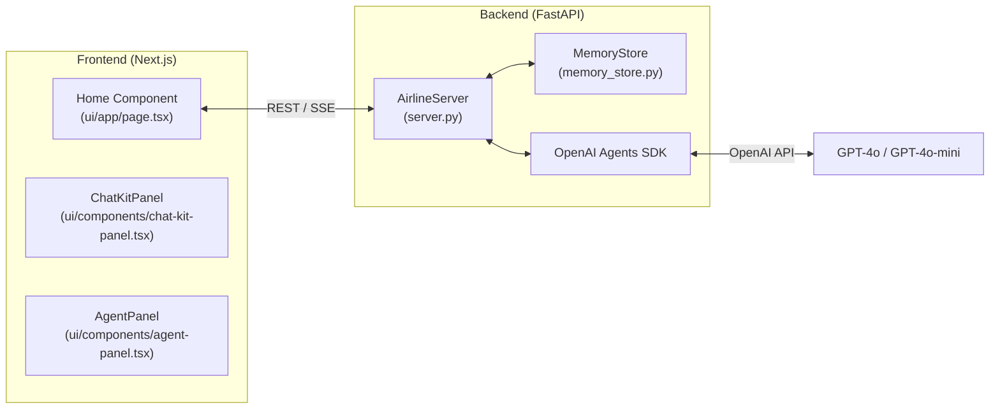
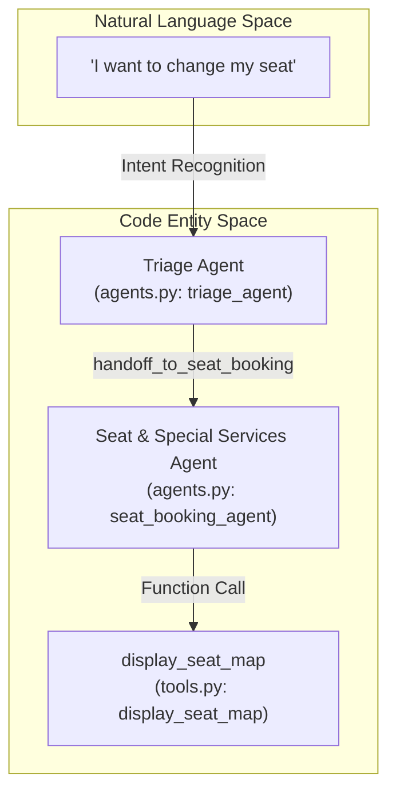

<!-- source: DeepWiki mcp.deepwiki.com · repo openai/openai-cs-agents-demo · page 1 Overview · fetched 2026-10-26 -->

# Overview

Relevant source files

The following files were used as context for generating this wiki page:

- [README.md](README.md)
- [screenshot.jpg](screenshot.jpg)

## Purpose and Scope

This document provides a high-level introduction to the Customer Service Agents Demo repository, which showcases OpenAI's Agents SDK through a complete airline customer service application. The system demonstrates intelligent agent orchestration, cross-agent collaboration, and guardrail enforcement in a production-ready full-stack environment.

The demo uses a hub-and-spoke architecture where a central **Triage Agent** routes user inquiries to specialized specialists (Flight Information, Booking, Seats, FAQ, etc.). It features a two-component architecture: a **Python backend** powered by FastAPI and the `openai-agents` SDK, and a **Next.js frontend** utilizing `@openai/chatkit-react` for a high-fidelity chat experience.

## System Architecture

The Customer Service Agents Demo consists of two primary components that communicate via REST and Server-Sent Events (SSE).

### Component Topology

**Sources**: [README.md:9-13](), [python-backend/server.py:20-40](), [ui/app/page.tsx:35-50]()

### Natural Language to Code Entity Mapping

The following diagram bridges user-facing intents to the specific code entities (Agents and Tools) defined in the backend.

**Sources**: [python-backend/agents.py:40-60](), [python-backend/tools.py:45-55](), [README.md:87-92]()

## Core System Capabilities

### Intelligent Request Routing
The system uses a `triage_agent` [python-backend/agents.py:38]() to analyze user intent and route requests to appropriate specialized agents. The routing is defined via handoff functions such as `handoff_to_flight_info` or `handoff_to_seat_booking`.

| Agent Type | Primary Function | Key Tools / Code Reference |
|------------|------------------|----------------------------|
| **Triage** | Entry point for routing | `triage_agent` [python-backend/agents.py:38]() |
| **Seat & Special Services** | Manage seats and medical requests | `seat_booking_agent` [python-backend/agents.py:112]() |
| **Flight Information** | Status, delays, and connections | `flight_info_agent` [python-backend/agents.py:65]() |
| **Booking & Cancellation** | Rebooking and cancellations | `booking_agent` [python-backend/agents.py:160]() |
| **FAQ** | Policy and general questions | `faq_agent` [python-backend/agents.py:228]() |
| **Refunds & Compensation** | Vouchers and support cases | `refunds_agent` [python-backend/agents.py:255]() |

### Guardrail Enforcement
The system implements a robust guardrail mechanism in `guardrails.py` [python-backend/guardrails.py:1-60]() to ensure safety and relevance.

- **Relevance Guardrail**: Evaluates if the input is related to airline services.
- **Jailbreak Guardrail**: Detects attempts to extract system instructions or bypass constraints.
- **Tripwire Mechanism**: If a guardrail is triggered, the `AirlineServer` catches an `InputGuardrailTripwireTriggered` exception [python-backend/server.py:206-210]() and returns a standardized refusal message.

### Real-Time State Management
The backend uses a `MemoryStore` [python-backend/memory_store.py:22]() to manage conversation threads in-memory. The frontend synchronizes this state using the `useChatKit` hook and a custom `hydrateState` function [ui/app/page.tsx:105]() that fetches updates from the `/chatkit/state` endpoint.

## Technology Stack

### Backend (Python)
- **FastAPI**: Provides the REST and SSE API layer [python-backend/main.py:1-25]().
- **OpenAI Agents SDK**: Orchestrates the multi-agent handoffs and tool executions.
- **Pydantic**: Used for type-safe context and state models (e.g., `AirlineAgentContext` [python-backend/models.py:45]()).

### Frontend (TypeScript/Next.js)
- **Next.js 14 (App Router)**: Framework for the dashboard and chat UI.
- **ChatKit**: OpenAI's library for building chat interfaces [ui/components/chat-kit-panel.tsx:10]().
- **Tailwind CSS**: Styling for the dual-panel "Customer View" and "Agent View" dashboard.

## Wiki Navigation

This wiki is organized into the following sections:

1.  **[System Architecture](2)**: Deep dive into the `AirlineServer` and the `MemoryStore`.
2.  **[Agent System](3)**: Detailed logic for each specialist agent, their tools, and the handoff graph.
3.  **[Frontend Application](4)**: React component structure and the API communication layer.
4.  **[Development Environment](5)**: Setup instructions and environment configuration.
5.  **[Demo Scenarios](6)**: Step-by-step walkthroughs of Seat Changes, IROP (Irregular Operations), and Guardrail enforcement.

**Sources**: [README.md:1-165](), [python-backend/main.py:1-25](), [ui/app/page.tsx:1-150]()

---

