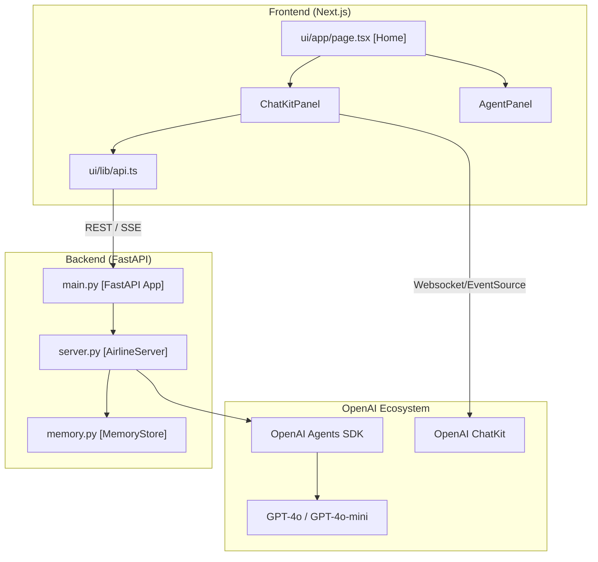
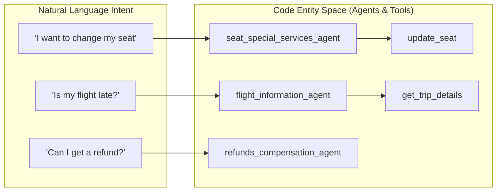

<!-- source: DeepWiki mcp.deepwiki.com · repo openai/openai-cs-agents-demo · page 2 System Architecture · fetched 2026-10-26 -->

# System Architecture

Relevant source files

The following files were used as context for generating this wiki page:

- [README.md](README.md)
- [python-backend/main.py](python-backend/main.py)
- [ui/app/page.tsx](ui/app/page.tsx)

## Purpose and Scope

This document describes the high-level technical architecture of the Customer Service Agents Demo. It details the integration between the Python backend, the Next.js frontend, and the OpenAI Agents SDK. The system is designed to demonstrate a multi-agent orchestration pattern where a central triage agent routes user requests to specialized domain agents.

For detailed technical specifications of the server implementation, see [Backend Server and API Layer](#2.1). For details on the persistence layer, see [In-Memory State Store](#2.2).

## High-Level Component Architecture

The system consists of two primary components: a **Python Backend** that manages agent logic and session state, and a **Next.js Frontend** that provides a dual-view interface for customers and developers.

**Sources:** [README.md:9-13](), [python-backend/main.py:28-42](), [ui/app/page.tsx:109-125]()

## Request Lifecycle and Integration

The system orchestrates communication between the user and the agent cluster through a series of specialized layers.

1.  **User Input**: The user submits a message via the `ChatKitPanel` in the frontend [ui/app/page.tsx:118-123]().
2.  **API Routing**: The frontend calls the `/chatkit` endpoint on the FastAPI server [python-backend/main.py:49-59]().
3.  **Agent Orchestration**: The `AirlineServer` uses the `openai-agents` SDK to process the request. It typically starts with the `triage_agent` [python-backend/main.py:18-26]().
4.  **Specialist Handoff**: Based on intent, the Triage agent may hand off the conversation to specialists like the `booking_cancellation_agent` or `flight_information_agent` [python-backend/main.py:12-19]().
5.  **State Synchronization**: As the backend processes the request, it updates the `MemoryStore`. The frontend synchronizes this state using `hydrateState` to update the observability dashboard [ui/app/page.tsx:35-59]().

### Natural Language to Code Mapping

This diagram maps conceptual entities in the "Natural Language Space" (user intents) to specific "Code Entities" (Agents and Tools) within the architecture.

**Sources:** [README.md:85-93](), [python-backend/main.py:12-19]()

## Backend Architecture

The backend is built on **FastAPI** and acts as a stateful wrapper around the OpenAI Agents SDK.

*   **FastAPI App (`main.py`)**: Defines the REST and SSE (Server-Sent Events) endpoints for the frontend to consume [python-backend/main.py:28-95]().
*   **AirlineServer (`server.py`)**: The core logic controller. It manages the lifecycle of `openai-agents` runners and bridges them with the ChatKit protocol. For details, see [Backend Server and API Layer](#2.1).
*   **MemoryStore (`memory.py`)**: An in-memory implementation of the ChatKit `Store` interface. It persists thread history, agent events, and context metadata. For details, see [In-Memory State Store](#2.2).

**Sources:** [python-backend/main.py:42-43](), [python-backend/main.py:62-81]()

## Frontend Architecture

The frontend is a **Next.js** application that utilizes `@openai/chatkit-react` for the chat interface and custom React components for agent observability.

*   **Home Component (`ui/app/page.tsx`)**: Orchestrates the top-level state, including the list of active agents, conversation context, and guardrail results [ui/app/page.tsx:9-17]().
*   **Synchronization Logic**: Uses `hydrateState` to fetch the latest snapshots from the backend after agent responses conclude [ui/app/page.tsx:35-59]().
*   **Dual-Panel Layout**: Separates the "Customer View" (chat) from the "Agent View" (internal logs, context, and state) [ui/app/page.tsx:110-124]().

**Sources:** [ui/app/page.tsx:109-125](), [ui/app/page.tsx:105-107]()

## Data Flow: Backend to Frontend

The system uses a combination of REST for snapshots and SSE for real-time updates to keep the UI in sync with the agent's "thought process."

| Flow Type | Endpoint | Code Reference | Purpose |
| :--- | :--- | :--- | :--- |
| **Bootstrap** | `/chatkit/bootstrap` | [python-backend/main.py:70-74]() | Initial UI load of agents and context. |
| **State Sync** | `/chatkit/state` | [python-backend/main.py:62-68]() | Refreshing UI after an agent turn. |
| **Real-time** | `/chatkit/state/stream` | [python-backend/main.py:77-95]() | Streaming agent events and progress updates. |

**Sources:** [python-backend/main.py:49-95](), [ui/app/page.tsx:67-95]()

---

