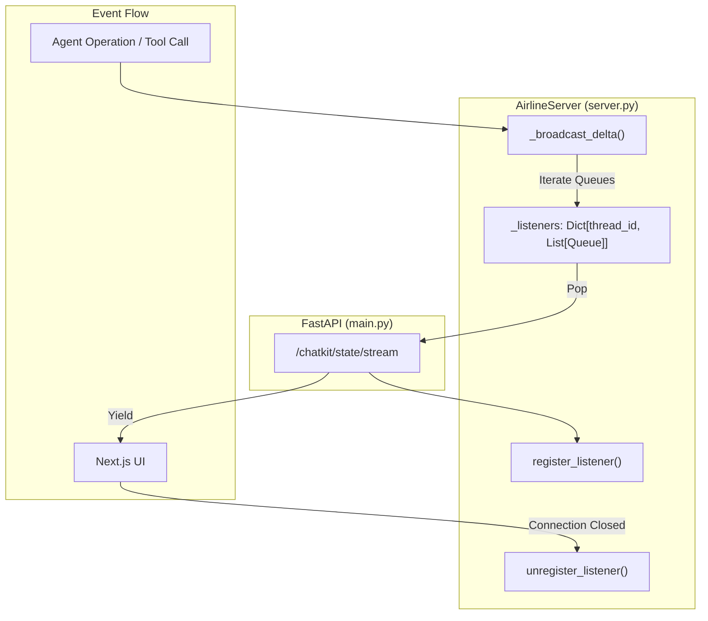
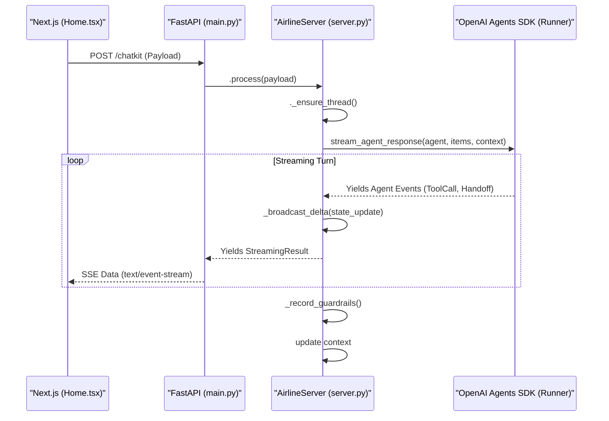

<!-- source: DeepWiki mcp.deepwiki.com · repo openai/openai-cs-agents-demo · page 2.1 Backend Server and API Layer · fetched 2026-10-26 -->

# Backend Server and API Layer

Relevant source files

The following files were used as context for generating this wiki page:

- [python-backend/main.py](python-backend/main.py)
- [python-backend/server.py](python-backend/server.py)

The Backend Server and API Layer provides the communication interface between the Next.js frontend and the Agent orchestration logic. It is built using **FastAPI** and serves as the bridge between the **OpenAI Agents SDK**, the **MemoryStore** state management, and the real-time UI updates via Server-Sent Events (SSE).

## FastAPI Application (`main.py`)

The entry point of the backend is `main.py`, which initializes the FastAPI application and defines the REST and SSE endpoints.

### Application Configuration
- **CORS**: Configured to allow requests from `http://localhost:3000` to support local development [python-backend/main.py:34-40]().
- **Tracing**: `OPENAI_TRACING_DISABLED` is set to `"1"` by default to ensure zero data retention [python-backend/main.py:31-31]().
- **Server Instance**: A singleton `AirlineServer` instance is created and shared across requests via FastAPI's dependency injection [python-backend/main.py:42-46]().

### API Endpoints

| Endpoint | Method | Description |
|----------|--------|-------------|
| `/chatkit` | `POST` | Processes incoming chat payloads. Returns a `StreamingResponse` for agent execution [python-backend/main.py:49-59](). |
| `/chatkit/state` | `GET` | Returns a snapshot of the current state for a specific `thread_id` [python-backend/main.py:62-67](). |
| `/chatkit/bootstrap` | `GET` | Returns an initial state snapshot (used when no thread exists) [python-backend/main.py:70-74](). |
| `/chatkit/state/stream`| `GET` | An SSE endpoint that streams real-time state updates to the UI [python-backend/main.py:77-95](). |
| `/health` | `GET` | Simple health check returning `{"status": "healthy"}` [python-backend/main.py:98-100](). |

**Sources:** [python-backend/main.py:28-100]()

## AirlineServer Class (`server.py`)

The `AirlineServer` class extends `ChatKitServer` and manages the lifecycle of agent interactions, state persistence, and event broadcasting.

### State and Listener Management
The server maintains several internal dictionaries to track conversation progress:
- `self._state`: Maps `thread_id` to a `ConversationState` object [python-backend/server.py:152-152]().
- `self._listeners`: Maps `thread_id` to a list of `asyncio.Queue` objects for broadcasting updates [python-backend/server.py:153-153]().
- `self.store`: An instance of `MemoryStore` used for persisting thread items [python-backend/server.py:150-150]().

### ConversationState
The `ConversationState` dataclass tracks the non-persistent UI-specific state for a session:
- `input_items`: Raw items processed during the current turn [python-backend/server.py:141-141]().
- `context`: The `AirlineAgentContext` (itineraries, user info) [python-backend/server.py:142-142]().
- `current_agent_name`: Tracks which agent is currently active (defaults to `triage_agent`) [python-backend/server.py:143-143]().
- `events`: A list of `AgentEvent` objects for the UI timeline [python-backend/server.py:144-144]().
- `guardrails`: Results of guardrail checks performed during the turn [python-backend/server.py:145-145]().

**Sources:** [python-backend/server.py:139-160]()

## Real-time Updates: Broadcast/Listener Pattern

The server implements a pub/sub pattern to ensure the frontend stays synchronized with the backend's internal state during long-running agent operations.

1. **Registration**: When the frontend connects to `/chatkit/state/stream`, the server calls `register_listener(thread_id)`, creating a new `asyncio.Queue` [python-backend/main.py:82-83]().
2. **Broadcasting**: Whenever the agent state changes (e.g., a handoff occurs or a tool is called), `_broadcast_delta()` is invoked. It serializes the change and pushes it into every queue registered for that `thread_id` [python-backend/server.py:214-220]().
3. **Consumption**: The `event_generator` in `main.py` continuously pulls from the queue and yields the data as an SSE message [python-backend/main.py:85-91]().
4. **Cleanup**: When the client disconnects, `unregister_listener` removes the queue to prevent memory leaks [python-backend/main.py:93-93]().

**Sources:** [python-backend/main.py:77-95](), [python-backend/server.py:153-153]()

## Request Lifecycle: Natural Language to Code Entities

The following diagram maps the flow of a user request through the API layer into the SDK's execution logic.

### Key Logic in `server.py`:
- **`_get_agent_by_name`**: Resolves string names from the UI to actual Agent objects like `triage_agent` or `faq_agent` [python-backend/server.py:70-80]().
- **`_record_guardrails`**: Processes results from the SDK's guardrail execution and maps them to `GuardrailCheck` Pydantic models for the UI [python-backend/server.py:179-206]().
- **`InputGuardrailTripwireTriggered`**: If a guardrail fails, this exception is caught to return a specialized refusal message instead of continuing agent execution [python-backend/server.py:16-16]().

**Sources:** [python-backend/server.py:13-80](), [python-backend/server.py:179-206](), [python-backend/main.py:49-59]()

---

