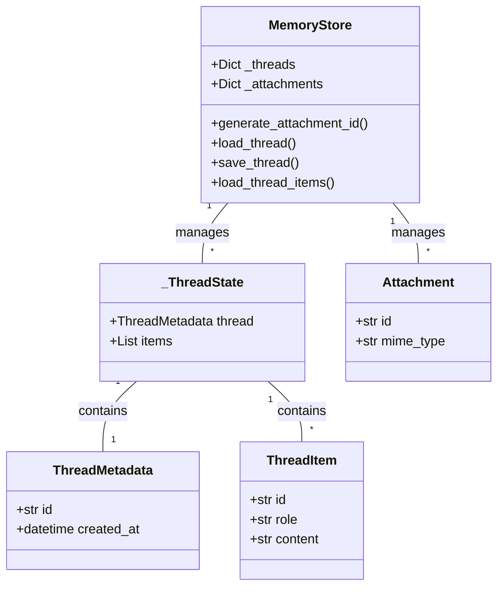
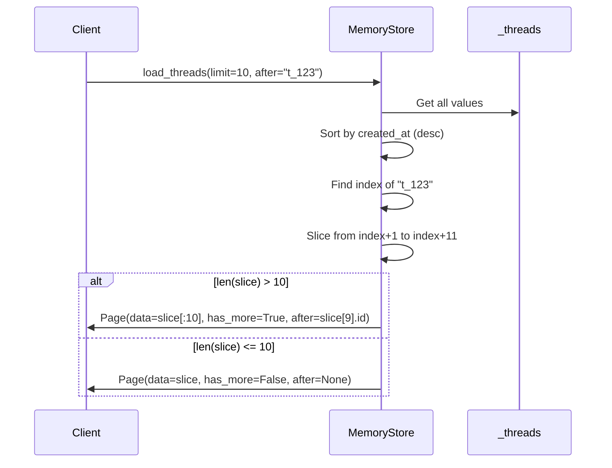

<!-- source: DeepWiki mcp.deepwiki.com · repo openai/openai-cs-agents-demo · page 2.2 In-Memory State Store · fetched 2026-10-26 -->

# In-Memory State Store

Relevant source files

The following files were used as context for generating this wiki page:

- [python-backend/memory_store.py](python-backend/memory_store.py)
- [python-backend/requirements.txt](python-backend/requirements.txt)

## Purpose and Scope

The `MemoryStore` class is a transient, in-memory implementation of the `chatkit.Store` interface [python-backend/memory_store.py:18-19](). It serves as the persistence layer for the `openai-chatkit` integration, managing the lifecycle of chat threads, message items, and file attachments. Because it stores data in local RAM, state is cleared whenever the backend server restarts. This implementation is designed for the demo's requirements of rapid prototyping without the overhead of an external database.

## Data Structures

The store organizes data using a nested structure centered around the `_ThreadState` dataclass.

### Internal Thread State
The `_ThreadState` dataclass [python-backend/memory_store.py:12-16]() acts as the primary container for a single conversation's data:
- **`thread`**: A `ThreadMetadata` object containing high-level information (ID, timestamps) but excluding the actual message list [python-backend/memory_store.py:14]().
- **`items`**: A list of `ThreadItem` objects representing the chronological history of messages and events within that thread [python-backend/memory_store.py:15]().

### Store Collections
The `MemoryStore` maintains two primary dictionaries:
1. **`_threads`**: Maps `thread_id` (string) to `_ThreadState` instances [python-backend/memory_store.py:22]().
2. **`_attachments`**: Maps `attachment_id` (string) to `Attachment` objects [python-backend/memory_store.py:23]().

### Entity Relationship Diagram

Sources: [python-backend/memory_store.py:12-23]()

## Thread and Item Management

### Metadata Handling
To comply with `openai-chatkit` (>=1.0) requirements, the store uses a static method `_get_thread_metadata` [python-backend/memory_store.py:29-40]() to ensure that `ThreadMetadata` objects do not contain embedded items when being saved or loaded. It explicitly strips the `items` field from the data model before returning a copy [python-backend/memory_store.py:38-40]().

### Thread Lifecycle
- **Loading**: `load_thread` retrieves the state and returns a deep copy of the metadata [python-backend/memory_store.py:43-47](). If the thread does not exist, it raises a `NotFoundError` [python-backend/memory_store.py:46]().
- **Saving**: `save_thread` either updates existing metadata or initializes a new `_ThreadState` with an empty items list [python-backend/memory_store.py:49-58]().
- **Deletion**: `delete_thread` removes the thread and all its associated items from the `_threads` dictionary [python-backend/memory_store.py:89-90]().

### Thread Item Operations
The store manages `ThreadItem` objects (messages, tool calls, etc.) via the following methods:
- **`add_thread_item`**: Appends a new item to the thread's internal list [python-backend/memory_store.py:129-132]().
- **`save_item`**: Upserts an item; if an item with the same ID exists, it is replaced; otherwise, it is appended [python-backend/memory_store.py:134-140]().
- **`load_item`**: Searches the thread's list for a specific `item_id` [python-backend/memory_store.py:142-146]().

Sources: [python-backend/memory_store.py:29-58](), [python-backend/memory_store.py:129-146]()

## Pagination and Sorting

The store implements cursor-based pagination for both threads and items using the `Page` type.

### Implementation Logic
1. **Sorting**: Items are sorted by `created_at` timestamps. Threads are sorted similarly, defaulting to `datetime.min` if a timestamp is missing [python-backend/memory_store.py:67-71](), [python-backend/memory_store.py:112-115]().
2. **Cursor (After)**: If an `after` parameter is provided, the store finds the index of that ID and starts the slice from the next element [python-backend/memory_store.py:73-77](), [python-backend/memory_store.py:117-121]().
3. **Lookahead**: The store fetches `limit + 1` items to determine if a "next page" exists (`has_more`) [python-backend/memory_store.py:79-82](), [python-backend/memory_store.py:123-126]().

### Thread Pagination Flow

Sources: [python-backend/memory_store.py:60-87](), [python-backend/memory_store.py:103-127]()

## Attachment Handling

The store manages binary or structured attachments associated with messages.

- **ID Generation**: `generate_attachment_id` creates unique identifiers prefixed with `atc_` followed by an 8-character UUID hex string [python-backend/memory_store.py:25-27]().
- **Persistence**: Attachments are stored in the `_attachments` dictionary [python-backend/memory_store.py:161]().
- **Retrieval**: `load_attachment` returns a deep copy of the `Attachment` model to prevent accidental mutation of the stored state [python-backend/memory_store.py:164-171]().

Sources: [python-backend/memory_store.py:25-27](), [python-backend/memory_store.py:156-174]()

---

