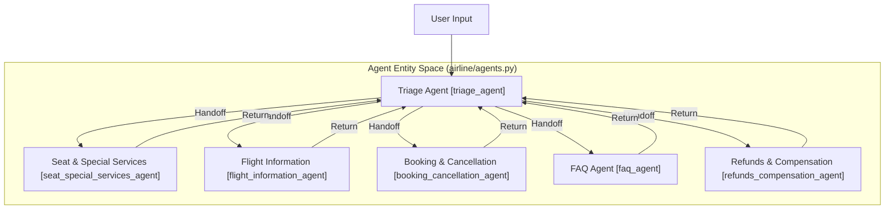
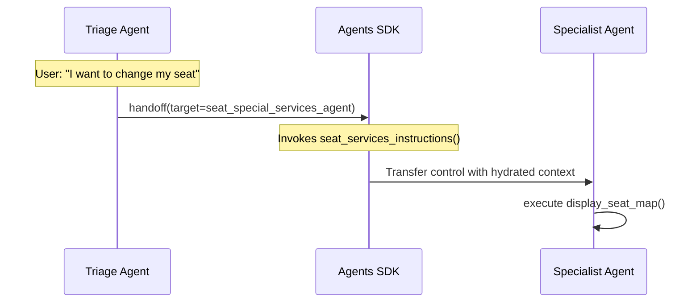

<!-- source: DeepWiki mcp.deepwiki.com · repo openai/openai-cs-agents-demo · page 3 Agent System · fetched 2026-10-26 -->

# Agent System

Relevant source files

The following files were used as context for generating this wiki page:

- [README.md](README.md)
- [python-backend/airline/agents.py](python-backend/airline/agents.py)

## Purpose and Scope

This document provides a high-level overview of the multi-agent orchestration system built on the OpenAI Agents SDK. It explains the hub-and-spoke architecture, where a central **Triage Agent** routes requests to specialized domain agents. This page introduces the core concepts of handoffs, context management, and safety guardrails.

For deep dives into specific areas, see the child pages:
- [Agent Types and Capabilities](#3.1) — Details on the six specialized agents and their toolsets.
- [Guardrail System](#3.2) — Technical implementation of the Relevance and Jailbreak protections.
- [Context and Demo Data](#3.3) — How state is managed across agents using Pydantic models.

## Agent Orchestration Overview

The system utilizes a hub-and-spoke model. Every conversation begins with the **Triage Agent**, which acts as the primary router. Based on the user's intent, the Triage Agent uses the `handoff` mechanism provided by the SDK to transfer control to a specialist.

### Hub-and-Spoke Architecture

Sources: [python-backend/airline/agents.py:49-56](), [python-backend/airline/agents.py:77-84](), [python-backend/airline/agents.py:106-113](), [python-backend/airline/agents.py:165-172]()

## Agent Definitions and Handoffs

Each agent is defined as an `Agent` instance typed with `AirlineAgentChatContext`. This context allows agents to share persistent state like confirmation numbers and flight details.

| Agent Variable Name | Role | Primary Tools |
|---------------------|------|---------------|
| `triage_agent` | Router & Trip Discovery | `get_trip_details` |
| `flight_information_agent` | Status & Impact Analysis | `flight_status_tool`, `get_matching_flights` |
| `booking_cancellation_agent` | Rebooking & Cancellation | `book_new_flight`, `cancel_flight` |
| `seat_special_services_agent` | Seating & Medical Requests | `display_seat_map`, `update_seat` |
| `refunds_compensation_agent` | Post-disruption Support | `issue_compensation` |
| `faq_agent` | Policy & General Info | `faq_lookup_tool` |

Sources: [python-backend/airline/agents.py:49-172](), [python-backend/airline/tools.py:1-25]()

### The Handoff Mechanism
Handoffs are not just simple transfers; they can include logic to hydrate the next agent's context. For example, when handing off to the Seat agent, the system uses specific instructions to ensure the `confirmation_number` is ready for the specialist.

Sources: [python-backend/airline/agents.py:28-46](), [python-backend/airline/agents.py:175-186]()

## Safety and Guardrails

To ensure the agents remain helpful and harmless, the system applies **Input Guardrails** at the agent definition level. Every agent (except the FAQ agent) is configured with `relevance_guardrail` and `jailbreak_guardrail`.

- **Relevance:** Prevents the agent from discussing topics outside of airline customer service (e.g., writing poems).
- **Jailbreak:** Detects attempts to bypass system instructions or extract the underlying prompt.

If a guardrail is triggered, the system raises an `InputGuardrailTripwireTriggered` exception, which is caught by the server to return a standardized refusal message.

Sources: [python-backend/airline/agents.py:55-55](), [python-backend/airline/guardrails.py:34-56](), [python-backend/airline/server.py:141-146]()

## Context Management

The entire system relies on a shared state object, `AirlineAgentChatContext`. This Pydantic model stores:
1. **User Info:** Name, loyalty status.
2. **Flight Info:** Confirmation number, flight number, seat.
3. **Session State:** Whether a disruption has occurred or a compensation case is open.

This state is "hydrated" (populated) by tools like `get_trip_details` and is preserved as the user moves between different specialist agents.

Sources: [python-backend/airline/context.py:18-35](), [python-backend/airline/demo_data.py:54-72]()

---

