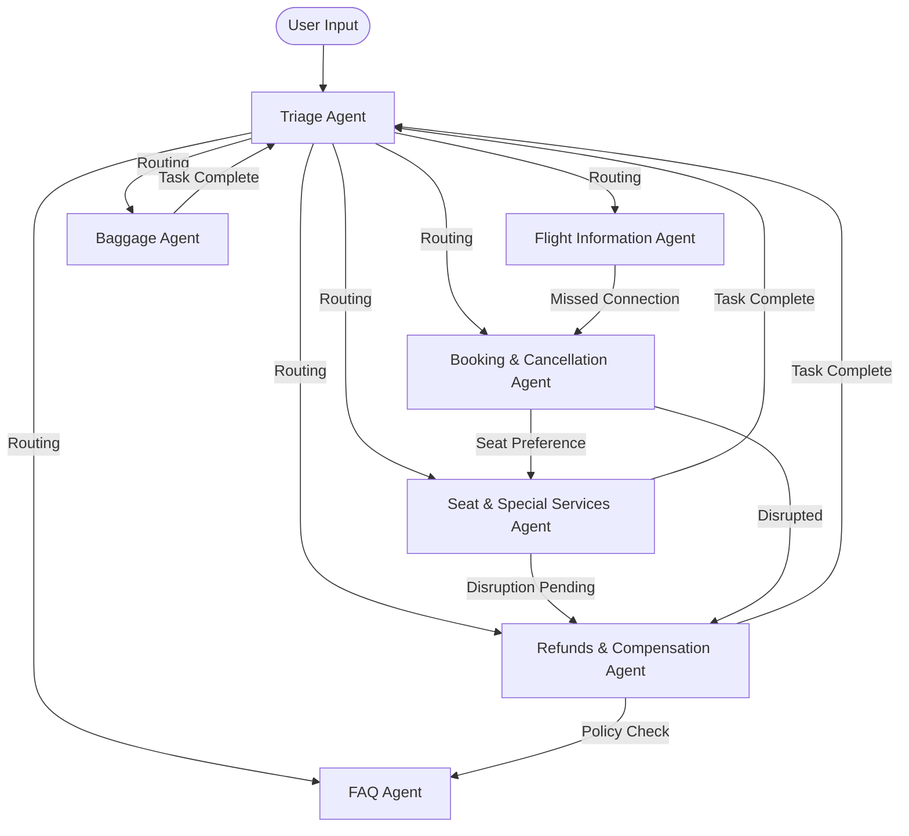
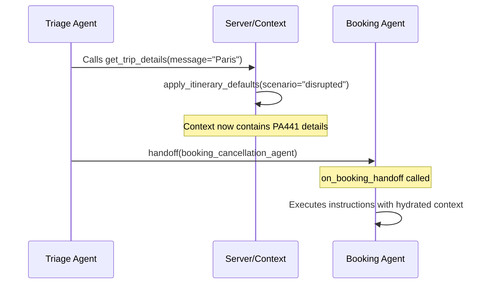

<!-- source: DeepWiki mcp.deepwiki.com · repo openai/openai-cs-agents-demo · page 3.1 Agent Types and Capabilities · fetched 2026-10-26 -->

# Agent Types and Capabilities

Relevant source files

The following files were used as context for generating this wiki page:

- [python-backend/airline/agents.py](python-backend/airline/agents.py)
- [python-backend/airline/tools.py](python-backend/airline/tools.py)

This document details the specialized agents implemented in the Customer Service Agents Demo system and their specific capabilities. Each agent is a discrete `Agent` instance defined in the backend, utilizing the `openai-agents` SDK to handle distinct aspects of airline customer service.

## Agent System Architecture

The system implements a hub-and-spoke architecture with a central `Triage Agent` that routes conversations to specialized service agents based on user intent. Each agent is defined by specific capabilities, tools, and handoff permissions. Agents are implemented using the `Agent[AirlineAgentChatContext]` class [python-backend/airline/agents.py:49]().

### Directed Handoff Graph

The following diagram illustrates the directed flow of handoffs between agents. While the `Triage Agent` can hand off to any specialist, specialists often hand off to each other based on the resolution of specific tasks (e.g., rebooking leading to seat selection).

Sources: [python-backend/airline/agents.py:44-45](), [python-backend/airline/agents.py:71-73](), [python-backend/airline/agents.py:101-102](), [python-backend/airline/agents.py:128-129]()

---

## Agent Definitions and Tools

### Triage Agent
The central coordinator. It uses the `get_trip_details` tool to hydrate the conversation context based on user input before routing.

*   **Instruction Function**: `triage_instructions` [python-backend/airline/agents.py:165-182]()
*   **Tools**: `get_trip_details` [python-backend/airline/agents.py:188]()
*   **Handoff Logic**: If a specific intent is detected (e.g., "change seat"), it calls `handoff(agent_name)` [python-backend/airline/agents.py:176]().

### Seat & Special Services Agent
Handles seat changes and medical/special requests.

*   **Instruction Function**: `seat_services_instructions` [python-backend/airline/agents.py:28-46]()
*   **Tools**: `update_seat`, `assign_special_service_seat`, `display_seat_map` [python-backend/airline/agents.py:54]()
*   **Key Behavior**: Can trigger the interactive `SeatMap` UI component via the `display_seat_map` tool [python-backend/airline/tools.py:16-23]().

### Flight Information Agent
Provides status, connection risks, and identifies disruptions.

*   **Instruction Function**: `flight_information_instructions` [python-backend/airline/agents.py:59-74]()
*   **Tools**: `flight_status_tool`, `get_matching_flights` [python-backend/airline/agents.py:82]()
*   **Context Logic**: Uses `flight_status_tool` to check if delays cause missed connections, triggering a handoff to rebooking [python-backend/airline/tools.py:120-121]().

### Booking & Cancellation Agent
Handles rebooking, new bookings, and cancellations.

*   **Instruction Function**: `booking_cancellation_instructions` [python-backend/airline/agents.py:87-103]()
*   **Tools**: `cancel_flight`, `get_matching_flights`, `book_new_flight` [python-backend/airline/agents.py:111]()
*   **Hydration Hook**: `on_booking_handoff` is used to ensure the agent has the necessary itinerary data when a handoff occurs [python-backend/airline/agents.py:204-207]().

### Refunds & Compensation Agent
Assists with vouchers and compensation cases after disruptions.

*   **Instruction Function**: `refunds_compensation_instructions` [python-backend/airline/agents.py:116-130]()
*   **Tools**: `issue_compensation`, `faq_lookup_tool` [python-backend/airline/agents.py:137]()
*   **Workflow**: Consults policy via `faq_lookup_tool` before issuing support [python-backend/airline/agents.py:126]().

---

## Context Hydration and Handoff Hooks

The system uses specific hooks to "hydrate" or prepare the `AirlineAgentChatContext` during agent transitions. This ensures that a specialist agent has the data it needs (like confirmation numbers or flight details) without re-asking the user.

### Context Hydration Flow

| Hook Function | File Reference | Purpose |
|---------------|----------------|---------|
| `on_seat_booking_handoff` | [python-backend/airline/agents.py:199-202]() | Hydrates default itinerary data when entering seat selection. |
| `on_booking_handoff` | [python-backend/airline/agents.py:204-207]() | Hydrates default itinerary data when entering rebooking flow. |
| `get_trip_details` (Tool) | [python-backend/airline/tools.py:48-74]() | Inters scenario ("on_time" vs "disrupted") from user text. |

Sources: [python-backend/airline/agents.py:199-207](), [python-backend/airline/tools.py:48-74]()

---

## Tool Implementation Details

Tools are defined as `@function_tool` in `tools.py`. They often interact directly with the `RunContextWrapper[AirlineAgentChatContext]` to modify the persistent state of the conversation.

### Core Tools Table

| Tool Name | Implementation | Description |
|-----------|----------------|-------------|
| `faq_lookup_tool` | [python-backend/airline/tools.py:14-41]() | Static knowledge base for baggage, wifi, and compensation policy. |
| `flight_status_tool` | [python-backend/airline/tools.py:89-145]() | Returns status and warns about connection risks in "disrupted" scenarios. |
| `display_seat_map` | [python-backend/airline/tools.py:168-175]() | Emits a `ProgressUpdateEvent` that the frontend interprets to show the `SeatMap`. |
| `book_new_flight` | [python-backend/airline/tools.py:214-235]() | Updates the `itinerary` in context and assigns a new `flight_number`. |
| `issue_compensation` | [python-backend/airline/tools.py:238-254]() | Generates a random `compensation_case_id` and sets `vouchers_issued` to `True`. |

Sources: [python-backend/airline/tools.py:14-254]()

---

