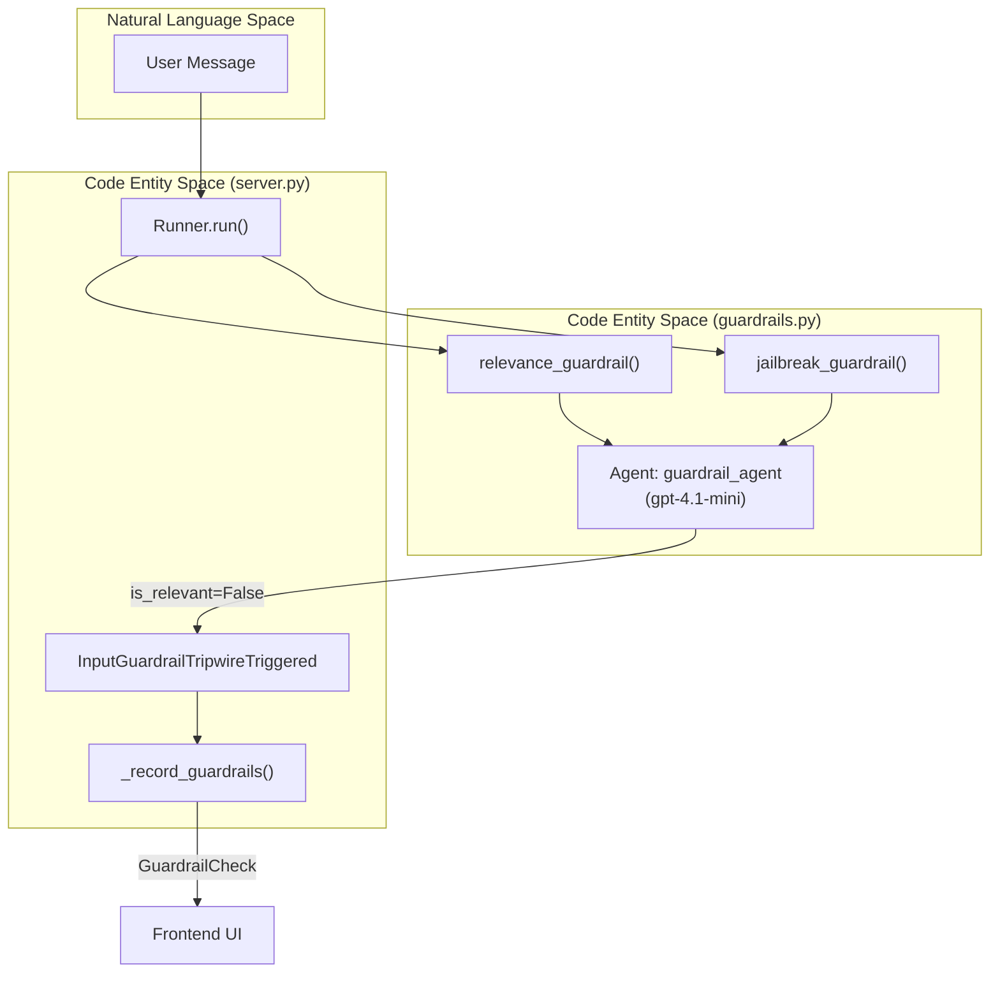
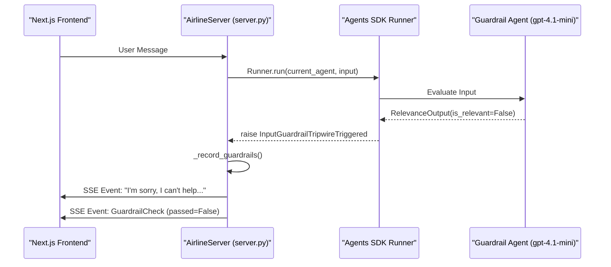

<!-- source: DeepWiki mcp.deepwiki.com · repo openai/openai-cs-agents-demo · page 3.2 Guardrail System · fetched 2026-10-26 -->

# Guardrail System

Relevant source files

The following files were used as context for generating this wiki page:

- [python-backend/airline/guardrails.py](python-backend/airline/guardrails.py)
- [python-backend/server.py](python-backend/server.py)

## Purpose and Scope

The Guardrail System enforces conversation boundaries and security constraints within the Customer Service Agents Demo. It utilizes specialized agents powered by `gpt-4.1-mini` [python-backend/airline/guardrails.py:14]() to evaluate user input in real-time. The system implements two primary protections: the **Relevance Guardrail** ensures conversations stay on airline-related topics, and the **Jailbreak Guardrail** prevents security violations and system instruction bypasses.

## Guardrail Architecture Overview

The guardrail system is implemented using the `agents` SDK's `@input_guardrail` decorator [python-backend/airline/guardrails.py:39](). When an agent is invoked, the SDK executes the assigned guardrails before the primary agent logic.

### Guardrail System Flow

Sources: [python-backend/airline/guardrails.py:24-88](), [python-backend/server.py:179-206]()

## Guardrail Implementation

Guardrails are defined as asynchronous functions that utilize a dedicated `guardrail_agent` to perform evaluation.

### Relevance Guardrail
The Relevance Guardrail [python-backend/airline/guardrails.py:40]() uses `RelevanceOutput` [python-backend/airline/guardrails.py:17]() to classify if the input is related to airline travel (flights, bookings, etc.). It returns a `GuardrailFunctionOutput` where `tripwire_triggered` is set to `True` if the input is irrelevant [python-backend/airline/guardrails.py:50]().

### Jailbreak Guardrail
The Jailbreak Guardrail [python-backend/airline/guardrails.py:78]() detects attempts to bypass system instructions or perform prompt injection. It uses `JailbreakOutput` [python-backend/airline/guardrails.py:53]() to provide reasoning and a safety boolean.

### The Tripwire Mechanism
Both guardrails return a `GuardrailFunctionOutput` [python-backend/airline/guardrails.py:50,88](). If `tripwire_triggered` is true, the SDK raises an `InputGuardrailTripwireTriggered` exception. This exception is caught in `server.py` during the response streaming process [python-backend/server.py:273-277](), which then returns a standard refusal message: *"I'm sorry, I can't help with that request."* [python-backend/server.py:276]().

Sources: [python-backend/airline/guardrails.py:1-89](), [python-backend/server.py:273-277]()

## Data Structures and Models

### GuardrailCheck
The `GuardrailCheck` Pydantic model [python-backend/server.py:61]() is used to package the results of a guardrail evaluation for the frontend.

| Field | Type | Purpose |
|-------|------|---------|
| `name` | `str` | Friendly name (e.g., "Relevance Guardrail") [python-backend/server.py:63]() |
| `input` | `str` | The specific text being evaluated [python-backend/server.py:64]() |
| `reasoning`| `str` | The LLM's explanation for the decision [python-backend/server.py:65]() |
| `passed` | `bool` | Inversion of `tripwire_triggered` [python-backend/server.py:66]() |

### Guardrail Recording Logic
The `AirlineServer._record_guardrails` method [python-backend/server.py:179]() iterates through an agent's configured `input_guardrails` [python-backend/server.py:188](). It matches the raw SDK `guardrail_results` to the agent's definitions to construct the list of `GuardrailCheck` objects [python-backend/server.py:189-206]().

Sources: [python-backend/server.py:61-68](), [python-backend/server.py:179-207]()

## Integration with Agent System

Agents are assigned guardrails via the `input_guardrails` attribute. The `_build_agents_list` helper [python-backend/server.py:97]() extracts these names so the UI can display which protections are active for the current agent [python-backend/server.py:106]().

### Request Lifecycle with Guardrails

### UI Surface
Guardrail results are surfaced to the UI via the `ConversationState` [python-backend/server.py:140](). The `guardrails` list in the state [python-backend/server.py:145]() is broadcasted to the frontend, where the "Agent View" dashboard displays the reasoning and pass/fail status for every check.

Sources: [python-backend/server.py:97-116](), [python-backend/server.py:140-147](), [python-backend/server.py:273-277]()

---

