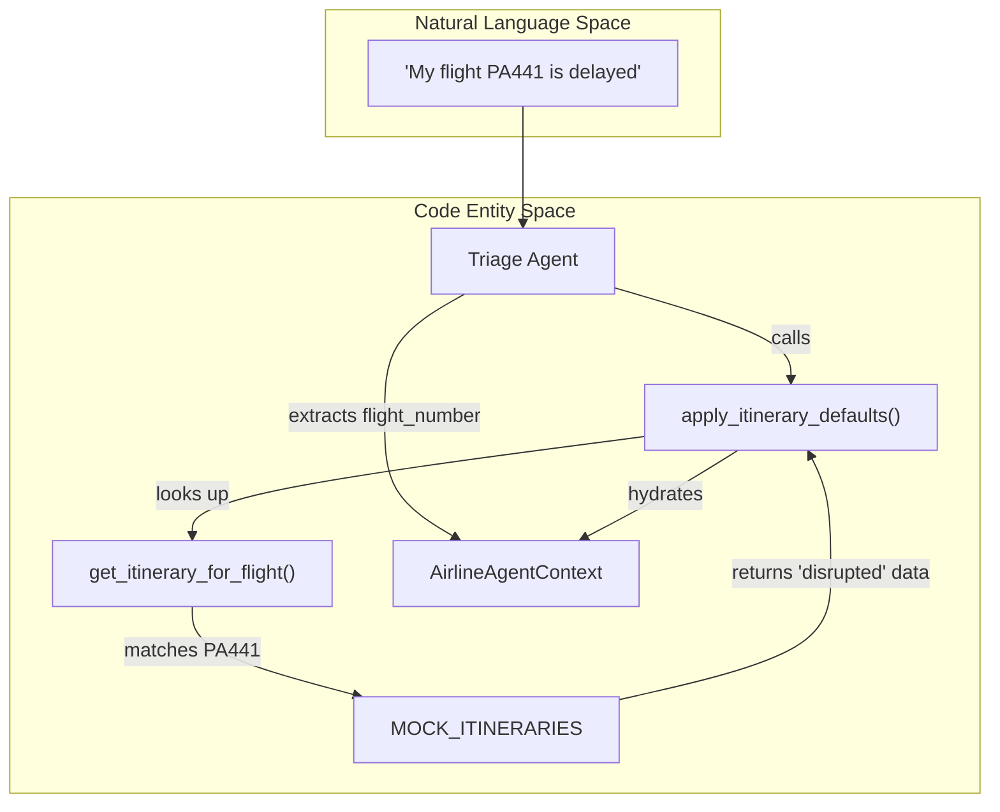
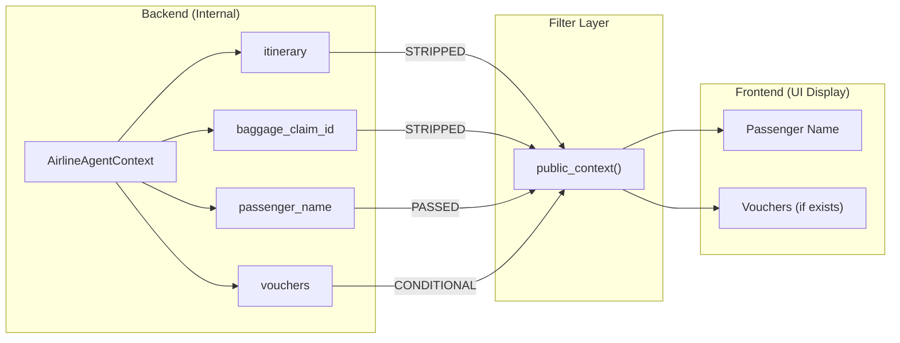

<!-- source: DeepWiki mcp.deepwiki.com · repo openai/openai-cs-agents-demo · page 3.3 Context and Demo Data · fetched 2026-10-26 -->

# Context and Demo Data

Relevant source files

The following files were used as context for generating this wiki page:

- [python-backend/airline/__init__.py](python-backend/airline/__init__.py)
- [python-backend/airline/context.py](python-backend/airline/context.py)
- [python-backend/airline/demo_data.py](python-backend/airline/demo_data.py)

This page documents the data structures and mock datasets that drive the Airline Customer Service Agents Demo. The system relies on a central context model to maintain state across multi-agent handoffs and uses a set of predefined scenarios to simulate realistic airline customer service interactions.

## Context Models

The application uses Pydantic models to define the schema for conversation state. This state is passed between agents, allowing a specialist (e.g., the Booking Agent) to access information gathered by a previous agent (e.g., the Triage Agent).

### AirlineAgentContext
The `AirlineAgentContext` is the primary data structure for storing passenger details, flight information, and session-specific metadata. It includes fields for both customer-facing data and internal tracking.

| Field | Type | Description |
| :--- | :--- | :--- |
| `passenger_name` | `str \| None` | The name of the customer. |
| `confirmation_number` | `str \| None` | The 6-character PNR or booking reference. |
| `flight_number` | `str \| None` | The identifier for the flight in question. |
| `itinerary` | `list[dict] \| None` | **Internal Only.** Full flight segment details. |
| `baggage_claim_id` | `str \| None` | **Internal Only.** Tracking ID for luggage. |
| `vouchers` | `list[str] \| None` | Compensation vouchers granted to the user. |
| `scenario` | `str \| None` | Identifies which mock data scenario is active. |

Sources: [python-backend/airline/context.py:7-23]()

### AirlineAgentChatContext
This class serves as a wrapper for the `AirlineAgentContext`, specifically designed for integration with the OpenAI Agents SDK `AgentContext`. It encapsulates the persistent state within a `state` attribute, which the SDK manages during chat runs.

Sources: [python-backend/airline/context.py:25-32]()

## Context Visibility and Filtering

To ensure sensitive or internal system data is not exposed to the user interface, the system implements a filtering mechanism.

### The `public_context` Function
The `public_context` function transforms the internal `AirlineAgentContext` into a dictionary suitable for the frontend. It explicitly removes keys defined in `hidden_keys` (such as `itinerary` and `baggage_claim_id`) and conditionally surfaces `vouchers` only if they have been populated.

Sources: [python-backend/airline/context.py:43-61]()

## Demo Scenarios and Mock Data

The system provides two primary scenarios defined in `MOCK_ITINERARIES` to demonstrate different agent capabilities.

### MOCK_ITINERARIES
This dictionary contains the data used to hydrate the agent's knowledge when a user provides a flight or confirmation number.

1.  **"on_time"**: A simple scenario featuring a commuter flight from SFO to LAX. Used for testing basic seat changes and flight status checks. [python-backend/airline/demo_data.py:60-80]()
2.  **"disrupted"**: A complex multi-leg scenario (Paris -> New York -> Austin) where the first leg is delayed, causing a missed connection. This scenario triggers rebooking logic and compensation vouchers. [python-backend/airline/demo_data.py:7-59]()

### Context Hydration Logic

The following diagram illustrates how the system transitions from an empty initial context to a populated state using the mock data.

**Context Hydration Flow**

Sources: [python-backend/airline/demo_data.py:83-113](), [python-backend/airline/context.py:34-40]()

## Helper Functions

The system uses utility functions to resolve which itinerary data should be active based on the current conversation state.

### `apply_itinerary_defaults`
This function populates an `AirlineAgentContext` instance with default values from a scenario. If no scenario is specified, it defaults to the "disrupted" scenario. It ensures that fields like `passenger_name`, `origin`, and `destination` are filled so that the agent can speak intelligently about the trip without asking the user for every detail.
Sources: [python-backend/airline/demo_data.py:83-99]()

### `active_itinerary`
This function resolves the specific itinerary dictionary and scenario key currently associated with the context. It first checks for an explicit `scenario` flag, then attempts to match the `flight_number` against known mock segments. If no match is found, it falls back to the "disrupted" data.
Sources: [python-backend/airline/demo_data.py:116-125]()

### Data Flow to UI

The relationship between the backend Pydantic models and the frontend visibility is strictly controlled by the filtering logic.

**Data Visibility Mapping**

Sources: [python-backend/airline/context.py:43-61]()

---

