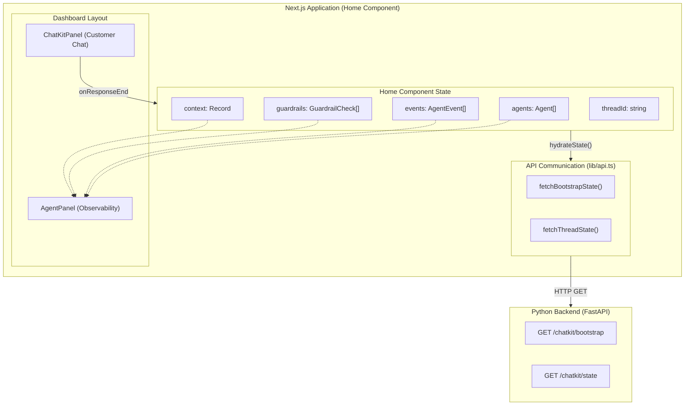

<!-- source: DeepWiki mcp.deepwiki.com · repo openai/openai-cs-agents-demo · page 4 Frontend Application · fetched 2026-10-26 -->

# Frontend Application

Relevant source files

The following files were used as context for generating this wiki page:

- [ui/app/layout.tsx](ui/app/layout.tsx)
- [ui/app/page.tsx](ui/app/page.tsx)
- [ui/tsconfig.json](ui/tsconfig.json)

This document covers the Next.js frontend application that provides the user interface and visualization layer for the Customer Service Agents Demo. The frontend is built using the Next.js 14 App Router and utilizes the `@openai/chatkit-react` library to manage the customer-facing chat experience while providing a custom observability dashboard for the agent orchestration process.

For information about the backend agent system, see [Agent System](#3). For development setup instructions, see [Development Environment](#5).

## Architecture Overview

The frontend is a single-page dashboard divided into two primary panels: the **Agent View** (left) and the **Customer View** (right). It runs on `localhost:3000` and synchronizes with the Python backend on `localhost:8000`.

### Frontend System Architecture

Sources: [ui/app/page.tsx:9-126](), [ui/app/layout.tsx:17-33](), [ui/lib/api.ts:1-35]()

## Component Layout

The root of the application is the `Home` component in `ui/app/page.tsx`. It manages the high-level state and orchestrates the synchronization between the OpenAI ChatKit thread and the custom agent visualization.

*   **Customer View (`ChatKitPanel`)**: Uses the OpenAI ChatKit SDK to render a high-fidelity chat interface. It manages the message history and interaction with the backend's ChatKit endpoints.
*   **Agent View (`AgentPanel`)**: A custom dashboard that visualizes the "behind-the-scenes" logic, including the current active agent, handoff history, tool execution logs, and guardrail results.

For details, see [UI Components](#4.1).

Sources: [ui/app/page.tsx:109-125]()

## State Management and Synchronization

The frontend maintains a local state that mirrors the backend's `ConversationState`. Synchronization occurs at two critical lifecycle points:

1.  **Bootstrap**: When the application first loads, `useEffect` calls `fetchBootstrapState` to retrieve the current thread ID, active agents, and initial context [ui/app/page.tsx:67-95]().
2.  **Response End**: When the `ChatKitPanel` finishes receiving a streamed response from the agent, it triggers `onResponseEnd`. This invokes `hydrateState`, which fetches the latest `AgentEvents` and `GuardrailChecks` from the backend [ui/app/page.tsx:105-107]().

### State Normalization
To keep the UI clean during streaming, the `normalizeEvents` function prunes "progress_update" events once newer concrete events (like tool calls or messages) arrive, or after a 15-second timeout [ui/app/page.tsx:18-33]().

Sources: [ui/app/page.tsx:35-59](), [ui/app/page.tsx:61-65]()

## API Communication Layer

The frontend communicates with the FastAPI backend through a specialized API layer in `ui/lib/api.ts`. Unlike standard REST patterns, this layer is designed to support the ChatKit state management.

| Function | Endpoint | Purpose |
| :--- | :--- | :--- |
| `fetchBootstrapState` | `/chatkit/bootstrap` | Initializes the UI with the default thread and agent definitions. |
| `fetchThreadState` | `/chatkit/state` | Retrieves the full history of events and guardrail checks for a specific thread. |

For details, see [API Communication Layer](#4.2).

Sources: [ui/lib/api.ts:1-35]()

## Type System

The frontend utilizes a robust TypeScript type system that mirrors the Pydantic models used in the Python backend. This ensures that complex objects like `AgentEvent` (containing tool arguments and handoff metadata) are handled safely across the component tree.

Key types include:
*   `Agent`: Defines agent capabilities and handoff targets.
*   `AgentEvent`: A union type representing everything from tool calls to context updates.
*   `GuardrailCheck`: Captures the reasoning and pass/fail status of input validations.

For details, see [Type System](#4.3).

Sources: [ui/lib/types.ts:1-98]()

## Configuration and Utilities

The application is configured as a standard Next.js project but includes specific integrations:
*   **Script Injection**: The `RootLayout` injects the OpenAI ChatKit library (`chatkit.js`) using the `beforeInteractive` strategy [ui/app/layout.tsx:25-28]().
*   **Styling**: Tailwind CSS is used for layout, with a utility `cn` function for dynamic class merging [ui/lib/utils.ts:1-5]().
*   **Path Aliases**: The project uses `@/*` aliases for clean imports from the root directory [ui/tsconfig.json:21-23]().

For details, see [Utility Functions and Configuration](#4.4).

Sources: [ui/app/layout.tsx:1-33](), [ui/tsconfig.json:1-29]()

---

