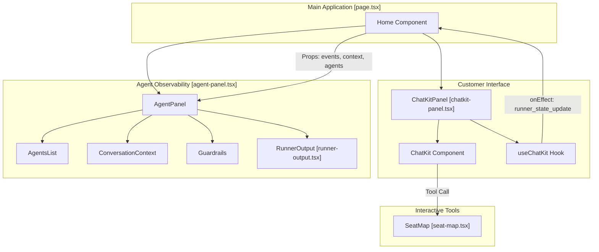
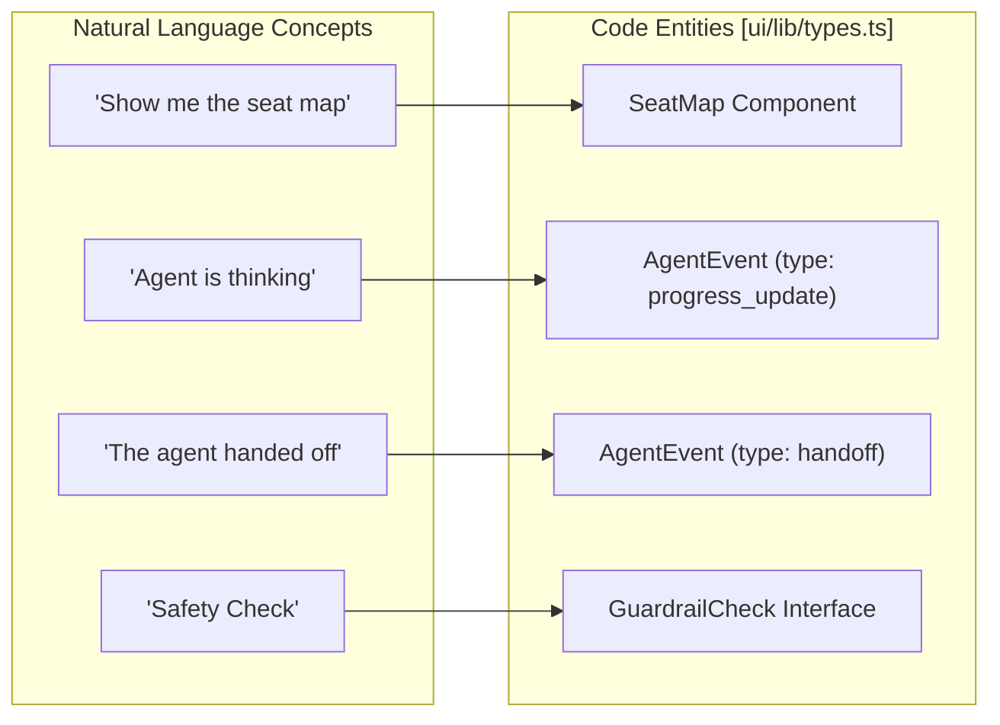
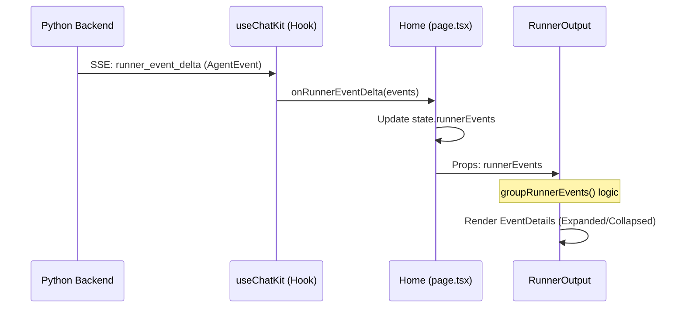

<!-- source: DeepWiki mcp.deepwiki.com · repo openai/openai-cs-agents-demo · page 4.1 UI Components · fetched 2026-10-26 -->

# UI Components

Relevant source files

The following files were used as context for generating this wiki page:

- [ui/components/agent-panel.tsx](ui/components/agent-panel.tsx)
- [ui/components/agents-list.tsx](ui/components/agents-list.tsx)
- [ui/components/chatkit-panel.tsx](ui/components/chatkit-panel.tsx)
- [ui/components/conversation-context.tsx](ui/components/conversation-context.tsx)
- [ui/components/runner-output.tsx](ui/components/runner-output.tsx)
- [ui/components/seat-map.tsx](ui/components/seat-map.tsx)

This page documents the React components that form the Customer Service Agents Demo interface. The frontend is divided into two primary sections: the **Customer View** (powered by OpenAI ChatKit) and the **Agent View** (an observability dashboard for monitoring agent state, events, and guardrails).

## Component Architecture Overview

The application utilizes a split-panel layout where the `Home` component coordinates state between the customer-facing chat and the internal agent monitoring tools.

### Data Flow and Component Hierarchy

Sources: [ui/components/agent-panel.tsx:18-53](), [ui/components/chatkit-panel.tsx:18-104](), [ui/components/runner-output.tsx:16-18]()

## Customer Interface Components

### ChatKitPanel
The `ChatKitPanel` serves as the primary interface for the customer. It wraps the `@openai/chatkit-react` library and initializes the `useChatKit` hook to manage the connection to the backend.

- **Hook Configuration**: Configures the API endpoint `/chatkit` and the `CHATKIT_DOMAIN_KEY` [ui/components/chatkit-panel.tsx:26-30]().
- **Event Handling**: Uses `onEffect` to listen for custom events from the backend runner, such as `runner_state_update` and `runner_event_delta`, which are used to synchronize the Agent View [ui/components/chatkit-panel.tsx:72-85]().
- **Start Screen**: Provides suggested prompts for "Change my seat", "Flight status", and "Missed connection" to guide the user [ui/components/chatkit-panel.tsx:49-63]().

Sources: [ui/components/chatkit-panel.tsx:1-104]()

### SeatMap
The `SeatMap` is an interactive component used when an agent triggers a seat selection tool. It visualizes three cabin classes: Business, Economy Plus, and Economy [ui/components/seat-map.tsx:12-19]().

- **Interaction**: Users can click available seats (emerald) to trigger `onSeatSelect`. Occupied seats (gray) are disabled [ui/components/seat-map.tsx:36-50]().
- **Special Features**: Identifies exit rows (yellow) which may have specific agent-enforced requirements [ui/components/seat-map.tsx:27]().

Sources: [ui/components/seat-map.tsx:1-140]()

## Agent Observability Components

### AgentPanel
The `AgentPanel` is the container for the "Agent View". It filters incoming stream events to remove standard messages and progress updates, focusing purely on agent logic (handoffs, tool calls, context changes) [ui/components/agent-panel.tsx:26-28]().

### RunnerOutput
This component visualizes the event stream from the `openai-agents` SDK. It includes complex grouping logic to pair tool calls with their respective outputs.

- **Grouping Logic**: The `groupRunnerEvents` function iterates through events, bundling `tool_call` events with subsequent `tool_output` events from the same agent to provide a cohesive UI view [ui/components/runner-output.tsx:65-87]().
- **Event Formatting**:
    - **Handoffs**: Visualizes the source and target agent [ui/components/runner-output.tsx:91-92]().
    - **Context Updates**: Displays key-value pairs of changes to the conversation state [ui/components/runner-output.tsx:103-109]().
    - **Tool Calls**: Displays function names and arguments with JSON syntax highlighting when expanded [ui/components/runner-output.tsx:115-204]().

Sources: [ui/components/runner-output.tsx:1-204]()

### AgentsList & ConversationContext
- **AgentsList**: Displays all available agents in the system. It highlights the currently `activeAgent` and uses grayscale to dim agents that are not reachable via a handoff from the current agent [ui/components/agents-list.tsx:25-34]().
- **ConversationContext**: Renders the `AirlineAgentChatContext`. It formats complex objects and arrays into readable strings, allowing developers to see the current state of variables like `passenger_name`, `flight_number`, or `needs_hotel` [ui/components/conversation-context.tsx:12-33]().

Sources: [ui/components/agents-list.tsx:14-56](), [ui/components/conversation-context.tsx:11-73]()

## Guardrails Display

The `Guardrails` component (rendered within `AgentPanel`) visualizes the safety and relevance checks performed on user input.

- **Input Guardrails**: Lists the guardrails configured for the active agent (e.g., "relevance", "jailbreak") [ui/components/agent-panel.tsx:45-48]().
- **Status Visualization**: Shows whether a check passed or was "triggered" (tripped). If a guardrail trips, the UI typically indicates a refusal state.

## Implementation Details

### Mapping System Names to Code Entities

The following diagram bridges the conceptual "Natural Language" requirements of the airline demo to the specific TypeScript entities implemented in the UI.

Sources: [ui/lib/types.ts:1-50](), [ui/components/seat-map.tsx:29-104]()

### Component Data Flow (Event Streaming)

This diagram tracks how a backend `AgentEvent` is processed and displayed in the `RunnerOutput`.

Sources: [ui/components/chatkit-panel.tsx:76-78](), [ui/components/runner-output.tsx:65-87](), [ui/components/runner-output.tsx:115-140]()

---

