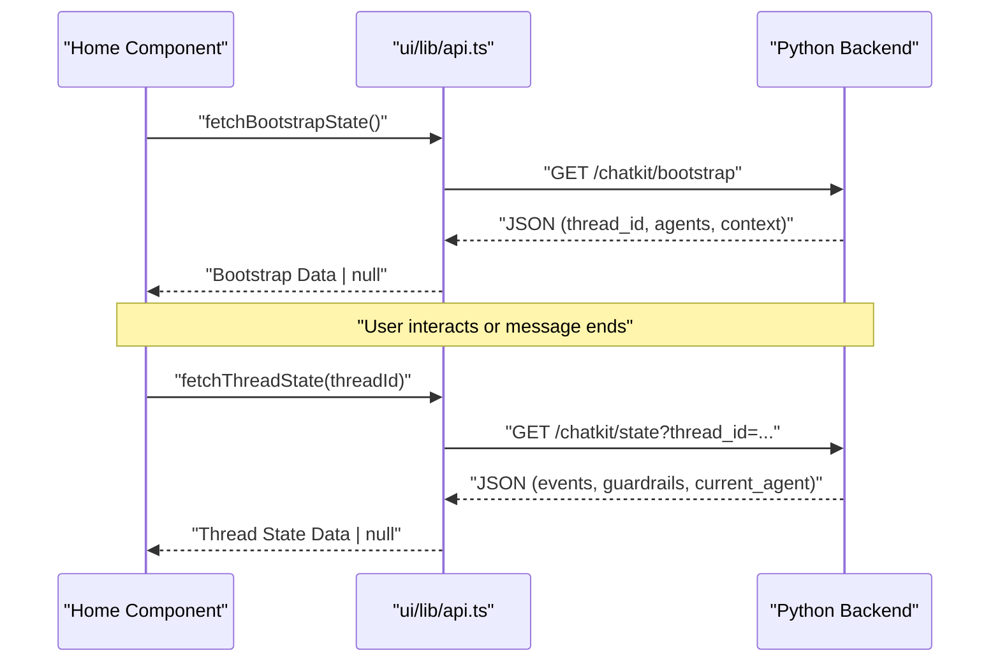
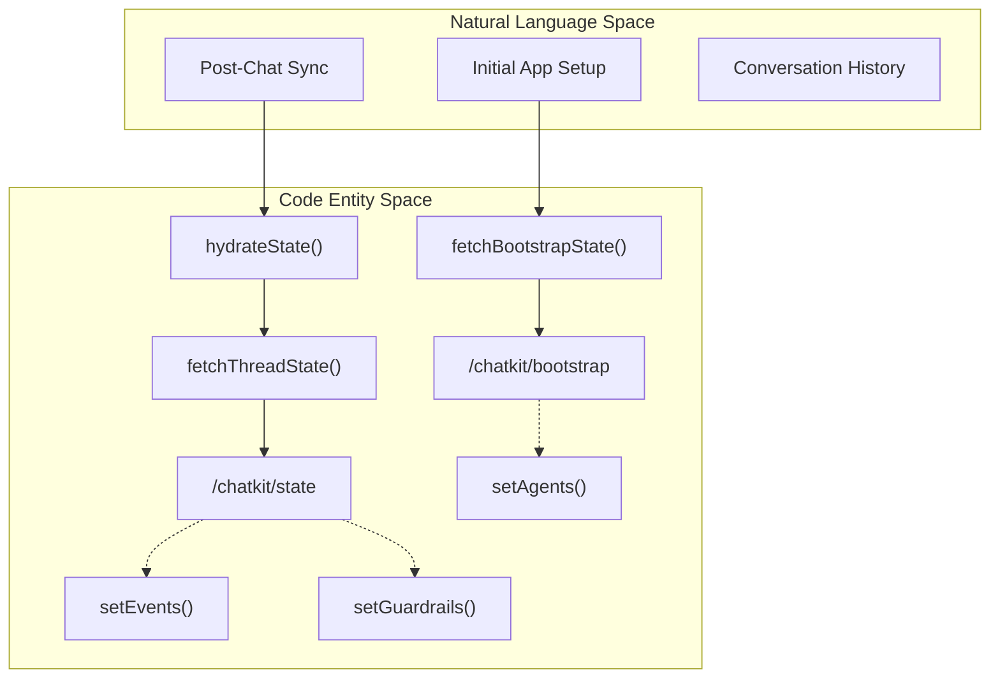
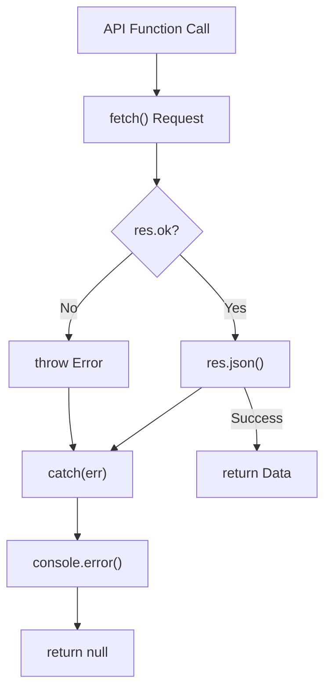
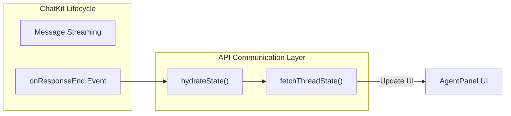

<!-- source: DeepWiki mcp.deepwiki.com · repo openai/openai-cs-agents-demo · page 4.2 API Communication Layer · fetched 2026-10-26 -->

# API Communication Layer

Relevant source files

The following files were used as context for generating this wiki page:

- [ui/app/page.tsx](ui/app/page.tsx)
- [ui/lib/api.ts](ui/lib/api.ts)

## Purpose and Scope

The API Communication Layer, primarily implemented in `ui/lib/api.ts`, handles all client-side HTTP communication between the Next.js frontend and the Python backend. This layer provides functions to fetch the initial application state and retrieve detailed thread information, which are essential for keeping the UI synchronized with the multi-agent system's state.

It abstracts the low-level `fetch` operations and provides error handling for the state synchronization functionality used by the `Home` component and the observability panels.

Sources: [ui/lib/api.ts:1-23]()

## Core API Functions

The communication layer provides two primary functions for state management: `fetchBootstrapState` and `fetchThreadState`.

### State Retrieval Functions

| Function | Endpoint | Purpose |
|----------|----------|---------|
| `fetchBootstrapState` | `/chatkit/bootstrap` | Retrieves initial thread ID, available agents, and current context on application load. |
| `fetchThreadState` | `/chatkit/state` | Retrieves the full history of events, guardrail checks, and current agent for a specific thread. |

### Implementation Detail
Both functions use the standard browser `fetch` API. They include basic error handling that logs to the console and returns `null` if the request fails or returns a non-OK status code.

Sources: [ui/lib/api.ts:2-22]()

## Data Flow and UI Synchronization

The `Home` component in `ui/app/page.tsx` acts as the central orchestrator, using the API layer to populate the application state.

### Hydration Mechanism

The frontend uses a "pull" model to synchronize state after complex agent operations:

1.  **Initial Load**: `useEffect` calls `fetchBootstrapState` to set the initial `threadId`, `agents`, and `context`. [ui/app/page.tsx:67-95]()
2.  **Thread Updates**: The `hydrateState` function is called whenever the `threadId` changes. [ui/app/page.tsx:61-65]()
3.  **Post-Response Sync**: The `handleResponseEnd` callback triggers `hydrateState` after a chat interaction finishes, ensuring the Agent Panel reflects the latest handoffs and tool outputs. [ui/app/page.tsx:105-107]()

### State Mapping (Natural Language to Code)

This diagram maps the conceptual "State" elements to the specific TypeScript entities and API functions that manage them.

Sources: [ui/lib/api.ts:2-22](), [ui/app/page.tsx:35-59](), [ui/app/page.tsx:105-107]()

## Error Handling and Resilience

The API layer is designed to fail silently regarding the UI, returning `null` to prevent crashes while logging errors for developers.

### Error Handling Flow

The `Home` component explicitly checks for these `null` returns before attempting to update React state, preventing undefined property access. [ui/app/page.tsx:38-38](), [ui/app/page.tsx:70-70]()

Sources: [ui/lib/api.ts:7-10](), [ui/lib/api.ts:18-21]()

## Integration with ChatKit

While `ui/lib/api.ts` handles custom state fetching, it works in tandem with the `@openai/chatkit` library. The `ChatKitPanel` manages the actual message streaming, and the `onResponseEnd` prop bridges the ChatKit lifecycle back to the custom API layer to refresh the "Agent View" panels.

Sources: [ui/app/page.tsx:105-107](), [ui/app/page.tsx:121-121]()

---

