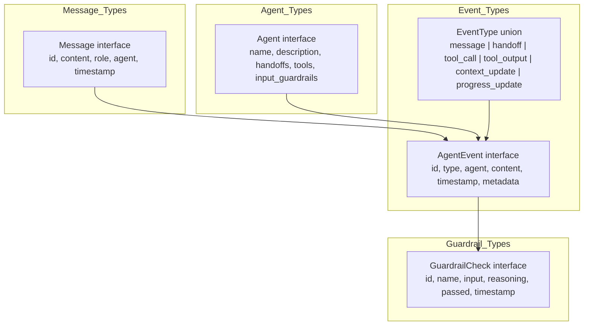
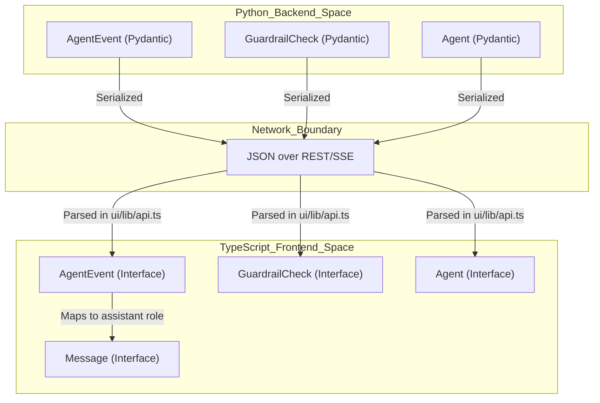

<!-- source: DeepWiki mcp.deepwiki.com · repo openai/openai-cs-agents-demo · page 4.3 Type System · fetched 2026-10-26 -->

# Type System

<details>
<summary>Relevant source files</summary>

The following files were used as context for generating this wiki page:

- [ui/lib/types.ts](ui/lib/types.ts)

</details>


## Purpose and Scope

This document covers the TypeScript type definitions that provide type safety and structure for the frontend application's data models in `ui/lib/types.ts`. These types serve as the frontend contract for Pydantic models defined in the Python backend (such as `AgentEvent` and `GuardrailCheck`), ensuring seamless data flow through the REST API to the React components.

For information about the API communication layer that uses these types, see [API Communication Layer](4.2). For details about the UI components that consume these types, see [UI Components](4.1).

## Core Type Architecture

The type system is organized around four primary domains: messaging, agent definitions, event tracking, and guardrail validation.

**Type System Overview**


Sources: [ui/lib/types.ts:1-53]()

## Message Interface

The `Message` interface represents individual chat messages in the conversation flow. It supports both user messages and assistant responses with optional agent attribution.

| Property | Type | Description |
|----------|------|-------------|
| `id` | `string` | Unique identifier for the message |
| `content` | `string` | The actual message text content |
| `role` | `"user" \| "assistant"` | Identifies sender type |
| `agent` | `string?` | Optional agent name for assistant messages |
| `timestamp` | `Date` | When the message was created |

The `role` field follows standard message format conventions, distinguishing between user inputs and assistant responses. The optional `agent` field enables the UI to attribute specific responses to specialized agents (e.g., "Triage Agent" or "Flight Information Agent").

Sources: [ui/lib/types.ts:1-7]()

## Agent Interface

The `Agent` interface defines the structure for agent metadata, including capabilities and integration points within the multi-agent system.

| Property | Type | Description |
|----------|------|-------------|
| `name` | `string` | Agent identifier |
| `description` | `string` | Human-readable agent purpose |
| `handoffs` | `string[]` | List of agents this agent can transfer to |
| `tools` | `string[]` | Available tool identifiers |
| `input_guardrails` | `string[]` | Guardrail identifiers for input validation |

The `handoffs` array enables the routing visualization in the `AgentsList` and `AgentPanel` components by defining possible agent transitions.

Sources: [ui/lib/types.ts:9-16]()

## Event Tracking System

The event system provides detailed tracking of agent activities, flowing from the backend's `AgentEvent` Pydantic model.

### EventType Union

```typescript
export type EventType =
  | "message"
  | "handoff"
  | "tool_call"
  | "tool_output"
  | "context_update"
  | "progress_update"
```

This union type constrains event types to valid agent operations, ensuring type safety when the `RunnerOutput` component processes the event stream.

Sources: [ui/lib/types.ts:18-24]()

### AgentEvent Interface

The `AgentEvent` interface captures all agent activities with comprehensive metadata support. This interface is the primary data structure for the "Agent View" panel.

| Property | Type | Description |
|----------|------|-------------|
| `id` | `string` | Unique event identifier |
| `type` | `EventType` | Event classification |
| `agent` | `string` | Agent that generated the event |
| `content` | `string` | Event description or content |
| `timestamp` | `Date` | Event occurrence time |
| `metadata` | `object?` | Optional structured data |

The `metadata` object is a flexible container that supports different data structures based on the `type`:

- **Handoffs**: Uses `source_agent` and `target_agent` [ui/lib/types.ts:33-34]().
- **Tools**: Uses `tool_name`, `tool_args`, and `tool_result` [ui/lib/types.ts:35-37]().
- **Context**: Uses `context_key`, `context_value`, and `changes` [ui/lib/types.ts:38-40]().

Sources: [ui/lib/types.ts:26-43]()

## Guardrail Validation Types

The `GuardrailCheck` interface structures validation results from the backend guardrail system. When a user sends a message, it is processed through guardrails defined in `backend/guardrails.py`, and the results are sent to the frontend as `GuardrailCheck` objects.

| Property | Type | Description |
|----------|------|-------------|
| `id` | `string` | Unique check identifier |
| `name` | `string` | Guardrail name (e.g., "relevance", "jailbreak") |
| `input` | `string` | Input text that was validated |
| `reasoning` | `string` | Explanation of validation logic |
| `passed` | `boolean` | Validation result |
| `timestamp` | `Date` | Validation time |

Sources: [ui/lib/types.ts:45-52]()

## Data Flow: Backend to Frontend

The following diagram illustrates how these types bridge the gap between Python backend models and the React frontend.

**Natural Language to Code Entity Mapping**


Sources: [ui/lib/types.ts:1-53]()

## Implementation Details

The type system in `ui/lib/types.ts` is designed for high-fidelity observability:

1. **Metadata Extensibility**: The `metadata` field in `AgentEvent` includes an `icon` property [ui/lib/types.ts:41](), allowing the UI to render specific visual cues for different tool calls or status updates.
2. **Tool Arguments**: `tool_args` is typed as `Record<string, any>` [ui/lib/types.ts:36](), accommodating the various schemas of agent tools (e.g., `update_seat` vs `book_new_flight`).
3. **Context Tracking**: The `changes` field [ui/lib/types.ts:40]() allows the frontend to visualize exactly what changed in the global `ConversationContext` after an agent execution.

Sources: [ui/lib/types.ts:32-42]()

---

