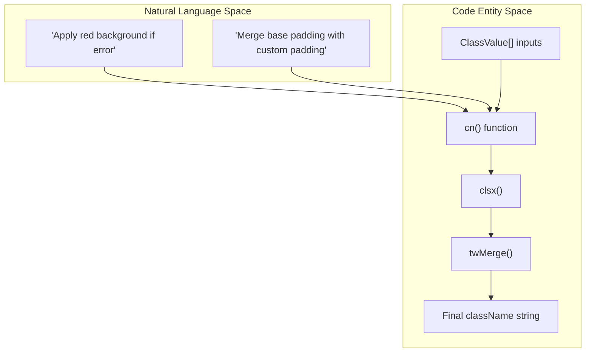
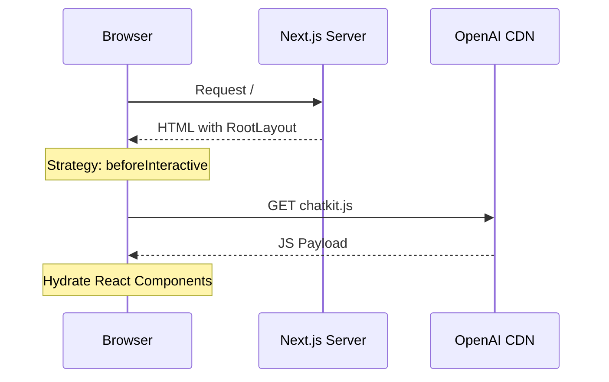
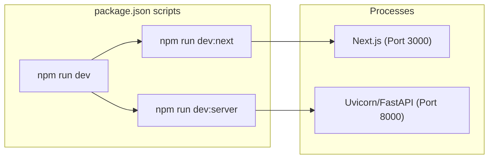

<!-- source: DeepWiki mcp.deepwiki.com · repo openai/openai-cs-agents-demo · page 4.4 Utility Functions and Configuration · fetched 2026-10-26 -->

# Utility Functions and Configuration

Relevant source files

The following files were used as context for generating this wiki page:

- [.gitignore](.gitignore)
- [ui/app/layout.tsx](ui/app/layout.tsx)
- [ui/lib/utils.ts](ui/lib/utils.ts)
- [ui/next-env.d.ts](ui/next-env.d.ts)
- [ui/next.config.mjs](ui/next.config.mjs)
- [ui/package-lock.json](ui/package-lock.json)
- [ui/package.json](ui/package.json)
- [ui/tsconfig.json](ui/tsconfig.json)

This document provides a comprehensive technical overview of the utility functions, environment configuration, and build system for the Customer Service Agents Demo. It covers the frontend styling utilities, the Next.js framework configuration, TypeScript settings, and the orchestration scripts that manage the full-stack lifecycle.

## Purpose and Scope

The configuration layer ensures that the Next.js frontend and Python backend operate as a unified system. This includes managing CSS class conflicts, proxying API requests to the FastAPI server, injecting necessary external scripts for the OpenAI ChatKit, and providing a streamlined development workflow through `package.json` scripts.

## CSS Class Management System

The core utility function is the `cn` function located in [ui/lib/utils.ts:4-6](). This function provides intelligent CSS class name concatenation and merging specifically designed for Tailwind CSS workflows.

### Implementation Detail

The `cn` function combines two libraries to create a robust styling solution:
- **clsx**: Handles conditional class name construction [ui/lib/utils.ts:1]().
- **tailwind-merge**: Resolves Tailwind CSS class conflicts (e.g., ensuring `px-4` is overridden by `px-6`) [ui/lib/utils.ts:2]().

**Bridging Logic to Utility Implementation**
Sources: [ui/lib/utils.ts:1-7]()

## Next.js Configuration and Proxying

The application uses a Next.js configuration [ui/next.config.mjs:2-21]() to manage environment behavior and API routing. A critical feature is the `rewrites` configuration, which acts as a reverse proxy to the Python backend.

### API Rewrite Strategy
To avoid Cross-Origin Resource Sharing (CORS) issues during development and simplify client-side fetching, specific paths are proxied from the Next.js server (port 3000) to the FastAPI server (port 8000).

| Source Path | Destination (Backend) | Purpose |
| :--- | :--- | :--- |
| `/chat` | `http://127.0.0.1:8000/chat` | Main streaming chat endpoint [ui/next.config.mjs:8-10]() |
| `/chatkit` | `http://127.0.0.1:8000/chatkit` | ChatKit state management [ui/next.config.mjs:12-14]() |
| `/chatkit/:path*` | `http://127.0.0.1:8000/chatkit/:path*` | Wildcard for ChatKit sub-resources [ui/next.config.mjs:16-18]() |

Sources: [ui/next.config.mjs:5-20]()

## Root Layout and Script Injection

The `RootLayout` component in [ui/app/layout.tsx:17-33]() defines the global structure of the application and handles the injection of the OpenAI ChatKit library.

### ChatKit Script Strategy
The application injects the `chatkit.js` script using the Next.js `Script` component with the `beforeInteractive` strategy [ui/app/layout.tsx:25-28](). This ensures the ChatKit global objects are available before the React hydration process completes.

**ChatKit Injection Lifecycle**
Sources: [ui/app/layout.tsx:22-31]()

## TypeScript Configuration

The `tsconfig.json` file defines the compilation boundaries and type safety rules. Notably, it includes specific type definitions for the OpenAI ChatKit to ensure IDE support and build-time validation.

- **Target**: `ES6` [ui/tsconfig.json:5]().
- **Module Resolution**: `bundler` [ui/tsconfig.json:11]().
- **Path Aliases**: Uses `@/*` to map to the root directory for cleaner imports [ui/tsconfig.json:21-23]().
- **Type Inclusions**: Explicitly includes `@openai/chatkit` types [ui/tsconfig.json:24]().

Sources: [ui/tsconfig.json:1-28]()

## Full-Stack Execution Scripts

The `ui/package.json` file contains scripts to run both the frontend and backend concurrently, simplifying the development environment setup.

### Development Workflow
The `npm run dev` command utilizes the `concurrently` package to spawn two sub-processes [ui/package.json:8]():
1.  **`dev:next`**: Runs the Next.js development server [ui/package.json:6]().
2.  **`dev:server`**: Navigates to the `python-backend` directory and starts the Uvicorn server on port 8000 [ui/package.json:7]().

**Process Orchestration**
Sources: [ui/package.json:5-12]()

## Key Dependencies

The frontend relies on several critical packages for its operation:
- **OpenAI Integration**: `@openai/chatkit` and `@openai/chatkit-react` [ui/package.json:14-15]().
- **UI Components**: Radix UI primitives for accessible components like `scroll-area` [ui/package.json:16-17]().
- **Styling**: `tailwindcss`, `lucide-react` for icons, and `motion` for animations [ui/package.json:19-21, 38]().

Sources: [ui/package.json:13-31]()

---

