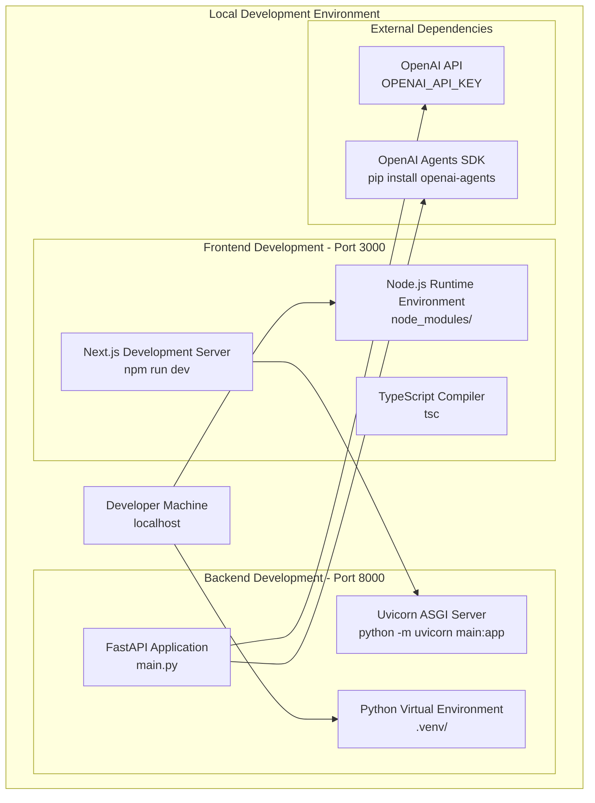
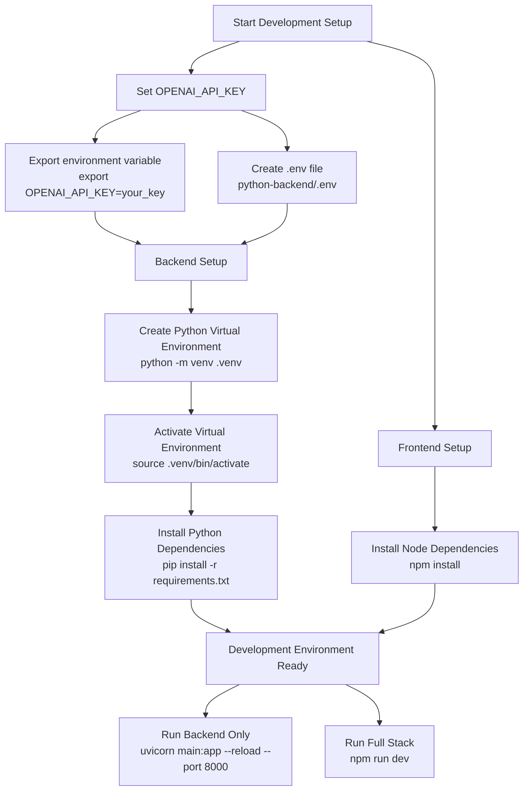
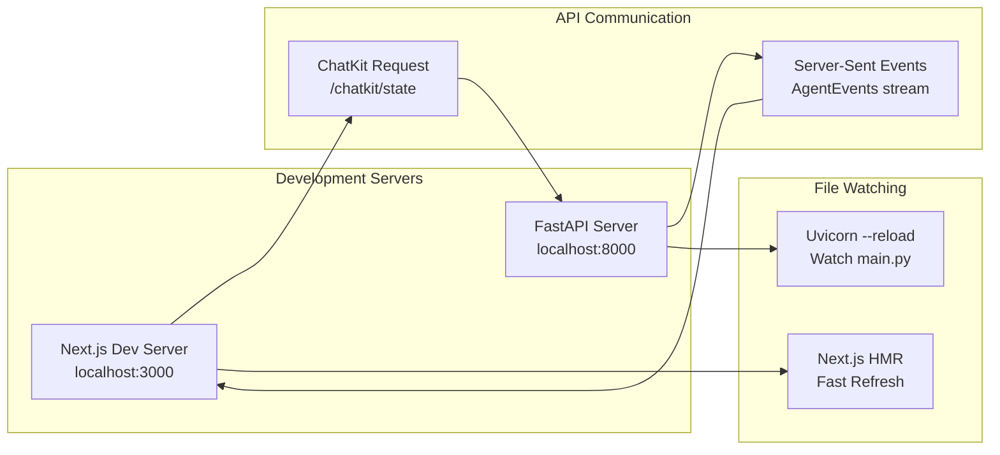

<!-- source: DeepWiki mcp.deepwiki.com · repo openai/openai-cs-agents-demo · page 5 Development Environment · fetched 2026-10-26 -->

# Development Environment

<details>
<summary>Relevant source files</summary>

The following files were used as context for generating this wiki page:

- [README.md](README.md)
- [ui/package.json](ui/package.json)

</details>


This document covers the development environment setup, technology stack, and development workflow for the Customer Service Agents Demo repository. It provides instructions for setting up a local development environment, configuring dependencies, and running the application components.

For information about specific technologies used, see [Technology Stack](#5.1). For step-by-step installation, see [Setup and Configuration](#5.2).

## Technology Stack Overview

The Customer Service Agents Demo uses a modern full-stack architecture with a FastAPI backend and a Next.js frontend.

### Development Environment Architecture



**Sources:** [README.md:7-13](), [README.md:57-79](), [ui/package.json:6-8]()

### Development Technology Stack

| Component | Technology | Purpose | Configuration |
|-----------|------------|---------|---------------|
| **Frontend Framework** | Next.js 15 | React-based UI application | `npm run dev` on port 3000 |
| **Frontend Language** | TypeScript | Type-safe JavaScript development | `tsconfig.json` |
| **Backend Framework** | FastAPI | Python web API framework | `uvicorn main:app` on port 8000 |
| **Backend Runtime** | Python 3.x | Server-side application runtime | Virtual environment in `.venv/` |
| **Agent Framework** | OpenAI Agents SDK | Agent orchestration and management | `pip install -r requirements.txt` |
| **Package Management** | npm + pip | Frontend and backend dependencies | `package.json` and `requirements.txt` |

**Sources:** [README.md:9-13](), [README.md:37-53](), [ui/package.json:13-31]()

## Development Setup Process

### Environment Configuration Flow



**Sources:** [README.md:17-53](), [ui/package.json:5-12]()

### High-Level Setup Summary

1.  **OpenAI API Key**: Required for the Agents SDK. Can be set via `export` or a `.env` file in `python-backend/`.
2.  **Backend Dependencies**: Requires a Python virtual environment and installation of requirements.
3.  **Frontend Dependencies**: Requires Node.js and `npm install` within the `ui/` directory.

For detailed, step-by-step instructions, see [Setup and Configuration](#5.2).

**Sources:** [README.md:19-53]()

## Running the Application

### Application Startup Options

The development environment supports two primary execution modes:

#### Backend-Only Development
Used for testing the agent logic or API endpoints independently.
```bash
cd python-backend
python -m uvicorn main:app --reload --port 8000
```
**Sources:** [README.md:59-67]()

#### Full-Stack Development
The recommended way to run the demo. This uses the `concurrently` package to launch both servers.
```bash
cd ui
npm run dev
```
This starts the Next.js frontend at `http://localhost:3000` and the Python backend at `http://localhost:8000`.

**Sources:** [README.md:69-79](), [ui/package.json:8]()

### Development Server Communication



**Sources:** [README.md:55-79](), [ui/package.json:5-12]()

## Customization and Extension

The development environment is designed for experimentation. Developers are encouraged to:

*   **Modify Agent Prompts**: Update the instructions for specialized agents like the `Triage Agent` or `FAQ Agent`.
*   **Extend Tools**: Add new Python functions to the backend and expose them to agents.
*   **Adjust Guardrails**: Modify `guardrails.py` to change how the system handles off-topic or malicious input.
*   **Update UI**: Customize the React components in the `ui/` folder to change the dashboard or chat experience.

For details on the technologies involved in these customizations, see [Technology Stack](#5.1).

**Sources:** [README.md:81-92]()

---

