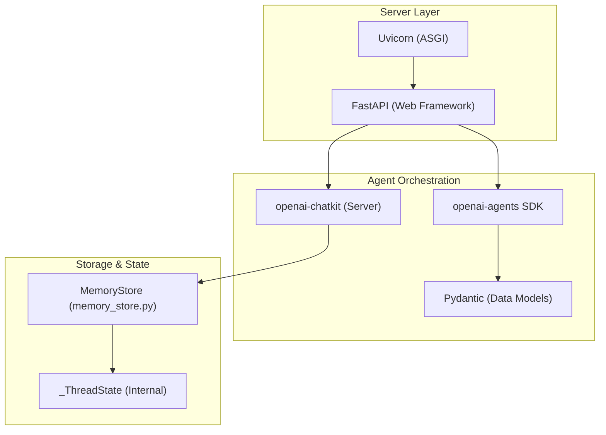
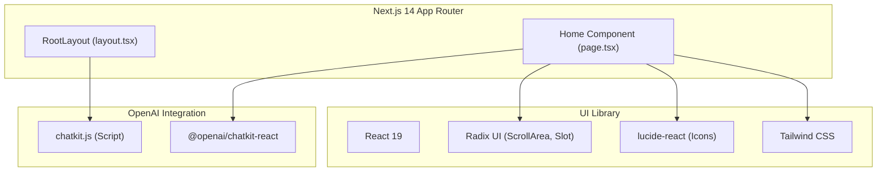

<!-- source: DeepWiki mcp.deepwiki.com · repo openai/openai-cs-agents-demo · page 5.1 Technology Stack · fetched 2026-10-26 -->

# Technology Stack

Relevant source files

The following files were used as context for generating this wiki page:

- [python-backend/memory_store.py](python-backend/memory_store.py)
- [python-backend/requirements.txt](python-backend/requirements.txt)
- [ui/app/layout.tsx](ui/app/layout.tsx)
- [ui/package.json](ui/package.json)
- [ui/tsconfig.json](ui/tsconfig.json)

This document details the complete technology stack used in the OpenAI Customer Service Agents Demo. The application uses a decoupled architecture consisting of a Python backend for agent orchestration and a Next.js frontend for the user interface.

## Backend Technology Stack

The backend is a Python application that leverages the OpenAI Agents SDK and ChatKit to manage complex, multi-agent conversations.

### Core Backend Components

**Backend Dependency Roles:**

| Dependency | Role | Implementation Detail |
|------------|------|-----------------------|
| `openai-agents` | Agent Orchestration | Provides the framework for defining `Agent` objects, handoffs, and tool execution. [python-backend/requirements.txt:1]() |
| `openai-chatkit` | Conversation Management | Handles the persistence and retrieval of chat threads and items. [python-backend/requirements.txt:2]() |
| `fastapi` | API Layer | Exposes REST and SSE endpoints for the frontend to communicate with the agent system. [python-backend/requirements.txt:4]() |
| `uvicorn` | ASGI Server | Provides the high-performance production server to run the FastAPI application. [python-backend/requirements.txt:5]() |
| `pydantic` | Data Validation | Defines schemas for agent context, events, and API responses. [python-backend/requirements.txt:3]() |

### State Management Implementation

The backend uses a custom `MemoryStore` class to manage conversation state without requiring an external database.

*   **`MemoryStore`**: Implements the `Store` interface from `openai-chatkit`. It manages `_threads` and `_attachments` in-memory dictionaries. [python-backend/memory_store.py:18-23]()
*   **`_ThreadState`**: A dataclass that bundles `ThreadMetadata` with a list of `ThreadItem` objects. [python-backend/memory_store.py:12-16]()
*   **Pagination**: The store implements cursor-based pagination using the `after` and `limit` parameters in `load_threads` and `load_thread_items`. [python-backend/memory_store.py:60-87](), [python-backend/memory_store.py:103-127]()

Sources: [python-backend/requirements.txt:1-6](), [python-backend/memory_store.py:1-175]()

## Frontend Technology Stack

The frontend is built with Next.js 14, providing a real-time dashboard for interacting with and observing the agent orchestration.

### Core Frontend Components

**Frontend Dependency Roles:**

| Dependency | Role | Implementation Detail |
|------------|------|-----------------------|
| `next` | Framework | Uses the App Router for routing and optimized builds. [ui/package.json:22]() |
| `@openai/chatkit-react` | UI Components | Provides hooks like `useChatKit` for managing the chat interface. [ui/package.json:15]() |
| `typescript` | Type Safety | Ensures consistency between backend Pydantic models and frontend interfaces. [ui/package.json:39]() |
| `tailwind-merge` / `clsx` | Styling | Utilities for dynamic CSS class management. [ui/package.json:19](), [ui/package.json:28]() |
| `radix-ui` | Accessible UI | Provides primitive components like `ScrollArea` for the chat and log panels. [ui/package.json:16-17]() |

### Script Injection Strategy

The frontend injects the OpenAI ChatKit library via the `RootLayout` to ensure it is available globally before components mount.

*   **`RootLayout`**: Uses the Next.js `Script` component with `strategy="beforeInteractive"` to load `chatkit.js` from the OpenAI CDN. [ui/app/layout.tsx:25-28]()
*   **TypeScript Integration**: The `tsconfig.json` includes `@openai/chatkit` in the `types` array to provide global type definitions for the injected script. [ui/tsconfig.json:24]()

Sources: [ui/package.json:13-31](), [ui/app/layout.tsx:1-33](), [ui/tsconfig.json:1-29]()

## Development Infrastructure

The project is configured for a unified development experience, allowing both backend and frontend to run concurrently.

### Build and Execution Scripts

The `package.json` in the `ui` directory acts as the primary entry point for development:

*   **`npm run dev:next`**: Starts the Next.js development server. [ui/package.json:6]()
*   **`npm run dev:server`**: Navigates to the backend directory and starts `uvicorn` with hot-reload enabled on port 8000. [ui/package.json:7]()
*   **`npm run dev`**: Uses the `concurrently` package to run both the frontend and backend servers with a single command. [ui/package.json:8]()

### Environment Configuration

The application requires environment variables for API communication:
1.  `OPENAI_API_KEY`: Required by the backend `openai-agents` SDK.
2.  `NEXT_PUBLIC_CHATKIT_DOMAIN_KEY`: Required by the frontend to authenticate with the ChatKit service.

Sources: [ui/package.json:5-12](), [python-backend/requirements.txt:1-6]()

---

