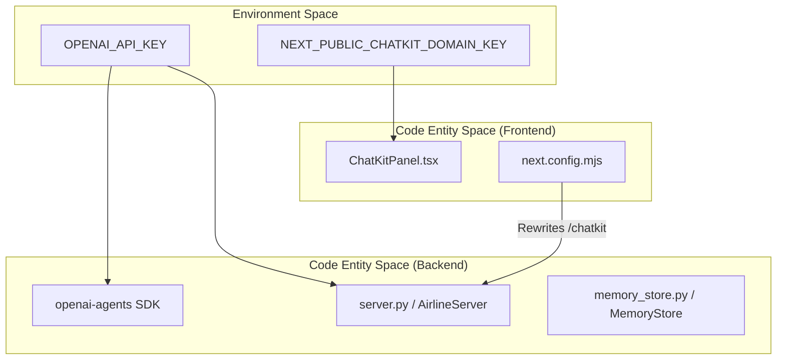
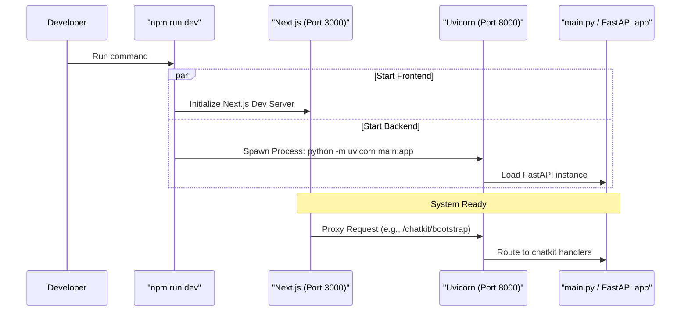

<!-- source: DeepWiki mcp.deepwiki.com · repo openai/openai-cs-agents-demo · page 5.2 Setup and Configuration · fetched 2026-10-26 -->

# Setup and Configuration

<details>
<summary>Relevant source files</summary>

The following files were used as context for generating this wiki page:

- [README.md](README.md)
- [python-backend/memory_store.py](python-backend/memory_store.py)
- [python-backend/requirements.txt](python-backend/requirements.txt)
- [ui/next.config.mjs](ui/next.config.mjs)

</details>


## Purpose and Scope

This document provides technical instructions for setting up the development environment and configuring the Customer Service Agents Demo. It covers repository cloning, dependency management for the Python backend and Next.js frontend, and the configuration of essential environment variables like `OPENAI_API_KEY` and `NEXT_PUBLIC_CHATKIT_DOMAIN_KEY`.

## Prerequisites

The application requires the following components:

| Component | Purpose | Version Requirements |
|-----------|---------|---------------------|
| Python | Backend orchestration logic | 3.10+ recommended |
| Node.js | Frontend UI and ChatKit integration | 18+ recommended |
| npm | Node package management | 9+ |
| OpenAI API Key | LLM and Agents SDK access | Valid API key |

## Environment Configuration

### Required Environment Variables

The system relies on two primary environment variables for operation:

1.  **`OPENAI_API_KEY`**: Used by the Python backend to authenticate with OpenAI services [README.md:19-25]().
2.  **`NEXT_PUBLIC_CHATKIT_DOMAIN_KEY`**: Required by the frontend to initialize the ChatKit interface for the customer chat panel.

### Configuration Methods

**Method 1: Terminal Environment Variables**
```bash
export OPENAI_API_KEY=your_api_key
export NEXT_PUBLIC_CHATKIT_DOMAIN_KEY=your_domain_key
```
[README.md:21-25]()

**Method 2: Local `.env` File**
You can place an `.env` file in the `python-backend/` folder. Note that you must ensure `python-dotenv` is utilized to load these variables into the environment [README.md:29-35]().

### Setup Data Flow: Environment to Code

The following diagram bridges the "Natural Language" configuration space to the specific "Code Entities" that consume these variables.


Sources: [README.md:19-35](), [ui/next.config.mjs:5-20](), [python-backend/memory_store.py:18-21]()

---

## Backend Setup

### 1. Dependency Installation
The backend uses a standard Python workflow. It is recommended to use a virtual environment to isolate the dependencies listed in `requirements.txt` [README.md:37-46]().

```bash
cd python-backend
python -m venv .venv
source .venv/bin/activate  # Windows: .venv\Scripts\activate
pip install -r requirements.txt
```

### 2. Backend Dependencies
The `requirements.txt` file specifies the core orchestration and API stack:
- `openai-agents`: The framework for multi-agent orchestration [python-backend/requirements.txt:1]().
- `openai-chatkit`: Provides the server-side implementation for the ChatKit protocol [python-backend/requirements.txt:2]().
- `fastapi` & `uvicorn`: The web server and ASGI implementation [python-backend/requirements.txt:4-5]().
- `pydantic`: Data validation for agent contexts and event types [python-backend/requirements.txt:3]().

### 3. In-Memory State Configuration
The backend initializes a `MemoryStore` class which implements the `chatkit.store.Store` interface [python-backend/memory_store.py:18-19](). This class manages `_ThreadState` objects in-memory, handling thread persistence and item pagination without requiring an external database [python-backend/memory_store.py:13-15]().

---

## Frontend Setup

### 1. Dependency Installation
The frontend is a Next.js application. Install the Node.js dependencies from the `ui` directory [README.md:48-53]().

```bash
cd ui
npm install
```

### 2. Proxy Configuration
The frontend is configured via `next.config.mjs` to proxy specific requests to the Python backend (running on port 8000). This prevents CORS issues during development [ui/next.config.mjs:2-21]().

| Source Path | Destination | Purpose |
| :--- | :--- | :--- |
| `/chat` | `http://127.0.0.1:8000/chat` | Main agent interaction endpoint [ui/next.config.mjs:8-10]() |
| `/chatkit/:path*` | `http://127.0.0.1:8000/chatkit/:path*` | ChatKit state and bootstrap endpoints [ui/next.config.mjs:12-18]() |

---

## Running the Application

### The Unified Command
The most efficient way to run the full stack is from the `ui` directory:

```bash
cd ui
npm run dev
```
[README.md:69-75]()

This command executes the `dev` script in `package.json`, which concurrently starts:
1.  **Next.js Development Server**: Runs on `http://localhost:3000`.
2.  **Python Backend (Uvicorn)**: Runs on `http://localhost:8000` via the `main:app` entry point [README.md:61-64]().

### Execution Lifecycle Diagram

This diagram maps the execution commands to the resulting processes and their communication ports.


Sources: [README.md:55-79](), [ui/next.config.mjs:5-20]()

## Troubleshooting Configuration

| Symptom | Cause | Resolution |
| :--- | :--- | :--- |
| `NotFoundError` in ChatKit | Thread ID mismatch in `MemoryStore` | Ensure the frontend is sending a valid thread ID; restart backend to clear in-memory state [python-backend/memory_store.py:44-46](). |
| 404 on `/chat` | Backend not running | Verify Uvicorn is active on port 8000 [README.md:64-67](). |
| Missing UI Styles | Tailwind not compiled | Ensure `npm install` was successful in the `ui` directory [README.md:52-53](). |
| Refusal Messages | Guardrail Tripwire | Check if input violates the Relevance or Jailbreak guardrails [README.md:135-146](). |

Sources: [README.md:17-80](), [python-backend/memory_store.py:1-50](), [ui/next.config.mjs:1-23]()

---

